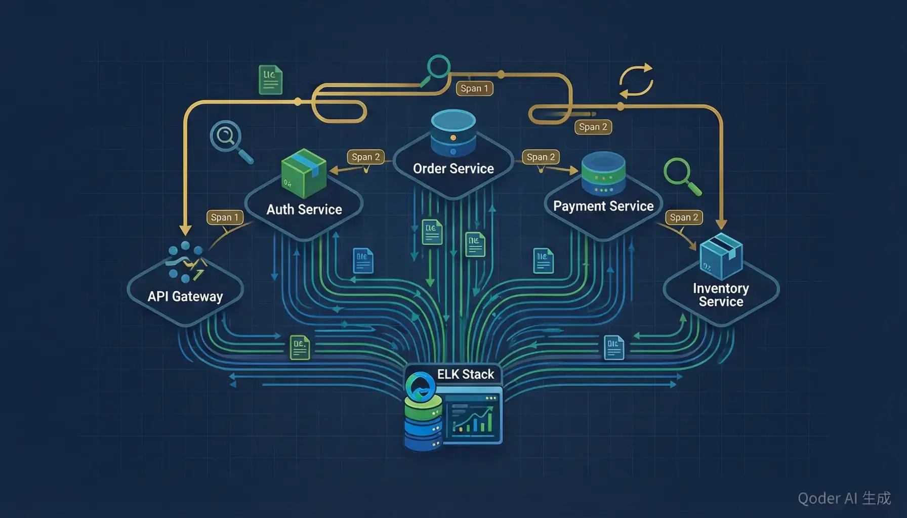

# 日志聚合与链路追踪



> **版本**：v2.0  
> 内容更新时间：2026-10-06 · 学习阶段：高级 · 预计用时：65 分钟

> **适用人群**：初学者 / 运维工程师 / 后端开发者  
> **前置知识**：了解基本的 Linux 命令、Docker 容器、微服务概念

---

## 一、课程概述

在现代微服务架构中，一个用户请求可能经过网关、认证服务、订单服务、库存服务、支付服务等多个组件。当系统出现问题时，如何快速定位故障？答案就是——**日志聚合**与**链路追踪**。

如果把微服务系统比作一座大型快递分拣中心，那么：

- **日志聚合**就像每个工位上的监控摄像头，记录每一步操作的详细信息。
- **链路追踪**就像快递包裹上的物流追踪号，让你能看到包裹从发货到收货的完整路径。

本课程将带你从零搭建一套完整的可观测性（Observability）系统，让你对系统的运行状态了如指掌。

---

## 二、日志级别与结构化日志

### 2.1 什么是日志级别

日志级别就像你在笔记本上用不同颜色笔做标记：红色代表紧急、黄色代表注意、蓝色代表普通记录。

常见的日志级别从低到高：

| 级别 | 含义 | 使用场景 |
|------|------|----------|
| `TRACE` | 最详细的调试信息 | 开发阶段排查复杂问题 |
| `DEBUG` | 调试信息 | 开发/测试环境 |
| `INFO` | 一般信息 | 记录正常业务流程 |
| `WARN` | 警告信息 | 可能出问题但还能运行 |
| `ERROR` | 错误信息 | 功能异常但不影响整体 |
| `FATAL` | 致命错误 | 系统即将崩溃 |

### 2.2 结构化日志

传统日志是一行文本，难以解析。结构化日志把每条日志变成 JSON 格式，方便机器处理。

**非结构化日志（难以解析）**：

```text
2024-01-15 10:23:45 INFO [order-service] User 12345 created order ORD-789 with total 299.00
```

**结构化日志（JSON 格式）**：

```json
{
  "timestamp": "2024-01-15T10:23:45.000Z",
  "level": "INFO",
  "service": "order-service",
  "traceId": "abc123def456",
  "userId": 12345,
  "action": "create_order",
  "orderId": "ORD-789",
  "totalAmount": 299.00,
  "message": "User 12345 created order ORD-789"
}
```

### 2.3 Python 结构化日志示例

```python
import logging
import json
from datetime import datetime

class StructuredFormatter(logging.Formatter):
    """将日志格式化为 JSON 结构化输出"""
    def format(self, record):
        log_entry = {
            "timestamp": datetime.utcfromtimestamp(record.created).isoformat() + "Z",
            "level": record.levelname,
            "service": "order-service",
            "message": record.getMessage(),
            "module": record.module,
            "function": record.funcName,
        }
        # 合并额外字段
        if hasattr(record, "extra_fields"):
            log_entry.update(record.extra_fields)
        return json.dumps(log_entry, ensure_ascii=False)

logger = logging.getLogger("order-service")
handler = logging.StreamHandler()
handler.setFormatter(StructuredFormatter())
logger.setLevel(logging.DEBUG)
logger.addHandler(handler)

# 使用示例
logger.info("订单创建成功", extra={"extra_fields": {
    "userId": 12345,
    "orderId": "ORD-789",
    "totalAmount": 299.00
}})
```

---

## 三、ELK Stack 架构详解

ELK Stack 是日志聚合领域最经典的解决方案，由三个组件组成：

- **Elasticsearch**：分布式搜索与分析引擎，负责存储和检索日志（相当于"大脑"）。
- **Logstash**：数据处理管道，负责接收、解析、转换日志（相当于"加工厂"）。
- **Kibana**：可视化仪表盘，负责展示和查询日志（相当于"显示屏"）。

### 3.1 架构数据流

```text
应用程序 → Filebeat（轻量采集器）→ Logstash（解析/过滤）→ Elasticsearch（存储/索引）→ Kibana（查询/展示）
```

### 3.2 Docker Compose 部署 ELK

```yaml
# docker-compose.yml - ELK Stack 完整部署
version: "3.8"

services:
  elasticsearch:
    image: docker.elastic.co/elasticsearch/elasticsearch:8.12.0
    container_name: elasticsearch
    environment:
      - discovery.type=single-node
      - xpack.security.enabled=false
      - "ES_JAVA_OPTS=-Xms512m -Xmx512m"
    ports:
      - "9200:9200"
    volumes:
      - es_data:/usr/share/elasticsearch/data
    networks:
      - elk

  logstash:
    image: docker.elastic.co/logstash/logstash:8.12.0
    container_name: logstash
    volumes:
      - ./logstash/pipeline:/usr/share/logstash/pipeline
    ports:
      - "5044:5044"
      - "5000:5000/tcp"
      - "5000:5000/udp"
      - "9600:9600"
    depends_on:
      - elasticsearch
    networks:
      - elk

  kibana:
    image: docker.elastic.co/kibana/kibana:8.12.0
    container_name: kibana
    environment:
      - ELASTICSEARCH_HOSTS=http://elasticsearch:9200
    ports:
      - "5601:5601"
    depends_on:
      - elasticsearch
    networks:
      - elk

volumes:
  es_data:
    driver: local

networks:
  elk:
    driver: bridge
```

### 3.3 Logstash Pipeline 配置

```ruby
# logstash/pipeline/app.conf

input {
  beats {
    port => 5044           # 接收 Filebeat 数据
  }
  tcp {
    port => 5000           # 接收 TCP 日志
    codec => json_lines    # 自动解析 JSON 格式日志
  }
}

filter {
  # 解析应用日志中的 JSON 字段
  if [message] =~ /^\{/ {
    json {
      source => "message"
    }
  }

  # 根据日志级别添加标签
  if [level] == "ERROR" {
    mutate {
      add_tag => [ "error_alert" ]
    }
  }

  # 添加时间戳
  date {
    match => [ "timestamp", "ISO8601" ]
    target => "@timestamp"
  }
}

output {
  elasticsearch {
    hosts => ["http://elasticsearch:9200"]
    index => "app-logs-%{+YYYY.MM.dd}"
  }
  stdout {
    codec => rubydebug       # 调试输出
  }
}
```

---

## 四、Fluentd / Fluent Bit 日志收集

Fluentd 和 Fluent Bit 是 CNCF（云原生计算基金会）毕业项目，比 Filebeat 更加灵活。

**生活类比**：如果 Logstash 是一台大型工业洗衣机（功能强大但笨重），那 Fluent Bit 就是一个便携手持清洁器（轻量高效，适合边缘场景）。

### 4.1 Fluent Bit 配置

```ini
# fluent-bit.conf

[SERVICE]
    Flush        5           # 每 5 秒刷新一次缓冲区
    Daemon       off
    Log_Level    info
    Parsers_File parsers.conf

[INPUT]
    Name         tail        # 从文件尾部读取
    Path         /var/log/containers/*.log
    Parser       docker       # 使用 docker 解析器
    Tag          kube.*       # 添加 Kubernetes 标签
    Mem_Buf_Limit 5MB         # 内存缓冲上限

[FILTER]
    Name         kubernetes   # 自动注入 Pod 元数据
    Match        kube.*
    Merge_Log    On           # 合并容器日志中的 JSON

[OUTPUT]
    Name         es           # 输出到 Elasticsearch
    Match        *
    Host         elasticsearch
    Port         9200
    Index        fluentbit
    Type         _doc
```

### 4.2 自定义 Parser

```ini
# parsers.conf

[PARSER]
    Name        docker
    Format      json
    Time_Key    time
    Time_Format %Y-%m-%dT%H:%M:%S.%L

[PARSER]
    Name        nginx_access
    Format      regex
    Regex       ^(?<remote>[^ ]*) - (?<user>[^ ]*) \[(?<time>[^\]]*)\] "(?<method>\S+)(?: +(?<path>[^\"]*?)(?: +\S*)?)?" (?<code>[^ ]*) (?<size>[^ ]*)
    Time_Key    time
    Time_Format %d/%b/%Y:%H:%M:%S %z
```

---

## 五、日志解析与过滤

### 5.1 Grok 模式解析非结构化日志

Grok 是 Logstash 内置的模式匹配工具，可以用正则表达式从非结构化文本中提取字段。就像用模板从一封格式不固定的信件中提取关键信息。

```ruby
# Logstash Grok 过滤器配置
filter {
  grok {
    match => {
      "message" => "%{TIMESTAMP_ISO8601:timestamp} %{LOGLEVEL:level} \[%{DATA:service}\] %{GREEDYDATA:log_message}"
    }
  }
}
```

**Grok 常用模式**：

```text
%{TIMESTAMP_ISO8601}  →  2024-01-15T10:23:45.000Z
%{LOGLEVEL}           →  INFO, ERROR, WARN ...
%{IP}                 →  192.168.1.100
%{NUMBER}             →  12345, 3.14
%{DATA}               →  匹配任意非贪婪数据
%{GREEDYDATA}         →  匹配任意数据（贪婪模式）
%{WORD}               →  匹配单个单词
%{URI}                →  匹配完整 URL
```

### 5.2 条件过滤

```ruby
# 条件过滤示例
filter {
  # 丢弃健康检查日志（减少噪音）
  if [path] =~ /healthcheck/ {
    drop { }
  }

  # 为错误日志添加告警标记
  if [level] == "ERROR" or [level] == "FATAL" {
    mutate {
      add_field => { "alert_needed" => "true" }
      add_tag => [ "critical" ]
    }
  }

  # 对特定服务的日志做特殊处理
  if [service] == "payment-service" {
    # 脱敏：隐藏信用卡号
    mutate {
      gsub => [ "message", "\d{4}-\d{4}-\d{4}-(\d{4})", "****-****-****-\1" ]
    }
  }
}
```

---

## 六、链路追踪核心概念

### 6.1 什么是链路追踪

**生活类比——快递包裹的全程追踪**：

当你在网上下单后，包裹会经过：仓库拣货 → 分拣中心 → 运输中转 → 配送站 → 快递员派送 → 签收。每一步都有扫描记录，你可以随时查看包裹到了哪里、在哪个环节停留了多久。

链路追踪就是给每个用户请求一个"追踪号"（Trace ID），记录它经过每个服务的完整路径和耗时。

### 6.2 三大核心概念

| 概念 | 类比 | 说明 |
|------|------|------|
| **Trace** | 一个快递包裹的完整旅程 | 一个请求从入口到结束的完整调用链 |
| **Span** | 旅程中的每一段（如仓库到分拣中心） | 单个服务或操作的处理过程，包含开始时间、持续时间 |
| **Context Propagation** | 包裹上的追踪条码 | 在微服务之间传递追踪信息的机制 |

### 6.3 Trace 和 Span 的结构

```text
Trace ID: abc123
├── Span 1: API Gateway (50ms)
│   ├── Span 2: Auth Service (10ms)
│   └── Span 3: Order Service (35ms)
│       ├── Span 4: Inventory Service (15ms)
│       └── Span 5: Payment Service (18ms)
```

每个 Span 包含：
- `traceId`：所属 Trace 的唯一标识
- `spanId`：当前 Span 的唯一标识
- `parentSpanId`：父 Span 的标识（用于构建调用树）
- `operationName`：操作名称
- `startTime` / `duration`：开始时间和持续时长
- `tags` / `logs`：附加信息

---

## 七、Jaeger 架构与部署

Jaeger 是 Uber 开源的分布式追踪系统，现在是 CNCF 毕业项目。

### 7.1 Jaeger 架构组件

```text
应用程序 → Jaeger Client → Jaeger Agent → Jaeger Collector → Cassandra/Elasticsearch（存储）→ Jaeger Query → Jaeger UI
```

- **Jaeger Agent**：部署在每个主机上的守护进程，接收应用发送的 Span 数据
- **Jaeger Collector**：接收 Agent 转发数据，写入存储后端
- **Jaeger Query**：提供 API 查询追踪数据
- **Jaeger UI**：可视化追踪结果的 Web 界面

### 7.2 Docker 部署 Jaeger（All-in-One）

```yaml
# docker-compose.yml - Jaeger 部署
version: "3.8"

services:
  jaeger:
    image: jaegertracing/all-in-one:1.54
    container_name: jaeger
    environment:
      - COLLECTOR_OTLP_ENABLED=true       # 启用 OTLP 协议
      - SPAN_STORAGE_TYPE=elasticsearch   # 使用 ES 存储
      - ES_SERVER_URLS=http://elasticsearch:9200
    ports:
      - "5775:5775/udp"       # Jaeger Thrift 协议
      - "6831:6831/udp"       # Jaeger Compact 协议
      - "6832:6832/udp"       # Jaeger Binary 协议
      - "16686:16686"         # Jaeger UI
      - "14268:14268"         # Jaeger Collector HTTP
      - "4317:4317"           # OTLP gRPC
      - "4318:4318"           # OTLP HTTP
    depends_on:
      - elasticsearch
    networks:
      - elk

networks:
  elk:
    external: true
```

---

## 八、OpenTelemetry 统一标准

OpenTelemetry（简称 OTel）是 CNCF 项目，统一了链路追踪、指标收集和日志记录的标准。你可以把它理解为"可观测性领域的 USB 接口标准"——不管你用什么品牌的设备，只要符合 OTel 标准就能即插即用。

### 8.1 为什么需要 OpenTelemetry

在 OTel 出现之前，Jaeger、Zipkin、SkyWalking 各有各的 SDK，切换追踪系统需要改代码。OpenTelemetry 提供统一 API，让你一次集成、多平台导出。

### 8.2 Python + OpenTelemetry 集成

```python
# otel_setup.py - OpenTelemetry 初始化配置
from opentelemetry import trace
from opentelemetry.sdk.trace import TracerProvider
from opentelemetry.sdk.trace.export import BatchSpanProcessor
from opentelemetry.exporter.otlp.proto.grpc.trace_exporter import OTLPSpanExporter
from opentelemetry.sdk.resources import Resource
from opentelemetry.semconv.resource import ResourceAttributes

# 定义服务资源（就像给追踪系统一个"身份证"）
resource = Resource.create({
    ResourceAttributes.SERVICE_NAME: "order-service",
    ResourceAttributes.SERVICE_VERSION: "1.0.0",
    "deployment.environment": "production"
})

# 创建 Tracer Provider
provider = TracerProvider(resource=resource)

# 配置 OTLP 导出器（发送到 Jaeger 或 Collector）
otlp_exporter = OTLPSpanExporter(
    endpoint="http://jaeger:4317",
    insecure=True
)

# 添加批量 Span 处理器
provider.add_span_processor(BatchSpanProcessor(otlp_exporter))

# 设置为全局 Tracer Provider
trace.set_tracer_provider(provider)

# 获取 Tracer 实例
tracer = trace.get_tracer("order-service.tracer")
```

### 8.3 在业务代码中使用 Tracer

```python
# order_service.py - 业务代码中使用链路追踪
from opentelemetry import trace

tracer = trace.get_tracer(__name__)

def create_order(user_id: int, items: list, total_amount: float):
    """创建订单 - 自动记录 Span"""
    with tracer.start_as_current_span("create_order") as span:
        span.set_attribute("user.id", user_id)
        span.set_attribute("order.item_count", len(items))
        span.set_attribute("order.total_amount", total_amount)

        # 调用库存服务
        with tracer.start_as_current_span("check_inventory") as child_span:
            inventory_ok = check_inventory(items)
            child_span.set_attribute("inventory.available", inventory_ok)

        if not inventory_ok:
            span.set_status(trace.StatusCode.ERROR, "库存不足")
            raise ValueError("库存不足")

        # 调用支付服务
        with tracer.start_as_current_span("process_payment") as child_span:
            payment_id = process_payment(user_id, total_amount)
            child_span.set_attribute("payment.id", payment_id)

        order_id = save_order(user_id, items, total_amount)
        span.set_attribute("order.id", order_id)
        return order_id
```

### 8.4 自动注入（Auto-Instrumentation）

OpenTelemetry 支持自动为常见库添加追踪，无需手动修改代码：

```python
# auto_instrumentation.py
from opentelemetry.instrumentation.flask import FlaskInstrumentor
from opentelemetry.instrumentation.requests import RequestsInstrumentor
from opentelemetry.instrumentation.sqlalchemy import SQLAlchemyInstrumentor

# 自动追踪 Flask 请求
FlaskInstrumentor().instrument()

# 自动追踪 HTTP 请求（requests 库）
RequestsInstrumentor().instrument()

# 自动追踪 SQL 查询
SQLAlchemyInstrumentor().instrument()
```

---

## 九、与微服务集成

### 9.1 Spring Cloud Sleuth + Zipkin（Java 生态）

```yaml
# application.yml - Spring Boot 配置
spring:
  application:
    name: order-service
  sleuth:
    sampler:
      probability: 1.0          # 100% 采样率（生产环境建议 0.1 即 10%）
  zipkin:
    base-url: http://jaeger:9411
    sender:
      type: web                  # 使用 HTTP 发送 Span
```

```java
// OrderController.java - Spring Boot 控制器
@RestController
@RequestMapping("/api/orders")
public class OrderController {

    private final Tracer tracer;  // Sleuth 自动注入

    @PostMapping
    public Order createOrder(@RequestBody OrderRequest request) {
        // 创建自定义 Span
        Span span = tracer.spanBuilder("createOrder").startSpan();
        try (Tracer.SpanInScope ws = tracer.withSpanInScope(span)) {
            span.tag("user.id", String.valueOf(request.getUserId()));
            Order order = orderService.create(request);
            span.tag("order.id", order.getId());
            return order;
        } finally {
            span.end();
        }
    }
}
```

### 9.2 Istio 自动注入 Sidecar

Istio 服务网格可以在不修改代码的情况下自动注入链路追踪。就像在高速公路的每个出入口安装自动收费站，车辆（请求）经过时自动记录。

```yaml
# istio-tracing.yaml - Istio Telemetry 配置
apiVersion: telemetry.istio.io/v1alpha1
kind: Telemetry
metadata:
  name: mesh-default
  namespace: istio-system
spec:
  tracing:
    - randomSamplingPercentage: 100.0   # 采样率
      customTags:
        env:
          literal:
            value: production
  metrics:
    reportingInterval: 10s
```

```bash
# 为命名空间启用 Sidecar 自动注入
kubectl label namespace default istio-injection=enabled

# 部署应用后，Istio 会自动注入 Envoy Sidecar
kubectl apply -f deployment.yaml
```

---

## 十、实战：搭建完整的日志链路追踪系统

### 10.1 完整架构

```text
                        ┌──────────────┐
                        │   Kibana     │  ← 日志查询
                        │  :5601       │
                        └──────┬───────┘
                               │
┌──────────┐  ┌──────────┐  ┌──┴───────────┐  ┌──────────┐
│  App 1   │→│Fluent Bit│→│Elasticsearch │←│  Jaeger  │
│  App 2   │  │          │  │  :9200       │  │  :16686  │
│  App 3   │  └──────────┘  └──────────────┘  └──────────┘
└──────────┘        ↑               ↑                ↑
                    │               │                │
              日志文件          结构化日志        OTLP Span
```

### 10.2 完整 Docker Compose

```yaml
# docker-compose-full.yml - 完整可观测性平台
version: "3.8"

services:
  # ===== 基础设施 =====
  elasticsearch:
    image: docker.elastic.co/elasticsearch/elasticsearch:8.12.0
    environment:
      - discovery.type=single-node
      - xpack.security.enabled=false
      - "ES_JAVA_OPTS=-Xms512m -Xmx512m"
    ports:
      - "9200:9200"
    volumes:
      - es_data:/usr/share/elasticsearch/data

  # ===== 日志聚合 =====
  logstash:
    image: docker.elastic.co/logstash/logstash:8.12.0
    volumes:
      - ./logstash/pipeline:/usr/share/logstash/pipeline
    ports:
      - "5044:5044"
      - "5000:5000/tcp"
    depends_on:
      - elasticsearch

  kibana:
    image: docker.elastic.co/kibana/kibana:8.12.0
    environment:
      - ELASTICSEARCH_HOSTS=http://elasticsearch:9200
    ports:
      - "5601:5601"
    depends_on:
      - elasticsearch

  # ===== 链路追踪 =====
  jaeger:
    image: jaegertracing/all-in-one:1.54
    environment:
      - COLLECTOR_OTLP_ENABLED=true
    ports:
      - "16686:16686"
      - "4317:4317"
      - "4318:4318"

  # ===== 应用服务 =====
  order-service:
    build: ./services/order-service
    environment:
      - OTEL_EXPORTER_OTLP_ENDPOINT=http://jaeger:4317
      - OTEL_SERVICE_NAME=order-service
      - LOG_LEVEL=INFO
    ports:
      - "8080:8080"
    depends_on:
      - jaeger
      - logstash

  payment-service:
    build: ./services/payment-service
    environment:
      - OTEL_EXPORTER_OTLP_ENDPOINT=http://jaeger:4317
      - OTEL_SERVICE_NAME=payment-service
    ports:
      - "8081:8081"
    depends_on:
      - jaeger

volumes:
  es_data:
```

### 10.3 验证系统运行

```bash
# 1. 启动所有服务
docker compose -f docker-compose-full.yml up -d

# 2. 检查各组件健康状态
curl http://localhost:9200/_cluster/health     # Elasticsearch
curl http://localhost:5601/api/status           # Kibana
curl http://localhost:16686/api/services        # Jaeger

# 3. 发送测试请求
curl -X POST http://localhost:8080/api/orders \
  -H "Content-Type: application/json" \
  -d '{"userId": 12345, "items": [{"sku": "ITEM-001", "qty": 2}]}'

# 4. 查看追踪结果
# 打开浏览器访问 http://localhost:16686 查看 Jaeger UI
# 打开浏览器访问 http://localhost:5601 查看 Kibana 日志
```

---

## 十一、最佳实践

### 11.1 日志最佳实践

1. **统一日志格式**：全公司使用 JSON 结构化日志，字段命名规范一致
2. **合理设置日志级别**：生产环境用 INFO，避免 DEBUG 日志淹没有用信息
3. **包含上下文信息**：每条日志都要包含 `traceId`、`service`、`userId` 等关键字段
4. **日志脱敏**：信用卡号、密码、身份证号等敏感信息必须脱敏处理
5. **日志轮转**：设置日志保留策略，避免磁盘空间耗尽

### 11.2 链路追踪最佳实践

1. **采样策略**：开发环境 100% 采样，生产环境建议 1%-10%（高流量系统）
2. **Span 命名规范**：使用 `HTTP GET /api/orders` 而非 `/api/orders/12345`，避免高基数问题
3. **设置合理的超时**：Span 超时避免长时间挂起的 Trace
4. **关联日志与追踪**：在日志中包含 `traceId`，实现日志和追踪的交叉查询

---

## 十二、常见问题排查

| 问题 | 可能原因 | 解决方案 |
|------|----------|----------|
| 日志丢失 | Fluent Bit 内存缓冲溢出 | 增大 `Mem_Buf_Limit`，检查输出端是否正常 |
| Kibana 查不到日志 | 索引模式不匹配 | 检查 Logstash 输出索引名与 Kibana 索引模式 |
| Jaeger 看不到 Trace | OTLP 端口未开放 | 确认 4317/4318 端口映射正确 |
| Trace 不完整 | 服务间 Context 未传递 | 检查 HTTP Header 中 `traceparent` 是否正确传播 |
| Elasticsearch 性能差 | 索引分片不合理 | 按天创建索引，合理设置分片数和副本数 |

---

## 十三、复习清单

完成本课程后，请确认你能够回答以下问题：

- [ ] **日志级别**：能说出 6 个日志级别及其适用场景，并解释为什么生产环境不建议使用 DEBUG 级别
- [ ] **结构化日志**：能将非结构化日志转换为 JSON 格式，并说明结构化日志相比纯文本日志的优势
- [ ] **ELK Stack**：能描述 Elasticsearch、Logstash、Kibana 各自的角色，并画出数据流向图
- [ ] **Fluentd vs Logstash**：能说出两者的区别，以及在什么场景下选择 Fluent Bit
- [ ] **Grok 模式**：能编写基本的 Grok 表达式来解析常见的日志格式
- [ ] **链路追踪三概念**：能用自己的话解释 Trace、Span、Context Propagation，并使用"快递追踪"类比向他人说明
- [ ] **Jaeger 部署**：能使用 Docker Compose 部署 Jaeger 并查看追踪结果
- [ ] **OpenTelemetry**：能解释 OpenTelemetry 解决了什么问题，并在 Python/Java 项目中集成 OTel SDK
- [ ] **微服务集成**：能说明 Spring Cloud Sleuth 和 Istio Sidecar 各自如何实现自动追踪
- [ ] **完整系统**：能独立搭建包含日志聚合 + 链路追踪的完整可观测性平台

---

## 附录：关键术语表

| 术语 | 英文 | 含义 |
|------|------|------|
| 可观测性 | Observability | 通过系统外部输出推断内部状态的能力 |
| 日志聚合 | Log Aggregation | 将分散的日志集中收集和管理 |
| 链路追踪 | Distributed Tracing | 追踪请求在分布式系统中的完整路径 |
| 结构化日志 | Structured Logging | 以固定格式（如 JSON）输出日志 |
| 采样率 | Sampling Rate | 被记录的请求占总请求的比例 |
| 上下文传播 | Context Propagation | 在服务间传递追踪上下文信息 |

---

---

## 考点精讲

### 考点 1

在链路追踪（Distributed Tracing）中，"Trace" 代表什么？

A. 单个服务内部的函数调用  
B. 一个请求从入口到结束的完整调用链路，包含经过的所有服务和耗时
C. 数据库查询的执行计划
D. 网络数据包的路由路径

**正确答案：B**

**详细解释：** Trace 代表一个用户请求在分布式系统中的完整调用路径。例如一个"创建订单"的请求可能经过 API Gateway -> 订单服务 -> 库存服务 -> 支付服务，这整个调用链就是一个 Trace。每个 Trace 有唯一的 Trace ID，由多个 Span 组成，每个 Span 代表单个服务的处理过程和耗时。通过 Trace 可以直观看到请求在哪个环节耗时最长，快速定位性能瓶颈。

---

### 考点 2

OpenTelemetry（OTel）项目解决了什么问题？

A. 提供统一的日志存储方案，把所有服务的日志都写进同一个数据库里查询  
B. 统一了链路追踪、指标收集和日志记录的标准，提供"一次集成、多平台导出"的能力，类似可观测性领域的 USB 接口
C. 替代了所有现有监控工具，接入之后可以卸载 Prometheus 与 Grafana
D. 只负责前端页面的性能监控，采集首屏时间与接口耗时这类指标

**正确答案：B**

**详细解释：** 在 OpenTelemetry 出现之前，Jaeger、Zipkin、SkyWalking 等各有自己的 SDK，如果要切换追踪系统就需要修改代码重新集成。OpenTelemetry 作为 CNCF 项目，提供了统一的标准 API 和 SDK，开发者只需集成一次 OTel，就可以将追踪数据导出到 Jaeger、Zipkin 等多个后端。它统一了三大可观测性支柱（链路追踪、指标、日志）的采集标准，被称为"可观测性领域的 USB 接口"。

---

### 考点 3

在生产环境中，推荐的日志级别设置是什么？为什么？

A. DEBUG——记录尽可能多的信息，方便排查问题
B. INFO——记录正常业务流程的关键信息，避免 DEBUG 日志的噪音淹没有用信息  
C. TRACE——最详细的调试级别，适合生产环境
D. 不设置日志级别，所有日志都输出

**正确答案：B**

**详细解释：** 生产环境推荐使用 INFO 级别。DEBUG 和 TRACE 级别的日志量非常大，会产生大量噪音，不仅增加存储成本，还会让真正重要的 ERROR 和 WARN 信息被淹没，难以快速定位问题。DEBUG 级别适合开发和测试环境使用。正确的做法是：生产环境用 INFO 记录关键业务事件，配合结构化日志（JSON 格式）和 "traceId" 字段，实现高效的日志查询和链路追踪关联。

---

### 考点 4

在 ELK Stack 中，Elasticsearch、Logstash、Kibana 各自承担什么角色？

A. Elasticsearch 负责日志采集，Logstash 负责可视化，Kibana 负责存储  
B. Elasticsearch 负责告警，Logstash 负责日志采集，Kibana 负责日志存储  
C. 三者功能完全相同，互为备份  
D. Elasticsearch 负责分布式存储和检索日志，Logstash 负责接收、解析和转换日志数据，Kibana 负责日志的查询和可视化展示  

**正确答案：D**

**详细解释：** ELK Stack 的完整数据流是：应用程序 -> Filebeat（轻量采集器）-> Logstash（解析/过滤/转换）-> Elasticsearch（分布式存储和全文检索）-> Kibana（Web 可视化仪表盘）。Elasticsearch 是核心存储引擎，提供强大的全文搜索和聚合分析能力。Logstash 是数据处理管道，支持 Grok 模式解析、条件过滤、数据脱敏等。Kibana 提供查询界面和仪表盘，让运维人员可以直观地搜索和分析日志。

---

### 考点 5

Fluent Bit 相比 Fluentd 的主要优势是什么？

A. 功能更丰富，支持更多的输出插件  
B. 只能与 Elasticsearch 配合使用  
C. 完全兼容 Logstash 的所有 Grok 模式  
D. 更轻量级，内存占用更低，适合边缘场景和容器环境中的日志采集  

**正确答案：D**

**详细解释：** Fluent Bit 是 Fluentd 的轻量版本，用 C 语言编写，内存占用极低（通常几 MB），非常适合在资源受限的环境中运行，如 Kubernetes 节点上的日志采集（DaemonSet 部署）。Fluentd 用 Ruby 编写，功能更丰富但资源消耗更大，适合作为集中式日志处理服务器。典型架构是：Fluent Bit 部署在每个节点上采集日志，转发给 Fluentd 进行集中处理和路由。

---

> **课程版本**：v2.0  
> **最后更新**：2026-10-19  
> **配套资源**：Docker Compose 配置文件、示例代码仓库

## 本节知识框架

**课程定位**：分类「devops」· 学习阶段 高级 · 建议用时 55 分钟。

本课主线：搭建 ELK Stack、Jaeger 和 OpenTelemetry 实现日志与链路追踪。

### 复习清单

- [ ] 能不看正文复述本课核心术语，并指出一个边界或反例。
- [ ] 能运行或推演本课示例，记录输入、输出与失败现象。
- [ ] 能完成一次自测，并把错题对照考点精讲定位原因。

## 核心概念定义

| 术语 | 一句话说明 |
| --- | --- |
| ELK | 搭建 ELK Stack、Jaeger 和 OpenTelemetry 实现日志相关：正文给出可操作定义与适用边界。 |
| Jaeger | 搭建 ELK Stack、Jaeger 和 OpenTelemetry 实现日志相关：正文给出可操作定义与适用边界。 |
| OpenTelemetry | 搭建 ELK Stack、Jaeger 和 OpenTelemetry 实现日志相关：正文给出可操作定义与适用边界。 |
| 日志 | 搭建 ELK Stack、Jaeger 和 OpenTelemetry 实现日志相关：正文给出可操作定义与适用边界。 |
| 链路追踪 | 搭建 ELK Stack、Jaeger 和 OpenTelemetry 实现日志相关：正文给出可操作定义与适用边界。 |

## 原理与运行机制

《日志聚合与链路追踪》正文各章按「输入是什么 → 中间如何转换 → 输出到哪 → 失败时怎样表现」四问展开；复习时给每个机制补一句自己的复述，再回到对应章节核对。

## 典型应用场景

- 结合「日志聚合与链路追踪」的常见落地场景与选型边界，详见正文各章节的对比讨论。
- 迁移到新项目时，先明确输入规模、失败代价与可观测手段，再决定采用深度。

## 代码/协议/SQL 示例

《日志聚合与链路追踪》正文首个示例可作为最小验证起点（原样保留在上方章节）：先跑通，再改一个输入观察输出变化。

```text
2024-01-15 10:23:45 INFO [order-service] User 12345 created order ORD-789 with total 299.00
```

## 时间/空间复杂度或性能分析

- 在《日志聚合与链路追踪》里处理规模 n 时，先估计主循环与嵌套层数，再决定优化方向；小样本上的耗时读数不能外推。
- 性能结论要绑定输入分布：换数据规模、并发度或缓存命中情况后须重新测量。

## 常见误区与易错点

| 错误做法 | 典型现象 | 修复方向 |
| --- | --- | --- |
| 只验证正常输入 | 边界数据触发时才暴露问题 | 为每个结论补一个空值/极值/重复值用例 |
| 背结论不跑实验 | 换个输入就失效 | 按「预测—实测—差异归因」三步复盘 |
| 忽略环境与版本差异 | 本机可用线上报错 | 把版本、配置与依赖写入复现步骤 |

## 与其他知识点的关系

本课与分类「devops」内相邻课程互为补充，建议按清单顺序学完再做综合练习。

## 自测题与参考答案

以下题目与题库同源，作答后再看解析；错误项要能说出错在哪一步。

## 术语速查

| 术语 | 一句话说明 |
| --- | --- |
| ELK | Elasticsearch、Logstash、Kibana 组成的日志收集分析技术栈。 |
| Jaeger | Uber 开源的分布式追踪系统，采集 Span 后用 UI 还原调用链。 |
| OpenTelemetry | CNCF 制定的可观测性数据标准，一次埋点可导出到多种后端。 |
| 日志 | 带时间戳与级别的运行记录，格式化为 JSON 后便于检索统计。 |
| 链路追踪 | 用 Trace ID 串起请求跨服务的每一跳，定位耗时与故障环节。 |

## 参考资料与复核

- 官方/权威资料：[OpenSSF 最佳实践](https://bestpractices.coreinfrastructure.org/)
- 主题延伸：[Jaeger 官方文档](https://www.jaegertracing.io/docs/2.0/)
- 最后复核：2026-10-04
- 下次复核：2027-02-22

## 内容元数据

- 内容更新时间：2026-10-06

- 内容版本：v2.0
- 课程标识：devops_logging_tracing
- 所属分类：devops
- 学习阶段：高级
- 建议用时：55 分钟
