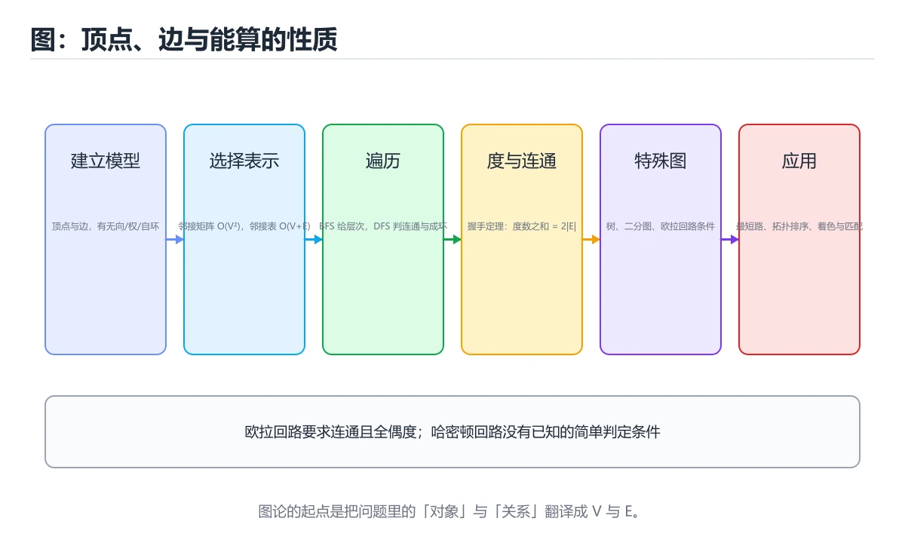

# 图论基础



> 内容更新时间：2026-10-06 · 学习阶段：进阶 · 预计用时：35 分钟

## 本节知识框架

### 学习目标
- 掌握图的基本定义与分类（有向/无向/加权）
- 理解路径、回路、连通性等核心概念
- 学会识别欧拉路径和哈密顿路径
- 掌握树的结构性质与应用
- 理解图着色问题与最短路径算法

### 前置知识
- 集合论基础
- 关系与函数（关系是图的抽象基础）
- 基本数据结构（栈、队列）

### 复习清单
- [ ] 能否用邻接矩阵和邻接表表示图？
- [ ] 能否判断一个图是否存在欧拉回路？
- [ ] 能否用Dijkstra算法求最短路径？
- [ ] 能否判断一棵二叉树是否为平衡树？

## 核心概念定义

| 术语 | 一句话说明 |
|------|-----------|
| 图 | 由顶点集V和边集E组成的结构G=(V,E) |
| 有向图 | 边有方向的图，边表示为有序对(u,v) |
| 无向图 | 边无方向的图，边表示为无序对{u,v} |
| 加权图 | 每条边附带权重（代价）的图 |
| 路径 | 顶点序列，相邻顶点间有边相连 |
| 回路 | 起点和终点相同的路径 |
| 连通图 | 任意两个顶点间都存在路径的图 |
| 欧拉路径 | 经过每条边恰好一次的路径 |
| 哈密顿路径 | 经过每个顶点恰好一次的路径 |
| 树 | 无环连通图，n个顶点恰好n-1条边 |
| 图着色 | 给顶点着色使相邻顶点颜色不同 |

## 原理与运行机制

### 生活类比：城市交通网络

把图想象成城市地图：
- **顶点**：城市中的地标建筑或交叉路口
- **边**：连接两个路口的道路
- **有向图**：单行道——只能从一个方向走
- **无向图**：双行道——两个方向都可以走
- **加权图**：每条路上标注了距离或通行时间
- **路径**：从A到B的行走路线
- **最短路径**：距离最短的行走路线
- **树**：没有环路的道路网络（像树枝一样分叉但不会绕回来）

### 图的存储结构

```text
邻接矩阵（适合稠密图）：
    v1 v2 v3 v4
v1 [ 0  1  0  1 ]
v2 [ 1  0  1  0 ]
v3 [ 0  1  0  1 ]
v4 [ 1  0  1  0 ]

邻接表（适合稀疏图）：
v1 → [v2, v4]
v2 → [v1, v3]
v3 → [v2, v4]
v4 → [v1, v3]
```

### 图的分类

```text
按边的方向：
  无向图：边无方向 {u,v}
  有向图：边有方向 (u,v)，u→v

按边的权重：
  无权图：边没有权重
  加权图：边有权重 w(u,v)

按边的数量：
  简单图：无自环、无重边
  多重图：允许重边
  完全图：任意两点间都有边，边数 = n(n-1)/2

特殊图：
  二分图：顶点可分为两组，边只连接不同组的顶点
  平面图：可以画在平面上边不交叉的图
```

### 欧拉路径与哈密顿路径

```text
欧拉路径（遍历所有边）：
  存在条件（无向图）：
    欧拉回路：所有顶点度数为偶数
    欧拉通路：恰好2个顶点度数为奇数（起点和终点）
  
  例：柯尼斯堡七桥问题
  四个区域度数分别为3,3,3,5（全奇数）→ 无欧拉路径

哈密顿路径（遍历所有顶点）：
  存在条件：没有简洁的充要条件（NP完全问题）
  充分条件（Dirac定理）：n≥3的简单图中，
    每个顶点度数≥n/2，则存在哈密顿回路
```

### 树的性质

```text
等价定义（以下任一条件成立则图是树）：
1. 连通且无环
2. 连通且有n-1条边
3. 无环且有n-1条边
4. 任意两点间有唯一路径
5. 删除任意一条边则不连通
6. 任意两点间加一条边则产生唯一环

特殊树：
  二叉树：每个节点最多2个子节点
  完全二叉树：除最后一层外每层都满
  平衡二叉树：左右子树高度差不超过1
  生成树：包含图所有顶点的树子图
```

## 典型应用场景

### 社交网络分析
```text
图模型：用户=顶点，好友关系=边
应用：
  - 最短路径：两人之间的最短介绍链（六度分隔）
  - 连通分量：朋友圈/社群检测
  - 图着色：活动分组（相邻好友不同组）
  - 中心性分析：找出网络中的关键人物
```

### 路由算法（网络协议）
```text
OSPF协议使用Dijkstra算法：
  路由器=顶点，链路=加权边（延迟/带宽）
  每个路由器计算到所有目的地的最短路径
  构建最短路径树用于数据转发
```

### 编译器依赖分析
```text
模块依赖构成有向图：
  A依赖B → 有向边 A→B
  环检测：有向环=循环依赖（编译错误）
  拓扑排序：确定编译顺序
  强连通分量：需要一起重构的模块组
```

### 地图着色与调度
```text
图着色应用：
  - 地图着色：相邻区域不同颜色（四色定理）
  - 考试调度：冲突课程不同时间段
  - 寄存器分配：冲突变量不同寄存器
  - 频率分配：相邻基站不同频率
```

## 代码示例

### 最小示例：图的BFS遍历

```python
from collections import deque

def bfs(graph, start):
    """广度优先搜索"""
    visited = set([start])
    queue = deque([start])
    order = []
    
    while queue:
        vertex = queue.popleft()
        order.append(vertex)
        
        for neighbor in graph[vertex]:
            if neighbor not in visited:
                visited.add(neighbor)
                queue.append(neighbor)
    
    return order

# 测试
graph = {
    'A': ['B', 'C'],
    'B': ['A', 'D', 'E'],
    'C': ['A', 'F'],
    'D': ['B'],
    'E': ['B', 'F'],
    'F': ['C', 'E']
}
print("BFS顺序:", bfs(graph, 'A'))
# 输出：['A', 'B', 'C', 'D', 'E', 'F']
```

### 完整示例：Dijkstra最短路径算法

```python
import heapq

def dijkstra(graph, start):
    """
    Dijkstra算法求单源最短路径
    graph: 邻接表，graph[u] = [(v, weight), ...]
    start: 起始顶点
    返回：(dist, prev) dist为最短距离字典，prev为前驱字典（用于重构路径）
    """
    dist = {v: float('inf') for v in graph}
    prev = {v: None for v in graph}
    dist[start] = 0
    pq = [(0, start)]  # 优先队列 (距离, 顶点)
    visited = set()
    
    while pq:
        d, u = heapq.heappop(pq)
        
        if u in visited:
            continue
        visited.add(u)
        
        for v, weight in graph[u]:
            if v not in visited:
                new_dist = d + weight
                if new_dist < dist[v]:
                    dist[v] = new_dist
                    prev[v] = u
                    heapq.heappush(pq, (new_dist, v))
    
    return dist, prev

def reconstruct_path(prev, target):
    """根据前驱字典重构最短路径"""
    path = []
    current = target
    while current is not None:
        path.append(current)
        current = prev[current]
    return path[::-1]

# 测试
graph = {
    'A': [('B', 4), ('C', 1)],
    'B': [('D', 1)],
    'C': [('B', 2), ('D', 5)],
    'D': []
}

dist, prev = dijkstra(graph, 'A')
print("最短距离:", dist)
# A→A:0, A→C:1, A→B:3, A→D:4
print("A到D的路径:", reconstruct_path(prev, 'D'))
# 输出：['A', 'C', 'B', 'D']
```

### 进阶示例：欧拉回路判定与构造

```python
def has_euler_circuit(graph):
    """判断无向图是否存在欧拉回路"""
    # 条件1：所有顶点度数为偶数
    for vertex in graph:
        if len(graph[vertex]) % 2 != 0:
            return False
    
    # 条件2：图连通（忽略孤立顶点）
    non_isolated = [v for v in graph if len(graph[v]) > 0]
    if not non_isolated:
        return True
    
    visited = set()
    stack = [non_isolated[0]]
    while stack:
        v = stack.pop()
        if v not in visited:
            visited.add(v)
            for u in graph[v]:
                if u not in visited:
                    stack.append(u)
    
    return len(visited) == len(non_isolated)

def find_euler_circuit(graph):
    """Hierholzer算法求欧拉回路"""
    # 构建边的多重集（支持重边）
    adj = {v: list(graph[v]) for v in graph}
    circuit = []
    stack = [next(iter(graph))]
    
    while stack:
        v = stack[-1]
        if adj[v]:
            u = adj[v].pop()
            adj[u].remove(v)  # 移除反向边
            stack.append(u)
        else:
            circuit.append(stack.pop())
    
    return circuit[::-1]

# 测试
graph = {
    'A': ['B', 'C', 'D'],
    'B': ['A', 'C', 'D'],
    'C': ['A', 'B', 'D'],
    'D': ['A', 'B', 'C']
}
# 完全图K4，每个顶点度数为3（奇数），无欧拉回路
print("K4有欧拉回路:", has_euler_circuit(graph))  # False

# 构造有欧拉回路的图
graph2 = {
    'A': ['B', 'B', 'C'],
    'B': ['A', 'A', 'C'],
    'C': ['A', 'B']
}
# 注意：实际实现需处理多重边
```

### 动手练习：用握手定理反推边数

前面几道题都靠握手定理（度数总和 ÷ 2 = 边数）。把它写成一小段能跑的代码，顺便演示「总和为奇数就一定是题目数据错了」这条自检：

```python
def edge_count(degrees):
    """无向图边数 = 度数之和 / 2；总和为奇数说明不存在这样的图。"""
    total = sum(degrees)
    if total % 2 != 0:
        raise ValueError(f"度数总和 {total} 是奇数，无向图不可能长这样")
    return total // 2

print(edge_count([1, 1, 2, 2, 3, 3, 4, 4]))  # 考点1
print(edge_count([3, 3, 3, 3, 3, 3]))         # 自测1
try:
    edge_count([0, 1, 2])
except ValueError as e:
    print("拦截:", e)
```

```text
10
9
拦截: 度数总和 3 是奇数，无向图不可能长这样
```

把列表换成 `[2, 2, 2, 3]` 再跑一次，看它在哪一步抛出，就能把「奇度顶点必须成对出现」记牢。

## 复杂度与性能分析

| 操作 | 时间复杂度 | 空间复杂度 | 说明 |
|------|-----------|-----------|------|
| BFS/DFS | O(V+E) | O(V) | V为顶点数，E为边数 |
| Dijkstra（优先队列） | O((V+E)logV) | O(V) | 使用最小堆 |
| Dijkstra（邻接矩阵） | O(V²) | O(V) | 适合稠密图 |
| Floyd-Warshall | O(V³) | O(V²) | 全源最短路径 |
| 拓扑排序 | O(V+E) | O(V) | Kahn算法或DFS |
| 图着色（贪心） | O(V+E) | O(V) | 不保证最优 |
| 最小生成树（Kruskal） | O(ElogE) | O(V) | 使用并查集 |
| 最小生成树（Prim） | O((V+E)logV) | O(V) | 使用优先队列 |

**实践建议：**
- 稀疏图（E≈V）：用邻接表 + BFS/DFS
- 稠密图（E≈V²）：用邻接矩阵
- 非负权最短路径：Dijkstra + 优先队列
- 含负权边：Bellman-Ford算法 O(VE)
- 全源最短路径：顶点少用Floyd-Warshall，顶点多用多次Dijkstra

## 常见误区与易错点

| 错误 | 现象 | 正确做法 |
|------|------|----------|
| 欧拉与哈密顿混淆 | 边遍历 vs 顶点遍历 | 欧拉=每条边一次，哈密顿=每顶点一次 |
| Dijkstra处理负权 | 结果错误 | 负权边用Bellman-Ford |
| 有向图连通性 | 忽略强/弱连通区别 | 强连通：双向可达；弱连通：忽略方向后连通 |
| 树的边数 | 忘记n-1条边 | n个顶点的树恰好n-1条边 |
| 图着色贪心非最优 | 贪心结果可能多于色数 | 图着色是NP难问题，贪心只是近似 |
| 完全图边数 | 计算为n² | 无向完全图边数 = n(n-1)/2 |
| 把欧拉通路误判成欧拉回路 | 恰有两个奇度顶点却以为能回到起点 | 回路要求全偶度；两奇度只够走一条从一角到另一角的通路 |

## 与其他知识点的关系

- **前置知识**：集合论、关系与函数（关系是图的前身）
- **后续知识**：组合数学（图的计数问题）、算法设计（图算法）
- **相关概念**：线性代数（邻接矩阵特征值）、概率论（随机游走）
- **应用领域**：网络路由、社交网络分析、编译器优化、电路设计、GIS路径规划

## 自测题与参考答案

### 题目1
一个无向图有6个顶点，每个顶点度数为3，求边数。

**答案：** 由握手定理，所有顶点度数之和 = 2×边数。6×3 = 18 = 2E，所以E = 9。

### 题目2
判断完全图K5是否存在欧拉回路。

**答案：** K5有5个顶点，每个顶点度数为4（偶数），且K5连通。因此K5存在欧拉回路。

### 题目3
一棵有1023个节点的完全二叉树的高度是多少？

**答案：** 完全二叉树第k层最多2^k个节点。总节点数 = 2^0 + 2^1 + ... + 2^h = 2^(h+1) - 1 = 1023，所以h+1=10，h=9。高度为9（从0开始计数）或10层。

## 考点精讲

### 考点 1
一个无向图有8个顶点，各顶点度数分别为1,1,2,2,3,3,4,4。该图的边数是多少？

A. 8  
B. 20  
C. 12  
D. 10  

**正确答案：D**

**详细解释：** 根据握手定理（Handshaking Lemma），无向图中所有顶点的度数之和等于边数的两倍。度数之和 = 1+1+2+2+3+3+4+4 = 20。因此边数 E = 20/2 = 10。

### 考点 2
以下哪个条件保证无向连通图存在欧拉回路？

A. 所有顶点度数为奇数
B. 恰好两个顶点度数为奇数
C. 所有顶点度数为偶数
D. 图中存在哈密顿回路

**正确答案：C**

**详细解释：** 欧拉回路存在的充要条件：(1)图连通（题目已给）；(2)所有顶点的度数都是偶数。选项A全奇数度数不可能存在欧拉回路。选项B恰好两个奇数度顶点是欧拉通路（非回路）的条件。选项D哈密顿回路的存在与欧拉回路无直接关系。

### 考点 3
使用Dijkstra算法求最短路径时，以下哪种情况会导致算法失效？

A. 图中存在环
B. 图中存在负权边
C. 图是有向图
D. 图不连通

**正确答案：B**

**详细解释：** Dijkstra算法基于贪心策略，假设已确定的最短路径不会被后续更新。负权边可能使已确定的最短路径被更短的路径替代，导致算法给出错误结果。选项A：Dijkstra可以处理含环图（只要没有负权环）。选项C：Dijkstra完全适用于有向图。选项D：不连通时算法仍可工作，只是某些顶点不可达（距离为无穷）。

### 考点 4
一棵有n个顶点的树，以下哪个性质不一定成立？

A. 有n-1条边
B. 是连通的
C. 是完全二叉树
D. 无环

**正确答案：C**

**详细解释：** 树的定义性质包括：连通且无环（B和D成立），等价地有n-1条边（A成立）。但树不一定是完全二叉树——完全二叉树要求除最后一层外每层都满，且最后一层节点靠左排列。一般的树可以是任意形状，比如一条链状的树就不是完全二叉树。

### 考点 5
对4个顶点的完全图K4进行顶点着色，最少需要几种颜色？

A. 1
B. 2
C. 3
D. 4

**正确答案：D**

**详细解释：** 完全图K4中任意两个顶点之间都有边相连，因此任意两个顶点必须着不同颜色。K4有4个顶点，所以至少需要4种颜色。一般地，完全图Kn的色数χ(Kn) = n。K4的每个顶点与其他3个顶点都相邻，4个顶点两两相邻，必须用4种不同颜色。

## 术语速查

| 术语 | 一句话说明 |
|------|------|
| 图 G=(V,E) | 顶点集V和边集E的结构 |
| 度 | 与顶点关联的边数 |
| 路径 | 顶点与边的交替序列 |
| 回路 | 起点=终点的路径 |
| 连通分量 | 极大连通子图 |
| 强连通 | 有向图中任意两点互相可达 |
| 生成树 | 包含所有顶点的树子图 |
| 最小生成树 | 边权之和最小的生成树 |
| 色数 | 图着色所需最少颜色数 |
| 拓扑排序 | 有向无环图的线性排列 |
| 握手定理 | 任一图度数总和 = 2×边数，所以奇度顶点必成对出现 |
| 二部图与 2-色 | 图能只用两色正常着色，当且仅当它不含奇数长度的环 |

## 参考资料与复核
- 下次复核：2026-12-29

- 《离散数学及其应用》（Kenneth H. Rosen）第10章
- 《算法导论》第22-24章 图算法
- MIT OpenCourseWare: Mathematics for Computer Science, Graph Theory
- 复核日期：2026-04-15
- 内容版本：v1.0
- 最后复核：2026-10-04

- 官方/权威资料：[MIT 6.042 公开课](https://ocw.mit.edu/courses/6-042j-mathematics-for-computer-science-fall-2010/)
- 主题延伸：[Discrete Mathematics（OpenMathBooks）图论篇](https://discrete.openmathbooks.org/dmoi3/sec_gt-intro.html)

## 内容元数据

- 内容更新时间：2026-10-06

- 内容版本：v2.0

```yaml
id: discrete_math_graph_theory
category: discrete_mathematics
difficulty: 进阶
estimated_time: 55
prerequisites:
  - discrete_math_set_theory
  - discrete_math_relations_functions
next_lessons:
  - discrete_math_combinatorics
tags:
  - 图论
  - 最短路径
  - Dijkstra
  - 欧拉路径
  - 哈密顿路径
  - 树
  - 图着色
  - 离散数学
```

## 代码/协议/SQL 示例

《图论基础》正文首个示例可作为最小验证起点（原样保留在上方章节）：先跑通，再改一个输入观察输出变化。

```text
邻接矩阵（适合稠密图）：
    v1 v2 v3 v4
v1 [ 0  1  0  1 ]
v2 [ 1  0  1  0 ]
v3 [ 0  1  0  1 ]
v4 [ 1  0  1  0 ]

邻接表（适合稀疏图）：
v1 → [v2, v4]
v2 → [v1, v3]
v3 → [v2, v4]
v4 → [v1, v3]
```

## 时间/空间复杂度或性能分析

- 在《图论基础》里处理规模 n 时，先估计主循环与嵌套层数，再决定优化方向；小样本上的耗时读数不能外推。
- 性能结论要绑定输入分布：换数据规模、并发度或缓存命中情况后须重新测量。
