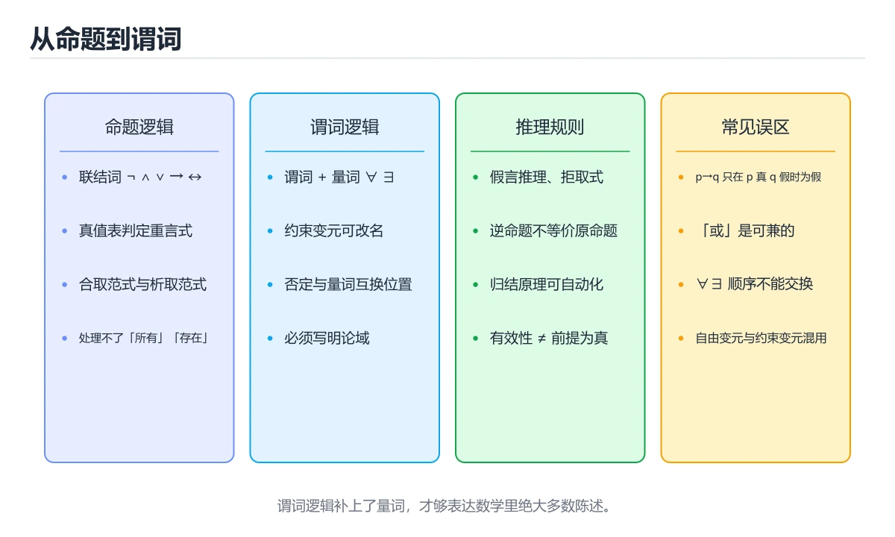

# 命题逻辑与谓词逻辑



> 内容更新时间：2026-10-06 · 学习阶段：进阶 · 预计用时：40 分钟

## 本节知识框架

### 学习目标
- 掌握命题与命题连接词的定义
- 学会构造和分析真值表
- 理解重言式、矛盾式与可满足式
- 掌握逻辑等价的判定方法
- 理解谓词逻辑中的量词（全称量词∀、存在量词∃）
- 学会运用推理规则进行有效论证

### 前置知识
- 基本数学思维
- 集合论基础（用于理解论域）

### 复习清单
- [ ] 能否区分命题与非命题？
- [ ] 能否构造含3个变量的真值表？
- [ ] 能否用真值表验证两个公式逻辑等价？
- [ ] 能否将自然语言翻译为谓词逻辑公式？
- [ ] 能否判断一个推理是否有效？

## 核心概念定义

| 术语 | 一句话说明 |
|------|-----------|
| 命题 | 有确定真假值的陈述句 |
| 联结词 | 连接命题构成复合命题的运算符（¬, ∧, ∨, →, ↔） |
| 真值表 | 列出所有赋值下公式真值的表格 |
| 重言式 | 在所有赋值下都为真的命题公式 |
| 矛盾式 | 在所有赋值下都为假的命题公式 |
| 可满足式 | 至少存在一种赋值使其为真的公式 |
| 逻辑等价 | 两个公式在所有赋值下真值相同，记作P⇔Q |
| 谓词 | 含变量的陈述，赋值后成为命题，如P(x)="x是偶数" |
| 全称量词∀ | "对所有x"，∀xP(x)表示每个x都满足P |
| 存在量词∃ | "存在某个x"，∃xP(x)表示至少一个x满足P |
| 推理规则 | 从前提推出结论的有效形式，如假言推理 |

## 原理与运行机制

### 生活类比：电路开关与条件判断

把逻辑想象成电路和日常决策：
- **命题**：开关的状态——要么开（真）要么关（假）
- **否定¬**：反向开关——原来开变关，原来关变开
- **合取∧**：串联电路——两个开关都开灯才亮
- **析取∨**：并联电路——任一开关开灯就亮
- **蕴含→**：自动门——"如果有人来（前提真），门就开（结论真）"；没人来时门开不开都无所谓
- **双条件↔**：同步开关——两个开关状态必须一致
- **全称量词∀**：全班考试——"所有人都及格了"
- **存在量词∃**：班级评优——"至少有人得了奖"

### 命题联结词

```text
否定 ¬p：
  p   | ¬p
  T   | F
  F   | T

合取 p∧q（AND）：
  p | q | p∧q
  T | T | T
  T | F | F
  F | T | F
  F | F | F

析取 p∨q（OR）：
  p | q | p∨q
  T | T | T
  T | F | T
  F | T | T
  F | F | F

蕴含 p→q（IF-THEN）：
  p | q | p→q
  T | T | T
  T | F | F
  F | T | T    ← 注意：前提假时蕴含式为真
  F | F | T

双条件 p↔q（IFF）：
  p | q | p↔q
  T | T | T
  T | F | F
  F | T | F
  F | F | T
```

### 重要逻辑等价式

```text
双重否定律：    ¬¬p ⇔ p
幂等律：        p∧p ⇔ p,  p∨p ⇔ p
交换律：        p∧q ⇔ q∧p,  p∨q ⇔ q∨p
结合律：        (p∧q)∧r ⇔ p∧(q∧r)
分配律：        p∧(q∨r) ⇔ (p∧q)∨(p∧r)
                p∨(q∧r) ⇔ (p∨q)∧(p∨r)
德摩根律：      ¬(p∧q) ⇔ ¬p∨¬q
                ¬(p∨q) ⇔ ¬p∧¬q
蕴含等价：      p→q ⇔ ¬p∨q
逆否命题：      p→q ⇔ ¬q→¬p
双条件等价：    p↔q ⇔ (p→q)∧(q→p)
吸收律：        p∨(p∧q) ⇔ p,  p∧(p∨q) ⇔ p
```

### 谓词逻辑基础

```text
谓词：P(x)表示关于x的某个性质
  例：P(x)="x是大学生", E(x)="x是偶数"

多参数谓词：R(x,y)表示x和y之间的关系
  例：L(x,y)="x爱y", G(x,y)="x大于y"

量词：
  全称量词 ∀xP(x)：论域中每个x都满足P
    等价于 P(a₁)∧P(a₂)∧...∧P(aₙ)（有限论域）
  
  存在量词 ∃xP(x)：论域中至少一个x满足P
    等价于 P(a₁)∨P(a₂)∨...∨P(aₙ)（有限论域）

量词否定（德摩根律推广）：
  ¬∀xP(x) ⇔ ∃x¬P(x)  "不是所有人都..." = "存在某人不..."
  ¬∃xP(x) ⇔ ∀x¬P(x)  "不存在某人..." = "所有人都不..."

嵌套量词：
  ∀x∃y L(x,y)：每个人都爱某个人（每个人有自己的爱人）
  ∃y∀x L(x,y)：存在某个人被所有人爱（有一个大众情人）
  注意：量词顺序不同，含义不同！
```

### 推理规则

```text
基本推理规则：
  假言推理（Modus Ponens）：
    p, p→q ⊢ q
    "如果p则q，p为真，所以q为真"
  
  假言三段论（Hypothetical Syllogism）：
    p→q, q→r ⊢ p→r
    "如果p则q，如果q则r，所以如果p则r"
  
  拒取式（Modus Tollens）：
    p→q, ¬q ⊢ ¬p
    "如果p则q，q不成立，所以p不成立"
  
  析取三段论：
    p∨q, ¬p ⊢ q
    "p或q，p不成立，所以q成立"
  
  全称例示（Universal Instantiation）：
    ∀xP(x) ⊢ P(c)（c为论域中任意元素）
  
  存在概括（Existential Generalization）：
    P(c) ⊢ ∃xP(x)
```

## 典型应用场景

### 程序条件判断
```python
# 蕴含关系的编程体现
# if (condition) { action } 等价于 condition → action

# 德摩根律优化条件
# 原代码：
if not (age >= 18 and has_id):
    print("拒绝访问")

# 德摩根律等价变换后：
if age < 18 or not has_id:
    print("拒绝访问")
```

### 数据库查询优化
```sql
-- 德摩根律在SQL中的应用
-- 原查询：NOT (status = 'active' AND role = 'admin')
-- 等价变换：status != 'active' OR role != 'admin'

SELECT * FROM users
WHERE NOT (status = 'active' AND role = 'admin');
-- 等价于
SELECT * FROM users
WHERE status != 'active' OR role != 'admin';
```

### 人工智能知识表示
```text
专家系统中的规则：
  前提：∀x (Patient(x) ∧ Fever(x) ∧ Cough(x)) → Flu(x)
  含义：如果病人发烧且咳嗽，则可能患流感
  
  前提：∃x (Student(x) ∧ Score(x) > 90)
  含义：存在成绩90分以上的学生

类型系统：
  ∀T (List<T> → T) : head  -- 对任意类型T，列表的head返回T
```

### 电路设计
```text
逻辑门对应联结词：
  NOT门 = ¬（非门）
  AND门 = ∧（与门）
  OR门  = ∨（或门）
  NAND  = ¬(p∧q)（与非门，通用门）
  XOR   = p⊕q = (p∨q)∧¬(p∧q)（异或门）

化简电路 = 化简逻辑表达式
```

## 代码/协议/SQL 示例

### 最小示例：真值表生成

```python
def truth_table(formula_func, variables):
    """
    生成命题公式的真值表
    formula_func: 接受变量字典返回布尔值的函数
    variables: 变量名列表
    """
    n = len(variables)
    print(" | ".join(variables) + " | Result")
    print("-" * (4 * n + 10))
    
    for i in range(2 ** n):
        assignment = {}
        for j, var in enumerate(variables):
            assignment[var] = bool((i >> (n - 1 - j)) & 1)
        
        result = formula_func(assignment)
        row = " | ".join(str(int(assignment[v])) for v in variables)
        print(f"{row} | {int(result)}")

# 测试：p → q 等价于 ¬p ∨ q
p_implies_q = lambda a: (not a['p']) or a['q']
print("p → q 的真值表:")
truth_table(p_implies_q, ['p', 'q'])

# 测试德摩根律：¬(p∧q) ⇔ ¬p∨¬q
left = lambda a: not (a['p'] and a['q'])
right = lambda a: (not a['p']) or (not a['q'])
print("\n¬(p∧q) 的真值表:")
truth_table(left, ['p', 'q'])
print("\n¬p∨¬q 的真值表:")
truth_table(right, ['p', 'q'])
```

### 完整示例：逻辑等价验证

```python
def are_equivalent(f1, f2, variables):
    """验证两个公式是否逻辑等价"""
    n = len(variables)
    for i in range(2 ** n):
        assignment = {}
        for j, var in enumerate(variables):
            assignment[var] = bool((i >> (n - 1 - j)) & 1)
        
        if f1(assignment) != f2(assignment):
            return False, assignment  # 找到反例
    return True, None

def is_tautology(formula, variables):
    """验证公式是否为重言式"""
    n = len(variables)
    for i in range(2 ** n):
        assignment = {}
        for j, var in enumerate(variables):
            assignment[var] = bool((i >> (n - 1 - j)) & 1)
        
        if not formula(assignment):
            return False, assignment
    return True, None

# 验证 p→q ⇔ ¬q→¬p（逆否命题等价）
original = lambda a: (not a['p']) or a['q']
contrapositive = lambda a: (not a['q']) or a['p']

equiv, counter = are_equivalent(original, contrapositive, ['p', 'q'])
print(f"p→q ⇔ ¬q→¬p: {equiv}")  # True

# 验证 (p∧(p→q))→q 是重言式（假言推理形式化）
modus_ponens = lambda a: not (a['p'] and ((not a['p']) or a['q'])) or a['q']
taut, counter = is_tautology(modus_ponens, ['p', 'q'])
print(f"(p∧(p→q))→q 是重言式: {taut}")  # True

# 验证分配律 p∧(q∨r) ⇔ (p∧q)∨(p∧r)
left = lambda a: a['p'] and (a['q'] or a['r'])
right = lambda a: (a['p'] and a['q']) or (a['p'] and a['r'])
equiv, counter = are_equivalent(left, right, ['p', 'q', 'r'])
print(f"分配律成立: {equiv}")  # True
```

### 进阶示例：谓词逻辑推理引擎

```python
class PredicateLogicEngine:
    """简单的谓词逻辑推理引擎"""
    
    def __init__(self, domain):
        self.domain = set(domain)
        self.predicates = {}  # 谓词解释
    
    def add_predicate(self, name, func):
        """添加谓词及其解释"""
        self.predicates[name] = func
    
    def evaluate_universal(self, pred_name):
        """评估 ∀x P(x)"""
        pred = self.predicates[pred_name]
        return all(pred(x) for x in self.domain)
    
    def evaluate_existential(self, pred_name):
        """评估 ∃x P(x)"""
        pred = self.predicates[pred_name]
        return any(pred(x) for x in self.domain)
    
    def evaluate_implication(self, pred1, pred2):
        """评估 ∀x (P(x) → Q(x))"""
        p = self.predicates[pred1]
        q = self.predicates[pred2]
        return all((not p(x)) or q(x) for x in self.domain)
    
    def find_counterexample(self, pred1, pred2):
        """找 ∀x(P(x)→Q(x)) 的反例"""
        p = self.predicates[pred1]
        q = self.predicates[pred2]
        for x in self.domain:
            if p(x) and not q(x):
                return x
        return None

# 测试
domain = [1, 2, 3, 4, 5, 6, 7, 8, 9, 10]
engine = PredicateLogicEngine(domain)

# 定义谓词
engine.add_predicate("even", lambda x: x % 2 == 0)
engine.add_predicate("prime", lambda x: x in {2, 3, 5, 7})
engine.add_predicate("positive", lambda x: x > 0)
engine.add_predicate("greater5", lambda x: x > 5)

# 验证命题
print("∀x even(x):", engine.evaluate_universal("even"))        # False
print("∃x even(x):", engine.evaluate_existential("even"))       # True
print("∀x positive(x):", engine.evaluate_universal("positive")) # True
print("∃x prime(x):", engine.evaluate_existential("prime"))     # True

# 验证推理：∀x(even(x) → positive(x))
print("∀x(even→positive):", engine.evaluate_implication("even", "positive"))
# True

# 验证推理：∀x(even(x) → greater5(x))
print("∀x(even→greater5):", engine.evaluate_implication("even", "greater5"))
# False，反例：2
print("反例:", engine.find_counterexample("even", "greater5"))
# 输出：2
```

```text
否定 ¬p：
  p   | ¬p
  T   | F
  F   | T
合取 p∧q（AND）：
  p | q | p∧q
  T | T | T
  T | F | F
  F | T | F
  F | F | F
析取 p∨q（OR）：
  p | q | p∨q
  T | T | T
  T | F | T
  F | T | T
  F | F | F
蕴含 p→q（IF-THEN）：
  p | q | p→q
  T | T | T
  T | F | F
  F | T | T    ← 注意：前提假时蕴含式为真
  F | F | T
双条件 p↔q（IFF）：
  p | q | p↔q
  T | T | T
  T | F | F
  F | T | F
  F | F | T
```

## 时间/空间复杂度或性能分析

| 操作 | 时间复杂度 | 空间复杂度 | 说明 |
|------|-----------|-----------|------|
| 真值表生成（n变量） | O(2^n) | O(n) | 指数级增长 |
| 等价性验证 | O(2^n) | O(1) | 需遍历所有赋值 |
| 重言式判定 | O(2^n) | O(1) | 命题逻辑是co-NP完全 |
| 谓词评估（有限域） | O(\|D\|) | O(1) | D为论域大小 |
| 量词嵌套评估 | O(\|D\|^k) | O(k) | k为嵌套层数 |
| 归结推理 | 指数级 | 多项式 | 最坏情况指数爆炸 |

**实践建议：**
- 变量数<20：直接真值表验证
- 变量数20~100：使用SAT求解器（如DPLL算法）
- 变量数>100：启发式方法或近似
- 谓词逻辑：限制论域大小，避免不可判定问题
- 实际工程中：用BDD（二元决策图）高效表示和操作布尔函数

## 常见误区与易错点

| 错误 | 现象 | 正确做法 |
|------|------|----------|
| 蕴含的"空真" | 认为p假时p→q无意义 | p假则p→q恒真（空真） |
| 逆命题混淆 | p→q的逆是q→p，不等价 | 逆否¬q→¬p才等价于原命题 |
| 量词顺序 | ∀x∃y与∃y∀x含义不同 | 先∀后∃：每人有自己的；先∃后∀：有一个人对所有人 |
| 否定量词 | ¬∀xP(x)写成∀x¬P(x) | ¬∀xP(x)⇔∃x¬P(x)，量词翻转 |
| 双条件理解 | p↔q误认为p→q | 双条件=两个方向的蕴含 |
| 可满足与重言混淆 | 有时为真≠总是为真 | 重言式要求所有赋值下为真 |

## 与其他知识点的关系

- **前置知识**：基本数学思维、集合论（论域概念）
- **后续知识**：集合论（集合运算的逻辑基础）、关系与函数（用逻辑语言描述）
- **相关概念**：布尔代数（逻辑的代数化）、自动机理论（逻辑与计算）
- **应用领域**：程序验证（霍尔逻辑）、数据库（关系代数）、AI（知识表示）、电路设计

## 自测题与参考答案

### 题目1
判断公式(p→q)∨(q→p)是否为重言式。

**答案：** 是重言式。分析：若p=T,q=T则p→q=T；若p=T,q=F则q→p=F但p→q=F，q→p=T；若p=F,q=T则p→q=T；若p=F,q=F则p→q=T。四种赋值下公式都为真，所以是重言式。

### 题目2
将"所有自然数都是整数"翻译为谓词逻辑公式。

**答案：** ∀x(N(x)→Z(x))，其中N(x)表示"x是自然数"，Z(x)表示"x是整数"。

### 题目3
证明¬(p→q)逻辑等价于p∧¬q。

**答案：** ¬(p→q) = ¬(¬p∨q) = ¬¬p∧¬q = p∧¬q。第一步用蕴含等价，第二步用德摩根律，第三步用双重否定律。

## 考点精讲

### 考点 1
命题"如果明天不下雨，我就去公园"的逻辑形式为p→q。以下哪个是该命题的逆否命题？

A. 如果我去了公园，则明天没下雨
B. 如果明天不下雨，则我去公园
C. 如果我没去公园，则明天下雨了
D. 如果明天下雨，则我不去公园

**正确答案：C**

**详细解释：** 设p="明天不下雨"，q="我去公园"。原命题p→q的逆否命题是¬q→¬p。¬q="我没去公园"，¬p="明天下雨了"（即并非不下雨）。所以逆否命题为"如果我没去公园，则明天下雨了"，对应选项C。注意：选项A是逆命题q→p（不等价），选项B是原命题本身，选项D是否命题¬p→¬q（不等价）。

### 考点 2
设论域为全体整数，P(x)表示"x是偶数"，Q(x)表示"x>0"。公式∀x(P(x)→Q(x))的含义是什么？

A. 所有整数都是偶数且大于0
B. 存在偶数大于0
C. 所有偶数都大于0
D. 存在大于0的偶数

**正确答案：C**

**详细解释：** ∀x(P(x)→Q(x))读作"对所有x，如果P(x)则Q(x)"。代入具体含义："对所有整数x，如果x是偶数，则x>0"，即"所有偶数都大于0"。选项A错误，因为不是要求所有整数同时满足两个条件。选项B和D是存在量词∃的含义，不是全称量词∀。注意该命题实际上为假（如-2是偶数但不大于0），但题目问的是含义而非真假。

### 考点 3
在命题逻辑中，下列哪一个公式是重言式（永真式）？

A. p∨q
B. p→(q→p)
C. p∧¬p
D. (p→q)→(q→p)

**正确答案：B**

**详细解释：** 逐一验证：A选项p∨q当p=F,q=F时为假，不是重言式。B选项p→(q→p)：若p=T则q→p=T（结论真则蕴含真），若p=F则前提假蕴含式为真。所以所有赋值下都为真，是重言式。C选项p∧¬p恒为假，是矛盾式。D选项(p→q)→(q→p)：当p=F,q=T时，p→q=T但q→p=F，所以T→F=F，不是重言式。

### 考点 4
¬∃x(P(x)∧Q(x))逻辑等价于以下哪个公式？

A. ∀x(¬P(x)∧¬Q(x))
B. ∀x(P(x)→¬Q(x))
C. ∃x(¬P(x)∨¬Q(x))
D. ∀x(¬P(x)∨¬Q(x))

**正确答案：D**

**详细解释：** 首先，量词否定规则：¬∃xR(x) ⇔ ∀x¬R(x)。所以¬∃x(P(x)∧Q(x)) ⇔ ∀x¬(P(x)∧Q(x))。再用德摩根律：¬(P(x)∧Q(x)) ⇔ ¬P(x)∨¬Q(x)。因此原式⇔∀x(¬P(x)∨¬Q(x))，对应选项D。选项A错误（德摩根律结果不是合取）。选项B虽然∀x(P(x)→¬Q(x))⇔∀x(¬P(x)∨¬Q(x))也等价，但D更直接。选项C量词类型错误（∃而非∀）。

### 考点 5
使用推理规则，从前提"p→q"和"¬q∨r"能推出什么结论？

A. p→r
B. ¬p∨r
C. q→r
D. p∧r

**正确答案：A**

**详细解释：** 推理过程：(1)p→q（前提）；(2)¬q∨r（前提）；(3)q→r（由(2)，因为¬q∨r等价于q→r）；(4)p→r（由(1)(3)假言三段论：p→q且q→r则p→r）。所以可以推出p→r，选A。验证：若p为真，由(1)q为真，由(2)¬q为假所以r必须为真，因此p→r成立。选项B(¬p∨r)等价于p→r，也是正确的，但A是更直接的推理结论形式。

---

### 考点 6

题目：在「命题逻辑与谓词逻辑」的术语表里，下列术语与解释的配对哪些是正确的？（多选）
A. 「逆否命题」：含变量的命题函数  
B. 「谓词」：p→q ⇔ ¬q→¬p  
C. 「联结词」：¬(非) ∧(与) ∨(或) →(蕴含) ↔(等价)  
D. 「命题」：有真假值的陈述句  
正确答案：CD

**解析**：本题正确项是「联结词」：¬(非) ∧(与) ∨(或) →(蕴含) ↔(等价)，以及「命题」：有真假值的陈述句，这两组配对与术语表一致。另外两组把术语和解释张冠李戴：「逆否命题」被安上了含变量的命题函数的解释，「谓词」反而拿到了p→q ⇔ ¬q→¬p的定义，所以两组都不能选。复习时回到「命题逻辑与谓词逻辑」的术语速查表逐条核对，配对题考的是定义里描述的对象和边界，而不是术语的字面长相。

---

## 术语速查

| 术语 | 一句话说明 |
|------|------|
| 命题 | 有真假值的陈述句 |
| 联结词 | ¬(非) ∧(与) ∨(或) →(蕴含) ↔(等价) |
| 重言式 | 永真公式 |
| 矛盾式 | 永假公式 |
| 逻辑等价 | 两公式在所有赋值下真值相同 |
| 谓词 | 含变量的命题函数 |
| 全称量词∀ | "对所有" |
| 存在量词∃ | "存在某个" |
| 论域 | 量词作用的范围 |
| 推理规则 | 有效论证的形式 |
| 假言推理 | p, p→q ⊢ q |
| 逆否命题 | p→q ⇔ ¬q→¬p |

## 参考资料与复核
- 下次复核：2027-01-08

- 《离散数学及其应用》（Kenneth H. Rosen）第1-2章
- MIT OpenCourseWare: Mathematics for Computer Science, Chapter 3
- 《逻辑的引擎》（Martin Davis）
- 复核日期：2026-04-15
- 内容版本：v1.0
- 最后复核：2026-10-04

- 官方/权威资料：[MIT 6.042 公开课](https://ocw.mit.edu/courses/6-042j-mathematics-for-computer-science-fall-2010/)
- 主题延伸：[斯坦福哲学百科：经典逻辑](https://plato.stanford.edu/entries/logic-classical/)

## 内容元数据

- 内容更新时间：2026-10-06

- 内容版本：v2.0

```yaml
id: discrete_math_logic
category: discrete_mathematics
difficulty: 进阶
estimated_time: 55
prerequisites:
  - basic_math_thinking
next_lessons:
  - discrete_math_set_theory
  - discrete_math_relations_functions
tags:
  - 命题逻辑
  - 谓词逻辑
  - 真值表
  - 量词
  - 推理规则
  - 逻辑等价
  - 离散数学
```
