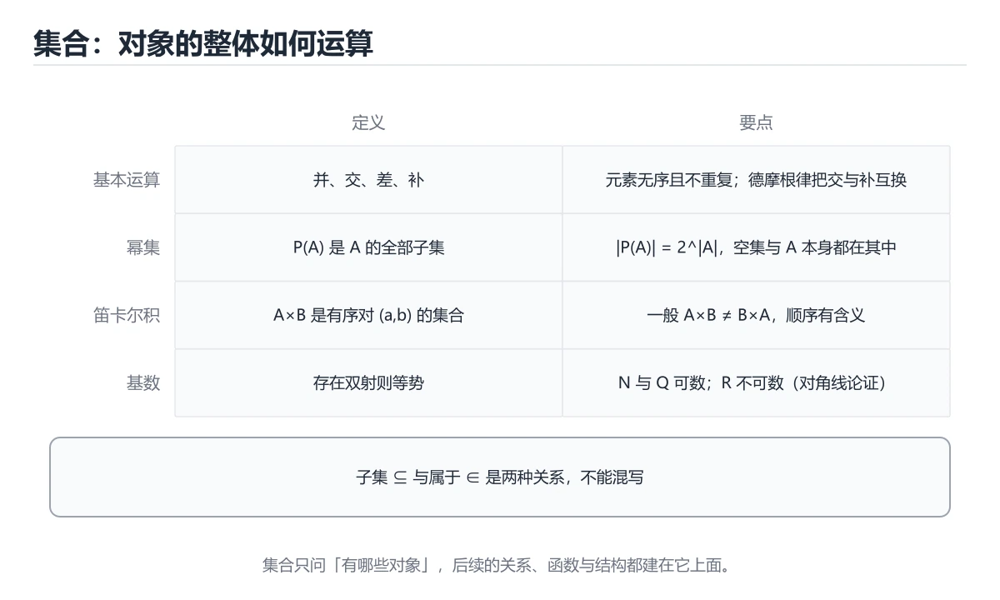

# 集合论基础



> 内容更新时间：2026-10-06 · 学习阶段：进阶 · 预计用时：45 分钟

## 本节知识框架

### 学习目标
- 掌握集合的基本概念和表示方法
- 理解集合运算（并、交、差、补）
- 学会使用韦恩图分析集合关系
- 掌握集合恒等式的证明方法

### 前置知识
- 基本数学逻辑
- 命题与谓词概念

### 复习清单
- [ ] 能否用列举法和描述法表示集合？
- [ ] 能否画出两个集合的韦恩图？
- [ ] 能否验证德摩根律？

## 核心概念定义

| 术语 | 一句话说明 |
|------|-----------|
| 集合 | 具有某种特定性质的对象的总体 |
| 元素 | 组成集合的个体对象 |
| 子集 | A中每个元素都属于B，则A是B的子集 |
| 幂集 | 集合所有子集构成的集合 |
| 笛卡尔积 | 两个集合中元素的所有有序对组成的集合 |
| 全集 U | 讨论补集时预先指定的"所有元素"范围，换全集则补集结果跟着变 |
| 基数 \|A\| | 集合中元素的个数；有限集用它计数，无限集用它比较"大小" |
| 对称差 A ⊕ B | 属于 A 或属于 B 但不同时属于两者的元素，等于 (A-B) ∪ (B-A) |
| 空集 ∅ | 不含任何元素的集合，是任何集合的子集、任何集合的真子集（除自身） |
| 有序对 (a,b) | a 与 b 按位置绑定，(1,2) ≠ (2,1)，是笛卡尔积的元素单位 |

## 原理与运行机制

### 生活类比：收纳盒系统

把集合想象成不同大小的收纳盒：
- **空集**：空盒子，里面什么都没有
- **有限集**：能数清楚里面有多少东西的盒子
- **无限集**：永远装不满的神奇盒子（比如所有自然数）

集合运算就像整理盒子：
- **并集**：把两个盒子的东西倒在一起
- **交集**：只保留两个盒子都有的东西
- **差集**：从第一个盒子拿走第二个盒子里有的东西

### 集合表示法

```text
列举法：A = {1, 2, 3, 4, 5}
描述法：B = {x | x是正整数且x < 6}
```

### 集合运算

```text
并集：A ∪ B = {x | x ∈ A 或 x ∈ B}
交集：A ∩ B = {x | x ∈ A 且 x ∈ B}
差集：A - B = {x | x ∈ A 且 x ∉ B}
补集：Ā = {x | x ∈ U 且 x ∉ A}（U是全集）
```

### 韦恩图

```text
    A           B
  ┌─────┐   ┌─────┐
  │  1  │ 2 │  3  │
  │     │   │     │
  └─────┘   └─────┘
  
A ∪ B = {1, 2, 3}（所有区域）
A ∩ B = {2}（中间重叠部分）
A - B = {1}（A独有的部分）
```

### 集合三要素怎么逐条检查

**确定性**：给定一个对象，必须能明确判断它属不属于这个集合。"本班个子高的同学"不是集合，因为没有可判定的标准；把标准写成"身高不低于 170cm 的本班同学"，确定性就满足了。含模糊形容词的"高、快、漂亮"类描述在离散数学里一律不算合法集合定义。

**互异性**：同一个元素重复列出仍然是那个元素，所以 {1, 1, 2, 3} 不是规范的集合表示，正确写法是 {1, 2, 3}，基数是 3 不是 4。这条正是"以下哪个不是集合的合法表示"这类题的判分点。

**无序性**：{1, 2, 3} 与 {3, 1, 2} 是同一个集合，元素书写顺序不影响相等性。做选择题时不要因为某个选项把元素排得杂乱就判它错——要逐个比对元素是否齐全。

表示法有两种：列举法把元素摊开写，适合有限且不太多的集合；描述法给出判定条件，适合无限集，写的时候必须交代论域，例如"所有正整数"要写成 {x | x 是整数且 x > 0}，只写 {x | x > 0} 会因为论域不明而在严格判分时扣分。

### 三个符号分别连接什么

- **∈（属于）**：左边是元素，右边是集合。1 ∈ {1,2,3} 正确。
- **⊆（包含于）**：两边都是集合。{1,2} ⊆ {1,2,3} 正确。
- **⊂（真包含）**：A ⊆ B 且 A ≠ B。{1,2} ⊂ {1,2} 不成立，但 ∅ ⊂ 任何非空集合成立。

层级一乱就出错：{1} ∈ {1,2,3} 错（这个集合的元素是 1、2、3，不含集合 {1}），而 {1} ∈ {{1},2,3} 对，{1} ⊆ {1,2,3} 也对。把 ∅ 与 {∅} 与 {{∅}} 三个排开看更清楚：∅ 里 0 个元素；{∅} 里 1 个元素，那个元素是空集本身；{{∅}} 里也是 1 个元素。P(∅) = {∅}，基数 2⁰ = 1，这条常被当成 0 而答错。

### 常用运算律一览

```text
交换律    A ∪ B = B ∪ A        A ∩ B = B ∩ A
结合律    (A∪B)∪C = A∪(B∪C)     (A∩B)∩C = A∩(B∩C)
分配律    A ∪ (B ∩ C) = (A∪B) ∩ (A∪C)
          A ∩ (B ∪ C) = (A∩B) ∪ (A∩C)
吸收律    A ∪ (A ∩ B) = A       A ∩ (A ∪ B) = A
德摩根    (A ∪ B)′ = A′ ∩ B′    (A ∩ B)′ = A′ ∪ B′
补集      A ∪ A′ = U            A ∩ A′ = ∅
差集      A - B = A ∩ B′
```

分配律是并与交互相分配，两条都要记；吸收律最难背也最常考——"A 加上 A 里那部分 B"仍是 A，因为它没有引入新元素。德摩根律的口径是"补集把并交互换"：先取补，再换运算符。把它记成一句人话——"不是（A 或 B）"等价于"非 A 且非 B"，"不是（A 且 B）"等价于"非 A 或非 B"，就不会写反。

### 元素论证法：恒等式怎么证

证明 X = Y 的标准套路是双包含：先证 X ⊆ Y，再证 Y ⊆ X。每一步都只交代"任取一个元素 x，假设它在左边，按定义它必须满足什么，因此它也在右边"。以分配律 A ∩ (B ∪ C) = (A ∩ B) ∪ (A ∩ C) 为例：

```text
设 x ∈ A ∩ (B ∪ C)
→ x ∈ A 且 x ∈ B ∪ C
→ x ∈ A 且 (x ∈ B 或 x ∈ C)
→ (x ∈ A 且 x ∈ B) 或 (x ∈ A 且 x ∈ C)   ← 逻辑"且"对"或"的分配
→ x ∈ (A ∩ B) ∪ (A ∩ C)
反向逐条回推即可，故两边互相包含，等式成立。
```

这套"元素级论证"就是把集合运算翻译回逻辑联结词，也解释了集合论与命题演算为什么共用同一套运算结构。

### 判断一个等式是否成立的最快办法：造小反例

怀疑某条律式不成立时，不要硬推，直接构造一个只有两三个元素的全集去试。检验 (A ∪ B)′ = A′ ∪ B′ 是否成立：

```text
取 U = {1, 2}，A = {1}，B = {2}
A ∪ B = {1,2} = U  →  (A ∪ B)′ = ∅
A′ = {2}，B′ = {1} →  A′ ∪ B′ = {1,2} = U
∅ ≠ U，所以该等式不成立（正确形式是 (A ∪ B)′ = A′ ∩ B′）。
```

反例只要一个就够，但要成立却得对所有情况证明——这个不对称性是选择题里"哪一个不成立"类题目省时的关键。

### 幂集为什么恰好是 2ⁿ 个

构造 A 的一个子集，等价于对 A 的每个元素做一次"要不要放进子集"的二选一。n 个元素就是 n 个独立的二进制位，状态总数 2ⁿ，于是 |P(A)| = 2ⁿ。把 A = {a,b,c} 的 8 个子集按二进制编号列出，能同时验证不漏不重：

```text
000 → ∅          100 → {a}
001 → {c}        101 → {a,c}
010 → {b}        110 → {a,b}
011 → {b,c}      111 → {a,b,c}
```

顺带两条基数结论：k 元子集个数是 C(n,k)，所有 k 加起来正好是 2ⁿ；A ⊆ B 时 P(A) ⊆ P(B)；A ∩ B 的幂集等于 P(A) ∩ P(B)，但 A ∪ B 的幂集只是 P(A) ∪ P(B) 的超集，不相等。

### 笛卡尔积与有序对

A × B = {(a,b) | a ∈ A 且 b ∈ B}，元素是有序对，因此 |A × B| = |A|·|B|，且一般 A × B ≠ B × A。当 A = B 时得到 A²，例如 {0,1}² 含 (0,0),(0,1),(1,0),(1,1) 四个有序对——这正是长度为 2 的全部二进制串。后面定义"关系是 A × B 的子集""函数是特殊的二元关系"都建立在这一步上。

## 典型应用场景

### 数据库查询
SQL中的WHERE条件本质是集合运算：
```sql
-- 并集：年龄<18 或 成绩>90
SELECT * FROM students WHERE age < 18 OR score > 90;

-- 交集：年龄<18 且 成绩>90
SELECT * FROM students WHERE age < 18 AND score > 90;
```

### 权限系统
用户权限集合的交集决定最终权限：
```text
用户权限 = {读, 写}
角色权限 = {读, 写, 删除}
实际权限 = 用户权限 ∩ 角色权限 = {读, 写}
```

### 搜索引擎
布尔搜索基于集合运算：
```text
"Python AND 教程" = Python页面集合 ∩ 教程页面集合
"Python OR Java" = Python页面集合 ∪ Java页面集合
"Python NOT 游戏" = Python页面集合 - 游戏页面集合
```

### 容斥原理：三集合的选课统计

统计"至少选过一门课"的人数时，直接把三门课的选课人数相加会把同时选两门的人重复计入。设 A、B、C 分别为选高等数学、离散数学、程序设计的人数集合：

```text
|A ∪ B ∪ C| = |A| + |B| + |C|
              - |A∩B| - |A∩C| - |B∩C|
              + |A∩B∩C|

|A|=30, |B|=25, |C|=20
|A∩B|=10, |A∩C|=8, |B∩C|=5, |A∩B∩C|=3
→ 30+25+20 - 10-8-5 + 3 = 55 人
```

两集合版本更简单：|A ∪ B| = |A| + |B| - |A ∩ B|。记忆方式是"先全加，减掉被数了两次的，补回被减没了的"，正负交替继续下去就是四五个集合的通用形式。这也是概率论加法公式 P(A∪B) = P(A)+P(B)-P(A∩B) 的同一件事，只是两边同除以了全集大小。

### 标签系统与推荐过滤

内容平台的标签匹配是密集的小集合运算：某篇文章标签集 T，用户兴趣集 I，屏蔽集 B，是否展示的判断式是 T ∩ I ≠ ∅ 且 T ∩ B = ∅。当标签总数固定在几百以内时，可把每个集合编码成一个位图（第 i 位代表第 i 个标签），交集与并集就退化为一次按位与、按位或——这正是 Python 里 `A & B`、`A | B` 这组运算符名字的来历。

## 代码示例

### 最小示例：集合运算

```python
# Python 集合操作
A = {1, 2, 3, 4}
B = {3, 4, 5, 6}

print("并集:", A | B)        # {1, 2, 3, 4, 5, 6}
print("交集:", A & B)        # {3, 4}
print("差集:", A - B)        # {1, 2}
print("对称差:", A ^ B)      # {1, 2, 5, 6}
print("子集测试:", {1, 2} <= A)  # True
```

### 完整示例：集合恒等式验证

```python
def verify_de_morgan(A, B, U):
    """验证德摩根律：(A ∪ B)' = A' ∩ B'"""
    # 左边：(A ∪ B)的补集
    union = A | B
    left = U - union
    
    # 右边：A的补集 ∩ B的补集
    A_comp = U - A
    B_comp = U - B
    right = A_comp & B_comp
    
    return left == right

# 测试
U = {1, 2, 3, 4, 5, 6, 7, 8, 9, 10}
A = {1, 2, 3, 4, 5}
B = {4, 5, 6, 7, 8}

print("德摩根律成立:", verify_de_morgan(A, B, U))  # True

# 验证分配律：A ∩ (B ∪ C) = (A ∩ B) ∪ (A ∩ C)
C = {5, 6, 7, 8, 9}
left = A & (B | C)
right = (A & B) | (A & C)
print("分配律成立:", left == right)  # True
```

### 进阶示例：幂集生成

```python
def power_set(s):
    """生成集合的幂集"""
    s = list(s)
    n = len(s)
    result = []
    
    # 2^n 个子集
    for i in range(1 << n):
        subset = set()
        for j in range(n):
            if i & (1 << j):
                subset.add(s[j])
        result.append(subset)
    
    return result

# 测试
A = {1, 2, 3}
ps = power_set(A)
print(f"集合 {A} 的幂集有 {len(ps)} 个元素:")
for s in ps:
    print(f"  {s}")
# 输出：8个子集（包括空集和全集）
```

### 练习示例：用位掩码理解 2ⁿ 与子集编号

```python
def subsets_by_mask(elems):
    """把每个子集看成一串二进制开关，第 j 位为 1 表示选第 j 个元素"""
    elems = list(elems)
    n = len(elems)
    for mask in range(1 << n):                 # 0 .. 2^n - 1
        picked = [elems[j] for j in range(n) if mask >> j & 1]
        print(f"{mask:0{n}b} -> {picked}")

subsets_by_mask({'a', 'b', 'c'})
# 000 -> []        100 -> ['a']
# 001 -> ['c']     101 -> ['a', 'c']
# 010 -> ['b']     110 -> ['a', 'b']
# 011 -> ['b','c'] 111 -> ['a', 'b', 'c']
```

打印顺序和前面手工列举的编号表一致，把"幂集有 2ⁿ 个元素"从公式变成了看得见的计数。反过来想也成立：给定一个 mask，就能唯一还原一个子集，这就是子集与二进制串的一一对应。

### 验证律式：批量随机测试比单次验证更可靠

```python
import random

def holds_law(A, B, C):
    left = A | (B & C)                       # A ∪ (B ∩ C)
    right = (A | B) & (A | C)                # (A ∪ B) ∩ (A ∪ C)
    return left == right

U = list(range(8))
random.seed(7)
fails = 0
for _ in range(2000):
    A, B, C = (set(random.sample(U, random.randint(0, 8))) for _ in range(3))
    if not holds_law(A, B, C):
        fails += 1
print("分配律随机测试失败次数:", fails)        # 0

def wrong_morgan(A, B, U):
    """错误形式：把并集的补集写成补集的并集"""
    return (U - (A | B)) == ((U - A) | (U - B))

print("德摩根错误形式在 U={1,2},A={1},B={2} 时成立吗:",
      wrong_morgan({1}, {2}, {1, 2}))         # False，这就是决定性反例
```

穷举小论域（8 个元素的全部子集只有 256 个）比随机抽样更强：只要在小论域上有一条不成立，就已经是决定性反例；在小论域上全部成立也不能替代证明，只能给你"值得去证"的信心。

## 复杂度与性能分析

| 操作 | 时间复杂度 | 空间复杂度 | 说明 |
|------|-----------|-----------|------|
| 并集 | O(m+n) | O(m+n) | m,n为两集合大小 |
| 交集 | O(min(m,n)) | O(min(m,n)) | 遍历较小集合 |
| 差集 | O(m) | O(m) | 遍历第一个集合 |
| 子集判断 | O(m) | O(1) | 检查每个元素 |
| 幂集生成 | O(2^n) | O(2^n) | 指数级增长 |

**实践建议：**
- 小集合（<1000元素）：直接用Python set
- 大集合：考虑位图（bitmap）表示
- 频繁查询：使用哈希集合

### 位图与哈希集合的规模分界

同样是"判断元素在不在集合里"，Python 的 `set` 走哈希表，位图（用一个整数的二进制位表示成员）在小论域上更省。论域是 0..63 时，一个 64 位整数就能装下整个集合，交集与并集各是一条 CPU 指令，而哈希集合要走一遍哈希函数和指针跳转。经验分界是：论域连续且不超过十万量级、集合个数又多（成千上万条记录各自带一个标签集）时位图完胜；论域稀疏、元素是字符串或对象时只能回到哈希集合。

幂集生成是这门课里唯一会"指数爆炸"的操作：n 从 20 涨到 30，输出量从约一百万涨到约十亿，任何常数优化都救不回来。所以在算法题里看到"枚举所有子集"，先确认 n 是否小于 25；否则要改用 meet-in-the-middle（把集合对半切，分别枚举两半的子集再合并）或状压 DP（把子集当掩码存进数组，dp[mask]），后者的空间恰好就是 2ⁿ。

## 常见误区与易错点

| 错误 | 现象 | 正确做法 |
|------|------|----------|
| 混淆∈和⊆ | {1} ∈ {1,2,3} ✗ | {1} ⊆ {1,2,3} ✓ |
| 忽略空集 | 幂集漏掉∅ | 幂集必含空集 |
| 重复元素 | {1,1,2} ≠ {1,2} | 集合元素唯一 |
| 无序性误解 | {1,2} ≠ {2,1} | {1,2} = {2,1} |
| 补集未指定全集 | Ā无意义 | 必须明确全集U |
| 把 {∅} 当成 ∅ | 误认为两者都是空集 | {∅} 含有一个元素（空集本身），基数为 1；∅ 不含任何元素，基数为 0 |
| 混淆 A-B 与 B-A | 以为差集可交换 | 差集无交换律，A-B = A ∩ B′，方向固定 |
| 德摩根只取补不换号 | 写成 (A∪B)′ = A′∪B′ | 必须同时交换 ∪ 与 ∩ |
| 数子集时漏 ∅ 和自身 | 认为 A={a,b,c} 只有 6 个真子集 | 子集 2ⁿ 个，真子集 2ⁿ-1 个，非空真子集 2ⁿ-2 个 |
| 用模糊语言定义集合 | "高个子的同学"无法判定归属 | 给出可判定的量化标准 |
| 忽略论域写描述法 | 写成 {x \| x > 0} 时不知 x 是整数还是实数 | 补一句"其中 x ∈ Z"或指定论域 U |

判归属关系时先问一句：左边是一个集合，还是集合里的一个元素？∈ 连接元素与集合，⊆ 连接集合与集合，把 {∅} 写进 ∅ 里就等于声称空集含有元素，幂集的元素个数也会跟着算错（n 个元素的集合有 2ⁿ 个幂集元素，∅ 的幂集是 {∅}，恰好 2⁰ = 1 个）。

### 补集与差集别混为一谈

`A - B` 只跟 A、B 两个集合有关，结果是 A 里剔掉 B 的元素，它永远是 A 的子集，不需要全集就能算。`Ā`（A 的补集）却必须先看全集：同一个 A 放在 U = {1,2,3} 里补集是 {2,3}，放在 U = {1,2,3,4,5} 里补集就成了 {2,3,4,5}。所以题目要求"(A∩B) 的补集"时，第一步永远是把 U 抄下来，第二步算 A∩B，第三步才是 U 减去它——顺序颠倒或漏掉第一步，是这类计算题最常见的丢分点。算完后逐项回验一遍：补集里的每个元素都确实不在 A∩B 中，且 A∩B 里的元素都没有出现在答案里，两者合起来正好等于 U。

### 韦恩图区域计数是另一种证明手段

两个集合把平面切成 4 个区域，三个集合切成 8 个区域。要验证 A∩(B∪C) = (A∩B)∪(A∩C)，可以在三圆图上把左边逐区域涂一遍（先标出 B∪C 覆盖的 6 个区域，再与 A 的 4 个区域取交），再涂右边，两边被涂亮的区域完全相同即验证通过。对复杂的含补集式子，还可以给每个区域写一个三元membership 记号（如 (在A, 在B, 在C) = (1,0,1)），逐个代入左右两边的表达式，比图形更不容易看走眼。

## 与其他知识点的关系

- **前置知识**：基本逻辑、命题演算
- **后续知识**：关系与函数、图论基础
- **相关概念**：布尔代数、概率论样本空间
- **应用领域**：数据库理论、形式语言、算法分析

### 集合语言在后面几章里会反复回来

"关系是笛卡尔积的子集"这一句直接把本章和下一章焊接起来：二元关系 R ⊆ A × B 的定义域是 {a | 存在 b 使 (a,b) ∈ R}，值域是 {b | 存在 a 使 (a,b) ∈ R}，而"函数是定义域中每个元素只对应唯一像"这条要求，写的依然是一个子集里的元素互不冲突，本质还是集合语言。再往后，图论里 G = (V, E) 中 V 是顶点集合、E 是边集合（无向图的 E 是 V 的 2 元子集构成的集合，即 E ⊆ P(V) 且每个元素基数为 2），连通分量是 V 的一个划分——划分与覆盖这两个概念也全部用并集、交集与不相重来描述。概率论那侧同理：样本空间 Ω 是集合，事件是 Ω 的子集，互斥就是交集为空，"至少一个发生"就是并集，德摩根律在这里以"对立事件的并"形式重新出现。学新章节时若觉得定义眼熟，多半就是本章的运算换了对象。

## 自测题与参考答案

### 题目1
设A={1,2,3}，B={2,3,4}，求A⊕B（对称差）。

**答案：** {1,4}

**解析：** 对称差 = (A-B) ∪ (B-A) = {1} ∪ {4} = {1,4}

### 题目2
证明：A ∪ (A ∩ B) = A（吸收律）

**答案：** 
- 左边⊆右边：若x∈A∪(A∩B)，则x∈A或x∈A∩B。无论哪种情况都有x∈A。
- 右边⊆左边：若x∈A，则x∈A∪(A∩B)（并集定义）。
- 因此A∪(A∩B) = A。

### 题目3
集合A有n个元素，求|P(A)|（幂集的元素个数）。

**答案：** 2^n

**解析：** 每个元素要么在子集中要么不在，共2种选择，n个元素独立选择，所以2^n个子集。

## 考点精讲

### 考点 1
以下哪个不是集合的合法表示？

A. {1, 2, 3}  
B. {x | x > 0}  
C. {1, 1, 2, 3}  
D. ∅  

**正确答案：C**

**详细解释：** 集合的元素具有互异性，不允许重复。{1, 1, 2, 3}应写为{1, 2, 3}。选项A是列举法，B是描述法，D是空集，都是合法的集合表示。

### 考点 2
设全集U={1,2,3,4,5,6,7,8}，A={1,2,3,5}，B={2,4,6}，求(A∩B)的补集。

A. {1,3,4,5,6,7,8}  
B. {2}  
C. {1,3,4,5,6,8}  
D. {1,3,5,4,6,7,8}  

**正确答案：A**

**详细解释：** 分两步：先求交集 A∩B，A={1,2,3,5} 与 B={2,4,6} 的公共元素只有 2，得 {2}；再求它在全集 U 中的补集，即 U 去掉元素 2，得到 {1,3,4,5,6,7,8}，对应选项 A。选项 B 是交集本身而不是补集；选项 C 漏掉了 7；选项 D 元素齐全但书写顺序混乱，集合与顺序无关，判分时以是否含全部 7 个元素为准。

### 考点 3
在集合运算的律式中，下列哪一个等式是不成立的？

A. A∪(B∩C) = (A∪B)∩(A∪C)  
B. A∩(B∪C) = (A∩B)∪(A∩C)  
C. (A∪B)的补集 = A的补集∪B的补集  
D. (A∩B)的补集 = A的补集∪B的补集  

**正确答案：C**

**详细解释：** 德摩根律：(A∪B)' = A'∩B'，(A∩B)' = A'∪B'。选项C错误地将并集的补集写成补集的并集，应该是补集的交集。

### 考点 4
集合A={a,b,c}的幂集P(A)包含多少个子集？

A. 3  
B. 6  
C. 8  
D. 9  

**正确答案：C**

**详细解释：** 幂集的元素个数 = 2^|A| = 2^3 = 8。包括：∅, {a}, {b}, {c}, {a,b}, {a,c}, {b,c}, {a,b,c}。

### 考点 5
设 A 与 B 为两个集合，若 A⊆B 且 B⊆A 同时成立，能推出什么？

A. A∩B=∅  
B. A∪B=A  
C. A=B  
D. A⊂B  

**正确答案：C**

**详细解释：** A⊆B说明A的元素都在B中，B⊆A说明B的元素都在A中，因此A和B包含完全相同的元素，即A=B。这是集合相等的定义。

## 术语速查

| 术语 | 一句话说明 |
|------|------|
| 集合 | 确定的、互异的对象的整体 |
| 元素 | 组成集合的个体 |
| 子集 | 所有元素都属于另一集合 |
| 真子集 | 子集且不等于原集合 |
| 幂集 | 所有子集构成的集合 |
| 并集 | 属于A或属于B的元素 |
| 交集 | 同时属于A和B的元素 |
| 补集 | 全集中不属于A的元素 |
| 全集 U | 讨论补集前必须指定的取值范围，换全集结果就变 |
| 对称差 ⊕ | 只属于其中一个集合的元素，(A-B) ∪ (B-A) |
| 基数 \|A\| | 有限集元素个数；\|A×B\| = \|A\|·\|B\|，\|P(A)\| = 2^\|A\| |
| 德摩根律 | 取补时并集与交集互换：(A∪B)′ = A′∩B′ |
| 容斥原理 | 并集基数要减掉重复计入的交集，三集合再补回三者交集 |
| 划分 | 把集合拆成若干非空且两两不相交的子集，其并集恰为原集合 |

## 参考资料与复核
- 下次复核：2026-12-19

- 《离散数学及其应用》（Kenneth H. Rosen）第2章
- MIT OpenCourseWare: Mathematics for Computer Science
- 复核日期：2026-04-15
- 内容版本：v1.0
- 最后复核：2026-10-04

- 官方/权威资料：[MIT 6.042 公开课](https://ocw.mit.edu/courses/6-042j-mathematics-for-computer-science-fall-2010/)
- 主题延伸：[斯坦福哲学百科：集合论](https://plato.stanford.edu/entries/set-theory/)

## 内容元数据

- 内容更新时间：2026-10-06

- 内容版本：v2.0

```yaml
id: discrete_math_set_theory
category: discrete_mathematics
difficulty: 进阶
estimated_time: 45
prerequisites:
  - basic_logic
next_lessons:
  - discrete_math_relations_functions
  - discrete_math_graph_theory
tags:
  - 集合论
  - 离散数学
  - 幂集
  - 集合运算
```

## 代码/协议/SQL 示例

《集合论基础》正文首个示例可作为最小验证起点（原样保留在上方章节）：先跑通，再改一个输入观察输出变化。

```text
列举法：A = {1, 2, 3, 4, 5}
描述法：B = {x | x是正整数且x < 6}
```

## 时间/空间复杂度或性能分析

- 在《集合论基础》里处理规模 n 时，先估计主循环与嵌套层数，再决定优化方向；小样本上的耗时读数不能外推。
- 性能结论要绑定输入分布：换数据规模、并发度或缓存命中情况后须重新测量。
