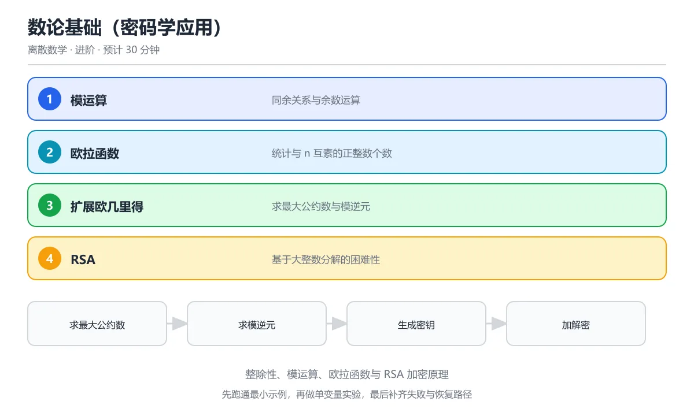

# 数论基础（密码学应用）



> 内容更新时间：2026-10-06 · 学习阶段：进阶 · 预计用时：40 分钟

## 本节知识框架

### 学习目标
- 掌握整除性、素数、模运算等基本概念
- 理解欧几里得算法与扩展欧几里得算法
- 掌握欧拉定理与费马小定理
- 了解 RSA 公钥密码体制的数学原理

### 前置知识
- 基本数学归纳法
- 集合与函数概念

### 复习清单
- [ ] 能否用辗转相除法求最大公因数？
- [ ] 能否解释模运算的"时钟"直觉？
- [ ] 能否说明 RSA 加密和解密的数学过程？

## 核心概念定义

| 术语 | 一句话说明 |
|------|-----------|
| 整除 (a\|b) | 存在整数 k 使 b = ak，读作"a 整除 b" |
| 素数 p | 大于 1 且只有 1 和自身两个正因子的正整数 |
| 最大公因数 gcd(a,b) | 同时整除 a 和 b 的最大正整数 |
| 互素 | gcd(a,b) = 1，即 a 和 b 没有公共素因子 |
| 模运算 (a mod n) | a 除以 n 的余数，取值范围 {0, 1, ..., n-1} |
| 同余 (a ≡ b mod n) | n 整除 (a-b)，即 a 和 b 除以 n 余数相同 |
| 欧拉函数 φ(n) | 1 到 n 中与 n 互素的正整数个数 |
| 模逆元 | 若 ab ≡ 1 (mod n)，则 b 是 a 模 n 的逆元，记作 a⁻¹ |
| 原根 | g 模 p 的幂遍历 1 到 p-1 的所有值，则 g 是 p 的原根 |
| 离散对数 | 给定 g^x ≡ h (mod p)，求 x 的问题；一般认为计算困难 |

## 原理与运行机制

### 生活类比：时钟算术

模运算就是时钟上的算术。12 小时制时钟就是一个 mod 12 的系统：
- 现在 10 点，过 5 小时是几点？(10 + 5) mod 12 = 3 点
- 现在 3 点，往回拨 7 小时？(3 - 7) mod 12 = 8 点
- 关键直觉：超过 12 就"绕回来"，就像跑道跑完一圈回到起点

RSA 密码的安全性就建立在这种"绕圈"的不对称性上：正向绕圈（乘法）很容易，反向绕圈（分解大数）极其困难。

### 整除与带余除法

```text
带余除法定理：对任意整数 a 和正整数 b，存在唯一的整数 q 和 r，使得
    a = bq + r,  其中 0 ≤ r < b

q 叫商，r 叫余数。
例：17 = 5 × 3 + 2，商 3 余 2，即 17 mod 5 = 2
```

整除的性质：
```text
1. 若 a|b 且 b|c，则 a|c（传递性）
2. 若 a|b 且 a|c，则 a|(bx + cy)（线性组合）
3. 若 a|b 且 b|a，则 a = ±b
```

### 欧几里得算法（辗转相除法）

求 gcd(a,b) 的经典算法，已有 2300 年历史：

```text
算法原理：gcd(a, b) = gcd(b, a mod b)
终止条件：gcd(a, 0) = a

示例：gcd(48, 18)
  gcd(48, 18) = gcd(18, 48 mod 18) = gcd(18, 12)
  gcd(18, 12) = gcd(12, 18 mod 12) = gcd(12, 6)
  gcd(12, 6)  = gcd(6, 12 mod 6)  = gcd(6, 0)
  → gcd = 6

为什么有效？因为 a = bq + r 意味着任何同时整除 a 和 b 的数也整除 r，
反之亦然。所以 a 和 b 的公因数集合 = b 和 r 的公因数集合。
```

### 扩展欧几里得算法

不仅求 gcd，还求出 Bézout 系数 x, y 使 ax + by = gcd(a,b)：

```text
回代过程（以上例 gcd(48,18)=6 为例）：
  48 = 18 × 2 + 12   →  12 = 48 - 18 × 2
  18 = 12 × 1 + 6    →  6 = 18 - 12 × 1
  12 = 6 × 2 + 0

回代：
  6 = 18 - 12 × 1
    = 18 - (48 - 18 × 2) × 1
    = 18 × 3 - 48 × 1

所以 48 × (-1) + 18 × 3 = 6，即 x = -1, y = 3
```

**核心应用**：当 gcd(a,n) = 1 时，扩展欧几里得给出 ax + ny = 1，因此 ax ≡ 1 (mod n)，x 就是 a 模 n 的逆元。

### 费马小定理与欧拉定理

```text
费马小定理：若 p 是素数且 gcd(a,p)=1，则 a^(p-1) ≡ 1 (mod p)
等价形式：对任意 a，a^p ≡ a (mod p)

欧拉定理（推广）：若 gcd(a,n)=1，则 a^φ(n) ≡ 1 (mod n)

示例（费马小定理）：
  p = 7, a = 3
  3^6 = 729 = 7 × 104 + 1
  所以 3^6 ≡ 1 (mod 7) ✓

示例（欧拉定理）：
  n = 10, φ(10) = 4（1,3,7,9 与 10 互素）
  a = 3, gcd(3,10) = 1
  3^4 = 81 = 8 × 10 + 1
  所以 3^4 ≡ 1 (mod 10) ✓
```

### RSA 密码体制

RSA 是数论在密码学中最著名的应用，1977 年由 Rivest、Shamir、Adleman 提出：

```text
密钥生成：
1. 选两个大素数 p, q（通常各 1024 位以上）
2. 计算 n = p × q
3. 计算 φ(n) = (p-1)(q-1)
4. 选 e 使 gcd(e, φ(n)) = 1（常用 e = 65537）
5. 求 d 使 ed ≡ 1 (mod φ(n))（用扩展欧几里得算法）
6. 公钥 = (n, e)，私钥 = (n, d)

加密：密文 c = m^e mod n（m 是明文消息）
解密：明文 m = c^d mod n

正确性证明：
  c^d = (m^e)^d = m^(ed)
  因为 ed ≡ 1 (mod φ(n))，所以 ed = 1 + k·φ(n)
  m^(ed) = m^(1 + k·φ(n)) = m · (m^φ(n))^k ≡ m · 1^k = m (mod n)
  （最后一步用了欧拉定理）

安全性：攻击者知道 (n, e) 和 c，要从 c = m^e mod n 恢复 m，
        需要知道 d，而求 d 需要知道 φ(n)，
        而求 φ(n) 需要分解 n 为 p × q。
        大整数分解目前没有已知的多项式时间算法。
```

## 典型应用场景

### RSA 加密通信
HTTPS 协议的密钥交换阶段使用 RSA 或类似方案：
```text
浏览器 → 服务器：获取公钥 (n, e)
浏览器：生成会话密钥 m，用公钥加密 c = m^e mod n
浏览器 → 服务器：发送 c
服务器：用私钥解密 m = c^d mod n
此后双方用 m 作为对称加密的密钥通信
```

### 哈希函数与数字签名
```text
数字签名流程：
1. 发送方计算消息摘要 h = Hash(消息)
2. 用私钥签名 s = h^d mod n
3. 接收方用公钥验证 h' = s^e mod n
4. 比较 h 和 h'，相同则签名有效
```

### 素性检验与密钥生成
```python
# Miller-Rabin 素性检验（概率算法）
def miller_rabin(n, k=20):
    """检验 n 是否为素数，k 轮检验"""
    if n < 2: return False
    if n == 2 or n == 3: return True
    if n % 2 == 0: return False

    # 写 n-1 = 2^r * d
    r, d = 0, n - 1
    while d % 2 == 0:
        r += 1
        d //= 2

    import random
    for _ in range(k):
        a = random.randrange(2, n - 1)
        x = pow(a, d, n)
        if x == 1 or x == n - 1:
            continue
        for _ in range(r - 1):
            x = pow(x, 2, n)
            if x == n - 1:
                break
        else:
            return False  # 合数
    return True  # 极大概率是素数
```

### 中国剩余定理 (CRT)
```text
问题：求解同余方程组
  x ≡ 2 (mod 3)
  x ≡ 3 (mod 5)
  x ≡ 2 (mod 7)

CRT 保证：模数两两互素时，解在 mod (3×5×7=105) 下唯一。
解：x ≡ 23 (mod 105)

应用：RSA 解密时用 CRT 加速，
     分别在 mod p 和 mod q 下计算，再合并，
     速度提升约 4 倍。
```

### 伪随机数生成
```text
线性同余生成器 (LCG)：
  X(n+1) = (a · Xn + c) mod m

参数选择影响周期和随机性质量。
现代应用：Mersenne Twister、Blum Blum Shub（基于数论的密码学安全 PRNG）
```

## 代码/协议/SQL 示例

### Python 实现核心数论算法

```python
def gcd(a, b):
    """欧几里得算法求最大公因数"""
    while b:
        a, b = b, a % b
    return a

def ext_gcd(a, b):
    """扩展欧几里得算法
    返回 (g, x, y) 使得 ax + by = g = gcd(a,b)"""
    if b == 0:
        return (a, 1, 0)
    g, x, y = ext_gcd(b, a % b)
    return (g, y, x - (a // b) * y)

def mod_inverse(a, n):
    """求 a 模 n 的逆元"""
    g, x, _ = ext_gcd(a, n)
    if g != 1:
        raise ValueError(f"{a} 模 {n} 无逆元")
    return x % n

def euler_phi(n):
    """计算欧拉函数 φ(n)"""
    result = n
    p = 2
    while p * p <= n:
        if n % p == 0:
            while n % p == 0:
                n //= p
            result -= result // p
        p += 1
    if n > 1:
        result -= result // n
    return result

# 验证
print(f"gcd(48, 18) = {gcd(48, 18)}")          # 6
print(f"ext_gcd(48, 18) = {ext_gcd(48, 18)}")   # (6, -1, 3)
print(f"mod_inverse(3, 7) = {mod_inverse(3, 7)}") # 5, 因为 3×5=15≡1(mod 7)
print(f"φ(10) = {euler_phi(10)}")                # 4
```

### Python 实现简化版 RSA

```python
import random

def generate_rsa_keypair(p, q):
    """简化版 RSA 密钥生成"""
    n = p * q
    phi = (p - 1) * (q - 1)

    # 选择 e（常用 65537）
    e = 65537
    assert gcd(e, phi) == 1

    # 计算 d
    d = mod_inverse(e, phi)

    return ((n, e), (n, d))  # (公钥, 私钥)

def rsa_encrypt(plaintext, public_key):
    n, e = public_key
    return pow(plaintext, e, n)

def rsa_decrypt(ciphertext, private_key):
    n, d = private_key
    return pow(ciphertext, d, n)

# 演示（用小素数，实际中 p,q 各 1024 位以上）
p, q = 61, 53
public_key, private_key = generate_rsa_keypair(p, q)
print(f"公钥: {public_key}")
print(f"私钥: {private_key}")

message = 42
encrypted = rsa_encrypt(message, public_key)
decrypted = rsa_decrypt(encrypted, private_key)
print(f"明文: {message}, 密文: {encrypted}, 解密: {decrypted}")
assert decrypted == message
```

### 快速幂算法（模幂运算）

```python
def fast_pow(base, exp, mod):
    """计算 (base ^ exp) mod mod
    时间复杂度 O(log exp)，而非暴力 O(exp)"""
    result = 1
    base = base % mod
    while exp > 0:
        if exp & 1:  # exp 是奇数
            result = (result * base) % mod
        exp >>= 1    # exp 除以 2
        base = (base * base) % mod
    return result

# RSA 加密的核心就是这个模幂运算
# pow(m, e, n) 在 Python 中已内置优化
print(fast_pow(42, 65537, 3233))  # RSA 加密示例
```

## 时间/空间复杂度或性能分析

| 算法 | 时间复杂度 | 空间复杂度 | 说明 |
|------|-----------|-----------|------|
| 欧几里得算法 | O(log(min(a,b))) | O(1) | 每步至少减半 |
| 扩展欧几里得 | O(log(min(a,b))) | O(log(min(a,b))) | 递归深度 |
| 试除法素性检验 | O(√n) | O(1) | 慢，仅适合小数 |
| Miller-Rabin | O(k · log²n) | O(1) | k 轮检验，概率正确 |
| 模幂运算 | O(log e · log²n) | O(1) | 快速幂 + 模乘 |
| 大整数分解 | 亚指数级 L(n) | - | 目前没有多项式算法 |
| 欧拉函数计算 | O(√n) | O(1) | 需要分解因数 |

**实践建议：**
- 大数运算使用 Python 内置 `pow(base, exp, mod)` 或 gmpy2 库
- RSA 密钥长度建议 ≥ 2048 位（对应约 617 位十进制数）
- 素性检验用 Miller-Rabin，k=40 轮时错误率 < 2⁻⁸⁰
- 生产环境不要自己实现密码学，使用经过审计的库（如 OpenSSL、libsodium）

### 为什么大整数分解难而素性检验容易

这是数论中最神奇的不对称之一。2002 年 Agrawal、Kayal、Saxena 证明了 AKS 素性检验是多项式时间的，也就是说"判断一个数是不是素数"在计算上是容易的。但"把一个合数分解成素因子"至今没有已知的多项式算法。最好的经典算法是数域筛法 (GNFS)，复杂度约为 O(exp(c · (log n)^(1/3) · (log log n)^(2/3)))。这种不对称正是 RSA 安全性的根基。

## 常见误区与易错点

| 错误 | 现象 | 正确做法 |
|------|------|----------|
| 混淆整除方向 | 以为 3\|7 表示"3 被 7 整除" | a\|b 表示 a 整除 b，即 b 是 a 的倍数 |
| 认为 1 是素数 | 把 1 列入素数表 | 素数定义要求 > 1，1 既不是素数也不是合数 |
| 模运算负数处理 | -7 mod 3 = -1 | 在数学中 -7 mod 3 = 2（余数非负） |
| 欧拉定理忽略互素条件 | 以为 2^φ(4) ≡ 1 (mod 4) | gcd(2,4)=2≠1，不满足条件，不能直接用 |
| RSA 中 n 可以小 | 用 p=3, q=5 做 RSA | 实际中 n 至少 2048 位，小 n 可被直接分解 |
| 混淆 φ(n) 和 n-1 | 以为 φ(n) = n-1 对所有 n | 仅当 n 是素数时 φ(n) = n-1 |
| 以为模逆元总存在 | 求 2 模 6 的逆元 | gcd(2,6)=2≠1，逆元不存在 |
| 快速幂忘记取模 | 中间结果溢出 | 每次乘法后都要 mod |

### φ(n) 的计算别用错公式

φ(n) = n-1 只在 n 是素数时成立。一般情况：若 n = p₁^a₁ · p₂^a₂ · ... · pₖ^aₖ，则 φ(n) = n · (1-1/p₁) · (1-1/p₂) · ... · (1-1/pₖ)。例如 φ(12) = 12 · (1-1/2) · (1-1/3) = 12 · 1/2 · 2/3 = 4。验证：{1, 5, 7, 11} 共 4 个数与 12 互素。

### RSA 的安全性不等于"不可破解"

RSA 的安全性基于"目前没有已知的多项式时间分解算法"，这是一个计算复杂度假设，不是数学证明。如果将来有人发明高效分解算法，或者量子计算机成熟（Shor 算法可以在多项式时间内分解大整数），RSA 就会被攻破。这就是为什么后量子密码学 (Post-Quantum Cryptography) 是当前研究热点。

## 与其他知识点的关系

- **前置知识**：集合基础、数学归纳法
- **后续知识**：群论与有限域、密码学、编码理论
- **相关概念**：群、环、域等代数结构
- **应用领域**：公钥密码学、数字签名、哈希函数、纠错码

### 数论是抽象代数的"具体实例"

整数模 n 的剩余类 Z/nZ 在加法下构成群，与 n 互素的剩余类在乘法下也构成群（阶为 φ(n)）。费马小定理和欧拉定理本质上就是这个群的拉格朗日定理（元素阶整除群的阶）。学到抽象代数时会发现，数论里的很多"定理"不过是群论、环论的一般结论在整数环上的特例。

### 从 RSA 到椭圆曲线密码

RSA 的安全性基于大整数分解难题。椭圆曲线密码 (ECC) 基于离散对数难题，在相同安全强度下密钥更短（256 位 ECC ≈ 3072 位 RSA）。比特币、以太坊等区块链系统普遍使用 ECC（具体是 secp256k1 曲线）。两者的共同数学基础都是"正向计算容易、反向计算困难"的单向陷门函数。

## 自测题与参考答案

### 题目1
求 gcd(120, 84) 并用扩展欧几里得算法找出 Bézout 系数。

**答案：** gcd(120, 84) = 12，120 × 1 + 84 × (-1) = 12（即 x=1, y=-1）

**解析：**
```text
120 = 84 × 1 + 36
84 = 36 × 2 + 12
36 = 12 × 3 + 0
回代：12 = 84 - 36 × 2 = 84 - (120 - 84) × 2 = 84 × 3 - 120 × 2
```
等等，重新算：12 = 84 - 36×2 = 84 - (120 - 84×1)×2 = 84×3 - 120×2。所以 x=-2, y=3，即 120×(-2) + 84×3 = -240 + 252 = 12。

### 题目2
计算 φ(35) 并验证欧拉定理：取 a=2，验证 2^φ(35) ≡ 1 (mod 35)。

**答案：** φ(35) = φ(5×7) = 35 × (1-1/5) × (1-1/7) = 35 × 4/5 × 6/7 = 24

**解析：** 2^24 mod 35。用快速幂：2^4=16, 2^8=256≡256-7×35=256-245=11, 2^16≡11²=121≡121-3×35=121-105=16, 2^24=2^16×2^8≡16×11=176≡176-5×35=176-175=1。验证通过。

### 题目3
在 RSA 中，p=11, q=3，求公钥和私钥（取 e=3）。

**答案：** n=33, φ(33)=20, e=3, d=7

**解析：** n=11×3=33, φ(n)=(11-1)(3-1)=20。选 e=3，需 gcd(3,20)=1 ✓。求 d：3d≡1(mod 20)，d=7（因为 3×7=21≡1 mod 20）。公钥=(33,3)，私钥=(33,7)。

### 题目4
求 7 模 26 的逆元。

**答案：** 7⁻¹ ≡ 15 (mod 26)

**解析：** 用扩展欧几里得：26 = 7×3 + 5, 7 = 5×1 + 2, 5 = 2×2 + 1。回代：1 = 5 - 2×2 = 5 - (7-5)×2 = 5×3 - 7×2 = (26-7×3)×3 - 7×2 = 26×3 - 7×11。所以 7×(-11) ≡ 1 (mod 26)，即 7×15 ≡ 1 (mod 26)。验证：7×15=105=4×26+1 ✓。

### 题目5
解释为什么 RSA 中 e 不能选为 φ(n) 的因子。

**答案：** 因为 e 必须满足 gcd(e, φ(n)) = 1 才能存在模逆元 d。如果 e 是 φ(n) 的因子，则 gcd(e, φ(n)) = e > 1，此时不存在 d 使 ed ≡ 1 (mod φ(n))，解密将无法正确还原明文。

## 考点精讲

### 考点 1

RSA 加密算法的安全性基于什么数学难题？

A. 排序问题

B. 图遍历问题

C. 大整数分解问题

D. 矩阵乘法

**正确答案：C**

**详细解释**：RSA 的安全性基于大整数分解的困难性：将两个大素数的乘积分解回原素数在计算上不可行。 实际密钥长度至少 2048 位，因为分解算法的进步会不断降低短密钥的安全余量，密钥太短会被直接攻破。 实际系统还会关注量子计算进展，因此后量子密码正在标准化，单靠加大密钥长度并不能永久保证安全。 本题正确项是「大整数分解问题」。

---

### 考点 2

欧拉函数 φ(n) 的含义是什么？

A. n 的因子个数

B. 小于等于 n 且与 n 互素的正整数个数

C. n 的素因子个数

D. n 的二进制位数

**正确答案：B**

**详细解释**：φ(n) 计算 1 到 n 中与 n 互素（最大公约数为 1）的数的个数。如 φ(10) = 4（1,3,7,9）。 当 n 是素数 p 时 φ(p) = p - 1，这条性质正是 RSA 计算私钥指数时使用的关键一步。 欧拉函数是积性函数，当 m 与 n 互素时 φ(mn) = φ(m)·φ(n)，这条性质让大数计算可以拆成小素数幂分别处理。 本题正确项是「小于等于 n 且与 n 互素的正整数个数」。

---

### 考点 3

模运算 a ≡ b (mod n) 的含义是什么？

A. a 等于 b

B. a 和 b 除以 n 的余数相同

C. a 是 b 的 n 倍

D. a 和 b 都是素数

**正确答案：B**

**详细解释**：同余关系：a mod n = b mod n，即 a-b 能被 n 整除。这是密码学和哈希函数的基础。 同余关系可以像等式一样做加减乘运算，但除法只在模数与除数互素时才安全，否则需要先求逆元。 同余式两边可以同时加、减、乘同一个整数，但约分时要格外小心，例如 2x ≡ 2 (mod 4) 不能直接约成 x ≡ 1。 本题正确项是「a 和 b 除以 n 的余数相同」。

---

### 考点 4

扩展欧几里得算法可以求解什么？

A. 最大公约数和贝祖等式的系数

B. 最小公倍数

C. 素数判定

D. 模幂运算

**正确答案：A**

**详细解释**：扩展欧几里得算法在求 gcd(a,b) 的同时找到 x,y 使得 ax + by = gcd(a,b)，用于求模逆元。 求模逆元时把等式写成 ax ≡ 1 (mod n)，再用扩展欧几里得算法回代，就能得到 a 在模 n 下的逆元。 回代时从最后一个余数等式往前推，把余数表示成原始两数的线性组合，系数就是贝祖等式里的 x 和 y。 本题正确项是「最大公约数和贝祖等式的系数」。

---

### 考点 5

费马小定理在密码学中的应用是什么？

A. 数据压缩

B. 快速计算模幂和素数判定

C. 哈希函数设计

D. 数据加密

**正确答案：B**

**详细解释**：费马小定理 a^(p-1) ≡ 1 (mod p) 用于快速模幂运算（RSA 核心）和素性检测。 注意费马小定理只对素数模成立，实际做素性检测时常用米勒-拉宾算法，它能以极高概率排除合数。 快速模幂用平方-乘算法把指数拆成二进制，每一步都取模，因此计算大指数时不会产生天文数字般的中间结果。 本题正确项是「快速计算模幂和素数判定」。

## 术语速查

| 术语 | 一句话说明 |
|------|------|
| 整除 a\|b | 存在整数 k 使 b = ak |
| 素数 | 大于 1 且仅有 1 和自身两个正因子 |
| gcd(a,b) | a 和 b 的最大公因数 |
| 互素 | gcd(a,b) = 1 |
| 模运算 a mod n | a 除以 n 的非负余数 |
| 同余 a ≡ b (mod n) | n 整除 (a-b) |
| 欧拉函数 φ(n) | 1..n 中与 n 互素的数的个数 |
| 模逆元 | ab ≡ 1 (mod n) 中的 b |
| 费马小定理 | a^(p-1) ≡ 1 (mod p)，p 为素数 |
| 欧拉定理 | a^φ(n) ≡ 1 (mod n)，gcd(a,n)=1 |
| RSA | 基于大整数分解难题的公钥密码体制 |
| 离散对数 | g^x ≡ h (mod p) 中求 x 的问题 |

## 参考资料与复核

- 《离散数学及其应用》（Kenneth H. Rosen）第4章
- 《数论概论》（Joseph H. Silverman）
- 《应用密码学》（Bruce Schneier）第19章
- 复核日期：2026-04-15
- 内容版本：v1.0

- 官方/权威资料：[NIST FIPS 186-4 数字签名标准](https://csrc.nist.gov/publications/detail/fips/186/4/final)
- 主题延伸：[RSA 算法原始论文](https://people.csail.mit.edu/rivest/Rsapaper.pdf)

- 最后复核：2026-10-04
- 下次复核：2027-10-10

## 内容元数据

- 内容版本：v2.0
- 最后更新：2026-10-06
- 学习阶段：进阶
- 适用环境：通用开发环境
- 内容来源：内置结构化课程与工程实践整理
- 相关主题：discrete number theory
- 质量版本：P0 测验标准 + P1 覆盖扩展 + P2 体验补全