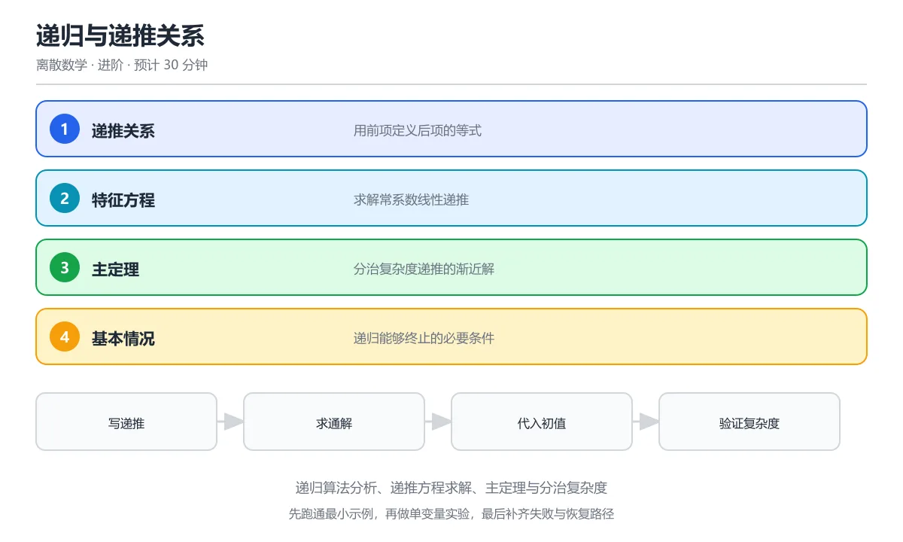

# 递归与递推关系



> 内容更新时间：2026-10-06 · 学习阶段：进阶 · 预计用时：30 分钟

## 本节知识框架

### 学习目标
- 理解递归的定义方式与数学归纳法的关系
- 掌握常见递推关系的求解方法
- 学会用特征方程法解线性递推
- 理解递归算法的复杂度分析方法

### 前置知识
- 数学归纳法
- 集合与函数基础
- 基本数列概念

### 复习清单
- [ ] 能否写出斐波那契数列的递推式？
- [ ] 能否用特征方程法解二阶线性递推？
- [ ] 能否分析递归算法的时间复杂度？

## 核心概念定义

| 术语 | 一句话说明 |
|------|-----------|
| 递归定义 | 用对象自身来定义对象，必须包含基础情形和递推步骤 |
| 递推关系 (recurrence) | 用序列的前几项表示当前项的等式 |
| 初始条件 (base case) | 递推的起点，没有它递推无法启动 |
| 阶数 | 递推式中涉及的最大下标差，如 aₙ = aₙ₋₁ + aₙ₋₂ 是二阶 |
| 线性递推 | 每一项都是前几项的线性组合（系数为常数或关于 n 的函数） |
| 齐次递推 | 递推式中不含与序列无关的"自由项" |
| 特征方程 | 把 aₙ = rⁿ 代入齐次线性递推后得到的关于 r 的多项式方程 |
| 主定理 (Master Theorem) | 分析分治递归 T(n) = aT(n/b) + f(n) 复杂度的速查公式 |
| 记忆化 (memoization) | 缓存已计算的子问题结果，避免重复计算 |
| 递推的闭合形式 | 不含递归引用的显式公式，如 Fₙ = (φⁿ - ψⁿ)/√5 |

## 原理与运行机制

### 生活类比：俄罗斯套娃

递归就像俄罗斯套娃：
- **基础情形**：最小的那个实心娃娃——不能再拆了
- **递推步骤**：每个娃娃打开后里面还有一个更小的同类娃娃
- **终止保证**：娃娃越拆越小，最终一定会到达最小的那个

没有基础情形的递归是无限循环（就像永远拆不到最小的套娃），没有递推步骤就只是普通数据（就像只有一个娃娃，没有"递归结构"）。

### 递归定义的三要素

每个合法的递归定义必须包含：

```text
1. 基础情形 (Base Case)：至少一个不需要递归就能确定的初始值
2. 递推步骤 (Recursive Step)：用较小规模的同类对象定义当前对象
3. 终止保证：每次递推都使问题规模严格减小，最终到达基础情形

示例：阶乘的递归定义
  基础：0! = 1
  递推：n! = n × (n-1)!  (n ≥ 1)
  终止：每次 n 减 1，最终到达 0
```

### 常见递推关系类型

```text
一阶线性：  aₙ = c · aₙ₋₁ + f(n)
  例：aₙ = 2aₙ₋₁ + 1, a₀ = 0 → aₙ = 2ⁿ - 1

二阶线性常系数齐次：aₙ = p · aₙ₋₁ + q · aₙ₋₂
  例：Fibonacci: Fₙ = Fₙ₋₁ + Fₙ₋₂, F₀=0, F₁=1

二阶线性常系数非齐次：aₙ = p · aₙ₋₁ + q · aₙ₋₂ + g(n)
  例：aₙ = 2aₙ₋₁ + 3ⁿ

分治型：T(n) = a · T(n/b) + f(n)
  例：归并排序 T(n) = 2T(n/2) + n
```

### 特征方程法：解齐次线性递推

这是解常系数齐次线性递推的标准方法：

```text
对于 aₙ = p · aₙ₋₁ + q · aₙ₋₂：

1. 假设解的形式为 aₙ = rⁿ
2. 代入递推式：rⁿ = p · rⁿ⁻¹ + q · rⁿ⁻²
3. 除以 rⁿ⁻²：r² = p · r + q
4. 得到特征方程：r² - p · r - q = 0

情况一：两个不同实根 r₁, r₂
  通解：aₙ = A · r₁ⁿ + B · r₂ⁿ
  A, B 由初始条件确定

情况二：重根 r₁ = r₂ = r
  通解：aₙ = (A + Bn) · rⁿ

情况三：复数根（较少见，通常转为三角形式）
```

### Fibonacci 数列的闭合形式

```text
Fₙ = Fₙ₋₁ + Fₙ₋₂, F₀ = 0, F₁ = 1

特征方程：r² - r - 1 = 0
根：r₁ = (1+√5)/2 = φ ≈ 1.618（黄金比例）
    r₂ = (1-√5)/2 = ψ ≈ -0.618

通解：Fₙ = A · φⁿ + B · ψⁿ
初始条件：F₀ = A + B = 0 → B = -A
          F₁ = Aφ + Bψ = A(φ - ψ) = A√5 = 1 → A = 1/√5

Binet 公式：Fₙ = (φⁿ - ψⁿ) / √5

由于 |ψ| < 1，ψⁿ → 0，所以 Fₙ ≈ φⁿ/√5（四舍五入到最近整数）
```

### 分治递归的复杂度：主定理

```text
主定理 (Master Theorem)：
  T(n) = a · T(n/b) + f(n)，其中 a ≥ 1, b > 1

  比较 f(n) 与 n^(log_b a)：

  情况1：f(n) = O(n^(log_b a - ε))，某 ε > 0
    → T(n) = Θ(n^(log_b a))
    例：T(n) = 8T(n/2) + n², log₂8 = 3, n² = O(n^(3-ε))
    → T(n) = Θ(n³)

  情况2：f(n) = Θ(n^(log_b a) · log^k n)
    → T(n) = Θ(n^(log_b a) · log^(k+1) n)
    例：T(n) = 2T(n/2) + n, log₂2 = 1, f(n) = n = Θ(n¹)
    → T(n) = Θ(n log n)  ← 归并排序

  情况3：f(n) = Ω(n^(log_b a + ε))，某 ε > 0，且满足正则条件
    → T(n) = Θ(f(n))
    例：T(n) = T(n/2) + n², log₂1 = 0, n² = Ω(n^ε)
    → T(n) = Θ(n²)
```

## 典型应用场景

### 算法复杂度分析
```text
归并排序：T(n) = 2T(n/2) + n → Θ(n log n)
快速排序（平均）：T(n) = 2T(n/2) + n → Θ(n log n)
二分查找：T(n) = T(n/2) + 1 → Θ(log n)
斐波那契堆操作：涉及 Fibonacci 数作为势函数
动态规划：本质是带记忆化的递推
```

### 数列与组合计数
```text
Catalan 数：Cₙ = Σ CᵢCₙ₋₁₋ᵢ, C₀ = 1
  C₀=1, C₁=1, C₂=2, C₃=5, C₄=14, ...
  应用：合法括号序列数、二叉树形态数、凸多边形三角剖分数

Stirling 数：S(n,k) = k·S(n-1,k) + S(n-1,k-1)
  应用：n 个元素划分成 k 个非空集合的方案数
```

### 金融复利计算
```text
复利递推：Aₙ = Aₙ₋₁ × (1 + r)
  A₀ = 本金, r = 利率
  闭合形式：Aₙ = A₀ × (1+r)ⁿ

定投模型：Aₙ = Aₙ₋₁ × (1+r) + P（每期追加 P 元）
  这是一阶线性非齐次递推
```

### 兔子繁殖问题（Fibonacci 原始模型）
```text
假设：
- 每对兔子每月生一对新兔子
- 新兔子从第二个月开始生育
- 兔子不死

设 Fₙ 为第 n 个月的兔子对数：
  Fₙ = Fₙ₋₁（上月存活的）+ Fₙ₋₂（上月新生的，现在能生育了）
  F₀ = 0, F₁ = 1

这正是 Fibonacci 递推。
```

### 汉诺塔问题
```text
T(n) = 2T(n-1) + 1, T(1) = 1
解：T(n) = 2ⁿ - 1

64 个金盘的汉诺塔需要 2⁶⁴ - 1 ≈ 1.8 × 10¹⁹ 步
按每秒一步计算需要约 5850 亿年
```

## 代码/协议/SQL 示例

### Python 实现递归与记忆化

```python
# 朴素递归 Fibonacci（指数时间！）
def fib_naive(n):
    """时间复杂度 O(2^n)，大量重复计算"""
    if n <= 1:
        return n
    return fib_naive(n - 1) + fib_naive(n - 2)

# 记忆化递归（线性时间）
def fib_memo(n, memo={}):
    """时间复杂度 O(n)，空间 O(n)"""
    if n in memo:
        return memo[n]
    if n <= 1:
        return n
    memo[n] = fib_memo(n - 1, memo) + fib_memo(n - 2, memo)
    return memo[n]

# Python 装饰器一键记忆化
from functools import lru_cache

@lru_cache(maxsize=None)
def fib_pythonic(n):
    if n <= 1:
        return n
    return fib_pythonic(n - 1) + fib_pythonic(n - 2)

# 迭代版本（最优：O(n) 时间，O(1) 空间）
def fib_iter(n):
    """时间 O(n)，空间 O(1)"""
    if n <= 1:
        return n
    a, b = 0, 1
    for _ in range(2, n + 1):
        a, b = b, a + b
    return b

# 验证
print([fib_iter(i) for i in range(10)])  # [0, 1, 1, 2, 3, 5, 8, 13, 21, 34]
```

### Python 求解线性递推的特征方程法

```python
import cmath

def solve_linear_recurrence(p, q, a0, a1):
    """
    解递推 aₙ = p·aₙ₋₁ + q·aₙ₋₂
    参数：p, q 是系数，a0, a1 是初始条件
    返回：闭合形式的系数 A, B 和特征根 r1, r2
    """
    # 特征方程 r² - p·r - q = 0
    discriminant = p**2 + 4*q
    r1 = (p + cmath.sqrt(discriminant)) / 2
    r2 = (p - cmath.sqrt(discriminant)) / 2

    if abs(r1 - r2) > 1e-10:
        # 两个不同根：aₙ = A·r1ⁿ + B·r2ⁿ
        # a0 = A + B, a1 = A·r1 + B·r2
        A = (a1 - a0 * r2) / (r1 - r2)
        B = a0 - A
        return {'type': 'distinct', 'A': A, 'B': B, 'r1': r1, 'r2': r2}
    else:
        # 重根：aₙ = (A + Bn)·rⁿ
        r = r1
        A = a0
        B = (a1 - A * r) / r if r != 0 else a1
        return {'type': 'repeated', 'A': A, 'B': B, 'r': r}

# Fibonacci: Fₙ = Fₙ₋₁ + Fₙ₋₂
result = solve_linear_recurrence(1, 1, 0, 1)
print(f"特征根: r1={result['r1']:.4f}, r2={result['r2']:.4f}")
print(f"系数: A={result['A']:.4f}, B={result['B']:.4f}")

# 验证：用闭合形式计算 F₁₀
r1, r2 = result['r1'], result['r2']
A, B = result['A'], result['B']
f10 = A * r1**10 + B * r2**10
print(f"F₁₀ = {round(f10.real)}")  # 55
```

### 汉诺塔递归求解

```python
def hanoi(n, source='A', target='C', auxiliary='B', moves=None):
    """汉诺塔：打印每一步移动"""
    if moves is None:
        moves = []
    if n == 1:
        moves.append(f"{source} → {target}")
        return moves
    hanoi(n - 1, source, auxiliary, target, moves)  # 把 n-1 个从 source 移到 auxiliary
    moves.append(f"{source} → {target}")              # 把最大的从 source 移到 target
    hanoi(n - 1, auxiliary, target, source, moves)  # 把 n-1 个从 auxiliary 移到 target
    return moves

# 3 个盘子
moves = hanoi(3)
for i, move in enumerate(moves, 1):
    print(f"第{i}步: {move}")
print(f"共需 {len(moves)} 步 = 2³ - 1 = {2**3 - 1}")
```

### 动态规划：递推的工程实现

```python
def climb_stairs(n):
    """
    爬楼梯问题：每次可以爬 1 或 2 个台阶
    递推：f(n) = f(n-1) + f(n-2), f(1)=1, f(2)=2
    本质是偏移的 Fibonacci 数列
    """
    if n <= 2:
        return n
    prev, curr = 1, 2
    for _ in range(3, n + 1):
        prev, curr = curr, prev + curr
    return curr

def coin_change(coins, amount):
    """
    零钱兑换：最少需要多少枚硬币凑出 amount
    递推：dp[i] = min(dp[i-c] for c in coins) + 1
    """
    dp = [float('inf')] * (amount + 1)
    dp[0] = 0
    for i in range(1, amount + 1):
        for c in coins:
            if i >= c:
                dp[i] = min(dp[i], dp[i - c] + 1)
    return dp[amount] if dp[amount] != float('inf') else -1

print(climb_stairs(10))              # 89
print(coin_change([1, 5, 10], 27))   # 5 (10+10+5+1+1)
```

## 时间/空间复杂度或性能分析

| 方法 | 时间复杂度 | 空间复杂度 | 说明 |
|------|-----------|-----------|------|
| 朴素递归 Fibonacci | O(2ⁿ) | O(n) 栈深度 | 指数级重复计算 |
| 记忆化递归 | O(n) | O(n) | 每个子问题只算一次 |
| 迭代（自底向上） | O(n) | O(1) | 最优空间 |
| 矩阵快速幂 | O(log n) | O(1) | 利用矩阵幂加速 |
| Binet 公式 | O(log n) | O(1) | 浮点精度限制 |

**实践建议：**
- 递归深度超过 ~1000 时 Python 会栈溢出，改用迭代或增大 `sys.setrecursionlimit`
- 能用 DP（自底向上）就不用记忆化递归（自顶向下），省掉函数调用开销
- 分析递归复杂度时先画递归树，再数节点总数
- 分治递归优先尝试主定理，不行再用递归树展开

### 为什么朴素递归 Fibonacci 是指数级

fib(n) 调用 fib(n-1) 和 fib(n-2)，fib(n-1) 又调用 fib(n-2) 和 fib(n-3)……递归树是一棵二叉树，深度约 n，节点总数约 2ⁿ。但其中大量节点计算的是同一个值（比如 fib(n-2) 被计算了两次）。记忆化的本质就是把这些重复节点"折叠"起来，使每个值只算一次，从而把指数级降到线性。

## 常见误区与易错点

| 错误 | 现象 | 正确做法 |
|------|------|----------|
| 忘记基础情形 | 递归无限进行直到栈溢出 | 每个递归函数必须有终止条件 |
| 递推方向搞反 | 以为 aₙ 依赖 aₙ₊₁ | 递推是用"已知的小规模"推"未知的大规模" |
| 特征方程写错符号 | r² - pr - q = 0 写成 r² + pr + q = 0 | aₙ = paₙ₋₁ + qaₙ₋₂ 对应 r² - pr - q = 0 |
| 重根时漏掉 n·rⁿ 项 | 以为通解还是 A·rⁿ + B·rⁿ | 重根时通解是 (A + Bn)·rⁿ |
| 主定理三种情况混淆 | 把情况 2 当情况 1 | 情况 2 是 f(n) 恰好等于 n^(log_b a) 的倍数 |
| 以为记忆化 = 动态规划 | 混淆自顶向下和自底向上 | 记忆化是递归+缓存（自顶向下），DP 是迭代填表（自底向上） |
| 忽略递推的闭合形式存在性 | 以为所有递推都能求出闭合形式 | 很多递推没有简洁的闭合形式 |
| 递归复杂度只看调用次数 | 忽略每次调用内部的工作量 | 总复杂度 = 调用次数 × 每次工作量 |

### 特征方程的符号陷阱

递推 aₙ = 3aₙ₋₁ - 2aₙ₋₂ 的特征方程是 r² - 3r + 2 = 0（注意减号），不是 r² + 3r - 2 = 0。口诀："递推里的系数搬到特征方程时变号"——aₙ₋₁ 的系数 3 变成 -3r，aₙ₋₂ 的系数 -2 变成 +2。解出 r₁=1, r₂=2，通解 aₙ = A·1ⁿ + B·2ⁿ = A + B·2ⁿ。

### 主定理不适用的情况

主定理只覆盖三种"干净"的情况。当 f(n) 和 n^(log_b a) 的差距不是多项式因子时（比如 f(n) = n·log n 而 n^(log_b a) = n），主定理无法直接应用。此时需要用递归树展开或其他方法（如 Akra-Bazzi 方法，主定理的推广）。

## 与其他知识点的关系

- **前置知识**：数学归纳法、数列基础
- **后续知识**：生成函数、算法设计与分析
- **相关概念**：动态规划、分治策略、组合数学
- **应用领域**：算法分析、数字信号处理、经济学模型

### 递推关系是算法分析的"语言"

分析一个递归算法的复杂度，本质上就是求解一个递推关系。归并排序的 T(n) = 2T(n/2) + n 是二阶分治递推，快速排序的平均情况 T(n) = (2/n)ΣT(k) + n 涉及求和，Strassen 矩阵乘法 T(n) = 8T(n/2) + n² 是主定理情况 1。掌握递推求解方法，算法复杂度分析就从"背结论"变成"推一遍就知道"。

### 从递推到生成函数

有些递推关系用特征方程法很难解（比如变系数递推、非线性递推），但用生成函数可以统一处理。生成函数把数列 {a₀, a₁, a₂, ...} 编码为幂级数 A(x) = a₀ + a₁x + a₂x² + ...，递推关系转化为关于 A(x) 的方程，解方程后再展开就得到闭合形式。这是下一课"生成函数"的核心内容。

## 自测题与参考答案

### 题目1
求解递推 aₙ = 3aₙ₋₁，a₀ = 2。

**答案：** aₙ = 2 · 3ⁿ

**解析：** 这是一阶齐次线性递推，特征方程 r - 3 = 0，根 r = 3。通解 aₙ = A · 3ⁿ，由 a₀ = A = 2 得 aₙ = 2 · 3ⁿ。

### 题目2
用特征方程法求解 Fₙ = Fₙ₋₁ + Fₙ₋₂，F₀ = 0, F₁ = 1。

**答案：** Fₙ = (φⁿ - ψⁿ)/√5，其中 φ = (1+√5)/2, ψ = (1-√5)/2

**解析：** 特征方程 r² - r - 1 = 0，根 r = (1±√5)/2。通解 Fₙ = Aφⁿ + Bψⁿ。由 F₀ = A + B = 0 和 F₁ = Aφ + Bψ = 1 解得 A = 1/√5, B = -1/√5。

### 题目3
分析递归 T(n) = 2T(n/2) + n² 的渐近复杂度。

**答案：** T(n) = Θ(n²)

**解析：** 用主定理：a=2, b=2, f(n)=n²。n^(log₂2) = n¹ = n。因为 f(n) = n² = Ω(n^(1+ε))（取 ε=1），属于情况 3，所以 T(n) = Θ(f(n)) = Θ(n²)。直觉上，每层的工作量以几何级数增长，最后一层 dominates。

### 题目4
写出爬楼梯问题（每次 1 或 2 阶）的递推式，并求 f(5)。

**答案：** f(n) = f(n-1) + f(n-2), f(1) = 1, f(2) = 2。f(5) = 8。

**解析：** 到第 n 阶要么从第 n-1 阶跨 1 步，要么从第 n-2 阶跨 2 步，所以 f(n) = f(n-1) + f(n-2)。f(3)=3, f(4)=5, f(5)=8。

### 题目5
汉诺塔 4 个盘子需要多少步？

**答案：** 2⁴ - 1 = 15 步

**解析：** T(n) = 2T(n-1) + 1, T(1) = 1。展开得 T(n) = 2ⁿ - 1。T(4) = 16 - 1 = 15。

## 考点精讲

### 考点 1

斐波那契数列的递推关系是什么？

A. F(n) = F(n-1) + 1

B. F(n) = 2 * F(n-1)

C. F(n) = F(n-1) + F(n-2)

D. F(n) = F(n-1) * F(n-2)

**正确答案：C**

**详细解释**：斐波那契数列：F(n) = F(n-1) + F(n-2)，初始条件 F(0)=0, F(1)=1。 如果直接按这个递推写递归，同一项会被重复计算指数次，改成迭代或记忆化后复杂度立刻降到线性。 初始条件的两个值缺一不可，只给递推式无法确定数列，因为不同的起始值会得到完全不同的序列。

---

### 考点 2

主定理（Master Theorem）用于解决什么问题？

A. 排序算法的正确性

B. 分治算法的时间复杂度递推方程

C. 图的连通性

D. 树的遍历顺序

**正确答案：B**

**详细解释**：主定理给出 T(n) = aT(n/b) + f(n) 形式递推的渐近解，快速分析分治算法复杂度。 使用时先确认递推形式符合 aT(n/b) + f(n)，再比较 f(n) 与 n^(log_b a) 的量级，判断落在三种情况的哪一种。 如果 f(n) 与 n^(log_b a) 同阶，答案要多乘一个 log n 因子，这是最容易记错的一种情况。

---

### 考点 3

归并排序的时间复杂度递推式是什么？

A. T(n) = T(n-1) + O(1)

B. T(n) = 2T(n/2) + O(n)

C. T(n) = T(n/2) + O(1)

D. T(n) = 2T(n-1) + O(n)

**正确答案：B**

**详细解释**：归并排序：将问题分成 2 个 n/2 子问题（2T(n/2)），合并需要 O(n)，总递推 T(n) = 2T(n/2) + O(n)。 展开这层递推会得到 log n 层、每层合并 O(n)，所以归并排序的总复杂度是 O(n log n)，额外空间 O(n)。

---

### 考点 4

求解常系数线性递推关系的特征方程法，对于 a_n = 3a_{n-1} - 2a_{n-2}，特征方程是什么？

A. x^2 + 3x - 2 = 0

B. x^2 - 3x + 2 = 0

C. x^2 - 3x - 2 = 0

D. x^3 - 3x + 2 = 0

**正确答案：B**

**详细解释**：将 a_n = r^n 代入递推，得 r^n = 3r^{n-1} - 2r^{n-2}，除以 r^{n-2} 得特征方程 r^2 - 3r + 2 = 0。 解出特征根 r1、r2 后，通解是 a_n = C1·r1^n + C2·r2^n，再用前两项初始值联立求出常数。

---

### 考点 5

递归算法必须包含什么要素才能正确终止？

A. 循环语句

B. 基本情况（base case）和递归步骤

C. 全局变量

D. 数组

**正确答案：B**

**详细解释**：递归需要基本情况（直接返回答案的终止条件）和递归步骤（将问题缩小直到达到基本情况）。 写递归时还要保证每一步都朝基本情况靠近，比如参数递减，否则即使写了 base case 也可能无限递归。 实际调试时可以打印每层参数，确认参数确实在变小，同时检查是否有分支绕过了基本情况。


## 术语速查

| 术语 | 一句话说明 |
|------|------|
| 递归定义 | 基础情形 + 递推步骤 + 终止保证 |
| 递推关系 | 用前几项表示当前项的等式 |
| 特征方程 | 代入 rⁿ 后得到的多项式方程 |
| 齐次递推 | 不含自由项（与序列无关的项） |
| 非齐次递推 | 含自由项 g(n) |
| 主定理 | 分治递归 T(n)=aT(n/b)+f(n) 的复杂度速查 |
| 记忆化 | 缓存子问题结果避免重复计算 |
| 动态规划 | 自底向上填表求解递推 |
| 闭合形式 | 不含递归的显式公式 |
| Catalan 数 | Cₙ = ΣCᵢCₙ₋₁₋ᵢ，计数合法括号序列等 |

## 参考资料与复核

- 《离散数学及其应用》（Kenneth H. Rosen）第5章
- 《算法导论》（CLRS）第4章 递归式
- 《具体数学》（Knuth, Graham, Patashnik）第6-7章
- 复核日期：2026-04-15
- 内容版本：v1.0

- 官方/权威资料：[MIT 6.042 公开课 Lecture 8: Recurrences](https://ocw.mit.edu/courses/6-042j-mathematics-for-computer-science-fall-2010/)
- 主题延伸：[OEIS 整数数列百科全书](https://oeis.org/)

- 最后复核：2026-10-04
- 下次复核：2027-10-10

## 内容元数据

- 内容版本：v2.0
- 最后更新：2026-10-06
- 学习阶段：进阶
- 适用环境：通用开发环境
- 内容来源：内置结构化课程与工程实践整理
- 相关主题：discrete recursion
- 质量版本：P0 测验标准 + P1 覆盖扩展 + P2 体验补全