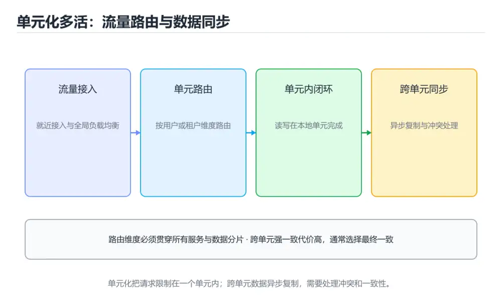
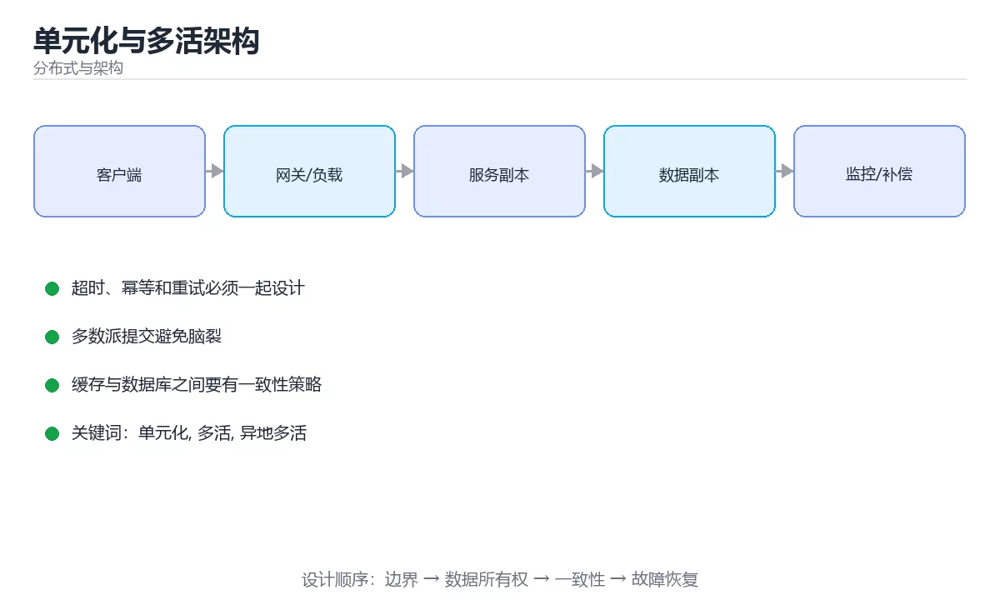

# 单元化与多活架构





> 内容更新时间：2026-10-06 · 学习阶段：高级 · 预计用时：35 分钟

## 本节知识框架

**课程定位**：所属分类 `distributed`（分布式与架构），课程主题 `单元化与多活架构`，学习阶段 高级，建议用时 40 分钟。

本课主线：单元划分、容量接管规划与切换演练要点。

**学完本课应当能够**
- 说清 `单元化` 与 `多活` 的含义与区别，并各举一个正例和一个反例。
- 用本课示例验证 `异地多活` 的行为，记录输入、输出与失败条件。
- 遇到「单元内还要跨单元同步调用」这类问题时，能说出触发条件与修复顺序。

### 复习清单

- [ ] 能讲清 单元化 与 多活 的分工，并指出其中一个前提失效的边界。
- [ ] 能跑通 单元化 的最小示例，记录一组正常输出和一组失败输出。
- [ ] 能完成一次自测，并把错题对照错误表定位原因。

## 核心概念定义

| 术语 | 操作性定义 | 常见边界与风险 |
| --- | --- | --- |
| 单元化 | 把系统按用户或数据分片部署到独立单元，以限制故障影响范围。 | 易错：单元内仍跨单元同步调用，一个机房故障就整体不可用；分片键选错会让高频查询跨全部单元，闭环不成立就限制不了故障范围。 |
| 多活 | 多个站点同时承载流量并具备故障接管能力。 | 易错：多活形同虚设；正确做法是消除单点或降级为只读。 |
| 异地多活 | 关键关系：先分清「单元化」与「多活」的职责，再理解「异地多活」的适用边界。 | 异地 RTT 数十毫秒，同步复制代价高，多数只能最终一致；切流前不核对复制延迟就会读到旧数据。 |
| 容灾 | 在机房、区域或核心依赖故障时维持业务可用并满足恢复目标。 | 易错：只把数据同步到位就认为具备容灾能力；不做切换演练真切换时才会失败，缺回切方案则故障恢复后无法回归。 |
| 切换演练 | 模拟主节点或机房故障并按预案执行流量切换，验证恢复时间与数据一致性。 | 易错：真切换时失败；正确做法是定期故障注入与切换演练。 |
| RTO | 灾难发生后恢复服务所需的最长时间目标。 | 主备形态是分钟级、同城双活才能到秒级；没做过切换演练的预案，真切换时的耗时通常超出目标。 |

## 原理与运行机制

### 机制总览

**教材衔接：三种多机房形态**

| 形态 | 流量分布 | 数据 | 恢复目标 | 复杂度 |
| --- | --- | --- | --- | --- |
| 同城主备 | 单机房承接 | 主库单写 | RTO 分钟级 | 低 |
| 同城双活 | 两机房分担 | 主库单写或双写 | RTO 秒级 | 中 |
| 异地多活 | 多地分担 | 分片多写 | 单机房故障不中断 | 高 |

关键概念：

| 概念 | 含义 |
| --- | --- |
| 单元（Cell） | 能独立承接一部分用户流量的完整闭环 |
| 单元化 | 按用户维度把流量与数据切分到不同单元 |
| 单元内闭环 | 单元内完成读、写、缓存、异步任务，不跨单元同步调用 |
| 异地多活 | 多单元同时对外服务，任一单元故障可被接管 |
| RTO / RPO | 恢复时间目标 / 数据丢失容忍量 |

**教材衔接：单元化设计要点**

| 主题 | 做法 |
| --- | --- |
| 分片键 | 用户 ID 或租户 ID，保证同一用户数据落在同一单元 |
| 路由 | 接入层按分片键计算单元，避开跨单元调用 |
| 数据同步 | 异步复制用于容灾；不可变数据可多写 |
| 全局数据 | 配置、字典等小数据全量复制到各单元 |
| 跨单元场景 | 转账、全局唯一 ID 等用异步补偿或专门服务 |
| 容量规划 | 每个单元按「接管全量流量」的降级容量规划 |
| 灰度与切换 | 支持按分片比例切流与一键回切 |

```python
import hashlib
from dataclasses import dataclass, field

def cell_for(user_id: str, cells: list) -> str:
    """按用户稳定映射到单元：同一用户永远落在同一单元。"""
    if not cells:
        raise ValueError("单元列表为空")
    digest = hashlib.md5(user_id.encode()).hexdigest()
    return cells[int(digest, 16) % len(cells)]

@dataclass
class UnitPlan:
    """单元容量规划：每个单元要能接管其他单元的流量。"""

    name: str
    base_qps: float                 # 本单元日常承载流量
    total_qps: float                # 全部单元合计流量
    headroom: float = 0.3           # 预留余量

    def take_over_qps(self, failed_units: int, unit_count: int) -> float:
        """故障接管：剩余单元分摊总流量。"""
        survivors = max(1, unit_count - failed_units)
        return round(self.total_qps / survivors, 2)

    def can_take_over(self, failed_units: int, unit_count: int, capacity_qps: float) -> bool:
        need = self.take_over_qps(failed_units, unit_count)
        return need <= capacity_qps * (1 - self.headroom)

@dataclass
class FailoverPlan:
    """切换演练：记录步骤与验证项，确保可回滚。"""

    steps: list = field(default_factory=list)

    def add(self, action: str, verify: str) -> None:
        self.steps.append((action, verify))

    def dry_run_checklist(self) -> list:
        return [f"{action} → 验证：{verify}" for action, verify in self.steps]

plan = UnitPlan("cell-a", base_qps=800, total_qps=2400)
print(cell_for("user-12345", ["cell-a", "cell-b", "cell-c"]))
print(plan.take_over_qps(1, 3), plan.can_take_over(1, 3, capacity_qps=1200))

drill = FailoverPlan()
drill.add("停掉 cell-a 的入口流量", "剩余单元错误率小于 1%")
drill.add("确认数据补齐", "各单元数据行数一致")
print(drill.dry_run_checklist())
```

**教材衔接：数据一致性策略速查**

| 数据类型 | 策略 |
| --- | --- |
| 用户分片数据 | 单元内单写，跨单元异步复制 |
| 全局配置 | 全量复制 + 版本号校验 |
| 全局唯一 ID | 单元前缀 + 本地发号，避免全局竞争 |
| 计数与余额 | 归属单元单写，跨单元用补偿事务 |
| 消息 | 按分片键分区，保证同用户消息有序 |
| 缓存 | 单元内独立缓存，避免跨单元读取 |

## 典型应用场景

- **单元内还要跨单元同步调用**：典型现象是一个机房故障整体不可用；正确做法是单元必须闭环，跨单元走异步补偿。
- **分片键选错**：典型现象是高频查询跨全部单元；正确做法是按最常用查询维度选分片键。
- **双写不做冲突解决**：典型现象是数据互相覆盖；正确做法是明确「谁为准」或使用不可变数据。
- **按平均流量规划单元容量**：典型现象是故障接管时被打垮；正确做法是按接管全量流量规划容量。

### 最小验证场景

- 准备：保留 `python` 示例的原始输入，先记录 `单元化与多活架构` 的基线输出和完整运行命令。
- 观察：先核对 调用了 `cell_for()`，再改变一个与 `单元化` 相关的条件。
- 判定：新结果与 `单元化与多活架构` 的基线不同不等于错误；只有当差异破坏了 `单元化` 的定义或错误表中的约束，才判定为失败。

### 选择与边界

- 使用 `单元化` 时，把系统按用户或数据分片部署到独立单元，以限制故障影响范围；容器与集群环境差异会改变行为，本地通过后仍需在目标编排环境复验。
- 使用 `多活` 时，多个站点同时承载流量并具备故障接管能力；易错：多活形同虚设；正确做法是消除单点或降级为只读。
- 使用 `异地多活` 时，关键关系：先分清「单元化」与「多活」的职责，再理解「异地多活」的适用边界。
- 使用 `容灾` 时，在机房、区域或核心依赖故障时维持业务可用并满足恢复目标；不同版本与依赖组合的行为可能不同，升级或换环境前要按官方变更说明重新验证。
- 使用 `切换演练` 时，模拟主节点或机房故障并按预案执行流量切换，验证恢复时间与数据一致性；易错：真切换时失败；正确做法是定期故障注入与切换演练。

## 代码/协议/SQL 示例

**教材衔接：补充：单元化路由、冲突解决与切换验收**

### 单元化的分片路由

```text
目标：让同一用户的数据与流量始终落在同一个单元（机房切片）

  ┌──────── 单元 A ────────┐   ┌──────── 单元 B ────────┐
  │ 用户 hash % 2 == 0      │   │ 用户 hash % 2 == 1      │
  │ 应用 + 缓存 + 数据库    │   │ 应用 + 缓存 + 数据库    │
  └─────────────────────────┘   └─────────────────────────┘
              │                              │
              └──────── 全局路由表 ──────────┘
                   （用户 → 单元映射）
```

| 路由方式 | 说明 | 变更代价 |
| --- | --- | --- |
| 取模分片 | `hash(uid) % N` | 扩缩容要搬大量数据 |
| 一致性哈希 | 单元环形分布 | 迁移量约 1/N |
| 显式路由表 | 元数据服务记录映射 | 可精确控制，但需中心化 |

```text
单元化的三条纪律
  ① 单元内闭环：一次请求只在本单元内完成，不跨机房调用
  ② 路由信息透传：入口定好路由后，整条链路都按同一单元走
  ③ 全局数据最小化：只有真正需要全局的唯一键、配置才集中存放
```

### 多活的三种形态

| 形态 | 数据写入 | 特点 | 典型场景 |
| --- | --- | --- | --- |
| 主备 | 只写主 | 简单，切换有 RTO | 传统容灾 |
| 双活（同城） | 双机房都写 | 延迟低，冲突少 | 同城容灾 |
| 多活（异地） | 多地都写 | 就近接入，冲突需处理 | 全国/全球业务 |

```text
同城双活 vs 异地多活
  同城：RTT < 3ms，可用同步复制，强一致可行
  异地：RTT 数十毫秒，同步复制代价高，通常选最终一致
```

### 冲突解决的五种策略

| 策略 | 做法 | 适用 |
| --- | --- | --- |
| 最后写入获胜（LWW） | 按时间戳取最新 | 用户资料等可覆盖数据 |
| 版本号比较 | 只接受更高版本 | 计数器、状态字段 |
| 业务合并 | 按业务规则合并（如取较大值） | 库存、积分 |
| 冲突上报 | 标记冲突交人工处理 | 金额、合同 |
| CRDT | 用可交换的数据结构自动合并 | 协同编辑、集合 |

```text
时间戳不可靠的原因
  · 各机房时钟存在漂移（即使有 NTP，也可能差几十毫秒）
  · 因此 LWW 在「同一秒内并发写」时结果不确定

更稳妥的做法
  · 使用逻辑时钟（如版本号 + 机房标识）而不是物理时间
  · 或者把冲突交给业务层合并
```

### 流量调度与故障切换

```text
三层调度
  ① DNS / GSLB：按地理与健康状态解析到最近可用单元
  ② 接入层：按用户路由规则转发到对应单元
  ③ 应用层：单元内负载均衡

切换策略
  · 单元故障：把该单元的用户整体切到备用单元（需要数据已同步）
  · 单元降级：只读可用，写请求转发到主单元
  · 全局降级：关闭非核心功能，保住登录与支付
```

```text
切换前必须确认的三件事
  · 备用单元的数据延迟（复制 lag）在可接受范围内
  · 备用单元的容量能承载「故障单元 + 自身」的总流量
  · 切换过程幂等，重复执行不会造成双写混乱
```

### 多活的验收标准

| 验收项 | 目标 |
| --- | --- |
| 单元内调用比例 | ≥ 99%（跨单元调用极少） |
| 数据复制延迟 | 同城 < 10ms，异地 < 1s |
| 单单元故障影响 | 仅影响该单元用户，其他单元无感 |
| 切换耗时 | 分钟级（自动）到秒级（DNS 预置） |
| 冲突处理 | 有明确策略且可回溯 |

### 自查清单

- [ ] 路由信息在整条链路透传，单元内闭环
- [ ] 冲突解决策略明确，且不单纯依赖物理时间戳
- [ ] 备用单元容量可承接故障单元的流量
- [ ] 切换流程可重复执行且幂等
- [ ] 有跨单元调用比例、复制延迟等验收指标

**运行方式**：运行 `单元化与多活架构` 的示例时，保存为 `.py` 文件后用 `python 文件名.py` 运行；第三方依赖先在虚拟环境里安装。

## 时间/空间复杂度或性能分析

**性能关注点（单元化与多活架构）**：一致性与可用性存在权衡：记录 P99 延迟、副本同步延迟与故障恢复时间。

**本课特有开销（单元化与多活架构 · 单元化）**：缓存命中率比缓存实现本身更关键，先记录命中率与失效策略再谈优化。

**测量方法**：以 `单元化与多活架构` 的 `单元化` 场景为对象，固定输入跑一遍记录基线，再把规模或并发度提高一个数量级复测；两次结果的差值与波动范围才是结论依据。

## 常见误区与易错点

| 容易写错的做法 | 实际现象 | 原因与正确做法 |
| --- | --- | --- |
| 单元内还要跨单元同步调用 | 一个机房故障整体不可用 | 单元必须闭环，跨单元走异步补偿 |
| 分片键选错 | 高频查询跨全部单元 | 按最常用查询维度选分片键 |
| 双写不做冲突解决 | 数据互相覆盖 | 明确「谁为准」或使用不可变数据 |
| 按平均流量规划单元容量 | 故障接管时被打垮 | 按接管全量流量规划容量 |
| 只做数据同步不做演练 | 真切换时失败 | 定期故障注入与切换演练 |
| 全局数据库单点 | 多活形同虚设 | 消除单点或降级为只读 |
| 忽略数据回传延迟 | 切换后读到旧数据 | 监控复制延迟并设置切流条件 |
| 无回切方案 | 故障恢复后无法回归 | 设计一键回切与数据核对 |

### 现场 1：单元内还要跨单元同步调用

**症状**：一个机房故障整体不可用。

**根因与修复**：单元必须闭环，跨单元走异步补偿。

**自检**：在本课示例里复现「单元内还要跨单元同步调用」，改成单元必须闭环，跨单元走异步补偿后重跑；如果症状消失且失败路径按预期变化，说明定位正确。

### 现场 2：分片键选错

**症状**：高频查询跨全部单元。

**根因与修复**：按最常用查询维度选分片键。

**自检**：在本课示例里复现「分片键选错」，改成按最常用查询维度选分片键后重跑；如果症状消失且失败路径按预期变化，说明定位正确。

### 现场 3：双写不做冲突解决

**症状**：数据互相覆盖。

**根因与修复**：明确「谁为准」或使用不可变数据。

**自检**：在本课示例里复现「双写不做冲突解决」，改成明确「谁为准」或使用不可变数据后重跑；如果症状消失且失败路径按预期变化，说明定位正确。

### 现场 4：按平均流量规划单元容量

**症状**：故障接管时被打垮。

**根因与修复**：按接管全量流量规划容量。

**自检**：在本课示例里复现「按平均流量规划单元容量」，改成按接管全量流量规划容量后重跑；如果症状消失且失败路径按预期变化，说明定位正确。

### 现场 5：只做数据同步不做演练

**症状**：真切换时失败。

**根因与修复**：定期故障注入与切换演练。

**自检**：在本课示例里复现「只做数据同步不做演练」，改成定期故障注入与切换演练后重跑；如果症状消失且失败路径按预期变化，说明定位正确。

### 现场 6：全局数据库单点

**症状**：多活形同虚设。

**根因与修复**：消除单点或降级为只读。

**自检**：在本课示例里复现「全局数据库单点」，改成消除单点或降级为只读后重跑；如果症状消失且失败路径按预期变化，说明定位正确。

### 现场 7：忽略数据回传延迟

**症状**：切换后读到旧数据。

**根因与修复**：监控复制延迟并设置切流条件。

**自检**：在本课示例里复现「忽略数据回传延迟」，改成监控复制延迟并设置切流条件后重跑；如果症状消失且失败路径按预期变化，说明定位正确。

### 现场 8：无回切方案

**症状**：故障恢复后无法回归。

**根因与修复**：设计一键回切与数据核对。

**自检**：在本课示例里复现「无回切方案」，改成设计一键回切与数据核对后重跑；如果症状消失且失败路径按预期变化，说明定位正确。

## 与其他知识点的关系

| 关系 | 课程 | 为什么 |
| --- | --- | --- |
| 先修 | 《分布式缓存架构》 | 本课会直接使用它的概念或操作前提。 |
| 前置顺序 | 《共识与复制：Raft 实战要点》 | 同分类中安排在本课之前，建议先完成其自测。 |

- **先修**：`分布式缓存架构`。本课默认这些内容已经掌握。
- **术语归属**：`单元化`、`多活`、`异地多活` 的定义以本课「核心概念定义」为准，换到其他课程时先确认定义是否被改写。

## 自测题与参考答案

> 先独立作答，再对照参考答案；答案都能在本课正文、术语表或错误表里找到依据。

### 自测 1（概念复述）

不看正文，写出 `单元化` 的操作性定义，并说明它与 `多活` 的区别。

**参考答案**：把系统按用户或数据分片部署到独立单元，以限制故障影响范围。

`多活` 的定位是：多个站点同时承载流量并具备故障接管能力；两者的差别要从适用对象与失败模式上说明。

### 自测 2（排错）

本课错误表记录了「单元内还要跨单元同步调用」这类做法。请写出它会出现的现象、根因，以及修复顺序。

**参考答案**：现象是一个机房故障整体不可用；正确做法是单元必须闭环，跨单元走异步补偿。修复时先复现现象并保留证据，再改动一处假设重跑，确认现象消失。

### 自测 3（动手验证）

运行本课的 `python` 示例，把其中的 `"按用户稳定映射到单元：同一用户永远落在同一单元。"` 换成一个边界值后重新运行，记录输出与错误信息。

**参考答案**：正常输入下 `python` 示例应当复现正文给出的结果；把 `"按用户稳定映射到单元：同一用户永远落在同一单元。"` 换成边界值后，如果结果改变或报错，先核对它是否满足 `单元化与多活架构` 中`单元化` 的适用范围，再检查错误表里是否有同类现象。

### 自测 4（代码阅读）

阅读本课开头的 `python` 示例，说明它体现了`单元化` 的哪一条性质，并指出改动哪个输入会让这条性质不再成立。

**参考答案**：`单元化` 的定义是 把系统按用户或数据分片部署到独立单元，以限制故障影响范围，示例正是在实现这条定义。改动与 `单元化` 有关的一个输入后，如果结果不再符合 `单元化与多活架构` 的正文描述，就说明该性质只在当前前提成立。

### 自测 5（迁移）

把 `单元化与多活架构` 的方法迁移到自己的项目：围绕 `单元化` 写出一个与错误表同类的风险点，并说明触发条件和检验方式。

**参考答案**：例如「无回切方案」，它会导致故障恢复后无法回归；检验方式是按设计一键回切与数据核对改一处再复现，确认现象消失且没有引入新的失败分支。

### 自测 6（对比）

用一个表格对比 `单元化` 与 `多活`：各写一行适用场景、一行失败表现。

**参考答案**：`单元化` 的定义是把系统按用户或数据分片部署到独立单元，以限制故障影响范围；`多活` 的定义是多个站点同时承载流量并具备故障接管能力。两者的失败表现分别对应本课错误表里与本术语相关的行。

### 自测 7（排错顺序）

面对「单元内还要跨单元同步调用」引发的问题，请把“复现 一个机房故障整体不可用 → 保留证据 → 单元必须闭环，跨单元走异步补偿 → 回归验证”四步写成可执行的检查清单。

**参考答案**：第一步按一个机房故障整体不可用复现；第二步记录输入、版本与完整报错；第三步按单元必须闭环，跨单元走异步补偿只改一处；第四步重跑并确认失败路径也按预期变化。

### 自测 8（边界判断）

针对 `RTO`，分别写出“可以使用”的条件和“结论不再成立”的条件。

**参考答案**：要把 `RTO` 的定义 灾难发生后恢复服务所需的最长时间目标 与实际输入逐项对照。

### 自测 9（机制重建）

不看正文，按输入、转换、输出、验证四段重建 `单元化` → `多活` → `异地多活` → `容灾` 的作用链。

**参考答案**：起点是 `单元化` 的定义 把系统按用户或数据分片部署到独立单元，以限制故障影响范围；中间每一步都保留可观察状态；终点由 `RTO` 检查，失败时回到错误表定位第一个偏离定义的步骤。

### 自测 10（综合排错）

在 `单元化与多活架构` 中，现象是 故障恢复后无法回归。请围绕 无回切方案 写出最小复现、关键证据、修复动作和回归验证，并说明为什么不能只凭一次运行下结论。

**参考答案**：先复现 无回切方案，记录输入与完整错误；再按 设计一键回切与数据核对 只改一处。回归时同时跑正常路径和边界路径，只有两次结果都可解释，才把修复视为完成。

### 自测 11（一分钟复述）

用每分钟约 200 字的速度复述 `单元化与多活架构`：先给主问题，再按顺序说出 `单元化`、`多活`、`异地多活`、`容灾`，最后给一个失败案例。

**自评标准**：主问题必须对应 单元划分、容量接管规划与切换演练要点；每个术语都要能接上一句定义或边界；失败案例必须写成可观察现象，不能用“可能有风险”代替证据。

## 延伸阅读

想更直观地理解本课概念？推荐参阅以下图解专题：

- [图解 Kubernetes 调度与探针](visual_k8s_scheduling.md)
- [图解一致性哈希与数据分片](visual_consistent_hashing.md)

## 术语速查

| 术语 | 一句话说明 |
| --- | --- |
| `单元化` | 把系统按用户或数据分片部署到独立单元，以限制故障影响范围。 |
| `多活` | 多个站点同时承载流量并具备故障接管能力。 |
| `异地多活` | 关键关系：先分清「单元化」与「多活」的职责，再理解「异地多活」的适用边界。 |
| `容灾` | 在机房、区域或核心依赖故障时维持业务可用并满足恢复目标。 |
| `切换演练` | 模拟主节点或机房故障并按预案执行流量切换，验证恢复时间与数据一致性。 |
| `RTO` | 灾难发生后恢复服务所需的最长时间目标。 |

**术语关系**：`单元化`（把系统按用户或数据分片部署到独立单元） → `多活`（多个站点同时承载流量并具备故障接管能力） → `异地多活`（关键关系：先分清「单元化」与「多活」的职责） → `容灾`（在机房、区域或核心依赖故障时维持业务可用并满足恢复目标）。

## 考点精讲

`单元化与多活架构` 的题库有 6 道题，下面逐题给出题干、正确项与判断依据：先自己作答，再核对正确项，最后回到正文对应小节复核。

### 考点 1：第 1 题

- **题目**：围绕“单元化与多活架构”中的 单元化、多活、异地多活，下列哪两项是本课强调的实践判断？
- **正确项**：验证 多活 时要固定版本并覆盖边界输入，结论才可复现；学习 单元化 时要同时说明输入、输出和失败路径，不能只看正常流程
- **判断依据**：按《单元化与多活架构》的正文口径，本题要同时选中「验证 多活 时要固定版本并覆盖边界输入，结论才可复现」、「学习 单元化 时要同时说明输入、输出和失败路径，不能只看正常流程」，漏掉任一项都算没答全。术语 单元化（单元化与多活架构）：把系统按用户或数据分片部署到独立单元，以限制故障影响范围。易错点是单元内还要跨单元同步调用，会造成一个机房故障整体不可用，改法是单元必须闭环，跨单元走异步补偿。

### 考点 2：第 2 题

- **题目**：按“单元化与多活架构”中 单元化、多活、异地多活 的实践顺序，把四个步骤排成从准备到复盘的合理顺序。
- **正确项**：先明确 单元化 的输入、输出与约束 → 写出最小示例并核对 多活 的基线结果 → 只改一个变量，记录边界与失败路径的变化 → 固定版本与证据，把“单元化与多活架构”的结论写成可复现记录
- **判断依据**：按《单元化与多活架构》正文的先后，本题顺序是「先明确 单元化 的输入、输出与约束」 → 「写出最小示例并核对 多活 的基线结果」 → 「只改一个变量，记录边界与失败路径的变化」 → 「固定版本与证据，把“单元化与多活架构”的结论写成可复现记录」。术语 单元化（单元化与多活架构）：把系统按用户或数据分片部署到独立单元，以限制故障影响范围。易错点是单元内还要跨单元同步调用会造成一个机房故障整体不可用，改法是单元必须闭环，跨单元走异步补偿。

### 考点 3：第 3 题

- **题目**：规划单元容量时，应该按什么标准？
- **正确项**：能接管全量流量
- **判断依据**：本题正确项是「能接管全量流量」。术语 单元化（单元化与多活架构）：把系统按用户或数据分片部署到独立单元，以限制故障影响范围，本题取「能接管全量流量」这条。易错点是双写不做冲突解决，会造成数据互相覆盖，改法是明确「谁为准」或使用不可变数据。易错点是按平均流量规划单元容量，会造成故障接管时被打垮，改法是按接管全量流量规划容量。

### 考点 4：第 4 题

- **题目**：跨单元的数据一致性，通常采用什么方式？
- **正确项**：按分片键单写归属单元
- **判断依据**：本题正确项是「按分片键单写归属单元」。术语 单元化（单元化与多活架构）：把系统按用户或数据分片部署到独立单元，以限制故障影响范围，本题取「按分片键单写归属单元」这条。易错点是按平均流量规划单元容量，会造成故障接管时被打垮，改法是按接管全量流量规划容量。

### 考点 5：第 5 题

- **题目**：多活架构上线后最重要的验证手段是？
- **正确项**：定期做故障注入与切换演练
- **判断依据**：本题正确项是「定期做故障注入与切换演练」。术语 多活（单元化与多活架构）：多个站点同时承载流量并具备故障接管能力，本题取「定期做故障注入与切换演练」这条。易错点是只做数据同步不做演练，会造成真切换时失败，改法是定期故障注入与切换演练。易错点是全局数据库单点，会造成多活形同虚设，改法是消除单点或降级为只读。

### 考点 6：第 6 题

- **题目**：结合 `单元化与多活架构` 中围绕 `单元化` 的代码，哪一项说法与“单元划分、容量接管规划与切换演练要点。”一致？
- **正确项**：单元内部闭环，能独立承接自己那部分流量
- **判断依据**：本题正确项是「单元内部闭环，能独立承接自己那部分流量」。术语 单元化（单元化与多活架构）：把系统按用户或数据分片部署到独立单元，以限制故障影响范围，本题取「单元内部闭环，能独立承接自己那部分流量」这条。易错点是全局数据库单点，会造成多活形同虚设，改法是消除单点或降级为只读。

### 考点 7：`单元化`

- **要点**：把系统按用户或数据分片部署到独立单元，以限制故障影响范围。
- **单元化 的边界**：容器与集群环境差异会改变行为，本地通过后仍需在目标编排环境复验。

### 考点 8：`多活`

- **要点**：多个站点同时承载流量并具备故障接管能力。
- **多活 的边界**：易错：多活形同虚设；正确做法是消除单点或降级为只读。

### 考点 9：`异地多活`

- **要点**：关键关系：先分清「单元化」与「多活」的职责，再理解「异地多活」的适用边界。

### 考点 10：`容灾`

- **要点**：在机房、区域或核心依赖故障时维持业务可用并满足恢复目标。
- **容灾 的边界**：不同版本与依赖组合的行为可能不同，升级或换环境前要按官方变更说明重新验证。

### 考点 11：`切换演练`

- **要点**：模拟主节点或机房故障并按预案执行流量切换，验证恢复时间与数据一致性。
- **切换演练 的边界**：易错：真切换时失败；正确做法是定期故障注入与切换演练。

### 考点 12：`RTO`

- **要点**：灾难发生后恢复服务所需的最长时间目标。

### 考点 13：排错——单元内还要跨单元同步调用

- **现象**：一个机房故障整体不可用。
- **处理**：单元必须闭环，跨单元走异步补偿。

### 考点 14：排错——分片键选错

- **现象**：高频查询跨全部单元。
- **处理**：按最常用查询维度选分片键。

### 考点 15：综合辨析——`单元化` 与 `RTO`

- **辨析点**：`单元化` 的定义是 把系统按用户或数据分片部署到独立单元，以限制故障影响范围；`RTO` 的定义是 灾难发生后恢复服务所需的最长时间目标。
- **答题要求**：面对 `单元化与多活架构` 的题目，先判断描述的是 `单元化` 还是 `RTO`，再归到对应定义，最后写出一个会让该定义失效的边界输入。

### 考点 16：排错评分点

- **现象分**：能写出 一个机房故障整体不可用，而不是只写“程序有错”。
- **证据分**：保留触发 单元内还要跨单元同步调用 的输入、版本和错误原文。
- **修复分**：按 单元必须闭环，跨单元走异步补偿 只改一处，并同时回归正常路径与边界路径。

## 内容元数据

- 内容版本：v2.0
- 最后更新：2026-10-06
- 学习阶段：高级
- 适用环境：分布式系统与云原生基础设施；本课聚焦 单元化。
- 内容来源：内置结构化课程与工程实践整理
- 相关主题：单元化、多活、异地多活、容灾、切换演练、RTO
- 质量版本：P0 测验标准 + P1 覆盖扩展 + P2 体验补全

## 参考资料与复核

- 最后复核：2026-10-04
- 下次复核：2027-07-24
- 复核范围：版本兼容、API 行为、安全建议与工程实践
- 来源性质：官方文档、标准或权威教材；本课核对关键词：单元化、多活、异地多活、容灾、切换演练、RTO。

| 参考资料 | 本课用途 |
| --- | --- |
| [AWS 架构中心](https://aws.amazon.com/architecture/) | 高可用与云架构模式 |
| [Google SRE 书](https://sre.google/books/) | 可靠性、容量与事故响应 |
| [Apache Kafka 文档](https://kafka.apache.org/documentation/) | 日志、分区与消费组 |

| [本课术语索引：单元化与多活架构](#核心概念定义) | 按本课输入、术语边界和错误表现逐项核对 |
> 「单元化与多活架构」的链接用于离线阅读后的延伸核对；App 不会自动联网。