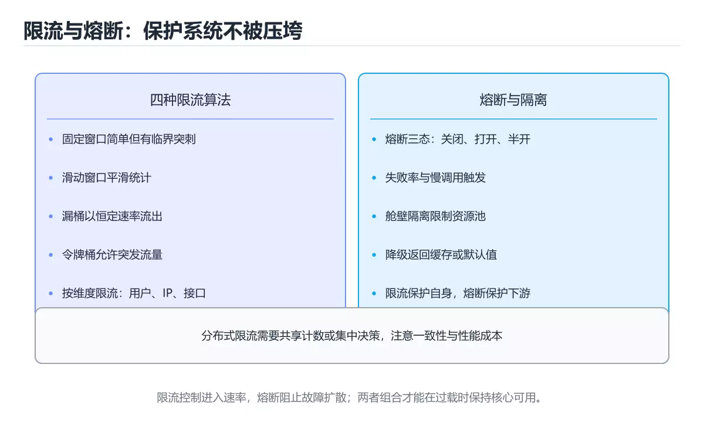
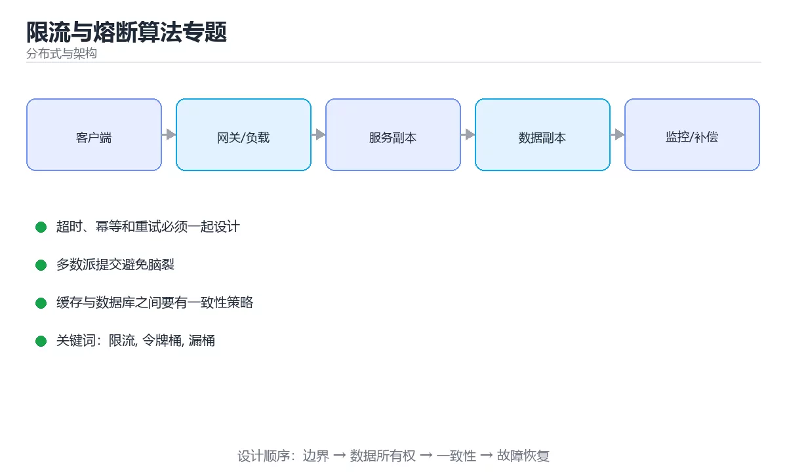

# 限流与熔断算法专题

> 内容更新时间：2026-10-06 · 学习阶段：进阶 · 预计用时：35 分钟





## 本节知识框架

**课程定位**：所属分类 `distributed`（分布式与架构），课程主题 `限流与熔断算法专题`，学习阶段 进阶，建议用时 40 分钟。

本课主线：四种限流算法对比、令牌桶实现与熔断隔离组合。

**学完本课应当能够**
- 说清 `限流` 与 `令牌桶` 的含义与区别，并各举一个正例和一个反例。
- 用本课示例验证 `漏桶` 的行为，记录输入、输出与失败条件。
- 遇到「只用固定窗口」这类问题时，能说出触发条件与修复顺序。

### 复习清单

- [ ] 能不看正文复述本课核心术语，并指出一个边界或反例。
- [ ] 能运行或推演本课示例，记录输入、输出与失败现象。
- [ ] 能完成一次自测，并把错题对照错误表定位原因。

## 核心概念定义

| 术语 | 操作性定义 | 常见边界与风险 |
| --- | --- | --- |
| 限流 | 限流：保护自己（入口流量控制）。 | 易错：NAT 后整栋楼被误伤；正确做法是叠加用户与租户维度。 |
| 令牌桶 | ④ 令牌桶：按速率补令牌，桶内容量即突发上限。 | 易错：边界处流量翻倍；正确做法是改用滑动窗口或令牌桶。 |
| 漏桶 | 关键关系：先分清「限流」与「令牌桶」的职责，再理解「漏桶」的适用边界。 | 权限与密钥策略变化会让结论失效，按最小权限并用真实凭据流程复验。 |
| 滑动窗口 | 在时间轴上只统计最近一段窗口内的请求或事件，用平滑突发并限制瞬时速率。 | 易错：边界处流量翻倍；正确做法是改用滑动窗口或令牌桶。 |
| 熔断 | 依赖连续失败达到阈值后暂时停止调用并快速失败，给下游恢复时间并防止雪崩。 | 易错：重试风暴加剧故障；正确做法是退避 + 上限 + 熔断。 |
| 退避 | 请求失败后按延迟逐步重试，避免大量客户端同时重试造成二次拥塞。 | 易错：重试风暴加剧故障；正确做法是退避 + 上限 + 熔断。 |

## 原理与运行机制

### 机制总览

**教材衔接：分布式限流要点**

| 主题 | 做法 |
| --- | --- |
| 共享计数 | Redis + Lua 脚本保证原子性 |
| 时钟一致 | 用 Redis 时间或服务端统一时间，避免各节点时钟差 |
| 精度与性能 | 本地预取配额（如每次取 100 个），用精度换吞吐 |
| 多维度 | 用户、接口、租户、IP 组合限流，按业务定优先级 |
| 反馈 | 返回 429 与 `Retry-After`，让客户端退避 |
| 降级 | 限流组件故障时按预设策略（放行或拒绝） |
| 监控 | 限流触发次数、被限用户分布、误伤比例 |

**教材衔接：熔断与隔离速查**

| 机制 | 作用 | 关键参数 |
| --- | --- | --- |
| 熔断 | 下游故障时快速失败 | 错误率阈值、窗口、半开探测数 |
| 隔离 | 防止故障扩散 | 线程池或信号量隔离 |
| 超时 | 避免无限等待 | 连接、读写分别设置 |
| 重试 | 处理瞬时抖动 | 仅幂等、指数退避、上限 |
| 降级 | 保核心功能 | 返回缓存或默认值 |
| 背压 | 保护自身 | 有界队列 + 拒绝策略 |

**教材衔接：补充：四种算法实现与配额分配**

### 四种算法的伪代码与对照

```text
① 固定窗口
  key = f"{user}:{now // window}"
  count = INCR(key)
  if count == 1: EXPIRE(key, window)
  return count <= limit
  缺点：窗口边界处可能放过 2 倍流量

② 滑动窗口（用两个窗口加权）
  cur = GET(cur_key); prev = GET(prev_key)
  ratio = (window - elapsed) / window
  approx = cur + prev * ratio
  return approx < limit
  优点：平滑，内存只需两个计数器

③ 漏桶：请求入队，按固定速率流出
  适合严格平滑输出，不允许突发

④ 令牌桶：按速率补令牌，桶内容量即突发上限
  允许突发，最常用
```

| 算法 | 允许突发 | 内存 | 精度 | 推荐场景 |
| --- | --- | --- | --- | --- |
| 固定窗口 | 边界处会 | 1 个计数 | 低 | 粗粒度保护 |
| 滑动窗口 | 轻微 | 2 个计数 | 中 | 通用限流 |
| 漏桶 | 不允许 | 队列长度 | 高 | 保护脆弱下游 |
| 令牌桶 | 允许（有上限） | 桶状态 | 高 | **默认选择** |

### 分布式令牌桶（Redis + Lua）

```lua
-- KEYS[1]=桶 key  ARGV: rate（每秒补充）, capacity, now（秒，含小数）, cost
local data = redis.call('HMGET', KEYS[1], 'tokens', 'ts')
local tokens = tonumber(data[1]) or tonumber(ARGV[2])
local ts = tonumber(data[2]) or tonumber(ARGV[3])

local delta = math.max(0, tonumber(ARGV[3]) - ts)
tokens = math.min(tonumber(ARGV[2]), tokens + delta * tonumber(ARGV[1]))

local allowed = 0
if tokens >= tonumber(ARGV[4]) then
  tokens = tokens - tonumber(ARGV[4])
  allowed = 1
end

redis.call('HMSET', KEYS[1], 'tokens', tokens, 'ts', ARGV[3])
redis.call('EXPIRE', KEYS[1], math.ceil(tonumber(ARGV[2]) / tonumber(ARGV[1]) * 2))
return allowed
```

```text
为什么必须用 Lua
  · 读取令牌数 → 计算 → 写回 三步若分开执行，并发下会互相覆盖
  · Lua 在 Redis 中原子执行，保证「检查并扣减」不可分割
  · 同时设置过期时间，避免冷 key 永久占内存
```

### 配额怎么在实例之间分配

| 方式 | 做法 | 问题 |
| --- | --- | --- |
| 全局限流 | 所有实例共用一个 Redis 计数 | Redis 成为瓶颈与单点 |
| 本地限流 | 每实例各自限额 | 总量随实例数放大 |
| 混合（推荐） | 本地挡突发 + 全局控总量 | 实现稍复杂 |

```text
混合方案示例（目标：全局 10000 QPS，10 个实例）
  ① 本地令牌桶：每实例 1200 QPS（留 20% 余量吸收突发）
  ② 全局令牌桶：Redis 中 10000 QPS
  ③ Redis 不可用时：降级为纯本地限流（宁可放过也不打垮自身）
```

### 多维度限流的组合

```text
按优先级从外到内
  ① 全局总配额（保护整个系统）
  ② 接口维度（保护单个热点接口）
  ③ 用户 / 租户维度（防单用户刷爆）
  ④ IP 维度（对未登录请求兜底）

提示：维度越多，Redis 的 key 越多，注意内存与热点问题。
大租户可单独配额，避免「一个租户吃掉全部额度」。
```

### 限流返回什么

| 响应 | 说明 |
| --- | --- |
| HTTP 429 | 标准状态码，明确表示限流 |
| `Retry-After` 头 | 告诉客户端多久后重试，避免立刻重试 |
| 明确的错误码 | 让客户端区分「限流」与「服务异常」 |

```text
与熔断的区别
  限流：保护自己（入口流量控制）
  熔断：保护调用方（下游故障时快速失败）
  二者组合，再加降级，才构成完整保护网
```

### 自查清单

- [ ] 默认使用令牌桶，允许有上限的突发
- [ ] 分布式限流用 Lua 保证原子性
- [ ] 有本地兜底，Redis 不可用时不至于全站拒绝
- [ ] 按用户与接口双维度限流，大租户单独配额
- [ ] 限流返回 429 并带 `Retry-After`

## 典型应用场景

- **只用固定窗口**：典型现象是边界处流量翻倍；正确做法是改用滑动窗口或令牌桶。
- **限流只按 IP**：典型现象是NAT 后整栋楼被误伤；正确做法是叠加用户与租户维度。
- **每请求都访问 Redis**：典型现象是限流组件成为瓶颈；正确做法是本地预取配额并批量上报。
- **用 `INCR` 加 `EXPIRE` 两步**：典型现象是中间失败导致键永不过期；正确做法是用 Lua 脚本保证原子性。

### 最小验证场景

- 准备：保留 `text` 示例的原始输入，先记录 `限流与熔断算法专题` 的基线输出和完整运行命令。
- 观察：先核对 调用了 `INCR()`，再改变一个与 `限流` 相关的条件。
- 判定：新结果与 `限流与熔断算法专题` 的基线不同不等于错误；只有当差异破坏了 `限流` 的定义或错误表中的约束，才判定为失败。

### 选择与边界

- 使用 `限流` 时，先满足它的定义：限流：保护自己（入口流量控制）；易错：NAT 后整栋楼被误伤；正确做法是叠加用户与租户维度。
- 使用 `令牌桶` 时，先满足它的定义：④ 令牌桶：按速率补令牌，桶内容量即突发上限；易错：边界处流量翻倍；正确做法是改用滑动窗口或令牌桶。
- 使用 `漏桶` 时，先满足它的定义：关键关系：先分清「限流」与「令牌桶」的职责，再理解「漏桶」的适用边界；权限与密钥策略变化会让结论失效，按最小权限并用真实凭据流程复验。
- 使用 `滑动窗口` 时，先满足它的定义：在时间轴上只统计最近一段窗口内的请求或事件，用平滑突发并限制瞬时速率；易错：边界处流量翻倍；正确做法是改用滑动窗口或令牌桶。
- 使用 `熔断` 时，先满足它的定义：依赖连续失败达到阈值后暂时停止调用并快速失败，给下游恢复时间并防止雪崩；易错：重试风暴加剧故障；正确做法是退避 + 上限 + 熔断。

## 代码/协议/SQL 示例

**教材衔接：令牌桶实现**

```python
import threading
import time

class TokenBucket:
    """令牌桶：按恒定速率补充令牌，桶容量决定可容忍的突发量。"""

    def __init__(self, rate_per_second: float, capacity: float):
        if rate_per_second <= 0 or capacity <= 0:
            raise ValueError("速率与容量必须为正")
        self.rate = rate_per_second
        self.capacity = capacity
        self.tokens = capacity
        self.updated_at = time.monotonic()
        self.lock = threading.Lock()

    def _refill(self, now: float) -> None:
        elapsed = max(0.0, now - self.updated_at)
        self.tokens = min(self.capacity, self.tokens + elapsed * self.rate)
        self.updated_at = now

    def try_acquire(self, cost: float = 1.0) -> bool:
        with self.lock:
            now = time.monotonic()
            self._refill(now)
            if self.tokens >= cost:
                self.tokens -= cost
                return True
            return False

    def wait_time(self, cost: float = 1.0) -> float:
        """需要等多久才能拿到令牌，用于返回 Retry-After。"""
        with self.lock:
            now = time.monotonic()
            self._refill(now)
            if self.tokens >= cost:
                return 0.0
            return round((cost - self.tokens) / self.rate, 3)

def client_key(user_id: str, api: str, ip: str) -> str:
    """限流维度：优先按用户与接口组合，未登录时退回 IP。"""
    return f"{user_id or 'anon'}:{api}" if user_id else f"ip:{ip}:{api}"

bucket = TokenBucket(rate_per_second=5, capacity=10)   # 平均 5 QPS，可突发 10
print([bucket.try_acquire() for _ in range(12)].count(True))
print(bucket.wait_time())
print(client_key("u1", "/api/orders", "1.2.3.4"))
```

## 时间/空间复杂度或性能分析

**性能关注点（限流与熔断算法专题）**：一致性与可用性存在权衡：记录 P99 延迟、副本同步延迟与故障恢复时间。

**本课特有开销（限流与熔断算法专题 · 限流）**：缓存命中率比缓存实现本身更关键，先记录命中率与失效策略再谈优化。

**测量方法**：以 `限流与熔断算法专题` 的 `限流` 场景为对象，固定输入跑一遍记录基线，再把规模或并发度提高一个数量级复测；两次结果的差值与波动范围才是结论依据。

## 常见误区与易错点

| 容易写错的做法 | 实际现象 | 原因与正确做法 |
| --- | --- | --- |
| 只用固定窗口 | 边界处流量翻倍 | 改用滑动窗口或令牌桶 |
| 限流只按 IP | NAT 后整栋楼被误伤 | 叠加用户与租户维度 |
| 每请求都访问 Redis | 限流组件成为瓶颈 | 本地预取配额并批量上报 |
| 用 `INCR` 加 `EXPIRE` 两步 | 中间失败导致键永不过期 | 用 Lua 脚本保证原子性 |
| 重试不考虑限流 | 重试风暴加剧故障 | 退避 + 上限 + 熔断 |
| 熔断后没有半开探测 | 下游恢复也不可用 | 冷却后放少量请求探测 |
| 无限流监控 | 误伤无人发现 | 监控触发次数与影响面 |
| 限流阈值凭感觉设定 | 要么误伤要么无保护 | 基于压测与容量规划设定 |

### 现场 1：只用固定窗口

**症状**：边界处流量翻倍。

**根因与修复**：改用滑动窗口或令牌桶。

**自检**：在本课示例里复现「只用固定窗口」，改成改用滑动窗口或令牌桶后重跑；如果症状消失且失败路径按预期变化，说明定位正确。

### 现场 2：限流只按 IP

**症状**：NAT 后整栋楼被误伤。

**根因与修复**：叠加用户与租户维度。

**自检**：在本课示例里复现「限流只按 IP」，改成叠加用户与租户维度后重跑；如果症状消失且失败路径按预期变化，说明定位正确。

### 现场 3：每请求都访问 Redis

**症状**：限流组件成为瓶颈。

**根因与修复**：本地预取配额并批量上报。

**自检**：在本课示例里复现「每请求都访问 Redis」，改成本地预取配额并批量上报后重跑；如果症状消失且失败路径按预期变化，说明定位正确。

### 现场 4：用 `INCR` 加 `EXPIRE` 两步

**症状**：中间失败导致键永不过期。

**根因与修复**：用 Lua 脚本保证原子性。

**自检**：在本课示例里复现「用 `INCR` 加 `EXPIRE` 两步」，改成用 Lua 脚本保证原子性后重跑；如果症状消失且失败路径按预期变化，说明定位正确。

### 现场 5：重试不考虑限流

**症状**：重试风暴加剧故障。

**根因与修复**：退避 + 上限 + 熔断。

**自检**：在本课示例里复现「重试不考虑限流」，改成退避 + 上限 + 熔断后重跑；如果症状消失且失败路径按预期变化，说明定位正确。

### 现场 6：熔断后没有半开探测

**症状**：下游恢复也不可用。

**根因与修复**：冷却后放少量请求探测。

**自检**：在本课示例里复现「熔断后没有半开探测」，改成冷却后放少量请求探测后重跑；如果症状消失且失败路径按预期变化，说明定位正确。

### 现场 7：无限流监控

**症状**：误伤无人发现。

**根因与修复**：监控触发次数与影响面。

**自检**：在本课示例里复现「无限流监控」，改成监控触发次数与影响面后重跑；如果症状消失且失败路径按预期变化，说明定位正确。

### 现场 8：限流阈值凭感觉设定

**症状**：要么误伤要么无保护。

**根因与修复**：基于压测与容量规划设定。

**自检**：在本课示例里复现「限流阈值凭感觉设定」，改成基于压测与容量规划设定后重跑；如果症状消失且失败路径按预期变化，说明定位正确。

## 与其他知识点的关系

**教材衔接：四种限流算法对照**

| 算法 | 允许突发 | 平滑度 | 实现成本 | 适用 |
| --- | --- | --- | --- | --- |
| 固定窗口计数 | 边界处可能双倍 | 差 | 最低 | 粗粒度保护 |
| 滑动窗口 | 有限 | 较好 | 中 | 通用接口限流 |
| 漏桶 | 不允许 | 最平滑 | 中 | 需要恒定输出速率 |
| 令牌桶 | 允许（桶容量决定） | 好 | 中 | 大多数业务首选 |

固定窗口的经典缺陷：限制「每分钟 100 次」时，用户在 00:59 发 100 次、01:00 再发 100 次，瞬间 200 次穿透。

- **先修**：`分布式 ID 与发号器`。本课默认这些内容已经掌握。
- **相关或后续**：`分布式缓存架构`、`API 网关与负载均衡`、`图解限流、熔断与降级`。本课术语会在这些课程里继续使用。
- **术语归属**：`限流`、`令牌桶`、`漏桶` 的定义以本课「核心概念定义」为准，换到其他课程时先确认定义是否被改写。
- 同一分类的《高可用与容量规划》也涉及 `限流`；两课衔接时先确认这个术语的定义是否一致。

## 自测题与参考答案

> 先独立作答，再对照参考答案；答案都能在本课正文、术语表或错误表里找到依据。

### 自测 1（概念复述）

不看正文，写出 `限流` 的操作性定义，并说明它与 `令牌桶` 的区别。

**参考答案**：限流：保护自己（入口流量控制）。

`令牌桶` 的定位是：④ 令牌桶：按速率补令牌，桶内容量即突发上限；两者的差别要从适用对象与失败模式上说明。

### 自测 2（排错）

本课错误表记录了「只用固定窗口」这类做法。请写出它会出现的现象、根因，以及修复顺序。

**参考答案**：现象是边界处流量翻倍；正确做法是改用滑动窗口或令牌桶。修复时先复现现象并保留证据，再改动一处假设重跑，确认现象消失。

### 自测 3（动手验证）

运行本课的 `text` 示例，把其中的 `"{user}:{now // window}"` 换成一个边界值后重新运行，记录输出与错误信息。

**参考答案**：正常输入下 `text` 示例应当复现正文给出的结果；把 `"{user}:{now // window}"` 换成边界值后，如果结果改变或报错，先核对它是否满足 `限流与熔断算法专题` 中`限流` 的适用范围，再检查错误表里是否有同类现象。

### 自测 4（代码阅读）

阅读本课开头的 `text` 示例，说明它体现了`限流` 的哪一条性质，并指出改动哪个输入会让这条性质不再成立。

**参考答案**：`限流` 的定义是 限流：保护自己（入口流量控制），示例正是在实现这条定义。改动与 `限流` 有关的一个输入后，如果结果不再符合 `限流与熔断算法专题` 的正文描述，就说明该性质只在当前前提成立。

### 自测 5（迁移）

把 `限流与熔断算法专题` 的方法迁移到自己的项目：围绕 `限流` 写出一个与错误表同类的风险点，并说明触发条件和检验方式。

**参考答案**：例如「限流阈值凭感觉设定」，它会导致要么误伤要么无保护；检验方式是按基于压测与容量规划设定改一处再复现，确认现象消失且没有引入新的失败分支。

### 自测 6（对比）

用一个表格对比 `限流` 与 `令牌桶`：各写一行适用场景、一行失败表现。

**参考答案**：`限流` 的定义是限流：保护自己（入口流量控制）；`令牌桶` 的定义是④ 令牌桶：按速率补令牌，桶内容量即突发上限。两者的失败表现分别对应本课错误表里与本术语相关的行。

### 自测 7（排错顺序）

面对「只用固定窗口」引发的问题，请把“复现 边界处流量翻倍 → 保留证据 → 改用滑动窗口或令牌桶 → 回归验证”四步写成可执行的检查清单。

**参考答案**：第一步按边界处流量翻倍复现；第二步记录输入、版本与完整报错；第三步按改用滑动窗口或令牌桶只改一处；第四步重跑并确认失败路径也按预期变化。

### 自测 8（边界判断）

针对 `退避`，分别写出“可以使用”的条件和“结论不再成立”的条件。

**参考答案**：易错：重试风暴加剧故障；正确做法是退避 + 上限 + 熔断。 同时要把 `退避` 的定义 请求失败后按延迟逐步重试，避免大量客户端同时重试造成二次拥塞 与实际输入逐项对照。

### 自测 9（机制重建）

不看正文，按输入、转换、输出、验证四段重建 `限流` → `令牌桶` → `漏桶` → `滑动窗口` 的作用链。

**参考答案**：起点是 `限流` 的定义 限流：保护自己（入口流量控制）；中间每一步都保留可观察状态；终点由 `退避` 检查，失败时回到错误表定位第一个偏离定义的步骤。

### 自测 10（综合排错）

在 `限流与熔断算法专题` 中，现象是 要么误伤要么无保护。请围绕 限流阈值凭感觉设定 写出最小复现、关键证据、修复动作和回归验证，并说明为什么不能只凭一次运行下结论。

**参考答案**：先复现 限流阈值凭感觉设定，记录输入与完整错误；再按 基于压测与容量规划设定 只改一处。回归时同时跑正常路径和边界路径，只有两次结果都可解释，才把修复视为完成。

### 自测 11（一分钟复述）

用每分钟约 200 字的速度复述 `限流与熔断算法专题`：先给主问题，再按顺序说出 `限流`、`令牌桶`、`漏桶`、`滑动窗口`，最后给一个失败案例。

**自评标准**：主问题必须对应 四种限流算法对比、令牌桶实现与熔断隔离组合；每个术语都要能接上一句定义或边界；失败案例必须写成可观察现象，不能用“可能有风险”代替证据。

## 延伸阅读

想更直观地理解本课概念？推荐参阅以下图解专题：

- [图解限流、熔断与降级](visual_rate_limit_circuit.md)

## 术语速查

| 术语 | 一句话说明 |
| --- | --- |
| `限流` | 限流：保护自己（入口流量控制）。 |
| `令牌桶` | ④ 令牌桶：按速率补令牌，桶内容量即突发上限。 |
| `漏桶` | 关键关系：先分清「限流」与「令牌桶」的职责，再理解「漏桶」的适用边界。 |
| `滑动窗口` | 在时间轴上只统计最近一段窗口内的请求或事件，用平滑突发并限制瞬时速率。 |
| `熔断` | 依赖连续失败达到阈值后暂时停止调用并快速失败，给下游恢复时间并防止雪崩。 |
| `退避` | 请求失败后按延迟逐步重试，避免大量客户端同时重试造成二次拥塞。 |

**术语关系**：`限流`（限流：保护自己（入口流量控制）） → `令牌桶`（④ 令牌桶：按速率补令牌） → `漏桶`（关键关系：先分清「限流」与「令牌桶」的职责） → `滑动窗口`（在时间轴上只统计最近一段窗口内的请求或事件）。

## 考点精讲

`限流与熔断算法专题` 的题库有 6 道题，下面逐题给出题干、正确项与判断依据：先自己作答，再核对正确项，最后回到正文对应小节复核。

### 考点 1：第 1 题

- **题目**：固定窗口限流的典型缺陷是？
- **正确项**：窗口边界处可能出现瞬时双倍流量
- **判断依据**：本题正确项是「窗口边界处可能出现瞬时双倍流量」。术语 限流（限流与熔断算法专题）：限流：保护自己（入口流量控制），本题取「窗口边界处可能出现瞬时双倍流量」这条。易错点是只用固定窗口，会造成边界处流量翻倍，改法是改用滑动窗口或令牌桶。易错点是限流只按 IP，会造成NAT 后整栋楼被误伤，改法是叠加用户与租户维度。

### 考点 2：第 2 题

- **题目**：围绕“限流与熔断算法专题”中的 限流、令牌桶、漏桶，下列哪两项是本课强调的实践判断？
- **正确项**：验证 令牌桶 时要固定版本并覆盖边界输入，结论才可复现；学习 限流 时要同时说明输入、输出和失败路径，不能只看正常流程
- **判断依据**：按《限流与熔断算法专题》的正文口径，本题要同时选中「验证 令牌桶 时要固定版本并覆盖边界输入，结论才可复现」、「学习 限流 时要同时说明输入、输出和失败路径，不能只看正常流程」，漏掉任一项都算没答全。术语 限流（限流与熔断算法专题）：限流：保护自己（入口流量控制）。易错点是限流只按 IP，会造成NAT 后整栋楼被误伤，改法是叠加用户与租户维度。

### 考点 3：第 3 题

- **题目**：按“限流与熔断算法专题”中 限流、令牌桶、漏桶 的实践顺序，把四个步骤排成从准备到复盘的合理顺序。
- **正确项**：先明确 限流 的输入、输出与约束 → 写出最小示例并核对 令牌桶 的基线结果 → 只改一个变量，记录边界与失败路径的变化 → 固定版本与证据，把“限流与熔断算法专题”的结论写成可复现记录
- **判断依据**：按《限流与熔断算法专题》正文的先后，本题顺序是「先明确 限流 的输入、输出与约束」 → 「写出最小示例并核对 令牌桶 的基线结果」 → 「只改一个变量，记录边界与失败路径的变化」 → 「固定版本与证据，把“限流与熔断算法专题”的结论写成可复现记录」。术语 限流（限流与熔断算法专题）：限流：保护自己（入口流量控制）。易错点是只用固定窗口会造成边界处流量翻倍，改法是改用滑动窗口或令牌桶。

### 考点 4：第 4 题

- **题目**：限流触发时，服务端应该返回什么？
- **正确项**：429 并带上 Retry-After
- **判断依据**：本题正确项是「429 并带上 Retry-After」。术语 限流（限流与熔断算法专题）：限流：保护自己（入口流量控制），本题取「429 并带上 Retry-After」这条。易错点是用 `INCR` 加 `EXPIRE` 两步，会造成中间失败导致键永不过期，改法是用 Lua 脚本保证原子性。

### 考点 5：第 5 题

- **题目**：熔断器进入打开状态后，还需要什么机制才能恢复？
- **正确项**：冷却后进入半开状态放少量探测请求
- **判断依据**：本题正确项是「冷却后进入半开状态放少量探测请求」。术语 熔断（限流与熔断算法专题）：依赖连续失败达到阈值后暂时停止调用并快速失败，给下游恢复时间并防止雪崩，本题取「冷却后进入半开状态放少量探测请求」这条。易错点是重试不考虑限流，会造成重试风暴加剧故障，改法是退避 + 上限 + 熔断。

### 考点 6：第 6 题

- **题目**：结合 `限流与熔断算法专题` 中围绕 `限流` 的代码，哪一项说法与“四种限流算法对比、令牌桶实现与熔断隔离组合。”一致？
- **正确项**：窗口边界处可能出现瞬时双倍流量
- **判断依据**：本题正确项是「窗口边界处可能出现瞬时双倍流量」。术语 限流（限流与熔断算法专题）：限流：保护自己（入口流量控制），本题取「窗口边界处可能出现瞬时双倍流量」这条。易错点是熔断后没有半开探测，会造成下游恢复也不可用，改法是冷却后放少量请求探测。易错点是无限流监控，会造成误伤无人发现，改法是监控触发次数与影响面。

### 考点 7：`限流`

- **要点**：限流：保护自己（入口流量控制）。
- **限流 的边界**：易错：NAT 后整栋楼被误伤；正确做法是叠加用户与租户维度。

### 考点 8：`令牌桶`

- **要点**：④ 令牌桶：按速率补令牌，桶内容量即突发上限。
- **令牌桶 的边界**：易错：边界处流量翻倍；正确做法是改用滑动窗口或令牌桶。

### 考点 9：`漏桶`

- **要点**：关键关系：先分清「限流」与「令牌桶」的职责，再理解「漏桶」的适用边界。
- **漏桶 的边界**：权限与密钥策略变化会让结论失效，按最小权限并用真实凭据流程复验。

### 考点 10：`滑动窗口`

- **要点**：在时间轴上只统计最近一段窗口内的请求或事件，用平滑突发并限制瞬时速率。
- **滑动窗口 的边界**：易错：边界处流量翻倍；正确做法是改用滑动窗口或令牌桶。

### 考点 11：`熔断`

- **要点**：依赖连续失败达到阈值后暂时停止调用并快速失败，给下游恢复时间并防止雪崩。
- **熔断 的边界**：易错：重试风暴加剧故障；正确做法是退避 + 上限 + 熔断。

### 考点 12：`退避`

- **要点**：请求失败后按延迟逐步重试，避免大量客户端同时重试造成二次拥塞。
- **退避 的边界**：易错：重试风暴加剧故障；正确做法是退避 + 上限 + 熔断。

### 考点 13：排错——只用固定窗口

- **现象**：边界处流量翻倍。
- **处理**：改用滑动窗口或令牌桶。

### 考点 14：排错——限流只按 IP

- **现象**：NAT 后整栋楼被误伤。
- **处理**：叠加用户与租户维度。

### 考点 15：综合辨析——`限流` 与 `退避`

- **辨析点**：`限流` 的定义是 限流：保护自己（入口流量控制）；`退避` 的定义是 请求失败后按延迟逐步重试，避免大量客户端同时重试造成二次拥塞。
- **答题要求**：面对 `限流与熔断算法专题` 的题目，先判断描述的是 `限流` 还是 `退避`，再归到对应定义，最后写出一个会让该定义失效的边界输入。

### 考点 16：排错评分点

- **现象分**：能写出 边界处流量翻倍，而不是只写“程序有错”。
- **证据分**：保留触发 只用固定窗口 的输入、版本和错误原文。
- **修复分**：按 改用滑动窗口或令牌桶 只改一处，并同时回归正常路径与边界路径。

## 内容元数据

- 内容版本：v2.0
- 最后更新：2026-10-06
- 学习阶段：进阶
- 适用环境：分布式系统与云原生基础设施；本课聚焦 限流。
- 内容来源：内置结构化课程与工程实践整理
- 相关主题：限流、令牌桶、漏桶、滑动窗口、熔断、退避
- 质量版本：P0 测验标准 + P1 覆盖扩展 + P2 体验补全

## 参考资料与复核

- 最后复核：2026-10-04
- 下次复核：2027-07-24
- 复核范围：版本兼容、API 行为、安全建议与工程实践
- 来源性质：官方文档、标准或权威教材；本课核对关键词：限流、令牌桶、漏桶、滑动窗口、熔断、退避。

| 参考资料 | 本课用途 |
| --- | --- |
| [Microsoft 云设计模式](https://learn.microsoft.com/azure/architecture/patterns/) | 重试、熔断与队列模式 |
| [Apache Kafka 文档](https://kafka.apache.org/documentation/) | 日志、分区与消费组 |
| [CNCF 技术地图](https://landscape.cncf.io/) | 云原生技术生态 |

| [本课术语索引：限流与熔断算法专题](#核心概念定义) | 按本课输入、术语边界和错误表现逐项核对 |
> 「限流与熔断算法专题」的链接用于离线阅读后的延伸核对；App 不会自动联网。