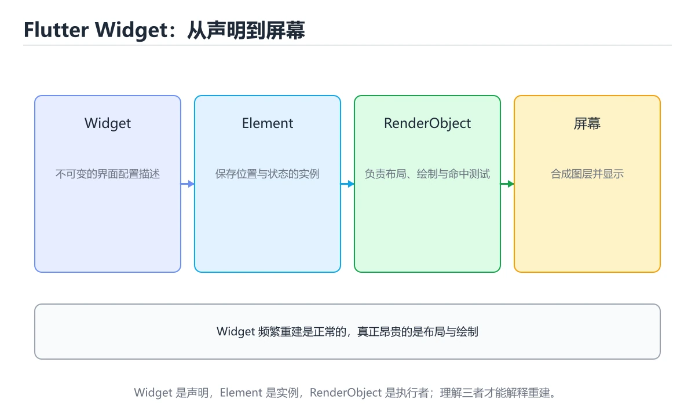
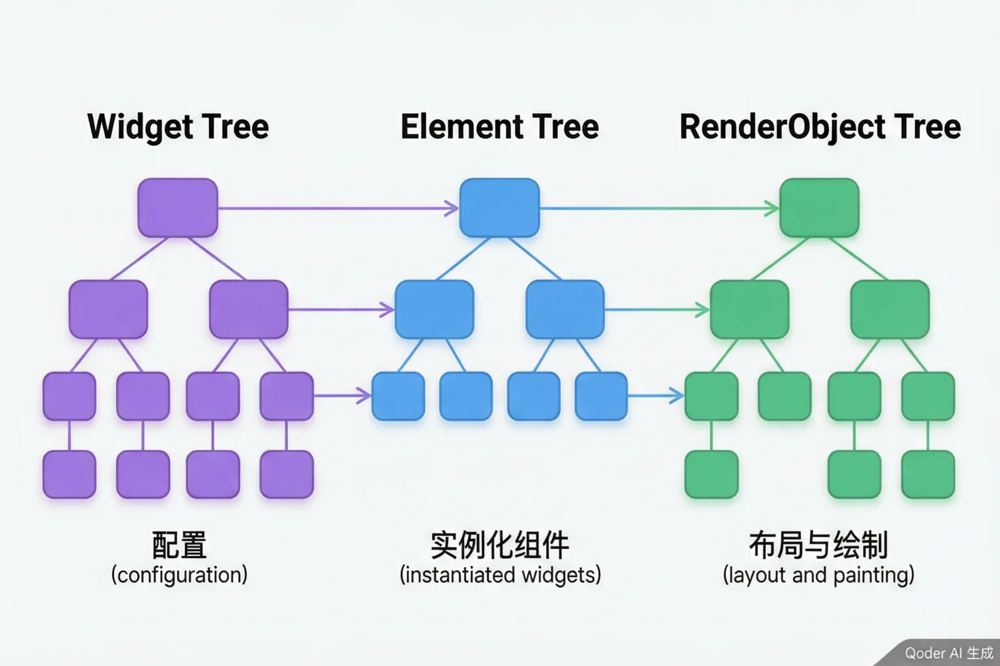

# Flutter 基础与 Widget 树

> 内容更新时间：2026-10-06 · 学习阶段：intermediate · 预计用时：45 分钟



## 本节知识框架

本课主线：Widget 分类、布局三原则与常用布局对照。学完之后，你应该能用自己的话说清楚 Flutter 里 Widget 是怎么回事、布局是怎么算出来的，以及碰到溢出报错时怎么修。

**先修知识**

- 了解 Dart 基本语法（变量、函数、类）
- 装好 Flutter SDK，能跑通 `flutter doctor`
- 知道什么是 JSON 或树形结构（Widget 树就是棵树）

**复习清单**

- [ ] 能不看正文复述布局三原则：约束向下、尺寸向上、父定位置
- [ ] 能说出 StatelessWidget 和 StatefulWidget 的区别，并各举一个例子
- [ ] 能独立排查一次 RenderFlex overflowed 报错，并写出修复步骤

## 核心概念定义

| 术语 | 一句话说明 |
| --- | --- |
| Flutter | Google 的跨平台 UI 框架，用 Dart 语言写一套代码就能跑在 Android、iOS、Web 和桌面上 |
| Widget | 界面的基本积木块，就像乐高零件——描述界面\"长什么样\"，本身不可变 |
| Widget 树 | 所有 Widget 按嵌套关系组成的树形结构，Flutter 靠它来描述整个界面 |
| 约束 (Constraints) | 父 Widget 告诉子 Widget\"你最大能多大、最小得多小\"的尺寸限制 |
| 热重载 (Hot Reload) | 改完代码保存后，界面秒级刷新且保留当前状态，开发时最常用的快速验证手段 |
| 懒加载 | 只构建当前屏幕可见的列表项，滚到新位置时才构建新的，避免一次性加载全部数据 |

## 原理与运行机制

### 用生活比喻理解 Flutter

想象你在盖房子：

- **Widget** 就像设计图纸——它描述\"这里有个客厅、那里有个卧室\"，但图纸本身不会住人。
- **Element** 是现场施工记录员——他拿着图纸（Widget），指挥实际的施工队，同时记录哪些房间需要翻新。
- **RenderObject** 是真正的砖墙和地板——负责实际的测量、布局和绘制。

好处是什么呢？改图纸比重盖房子便宜得多。所以 Flutter 里重建 Widget 非常廉价，真正的性能瓶颈在布局计算和绘制上。



### 布局三原则

Flutter 的布局可以用三句话概括，记住这三句就能解释绝大多数布局问题：

```text
1. 约束向下传递 —— 父节点告诉子节点：\"你最大能多大、最小得多小\"
2. 尺寸向上汇报 —— 子节点在约束范围内决定自己的大小，然后告诉父节点
3. 父决定子位置 —— 父节点根据子节点的大小，决定把它放在哪里
```

用传话游戏来理解：爸爸对孩子说\"桌子最多一米宽\"（约束向下），孩子说\"我要 80 厘米\"（尺寸向上），爸爸决定把桌子靠墙放（父定位置）。

### 布局流程 ASCII 图

```text
    ┌──────────────────────────┐
    │  父 Widget (如 Row)       │
    │  给出约束: maxWidth=360   │
    │         ↓ 约束向下        │
    │  ┌─────┐  ┌──────────┐  │
    │  │Icon │  │ Expanded  │  │
    │  │24px │  │ 剩余宽度   │  │
    │  └─────┘  └──────────┘  │
    │         ↑ 尺寸向上       │
    │  父决定各自位置           │
    └──────────────────────────┘
```

看到 `RenderFlex overflowed` 报错，就是子节点要的空间超过了父节点给的约束——比如 Row 里塞了太多东西，横向放不下。

### Widget 分类速查

| 类型 | 特点 | 典型组件 |
| --- | --- | --- |
| 无状态 | 不可变、由父级传入数据 | `StatelessWidget`、`Text`、`Icon` |
| 有状态 | 自身持有并修改状态 | `StatefulWidget`、`TextField`、`Checkbox` |
| 布局 | 控制子组件位置与尺寸 | `Row`、`Column`、`Stack`、`Wrap` |
| 滚动 | 提供滚动能力 | `ListView`、`GridView`、`SingleChildScrollView` |

## 典型应用场景

- **横向溢出**：Row 里子项太多放不下。修法：用 `Expanded` 或 `Flexible` 包住需要缩放的子项。
- **纵向溢出**：Column 内容超出屏幕高度。修法：用 `SingleChildScrollView` 或 `ListView` 让它可滚动。
- **文本溢出**：文字太长一行放不下。修法：`maxLines` 加 `TextOverflow.ellipsis` 显示省略号。
- **无限高度约束**：ListView 直接放在 Column 里报错。修法：给 ListView 加 `Expanded` 或设置 `shrinkWrap: true`。
- **长列表性能差**：用 Column + map 渲染几百条数据。修法：改用 `ListView.builder` 懒加载。

## 代码/协议/SQL 示例

### 最小可运行示例

```dart
import 'package:flutter/material.dart';

void main() => runApp(const MyApp());

class MyApp extends StatelessWidget {
  const MyApp({super.key});

  @override
  Widget build(BuildContext context) {
    return MaterialApp(
      home: Scaffold(
        appBar: AppBar(title: const Text('Flutter 基础')),
        body: const Center(child: Text('Hello, Flutter!')),
      ),
    );
  }
}
```

### 卡片列表：ListView.builder 懒加载

```dart
class LessonList extends StatelessWidget {
  const LessonList({super.key, required this.titles});

  final List<String> titles;

  @override
  Widget build(BuildContext context) {
    return ListView.separated(
      padding: const EdgeInsets.all(16),
      itemCount: titles.length,
      separatorBuilder: (_, __) => const SizedBox(height: 8),
      itemBuilder: (context, index) {
        return Card(
          child: ListTile(
            title: Text(titles[index]),
            trailing: const Icon(Icons.chevron_right),
            onTap: () {},
          ),
        );
      },
    );
  }
}
```

### 自适应网格：LayoutBuilder 按宽度决定列数

```dart
Widget adaptiveGrid(BuildContext context, List<Widget> items) {
  return LayoutBuilder(
    builder: (context, constraints) {
      final columns = constraints.maxWidth >= 900 ? 4
          : constraints.maxWidth >= 600 ? 3 : 2;
      return GridView.count(
        crossAxisCount: columns,
        shrinkWrap: true,
        physics: const NeverScrollableScrollPhysics(),
        children: items,
      );
    },
  );
}
```

### 布局实战：Row + Expanded 按比例分配宽度

```dart
Column(
  crossAxisAlignment: CrossAxisAlignment.start,
  children: [
    const Text('标题', style: TextStyle(fontSize: 20)),
    const SizedBox(height: 8),
    Row(
      children: [
        const Icon(Icons.person),
        const SizedBox(width: 8),
        Expanded(
          child: Text(
            '很长的说明文字会自动换行，不会溢出',
            maxLines: 2,
            overflow: TextOverflow.ellipsis,
          ),
        ),
      ],
    ),
  ],
)
```

### 有状态 Widget：计数器示例

```dart
class Counter extends StatefulWidget {
  const Counter({super.key});

  @override
  State<Counter> createState() => _CounterState();
}

class _CounterState extends State<Counter> {
  int _count = 0;

  @override
  Widget build(BuildContext context) {
    return Column(
      children: [
        Text('计数：$_count'),
        FilledButton(
          onPressed: () => setState(() => _count++),
          child: const Text('加一'),
        ),
      ],
    );
  }
}
```

## 时间/空间复杂度或性能分析

Flutter 的性能关注点主要集中在三个方面：Widget 重建次数、布局计算耗时和首屏渲染时间。

**Widget 重建**：Widget 本身是不可变的配置描述，重建代价很低，但如果一个大 Widget 树频繁重建，累积开销不可忽视。经验法则是：能加 `const` 就加——`const` 组件不会因父级重建而重建。

**列表性能**：用 `Column` + `.map()` 渲染 1000 条数据会一次性构建所有子项，首帧慢且内存占用高。换成 `ListView.builder` 后只构建可见区域的子项，内存和首帧时间大幅下降。

**setState 范围**：`setState` 会触发整个 StatefulWidget 的 `build` 重新执行。把状态下沉到最小的 StatefulWidget，可以减少不必要的重建范围。

**测量方法**：用 Flutter DevTools 的 Performance 面板观察帧时间。固定输入跑一遍记录基线，再提高数据量一个数量级复测，两次结果的差值才是结论依据。

## 常见误区与易错点

| 错误 | 现象 | 修法 |
| --- | --- | --- |
| Row 里直接放多个不定宽子项 | RenderFlex overflowed 横向溢出 | 用 `Expanded` 或 `Flexible` 包住 |
| Column 里直接放 ListView | 无限高度约束报错 | 用 `Expanded` 包 ListView 或设 `shrinkWrap` |
| 忘记 dispose 控制器 | 内存泄漏 | 在 `dispose()` 里释放 AnimationController 等 |
| 在 build 里发网络请求 | 每次重建都重复请求 | 放 `initState` 或用状态管理 |
| setState 后 Widget 已卸载 | 报\"setState called after dispose\" | 加 `if (!mounted) return;` |
| 直接改 Widget 字段期望刷新 | 界面不更新 | 状态改变要走 `setState` 或状态管理 |
| 列表项没有 key | 滚动或删改后元素错位 | 用 `ValueKey(item.id)` |
| 硬编码固定尺寸 | 小屏设备上溢出 | 用比例或 `LayoutBuilder` 自适应 |
| 忽略 SafeArea | 内容被刘海或手势条遮挡 | 外层包 `SafeArea` |
| 大列表用 Column + map | 内存暴涨、首帧卡顿 | 用 `ListView.builder` 懒加载 |

## 与其他知识点的关系

本课是 Flutter 学习路线的基石，后续课程会反复用到这里的概念：

```text
Flutter 基础与 Widget 树（本课）
    ├── Flutter 状态管理与性能（进阶）
    │     └── 实战：Flutter 打包发布 Android（发布）
    └── 布局与自定义 Widget（深入）
```

**关键联系**

- **Widget 树 与 状态管理**：本课讲的 Widget 分类是理解 Provider、Riverpod 等状态管理方案的前提。状态管理的本质就是决定\"哪些 Widget 需要响应哪些数据变化\"。
- **布局三原则 与 自定义布局**：约束向下、尺寸向上、父定位置这三条规则，在自定义 LayoutDelegate 和 Sliver 时同样适用。
- **懒加载 与 性能优化**：ListView.builder 的懒加载思想会延伸到 GridView.builder、CustomScrollView 和 Sliver 系列。
- **热重载 与 开发效率**：理解热重载保留 State 的特性，能帮你更快调试界面，也是后续学习 DevTools 的基础。

## 自测题与参考答案

> 先独立作答，再对照参考答案。

**自测 1**：不看正文，写出布局三原则。

**参考答案**：约束向下传递（父给子最大/最小尺寸）、尺寸向上汇报（子在约束内决定自己的大小）、父决定子位置（父根据子的大小安排位置）。

**自测 2**：StatelessWidget 和 StatefulWidget 有什么区别？各举一个使用场景。

**参考答案**：StatelessWidget 不可变，数据由父级传入，适合纯展示组件如 `Text`、`Icon`。StatefulWidget 自身持有可变状态，适合需要响应用户交互的场景如 `TextField`、`Checkbox`。

**自测 3**：看到 `RenderFlex overflowed` 报错，你的排查步骤是什么？

**参考答案**：先看报错方向（horizontal 还是 vertical），确认是 Row 还是 Column 溢出；然后检查子项是否有多余的固定宽度/高度；最后用 `Expanded` 或 `Flexible` 包住需要自适应的子项，或改用可滚动容器。

**自测 4**：为什么长列表要用 `ListView.builder` 而不用 `Column` + `map`？

**参考答案**：`Column` + `map` 会一次性构建所有子项，数据量大时首帧慢且内存占用高。`ListView.builder` 只构建当前可见区域的子项，滚动时按需构建新的，内存和性能都更好。

**自测 5**：`const` 关键字在 Flutter 里有什么性能意义？

**参考答案**：标记为 `const` 的 Widget 在编译期就确定了，不会因父级重建而重建，减少了不必要的 Widget 创建和 diff 计算。

## 考点精讲

`Flutter 基础与 Widget 树` 的题库有 6 道题，下面逐题给出题干、正确项与判断依据。先自己作答，再核对正确项，最后回到正文对应小节复核。

### 考点 1

- **题目**：这段 `dart` 代码对应 `Flutter 基础与 Widget 树` 的 `flutter run`。课程要解决的是Widget 分类、布局三原则与常用布局对照。关于代码内容，哪一项说法准确？
  A. 调用了 `join()`
  B. 调用了 `loads()`
  C. 调用了 `LayoutBuilder()`
  D. 调用了 `take_over_qps()`
- **正确项**：C
- **判断依据**：本课代码示例中 `adaptiveGrid` 函数使用了 `LayoutBuilder` 来获取父级约束并按可用宽度决定列数。复习时把布局三原则和 LayoutBuilder 的用法对照正文\"代码示例\"小节核对。

### 考点 2

- **题目**：长列表应该使用？
  A. Column 全部展开
  B. ListView.builder 懒加载
  C. SingleChildScrollView 包 Column
  D. Wrap
- **正确项**：B
- **判断依据**：Column 全部展开会一次性构建所有子项，内存和首帧都扛不住；SingleChildScrollView 包 Column 也是同样问题。ListView.builder 按需构建可见子项，是长列表的标准做法。

### 考点 3

- **题目**：按“Flutter 基础与 Widget 树”中 Flutter、Widget、布局 的实践顺序，把四个步骤排成从准备到复盘的合理顺序。
  A. 写出最小示例并核对 Widget 的基线结果
  B. 只改一个变量，记录边界与失败路径的变化
  C. 固定版本与证据，把“Flutter 基础与 Widget 树”的结论写成可复现记录
  D. 先明确 Flutter 的输入、输出与约束
- **正确项**：DABC
- **判断依据**：合理的实践顺序是：先明确目标与约束（D）→ 写出最小示例验证基线（A）→ 单变量实验探索边界（B）→ 固定证据写成记录（C）。这和科学实验的思路一致。

### 考点 4

- **题目**：让 Row 中的子项按比例占满剩余宽度，应该使用？
  A. Expanded(flex: n)
  B. SizedBox(width: 100)
  C. Container(color: ...)
  D. Padding
- **正确项**：A
- **判断依据**：Expanded 会把子项撑满 Row 的剩余空间，`flex` 参数控制分配比例。SizedBox 是固定尺寸，Container 和 Padding 不具备按比例分配空间的能力。

### 考点 5

- **题目**：热重载（hot reload）与热重启（hot restart）的关键区别是？
  A. 热重启能保留 State，热重载不能
  B. 热重载保留当前 State
  C. 热重载必须重启模拟器
  D. 两者完全等价
- **正确项**：B
- **判断依据**：热重载（Hot Reload）把代码改动注入正在运行的应用并保留当前 State，所以你在输入框里打的字不会丢。热重启（Hot Restart）会重置所有 State，一切从头开始。

### 考点 6

- **题目**：关于 `flutter run`，下列哪些说法与 `Flutter 基础与 Widget 树` 的正文一致？判断时以Widget 分类、布局三原则与常用布局对照。为主线。（多选）
  A. ListView.builder 懒加载
  B. 只要记住术语，不需要理解输入和边界条件
  C. 尺寸由子决定一切
  D. 约束向下、尺寸向上、父决定位置
- **正确项**：AD
- **判断依据**：A 对应本课\"长列表一定用 builder\"的结论；D 是布局三原则的原文。B 错在理解输入和边界条件同样重要；C 错在尺寸并非全由子决定——子只能在父给的约束范围内选择大小。

## 术语速查

| 术语 | 一句话说明 |
| --- | --- |
| Widget 树 | 所有 Widget 按嵌套关系组成的树，Flutter 通过对比新旧两棵树来决定哪里需要更新 |
| 布局约束 | 父 Widget 给子 Widget 的尺寸限制，包含最小和最大宽高的允许范围 |
| 热重载 | 保存代码后秒级刷新界面，保留当前 State，是日常开发最常用的刷新方式 |
| 懒加载 | 只构建屏幕可见区域的列表项，滚动时按需加载，用 ListView.builder 实现 |
| setState | StatefulWidget 里通知框架\"我的状态变了，请重新 build\"的方法 |
| const Widget | 编译期就确定的不可变组件，不会因父级重建而重建，有助于减少性能开销 |

## 内容元数据

- 内容版本：v2.0
- 最后更新：2026-10-06
- 学习阶段：intermediate
- 适用环境：Flutter 3.x / Dart 3.x
- 内容来源：内置结构化课程与工程实践整理
- 相关主题：Flutter、Widget、布局、约束、热重载
- 主线：Widget 分类、布局三原则与常用布局对照

## 参考资料与复核

- [本课资料锚点 flutter_basics](https://zh.wikipedia.org/w/index.php?search=flutter_basics)

- 最后复核：2026-10-04
- 下次复核：2027-08-10
- 复核范围：版本兼容、API 行为、布局机制与工程实践

| 参考资料 | 本课用途 |
| --- | --- |
| [Flutter 布局教程](https://docs.flutter.dev/ui/widgets/layout) | 布局三原则详解 |
| [Dart 语言规范](https://dart.dev/language) | Dart 语法参考 |
| [Flutter 状态管理](https://docs.flutter.dev/data-and-backend/state-mgmt/intro) | 状态管理入门 |
