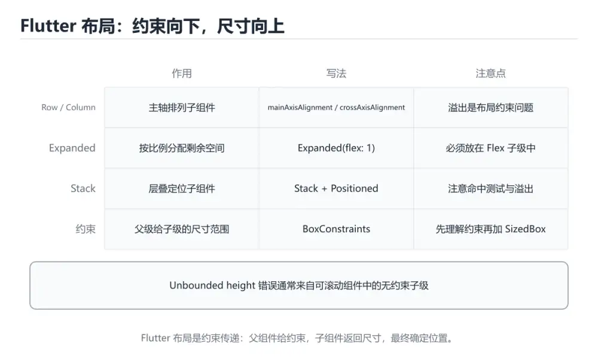

# Flutter 布局入门

> 内容更新时间：2026-10-06 · 学习阶段：intermediate · 预计用时：45 分钟



## 本节知识框架

本课主线：用 Row、Column 和 Expanded 完成基础布局。

学完本课应当能够：

- 区分 Row 和 Column 的排列方向，说出主轴与交叉轴的含义。
- 用 Expanded 按比例分配剩余空间，避免溢出警告。
- 读懂一个包含 Row、Column、Expanded 的 Flutter 布局代码。

### 复习清单

- [ ] 不看正文，写出 Row 和 Column 各自的主轴方向。
- [ ] 说出 Expanded 的 flex 参数如何影响空间分配。
- [ ] 能解释 RenderFlex overflow 警告出现的原因并给出修复方法。
- [ ] 运行本课示例代码，观察 Expanded 改变前后的布局差异。

## 核心概念定义

| 术语 | 一句话说明 |
| --- | --- |
| Row | 把子节点沿水平方向从左到右排列的弹性布局组件。 |
| Column | 把子节点沿垂直方向从上到下排列的弹性布局组件。 |
| 主轴（Main Axis） | Row 或 Column 排列子节点的方向；Row 的主轴是水平的，Column 的主轴是垂直的。 |
| 交叉轴（Cross Axis） | 与主轴垂直的方向；Row 的交叉轴是垂直的，Column 的交叉轴是水平的。 |
| Expanded | 包裹在 Row 或 Column 子节点外层，按 flex 比例瓜分主轴剩余空间的组件。 |
| 溢出（Overflow） | 子节点在主轴上的总尺寸超过父容器可用空间时，出现的黄黑条纹警告。 |

## 原理与运行机制

### Flutter 布局三步走

Flutter 的布局过程可以用三句话概括：

1. 父节点向下传递约束：父容器告诉每个子节点"你最大能多宽、最窄能多宽"。
2. 子节点向上汇报尺寸：子节点在约束范围内选一个自己想要的尺寸，告诉父节点。
3. 父节点决定位置：父节点根据所有子节点汇报的尺寸，把它们放到具体位置上。

### Row 和 Column 的工作方式

Row 和 Column 都是弹性布局组件（Flex 家族），它们的核心区别就是主轴方向不同：

- Row：主轴水平，子节点从左往右排。想象一排书摆在书架上。
- Column：主轴垂直，子节点从上往下排。想象一摞盘子叠在桌上。

两者都有一个与主轴垂直的交叉轴。Row 的交叉轴是垂直方向，Column 的交叉轴是水平方向。对齐方式（mainAxisAlignment 和 crossAxisAlignment）分别控制子节点在主轴和交叉轴上怎么摆放。

### Expanded 如何分配空间

当一个 Row 宽度是 300px，里面放了三个子节点，前两个各占 50px，还剩 200px 没分配。如果这三个子节点都用 Expanded 包裹并设置 flex: 1，那么剩余空间会按 1:1:1 三等分。如果改成 flex 分别为 1、2、1，就按 1:2:1 分配。

Expanded 只能用在 Row、Column 或 Flex 的直接子节点上，不能嵌套在 Padding 或 Container 里面再套 Expanded，那样会报错。

### 溢出是怎么产生的

当 Row 里的子节点总宽度超过了 Row 本身能拿到的宽度约束，就会出现 RenderFlex overflow 警告——屏幕上会显示黄黑相间的条纹。常见原因有：

- 子节点内容太多，没有用 Expanded 或 Flexible 分配空间。
- 在 Row 里放了不受约束宽度的组件（比如没有限制宽度的 TextField）。
- 嵌套了可滚动组件但没有给明确高度。

## 典型应用场景

### 场景一：顶部导航栏

用 Row 水平排列 Logo、标题和右侧按钮。标题用 Expanded 包裹，让它自动占满中间剩余空间，两侧按钮保持固定大小。

### 场景二：表单页面

用 Column 垂直排列多个输入框和按钮。每个输入框之间用 SizedBox 留间距，最后一个按钮用 Expanded 让它贴底或占满剩余高度。

### 场景三：卡片内容区

Column 里放标题行（Row）和正文段落。标题行用 Row 把图标和文字水平排列，文字部分用 Expanded 防止溢出。

### 场景四：等分布局

用 Row 配合多个 Expanded（flex: 1）实现屏幕等分。比如底部三个功能入口各占三分之一宽度。

## 代码/协议/SQL 示例

### 最小可运行示例

```dart
import 'package:flutter/material.dart';

void main() {
  runApp(
    const MaterialApp(
      home: Scaffold(
        body: Column(
          children: [
            Expanded(child: ColoredBox(color: Color(0xFF2F6BFF))),
            SizedBox(height: 12, child: ColoredBox(color: Color(0xFFE7EAF0))),
            Expanded(child: ColoredBox(color: Color(0xFFFFFFFF))),
          ],
        ),
      ),
    ),
  );
}
```

预期输出：

```text
页面被分成上下两块等高的色块，中间是一条 12px 高的浅灰间隔
```

### Row 水平排列示例

```dart
Row(
  children: [
    const Icon(Icons.star, size: 24),
    const SizedBox(width: 8),
    Expanded(
      child: Text('收藏列表标题', overflow: TextOverflow.ellipsis),
    ),
    const Icon(Icons.chevron_right),
  ],
)
```

这段代码展示了一个常见的列表项布局：左侧图标、中间标题用 Expanded 占满剩余空间、右侧箭头固定宽度。

### Expanded flex 比例示例

```dart
Row(
  children: [
    Expanded(
      flex: 1,
      child: Container(color: Colors.red, height: 50),
    ),
    Expanded(
      flex: 2,
      child: Container(color: Colors.blue, height: 50),
    ),
    Expanded(
      flex: 1,
      child: Container(color: Colors.green, height: 50),
    ),
  ],
)
```

三个容器按 1:2:1 的比例瓜分 Row 的全部宽度。

### 溢出修复前后对比

```text
修复前：出现 RenderFlex overflow
Row(
  children: [
    Text('很长很长很长很长的文本内容'),
    Text('另一段文字'),
  ],
)

修复后：用 Expanded 包裹防止溢出
Row(
  children: [
    Expanded(child: Text('很长很长很长很长的文本内容')),
    Text('另一段文字'),
  ],
)
```

## 时间/空间复杂度或性能分析

### 布局性能

Row 和 Column 的布局算法是 O(n)，n 为子节点数量。每个子节点遍历一次，计算约束和尺寸，开销很小。日常使用中不需要担心性能问题。

### 重建开销

Flutter 的 Widget 重建本身很轻量。真正影响帧率的是：

- 子节点中包含复杂绘制（大图片解码、自定义 Paint）。
- 频繁 setState 导致整棵子树重建。
- 嵌套层级过深导致布局计算变慢。

### 优化建议

- 用 const 构造函数让 Flutter 跳过不必要的重建。
- 列表项多时用 ListView.builder 懒加载，不要在 Column 里放几百个子节点。
- 图片使用合适尺寸，避免原图解码浪费内存。
- 用 DevTools 的 Layout Explorer 查看实际约束和尺寸，定位溢出根因。

## 常见误区与易错点

| 错误 | 现象 | 修法 |
| --- | --- | --- |
| 在 Row 里放不受约束宽度的子节点 | RenderFlex overflow 黄黑条纹 | 用 Expanded 或 Flexible 包裹，或给子节点固定宽度 |
| Expanded 嵌套在 Padding 里面 | 编译报错或布局不符合预期 | Expanded 必须是 Row/Column 的直接子节点，Padding 放在 Expanded 内部 |
| 在 Column 里嵌套 ListView 没有限制高度 | 运行时抛出无界高度异常 | 给 ListView 设置固定高度，或用 Expanded 包裹 |
| 用固定像素适配所有屏幕 | 小屏溢出，大屏留白过多 | 用 Expanded、Flexible 和相对尺寸，必要时配合 LayoutBuilder |
| 忽略安全区域 | 刘海与手势条遮挡内容 | 外层使用 SafeArea 包裹 |
| 混淆 Row 和 Column 的主轴方向 | 子节点排列方向与预期相反 | 记住 Row 是水平排列，Column 是垂直排列 |

## 与其他知识点的关系

### 先修知识

- Flutter Widget 入门：理解什么是 Widget、Widget 树和 build 方法。
- Dart 基础语法：理解构造函数、命名参数和 const 关键字。

### 后续衔接

- Stack 布局：在 Row 和 Column 之外，Stack 提供层叠布局能力。
- ListView 与 GridView：当子节点数量很多时，用懒加载列表代替 Column。
- LayoutBuilder：需要在运行时根据父容器约束动态调整布局。

### 容易混淆的概念

- Row 和 Column：唯一区别是主轴方向。Row 水平排列，Column 垂直排列。交叉轴自动与主轴垂直。
- Expanded 和 Flexible：Expanded 强制子节点占满分配到的空间，Flexible 允许子节点小于分配空间。两者都按 flex 比例分配。
- mainAxisAlignment 和 crossAxisAlignment：前者控制主轴方向的对齐，后者控制交叉轴方向的对齐。

## 自测题与参考答案

### 自测 1

不看正文，写出 Row 和 Column 各自的主轴方向。

**参考答案**：Row 的主轴是水平方向（从左到右），Column 的主轴是垂直方向（从上到下）。

### 自测 2

Expanded 的 flex 参数默认值是什么？如果三个子节点的 flex 分别是 1、2、3，剩余空间怎么分配？

**参考答案**：flex 默认值是 1。按 1:2:3 的比例分配，即第一个占六分之一，第二个占六分之二，第三个占六分之三。

### 自测 3

运行本课的最小示例后，把其中一个 Expanded 去掉，会发生什么？

**参考答案**：去掉 Expanded 后，那个子节点不再参与剩余空间分配，它会使用自身内容决定的尺寸。如果子节点是 ColoredBox 且没有指定尺寸，可能会因为缺少约束而报错或显示异常。

### 自测 4

在 Row 中嵌套一个没有固定高度的 ListView，会出现什么问题？怎么修复？

**参考答案**：会出现运行时抛出无界高度异常，因为 Row 给子节点的垂直约束是无限的，ListView 不知道自己能有多高。修复方法是用 SizedBox 给 ListView 固定高度，或者用 Expanded 包裹让它获得明确约束。

## 考点精讲

本课题库共 6 道题，逐题给出题干、选项、正确答案与判断依据。先自己作答，再核对答案。

### 考点 1

题目：Row 与 Column 分别沿哪个方向排列子节点？
A. 两者都沿水平方向，只是默认间距不同
B. Row 沿水平主轴，Column 沿垂直主轴排列
C. 两者都沿垂直方向，只是交叉轴对齐不同
D. Row 沿垂直主轴，Column 沿水平主轴排列
正确答案：B

判断依据：Row 的主轴是水平方向，Column 的主轴是垂直方向。这是两者最根本的区别。

### 考点 2

题目：在 Row 或 Column 中，Expanded 起到什么作用？
A. 给子节点添加固定的外边距和内边距
B. 让子节点脱离父容器限制自由定位
C. 按 flex 比例瓜分主轴上的剩余空间
D. 把子节点固定在容器的左上角位置
正确答案：C

判断依据：Expanded 按 flex 比例把主轴上的剩余空间分配给子节点。flex 值越大，分到的空间越多。

### 考点 3

题目：下面这段 `dart` 代码来自 `Flutter 布局入门`。课程主线是用 Row、Column 和 Expanded 完成基础布局。代码与 `Row` 有关。哪一项是代码里真实出现的内容？
A. 调用了 `enumerate()`
B. 调用了 `bit_count()`
C. 调用了 `optimization_hint()`
D. 调用了 `Column()`
正确答案：D

判断依据：本课最小示例中，body 部分使用了 Column 包裹多个子节点。代码中出现了 Column()、Expanded()、ColoredBox() 等调用，没有出现 enumerate()、bit_count() 或 optimization_hint()。

### 考点 4

题目：布局时出现 RenderFlex overflow 警告，通常意味着什么？
A. 设备屏幕的刷新率低于应用要求
B. Dart 代码存在语法错误无法编译
C. 图片资源太大导致内存占用过高
D. 子节点在主轴上的总尺寸超过了可用约束
正确答案：D

判断依据：RenderFlex overflow 表示子节点在主轴方向的总尺寸超出了父容器的约束范围。解决方法是用 Expanded 或 Flexible 分配空间，或减少子节点内容。

### 考点 5

题目：填空：补齐下面这段术语说明中的空缺。课程 `用 Row、Column 和 Expanded 完成基础布局。`，这段说明是：`____`：按比例瓜分主轴剩余空间的组件，放在 Row/Column 的子节点上。空缺处应填哪个术语？
正确答案：Expanded

判断依据：Expanded 的定义就是按比例瓜分主轴剩余空间，它只能放在 Row 或 Column 的直接子节点上使用。

### 考点 6

题目：关于 `Row`，下列哪些说法与 `Flutter 布局入门` 的正文一致？判断时以用 Row、Column 和 Expanded 完成基础布局。为主线。（多选）
A. Row 沿垂直主轴，Column 沿水平主轴排列
B. Row 沿水平主轴，Column 沿垂直主轴排列
C. 两者都沿水平方向，只是默认间距不同
D. 按 flex 比例瓜分主轴上的剩余空间
正确答案：BD

判断依据：B 正确，Row 的主轴是水平方向，Column 的主轴是垂直方向。D 正确，Expanded 按 flex 比例瓜分主轴剩余空间，这是 Row 和 Column 布局的核心机制。A 和 C 的描述与正文不一致。

## 术语速查

| 术语 | 一句话说明 |
| --- | --- |
| Row | 把子节点沿水平方向从左到右排列的弹性布局组件。 |
| Column | 把子节点沿垂直方向从上到下排列的弹性布局组件。 |
| Expanded | 按 flex 比例瓜分 Row 或 Column 主轴剩余空间的组件。 |
| 主轴（Main Axis） | Row 或 Column 排列子节点的方向，Row 水平，Column 垂直。 |
| 交叉轴（Cross Axis） | 与主轴垂直的方向，用于控制子节点的对齐方式。 |
| RenderFlex overflow | 子节点在主轴上的总尺寸超过父容器约束时出现的黄黑条纹警告。 |
| Flexible | 与 Expanded 类似，按 flex 比例分配空间，但允许子节点小于分配尺寸。 |
| SizedBox | 指定固定宽高的空白容器，常用于在子节点之间添加间距。 |

## 内容元数据

- 内容版本：v2.0
- 最后更新：2026-10-06
- 学习阶段：intermediate
- 适用环境：Flutter 3.x / Dart 3.x
- 内容来源：内置结构化课程与工程实践整理
- 相关主题：Flutter 布局入门、移动开发、入门练习

## 参考资料与复核

- 最后复核：2026-10-04
- 下次复核：2027-08-10
- 复核范围：版本兼容、API 行为、布局约束机制与工程实践

| 参考资料 | 本课用途 |
| --- | --- |
| [Flutter 布局教程](https://docs.flutter.dev/ui/layout) | Row、Column、Expanded 的官方布局教程与示例 |
| [Flutter Widget 目录](https://docs.flutter.dev/ui/widgets) | 所有内置 Widget 的索引，包含布局类组件文档 |
| [Dart 语言概览](https://dart.dev/language) | Dart 语法基础，理解构造函数、const 和命名参数 |
