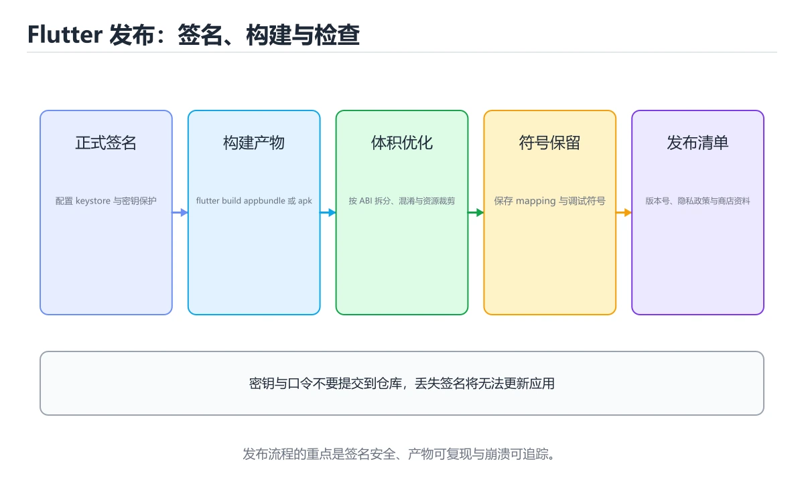
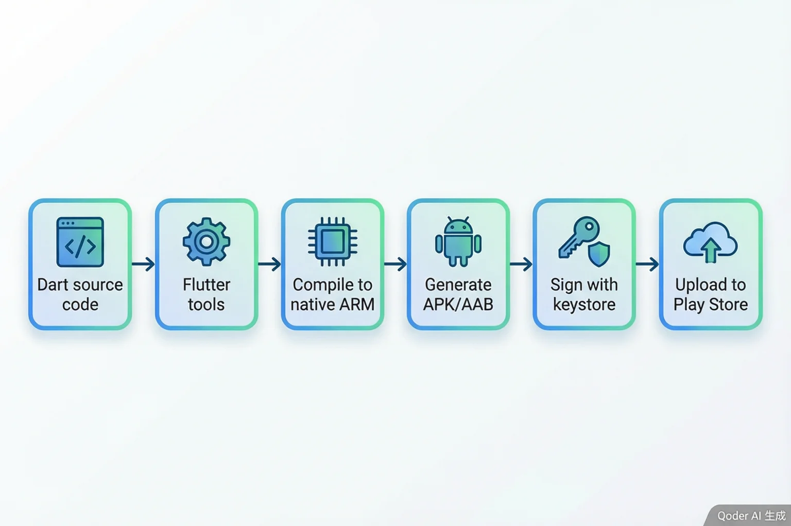

# 实战：Flutter 打包发布 Android

> 内容更新时间：2026-10-06 · 学习阶段：基础 · 预计用时：65 分钟



## 本节知识框架

本课带你走完 Flutter 应用从开发机到用户手机的最后一段路：**签名、定版本、减体积、留符号、过清单**。

学完你能做到：
- 用自己的 keystore 签出正式包，不再使用 debug 签名
- 按 ABI 拆分 APK 或使用 App Bundle，让安装包更小
- 开启混淆并保留符号文件，线上崩溃也能定位
- 对照发布清单逐项检查，避免上架被拒

**先修**：《Flutter 状态管理与性能》中的 Widget 构建与状态管理。

### 复习清单

- [ ] 能说出 keystore 丢失的后果，并写出备份方案
- [ ] 能区分 `versionName` 与 `versionCode` 的分工
- [ ] 能列出至少三种减小 APK 体积的手段
- [ ] 知道 `--split-debug-info` 产物要归档保存
- [ ] 能对照发布清单说出至少五项检查项

## 核心概念定义

| 术语 | 一句话说明 |
| --- | --- |
| Flutter 发布 | 把开发好的 Flutter 应用构建成 APK 或 App Bundle，签名后交付给用户或上架商店。 |
| App Bundle (.aab) | Google Play 推荐的发布格式，商店根据用户设备只下发需要的架构和资源，安装体积更小。 |
| 签名 (Signing) | 用正式 keystore 对应用做数字签名，商店靠它确认发布者身份，debug 签名不能用于上架。 |
| 混淆 (Obfuscation) | 构建时把类名和函数名替换为无意义短名，提高逆向成本，但必须保留符号文件才能还原崩溃堆栈。 |
| ABI 拆分 | 用 `--split-per-abi` 按 CPU 架构（arm64-v8a、armeabi-v7a 等）分别生成 APK，避免一个包塞入所有架构。 |
| 发布清单 | 上架前的逐项检查表：版本号递增、权限最小化、图标替换、隐私政策、目标 SDK 达标等。 |

## 原理与运行机制

### 从调试到发布

开发时 `flutter run` 用的是 debug 签名，自带调试工具，包体较大。发布时要切换到 release 模式，经过以下阶段：

| 阶段 | 命令 | 关注点 |
| --- | --- | --- |
| 静态检查 | `flutter analyze` | 零 error，info 尽量清零 |
| 运行测试 | `flutter test` | 单元 + 组件 + 端到端全部通过 |
| 构建产物 | `flutter build apk --release` 或 `flutter build appbundle --release` | 签名、混淆、ABI 拆分 |
| 体积分析 | `flutter build apk --analyze-size` | 查看各模块体积占比 |

### 发布流程四件事

发布 Flutter 应用要做四件事：**签名、定版本、减体积、留符号**。前三件决定能不能上架，最后一件决定线上崩溃能不能查。

```text
Flutter 源码
    │
    ├─ flutter build apk --release ──→ 签名 APK（单包，适合侧载）
    │
    ├─ flutter build appbundle --release ──→ .aab（上架 Google Play 推荐）
    │
    └─ --split-per-abi ──→ 按架构拆分的多个 APK（体积更小）
```



### 签名机制

签名就像盖公章——商店靠它确认这个包确实是你发布的。你需要：

1. 用 `keytool` 生成一个 keystore 文件（相当于刻一枚公章）
2. 把 keystore 路径和密码告诉 Gradle（通过 `key.properties` 或环境变量）
3. 构建时 Gradle 用这个 keystore 对 APK/AAB 签名

**关键**：keystore 和密码一旦丢失，你就无法更新已上架的应用。必须多处离线备份。

### 混淆与符号保留

混淆把代码中的类名、方法名替换为 `a`、`b`、`c` 这样的短名，让逆向工程更困难。但代价是——线上崩溃时你看到的堆栈也是 `a.b.c`，完全无法定位问题。

解决办法：构建时用 `--split-debug-info=build/symbols` 把符号表单独输出，然后**把 `build/symbols` 目录归档保存**。需要还原崩溃堆栈时用 `flutter symbolize` 命令即可。

### 体积优化原理

Flutter 默认打包所有支持的 CPU 架构（arm64-v8a、armeabi-v7a、x86_64），导致一个 APK 可能超过 100MB。优化方式：

- `--split-per-abi`：每种架构生成一个 APK，用户只下载匹配的那个
- App Bundle：由 Google Play 动态下发，只包含目标设备需要的代码和资源
- Tree-shake icons：默认开启，自动移除未使用的图标
- 移除调试依赖：release 构建不带 dev 包

## 典型应用场景

- **首次上架 Google Play**：生成 keystore → 配置签名 → 构建 AAB → 填写商店信息 → 提交审核
- **版本更新发布**：递增 versionCode → 回归测试 → 构建签名包 → 检查升级路径
- **企业内部分发**：按 ABI 拆分 APK → 签名 → 通过内网或 MDM 分发
- **多渠道发布**：为不同渠道配置不同的 applicationId 或签名

### 项目专属规格

| 项目属性 | 说明 |
| --- | --- |
| 项目标识 | `flutter_release` |
| 技术栈 | Flutter 3.x / Dart 3.x / Gradle (Kotlin DSL) |
| 目标平台 | Android（APK + App Bundle） |
| 主线流程 | 正式签名 → 按 ABI 拆分 → 混淆与符号保留 → 发布清单 |
| 最低 SDK | minSdk 24（Android 7.0） |
| 目标 SDK | targetSdk 35 |

### 项目交付物

1. **签名 APK**：`build/app/outputs/flutter-apk/app-release.apk`
2. **App Bundle**：`build/app/outputs/bundle/release/app-release.aab`
3. **按 ABI 拆分的 APK**：`app-arm64-v8a-release.apk`、`app-armeabi-v7a-release.apk` 等
4. **符号文件**：`build/symbols/` 目录（必须归档保存）
5. **发布清单记录**：版本号、签名配置、权限声明、隐私政策等检查项的确认记录

### 验证命令与预期输出

| 阶段 | 命令 | 预期输出 |
| --- | --- | --- |
| 静态检查 | `flutter analyze` | No issues found |
| 运行测试 | `flutter test` | All tests passed |
| 构建 APK | `flutter build apk --release` | 成功生成 `app-release.apk` |
| 构建 AAB | `flutter build appbundle --release` | 成功生成 `app-release.aab` |
| 体积分析 | `flutter build apk --analyze-size` | 输出各模块体积占比 |

## 代码/协议/SQL 示例

### 第一步：生成签名密钥

```bash
keytool -genkeypair -v \
  -keystore ~/keys/release.jks \
  -keyalg RSA -keysize 2048 -validity 10000 \
  -alias release
```

这条命令会在 `~/keys/` 下生成一个 `release.jks` 文件。记住你设置的密码，后面要用。

### 第二步：配置签名信息

方式一：使用 `key.properties` 文件

```properties
# android/key.properties（绝对不要提交到 Git）
storePassword=你的密码
keyPassword=你的密码
keyAlias=release
storeFile=/abs/path/release.jks
```

方式二：使用环境变量（CI/CD 推荐）

```bash
# 在 CI 环境中设置这些变量
export KEYSTORE_PATH=/path/to/release.jks
export KEYSTORE_PASSWORD=你的密码
export KEY_ALIAS=release
export KEY_PASSWORD=你的密码
```

### 第三步：配置 Gradle 签名

```dart
// android/app/build.gradle.kts
// 读取 key.properties 配置签名
val keystoreProperties = java.util.Properties().apply {
    val f = rootProject.file("key.properties")
    if (f.exists()) f.inputStream().use { load(it) }
}

android {
    // 读取环境变量或 key.properties
    val keystorePath = System.getenv("KEYSTORE_PATH")
        ?: (keystoreProperties["storeFile"] as? String)

    signingConfigs {
        create("release") {
            storeFile = file(keystorePath ?: "keystore.jks")
            storePassword = System.getenv("KEYSTORE_PASSWORD")
                ?: (keystoreProperties["storePassword"] as? String)
            keyAlias = System.getenv("KEY_ALIAS")
                ?: (keystoreProperties["keyAlias"] as? String)
            keyPassword = System.getenv("KEY_PASSWORD")
                ?: (keystoreProperties["keyPassword"] as? String)
        }
    }
    buildTypes {
        release {
            signingConfig = signingConfigs.getByName("release")
            isMinifyEnabled = true
            isShrinkResources = true
        }
    }
}
```

### 第四步：设置版本号

```yaml
# pubspec.yaml
version: 1.2.0+12
# 格式：versionName+versionCode
# 1.2.0 是用户看到的版本号，12 是内部构建号
# 每次上架 versionCode 必须比上一版大，否则商店拒绝
```

### 第五步：构建与体积优化

```bash
# 构建单个 APK
flutter build apk --release

# 按 CPU 架构拆分 APK，每个包体积显著下降
flutter build apk --release --split-per-abi

# 构建 App Bundle（上架 Google Play 推荐）
flutter build appbundle --release

# 查看各部分体积构成
flutter build apk --analyze-size

# 指定版本号构建
flutter build apk --release --build-name=1.4.0 --build-number=42
```

### 第六步：混淆与符号保留

```bash
# 构建时开启混淆，输出符号文件
flutter build appbundle --release \
  --obfuscate \
  --split-debug-info=build/symbols

# 线上崩溃后，用符号文件还原堆栈
flutter symbolize -i crash.txt -d build/symbols/app.android-arm64.symbols
```

**务必把 `build/symbols` 目录归档保存**，否则线上崩溃只能看到 `a.b.c` 这类无意义符号。

### 完整发布流水线脚本

```bash
#!/usr/bin/env bash
set -euo pipefail

echo "=== 清理与依赖安装 ==="
flutter clean
flutter pub get

echo "=== 静态检查 ==="
flutter analyze

echo "=== 运行测试 ==="
flutter test

echo "=== 构建 App Bundle ==="
flutter build appbundle --release \
  --obfuscate \
  --split-debug-info=build/symbols \
  --build-name="${VERSION:?需要设置 VERSION 环境变量}" \
  --build-number="${BUILD_NUMBER:?需要设置 BUILD_NUMBER 环境变量}"

echo "产物：build/app/outputs/bundle/release/app-release.aab"
echo "符号：build/symbols（请归档保存）"
```

### 发布前检查清单

| 检查项 | 说明 |
| --- | --- |
| applicationId 唯一 | 上架后不可更改，相当于应用的身份证号 |
| 版本号递增 | versionCode 必须大于上一版，否则商店拒绝上传 |
| 正式签名 | 必须用 release keystore，不能用 debug 签名 |
| 权限最小化 | 删掉不需要的权限，只申请真正用到的 |
| 隐私政策 | 收集用户数据必须提供隐私政策说明 |
| 图标与截图 | 各尺寸都要提供，不要用模板默认图标 |
| 目标 SDK 达标 | Google Play 有最低 targetSdk 要求 |
| 混淆后自测 | 反射相关代码可能被裁掉，需要额外测试 |
| 无调试日志泄漏 | 全局搜索 `print`、`debugPrint` 与测试域名 |
| 密钥未入库 | 检查 `.gitignore` 确保 keystore 和 key.properties 不在仓库中 |

## 时间/空间复杂度或性能分析

### 构建时间

| 构建方式 | 大致耗时 | 说明 |
| --- | --- | --- |
| `flutter build apk --release` | 2-5 分钟 | 首次构建较慢，增量构建较快 |
| `--split-per-abi` | 5-15 分钟 | 需要为每个架构分别构建 |
| `flutter build appbundle` | 3-6 分钟 | 加上 `--obfuscate` 会额外增加 1-2 分钟 |

### APK 体积对比

| 方式 | 典型体积 | 说明 |
| --- | --- | --- |
| 未拆分 APK | 80-120 MB | 包含所有架构的 native 库 |
| 按 ABI 拆分 | 30-50 MB/包 | 每个架构一个包，体积降 50% 以上 |
| App Bundle | 由商店动态下发 | 用户实际下载体积最小 |

### 混淆对启动速度的影响

开启混淆后，Dart 代码会被裁剪和压缩，通常对启动速度影响很小（< 5%）。但如果混淆规则配置不当，可能裁掉反射使用的类，导致运行时崩溃。建议在混淆后做一次完整的回归测试。

### 符号文件存储开销

`build/symbols` 目录通常占 5-20 MB，建议每次发布都归档一份，按版本号命名。这些文件是还原线上崩溃堆栈的唯一依据。

## 常见误区与易错点

| 错误 | 现象 | 修法 |
| --- | --- | --- |
| 用 debug 签名发布 | 商店拒绝上架，或用户无法从 debug 版升级到 release 版 | 生成正式 keystore，在 `build.gradle.kts` 中配置 `signingConfigs.release` |
| keystore 或密码丢失 | 无法更新已上架的应用，只能重新发布（丢失所有用户和评分） | 多处离线备份 keystore 文件与密码，存放在安全位置 |
| `key.properties` 提交到 Git | 密钥泄露，任何人都能伪造你的签名 | 把 `key.properties` 和 `*.jks` 加进 `.gitignore` |
| 忘了递增 versionCode | 商店拒绝上传，提示版本号必须大于当前版本 | 每次发布前递增 versionCode，建议在 CI 中自动递增 |
| 混淆后不保留符号文件 | 线上崩溃堆栈全是 `a.b.c`，无法定位问题 | 构建时加 `--split-debug-info=build/symbols`，并把该目录归档 |
| 只测 APK 不测 AAB | APK 测试通过但上架后出问题，AAB 的拆分逻辑可能不同 | 用 `bundletool` 在本地验证 AAB 产物 |
| 权限申请过多 | 商店审核被拒，用户信任度下降 | 对照 `AndroidManifest.xml` 逐条确认，只保留真正需要的权限 |
| 混淆裁掉反射用类 | 运行时崩溃，某些功能突然不可用 | 在 ProGuard/R8 规则中配置 `-keep` 并做回归测试 |
| 测试环境地址打进包 | 生产版本连接了测试后端，数据混乱 | 用编译期变量或 flavor 区分环境 |
| 只在大屏机型测试 | 小屏设备出现布局溢出或控件遮挡 | 测试覆盖小屏、折叠屏与平板 |
| 不配置隐私说明 | 商店审核被拒 | 提供隐私政策页面和数据收集说明 |
| 未测升级路径 | 老用户升级后数据丢失或崩溃 | 保留旧版本，测试从旧版升级到新版的完整流程 |

## 与其他知识点的关系

- **先修**：《Flutter 状态管理与性能》——本课假设你已经掌握 Widget 构建、状态管理和基本性能优化。
- **后续**：《Kotlin 与 Android 开发》——本课只涉及 Flutter 侧的构建与发布，原生 Android 的 Gradle 配置、多渠道打包等内容在后续课程展开。
- **横向对照**：《构建与发布产物：九种生态横向对照》——把 Flutter 的发布流程与 iOS、Web、桌面等平台做对比，理解不同生态的签名与分发差异。
- **术语衔接**：本课的 `签名`、`混淆`、`体积优化` 定义以本课为准。如果其他课程也提到这些术语，先确认定义是否一致。

## 自测题与参考答案

> 先独立作答，再对照参考答案。

**自测 1**：`versionName` 和 `versionCode` 分别是什么？各有什么用？

参考答案：`versionName` 是用户看到的版本号（如 1.2.0），`versionCode` 是内部递增的构建号。每次上架商店 `versionCode` 必须比上一版大，否则被拒。

**自测 2**：keystore 丢失会怎样？怎么预防？

参考答案：丢失后无法更新已上架的应用。预防方式：把 keystore 文件和密码备份到多个安全位置（如加密 U 盘、密码管理器），不要只存在开发机上。

**自测 3**：说出三种减小 APK 体积的方法。

参考答案：① `--split-per-abi` 按架构拆分；② 使用 App Bundle 让商店动态下发；③ 移除未使用的图片和字体资源；④ 开启 tree-shake icons。

**自测 4**：`--split-debug-info` 的产物要做什么？

参考答案：必须归档保存。线上崩溃时用它配合 `flutter symbolize` 还原混淆后的堆栈，否则只能看到无意义的短名。

**自测 5**：列出上架前至少五项检查。

参考答案：① applicationId 唯一且不可更改；② versionCode 已递增；③ 使用正式签名；④ 权限最小化；⑤ 隐私政策齐全；⑥ 图标与截图各尺寸完整；⑦ targetSdk 达标。

## 考点精讲

### 考点 1

题目：围绕“实战：Flutter 打包发布 Android”中的 Flutter、发布、签名，下列哪两项是本课强调的实践判断？
A. 验证 发布 时要固定版本并覆盖边界输入，结论才可复现
B. 把 发布 的单次运行结果当成所有版本和规模都成立
C. 学习 Flutter 时要同时说明输入、输出和失败路径，不能只看正常流程
D. 只要 Flutter 的常规示例通过，就可以跳过边界与异常路径
正确答案：AC

### 考点 2

题目：阅读 `实战：Flutter 打包发布 Android` 的 `Flutter` 示例。它服务于正式签名、按 ABI 拆分、混淆与符号保留、发布清单。代码中实际包含下列哪一项？
A. 出现字面量 `解析失败`
B. 出现字面量 `KEYSTORE_PATH`
C. 出现字面量 `system`
D. 出现字面量 `error`
正确答案：B

### 考点 3

题目：减小 APK 体积的常用做法是？
A. 使用 --split-per-abi 或 App Bundle
B. 内嵌高清图
C. 打包全部 ABI
D. 引入更多字体
正确答案：A

### 考点 4

题目：flutter build appbundle 的产物格式是？
A. .jar  
B. .ipa  
C. .apk  
D. .aab  
正确答案：D

### 考点 5

题目：Android 的 minSdk / targetSdk 在哪个文件中配置？
A. lib/main.dart 顶部常量
B. pubspec.yaml 的 flutter 段
C. AndroidManifest.xml 的 application 标签，用于声明权限与组件
D. android/app/build.gradle(.kts) 的 defaultConfig
正确答案：D

### 考点 6

题目：下面几项都与 `Flutter` 有关，请按 `实战：Flutter 打包发布 Android` 的正文顺序排列；该课主线是正式签名、按 ABI 拆分、混淆与符号保留、发布清单。
A. 从调试到发布
B. 签名配置
C. 体积优化
D. 混淆与符号
正确答案：ABCD

## 术语速查

| 术语 | 一句话说明 |
| --- | --- |
| keystore | 签名密钥文件，相当于应用的公章，商店靠它确认发布者身份。 |
| applicationId | 应用的唯一标识符，上架后不可更改，相当于身份证号。 |
| versionName | 用户看到的版本号，如 1.2.0，可以随意命名。 |
| versionCode | 内部构建序号，每次上架必须递增，否则商店拒绝。 |
| App Bundle (.aab) | Google Play 推荐的发布格式，商店按设备动态下发，安装体积最小。 |
| split-debug-info | 混淆后输出的符号文件目录，必须归档保存，用于还原崩溃堆栈。 |
| bundletool | Google 官方工具，用于在本地验证 AAB 产物是否正确。 |
| signingConfig | Gradle 中的签名配置块，指定 release 构建使用的 keystore 信息。 |

## 内容元数据

- 内容版本：v2.0
- 最后更新：2026-10-06
- 学习阶段：基础
- 适用环境：Flutter 3.x / Dart 3.x / Android Gradle Plugin 8.x
- 内容来源：内置结构化课程与工程实践整理
- 相关主题：Flutter、发布、签名、混淆、体积优化
- 质量版本：P0 测验标准 + P1 覆盖扩展 + P2 体验补全

## 参考资料与复核

- 最后复核：2026-10-04
- 下次复核：2027-08-10
- 复核范围：Flutter SDK 版本兼容、Gradle 配置语法、签名安全建议与工程实践

| 参考资料 | 本课用途 |
| --- | --- |
| [Android 发布指南 - Flutter 官方文档](https://docs.flutter.dev/deployment/android) | 签名配置、构建命令与发布流程 |
| [App Bundle 格式说明 - Google Play](https://developer.android.com/guide/app-bundle) | 理解 AAB 格式与按设备下发机制 |
| [混淆与调试信息 - Flutter 官方文档](https://docs.flutter.dev/testing/debugging#enable-logging-for-release-mode) | 混淆配置与符号文件还原 |
| [keytool 密钥管理 - Java 文档](https://docs.oracle.com/en/java/javase/21/docs/specs/man/keytool.html) | 生成与管理 keystore 文件 |
