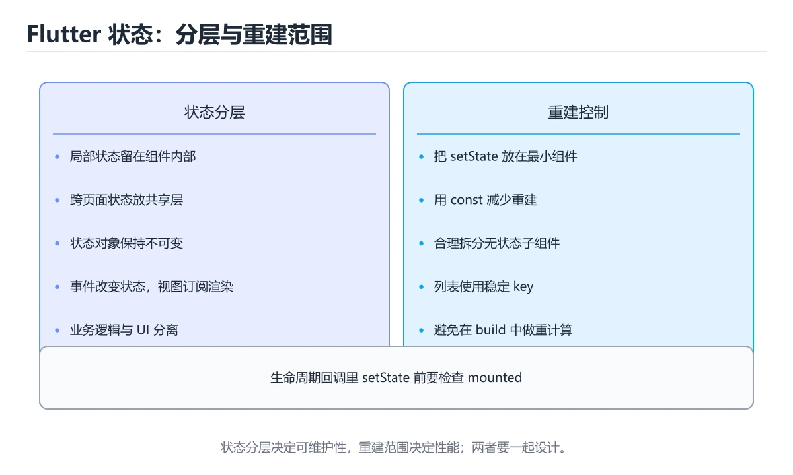
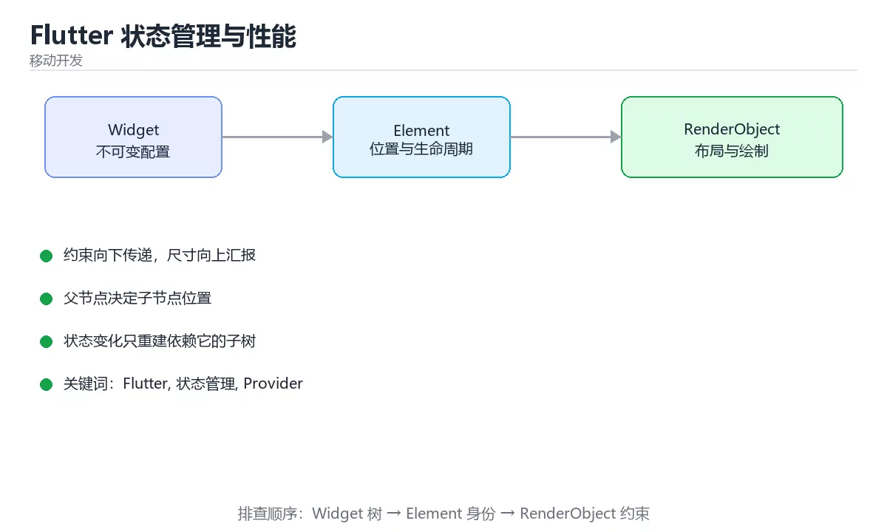

# Flutter 状态管理与性能

> 内容更新时间：2026-10-06 · 学习阶段：intermediate · 预计用时：45 分钟





## 本节知识框架

本课主线：状态分层、重建范围控制与生命周期陷阱。学完之后，你会知道 Flutter 里的状态该放在哪、怎么让界面只刷新该刷新的部分、以及什么时候该释放资源。

**学完本课你会**：
- 分清局部状态和全局状态，知道什么时候用 setState、什么时候用 Provider
- 用 `const`、`Selector`、`Consumer` 缩小重建范围，让列表不卡顿
- 正确处理控制器的创建和释放，避免内存泄漏

**先修**：《Flutter 基础与 Widget 树》里的 `flutter run`、`Widget` 概念。**后续**：《实战：Flutter 打包发布 Android》。

### 复习清单

- [ ] 能区分局部状态和全局状态，并说出各自的典型例子。
- [ ] 能说出 `watch`、`select`、`read` 三种读法的区别和使用场景。
- [ ] 能运行本课示例代码，记录输入、输出与失败现象。
- [ ] 能完成一次自测，并把错题对照错误表定位原因。

## 核心概念定义

| 术语 | 一句话说明 |
| --- | --- |
| `Flutter` | 用 Dart 编写、自带渲染引擎绘制界面的跨平台 UI 框架。 |
| `状态管理` | 集中或按作用域组织应用状态，控制读取、更新与生命周期。 |
| `Provider` | Flutter 官方推荐的状态管理方案之一，基于 InheritedWidget 实现依赖注入。 |
| `性能` | 系统在给定负载下的帧率、重建次数、内存占用和稳定性表现。 |
| `生命周期` | Widget 从创建、更新到销毁的完整过程，对应 initState、build、dispose 等回调。 |
| `ChangeNotifier` | Flutter 提供的通知机制，数据变化时调用 notifyListeners 通知订阅者刷新界面。 |

## 原理与运行机制

### 状态分层：把状态放对地方

Flutter 状态管理的核心思路是分层。不同类型的状态放在不同的层级，用不同的方式管理：

| 状态类型 | 生命周期 | 推荐方案 |
| --- | --- | --- |
| 局部 UI 状态 | 单页面 | `StatefulWidget` + `setState` |
| 跨组件共享 | 多个页面 | Provider / Riverpod |
| 全局配置 | 应用级 | Provider + 持久化 |
| 派生状态 | 由其他状态计算 | 直接计算，不额外存 |
| 异步数据 | 网络请求 | `FutureBuilder` 或状态管理的异步封装 |

选型原则就一句话：**能局部就不全局**。全局状态越少，重建范围越小，代码也越容易测试。Provider 适合中小项目（ChangeNotifier + Consumer），Riverpod 编译期安全、便于测试，Bloc 适合复杂业务与团队规范要求高的场景。

### 重建范围控制：让界面只刷该刷的部分

1. 用 `const` 构造器避免无谓重建。
2. `Consumer`/`Selector` 只包裹真正依赖该状态的子树，而不是整页。
3. 长列表用 `ListView.builder` + `itemExtent`（已知行高时）减少布局计算。
4. 复杂动画或频繁重绘区域用 `RepaintBoundary` 隔离。
5. 避免在 build 里做重活（排序、网络、JSON 解析），移到 initState 或状态层。

### 生命周期要点：该释放的一定要释放

`initState` 做一次初始化（注意不能在这里用 context 依赖），`didChangeDependencies` 响应依赖变化，`dispose` 释放控制器、订阅与定时器。**忘记 dispose 是内存泄漏的常见来源**，AnimationController、TextEditingController、StreamSubscription 都要记得释放。

| 阶段 | 时机 | 典型用途 |
| --- | --- | --- |
| `initState` | 组件插入树后 | 初始化控制器、首次请求 |
| `didChangeDependencies` | 依赖变化 | 读取 `InheritedWidget` 或主题 |
| `build` | 每次需要渲染 | 只做构建，不放副作用 |
| `didUpdateWidget` | 父级传入参数变化 | 对比新旧参数做响应 |
| `dispose` | 组件移除 | 取消订阅、释放控制器 |

### 异步与错误处理

用 FutureBuilder 时务必处理三种状态：等待、错误、空数据；页面卸载后不要再 setState（用 `if (!mounted) return;`）。分页加载要注意去重与并发请求的竞态（后发先至）。

## 典型应用场景

### 场景一：购物车计数徽标

用户在应用里添加商品到购物车，底部导航栏的购物车图标要实时显示数量。这种跨页面共享的状态适合用 Provider 管理，在根部注入，在需要的地方用 `context.select` 只订阅数量字段。

### 场景二：带四态的列表页

从服务端加载列表数据时，界面要表达四种状态：加载中（转圈圈）、成功（显示列表）、空数据（提示暂无内容）、失败（显示错误信息和重试按钮）。把这四种状态都写出来，界面就不会出现莫名其妙的空白。

### 场景三：表单输入与提交

输入框的内容是局部状态，用 `TextEditingController` 管理。提交按钮点击后发异步请求，请求期间禁用按钮防止重复提交，请求结束后根据结果显示成功提示或错误信息。页面关闭时要释放控制器。

### 场景四：主题切换

主题设置是全局状态，用 Provider 提供 ThemeMode，所有页面通过 `Provider.of<ThemeMode>` 读取。切换主题时调用 `notifyListeners`，整个应用自动刷新。

## 代码/协议/SQL 示例

### Provider 三件套：定义、注入、消费

```dart
// 1. 定义可监听模型
class CartModel extends ChangeNotifier {
  final List<Item> _items = [];
  List<Item> get items => List.unmodifiable(_items);
  double get total => _items.fold(0, (sum, i) => sum + i.price);

  void add(Item item) {
    _items.add(item);
    notifyListeners();          // 通知订阅者重建
  }
}

// 2. 在顶层提供
ChangeNotifierProvider(
  create: (_) => CartModel(),
  child: const MyApp(),
)

// 3. 按需读取
class CartBadge extends StatelessWidget {
  const CartBadge({super.key});

  @override
  Widget build(BuildContext context) {
    final count = context.select<CartModel, int>((m) => m.items.length);
    return Badge(label: Text('$count'), child: const Icon(Icons.shopping_cart));
  }
}
```

`context.select` 只订阅需要的字段，**只有这个字段变化才重建**。

### 缩小重建范围的三个技巧

```dart
// 技巧一：把 Consumer 包到最小范围
Consumer<CartModel>(
  builder: (context, cart, child) => Text('${cart.items.length}'),
)

// 技巧二：child 参数复用不依赖状态的部分
Consumer<CartModel>(
  builder: (context, cart, child) => Row(
    children: [child!, Text('${cart.total}')],
  ),
  child: const Icon(Icons.shopping_cart),   // 不会重建
)

// 技巧三：读取不订阅，用 read
onPressed: () => context.read<CartModel>().add(item),
```

| 方法 | 是否订阅 | 用途 |
| --- | --- | --- |
| `watch` / `Consumer` | 是 | 需要随状态重建 |
| `select` | 是（单字段） | 只关心某个字段 |
| `read` | 否 | 事件回调里调用方法 |

### 异步状态要表达出来

```dart
sealed class UiState<T> {
  const UiState();
}

class Loading<T> extends UiState<T> { const Loading(); }
class Success<T> extends UiState<T> {
  const Success(this.data);
  final T data;
}
class Failure<T> extends UiState<T> {
  const Failure(this.message);
  final String message;
}

// 界面按状态分支，四态齐全：加载中、成功、空、失败
Widget buildBody(UiState<List<Item>> state) => switch (state) {
      Loading() => const Center(child: CircularProgressIndicator()),
      Failure(:final message) => Center(child: Text('出错了：$message')),
      Success(:final data) when data.isEmpty => const Center(child: Text('暂无数据')),
      Success(:final data) => ItemList(items: data),
    };
```

**把「加载中 / 成功 / 空 / 失败」都写出来，界面就不会出现莫名其妙的空白。**

### 生命周期与释放

```dart
class _PageState extends State<Page> {
  late final TextEditingController _controller;
  StreamSubscription? _sub;

  @override
  void initState() {
    super.initState();
    _controller = TextEditingController();
    _sub = stream.listen((_) { if (mounted) setState(() {}); });
  }

  @override
  void dispose() {
    _sub?.cancel();          // 取消订阅
    _controller.dispose();   // 释放控制器
    super.dispose();
  }
}
```

### 完整练习：带四态的列表页

```dart
class ItemPage extends StatefulWidget {
  const ItemPage({super.key});
  @override
  State<ItemPage> createState() => _ItemPageState();
}

class _ItemPageState extends State<ItemPage> {
  UiState<List<Item>> _state = const Loading();

  @override
  void initState() {
    super.initState();
    _load();
  }

  Future<void> _load() async {
    setState(() => _state = const Loading());
    try {
      final items = await repository.fetchAll();
      if (!mounted) return;
      setState(() => _state = Success(items));
    } catch (e) {
      if (!mounted) return;
      setState(() => _state = Failure(e.toString()));
    }
  }

  @override
  Widget build(BuildContext context) => Scaffold(
        appBar: AppBar(title: const Text('列表'), actions: [
          IconButton(onPressed: _load, icon: const Icon(Icons.refresh)),
        ]),
        body: buildBody(_state),
      );
}
```

## 时间/空间复杂度或性能分析

性能关注点：渲染与重建是主要开销。关注帧时间、重建次数与首屏耗时，热重载与 release 构建要分开记录。

测量方法：固定输入跑一遍记录基线，再把数据量提高一个数量级复测，两次结果的差值才是结论依据。

| 优化手段 | 效果 | 适用场景 |
| --- | --- | --- |
| `const` 构造器 | 跳过重建 | 所有不变 Widget |
| `Consumer` 精准包裹 | 只重建依赖部分 | 局部依赖状态 |
| `Selector` 订阅单字段 | 字段不变不重建 | 大模型只关心一个属性 |
| `RepaintBoundary` | 隔离重绘 | 复杂动画区域 |
| `ListView.builder` | 懒加载 | 长列表 |

使用 Flutter DevTools 的 Performance 页面和 Frame indicator 观察实际帧耗时和重建范围，找到真正的瓶颈。release 构建比 debug 快很多，两者都要测。

Provider 本身的开销很小，性能问题主要来自重建范围过大和 const 缺失。状态类不依赖 Widget，可直接单测：构造 Provider、调用方法、断言状态与通知次数（用 `addListener` 计数）。Widget 测试中通过 `ChangeNotifierProvider.value` 注入假数据，避免真实网络与数据库。

## 常见误区与易错点

| 错误 | 现象 | 修法 |
| --- | --- | --- |
| 整页 `Consumer` 包住所有内容 | 无谓重建 | 只包需要的子树 |
| 用 `watch` 在回调里读 | 报错或多余重建 | 回调用 `read` |
| 忘记 `notifyListeners` | 界面不更新 | 改完状态必须通知 |
| 忘记 `dispose` | 内存泄漏、后台继续跑 | 控制器与订阅都要释放 |
| 状态放得太高 | 到处都是依赖 | 状态尽量下沉 |
| 没有失败态 | 出错时白屏 | 四态齐全 |
| 异步回调里 setState | 组件已卸载 | 加 `mounted` 判断 |
| 全局单例存临时状态 | 页面间互相污染 | 临时状态留在页面内 |
| 在 `build` 里发请求或改状态 | 无限重建或报错 | 副作用放 `initState` 或事件回调 |
| 一次变更多次通知 | 重建次数翻倍 | 合并为一次通知 |
| 依赖派生状态另存一份 | 两份数据不同步 | 直接计算派生值 |
| `setState` 后使用旧值 | 界面与数据不一致 | 用函数式更新或读取最新状态 |
| 在 `dispose` 后调用 `setState` | 运行时报错 | 异步回调中先判断 `mounted` |
| 大对象频繁 `notifyListeners` | 卡顿 | 拆分模型或精细订阅 |

### 误区一：整页 Consumer 包住所有内容

把 Consumer 放在页面根部，包裹了所有子组件。结果：任何一个字段变化都会导致整页重建，包括那些根本不依赖这个状态的部分。修法：把 Consumer 下沉到真正需要该状态的叶子组件。

### 误区二：忘记 dispose

AnimationController、TextEditingController、StreamSubscription 创建后不释放。结果：内存泄漏，控制器或订阅还在后台继续执行，可能触发已卸载组件的回调。修法：在 dispose 里统一释放所有资源。

### 误区三：异步回调里直接 setState

网络请求返回后直接调用 setState，但此时页面可能已经被用户关闭。结果：运行时报错「setState called after dispose」。修法：在 setState 前先判断 `if (!mounted) return;`。

## 与其他知识点的关系

- **先修**：《Flutter 基础与 Widget 树》。本课默认你已经了解 Widget 树和 build 机制。
- **后续**：《实战：Flutter 打包发布 Android》。状态管理和生命周期处理在打包时同样重要。
- **术语衔接**：本课定义的 `Flutter`、`状态管理`、`Provider`、`性能`、`生命周期` 会在后续课程反复出现。

### 概念地图

```text
状态管理
  ├─ 局部状态 → StatefulWidget + setState
  ├─ 共享状态 → Provider / Riverpod
  └─ 服务端数据 → 仓库层 + FutureBuilder

重建范围控制
  ├─ const 构造器
  ├─ Consumer / Selector 精准包裹
  └─ RepaintBoundary 隔离

生命周期
  ├─ initState → 初始化
  ├─ dispose → 释放
  └─ mounted → 异步保护
```

## 自测题与参考答案

### 自测 1

**问**：局部状态和全局状态有什么区别？各举一个例子。

**答**：局部状态只在单个组件内使用，比如输入框内容、开关状态，用 StatefulWidget + setState 管理。全局状态需要跨页面共享，比如登录信息、购物车，用 Provider 或 Riverpod 管理。

### 自测 2

**问**：`watch`、`select`、`read` 三种读法有什么区别？

**答**：`watch` 和 `Consumer` 会订阅状态变化并重建整个组件；`select` 只订阅某个字段，该字段变化才重建；`read` 不订阅，只在事件回调里用来调用方法。

### 自测 3

**问**：为什么 Consumer 的 child 参数能减少重建？

**答**：child 参数在 Consumer 外部构建，不依赖状态，所以状态变化时 child 不会重建。把不依赖状态的部分放到 child 里，可以避免无谓重建。

### 自测 4

**问**：界面应该表达哪四种状态？

**答**：加载中、成功（有数据）、成功（空数据）、失败。把这四种都写出来，界面就不会出现莫名其妙的空白或卡死。

### 自测 5

**问**：dispose 里必须释放哪些资源？

**答**：AnimationController、TextEditingController、StreamSubscription。忘记释放会导致内存泄漏和后台继续执行。

### 自测 6

**问**：整页 Consumer 包住所有内容会导致什么问题？怎么修？

**答**：导致无谓重建，任何状态变化都重建整页。修法：把 Consumer 下沉到只依赖该状态的子树。

## 考点精讲

`Flutter 状态管理与性能` 的题库有 6 道题，下面逐题给出题干、正确项与判断依据：先自己作答，再核对正确项，最后回到正文对应小节复核。

### 考点 1：第 1 题

- **题目**：围绕“Flutter 状态管理与性能”中的 Flutter、状态管理、Provider，下列哪两项是本课强调的实践判断？
- **正确项**：AC
- **判断依据**：这道题落在术语 `Flutter` 上：用 Dart 编写、自带渲染引擎绘制界面的跨平台 UI 框架。学习 Flutter 时要同时说明输入、输出和失败路径，不能只看正常流程；验证状态管理时要固定版本并覆盖边界输入，结论才可复现。复习时把 `Flutter` 的定义、适用边界和一个反例一起说清楚，再回到「核心概念定义」核对原文。

### 考点 2：第 2 题

- **题目**：代码语言为 `dart`，选自 `Flutter 状态管理与性能` 的 `Flutter` 部分。课程问题为状态分层、重建范围控制与生命周期陷阱。哪一项描述与代码一致？
- **正确项**：B
- **判断依据**：这道题落在术语 `Flutter` 上：用 Dart 编写、自带渲染引擎绘制界面的跨平台 UI 框架。本课代码示例中调用了 `ChangeNotifierProvider()`，用于在应用根部注入 CartProvider。复习时把 `Flutter` 的定义、适用边界和一个反例一起说清楚，再回到「核心概念定义」核对原文。

### 考点 3：第 3 题

- **题目**：忘记在 dispose 中释放控制器会导致？
- **正确项**：A
- **判断依据**：这道题检验本课主问题：状态分层、重建范围控制与生命周期陷阱。忘记释放控制器会导致内存泄漏与后台继续执行，AnimationController、TextEditingController、StreamSubscription 都要在 dispose 中释放。复习时先复述本课主问题，再举一个会让结论失效的输入。

### 考点 4：第 4 题

- **题目**：ChangeNotifier 子类中通知界面刷新的方法是？
- **正确项**：D
- **判断依据**：这道题检验本课主问题：状态分层、重建范围控制与生命周期陷阱。ChangeNotifier 通过 notifyListeners 通知订阅者重建；setState 属于 StatefulWidget 自身，refresh 和 updateUI 都不是框架 API。复习时先复述本课主问题，再举一个会让结论失效的输入。

### 考点 5：第 5 题

- **题目**：订阅 Provider 时，只希望在某个字段变化时重建，应该用？
- **正确项**：C
- **判断依据**：这道题检验本课主问题：状态分层、重建范围控制与生命周期陷阱。context.select<Model, T>((m) => m.field) 只订阅单个字段，只有该字段变化时才重建组件。Provider.of 的 listen: false 不订阅，context.read 也不订阅。复习时先复述本课主问题，再举一个会让结论失效的输入。

### 考点 6：第 6 题

- **题目**：下面几项都与 `Flutter` 有关，请按 `Flutter 状态管理与性能` 的正文顺序排列；该课主线是状态分层、重建范围控制与生命周期陷阱。
- **正确项**：ABCD
- **判断依据**：这道题落在术语 `Flutter` 上：用 Dart 编写、自带渲染引擎绘制界面的跨平台 UI 框架。本课正文顺序为：状态分层 → 重建范围控制 → 生命周期要点 → 异步与错误处理。复习时把 `Flutter` 的定义、适用边界和一个反例一起说清楚，再回到「核心概念定义」核对原文。

## 术语速查

| 术语 | 一句话说明 |
| --- | --- |
| `Flutter` | 用 Dart 编写、自带渲染引擎绘制界面的跨平台 UI 框架。 |
| `状态管理` | 集中或按作用域组织应用状态，控制读取、更新与生命周期。 |
| `Provider` | Flutter 官方推荐的状态管理方案之一，基于 InheritedWidget 实现依赖注入。 |
| `ChangeNotifier` | 数据变化时调用 notifyListeners 通知订阅者刷新界面。 |
| `Consumer` | 监听 Provider 中的状态变化并重建被包裹的子树。 |
| `setState` | StatefulWidget 内部触发局部状态更新并重建组件。 |
| `read` | 从 Provider 读取值但不订阅变化，用于事件回调。 |
| `select` | 只订阅 Provider 中某个字段的变化，精准控制重建。 |
| `RepaintBoundary` | 隔离重绘区域，避免复杂动画影响周围组件。 |
| `ListView.builder` | 懒加载长列表，按需构建可见区域的子项。 |
| `mounted` | 判断组件是否仍在树中，异步回调里防止 setState 崩溃。 |
| `dispose` | 组件移除时的回调，用来释放控制器、取消订阅。 |

## 内容元数据

- 内容版本：v2.0
- 最后更新：2026-10-06
- 学习阶段：intermediate
- 适用环境：Flutter 3.x / Dart 3.x；本课聚焦 Flutter。
- 内容来源：内置结构化课程与工程实践整理
- 相关主题：Flutter、状态管理、Provider、性能、生命周期

## 参考资料与复核

- [本课资料锚点 flutter_state](https://zh.wikipedia.org/w/index.php?search=flutter_state)

- 最后复核：2026-10-04
- 下次复核：2027-08-10
- 复核范围：版本兼容、API 行为、安全建议与工程实践

| 参考资料 | 本课用途 |
| --- | --- |
| [Flutter 状态管理官方文档](https://docs.flutter.dev/data-and-backend/state-mgmt/intro) | 状态分层与重建范围 |
| [Provider 包文档](https://pub.dev/packages/provider) | ChangeNotifier 与 Consumer 用法 |
| [Riverpod 官方文档](https://riverpod.dev/) | 编译期安全的替代方案 |
| [Flutter 性能优化](https://docs.flutter.dev/performance) | 重建范围与帧率调优 |
