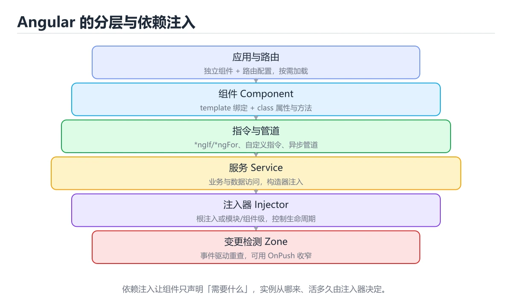

# Angular基础与依赖注入



> 内容更新时间：2026-10-06 · 学习阶段：入门 · 预计用时：60 分钟

## 本节知识框架

**课程定位**：分类「frontend_frameworks」· 学习阶段 入门 · 建议用时 50 分钟。

本课主线：学习Angular架构、TypeScript集成、依赖注入系统和RxJS响应式编程。

### 复习清单

- [ ] 能不看正文复述本课核心术语，并指出一个边界或反例。
- [ ] 能运行或推演本课示例，记录输入、输出与失败现象。
- [ ] 能完成一次自测，并把错题对照考点精讲定位原因。

### 课程导言
Angular是一个功能完整的企业级前端框架，由Google维护。它以TypeScript为基础，提供了从路由、表单处理到HTTP客户端的一站式解决方案。本章将带你深入理解Angular的核心概念，特别是其标志性的依赖注入系统——这是Angular架构的基石。你将学习组件、模块、服务、指令等基本概念，掌握如何通过依赖注入实现松耦合和可测试性，并了解Angular的变更检测机制。通过实际案例和渐进式示例，你会发现Angular虽然学习曲线较陡，但其严谨的架构设计非常适合大型应用开发。

### 学习目标
完成本章后，你将能够：

- 理解Angular的模块化架构和核心概念
- 掌握依赖注入的原理和使用方法
- 熟练使用组件、服务和指令构建应用
- 理解Angular的变更检测机制
- 使用HttpClient进行网络请求
- 识别并避免常见的Angular开发陷阱

## 核心概念定义

| 术语 | 一句话说明 |
| --- | --- |
| Angular | 学习Angular架构、TypeScript集成、依赖注入系统和RxJS响应式编相关：正文给出可操作定义与适用边界。 |
| 依赖注入 | 学习Angular架构、TypeScript集成、依赖注入系统和RxJS响应式编相关：正文给出可操作定义与适用边界。 |
| TypeScript | 学习Angular架构、TypeScript集成、依赖注入系统和RxJS响应式编相关：正文给出可操作定义与适用边界。 |
| RxJS | 学习Angular架构、TypeScript集成、依赖注入系统和RxJS响应式编相关：正文给出可操作定义与适用边界。 |
| 服务 | 学习Angular架构、TypeScript集成、依赖注入系统和RxJS响应式编相关：正文给出可操作定义与适用边界。 |

## 原理与运行机制

《Angular基础与依赖注入》正文各章按「输入是什么 → 中间如何转换 → 输出到哪 → 失败时怎样表现」四问展开；复习时给每个机制补一句自己的复述，再回到对应章节核对。

### 核心概念解析
#### Angular是什么？

想象你在建造一座摩天大楼。React和Vue像是提供砖块和水泥，让你自由发挥；而Angular则像是一个完整的建筑套件，包含了地基、钢结构、电梯系统、消防系统等所有基础设施。你不需要自己挑选每个部件，但必须按照它的设计规范来建造。

Angular是一个" opiniated "（有主见的）框架，这意味着它对如何组织代码、如何构建应用有明确的建议。这种严格性在小型项目中可能显得繁琐，但在大型团队和企业级应用中，它能确保代码的一致性和可维护性。

#### TypeScript：Angular的基石

Angular强制使用TypeScript，这就像是在JavaScript上加了一层类型检查的安全网。TypeScript的好处包括：

- **编译时错误检测**：很多bug在写代码时就能发现，而不是运行时
- **更好的IDE支持**：自动补全、重构、导航等功能更强大
- **自文档化**：类型本身就是最好的文档
- **更易维护**：大型项目中，类型系统让代码意图更清晰

#### 依赖注入：Angular的灵魂

依赖注入（DI）是Angular最核心的特性之一。可以把DI想象成一个智能的快递系统：

传统方式中，如果一个组件需要某个服务，它会自己去创建这个服务的实例。这就像是每个人都需要什么东西时，都自己去工厂生产。

使用依赖注入后，组件只需要声明"我需要这个服务"，Angular的注入器会自动提供。这就像是有一个中央仓库，你需要什么就下单，仓库会送货上门。

DI的好处：
- **解耦**：组件不关心服务如何创建，只关心如何使用
- **可测试**：测试时可以轻松替换为mock服务
- **单例管理**：确保整个应用中只有一个服务实例
- **生命周期管理**：Angular自动管理服务实例的创建和销毁

#### 组件树：应用的骨架

Angular应用是由组件组成的树形结构。根组件是树干，其他组件是树枝和树叶。每个组件都有自己的：
- **模板**：定义UI结构
- **类**：包含逻辑和数据
- **样式**：定义外观
- **元数据**：告诉Angular如何处理这个组件

#### 变更检测：智能的更新机制

Angular的变更检测机制就像一个勤奋的保安，定期检查每个组件的数据是否发生变化。当检测到变化时，它会更新对应的DOM。

Angular使用Zone.js来拦截异步操作（如setTimeout、Promise、事件监听），在这些操作完成后自动触发变更检测。这意味着你不需要手动调用更新方法，Angular会自动处理。

## 典型应用场景

- 结合「Angular基础与依赖注入」的常见落地场景与选型边界，详见正文各章节的对比讨论。
- 迁移到新项目时，先明确输入规模、失败代价与可观测手段，再决定采用深度。

## 代码/协议/SQL 示例

《Angular基础与依赖注入》正文首个示例可作为最小验证起点（原样保留在上方章节）：先跑通，再改一个输入观察输出变化。

```typescript
// app.component.ts
import { Component } from '@angular/core';

@Component({
  selector: 'app-root',
  template: `<h1>Hello, Angular!</h1>`,
  styles: [`
    h1 {
      color: #dd0031;
      font-family: Arial, sans-serif;
    }
  `]
})
export class AppComponent {
  title = 'my-angular-app';
}
```

### 渐进式代码示例
#### 最小示例：Hello World组件

让我们从最简单的组件开始：

```typescript
// app.component.ts
import { Component } from '@angular/core';

@Component({
  selector: 'app-root',
  template: `<h1>Hello, Angular!</h1>`,
  styles: [`
    h1 {
      color: #dd0031;
      font-family: Arial, sans-serif;
    }
  `]
})
export class AppComponent {
  title = 'my-angular-app';
}
```

关键点解析：
- `@Component`装饰器定义了组件的元数据
- `selector`指定了组件在HTML中的标签名
- `template`是组件的HTML模板
- `styles`是组件的CSS样式（作用域仅限于该组件）
- 组件类可以包含属性和方法

#### 完整示例：带输入输出的组件通信

现在让我们看看组件之间如何通信：

```typescript
// product.model.ts
export interface Product {
  id: number;
  name: string;
  price: number;
  description: string;
}
```

```typescript
// product-card.component.ts
import { Component, Input, Output, EventEmitter } from '@angular/core';
import { Product } from './product.model';

@Component({
  selector: 'app-product-card',
  template: `
    <div class="product-card">
      <h3>{{ product.name }}</h3>
      <p class="price">¥{{ product.price | number:'1.2-2' }}</p>
      <p class="description">{{ product.description }}</p>
      <button (click)="onAddToCart()">加入购物车</button>
    </div>
  `,
  styles: [`
    .product-card {
      border: 1px solid #ddd;
      border-radius: 8px;
      padding: 16px;
      margin: 8px;
    }
    .price {
      color: #dd0031;
      font-weight: bold;
      font-size: 1.2em;
    }
    button {
      background: #dd0031;
      color: white;
      border: none;
      padding: 8px 16px;
      border-radius: 4px;
      cursor: pointer;
    }
    button:hover {
      background: #c5002a;
    }
  `]
})
export class ProductCardComponent {
  @Input() product!: Product;
  @Output() addToCart = new EventEmitter<Product>();

  onAddToCart(): void {
    this.addToCart.emit(this.product);
  }
}
```

```typescript
// product-list.component.ts
import { Component } from '@angular/core';
import { Product } from './product.model';

@Component({
  selector: 'app-product-list',
  template: `
    <div class="product-list">
      <h2>商品列表</h2>
      <app-product-card
        *ngFor="let product of products"
        [product]="product"
        (addToCart)="handleAddToCart($event)"
      ></app-product-card>
    </div>
  `,
  styles: [`
    .product-list {
      padding: 20px;
    }
  `]
})
export class ProductListComponent {
  products: Product[] = [
    {
      id: 1,
      name: '笔记本电脑',
      price: 5999,
      description: '高性能办公笔记本'
    },
    {
      id: 2,
      name: '无线鼠标',
      price: 99,
      description: '人体工学设计'
    },
    {
      id: 3,
      name: '机械键盘',
      price: 299,
      description: 'Cherry轴体'
    }
  ];

  handleAddToCart(product: Product): void {
    console.log('已添加到购物车:', product.name);
    // 实际项目中会调用购物车服务
  }
}
```

这个例子展示了：
- `@Input()`接收父组件传递的数据
- `@Output()`向父组件发送事件
- `*ngFor`指令用于循环渲染列表
- 管道（Pipe）用于格式化数据

#### 进阶示例：服务和依赖注入

现在让我们创建一个服务来管理产品数据：

```typescript
// product.service.ts
import { Injectable } from '@angular/core';
import { HttpClient } from '@angular/common/http';
import { Observable } from 'rxjs';
import { Product } from './product.model';

@Injectable({
  providedIn: 'root' // 注册为根注入器中的单例
})
export class ProductService {
  private apiUrl = 'https://api.example.com/products';

  constructor(private http: HttpClient) {}

  getProducts(): Observable<Product[]> {
    return this.http.get<Product[]>(this.apiUrl);
  }

  getProductById(id: number): Observable<Product> {
    return this.http.get<Product>(`${this.apiUrl}/${id}`);
  }

  createProduct(product: Product): Observable<Product> {
    return this.http.post<Product>(this.apiUrl, product);
  }

  updateProduct(id: number, product: Product): Observable<Product> {
    return this.http.put<Product>(`${this.apiUrl}/${id}`, product);
  }

  deleteProduct(id: number): Observable<void> {
    return this.http.delete<void>(`${this.apiUrl}/${id}`);
  }
}
```

```typescript
// cart.service.ts
import { Injectable } from '@angular/core';
import { BehaviorSubject, Observable } from 'rxjs';
import { Product } from './product.model';

@Injectable({
  providedIn: 'root'
})
export class CartService {
  private cartItems = new BehaviorSubject<Product[]>([]);
  
  // 公开observable供组件订阅
  cartItems$: Observable<Product[]> = this.cartItems.asObservable();
  
  // 获取购物车数量
  get cartCount(): number {
    return this.cartItems.value.length;
  }

  addToCart(product: Product): void {
    const currentItems = this.cartItems.value;
    this.cartItems.next([...currentItems, product]);
  }

  removeFromCart(productId: number): void {
    const currentItems = this.cartItems.value;
    const updatedItems = currentItems.filter(item => item.id !== productId);
    this.cartItems.next(updatedItems);
  }

  clearCart(): void {
    this.cartItems.next([]);
  }
}
```

```typescript
// product-list-with-service.component.ts
import { Component, OnInit, OnDestroy } from '@angular/core';
import { Subscription } from 'rxjs';
import { ProductService } from './product.service';
import { CartService } from './cart.service';
import { Product } from './product.model';

@Component({
  selector: 'app-product-list',
  template: `
    <div class="product-list">
      <h2>商品列表</h2>
      
      <div *ngIf="loading" class="loading">
        加载中...
      </div>
      
      <div *ngIf="error" class="error">
        {{ error }}
      </div>
      
      <app-product-card
        *ngFor="let product of products"
        [product]="product"
        (addToCart)="handleAddToCart($event)"
      ></app-product-card>
      
      <div class="cart-summary">
        <p>购物车中有 {{ cartCount }} 件商品</p>
      </div>
    </div>
  `,
  styles: [`
    .loading, .error {
      padding: 20px;
      text-align: center;
    }
    .error {
      color: red;
    }
    .cart-summary {
      margin-top: 20px;
      padding: 10px;
      background: #f0f0f0;
      border-radius: 4px;
    }
  `]
})
export class ProductListWithServiceComponent implements OnInit, OnDestroy {
  products: Product[] = [];
  loading = false;
  error: string | null = null;
  cartCount = 0;
  private subscription: Subscription | null = null;

  constructor(
    private productService: ProductService,
    private cartService: CartService
  ) {}

  ngOnInit(): void {
    this.loading = true;
    
    this.productService.getProducts().subscribe({
      next: (products) => {
        this.products = products;
        this.loading = false;
      },
      error: (err) => {
        this.error = '加载商品失败，请稍后重试';
        this.loading = false;
        console.error(err);
      }
    });

    // 订阅购物车变化
    this.subscription = this.cartService.cartItems$.subscribe(items => {
      this.cartCount = items.length;
    });
  }

  ngOnDestroy(): void {
    // 取消订阅，防止内存泄漏
    if (this.subscription) {
      this.subscription.unsubscribe();
    }
  }

  handleAddToCart(product: Product): void {
    this.cartService.addToCart(product);
  }
}
```

这个例子展示了：
- 使用`@Injectable`创建服务
- 通过构造函数注入服务
- 使用HttpClient进行HTTP请求
- 使用RxJS的BehaviorSubject管理状态
- 实现OnInit和OnDestroy生命周期钩子
- 正确取消订阅防止内存泄漏

#### 实战示例：自定义指令和管道

让我们创建一些可复用的指令和管道：

```typescript
// highlight.directive.ts
import { Directive, ElementRef, Input, OnInit, OnChanges } from '@angular/core';

@Directive({
  selector: '[appHighlight]'
})
export class HighlightDirective implements OnInit, OnChanges {
  @Input() appHighlight: string = 'yellow';
  @Input() highlightCondition: boolean = true;

  constructor(private el: ElementRef) {}

  ngOnInit(): void {
    this.applyHighlight();
  }

  ngOnChanges(): void {
    this.applyHighlight();
  }

  private applyHighlight(): void {
    if (this.highlightCondition) {
      this.el.nativeElement.style.backgroundColor = this.appHighlight;
    } else {
      this.el.nativeElement.style.backgroundColor = '';
    }
  }
}
```

```typescript
// currency-format.pipe.ts
import { Pipe, PipeTransform } from '@angular/core';

@Pipe({
  name: 'currencyFormat'
})
export class CurrencyFormatPipe implements PipeTransform {
  transform(value: number, currency: string = 'CNY'): string {
    if (value == null || isNaN(value)) {
      return '';
    }

    const symbols: { [key: string]: string } = {
      'CNY': '¥',
      'USD': '$',
      'EUR': '€',
      'JPY': '¥'
    };

    const symbol = symbols[currency] || currency;
    const formatted = value.toLocaleString('zh-CN', {
      minimumFractionDigits: 2,
      maximumFractionDigits: 2
    });

    return `${symbol}${formatted}`;
  }
}
```

使用自定义指令和管道：

```typescript
// product-display.component.ts
import { Component } from '@angular/core';
import { Product } from './product.model';

@Component({
  selector: 'app-product-display',
  template: `
    <div class="product-display">
      <h2>特价商品</h2>
      
      <div 
        *ngFor="let product of products"
        [appHighlight]="'lightgreen'"
        [highlightCondition]="product.price < 200"
        class="product-item"
      >
        <h3>{{ product.name }}</h3>
        <p>价格：{{ product.price | currencyFormat:'CNY' }}</p>
        <p *ngIf="product.price < 200" class="discount-badge">
          特价优惠！
        </p>
      </div>
    </div>
  `,
  styles: [`
    .product-item {
      padding: 10px;
      margin: 5px 0;
      border: 1px solid #eee;
    }
    .discount-badge {
      color: #dd0031;
      font-weight: bold;
    }
  `]
})
export class ProductDisplayComponent {
  products: Product[] = [
    { id: 1, name: 'T恤', price: 99, description: '纯棉材质' },
    { id: 2, name: '牛仔裤', price: 299, description: '修身版型' },
    { id: 3, name: '运动鞋', price: 199, description: '透气舒适' }
  ];
}
```

#### 综合示例：完整的用户管理模块

让我们把所有知识整合到一个完整的用户管理模块中：

```typescript
// user.model.ts
export interface User {
  id: number;
  name: string;
  email: string;
  role: 'admin' | 'user' | 'editor';
  createdAt: Date;
  isActive: boolean;
}
```

```typescript
// user.service.ts
import { Injectable } from '@angular/core';
import { HttpClient } from '@angular/common/http';
import { Observable } from 'rxjs';
import { User } from './user.model';

@Injectable({
  providedIn: 'root'
})
export class UserService {
  private apiUrl = 'https://api.example.com/users';

  constructor(private http: HttpClient) {}

  getUsers(): Observable<User[]> {
    return this.http.get<User[]>(this.apiUrl);
  }

  getUserById(id: number): Observable<User> {
    return this.http.get<User>(`${this.apiUrl}/${id}`);
  }

  createUser(user: Omit<User, 'id' | 'createdAt'>): Observable<User> {
    return this.http.post<User>(this.apiUrl, user);
  }

  updateUser(id: number, user: Partial<User>): Observable<User> {
    return this.http.patch<User>(`${this.apiUrl}/${id}`, user);
  }

  deleteUser(id: number): Observable<void> {
    return this.http.delete<void>(`${this.apiUrl}/${id}`);
  }
}
```

```typescript
// user-form.component.ts
import { Component, Input, Output, EventEmitter, OnInit } from '@angular/core';
import { FormBuilder, FormGroup, Validators } from '@angular/forms';
import { User } from './user.model';

@Component({
  selector: 'app-user-form',
  template: `
    <form [formGroup]="userForm" (ngSubmit)="onSubmit()" class="user-form">
      <h3>{{ isEditMode ? '编辑用户' : '添加用户' }}</h3>
      
      <div class="form-group">
        <label for="name">姓名</label>
        <input 
          id="name"
          formControlName="name"
          type="text"
          placeholder="请输入姓名"
        />
        <div *ngIf="userForm.get('name')?.invalid && userForm.get('name')?.touched" 
             class="error-message">
          姓名不能为空
        </div>
      </div>
      
      <div class="form-group">
        <label for="email">邮箱</label>
        <input 
          id="email"
          formControlName="email"
          type="email"
          placeholder="请输入邮箱"
        />
        <div *ngIf="userForm.get('email')?.invalid && userForm.get('email')?.touched" 
             class="error-message">
          请输入有效的邮箱地址
        </div>
      </div>
      
      <div class="form-group">
        <label for="role">角色</label>
        <select id="role" formControlName="role">
          <option value="user">普通用户</option>
          <option value="editor">编辑</option>
          <option value="admin">管理员</option>
        </select>
      </div>
      
      <div class="form-actions">
        <button type="button" (click)="onCancel()" class="btn-cancel">
          取消
        </button>
        <button 
          type="submit" 
          [disabled]="userForm.invalid"
          class="btn-submit"
        >
          {{ isEditMode ? '更新' : '添加' }}
        </button>
      </div>
    </form>
  `,
  styles: [`
    .user-form {
      max-width: 500px;
      margin: 20px auto;
      padding: 20px;
      border: 1px solid #ddd;
      border-radius: 8px;
    }
    .form-group {
      margin-bottom: 15px;
    }
    label {
      display: block;
      margin-bottom: 5px;
      font-weight: bold;
    }
    input, select {
      width: 100%;
      padding: 8px;
      border: 1px solid #ddd;
      border-radius: 4px;
    }
    .error-message {
      color: red;
      font-size: 0.9em;
      margin-top: 5px;
    }
    .form-actions {
      display: flex;
      gap: 10px;
      justify-content: flex-end;
    }
    button {
      padding: 10px 20px;
      border: none;
      border-radius: 4px;
      cursor: pointer;
    }
    .btn-cancel {
      background: #f0f0f0;
    }
    .btn-submit {
      background: #dd0031;
      color: white;
    }
    .btn-submit:disabled {
      background: #ccc;
      cursor: not-allowed;
    }
  `]
})
export class UserFormComponent implements OnInit {
  @Input() user: User | null = null;
  @Output() save = new EventEmitter<any>();
  @Output() cancel = new EventEmitter<void>();

  userForm!: FormGroup;
  isEditMode = false;

  constructor(private fb: FormBuilder) {}

  ngOnInit(): void {
    this.isEditMode = !!this.user;
    
    this.userForm = this.fb.group({
      name: ['', [Validators.required, Validators.minLength(2)]],
      email: ['', [Validators.required, Validators.email]],
      role: ['user', Validators.required]
    });

    if (this.user) {
      this.userForm.patchValue({
        name: this.user.name,
        email: this.user.email,
        role: this.user.role
      });
    }
  }

  onSubmit(): void {
    if (this.userForm.valid) {
      this.save.emit(this.userForm.value);
    }
  }

  onCancel(): void {
    this.cancel.emit();
  }
}
```

```typescript
// user-list.component.ts
import { Component, OnInit } from '@angular/core';
import { UserService } from './user.service';
import { User } from './user.model';

@Component({
  selector: 'app-user-list',
  template: `
    <div class="user-list">
      <h2>用户管理</h2>
      
      <button (click)="showAddForm()" class="btn-add">
        添加用户
      </button>
      
      <app-user-form
        *ngIf="showForm"
        [user]="editingUser"
        (save)="handleSave($event)"
        (cancel)="hideForm()"
      ></app-user-form>
      
      <div *ngIf="loading" class="loading">
        加载中...
      </div>
      
      <table *ngIf="!loading && users.length > 0" class="user-table">
        <thead>
          <tr>
            <th>ID</th>
            <th>姓名</th>
            <th>邮箱</th>
            <th>角色</th>
            <th>状态</th>
            <th>操作</th>
          </tr>
        </thead>
        <tbody>
          <tr *ngFor="let user of users">
            <td>{{ user.id }}</td>
            <td>{{ user.name }}</td>
            <td>{{ user.email }}</td>
            <td>
              <span [class]="getRoleClass(user.role)">
                {{ getRoleText(user.role) }}
              </span>
            </td>
            <td>
              <span [class]="user.isActive ? 'status-active' : 'status-inactive'">
                {{ user.isActive ? '活跃' : '禁用' }}
              </span>
            </td>
            <td>
              <button (click)="editUser(user)" class="btn-edit">编辑</button>
              <button (click)="deleteUser(user.id)" class="btn-delete">删除</button>
            </td>
          </tr>
        </tbody>
      </table>
      
      <div *ngIf="!loading && users.length === 0" class="empty-state">
        暂无用户数据
      </div>
    </div>
  `,
  styles: [`
    .user-list {
      padding: 20px;
    }
    .btn-add {
      margin-bottom: 20px;
      padding: 10px 20px;
      background: #dd0031;
      color: white;
      border: none;
      border-radius: 4px;
      cursor: pointer;
    }
    .user-table {
      width: 100%;
      border-collapse: collapse;
    }
    .user-table th,
    .user-table td {
      padding: 12px;
      text-align: left;
      border-bottom: 1px solid #ddd;
    }
    .user-table th {
      background: #f5f5f5;
      font-weight: bold;
    }
    .role-admin {
      color: #dd0031;
      font-weight: bold;
    }
    .role-editor {
      color: #0066cc;
    }
    .role-user {
      color: #666;
    }
    .status-active {
      color: green;
    }
    .status-inactive {
      color: red;
    }
    .btn-edit, .btn-delete {
      padding: 5px 10px;
      margin-right: 5px;
      border: none;
      border-radius: 4px;
      cursor: pointer;
    }
    .btn-edit {
      background: #0066cc;
      color: white;
    }
    .btn-delete {
      background: #ff4444;
      color: white;
    }
    .empty-state {
      text-align: center;
      padding: 40px;
      color: #999;
    }
  `]
})
export class UserListComponent implements OnInit {
  users: User[] = [];
  loading = false;
  showForm = false;
  editingUser: User | null = null;

  constructor(private userService: UserService) {}

  ngOnInit(): void {
    this.loadUsers();
  }

  loadUsers(): void {
    this.loading = true;
    this.userService.getUsers().subscribe({
      next: (users) => {
        this.users = users;
        this.loading = false;
      },
      error: (err) => {
        console.error('加载用户失败:', err);
        this.loading = false;
      }
    });
  }

  showAddForm(): void {
    this.editingUser = null;
    this.showForm = true;
  }

  hideForm(): void {
    this.showForm = false;
    this.editingUser = null;
  }

  editUser(user: User): void {
    this.editingUser = user;
    this.showForm = true;
  }

  handleSave(userData: any): void {
    if (this.editingUser) {
      // 更新用户
      this.userService.updateUser(this.editingUser.id, userData).subscribe({
        next: () => {
          this.loadUsers();
          this.hideForm();
        },
        error: (err) => {
          console.error('更新用户失败:', err);
        }
      });
    } else {
      // 创建用户
      this.userService.createUser(userData).subscribe({
        next: () => {
          this.loadUsers();
          this.hideForm();
        },
        error: (err) => {
          console.error('创建用户失败:', err);
        }
      });
    }
  }

  deleteUser(userId: number): void {
    if (confirm('确定要删除这个用户吗？')) {
      this.userService.deleteUser(userId).subscribe({
        next: () => {
          this.loadUsers();
        },
        error: (err) => {
          console.error('删除用户失败:', err);
        }
      });
    }
  }

  getRoleClass(role: string): string {
    return `role-${role}`;
  }

  getRoleText(role: string): string {
    const roleMap: { [key: string]: string } = {
      'admin': '管理员',
      'editor': '编辑',
      'user': '普通用户'
    };
    return roleMap[role] || role;
  }
}
```

这个完整的用户管理模块展示了：
- 响应式表单的使用
- 表单验证
- CRUD操作的完整实现
- 条件渲染和样式绑定
- 父子组件通信
- 错误处理和加载状态

## 时间/空间复杂度或性能分析

- 在《Angular基础与依赖注入》里处理规模 n 时，先估计主循环与嵌套层数，再决定优化方向；小样本上的耗时读数不能外推。
- 性能结论要绑定输入分布：换数据规模、并发度或缓存命中情况后须重新测量。

## 常见误区与易错点

| 错误做法 | 典型现象 | 修复方向 |
| --- | --- | --- |
| 只验证正常输入 | 边界数据触发时才暴露问题 | 为每个结论补一个空值/极值/重复值用例 |
| 背结论不跑实验 | 换个输入就失效 | 按「预测—实测—差异归因」三步复盘 |
| 忽略环境与版本差异 | 本机可用线上报错 | 把版本、配置与依赖写入复现步骤 |

### 常见陷阱对照表
| 陷阱 | 表现 | 解决方案 |
|------|------|----------|
| 忘记取消订阅 | 组件销毁后仍在接收数据，导致内存泄漏 | 在ngOnDestroy中unsubscribe，或使用async管道 |
| ChangeDetectionStrategy.OnChange未生效 | 手动修改对象属性不触发更新 | 使用immutable模式，创建新对象引用 |
| 循环依赖注入 | 两个服务互相依赖导致启动失败 | 重构代码，提取共享服务或使用forwardRef |
| NgZone外操作不触发更新 | 第三方库回调中修改数据界面不更新 | 使用NgZone.run()包裹代码 |
| async管道重复订阅 | 多个async管道导致多次HTTP请求 | 使用shareReplay操作符或BehaviorSubject |
| 模板中调用函数造成性能问题 | 每次变更检测都执行函数 | 使用pure pipe或将计算结果缓存 |
| 模块懒加载配置错误 | 路由跳转时模块加载失败 | 确保RouterModule.forChild正确配置 |

## 与其他知识点的关系

本课与分类「frontend_frameworks」内相邻课程互为补充，建议按清单顺序学完再做综合练习。

## 自测题与参考答案

以下题目与题库同源，作答后再看解析；错误项要能说出错在哪一步。

## 考点精讲

### 考点 1

关于Angular的依赖注入，以下说法正确的是？

A. 服务必须在@NgModule的providers中注册才能使用  
B. @Injectable({ providedIn: 'root' })会使服务成为单例 ✅  
C. 构造函数中的参数顺序不影响依赖注入  
D. 每个组件都会创建一个新的服务实例  

**正确答案：** B

**解析：** Angular的依赖注入系统非常灵活。选项A错误，从Angular 6开始，可以使用`@Injectable({ providedIn: 'root' })`在服务级别注册，无需在模块中声明。选项B正确，`providedIn: 'root'`会将服务注册到根注入器，整个应用共享一个实例，形成单例模式。选项C错误，虽然TypeScript的参数名可以提供线索，但Angular主要依靠参数的类型信息来注入依赖，顺序本身不重要，但类型必须匹配。选项D错误，默认情况下服务是单例的，只有在组件的providers中显式声明才会为该组件创建新实例。

### 考点 2

这段 Angular 组件在模板里直接调用 getData()，会带来什么问题？

A. 模板中不能调用方法  
B. 每次变更检测都会调用getData，影响性能 ✅  
C. 返回数组会导致错误  
D. 没有导入必要的模块  

**正确答案：** B

**解析：** 在Angular模板中直接调用方法是一个常见的性能陷阱。Angular的变更检测机制会在每次检测到变化时重新评估模板表达式，这意味着`getData()`会被频繁调用，即使数据没有变化。控制台会看到大量的"getData called"输出。正确的做法是使用属性或pure pipe：要么直接将data暴露给模板`<div>{{ data }}</div>`，要么创建一个pure pipe来处理数据转换。pure pipe只有在输入参数变化时才会重新执行，可以避免这个问题。

### 考点 3

关于Angular的生命周期钩子，以下执行顺序正确的是？

A. ngOnInit → ngAfterViewInit → ngOnChanges → ngOnDestroy  
B. ngAfterViewInit → ngOnInit → ngOnChanges → ngOnDestroy  
C. ngOnInit → ngOnChanges → ngAfterViewInit → ngOnDestroy  
D. ngOnChanges → ngOnInit → ngAfterViewInit → ngOnDestroy ✅  

**正确答案：** D

**解析：** Angular组件的生命周期钩子有严格的执行顺序：1）ngOnChanges - 当输入属性变化时调用（首次也会调用）；2）ngOnInit - 组件初始化完成后调用，通常在这里进行数据获取；3）ngAfterContentInit - 内容投影完成后；4）ngAfterContentChecked - 内容检查后；5）ngAfterViewInit - 视图初始化完成后；6）ngAfterViewChecked - 视图检查后；7）ngOnDestroy - 组件销毁前。所以正确顺序是ngOnChanges → ngOnInit → ngAfterViewInit → ngOnDestroy。记住这个顺序对于正确处理初始化和清理逻辑非常重要。

### 考点 4

关于RxJS在Angular中的使用，以下说法错误的是？

A. HttpClient返回的是Observable  
B. 使用async管道可以自动管理订阅  
C. subscribe()返回的Subscription需要手动取消  
D. Observable是同步执行的，不会造成性能问题 ✅  

**正确答案：** D

**解析：** RxJS是Angular的重要组成部分。选项A正确，HttpClient的所有方法都返回Observable，这是Angular推荐的异步处理方式。选项B正确，async管道会在组件销毁时自动取消订阅，是最佳实践。选项C正确，如果手动调用subscribe()，需要在ngOnDestroy中取消订阅以防止内存泄漏。选项D错误，Observable既可以是同步的也可以是异步的，而且如果不正确使用（如在模板中频繁创建新的Observable），确实会造成性能问题。关键是要理解Observable的惰性求值特性和正确的订阅管理模式。

### 考点 5

以下哪种情况会导致Angular的变更检测无法正常工作？

A. 在NgZone外部修改了响应式数据 ✅  
B. 使用了ChangeDetectionStrategy.Default  
C. 在ngOnInit中调用了HTTP请求  
D. 使用了async管道订阅Observable  

**正确答案：** A

**解析：** Angular依赖Zone.js来拦截异步操作并触发变更检测。如果在NgZone外部执行代码（比如某些第三方库的回调），Angular不知道数据发生了变化，因此不会更新视图。解决方法是使用`NgZone.run()`将代码包裹起来，或者手动调用`ChangeDetectorRef.detectChanges()`。选项B是默认的变更检测策略，工作正常。选项C是标准做法，HttpClient集成在NgZone中，会自动触发变更检测。选项D也是推荐做法，async管道会自动处理变更检测。

## 术语速查

| 术语 | 一句话说明 |
| --- | --- |
| Angular | Google 维护的企业级全家桶框架，路由、表单与 HTTP 客户端开箱自带。 |
| 依赖注入 | 组件只声明需要什么服务，实例的创建与送达交给框架注入器完成。 |
| TypeScript | JavaScript 的静态类型超集，编译期即可暴露类型错误。 |
| RxJS | 用 Observable 表示异步数据流，并靠操作符做组合、过滤与转换。 |
| 服务 | 带 Injectable 标记的普通类，集中封装数据与业务逻辑供组件复用。 |

## 参考资料与复核

- 官方/权威资料：[web.dev 性能指南](https://web.dev/)
- 主题延伸：[Angular 依赖注入指南](https://angular.cn/guide/di)
- 最后复核：2026-10-04
- 下次复核：2027-03-09

## 内容元数据

- 内容更新时间：2026-10-06

- 内容版本：v2.0
- 课程标识：frontend_angular_basics
- 所属分类：frontend_frameworks
- 学习阶段：入门
- 建议用时：50 分钟
