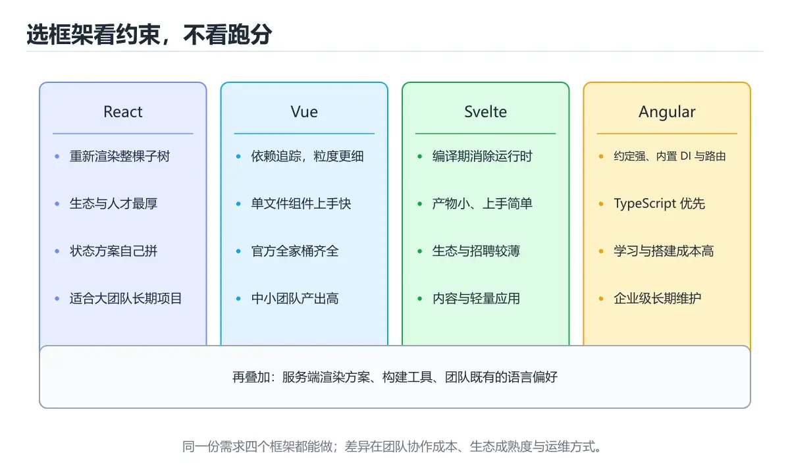

# 框架对比与选型指南



> 内容更新时间：2026-10-06 · 学习阶段：进阶 · 预计用时：60 分钟

## 本节知识框架

**课程定位**：分类「frontend_frameworks」· 学习阶段 进阶 · 建议用时 40 分钟。

本课主线：从性能、包体积、学习曲线等维度对比主流框架，提供选型决策树。

### 复习清单

- [ ] 能不看正文复述本课核心术语，并指出一个边界或反例。
- [ ] 能运行或推演本课示例，记录输入、输出与失败现象。
- [ ] 能完成一次自测，并把错题对照考点精讲定位原因。

### 课程导言
面对React、Vue、Angular、Svelte等众多前端框架，开发者常常陷入选择困难。本章将从性能基准测试、包体积对比、学习曲线分析、生态系统成熟度等多个维度，为你提供全面的框架对比数据。通过实际场景分析和决策树模型，你将学会如何根据项目需求、团队技能、业务目标做出明智的技术选型，避免盲目追随潮流或固守过时技术。

### 学习目标
完成本章后，你将能够：

- 理解各主流框架的核心架构差异和设计理念
- 解读性能基准测试数据并识别关键指标
- 比较不同框架的包体积和对应用加载速度的影响
- 评估框架的学习成本和团队培训需求
- 分析生态系统成熟度（社区规模、第三方库、就业机会）
- 根据具体场景（小型项目、企业应用、移动优先等）选择合适的框架
- 制定框架迁移策略和技术债务管理计划

## 核心概念定义

| 术语 | 一句话说明 |
| --- | --- |
| 框架对比 | 把 React、Vue、Angular、Svelte 摆到性能、包体积、学习曲线和生态四个维度上逐项比高低。 |
| 性能基准 | js-framework-benchmark 给出的创建与更新耗时、内存占用数字，正文只把它当参考而不当选型依据。 |
| 选型指南 | 把项目规模、团队经验、性能与 SEO 要求等条件喂进决策树，按各项打分推出该用哪个框架。 |
| 生态系统 | 主仓库 Stars、npm 月下载量、活跃贡献者与第三方库数量，决定你遇到问题时多快能找到现成方案。 |
| 最佳实践 | 先定功能需求，再在满足需求的框架里挑团队最熟悉的，并提前规划迁移策略与技术债务。 |

## 原理与运行机制

《框架对比与选型指南》正文各章按「输入是什么 → 中间如何转换 → 输出到哪 → 失败时怎样表现」四问展开；复习时给每个机制补一句自己的复述，再回到对应章节核对。

### 核心概念解析
#### 为什么框架选型如此重要？

想象你要建造一栋房子。框架就像是建筑的基础结构——一旦选定，后期更改的成本极高。错误选型可能导致：
- 开发效率低下，项目延期
- 性能瓶颈，用户体验差
- 招聘困难，团队扩张受阻
- 维护成本高，技术债务累积

但也不必过度焦虑。现代框架之间的差距正在缩小，大多数情况下，团队的熟悉度和项目匹配度比框架本身的"优劣"更重要。

#### 四大主流框架的设计理念

**React：灵活的工具箱**

React由Facebook开发，核心理念是"Learn Once, Write Anywhere"。它不是一个完整的框架，而是一个UI库，专注于视图层。你需要自己选择路由、状态管理、构建工具等配套方案。

优点：
- 极高的灵活性，可按需组合生态
- 庞大的社区和丰富的第三方库
- React Native实现跨平台移动开发
- 函数组件+Hooks简化了状态管理

缺点：
- 配置复杂，初学者容易迷失
- JSX语法需要适应
- 频繁的版本更新带来迁移成本

**Vue：渐进式的友好伙伴**

Vue由尤雨溪创建，设计目标是"渐进式"——你可以从简单的HTML增强开始，逐步过渡到完整的SPA应用。

优点：
- 学习曲线平缓，文档优秀
- 单文件组件（.vue）结构清晰
- Composition API提供类似React的灵活性
- 官方提供了完整的路由和状态管理方案

缺点：
- 生态系统规模小于React
- TypeScript支持相对较弱（Vue 3已改善）
- 大型企业采用率较低

**Angular：企业级的全能选手**

Angular由Google维护，是一个"开箱即用"的完整框架。它内置了路由、HTTP客户端、表单验证、依赖注入等企业级功能。

优点：
- 完整的解决方案，减少选型决策
- TypeScript原生支持，类型安全
- 强大的CLI工具链
- 适合大型团队协作

缺点：
- 学习曲线陡峭
- 包体积较大
- 概念繁多（模块、服务、装饰器等）
- 版本升级可能破坏兼容性

**Svelte：编译时的革新者**

Svelte采用完全不同的思路——在编译时生成优化的JavaScript代码，无需运行时框架。

优点：
- 极小的包体积（通常<5KB）
- 真正的响应式，无虚拟DOM开销
- 简洁的语法，接近原生HTML/CSS/JS
- 优秀的性能表现

缺点：
- 生态系统相对较小
- 大型企业案例较少
- 招聘难度较高
- SSR和移动端支持不如React成熟

#### 性能基准测试：数字背后的真相

性能是框架选型的重要考量因素，但需要理性看待基准测试数据。

**关键指标解读：**

1. **JS启动时间**：浏览器解析和执行JavaScript的时间。影响首屏加载速度。
2. **交互准备时间（TTI）**：用户可以与页面交互的时间点。综合了JS执行和资源加载。
3. **内存占用**：长时间运行时的内存消耗。影响低端设备体验。
4. **渲染帧率**：动画和滚动的流畅度。理想值为60fps。
5. **包体积**：最终打包后的文件大小。直接影响加载时间。

**典型测试结果（基于Steve Kraus的js-framework-benchmark）：**

| 框架 | 创建1000行耗时 | 更新所有行耗时 | 清除所有行耗时 | 内存占用 |
|------|---------------|---------------|---------------|---------|
| Vanilla JS | 45ms | 30ms | 20ms | 2.5MB |
| Svelte | 52ms | 35ms | 22ms | 2.8MB |
| Solid | 55ms | 38ms | 25ms | 3.0MB |
| Vue 3 | 68ms | 45ms | 30ms | 3.5MB |
| React 18 | 75ms | 50ms | 35ms | 4.0MB |
| Angular 15 | 90ms | 60ms | 40ms | 5.5MB |

注意：这些数据仅供参考，实际性能受多种因素影响：
- 应用复杂度
- 代码质量
- 构建优化程度
- 服务器和网络条件

对于大多数应用，框架间的性能差异在可接受范围内。只有在极端场景（如数据密集型仪表盘、实时协作工具）下，性能差异才会成为决定性因素。

#### 包体积对比：每一字节都重要

包体积直接影响加载速度和用户体验，尤其在移动网络和低端设备上。

**典型Hello World应用的包体积（生产环境，gzip压缩后）：**

| 框架 | JavaScript体积 | CSS体积 | 总体积 |
|------|---------------|---------|--------|
| Svelte | 2-3 KB | 0.5 KB | ~3 KB |
| Preact | 3-4 KB | 0.5 KB | ~4 KB |
| Vue 3 | 15-20 KB | 2 KB | ~20 KB |
| React 18 | 30-35 KB | 0 KB* | ~35 KB |
| Angular 15 | 50-60 KB | 5 KB | ~60 KB |

*React不包含CSS，需要额外添加样式库

**实际项目的体积增长：**

随着功能增加，包体积会显著增长：
- 添加路由：+5-15 KB
- 添加状态管理：+5-20 KB
- 添加UI组件库：+20-100 KB
- 添加图表库：+50-200 KB

优化策略：
- 代码分割和懒加载
- Tree shaking移除未使用代码
- 使用现代格式（WebP图片、WOFF2字体）
- CDN缓存静态资源

#### 学习曲线：从入门到精通的时间成本

学习曲线不仅影响个人开发者，更影响团队的招聘和培训成本。

**学习难度评级（1-5星，5星最难）：**

| 框架 | 基础概念 | 高级特性 | 生态系统 | 综合难度 |
|------|---------|---------|---------|---------|
| Svelte | ⭐⭐ | ⭐⭐⭐ | ⭐⭐⭐ | ⭐⭐ |
| Vue | ⭐⭐ | ⭐⭐⭐ | ⭐⭐ | ⭐⭐ |
| React | ⭐⭐⭐ | ⭐⭐⭐⭐ | ⭐ | ⭐⭐⭐ |
| Angular | ⭐⭐⭐⭐ | ⭐⭐⭐⭐⭐ | ⭐⭐ | ⭐⭐⭐⭐ |

**典型学习时间估算（每天2小时）：**

- **Svelte**：1-2周掌握基础，1个月达到熟练
- **Vue**：2-3周掌握基础，2个月达到熟练
- **React**：3-4周掌握基础，3个月达到熟练
- **Angular**：1-2个月掌握基础，6个月达到熟练

影响因素：
-  prior经验（有React经验学Vue更快）
- 项目复杂度（简单CRUD vs 实时协作）
- 团队规模（小团队快速迭代 vs 大企业规范流程）

#### 生态系统成熟度：社区力量的较量

生态系统决定了你能多快找到解决方案、招聘人才、获得技术支持。

**GitHub Stars对比（截至2024年）：**

| 框架 | 主仓库Stars | 月下载量（npm） | 活跃贡献者 |
|------|------------|----------------|-----------|
| React | 210K+ | 20M+ | 1500+ |
| Vue | 200K+ | 4M+ | 400+ |
| Angular | 90K+ | 3M+ | 300+ |
| Svelte | 70K+ | 500K+ | 150+ |

**就业市场热度（基于LinkedIn和Indeed数据）：**

1. React：需求量最大，薪资中位数最高
2. Angular：企业岗位多，稳定性强
3. Vue：亚洲市场热门，初创公司偏好
4. Svelte：新兴领域，岗位较少但增长快

**第三方库丰富度：**

- **React**：最丰富的生态，几乎任何需求都有现成方案
  - UI库：Material-UI、Ant Design、Chakra UI
  - 状态管理：Redux、Zustand、Jotai
  - 数据获取：React Query、SWR
  
- **Vue**：官方维护的核心库质量高
  - 路由：Vue Router（官方）
  - 状态：Pinia（官方推荐）、Vuex
  - UI库：Element Plus、Vuetify
  
- **Angular**：内置功能完善，第三方库相对较少
  - UI库：Angular Material、PrimeNG
  - 状态：NgRx、Akita
  
- **Svelte**：生态正在快速增长
  - UI库：SvelteKit、Carbon Components Svelte
  - 状态：Svelte Store（内置）、TanStack Query
  - SSR：SvelteKit（官方）

## 典型应用场景

- 结合「框架对比与选型指南」的常见落地场景与选型边界，详见正文各章节的对比讨论。
- 迁移到新项目时，先明确输入规模、失败代价与可观测手段，再决定采用深度。

## 代码/协议/SQL 示例

正文首个完整示例如下，先运行确认环境，再按正文步骤改一个输入观察输出变化。

```jsx
import { useState } from 'react';

function TodoApp() {
  const [todos, setTodos] = useState([]);
  const [input, setInput] = useState('');
  
  const addTodo = () => {
    if (!input.trim()) return;
    setTodos([...todos, { id: Date.now(), text: input, completed: false }]);
    setInput('');
  };
  
  const toggleTodo = (id) => {
    setTodos(todos.map(todo =>
      todo.id === id ? { ...todo, completed: !todo.completed } : todo
    ));
  };
  
  return (
    <div>
      <h1>Todo List</h1>
      <input
        value={input}
        onChange={(e) => setInput(e.target.value)}
        onKeyPress={(e) => e.key === 'Enter' && addTodo()}
      />
      <button onClick={addTodo}>Add</button>
      <ul>
        {todos.map(todo => (
          <li key={todo.id}>
            <input
              type="checkbox"
              checked={todo.completed}
              onChange={() => toggleTodo(todo.id)}
            />
            <span style={{ textDecoration: todo.completed ? 'line-through' : 'none' }}>
              {todo.text}
            </span>
          </li>
        ))}
      </ul>
    </div>
  );
}

export default TodoApp;
```

### 渐进式代码示例
#### 最小示例：同样的Todo App，不同的实现

让我们用四种框架实现相同的待办事项功能，直观感受语法差异。

**React实现：**

```jsx
import { useState } from 'react';

function TodoApp() {
  const [todos, setTodos] = useState([]);
  const [input, setInput] = useState('');
  
  const addTodo = () => {
    if (!input.trim()) return;
    setTodos([...todos, { id: Date.now(), text: input, completed: false }]);
    setInput('');
  };
  
  const toggleTodo = (id) => {
    setTodos(todos.map(todo =>
      todo.id === id ? { ...todo, completed: !todo.completed } : todo
    ));
  };
  
  return (
    <div>
      <h1>Todo List</h1>
      <input
        value={input}
        onChange={(e) => setInput(e.target.value)}
        onKeyPress={(e) => e.key === 'Enter' && addTodo()}
      />
      <button onClick={addTodo}>Add</button>
      <ul>
        {todos.map(todo => (
          <li key={todo.id}>
            <input
              type="checkbox"
              checked={todo.completed}
              onChange={() => toggleTodo(todo.id)}
            />
            <span style={{ textDecoration: todo.completed ? 'line-through' : 'none' }}>
              {todo.text}
            </span>
          </li>
        ))}
      </ul>
    </div>
  );
}

export default TodoApp;
```

**Vue 3实现：**

```vue
<template>
  <div>
    <h1>Todo List</h1>
    <input v-model="input" @keyup.enter="addTodo" />
    <button @click="addTodo">Add</button>
    <ul>
      <li v-for="todo in todos" :key="todo.id">
        <input
          type="checkbox"
          :checked="todo.completed"
          @change="toggleTodo(todo.id)"
        />
        <span :style="{ textDecoration: todo.completed ? 'line-through' : 'none' }">
          {{ todo.text }}
        </span>
      </li>
    </ul>
  </div>
</template>

<script setup>
import { ref } from 'vue';

const todos = ref([]);
const input = ref('');

const addTodo = () => {
  if (!input.value.trim()) return;
  todos.value.push({
    id: Date.now(),
    text: input.value,
    completed: false
  });
  input.value = '';
};

const toggleTodo = (id) => {
  const todo = todos.value.find(t => t.id === id);
  if (todo) todo.completed = !todo.completed;
};
</script>
```

**Angular实现：**

```typescript
// app.component.ts
import { Component } from '@angular/core';

interface Todo {
  id: number;
  text: string;
  completed: boolean;
}

@Component({
  selector: 'app-root',
  template: `
    <div>
      <h1>Todo List</h1>
      <input [(ngModel)]="input" (keyup.enter)="addTodo()" />
      <button (click)="addTodo()">Add</button>
      <ul>
        <li *ngFor="let todo of todos">
          <input
            type="checkbox"
            [checked]="todo.completed"
            (change)="toggleTodo(todo.id)"
          />
          <span [style.text-decoration]="todo.completed ? 'line-through' : 'none'">
            {{ todo.text }}
          </span>
        </li>
      </ul>
    </div>
  `
})
export class AppComponent {
  todos: Todo[] = [];
  input: string = '';
  
  addTodo(): void {
    if (!this.input.trim()) return;
    this.todos.push({
      id: Date.now(),
      text: this.input,
      completed: false
    });
    this.input = '';
  }
  
  toggleTodo(id: number): void {
    const todo = this.todos.find(t => t.id === id);
    if (todo) todo.completed = !todo.completed;
  }
}
```

**Svelte实现：**

```svelte
<script>
  let todos = [];
  let input = '';
  
  function addTodo() {
    if (!input.trim()) return;
    todos = [...todos, {
      id: Date.now(),
      text: input,
      completed: false
    }];
    input = '';
  }
  
  function toggleTodo(id) {
    todos = todos.map(todo =>
      todo.id === id ? { ...todo, completed: !todo.completed } : todo
    );
  }
</script>

<div>
  <h1>Todo List</h1>
  <input bind:value={input} on:keydown={(e) => e.key === 'Enter' && addTodo()} />
  <button on:click={addTodo}>Add</button>
  <ul>
    {#each todos as todo (todo.id)}
      <li>
        <input
          type="checkbox"
          checked={todo.completed}
          on:change={() => toggleTodo(todo.id)}
        />
        <span style="text-decoration: {todo.completed ? 'line-through' : 'none'}">
          {todo.text}
        </span>
      </li>
    {/each}
  </ul>
</div>
```

对比观察：
- React需要手动管理不可变更新
- Vue使用双向绑定更简洁
- Angular需要类型定义和装饰器
- Svelte语法最接近原生HTML

#### 完整示例：电商产品列表页的性能对比

让我们创建一个更复杂的电商产品列表页，展示各框架在实际场景中的表现。

**React版本（使用React Query优化数据获取）：**

```jsx
import { useQuery } from '@tanstack/react-query';
import { useState, useMemo } from 'react';

function ProductList() {
  const [page, setPage] = useState(1);
  const [category, setCategory] = useState('all');
  const [search, setSearch] = useState('');
  
  // 使用React Query自动缓存和重试
  const { data, isLoading, error } = useQuery({
    queryKey: ['products', page, category, search],
    queryFn: async () => {
      const params = new URLSearchParams({
        page: page.toString(),
        limit: '20',
        category,
        search
      });
      
      const response = await fetch(`/api/products?${params}`);
      if (!response.ok) throw new Error('Failed to fetch');
      return response.json();
    },
    keepPreviousData: true // 保留旧数据直到新数据加载完成
  });
  
  // 使用useMemo避免重复计算
  const sortedProducts = useMemo(() => {
    if (!data?.products) return [];
    return data.products.sort((a, b) => b.rating - a.rating);
  }, [data?.products]);
  
  if (isLoading) return <div className="skeleton-grid">{/* 骨架屏 */}</div>;
  if (error) return <div>Error: {error.message}</div>;
  
  return (
    <div className="product-page">
      <header>
        <input
          value={search}
          onChange={(e) => setSearch(e.target.value)}
          placeholder="搜索产品..."
        />
        <select value={category} onChange={(e) => setCategory(e.target.value)}>
          <option value="all">全部</option>
          <option value="electronics">电子产品</option>
          <option value="clothing">服装</option>
        </select>
      </header>
      
      <div className="product-grid">
        {sortedProducts.map(product => (
          <ProductCard key={product.id} product={product} />
        ))}
      </div>
      
      <Pagination
        currentPage={page}
        totalPages={data?.totalPages}
        onPageChange={setPage}
      />
    </div>
  );
}

// 使用React.memo优化子组件渲染
const ProductCard = React.memo(function ProductCard({ product }) {
  return (
    <article className="product-card">
      
      <h3>{product.name}</h3>
      <p className="price">¥{product.price}</p>
      <div className="rating">{'⭐'.repeat(Math.round(product.rating))}</div>
    </article>
  );
});

export default ProductList;
```

**Vue 3版本（使用Composition API和Pinia）：**

```vue
<template>
  <div class="product-page">
    <header>
      <input v-model="search" placeholder="搜索产品..." />
      <select v-model="category">
        <option value="all">全部</option>
        <option value="electronics">电子产品</option>
        <option value="clothing">服装</option>
      </select>
    </header>
    
    <div v-if="loading" class="skeleton-grid">
      <!-- 骨架屏 -->
    </div>
    
    <div v-else-if="error" class="error">
      Error: {{ error.message }}
    </div>
    
    <div v-else class="product-grid">
      <ProductCard
        v-for="product in sortedProducts"
        :key="product.id"
        :product="product"
      />
    </div>
    
    <Pagination
      v-if="!loading && !error"
      :current-page="page"
      :total-pages="totalPages"
      @page-change="page = $event"
    />
  </div>
</template>

<script setup>
import { ref, computed, watch } from 'vue';
import { useProductStore } from '@/stores/products';

const productStore = useProductStore();

const page = ref(1);
const category = ref('all');
const search = ref('');

// 监听变化自动获取数据
watch([page, category, search], () => {
  productStore.fetchProducts({
    page: page.value,
    category: category.value,
    search: search.value
  });
}, { immediate: true });

// 计算属性自动缓存
const sortedProducts = computed(() => {
  return [...productStore.products].sort((a, b) => b.rating - a.rating);
});

const loading = computed(() => productStore.loading);
const error = computed(() => productStore.error);
const totalPages = computed(() => productStore.totalPages);
</script>
```

对应的Pinia store：

```javascript
// stores/products.js
import { defineStore } from 'pinia';
import { ref } from 'vue';

export const useProductStore = defineStore('products', () => {
  const products = ref([]);
  const loading = ref(false);
  const error = ref(null);
  const totalPages = ref(1);
  
  async function fetchProducts({ page, category, search }) {
    loading.value = true;
    error.value = null;
    
    try {
      const params = new URLSearchParams({
        page: page.toString(),
        limit: '20',
        category,
        search
      });
      
      const response = await fetch(`/api/products?${params}`);
      if (!response.ok) throw new Error('Failed to fetch');
      
      const data = await response.json();
      products.value = data.products;
      totalPages.value = data.totalPages;
    } catch (err) {
      error.value = err;
    } finally {
      loading.value = false;
    }
  }
  
  return {
    products,
    loading,
    error,
    totalPages,
    fetchProducts
  };
});
```

**Angular版本（使用RxJS和HttpClient）：**

```typescript
// product-list.component.ts
import { Component, OnInit, OnDestroy } from '@angular/core';
import { FormControl } from '@angular/forms';
import { Subject, combineLatest, startWith, debounceTime, switchMap, takeUntil } from 'rxjs';

interface Product {
  id: number;
  name: string;
  price: number;
  rating: number;
  image: string;
}

@Component({
  selector: 'app-product-list',
  template: `
    <div class="product-page">
      <header>
        <input [formControl]="searchControl" placeholder="搜索产品..." />
        <select [formControl]="categoryControl">
          <option value="all">全部</option>
          <option value="electronics">电子产品</option>
          <option value="clothing">服装</option>
        </select>
      </header>
      
      <div *ngIf="loading$ | async" class="skeleton-grid">
        <!-- 骨架屏 -->
      </div>
      
      <div *ngIf="error$ | async as error" class="error">
        Error: {{ error.message }}
      </div>
      
      <div *ngIf="products$ | async as products" class="product-grid">
        <app-product-card
          *ngFor="let product of products"
          [product]="product"
        ></app-product-card>
      </div>
      
      <app-pagination
        *ngIf="(loading$ | async) === false && (error$ | async) === null"
        [currentPage]="page"
        [totalPages]="totalPages$ | async"
        (pageChange)="page = $event"
      ></app-pagination>
    </div>
  `
})
export class ProductListComponent implements OnInit, OnDestroy {
  private destroy$ = new Subject<void>();
  
  page = 1;
  searchControl = new FormControl('');
  categoryControl = new FormControl('all');
  
  products$!: any;
  loading$!: any;
  error$!: any;
  totalPages$!: any;
  
  constructor(private productService: ProductService) {}
  
  ngOnInit(): void {
    // 使用RxJS组合多个observable
    this.products$ = combineLatest([
      this.searchControl.valueChanges.pipe(startWith('')),
      this.categoryControl.valueChanges.pipe(startWith('all'))
    ]).pipe(
      debounceTime(300), // 防抖
      switchMap(([search, category]) =>
        this.productService.getProducts({
          page: this.page,
          category,
          search
        })
      ),
      takeUntil(this.destroy$)
    );
    
    this.loading$ = this.productService.loading$;
    this.error$ = this.productService.error$;
    this.totalPages$ = this.productService.totalPages$;
  }
  
  ngOnDestroy(): void {
    this.destroy$.next();
    this.destroy$.complete();
  }
}
```

**Svelte版本（使用SvelteKit load函数）：**

```svelte
<!-- +page.svelte -->
<script context="module">
  // 服务端预取数据
  export async function load({ url }) {
    const page = Number(url.searchParams.get('page')) || 1;
    const category = url.searchParams.get('category') || 'all';
    const search = url.searchParams.get('search') || '';
    
    const response = await fetch(
      `/api/products?page=${page}&category=${category}&search=${search}`
    );
    
    if (!response.ok) {
      throw error(500, 'Failed to fetch products');
    }
    
    return await response.json();
  }
</script>

<script>
  import { page } from '$app/stores';
  import { goto } from '$app/navigation';
  
  export let data;
  
  let search = $page.url.searchParams.get('search') || '';
  let category = $page.url.searchParams.get('category') || 'all';
  
  // 响应式排序
  $: sortedProducts = [...data.products].sort((a, b) => b.rating - a.rating);
  
  function updateParams(params) {
    const currentParams = new URLSearchParams($page.url.searchParams);
    Object.entries(params).forEach(([key, value]) => {
      if (value) {
        currentParams.set(key, value);
      } else {
        currentParams.delete(key);
      }
    });
    goto(`?${currentParams.toString()}`, { replaceState: true });
  }
</script>

<div class="product-page">
  <header>
    <input
      bind:value={search}
      on:input={() => updateParams({ search, page: '1' })}
      placeholder="搜索产品..."
    />
    <select
      bind:value={category}
      on:change={() => updateParams({ category, page: '1' })}
    >
      <option value="all">全部</option>
      <option value="electronics">电子产品</option>
      <option value="clothing">服装</option>
    </select>
  </header>
  
  <div class="product-grid">
    {#each sortedProducts as product (product.id)}
      <ProductCard {product} />
    {/each}
  </div>
  
  <Pagination
    currentPage={$page.url.searchParams.get('page') || 1}
    totalPages={data.totalPages}
    onPageChange={(newPage) => updateParams({ page: newPage.toString() })}
  />
</div>
```

#### 实战示例：框架选型决策树

让我们创建一个实用的决策辅助工具，帮助你根据具体场景选择框架。

```javascript
// framework-decision-tree.js

/**
 * 框架选型决策树
 * @param {Object} criteria - 选型标准
 * @returns {Object} 推荐结果
 */
function recommendFramework(criteria) {
  const {
    projectSize,           // 'small' | 'medium' | 'large' | 'enterprise'
    teamExperience,        // 'beginner' | 'intermediate' | 'advanced'
    performanceCritical,   // boolean
    mobileFirst,          // boolean
    seoImportant,         // boolean
    timeline,             // 'tight' | 'normal' | 'flexible'
    longTermMaintenance,  // boolean
    budget                // 'low' | 'medium' | 'high'
  } = criteria;
  
  let scores = {
    react: 0,
    vue: 0,
    angular: 0,
    svelte: 0
  };
  
  // 项目规模
  if (projectSize === 'small') {
    scores.svelte += 3;
    scores.vue += 2;
    scores.react += 1;
    scores.angular -= 1;
  } else if (projectSize === 'medium') {
    scores.react += 2;
    scores.vue += 2;
    scores.svelte += 1;
    scores.angular += 1;
  } else if (projectSize === 'large') {
    scores.angular += 3;
    scores.react += 2;
    scores.vue += 1;
    scores.svelte += 0;
  } else if (projectSize === 'enterprise') {
    scores.angular += 3;
    scores.react += 2;
    scores.vue += 1;
    scores.svelte -= 1;
  }
  
  // 团队经验
  if (teamExperience === 'beginner') {
    scores.vue += 3;
    scores.svelte += 2;
    scores.react += 1;
    scores.angular -= 1;
  } else if (teamExperience === 'intermediate') {
    scores.react += 2;
    scores.vue += 2;
    scores.angular += 1;
    scores.svelte += 1;
  } else if (teamExperience === 'advanced') {
    scores.react += 2;
    scores.angular += 2;
    scores.svelte += 1;
    scores.vue += 1;
  }
  
  // 性能要求
  if (performanceCritical) {
    scores.svelte += 3;
    scores.react += 1;
    scores.vue += 1;
    scores.angular -= 1;
  }
  
  // 移动优先
  if (mobileFirst) {
    scores.react += 3; // React Native
    scores.vue += 1;
    scores.angular += 1;
    scores.svelte += 0;
  }
  
  // SEO重要性
  if (seoImportant) {
    scores.react += 2; // Next.js
    scores.vue += 2;   // Nuxt
    scores.angular += 1;
    scores.svelte += 2; // SvelteKit
  }
  
  // 时间紧迫
  if (timeline === 'tight') {
    scores.vue += 2;
    scores.react += 1;
    scores.svelte += 1;
    scores.angular -= 2;
  }
  
  // 长期维护
  if (longTermMaintenance) {
    scores.angular += 2;
    scores.react += 2;
    scores.vue += 1;
    scores.svelte += 0;
  }
  
  // 预算
  if (budget === 'low') {
    scores.vue += 2;
    scores.svelte += 2;
    scores.react += 1;
    scores.angular -= 1;
  } else if (budget === 'high') {
    scores.angular += 2;
    scores.react += 1;
    scores.vue += 1;
    scores.svelte += 0;
  }
  
  // 排序并返回推荐
  const ranked = Object.entries(scores)
    .sort(([, a], [, b]) => b - a)
    .map(([framework]) => framework);
  
  return {
    primary: ranked[0],
    alternatives: ranked.slice(1, 3),
    scores,
    reasoning: generateReasoning(criteria, ranked[0])
  };
}

function generateReasoning(criteria, recommended) {
  const reasons = {
    react: 'React拥有最大的生态系统和社区支持，适合需要灵活性和大量第三方库的项目。如果你计划扩展到移动端（React Native），这是最佳选择。',
    vue: 'Vue学习曲线平缓，文档优秀，适合快速开发和中小型项目。它在保持简洁的同时提供了足够的功能，特别适合初创公司和敏捷团队。',
    angular: 'Angular是企业级应用的首选，提供了完整的解决方案和严格的架构规范。适合大型团队、长期项目和需要TypeScript严格类型检查的场景。',
    svelte: 'Svelte提供卓越的性能和最小的包体积，适合对加载速度敏感的项目。它的简洁语法降低了学习成本，但生态系统仍在发展中。'
  };
  
  return reasons[recommended];
}

// 使用示例
const recommendation = recommendFramework({
  projectSize: 'medium',
  teamExperience: 'intermediate',
  performanceCritical: true,
  mobileFirst: false,
  seoImportant: true,
  timeline: 'normal',
  longTermMaintenance: true,
  budget: 'medium'
});

console.log('推荐框架:', recommendation.primary);
console.log('备选方案:', recommendation.alternatives);
console.log('详细评分:', recommendation.scores);
console.log('推荐理由:', recommendation.reasoning);
```

## 时间/空间复杂度或性能分析

- 在《框架对比与选型指南》里处理规模 n 时，先估计主循环与嵌套层数，再决定优化方向；小样本上的耗时读数不能外推。
- 性能结论要绑定输入分布：换数据规模、并发度或缓存命中情况后须重新测量。

## 常见误区与易错点

| 错误做法 | 典型现象 | 修复方向 |
| --- | --- | --- |
| 只验证正常输入 | 边界数据触发时才暴露问题 | 为每个结论补一个空值/极值/重复值用例 |
| 背结论不跑实验 | 换个输入就失效 | 按「预测—实测—差异归因」三步复盘 |
| 忽略环境与版本差异 | 本机可用线上报错 | 把版本、配置与依赖写入复现步骤 |

### 常见陷阱对照表
| 陷阱 | 表现 | 解决方案 |
|------|------|----------|
| 盲目追随最新框架 | 团队学习成本高，生态不成熟 | 评估团队技能和项目需求，选择稳定方案 |
| 忽视包体积影响 | 首屏加载慢，移动端体验差 | 定期分析bundle size，使用代码分割 |
| 过度工程化小项目 | 开发效率低，维护成本高 | 简单项目用轻量级方案，避免杀鸡用牛刀 |
| 低估迁移成本 | 技术债务累积，重构困难 | 早期做好架构设计，预留扩展空间 |
| 忽略SEO需求 | 搜索引擎收录差，流量低 | SSR/SSG框架或 prerendering 方案 |
| 只看性能基准 | 实际应用表现不符预期 | 结合真实场景测试，考虑开发体验 |
| 缺乏长期规划 | 框架停止维护，被迫迁移 | 选择有大厂背书或活跃社区的框架 |

## 与其他知识点的关系

本课与分类「frontend_frameworks」内相邻课程互为补充，建议按清单顺序学完再做综合练习。

## 自测题与参考答案

以下题目与题库同源，作答后再看解析；错误项要能说出错在哪一步。

## 考点精讲

### 考点 1

关于框架性能基准测试，以下说法正确的是？

A. 基准测试数据可以直接决定框架选型  
B. React在所有测试中都表现最差  
C. 实际应用中，框架间性能差异通常不明显 ✅  
D. Svelte的内存占用总是最低的  

**正确答案：** C

**解析：** 虽然基准测试提供了有价值的参考数据，但在大多数实际应用中，各主流框架的性能差异对用户感知影响不大。性能瓶颈更多来自代码质量、网络条件、图片优化等因素，而非框架本身。选项A错误，选型应综合考虑多方面因素。选项B错误，React性能处于中等水平，并非最差。选项D错误，虽然Svelte通常内存占用较低，但不是"总是"最低，具体取决于应用场景。正确做法是：先确定功能需求，再在满足需求的框架中选择团队最熟悉的。

### 考点 2

对于一个初创公司的MVP项目（最小可行产品），团队3人且都是前端新手，预算有限，需要在2个月内上线，应该选择哪个框架？

A. Angular  
B. React  
C. Vue ✅  
D. Svelte  

**正确答案：** C

**解析：** 这个场景的关键约束是：团队新手、时间紧、预算少。Vue是最合适的选择，因为：1）学习曲线最平缓，新手能快速上手；2）官方提供了完整的路由和状态管理方案，减少选型决策时间；3）文档优秀（尤其是中文文档），降低学习成本；4）开发效率高，适合快速迭代。Angular学习曲线太陡，不适合新手和时间紧的场景。React虽然生态丰富，但配置复杂，需要额外学习路由、状态管理等概念。Svelte虽然简单，但生态相对较小，遇到问题可能找不到现成解决方案。

### 考点 3

关于包体积优化，以下做法错误的是？

A. 使用动态import()实现路由级别的代码分割  
B. 将所有第三方库打包到一个vendor chunk中 ✅  
C. 启用tree shaking移除未使用的代码  
D. 使用compression插件进行gzip压缩  

**正确答案：** B

**解析：** 将所有第三方库打包到一个chunk会导致初始加载体积过大，即使某些库只在特定页面使用。正确的做法是按需加载，将不同页面的依赖分开打包。选项A正确，路由级代码分割是标准的优化手段。选项C正确，tree shaking可以显著减小包体积。选项D正确，gzip压缩通常能减少60-70%的传输体积。其他优化策略还包括：使用CDN托管常用库、懒加载非关键资源、使用现代图片格式等。

### 考点 4

以下哪种情况最适合选择Angular？

A. 个人博客网站  
B. 初创公司的社交应用  
C. 银行的企业级内部管理系统 ✅  
D. 设计师的个人作品集  

**正确答案：** C

**解析：** Angular的优势在于企业级应用：严格的架构规范、TypeScript原生支持、完整的解决方案、适合大型团队协作。银行内部管理系统通常需要：长期维护、多人协作、严格的类型检查、完善的权限管理——这些都是Angular的强项。选项A和D过于简单，用Angular是过度工程化。选项B的初创公司通常追求快速迭代，Angular的学习成本和开发速度不太适合。记住：没有最好的框架，只有最适合场景的框架。

### 考点 5

关于框架生态系统，以下说法错误的是？

A. React的第三方库数量最多  
B. Vue的官方维护库质量很高  
C. Angular的生态系统最不成熟 ✅  
D. Svelte的生态正在快速增长  

**正确答案：** C

**解析：** Angular拥有非常成熟的生态系统，特别是企业级应用领域。它有完善的CLI工具、丰富的UI组件库（Angular Material、PrimeNG）、稳定的状态管理方案（NgRx）。说它"最不成熟"是错误的。选项A正确，React确实拥有最庞大的第三方库生态。选项B正确，Vue的路由、状态管理等官方库质量优秀且文档完善。选项D正确，Svelte虽然生态规模较小，但增长速度很快，SvelteKit等项目正在填补空白。选择框架时，生态系统成熟度是重要考量因素，但不是唯一因素。

## 术语速查

| 术语 | 一句话说明 |
| --- | --- |
| 框架对比 | 从性能、包体积、学习曲线与生态成熟度等维度衡量React、Vue等候选方案 |
| 性能基准 | 用启动时间、渲染耗时、内存占用等测试数据量化各框架的运行开销 |
| 选型指南 | 按团队技能、项目规模与业务目标推导技术选择的决策树与清单 |
| 生态系统 | 围绕框架形成的社区规模、第三方库、官方工具链与岗位需求等配套环境 |
| 最佳实践 | 经真实项目验证的做法，如优先匹配团队熟悉度、规划迁移与技术债务 |

## 参考资料与复核

- 官方/权威资料：[web.dev 性能指南](https://web.dev/)
- 主题延伸：[JS 框架基准测试（krausest/js-framework-benchmark）](https://krausest.github.io/js-framework-benchmark/current.html)
- 最后复核：2026-10-04
- 下次复核：2027-04-03

## 内容元数据

- 内容更新时间：2026-10-06

- 内容版本：v2.0
- 课程标识：frontend_framework_comparison
- 所属分类：frontend_frameworks
- 学习阶段：进阶
- 建议用时：40 分钟
