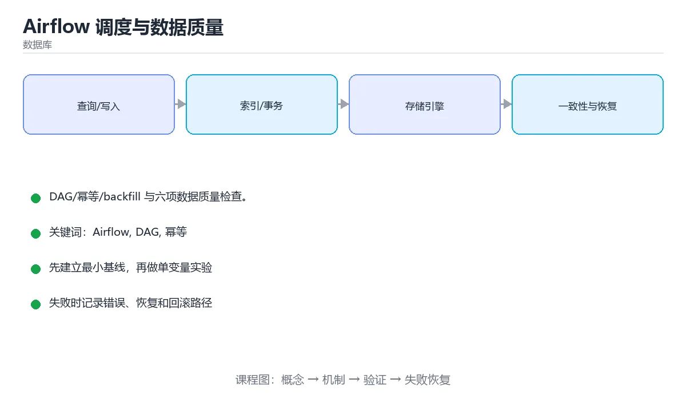

# 性能优化最佳实践



> 内容更新时间：2026-10-06 · 学习阶段：进阶 · 预计用时：60 分钟

## 本节知识框架

**课程定位**：分类「frontend_frameworks」· 学习阶段 进阶 · 建议用时 50 分钟。

本课主线：掌握代码分割、懒加载、记忆化、Tree Shaking和虚拟滚动等优化技术。

### 复习清单

- [ ] 能不看正文复述本课核心术语，并指出一个边界或反例。
- [ ] 能运行或推演本课示例，记录输入、输出与失败现象。
- [ ] 能完成一次自测，并把错题对照考点精讲定位原因。

### 课程导言
前端性能直接影响用户体验和业务指标——加载时间每增加1秒，转化率就可能下降7%。本章将系统讲解代码分割、懒加载、记忆化优化、Tree Shaking、Bundle分析等核心优化技术，深入解读Lighthouse各项指标的含义和优化策略。通过虚拟滚动、图片优化、缓存策略等实战案例，你将掌握从开发到部署的全链路性能优化方法，学会用数据驱动的方式持续提升应用性能。

### 学习目标
完成本章后，你将能够：

- 理解Web Vitals核心指标（LCP、FID、CLS）的含义和测量方法
- 实施代码分割和路由级懒加载减小初始包体积
- 正确使用React.memo、useMemo、useCallback避免不必要的渲染
- 配置Webpack/Vite进行Tree Shaking移除未使用代码
- 使用Webpack Bundle Analyzer分析并优化打包结果
- 实现虚拟滚动处理大数据列表的性能问题
- 制定图片优化策略（格式转换、懒加载、响应式图片）
- 使用Lighthouse进行性能审计并制定优化计划

## 核心概念定义

| 术语 | 一句话说明 |
| --- | --- |
| 性能优化 | 掌握代码分割、懒加载、记忆化、Tree Shaking和虚拟滚动等优化技术。相关：正文给出可操作定义与适用边界。 |
| 代码分割 | 掌握代码分割、懒加载、记忆化、Tree Shaking和虚拟滚动等优化技术。相关：正文给出可操作定义与适用边界。 |
| 懒加载 | 掌握代码分割、懒加载、记忆化、Tree Shaking和虚拟滚动等优化技术。相关：正文给出可操作定义与适用边界。 |
| Tree Shaking | 掌握代码分割、懒加载、记忆化、Tree Shaking和虚拟滚动等优化技术。相关：正文给出可操作定义与适用边界。 |
| 虚拟滚动 | 掌握代码分割、懒加载、记忆化、Tree Shaking和虚拟滚动等优化技术。相关：正文给出可操作定义与适用边界。 |

## 原理与运行机制

《性能优化最佳实践》正文各章按「输入是什么 → 中间如何转换 → 输出到哪 → 失败时怎样表现」四问展开；复习时给每个机制补一句自己的复述，再回到对应章节核对。

### 核心概念解析
#### 为什么性能优化至关重要？

想象你在餐厅等餐。如果5分钟就能上菜，你会很满意；但如果等了30分钟，即使菜品再美味，你的体验也会大打折扣。网站性能也是如此——用户对速度的容忍度极低。

研究数据显示：
- **53%的移动用户**会离开加载时间超过3秒的网站
- **加载时间每增加1秒**，转化率下降7%
- **Amazon发现**：页面加载每慢100ms，销售额减少1%
- **Google发现**：搜索延迟400ms，每日搜索量减少0.59%

性能不仅是技术问题，更是商业问题。

#### Web Vitals：Google的核心性能指标

Web Vitals是Google提出的一组关键性能指标，用于衡量用户体验质量。

**LCP（Largest Contentful Paint，最大内容绘制）**

LCP测量视口中最大内容元素（通常是图片或文本块）完全渲染的时间。理想值应在2.5秒以内。

影响因素：
- 服务器响应时间
- 资源加载顺序
- 图片大小和格式
- CSS/JS阻塞渲染

优化策略：
- 使用CDN加速静态资源
- 预加载关键资源
- 优化图片（压缩、现代格式）
- 服务端渲染或静态生成

**FID（First Input Delay，首次输入延迟）**

FID测量用户首次与页面交互（点击、按键）到浏览器开始处理之间的延迟。理想值应小于100毫秒。

影响因素：
- 主线程被长任务阻塞
- 大量JavaScript执行
- 复杂的样式计算

优化策略：
- 代码分割，减少初始JS体积
- 使用Web Workers处理密集计算
- 优化第三方脚本加载
- 避免长时间运行的同步操作

**CLS（Cumulative Layout Shift，累积布局偏移）**

CLS测量页面加载过程中视觉元素的意外移动程度。理想值应小于0.1。

常见原因：
- 没有指定尺寸的图片/视频
- 动态插入的内容（广告、嵌入）
- 字体加载导致的FOIT/FOUT
- 异步加载的CSS

优化策略：
- 为媒体元素设置明确的width/height
- 预留广告位空间
- 使用font-display: optional
- 避免在现有内容上方插入新内容

**INP（Interaction to Next Paint，新版交互指标）**

Google正在用INP替代FID，它测量所有交互的响应性，而不仅仅是首次交互。理想值应小于200毫秒。

#### 代码分割：化整为零的智慧

代码分割是将大型JavaScript包拆分成多个小块的技术。就像把一本厚重的百科全书分成多册，读者只需携带当前需要的那一册。

**分割策略：**

1. **路由级分割**：每个路由对应一个chunk，访问时才加载
2. **组件级分割**：大型组件独立打包，按需加载
3. **库级分割**：第三方库单独打包，利用缓存

**实现方式：**

```javascript
// 动态import实现懒加载
const Dashboard = React.lazy(() => import('./Dashboard'));

// Vue的动态导入
const Dashboard = () => import('./Dashboard.vue');

// Angular的懒加载模块
{ path: 'dashboard', loadChildren: () => import('./dashboard.module').then(m => m.DashboardModule) }
```

好处：
- 减小初始包体积，加快首屏加载
- 并行加载多个小文件
- 更好的缓存策略（未变化的chunk不会重新下载）

#### 记忆化：聪明地避免重复计算

记忆化（Memoization）是一种缓存技术，存储昂贵计算的结果，当输入相同时直接返回缓存值。就像数学考试时记住常用公式，不用每次都重新推导。

**React中的记忆化工具：**

- **React.memo**：包装组件，props不变时跳过重新渲染
- **useMemo**：缓存计算结果，依赖不变时返回缓存值
- **useCallback**：缓存函数引用，依赖不变时返回同一函数

关键原则：
- 只对昂贵的计算使用记忆化
- 确保比较成本低于重新计算成本
- 注意浅比较的局限性

#### Tree Shaking：摇掉未使用的代码

Tree Shaking是构建工具移除未使用代码的过程。就像整理衣柜，把从不穿的衣服扔掉，只保留真正需要的。

工作原理：
- 基于ES6模块的静态分析（import/export）
- 识别未被引用的导出
- 从最终bundle中移除这些代码

必要条件：
- 使用ES6模块语法（import/export）
- 标记纯函数（sideEffects: false）
- 生产环境构建（启用压缩）

注意事项：
- CommonJS（require/module.exports）不支持Tree Shaking
- 副作用代码可能被误删，需谨慎配置

#### Bundle Analysis：看见你的包

Webpack Bundle Analyzer等工具可以可视化展示bundle的组成，帮你找出体积大的模块。就像X光片，让你看到应用的"内部结构"。

常见发现：
- 意外引入的大型库（如moment.js 300KB+）
- 重复的依赖（多个版本的lodash）
- 未使用的组件仍被打包
- 图片等资源未优化

优化方向：
- 替换轻量级替代方案（date-fns替代moment）
- 升级依赖消除重复
- 移除未使用的导入
- 压缩图片和字体

#### 虚拟滚动：处理海量数据

虚拟滚动（Virtual Scrolling）只渲染可视区域内的元素，大幅减少DOM节点数量。就像透过窗户看风景——你只能看到窗框内的部分，不需要绘制整个世界的细节。

适用场景：
- 列表项超过100个
- 每项高度固定或可估算
- 需要流畅滚动体验

实现原理：
1. 计算可视区域能显示多少项
2. 只渲染这些项加上缓冲区
3. 滚动时动态更新渲染的项
4. 使用padding或transform保持滚动条正确位置

性能提升：
- DOM节点从数千个减少到几十个
- 内存占用显著降低
- 滚动帧率保持在60fps

## 典型应用场景

- 结合「性能优化最佳实践」的常见落地场景与选型边界，详见正文各章节的对比讨论。
- 迁移到新项目时，先明确输入规模、失败代价与可观测手段，再决定采用深度。

## 代码/协议/SQL 示例

《性能优化最佳实践》正文首个示例可作为最小验证起点（原样保留在上方章节）：先跑通，再改一个输入观察输出变化。

```javascript
// 动态import实现懒加载
const Dashboard = React.lazy(() => import('./Dashboard'));

// Vue的动态导入
const Dashboard = () => import('./Dashboard.vue');

// Angular的懒加载模块
{ path: 'dashboard', loadChildren: () => import('./dashboard.module').then(m => m.DashboardModule) }
```

### 渐进式代码示例
#### 最小示例：React.memo基础用法

让我们从一个简单的性能优化开始，展示React.memo如何避免不必要的渲染。

```jsx
import { useState, memo } from 'react';

// 不使用memo的子组件 - 每次父组件渲染都会重新渲染
function ExpensiveComponentWithoutMemo({ data }) {
  console.log('ExpensiveComponent rendered');
  
  // 模拟昂贵的计算
  const processedData = data.map(item => {
    // 复杂的数据处理逻辑
    return {
      ...item,
      formatted: item.value.toLocaleString(),
      timestamp: new Date().toISOString()
    };
  });
  
  return (
    <ul>
      {processedData.map(item => (
        <li key={item.id}>{item.name}: {item.formatted}</li>
      ))}
    </ul>
  );
}

// 使用memo优化的子组件 - props不变时跳过渲染
const ExpensiveComponentWithMemo = memo(function ExpensiveComponent({ data }) {
  console.log('ExpensiveComponentWithMemo rendered');
  
  const processedData = data.map(item => ({
    ...item,
    formatted: item.value.toLocaleString(),
    timestamp: new Date().toISOString()
  }));
  
  return (
    <ul>
      {processedData.map(item => (
        <li key={item.id}>{item.name}: {item.formatted}</li>
      ))}
    </ul>
  );
});

function Parent() {
  const [count, setCount] = useState(0);
  const [data] = useState([
    { id: 1, name: 'Item 1', value: 100 },
    { id: 2, name: 'Item 2', value: 200 },
    { id: 3, name: 'Item 3', value: 300 }
  ]);
  
  return (
    <div>
      <button onClick={() => setCount(count + 1)}>
        Count: {count}
      </button>
      
      {/* 这个组件会在每次count变化时重新渲染 */}
      <ExpensiveComponentWithoutMemo data={data} />
      
      {/* 这个组件只在data变化时重新渲染 */}
      <ExpensiveComponentWithMemo data={data} />
    </div>
  );
}

export default Parent;
```

在这个例子中，点击按钮增加count时：
- `ExpensiveComponentWithoutMemo`会重新渲染（因为父组件渲染了）
- `ExpensiveComponentWithMemo`不会重新渲染（因为data没变）

控制台输出会清楚显示这一差异。

#### 完整示例：代码分割与懒加载

现在让我们实现一个完整的路由级代码分割方案。

```jsx
// App.jsx - 主应用入口
import { Suspense, lazy } from 'react';
import { BrowserRouter, Routes, Route, Link } from 'react-router-dom';

// 懒加载路由组件
const Home = lazy(() => import('./pages/Home'));
const Dashboard = lazy(() => import('./pages/Dashboard'));
const Products = lazy(() => import('./pages/Products'));
const Settings = lazy(() => import('./pages/Settings'));
const Profile = lazy(() => import('./pages/Profile'));

// 加载占位符组件
function LoadingSpinner() {
  return (
    <div className="loading-container">
      <div className="spinner"></div>
      <p>加载中...</p>
    </div>
  );
}

// 错误边界组件
function LoadError({ error, reset }) {
  return (
    <div className="error-container">
      <h2>加载失败</h2>
      <p>{error.message}</p>
      <button onClick={reset}>重试</button>
    </div>
  );
}

function App() {
  return (
    <BrowserRouter>
      <nav className="main-nav">
        <Link to="/">首页</Link>
        <Link to="/dashboard">仪表盘</Link>
        <Link to="/products">产品</Link>
        <Link to="/settings">设置</Link>
        <Link to="/profile">个人资料</Link>
      </nav>
      
      <Suspense fallback={<LoadingSpinner />}>
        <Routes>
          <Route path="/" element={<Home />} />
          <Route path="/dashboard" element={<Dashboard />} />
          <Route path="/products" element={<Products />} />
          <Route path="/settings" element={<Settings />} />
          <Route path="/profile" element={<Profile />} />
        </Routes>
      </Suspense>
    </BrowserRouter>
  );
}

export default App;
```

Webpack配置优化：

```javascript
// webpack.config.js
const path = require('path');
const BundleAnalyzerPlugin = require('webpack-bundle-analyzer').BundleAnalyzerPlugin;

module.exports = {
  entry: './src/index.js',
  output: {
    path: path.resolve(__dirname, 'dist'),
    filename: '[name].[contenthash].js',
    chunkFilename: '[name].[contenthash].chunk.js',
    clean: true
  },
  optimization: {
    splitChunks: {
      chunks: 'all',
      cacheGroups: {
        //  vendor chunk：第三方库
        vendor: {
          test: /[\\/]node_modules[\\/]/,
          name: 'vendors',
          chunks: 'all',
          priority: 10
        },
        //  common chunk：共享代码
        common: {
          minChunks: 2,
          priority: 5,
          reuseExistingChunk: true
        }
      }
    },
    runtimeChunk: true
  },
  plugins: [
    // 生产环境启用bundle分析
    process.env.ANALYZE && new BundleAnalyzerPlugin({
      analyzerMode: 'static',
      openAnalyzer: false
    })
  ].filter(Boolean),
  mode: process.env.NODE_ENV || 'development'
};
```

Vite配置（更简洁）：

```javascript
// vite.config.js
import { defineConfig } from 'vite';
import react from '@vitejs/plugin-react';
import { visualizer } from 'rollup-plugin-visualizer';

export default defineConfig({
  plugins: [
    react(),
    // 可视化bundle分析
    visualizer({
      open: true,
      gzipSize: true,
      brotliSize: true
    })
  ],
  build: {
    rollupOptions: {
      output: {
        manualChunks(id) {
          // 将node_modules中的包单独打包
          if (id.includes('node_modules')) {
            return 'vendor';
          }
        }
      }
    },
    chunkSizeWarningLimit: 1000 // chunk大小警告阈值（KB）
  }
});
```

组件级懒加载示例：

```jsx
// Dashboard.jsx
import { useState, lazy, Suspense } from 'react';

// 懒加载重型组件
const ChartComponent = lazy(() => import('./components/ChartComponent'));
const DataGrid = lazy(() => import('./components/DataGrid'));

function Dashboard() {
  const [showChart, setShowChart] = useState(false);
  
  return (
    <div>
      <h1>仪表盘</h1>
      
      <button onClick={() => setShowChart(!showChart)}>
        {showChart ? '隐藏图表' : '显示图表'}
      </button>
      
      {showChart && (
        <Suspense fallback={<div>加载图表中...</div>}>
          <ChartComponent />
        </Suspense>
      )}
      
      <Suspense fallback={<div>加载数据表格中...</div>}>
        <DataGrid />
      </Suspense>
    </div>
  );
}

export default Dashboard;
```

#### 进阶示例：useMemo和useCallback优化

让我们深入展示记忆化的正确使用方式。

```jsx
import { useState, useMemo, useCallback, memo } from 'react';

// 模拟昂贵的过滤和排序操作
function expensiveFilterAndSort(items, filter, sortBy) {
  console.log('Running expensive filter and sort...');
  
  // 模拟耗时操作
  let result = items.filter(item => {
    if (filter === 'all') return true;
    if (filter === 'active') return item.status === 'active';
    if (filter === 'completed') return item.status === 'completed';
    return true;
  });
  
  result.sort((a, b) => {
    if (sortBy === 'name') return a.name.localeCompare(b.name);
    if (sortBy === 'date') return new Date(b.date) - new Date(a.date);
    if (sortBy === 'priority') return b.priority - a.priority;
    return 0;
  });
  
  return result;
}

// 子组件：任务列表项
const TaskItem = memo(function TaskItem({ task, onToggle, onDelete }) {
  console.log(`TaskItem rendered: ${task.name}`);
  
  return (
    <li className={`task-item ${task.status}`}>
      <input
        type="checkbox"
        checked={task.status === 'completed'}
        onChange={() => onToggle(task.id)}
      />
      <span>{task.name}</span>
      <span className="priority">优先级: {task.priority}</span>
      <button onClick={() => onDelete(task.id)}>删除</button>
    </li>
  );
});

function TaskManager() {
  const [tasks, setTasks] = useState([
    { id: 1, name: '完成任务A', status: 'active', priority: 3, date: '2024-01-15' },
    { id: 2, name: '编写文档', status: 'completed', priority: 2, date: '2024-01-14' },
    { id: 3, name: '代码审查', status: 'active', priority: 1, date: '2024-01-16' },
    // ... 更多任务
  ]);
  
  const [filter, setFilter] = useState('all');
  const [sortBy, setSortBy] = useState('date');
  const [searchQuery, setSearchQuery] = useState('');
  
  // ❌ 错误做法：每次渲染都重新计算
  // const filteredTasks = expensiveFilterAndSort(tasks, filter, sortBy);
  
  // ✅ 正确做法：使用useMemo缓存计算结果
  const filteredTasks = useMemo(() => {
    return expensiveFilterAndSort(tasks, filter, sortBy);
  }, [tasks, filter, sortBy]);
  
  // 进一步过滤搜索结果
  const searchedTasks = useMemo(() => {
    if (!searchQuery.trim()) return filteredTasks;
    
    return filteredTasks.filter(task =>
      task.name.toLowerCase().includes(searchQuery.toLowerCase())
    );
  }, [filteredTasks, searchQuery]);
  
  // ❌ 错误做法：每次渲染都创建新函数
  // const handleToggle = (id) => { ... };
  
  // ✅ 正确做法：使用useCallback缓存函数引用
  const handleToggle = useCallback((id) => {
    setTasks(prevTasks =>
      prevTasks.map(task =>
        task.id === id
          ? { ...task, status: task.status === 'completed' ? 'active' : 'completed' }
          : task
      )
    );
  }, []);
  
  const handleDelete = useCallback((id) => {
    setTasks(prevTasks => prevTasks.filter(task => task.id !== id));
  }, []);
  
  const handleAddTask = useCallback(() => {
    const newTask = {
      id: Date.now(),
      name: `新任务 ${tasks.length + 1}`,
      status: 'active',
      priority: 2,
      date: new Date().toISOString().split('T')[0]
    };
    setTasks(prev => [...prev, newTask]);
  }, [tasks.length]);
  
  return (
    <div className="task-manager">
      <h1>任务管理</h1>
      
      <div className="controls">
        <input
          type="text"
          value={searchQuery}
          onChange={(e) => setSearchQuery(e.target.value)}
          placeholder="搜索任务..."
        />
        
        <select value={filter} onChange={(e) => setFilter(e.target.value)}>
          <option value="all">全部</option>
          <option value="active">进行中</option>
          <option value="completed">已完成</option>
        </select>
        
        <select value={sortBy} onChange={(e) => setSortBy(e.target.value)}>
          <option value="date">按日期</option>
          <option value="name">按名称</option>
          <option value="priority">按优先级</option>
        </select>
        
        <button onClick={handleAddTask}>添加任务</button>
      </div>
      
      <ul className="task-list">
        {searchedTasks.map(task => (
          <TaskItem
            key={task.id}
            task={task}
            onToggle={handleToggle}
            onDelete={handleDelete}
          />
        ))}
      </ul>
      
      <p className="stats">
        显示 {searchedTasks.length} / {tasks.length} 个任务
      </p>
    </div>
  );
}

export default TaskManager;
```

这个示例展示了：
- `useMemo`缓存昂贵的过滤和排序计算
- `useCallback`缓存事件处理函数，避免子组件不必要的重新渲染
- `memo`包装子组件，配合稳定的props引用实现优化
- 多层记忆化的组合使用

#### 实战示例：虚拟滚动实现

让我们实现一个高性能的虚拟滚动列表，处理10000+条数据。

```jsx
// VirtualList.jsx
import { useState, useRef, useEffect, useCallback, useMemo } from 'react';

function VirtualList({
  items,
  itemHeight = 50,
  containerHeight = 600,
  renderItem,
  overscan = 5 // 额外渲染的项数（上下缓冲区）
}) {
  const containerRef = useRef(null);
  const [scrollTop, setScrollTop] = useState(0);
  
  // 计算可见区域的起始和结束索引
  const visibleRange = useMemo(() => {
    const startIndex = Math.max(0, Math.floor(scrollTop / itemHeight) - overscan);
    const visibleCount = Math.ceil(containerHeight / itemHeight);
    const endIndex = Math.min(
      items.length,
      startIndex + visibleCount + overscan * 2
    );
    
    return { startIndex, endIndex };
  }, [scrollTop, itemHeight, containerHeight, items.length, overscan]);
  
  // 获取要渲染的项
  const visibleItems = useMemo(() => {
    return items.slice(visibleRange.startIndex, visibleRange.endIndex);
  }, [items, visibleRange]);
  
  // 计算总高度和顶部偏移
  const totalHeight = items.length * itemHeight;
  const offsetY = visibleRange.startIndex * itemHeight;
  
  // 滚动处理
  const handleScroll = useCallback((e) => {
    setScrollTop(e.target.scrollTop);
  }, []);
  
  return (
    <div
      ref={containerRef}
      className="virtual-list-container"
      style={{ height: containerHeight, overflow: 'auto' }}
      onScroll={handleScroll}
    >
      <div
        className="virtual-list-spacer"
        style={{ height: totalHeight, position: 'relative' }}
      >
        <div
          className="virtual-list-content"
          style={{ transform: `translateY(${offsetY}px)` }}
        >
          {visibleItems.map((item, index) => {
            const actualIndex = visibleRange.startIndex + index;
            return (
              <div
                key={item.id || actualIndex}
                className="virtual-list-item"
                style={{ height: itemHeight }}
              >
                {renderItem(item, actualIndex)}
              </div>
            );
          })}
        </div>
      </div>
    </div>
  );
}

export default VirtualList;
```

使用虚拟滚动的示例：

```jsx
// App.jsx
import { useMemo } from 'react';
import VirtualList from './VirtualList';

function App() {
  // 生成10000条测试数据
  const items = useMemo(() => {
    return Array.from({ length: 10000 }, (_, i) => ({
      id: i,
      name: `用户 ${i + 1}`,
      email: `user${i + 1}@example.com`,
      score: Math.floor(Math.random() * 100)
    }));
  }, []);
  
  const renderUser = useCallback((user) => (
    <div className="user-row">
      <span className="user-id">#{user.id + 1}</span>
      <span className="user-name">{user.name}</span>
      <span className="user-email">{user.email}</span>
      <span className={`user-score score-${getScoreLevel(user.score)}`}>
        {user.score}分
      </span>
    </div>
  ), []);
  
  return (
    <div className="app">
      <h1>用户列表（10000条记录）</h1>
      <p className="info">
        使用虚拟滚动，仅渲染可见区域的DOM节点
      </p>
      
      <VirtualList
        items={items}
        itemHeight={60}
        containerHeight={600}
        renderItem={renderUser}
        overscan={5}
      />
    </div>
  );
}

function getScoreLevel(score) {
  if (score >= 90) return 'excellent';
  if (score >= 70) return 'good';
  if (score >= 60) return 'pass';
  return 'fail';
}

export default App;
```

CSS样式：

```css
.virtual-list-container {
  border: 1px solid #ddd;
  border-radius: 8px;
}

.virtual-list-item {
  display: flex;
  align-items: center;
  padding: 0 1rem;
  border-bottom: 1px solid #eee;
  background: white;
}

.user-row {
  display: flex;
  gap: 1rem;
  width: 100%;
}

.user-id {
  width: 60px;
  color: #999;
}

.user-name {
  flex: 1;
  font-weight: 500;
}

.user-email {
  flex: 2;
  color: #666;
}

.user-score {
  width: 80px;
  text-align: right;
  font-weight: bold;
}

.score-excellent { color: #2e7d32; }
.score-good { color: #1565c0; }
.score-pass { color: #ef6c00; }
.score-fail { color: #c62828; }
```

性能对比：
- **传统渲染**：10000个DOM节点，初始加载慢，滚动卡顿
- **虚拟滚动**：仅渲染约20-30个DOM节点，流畅滚动60fps

#### 综合示例：完整的性能优化方案

最后，让我们整合所有优化技术，创建一个高性能的电商产品列表页。

```jsx
// ProductListPage.jsx
import { useState, useMemo, useCallback, lazy, Suspense } from 'react';
import VirtualList from './VirtualList';

// 懒加载重型组件
const ProductFilters = lazy(() => import('./ProductFilters'));
const ProductCard = lazy(() => import('./ProductCard'));

function ProductListPage() {
  const [products, setProducts] = useState([]);
  const [loading, setLoading] = useState(true);
  const [filters, setFilters] = useState({
    category: 'all',
    priceRange: [0, 10000],
    rating: 0,
    search: ''
  });
  
  // 获取产品数据
  useEffect(() => {
    async function fetchProducts() {
      try {
        const response = await fetch('/api/products');
        const data = await response.json();
        setProducts(data);
      } catch (error) {
        console.error('Failed to fetch products:', error);
      } finally {
        setLoading(false);
      }
    }
    
    fetchProducts();
  }, []);
  
  // 记忆化过滤逻辑
  const filteredProducts = useMemo(() => {
    return products.filter(product => {
      // 分类过滤
      if (filters.category !== 'all' && product.category !== filters.category) {
        return false;
      }
      
      // 价格范围过滤
      if (product.price < filters.priceRange[0] || product.price > filters.priceRange[1]) {
        return false;
      }
      
      // 评分过滤
      if (product.rating < filters.rating) {
        return false;
      }
      
      // 搜索过滤
      if (filters.search && !product.name.toLowerCase().includes(filters.search.toLowerCase())) {
        return false;
      }
      
      return true;
    });
  }, [products, filters]);
  
  // 记忆化排序
  const sortedProducts = useMemo(() => {
    return [...filteredProducts].sort((a, b) => {
      // 可以添加排序逻辑
      return b.rating - a.rating;
    });
  }, [filteredProducts]);
  
  // 缓存渲染函数
  const renderProduct = useCallback((product) => (
    <Suspense fallback={<div className="product-skeleton"></div>}>
      <ProductCard product={product} />
    </Suspense>
  ), []);
  
  // 处理过滤变化
  const handleFilterChange = useCallback((newFilters) => {
    setFilters(prev => ({ ...prev, ...newFilters }));
  }, []);
  
  if (loading) {
    return <div className="page-loading">加载中...</div>;
  }
  
  return (
    <div className="product-list-page">
      <header>
        <h1>产品中心</h1>
        <p>共 {sortedProducts.length} 个产品</p>
      </header>
      
      <Suspense fallback={<div>加载过滤器中...</div>}>
        <ProductFilters
          filters={filters}
          onChange={handleFilterChange}
        />
      </Suspense>
      
      {sortedProducts.length === 0 ? (
        <div className="no-results">
          <p>没有找到符合条件的产品</p>
          <button onClick={() => setFilters({
            category: 'all',
            priceRange: [0, 10000],
            rating: 0,
            search: ''
          })}>
            清除筛选
          </button>
        </div>
      ) : (
        <VirtualList
          items={sortedProducts}
          itemHeight={200}
          containerHeight={800}
          renderItem={renderProduct}
          overscan={3}
        />
      )}
    </div>
  );
}

export default ProductListPage;
```

图片优化组件：

```jsx
// OptimizedImage.jsx
import { useState, useEffect } from 'react';

function OptimizedImage({ src, alt, width, height, priority = false }) {
  const [isLoaded, setIsLoaded] = useState(false);
  const [isInView, setIsInView] = useState(priority);
  const imgRef = useState(null)[0];
  
  useEffect(() => {
    if (priority) return;
    
    const observer = new IntersectionObserver(
      ([entry]) => {
        if (entry.isIntersecting) {
          setIsInView(true);
          observer.disconnect();
        }
      },
      { rootMargin: '200px' } // 提前200px开始加载
    );
    
    if (imgRef.current) {
      observer.observe(imgRef.current);
    }
    
    return () => observer.disconnect();
  }, [priority, imgRef]);
  
  return (
    <div
      ref={imgRef}
      className="optimized-image"
      style={{ width, height }}
    >
      {!isLoaded && <div className="image-placeholder"></div>}
      
      {isInView && (
         setIsLoaded(true)}
          className={isLoaded ? 'loaded' : ''}
        />
      )}
    </div>
  );
}

export default OptimizedImage;
```

Lighthouse优化清单：

```javascript
// performance-checklist.js

/**
 * Lighthouse性能优化清单
 */
const performanceChecklist = {
  // LCP优化
  lcp: [
    '预加载关键资源（link rel="preload"）',
    '优化首屏图片（压缩、WebP格式）',
    '使用服务端渲染或静态生成',
    '减少服务器响应时间（使用CDN）',
    '避免渲染阻塞的JavaScript/CSS'
  ],
  
  // FID/INP优化
  fid: [
    '代码分割，减小初始JS包',
    '使用Web Workers处理密集计算',
    '优化第三方脚本加载（async/defer）',
    '避免长时间运行的同步任务',
    '使用requestIdleCallback调度低优先级任务'
  ],
  
  // CLS优化
  cls: [
    '为图片和视频设置明确的width/height',
    '预留广告位和动态内容的空间',
    '使用font-display: optional避免FOIT',
    '避免在现有内容上方插入新内容',
    '使用transform而非top/left进行动画'
  ],
  
  // 通用优化
  general: [
    '启用gzip/brotli压缩',
    '使用HTTP/2或HTTP/3',
    '实施有效的缓存策略',
    '移除未使用的CSS/JS',
    '优化字体加载（子集化、swap）',
    '使用Service Worker离线缓存',
    '监控真实用户性能（RUM）'
  ]
};

export default performanceChecklist;
```

## 时间/空间复杂度或性能分析

- 在《性能优化最佳实践》里处理规模 n 时，先估计主循环与嵌套层数，再决定优化方向；小样本上的耗时读数不能外推。
- 性能结论要绑定输入分布：换数据规模、并发度或缓存命中情况后须重新测量。

## 常见误区与易错点

| 错误做法 | 典型现象 | 修复方向 |
| --- | --- | --- |
| 只验证正常输入 | 边界数据触发时才暴露问题 | 为每个结论补一个空值/极值/重复值用例 |
| 背结论不跑实验 | 换个输入就失效 | 按「预测—实测—差异归因」三步复盘 |
| 忽略环境与版本差异 | 本机可用线上报错 | 把版本、配置与依赖写入复现步骤 |

### 常见陷阱对照表
| 陷阱 | 表现 | 解决方案 |
|------|------|----------|
| 过度使用memo/useMemo | 记忆化开销大于收益 | 只对昂贵计算和频繁渲染使用 |
| useCallback依赖数组错误 | 函数引用不稳定，失去优化效果 | 将所有外部变量加入依赖数组 |
| 虚拟滚动项高度不一致 | 滚动位置计算错误 | 使用固定高度或动态测量 |
| Tree Shaking失效 | 未使用代码仍被打包 | 使用ES6模块，配置sideEffects |
| 图片未设置尺寸 | CLS分数高，布局偏移 | 始终提供width/height或使用aspect-ratio |
| 懒加载过多小组件 | 请求瀑布，反而变慢 | 只懒加载大型或 rarely-used 组件 |
| 忽略移动端性能 | 桌面端快，移动端慢 | 针对低端设备和慢网络优化 |

## 与其他知识点的关系

本课与分类「frontend_frameworks」内相邻课程互为补充，建议按清单顺序学完再做综合练习。

## 自测题与参考答案

以下题目与题库同源，作答后再看解析；错误项要能说出错在哪一步。

## 考点精讲

### 考点 1

关于React.memo的使用，以下说法正确的是？

A. 应该包裹所有组件以获得最佳性能  
B. 只在props是原始值时才有效  
C. 对于频繁变化的props，memo可能适得其反 ✅  
D. memo可以优化组件内部的state变化  

**正确答案：** C

**解析：** React.memo通过浅比较props来决定是否跳过渲染。如果props频繁变化，每次都要进行比较，而比较本身也有开销。在这种情况下，memo的开销可能超过它节省的渲染成本，反而降低性能。选项A错误，过度使用memo会增加复杂度且不一定带来收益。选项B错误，memo对对象类型的props也有效（通过浅比较）。选项D错误，memo只关注props变化，不关注内部state变化。

### 考点 2

以下哪种情况最适合使用虚拟滚动？

A. 显示10个用户的头像列表  
B. 显示10000条日志记录的表格 ✅  
C. 显示5个导航菜单项  
D. 显示20个产品卡片（每页）  

**正确答案：** B

**解析：** 虚拟滚动的核心价值在于处理大量数据（通常1000+项），通过只渲染可视区域来减少DOM节点数量。10000条日志记录是典型的应用场景。选项A、C、D的数据量都很小，传统渲染即可，引入虚拟滚动会增加不必要的复杂度。判断标准：如果列表项超过屏幕显示数量的10倍，考虑使用虚拟滚动。

### 考点 3

关于Tree Shaking，以下代码会导致什么问题？

A. formatDate会被正确tree shake  
B. 整个utils.js都会被包含在bundle中  
C. formatCurrency会被自动移除  
D. initAnalytics的副作用代码可能被错误移除 ✅  

**正确答案：** D

**解析：** Tree Shaking基于静态分析，无法准确判断哪些代码有副作用。`initAnalytics`函数虽然未被导入，但它包含副作用（修改window对象）。如果构建工具错误地认为它未被使用而移除，会导致运行时错误。正确的做法是在package.json中标记`sideEffects: ["./src/utils.js"]`，告诉构建工具这个文件有副作用，不要完全移除。选项A和C理论上正确，但实际行为取决于构建配置。选项B错误，现代构建工具可以进行细粒度的tree shaking。

### 考点 4

关于Lighthouse的CLS指标，以下做法错误的是？

A. 为所有图片设置明确的width和height属性  
B. 使用CSS aspect-ratio保持宽高比  
C. 在页面加载完成后动态插入广告 ✅  
D. 使用font-display: swap加载自定义字体  

**正确答案：** C

**解析：** 在页面加载完成后动态插入广告是导致CLS的主要原因之一——新内容会推动现有内容下移，造成布局偏移。正确的做法是预留广告位的空间（使用固定高度的容器）。选项A和B都是防止CLS的最佳实践。选项D的font-display: swap虽然可能导致短暂的字体闪烁（FOUT），但不会造成布局偏移，是可以接受的权衡。更好的选择是font-display: optional，在字体未加载时使用系统字体。

### 考点 5

关于代码分割策略，以下说法错误的是？

A. 路由级分割是最常见的分割方式  
B. 应该将每个组件都单独分割成chunk ✅  
C. 第三方库可以单独打包利用浏览器缓存  
D. 过小的chunk会增加HTTP请求数量  

**正确答案：** B

**解析：** 将每个组件都单独分割会导致大量小chunk，增加HTTP请求数量和协调开销，反而降低性能。正确的做法是按路由、按功能模块、按使用频率进行合理分割。选项A正确，路由级分割平衡了初始加载和后续导航的性能。选项C正确，vendor chunk可以利用长期缓存。选项D正确，需要在chunk大小和请求数量之间找到平衡点（通常建议chunk大小在20-50KB之间）。

## 术语速查

| 术语 | 一句话说明 |
| --- | --- |
| 性能优化 | 围绕LCP、INP等核心指标减少加载与交互耗时、改善用户体验的工程实践 |
| 代码分割 | 把大型JS包按路由、组件、第三方库拆成小块，减小首屏体积并提升缓存命中 |
| 懒加载 | 延迟到真正需要时才用动态import载入模块或图片，避免拖慢首次渲染 |
| Tree Shaking | 构建时基于ES6模块静态分析剔除未被引用的导出，前提是无副作用标记且不用CommonJS |
| 虚拟滚动 | 只渲染可视区及其缓冲区的少量DOM节点，滚动时动态替换，用于上百项的长列表 |

## 参考资料与复核

- 官方/权威资料：[web.dev 性能指南](https://web.dev/)
- 主题延伸：[webpack 代码分割指南](https://webpack.js.org/guides/code-splitting/)
- 最后复核：2026-10-04
- 下次复核：2027-03-29

## 内容元数据

- 内容更新时间：2026-10-06

- 内容版本：v2.0
- 课程标识：frontend_performance_optimization
- 所属分类：frontend_frameworks
- 学习阶段：进阶
- 建议用时：50 分钟
