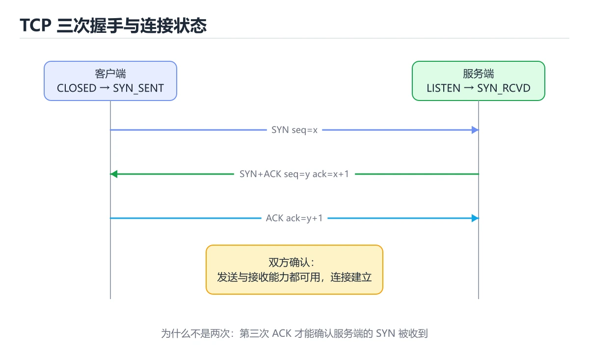

# Svelte响应式编程



> 内容更新时间：2026-10-06 · 学习阶段：入门 · 预计用时：50 分钟

## 本节知识框架

**课程定位**：分类「frontend_frameworks」· 学习阶段 入门 · 建议用时 40 分钟。

本课主线：探索Svelte编译时响应式系统，掌握stores、transitions和actions。

### 复习清单

- [ ] 能不看正文复述本课核心术语，并指出一个边界或反例。
- [ ] 能运行或推演本课示例，记录输入、输出与失败现象。
- [ ] 能完成一次自测，并把错题对照考点精讲定位原因。

### 课程导言
Svelte是一个革命性的前端框架，它摒弃了虚拟DOM，采用编译时优化的方式实现真正的响应式。本章将带你深入理解Svelte的响应式声明语法（$:），掌握三种store类型（writable、readable、derived）的使用场景，学习过渡动画和actions的高级用法，以及组件生命周期的管理。通过生活化的类比和渐进式示例，你将发现Svelte如何让响应式编程变得直观而优雅。

### 学习目标
完成本章后，你将能够：

- 理解Svelte的编译时响应式原理及其与运行时框架的区别
- 熟练使用$:标记创建响应式声明和自动更新
- 掌握writable、readable、derived三种store的使用方法和适用场景
- 使用transition指令添加流畅的进入/退出动画
- 编写自定义actions封装DOM操作逻辑
- 正确使用onMount、beforeUpdate、afterUpdate等生命周期函数
- 构建可复用的Svelte组件并管理组件间通信

## 核心概念定义

| 术语 | 一句话说明 |
| --- | --- |
| Svelte | 探索Svelte编译时响应式系统，掌握stores、transitions和ac相关：正文给出可操作定义与适用边界。 |
| 响应式 | 探索Svelte编译时响应式系统，掌握stores、transitions和ac相关：正文给出可操作定义与适用边界。 |
| stores | 探索Svelte编译时响应式系统，掌握stores、transitions和ac相关：正文给出可操作定义与适用边界。 |
| transitions | 探索Svelte编译时响应式系统，掌握stores、transitions和ac相关：正文给出可操作定义与适用边界。 |
| 无虚拟DOM | 探索Svelte编译时响应式系统，掌握stores、transitions和ac相关：正文给出可操作定义与适用边界。 |

## 原理与运行机制

《Svelte响应式编程》正文各章按「输入是什么 → 中间如何转换 → 输出到哪 → 失败时怎样表现」四问展开；复习时给每个机制补一句自己的复述，再回到对应章节核对。

### 核心概念解析
#### Svelte的哲学：编译时的魔法

想象你在组装家具。React和Vue像是给你一套工具，让你在运行时动态组装零件。而Svelte像是一位聪明的木匠，在你下单时就根据设计图预先切割好所有部件，你拿到的是已经优化好的成品。

Svelte没有虚拟DOM，它在编译阶段就分析出哪些变量会影响哪些DOM节点，生成精确的更新代码。这意味着更小的包体积、更快的运行速度，以及更简单的开发体验。

关键优势：
- **无虚拟DOM开销**：直接操作真实DOM，但只更新需要变化的部分
- **真正的响应式**：基于赋值触发更新，无需手动调用setState
- **零运行时依赖**：编译后的代码是纯JavaScript，不依赖庞大的运行时库
- **简洁的语法**：用原生HTML/CSS/JS思维编写组件

#### 响应式声明（$:）：自动追踪的计算器

`: `标记是Svelte响应式的核心。它就像Excel中的公式单元格——当引用的数据变化时，公式会自动重新计算。

在Svelte中，任何以`$:`开头的语句都是响应式声明。当语句中引用的变量发生变化时，该语句会重新执行。这比手动订阅变化要简单得多。

常见用途：
- 计算派生值（如过滤后的列表）
- 执行副作用（如保存到localStorage）
- 条件渲染的逻辑判断

可以把`: `想象成智能手表的健康监测——当你心率变化时，它自动记录并提醒，不需要你手动点击"开始监测"。

#### Store：跨组件的状态容器

虽然Svelte组件可以通过props传递数据，但当应用变复杂时，我们需要更强大的状态管理方案。Store就是Svelte提供的解决方案。

Store有三种类型，对应不同的使用场景：

**Writable Store**：可写的状态容器，就像共享记事本。任何组件都可以读取和修改它。适合用户输入、主题切换等可变状态。

**Readable Store**：只读的状态容器，就像公告栏。只能由创建者更新，其他组件只能订阅。适合服务器推送的数据、时间戳等单向流动的信息。

**Derived Store**：从其他store派生的值，就像数学公式。当源store变化时，它自动重新计算。适合过滤、排序、聚合等操作。

Store的核心优势是响应式订阅——当store值变化时，所有订阅的组件自动更新，无需手动通知。

#### Transitions：丝滑的动画效果

Svelte内置了丰富的过渡动画系统，让元素进入和离开页面时更加自然。就像电影中的转场效果，好的动画能提升用户体验。

过渡类型包括：
- **fade**：淡入淡出
- **slide**：滑动进入/退出
- **fly**：飞入飞出
- **scale**：缩放效果
- **draw**：SVG路径绘制动画

你可以自定义持续时间、延迟、缓动函数，甚至创建复杂的链式动画。Svelte会在元素添加或移除时自动触发动画，无需手动控制。

#### Actions：DOM操作的封装器

Actions是Svelte特有的概念，用于封装对DOM元素的直接操作。就像给元素穿上了一件功能外套，附加额外的行为。

典型应用场景：
- 拖拽功能
- 滚动监听
- 焦点管理
- 第三方库集成（如图表、地图）

Action的本质是一个函数，接收DOM元素作为参数，可以返回一个包含update和destroy方法的对象，用于处理属性变化和清理工作。

#### 组件生命周期：出生到退休的旅程

每个Svelte组件都有完整的生命周期，从创建到销毁经历不同阶段：

- **onMount**：组件挂载到DOM后执行，类似出生证明
- **beforeUpdate**：DOM更新前执行，适合准备工作
- **afterUpdate**：DOM更新后执行，适合后续操作
- **onDestroy**：组件销毁前执行，类似退休手续

这些生命周期函数让你能在合适的时机执行特定逻辑，比如获取数据、设置定时器、清理事件监听器等。

## 典型应用场景

- 结合「Svelte响应式编程」的常见落地场景与选型边界，详见正文各章节的对比讨论。
- 迁移到新项目时，先明确输入规模、失败代价与可观测手段，再决定采用深度。

## 代码/协议/SQL 示例

正文首个完整示例如下，先运行确认环境，再按正文步骤改一个输入观察输出变化。

```svelte
<!-- App.svelte -->
<script>
  let name = 'World';
</script>

<main>
  <h1>Hello {name}!</h1>
  <input bind:value={name} placeholder="Enter your name">
</main>

<style>
  h1 {
    color: #ff3e00;
    font-family: sans-serif;
  }
  
  input {
    padding: 0.5rem;
    font-size: 1rem;
    border: 2px solid #ddd;
    border-radius: 4px;
  }
</style>
```

### 渐进式代码示例
#### 最小示例：Hello World组件

让我们从最简单的Svelte组件开始：

```svelte
<!-- App.svelte -->
<script>
  let name = 'World';
</script>

<main>
  <h1>Hello {name}!</h1>
  <input bind:value={name} placeholder="Enter your name">
</main>

<style>
  h1 {
    color: #ff3e00;
    font-family: sans-serif;
  }
  
  input {
    padding: 0.5rem;
    font-size: 1rem;
    border: 2px solid #ddd;
    border-radius: 4px;
  }
</style>
```

这个组件展示了Svelte的三个基本部分：
- `<script>`：组件逻辑
- HTML模板：使用大括号插值
- `<style>`：组件作用域样式

注意`bind:value`实现了双向绑定——输入框的变化会自动更新变量，反之亦然。

#### 完整示例：响应式待办事项列表

现在让我们创建一个功能完整的待办事项应用，展示响应式声明的威力：

```svelte
<!-- TodoApp.svelte -->
<script>
  import { onMount } from 'svelte';
  
  let todos = [];
  let newTodoText = '';
  let filter = 'all'; // 'all', 'active', 'completed'
  
  // 响应式声明：过滤后的待办事项
  $: filteredTodos = todos.filter(todo => {
    if (filter === 'active') return !todo.completed;
    if (filter === 'completed') return todo.completed;
    return true;
  });
  
  // 响应式声明：统计信息
  $: totalTodos = todos.length;
  $: completedTodos = todos.filter(t => t.completed).length;
  $: activeTodos = totalTodos - completedTodos;
  $: progressPercent = totalTodos > 0 
    ? Math.round((completedTodos / totalTodos) * 100) 
    : 0;
  
  // 响应式声明：持久化到localStorage
  $: if (todos.length > 0) {
    localStorage.setItem('todos', JSON.stringify(todos));
  }
  
  // 组件挂载时从localStorage加载
  onMount(() => {
    const saved = localStorage.getItem('todos');
    if (saved) {
      todos = JSON.parse(saved);
    }
  });
  
  function addTodo() {
    if (!newTodoText.trim()) return;
    
    todos = [
      ...todos,
      {
        id: Date.now(),
        text: newTodoText.trim(),
        completed: false,
        createdAt: new Date().toISOString()
      }
    ];
    
    newTodoText = '';
  }
  
  function toggleTodo(id) {
    todos = todos.map(todo =>
      todo.id === id ? { ...todo, completed: !todo.completed } : todo
    );
  }
  
  function deleteTodo(id) {
    todos = todos.filter(todo => todo.id !== id);
  }
  
  function clearCompleted() {
    todos = todos.filter(todo => !todo.completed);
  }
  
  function handleKeydown(event) {
    if (event.key === 'Enter') {
      addTodo();
    }
  }
</script>

<div class="todo-app">
  <header>
    <h1>📝 待办事项</h1>
    
    <!-- 进度条 -->
    <div class="progress-bar">
      <div 
        class="progress-fill" 
        style="width: {progressPercent}%"
      ></div>
    </div>
    <p class="progress-text">
      完成度：{completedTodos}/{totalTodos} ({progressPercent}%)
    </p>
  </header>
  
  <!-- 添加新待办 -->
  <form on:submit|preventDefault={addTodo}>
    <input
      type="text"
      bind:value={newTodoText}
      on:keydown={handleKeydown}
      placeholder="添加新任务..."
      class="todo-input"
    />
    <button type="submit" disabled={!newTodoText.trim()}>
      添加
    </button>
  </form>
  
  <!-- 过滤器 -->
  <div class="filters">
    <button 
      class:active={filter === 'all'}
      on:click={() => filter = 'all'}
    >
      全部 ({totalTodos})
    </button>
    <button 
      class:active={filter === 'active'}
      on:click={() => filter = 'active'}
    >
      进行中 ({activeTodos})
    </button>
    <button 
      class:active={filter === 'completed'}
      on:click={() => filter = 'completed'}
    >
      已完成 ({completedTodos})
    </button>
  </div>
  
  <!-- 待办列表 -->
  <ul class="todo-list">
    {#each filteredTodos as todo (todo.id)}
      <li class:completed={todo.completed}>
        <input
          type="checkbox"
          checked={todo.completed}
          on:change={() => toggleTodo(todo.id)}
        />
        
        <span class="todo-text">{todo.text}</span>
        
        <button 
          class="delete-btn"
          on:click={() => deleteTodo(todo.id)}
        >
          删除
        </button>
      </li>
    {:else}
      <li class="empty-state">
        {filter === 'all' 
          ? '暂无待办事项，添加一个吧！' 
          : filter === 'active' 
            ? '没有进行中的任务' 
            : '没有已完成的任务'}
      </li>
    {/each}
  </ul>
  
  <!-- 批量操作 -->
  {#if completedTodos > 0}
    <button class="clear-btn" on:click={clearCompleted}>
      清除已完成 ({completedTodos})
    </button>
  {/if}
</div>

<style>
  .todo-app {
    max-width: 600px;
    margin: 2rem auto;
    padding: 2rem;
    background: white;
    border-radius: 12px;
    box-shadow: 0 4px 20px rgba(0, 0, 0, 0.1);
  }
  
  h1 {
    margin: 0 0 1rem;
    color: #333;
  }
  
  .progress-bar {
    height: 8px;
    background: #eee;
    border-radius: 4px;
    overflow: hidden;
    margin-bottom: 0.5rem;
  }
  
  .progress-fill {
    height: 100%;
    background: linear-gradient(90deg, #ff3e00, #ff8c00);
    transition: width 0.3s ease;
  }
  
  .progress-text {
    font-size: 0.9rem;
    color: #666;
    margin-bottom: 1.5rem;
  }
  
  form {
    display: flex;
    gap: 0.5rem;
    margin-bottom: 1.5rem;
  }
  
  .todo-input {
    flex: 1;
    padding: 0.75rem;
    border: 2px solid #ddd;
    border-radius: 6px;
    font-size: 1rem;
  }
  
  button {
    padding: 0.75rem 1.5rem;
    background: #ff3e00;
    color: white;
    border: none;
    border-radius: 6px;
    cursor: pointer;
    font-size: 1rem;
    transition: background 0.2s;
  }
  
  button:hover:not(:disabled) {
    background: #e03600;
  }
  
  button:disabled {
    opacity: 0.5;
    cursor: not-allowed;
  }
  
  .filters {
    display: flex;
    gap: 0.5rem;
    margin-bottom: 1.5rem;
  }
  
  .filters button {
    flex: 1;
    background: #f5f5f5;
    color: #333;
  }
  
  .filters button.active {
    background: #ff3e00;
    color: white;
  }
  
  .todo-list {
    list-style: none;
    padding: 0;
    margin: 0 0 1rem;
  }
  
  li {
    display: flex;
    align-items: center;
    gap: 1rem;
    padding: 1rem;
    border-bottom: 1px solid #eee;
    transition: background 0.2s;
  }
  
  li:hover {
    background: #f9f9f9;
  }
  
  li.completed .todo-text {
    text-decoration: line-through;
    color: #999;
  }
  
  .todo-text {
    flex: 1;
  }
  
  .delete-btn {
    padding: 0.5rem 1rem;
    background: #ff4444;
    font-size: 0.9rem;
  }
  
  .delete-btn:hover {
    background: #cc0000;
  }
  
  .empty-state {
    text-align: center;
    color: #999;
    padding: 2rem;
  }
  
  .clear-btn {
    width: 100%;
    background: #666;
  }
  
  .clear-btn:hover {
    background: #444;
  }
  
  input[type="checkbox"] {
    width: 20px;
    height: 20px;
    cursor: pointer;
  }
</style>
```

这个示例展示了：
- 多个`: `响应式声明自动计算派生值
- localStorage持久化
- 条件渲染和列表循环
- 事件处理和表单验证
- 动态class绑定

#### 进阶示例：使用Store管理全局状态

让我们重构上述应用，使用store来管理状态，实现更好的组件分离：

```javascript
// stores/todos.js
import { writable, derived } from 'svelte/store';

// Writable store：可写的待办事项列表
export const todos = writable([]);

// Derived store：派生的过滤后列表
export const filteredTodos = derived(
  [todos, filter],
  ([$todos, $filter]) => {
    if ($filter === 'active') return $todos.filter(t => !t.completed);
    if ($filter === 'completed') return $todos.filter(t => t.completed);
    return $todos;
  }
);

// Readable store：只读的统计信息
export const stats = derived(todos, $todos => {
  const total = $todos.length;
  const completed = $todos.filter(t => t.completed).length;
  const active = total - completed;
  const progress = total > 0 ? Math.round((completed / total) * 100) : 0;
  
  return { total, completed, active, progress };
});

// Filter state
export const filter = writable('all');

// Actions
export function addTodo(text) {
  todos.update(current => [
    ...current,
    {
      id: Date.now(),
      text: text.trim(),
      completed: false,
      createdAt: new Date().toISOString()
    }
  ]);
}

export function toggleTodo(id) {
  todos.update(current =>
    current.map(todo =>
      todo.id === id ? { ...todo, completed: !todo.completed } : todo
    )
  );
}

export function deleteTodo(id) {
  todos.update(current => current.filter(todo => todo.id !== id));
}

export function clearCompleted() {
  todos.update(current => current.filter(todo => !todo.completed));
}

// 持久化逻辑
todos.subscribe(value => {
  if (value.length > 0) {
    localStorage.setItem('todos', JSON.stringify(value));
  }
});

// 初始化
const saved = localStorage.getItem('todos');
if (saved) {
  todos.set(JSON.parse(saved));
}
```

使用store的组件变得更简洁：

```svelte
<!-- TodoList.svelte -->
<script>
  import { filteredTodos, stats, filter, toggleTodo, deleteTodo } from '../stores/todos';
  
  // 自动订阅store，$符号解包值
  $: currentFilter = $filter;
  $: currentStats = $stats;
</script>

<div class="todo-list-container">
  <div class="stats-bar">
    <span>总计：{$stats.total}</span>
    <span>进行中：{$stats.active}</span>
    <span>已完成：{$stats.completed}</span>
    <span>进度：{$stats.progress}%</span>
  </div>
  
  <div class="filters">
    <button 
      class:active={$filter === 'all'}
      on:click={() => $filter = 'all'}
    >
      全部
    </button>
    <button 
      class:active={$filter === 'active'}
      on:click={() => $filter = 'active'}
    >
      进行中
    </button>
    <button 
      class:active={$filter === 'completed'}
      on:click={() => $filter = 'completed'}
    >
      已完成
    </button>
  </div>
  
  <ul>
    {#each $filteredTodos as todo (todo.id)}
      <li class:completed={todo.completed}>
        <input
          type="checkbox"
          checked={todo.completed}
          on:change={() => toggleTodo(todo.id)}
        />
        <span>{todo.text}</span>
        <button on:click={() => deleteTodo(todo.id)}>删除</button>
      </li>
    {/each}
  </ul>
</div>
```

注意`$`符号的用法：在Svelte中，`$storeName`会自动订阅store并在值变化时更新组件。这是Svelte store系统的精髓所在。

#### 实战示例：Transition过渡动画

让我们为待办事项添加优雅的动画效果：

```svelte
<!-- AnimatedTodoItem.svelte -->
<script>
  import { fade, slide, fly } from 'svelte/transition';
  import { quintOut } from 'svelte/easing';
  
  export let todo;
  export let onToggle;
  export let onDelete;
  
  let duration = 300;
</script>

<li
  transition:slide={{ duration, easing: quintOut }}
  class:completed={todo.completed}
>
  <input
    type="checkbox"
    checked={todo.completed}
    on:change={onToggle}
  />
  
  <span 
    in:fade={{ duration: 200 }}
    out:fly={{ y: -20, duration: 200 }}
  >
    {todo.text}
  </span>
  
  <button
    on:click={onDelete}
    transition:fly={{ x: 50, duration: 200 }}
  >
    删除
  </button>
</li>

<style>
  li {
    display: flex;
    align-items: center;
    gap: 1rem;
    padding: 1rem;
    border-bottom: 1px solid #eee;
  }
  
  li.completed span {
    text-decoration: line-through;
    color: #999;
  }
</style>
```

在主应用中使用：

```svelte
<!-- 替换原来的列表渲染 -->
{#each $filteredTodos as todo (todo.id)}
  <AnimatedTodoItem
    {todo}
    onToggle={() => toggleTodo(todo.id)}
    onDelete={() => deleteTodo(todo.id)}
  />
{/each}
```

过渡动画的类型：
- `transition:name`：进入和退出都使用相同动画
- `in:name`：仅进入时动画
- `out:name`：仅退出时动画

可以传入配置对象自定义参数：
- `duration`：持续时间（毫秒）
- `delay`：延迟时间
- `easing`：缓动函数
- 其他特定于动画的参数（如fly的x/y方向）

#### 综合示例：自定义Action封装拖拽功能

最后，让我们创建一个可拖拽的看板应用，展示actions的强大能力：

```javascript
// actions/draggable.js
export function draggable(node, options = {}) {
  let isDragging = false;
  let startX, startY, initialX, initialY;
  
  function handleMouseDown(event) {
    if (event.target.closest('.no-drag')) return;
    
    isDragging = true;
    startX = event.clientX;
    startY = event.clientY;
    
    const transform = node.style.transform;
    const match = transform.match(/translate\(([^,]+)px,\s*([^)]+)px\)/);
    
    if (match) {
      initialX = parseFloat(match[1]);
      initialY = parseFloat(match[2]);
    } else {
      initialX = 0;
      initialY = 0;
    }
    
    node.classList.add('dragging');
    document.body.style.cursor = 'grabbing';
    
    event.preventDefault();
  }
  
  function handleMouseMove(event) {
    if (!isDragging) return;
    
    const deltaX = event.clientX - startX;
    const deltaY = event.clientY - startY;
    
    node.style.transform = `translate(${initialX + deltaX}px, ${initialY + deltaY}px)`;
    
    // 分发自定义事件
    node.dispatchEvent(new CustomEvent('dragmove', {
      detail: { x: initialX + deltaX, y: initialY + deltaY }
    }));
  }
  
  function handleMouseUp() {
    if (!isDragging) return;
    
    isDragging = false;
    node.classList.remove('dragging');
    document.body.style.cursor = '';
    
    // 分发拖拽结束事件
    const transform = node.style.transform;
    const match = transform.match(/translate\(([^,]+)px,\s*([^)]+)px\)/);
    
    if (match) {
      node.dispatchEvent(new CustomEvent('dragend', {
        detail: {
          x: parseFloat(match[1]),
          y: parseFloat(match[2])
        }
      }));
    }
  }
  
  // 添加事件监听
  node.addEventListener('mousedown', handleMouseDown);
  document.addEventListener('mousemove', handleMouseMove);
  document.addEventListener('mouseup', handleMouseUp);
  
  // 返回更新和销毁方法
  return {
    update(newOptions) {
      options = { ...options, ...newOptions };
    },
    destroy() {
      node.removeEventListener('mousedown', handleMouseDown);
      document.removeEventListener('mousemove', handleMouseMove);
      document.removeEventListener('mouseup', handleMouseUp);
    }
  };
}
```

使用draggable action的看板组件：

```svelte
<!-- KanbanBoard.svelte -->
<script>
  import { draggable } from '../actions/draggable';
  import { fade } from 'svelte/transition';
  
  let columns = [
    {
      id: 'todo',
      title: '待办',
      tasks: [
        { id: 1, title: '设计首页', priority: 'high' },
        { id: 2, title: '编写文档', priority: 'medium' }
      ]
    },
    {
      id: 'in-progress',
      title: '进行中',
      tasks: [
        { id: 3, title: '开发API', priority: 'high' }
      ]
    },
    {
      id: 'done',
      title: '已完成',
      tasks: [
        { id: 4, title: '需求分析', priority: 'low' }
      ]
    }
  ];
  
  function handleDragEnd(event, columnId, taskId) {
    console.log(`Task ${taskId} dropped in column ${columnId}`);
    // 这里可以实现列之间的任务移动逻辑
  }
</script>

<div class="kanban-board">
  {#each columns as column (column.id)}
    <div class="column">
      <h2>{column.title}</h2>
      
      <div class="task-list">
        {#each column.tasks as task (task.id)}
          <div
            class="task-card"
            use:draggable
            on:dragend={(e) => handleDragEnd(e, column.id, task.id)}
            transition:fade
          >
            <div class="task-header">
              <h3>{task.title}</h3>
              <span class="priority {task.priority}">
                {task.priority === 'high' ? '高' : task.priority === 'medium' ? '中' : '低'}
              </span>
            </div>
            
            <div class="task-actions no-drag">
              <button>编辑</button>
              <button>删除</button>
            </div>
          </div>
        {/each}
      </div>
      
      <button class="add-task">+ 添加任务</button>
    </div>
  {/each}
</div>

<style>
  .kanban-board {
    display: flex;
    gap: 1.5rem;
    padding: 2rem;
    overflow-x: auto;
  }
  
  .column {
    min-width: 300px;
    background: #f5f5f5;
    border-radius: 8px;
    padding: 1rem;
  }
  
  .column h2 {
    margin: 0 0 1rem;
    font-size: 1.2rem;
  }
  
  .task-list {
    min-height: 200px;
  }
  
  .task-card {
    background: white;
    border-radius: 6px;
    padding: 1rem;
    margin-bottom: 0.75rem;
    box-shadow: 0 2px 4px rgba(0, 0, 0, 0.1);
    cursor: grab;
    transition: box-shadow 0.2s;
  }
  
  .task-card.dragging {
    box-shadow: 0 8px 16px rgba(0, 0, 0, 0.2);
    cursor: grabbing;
    opacity: 0.8;
  }
  
  .task-header {
    display: flex;
    justify-content: space-between;
    align-items: center;
    margin-bottom: 0.5rem;
  }
  
  .task-header h3 {
    margin: 0;
    font-size: 1rem;
  }
  
  .priority {
    padding: 0.25rem 0.5rem;
    border-radius: 4px;
    font-size: 0.8rem;
  }
  
  .priority.high {
    background: #ffebee;
    color: #c62828;
  }
  
  .priority.medium {
    background: #fff3e0;
    color: #ef6c00;
  }
  
  .priority.low {
    background: #e8f5e9;
    color: #2e7d32;
  }
  
  .task-actions {
    display: flex;
    gap: 0.5rem;
    margin-top: 0.75rem;
  }
  
  .task-actions button {
    flex: 1;
    padding: 0.5rem;
    border: 1px solid #ddd;
    background: white;
    border-radius: 4px;
    cursor: pointer;
    font-size: 0.9rem;
  }
  
  .add-task {
    width: 100%;
    padding: 0.75rem;
    background: transparent;
    border: 2px dashed #ccc;
    border-radius: 6px;
    color: #666;
    cursor: pointer;
    margin-top: 0.5rem;
  }
  
  .add-task:hover {
    border-color: #ff3e00;
    color: #ff3e00;
  }
</style>
```

这个示例展示了：
- 自定义action封装复杂的DOM交互
- action的update和destroy生命周期
- 分发自定义事件供父组件处理
- 结合transition实现流畅动画
- 实用的看板UI设计

## 时间/空间复杂度或性能分析

- 在《Svelte响应式编程》里处理规模 n 时，先估计主循环与嵌套层数，再决定优化方向；小样本上的耗时读数不能外推。
- 性能结论要绑定输入分布：换数据规模、并发度或缓存命中情况后须重新测量。

## 常见误区与易错点

| 错误做法 | 典型现象 | 修复方向 |
| --- | --- | --- |
| 只验证正常输入 | 边界数据触发时才暴露问题 | 为每个结论补一个空值/极值/重复值用例 |
| 背结论不跑实验 | 换个输入就失效 | 按「预测—实测—差异归因」三步复盘 |
| 忽略环境与版本差异 | 本机可用线上报错 | 把版本、配置与依赖写入复现步骤 |

### 常见陷阱对照表
| 陷阱 | 表现 | 解决方案 |
|------|------|----------|
| 忘记在$:语句中引用响应式变量 | 语句不会自动重新执行 | 确保$:语句中直接使用了需要追踪的变量 |
| 在store订阅中直接修改变量 | 无限循环或状态不同步 | 使用store的update/set方法，不要直接赋值 |
| Action中未清理事件监听器 | 内存泄漏 | 在action的destroy方法中移除所有监听器 |
| Transition在非条件渲染中使用 | 动画不触发 | transition只在元素添加/移除时生效，确保使用{#if}或{#each} |
| 组件卸载后仍访问DOM | 报错或意外行为 | 在onDestroy中清理定时器、取消请求 |
| 过度使用$:导致性能问题 | 不必要的重复计算 | 避免在$:中执行昂贵操作，考虑使用memoization |
| Store订阅未正确解包 | 显示[object Object] | 在模板中使用$storeName自动解包，或在script中手动subscribe |

## 与其他知识点的关系

本课与分类「frontend_frameworks」内相邻课程互为补充，建议按清单顺序学完再做综合练习。

## 自测题与参考答案

以下题目与题库同源，作答后再看解析；错误项要能说出错在哪一步。

## 考点精讲

### 考点 1

关于Svelte的$:响应式声明，以下代码的输出是什么？ 首次点击按钮后，控制台输出几次日志？

A. 1次  
B. 2次 ✅  
C. 3次  
D. 4次  

**正确答案：** B

**解析：** 这是一个考察Svelte响应式执行顺序的问题。初始渲染时，count=0，doubled=0，console.log执行一次。点击按钮后，count变为1，这触发了两个响应式语句：首先doubled重新计算为2，然后console.log再次执行（因为count和doubled都变了）。所以总共输出2次日志。关键点在于：Svelte会按依赖关系顺序执行响应式语句，且每个语句只在其依赖变化时执行一次，不会重复执行。

### 考点 2

关于Svelte Store，以下说法错误的是？

A. writable store可以被任何组件读写  
B. readable store只能通过其内部的set/update方法更新  
C. derived store的值可以直接修改 ✅  
D. 使用$符号可以在模板中自动订阅store  

**正确答案：** C

**解析：** derived store是从其他store派生的值，它是只读的。你不能直接修改derived store的值，它的值完全由源store和派生函数决定。尝试直接赋值会导致错误。选项A正确，writable store提供了set和update方法供外部修改。选项B正确，readable store的更新逻辑封装在创建函数内部。选项D正确，`$storeName`语法是Svelte的自动订阅机制，会在组件销毁时自动取消订阅。

### 考点 3

以下哪个场景最适合使用Svelte Action？

A. 根据用户输入过滤列表  
B. 集成第三方图表库到DOM元素 ✅  
C. 在多个组件间共享状态  
D. 计算购物车总价  

**正确答案：** B

**解析：** Action的主要用途是封装对DOM元素的直接操作，特别适合集成第三方库（如Chart.js、Leaflet地图等）。选项A应该使用响应式声明或computed值。选项C应该使用store。选项D应该使用derived store或响应式声明。Action的典型特征是需要直接操作DOM元素，且在元素挂载/卸载时需要初始化和清理。

### 考点 4

关于Svelte的Transition，以下代码有什么问题？

A. 缺少duration参数  
B. transition不会触发，因为没有条件渲染 ✅  
C. fade导入名称错误  
D. 需要使用in:fade而非transition:fade  

**正确答案：** B

**解析：** Svelte的transition只在元素被添加到DOM或从DOM移除时触发。在这个例子中，div元素始终存在于DOM中，只是visible变量在变化，但这并不影响div的存在。要让transition生效，需要使用条件渲染：`{#if visible}<div transition:fade>...</div>{/if}`。这样当visible变为false时，div会从DOM移除，触发淡出动画；变为true时，div被添加，触发淡入动画。选项A不是问题，duration有默认值。选项C导入正确。选项D也不是必须的，transition同时处理进入和退出。

### 考点 5

关于Svelte组件生命周期，以下执行顺序正确的是？

A. onMount → beforeUpdate → afterUpdate → onDestroy ✅  
B. beforeUpdate → onMount → afterUpdate → onDestroy  
C. onMount → afterUpdate → beforeUpdate → onDestroy  
D. beforeUpdate → afterUpdate → onMount → onDestroy  

**正确答案：** A

**解析：** Svelte组件的生命周期顺序是：首先组件创建并挂载到DOM，触发onMount；之后每次状态变化时，先执行beforeUpdate（DOM更新前），再执行afterUpdate（DOM更新后）；最后组件销毁时执行onDestroy。这个顺序确保了你能在正确的时机执行相应逻辑：onMount用于初始化（如获取数据），beforeUpdate用于准备（如保存滚动位置），afterUpdate用于后续操作（如聚焦输入框），onDestroy用于清理（如取消订阅、清除定时器）。

## 术语速查

| 术语 | 一句话说明 |
| --- | --- |
| Svelte | 在编译阶段把组件翻译成精简 JavaScript 的框架，几乎不带运行时库。 |
| 响应式 | 对变量重新赋值即自动刷新引用它的界面，无需 setState 或手动订阅。 |
| stores | 跨组件共享的可订阅状态，分 writable、readable、derived 三类。 |
| transitions | 内置的进入与离开动画指令，元素增删时自动播放且可配置缓动时长。 |
| 无虚拟DOM | 编译期就理清变量与节点的依赖关系，更新时直接改写真实 DOM。 |

## 参考资料与复核

- 官方/权威资料：[web.dev 性能指南](https://web.dev/)
- 主题延伸：[Svelte 官方文档：响应式概览](https://svelte.dev/docs/svelte/overview)
- 最后复核：2026-10-04
- 下次复核：2027-03-14

## 内容元数据

- 内容更新时间：2026-10-06

- 内容版本：v2.0
- 课程标识：frontend_svelte_reactive
- 所属分类：frontend_frameworks
- 学习阶段：入门
- 建议用时：40 分钟
