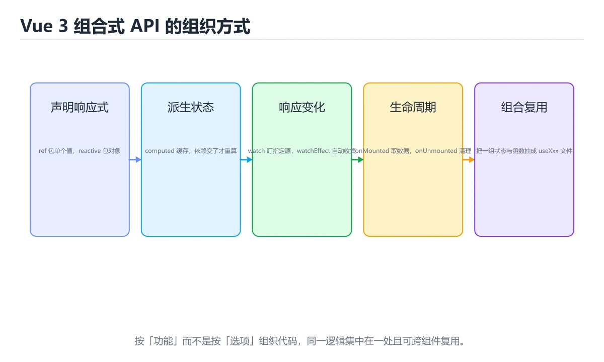

# Vue 3组合式API



> 内容更新时间：2026-10-06 · 学习阶段：入门 · 预计用时：40 分钟

## 本节知识框架

**课程定位**：分类「frontend_frameworks」· 学习阶段 入门 · 建议用时 45 分钟。

本课主线：理解Composition API设计理念，掌握ref/reactive/computed/watch等响应式API。

### 复习清单

- [ ] 能不看正文复述本课核心术语，并指出一个边界或反例。
- [ ] 能运行或推演本课示例，记录输入、输出与失败现象。
- [ ] 能完成一次自测，并把错题对照考点精讲定位原因。

### 课程导言
Vue 3引入了革命性的组合式API（Composition API），它改变了我们组织组件逻辑的方式。与选项式API不同，组合式API让你能够根据功能而不是选项类型来组织代码，这使得大型组件更易维护、逻辑更易复用。本章将带你深入理解ref、reactive、computed、watch等核心概念，学习如何编写可复用的组合式函数，并掌握从选项式API迁移到组合式API的最佳实践。通过实际案例和渐进式示例，你将发现组合式API如何让Vue开发变得更加灵活和强大。

### 学习目标
完成本章后，你将能够：

- 理解组合式API的设计理念和优势
- 熟练使用ref、reactive创建响应式数据
- 掌握computed、watch、watchEffect的使用场景
- 编写可复用的组合式函数（composables）
- 在setup语法糖中高效组织代码
- 识别并避免常见的响应式陷阱

## 核心概念定义

| 术语 | 一句话说明 |
| --- | --- |
| Vue 3 | 理解Composition API设计理念，掌握ref/reactive/com相关：正文给出可操作定义与适用边界。 |
| Composition API | 理解Composition API设计理念，掌握ref/reactive/com相关：正文给出可操作定义与适用边界。 |
| ref | 理解Composition API设计理念，掌握ref/reactive/com相关：正文给出可操作定义与适用边界。 |
| reactive | 理解Composition API设计理念，掌握ref/reactive/com相关：正文给出可操作定义与适用边界。 |
| 响应式 | 理解Composition API设计理念，掌握ref/reactive/com相关：正文给出可操作定义与适用边界。 |

## 原理与运行机制

《Vue 3组合式API》正文各章按「输入是什么 → 中间如何转换 → 输出到哪 → 失败时怎样表现」四问展开；复习时给每个机制补一句自己的复述，再回到对应章节核对。

### 核心概念解析
#### 为什么需要组合式API？

想象你在整理一个工具箱。选项式API就像把工具按类型分类：所有螺丝刀放一格，所有扳手放另一格。但当你要修一台复杂的机器时，你需要在不同格子之间来回翻找。组合式API则允许你按任务分组：修发动机的工具放一起，修电路的工具放一起。这样每次执行特定任务时，所有需要的工具都在手边。

在Vue 2的选项式API中，一个组件的逻辑被分散到data、methods、computed、watch等不同选项中。当组件变得复杂时，相关的逻辑会被拆散，难以理解和维护。组合式API通过setup函数将所有相关逻辑集中在一起，让代码组织更加直观。

#### 响应式系统：Vue的魔法引擎

Vue的核心是它的响应式系统。你可以把它想象成一个智能的通知系统：当你修改数据时，Vue会自动知道哪些地方依赖这个数据，然后只更新那些地方。

Vue 3使用Proxy对象来实现响应式，相比Vue 2的Object.defineProperty，Proxy有以下优势：
- 可以检测属性的添加和删除
- 可以监听数组的变化
- 性能更好，内存占用更少

#### ref vs reactive：两种响应式数据的选择

这是初学者最容易困惑的地方。可以把它们比作两种不同的容器：

- **ref**：像一个带标签的小盒子，里面装着一个值。要访问或修改里面的值，需要通过`.value`。适合存储基本类型（数字、字符串、布尔值）。
- **reactive**：像一个透明的收纳箱，可以直接看到和操作里面的物品。适合存储对象和数组。

选择原则很简单：如果是单个值，用ref；如果是对象或数组，用reactive。但要注意，reactive解构后会失去响应性，这时需要用toRefs转换。

#### 组合式函数：逻辑复用的新范式

组合式函数（Composables）是组合式API最强大的特性之一。它们是以"use"开头的函数，封装了可复用的逻辑。这类似于React的自定义Hook，但在Vue中更加自然，因为Vue的响应式系统天生就支持这种模式。

一个好的组合式函数应该：
- 职责单一，只做一件事
- 接受参数，返回响应式数据和方法
- 不依赖组件上下文，可以在任何地方使用
- 有清晰的输入输出

## 典型应用场景

- 结合「Vue 3组合式API」的常见落地场景与选型边界，详见正文各章节的对比讨论。
- 迁移到新项目时，先明确输入规模、失败代价与可观测手段，再决定采用深度。

## 代码/协议/SQL 示例

《Vue 3组合式API》正文首个示例可作为最小验证起点（原样保留在上方章节）：先跑通，再改一个输入观察输出变化。

```vue
<script setup>
import { ref } from 'vue'

const count = ref(0)

function increment() {
  count.value++
}
</script>

<template>
  <div>
    <p>计数：{{ count }}</p>
    <button @click="increment">增加</button>
  </div>
</template>
```

### 渐进式代码示例
#### 最小示例：基础响应式数据

让我们从一个最简单的计数器开始：

```vue
<script setup>
import { ref } from 'vue'

const count = ref(0)

function increment() {
  count.value++
}
</script>

<template>
  <div>
    <p>计数：{{ count }}</p>
    <button @click="increment">增加</button>
  </div>
</template>
```

注意几个关键点：
1. 使用`<script setup>`语法糖，代码更简洁
2. ref创建的值在模板中自动解包，不需要`.value`
3. 在JavaScript中访问ref的值需要使用`.value`

#### 完整示例：响应式对象和计算属性

现在让我们处理更复杂的数据结构：

```vue
<script setup>
import { ref, reactive, computed } from 'vue'

// 使用reactive管理对象状态
const user = reactive({
  name: '张三',
  age: 25,
  email: 'zhangsan@example.com'
})

// 使用ref管理简单值
const searchKeyword = ref('')

// 计算属性：基于其他响应式数据派生出新数据
const displayName = computed(() => {
  return user.name ? `${user.name} (${user.age}岁)` : '未命名用户'
})

// 过滤后的用户列表（模拟）
const filteredUsers = computed(() => {
  const users = [
    { id: 1, name: '张三', age: 25 },
    { id: 2, name: '李四', age: 30 },
    { id: 3, name: '王五', age: 28 }
  ]
  
  if (!searchKeyword.value) {
    return users
  }
  
  return users.filter(user => 
    user.name.includes(searchKeyword.value)
  )
})

function updateAge(newAge) {
  user.age = newAge
}
</script>

<template>
  <div class="user-profile">
    <h2>{{ displayName }}</h2>
    
    <div class="search-box">
      <input 
        v-model="searchKeyword" 
        placeholder="搜索用户..."
      />
    </div>
    
    <ul>
      <li v-for="u in filteredUsers" :key="u.id">
        {{ u.name }} - {{ u.age }}岁
      </li>
    </ul>
    
    <button @click="updateAge(user.age + 1)">
      年龄+1
    </button>
  </div>
</template>
```

这个例子展示了：
- reactive用于管理对象
- ref用于管理简单值
- computed用于派生数据
- v-model实现双向绑定

#### 进阶示例：侦听器和副作用处理

当需要响应数据变化执行副作用时，使用watch：

```vue
<script setup>
import { ref, watch, watchEffect } from 'vue'

const theme = ref('light')
const userId = ref(1)
const userData = ref(null)

// watch：明确指定监听的源
watch(theme, (newTheme, oldTheme) => {
  console.log(`主题从 ${oldTheme} 变为 ${newTheme}`)
  // 保存到localStorage
  localStorage.setItem('theme', newTheme)
})

// 监听多个源
watch([userId, theme], ([newId, newTheme]) => {
  console.log(`用户ID: ${newId}, 主题: ${newTheme}`)
})

// watchEffect：自动追踪依赖
watchEffect(async () => {
  // 当userId变化时自动重新执行
  const response = await fetch(`/api/users/${userId.value}`)
  userData.value = await response.json()
})

// 深度监听对象
const settings = reactive({
  notifications: {
    email: true,
    push: false
  }
})

watch(
  () => settings.notifications,
  (newNotifications) => {
    console.log('通知设置已更新:', newNotifications)
  },
  { deep: true } // 深度监听嵌套属性
)

function toggleTheme() {
  theme.value = theme.value === 'light' ? 'dark' : 'light'
}

function changeUser(id) {
  userId.value = id
}
</script>

<template>
  <div>
    <p>当前主题：{{ theme }}</p>
    <button @click="toggleTheme">切换主题</button>
    
    <div v-if="userData">
      <h3>{{ userData.name }}</h3>
      <p>{{ userData.email }}</p>
    </div>
    
    <button @click="changeUser(2)">切换到用户2</button>
  </div>
</template>
```

watch和watchEffect的区别：
- **watch**：需要明确指定监听的源，适合精确控制
- **watchEffect**：自动追踪effect中使用的响应式数据，更简洁但可能意外触发

#### 实战示例：自定义组合式函数

让我们创建一个可复用的useFetch组合式函数：

```javascript
// composables/useFetch.js
import { ref, watch } from 'vue'

export function useFetch(url, options = {}) {
  const data = ref(null)
  const error = ref(null)
  const loading = ref(false)
  
  // 立即执行的fetch函数
  async function executeFetch() {
    loading.value = true
    error.value = null
    
    try {
      const response = await fetch(url, options)
      
      if (!response.ok) {
        throw new Error(`HTTP error! status: ${response.status}`)
      }
      
      data.value = await response.json()
    } catch (err) {
      error.value = err.message
    } finally {
      loading.value = false
    }
  }
  
  // 如果url是响应式的，自动重新获取
  if (typeof url !== 'string') {
    watch(url, () => {
      executeFetch()
    })
  }
  
  // 首次执行
  executeFetch()
  
  return {
    data,
    error,
    loading,
    refetch: executeFetch
  }
}
```

再创建一个useLocalStorage组合式函数：

```javascript
// composables/useLocalStorage.js
import { ref, watch } from 'vue'

export function useLocalStorage(key, defaultValue) {
  // 从localStorage读取初始值
  const storedValue = localStorage.getItem(key)
  const initialValue = storedValue 
    ? JSON.parse(storedValue) 
    : defaultValue
  
  const value = ref(initialValue)
  
  // 监听变化，同步到localStorage
  watch(value, (newValue) => {
    localStorage.setItem(key, JSON.stringify(newValue))
  }, { deep: true })
  
  return value
}
```

使用这些组合式函数的组件：

```vue
<script setup>
import { computed } from 'vue'
import { useFetch } from '@/composables/useFetch'
import { useLocalStorage } from '@/composables/useLocalStorage'

// 使用本地存储持久化用户偏好
const itemsPerPage = useLocalStorage('itemsPerPage', 10)
const sortBy = useLocalStorage('sortBy', 'name')

// 动态构建API URL
const apiUrl = computed(() => 
  `/api/products?page=1&limit=${itemsPerPage.value}&sort=${sortBy.value}`
)

// 使用useFetch获取数据
const { data, error, loading, refetch } = useFetch(apiUrl)

function changeSortOrder(order) {
  sortBy.value = order
}

function changePageSize(size) {
  itemsPerPage.value = size
}
</script>

<template>
  <div class="product-list">
    <div class="controls">
      <select v-model="sortBy" @change="changeSortOrder($event.target.value)">
        <option value="name">按名称</option>
        <option value="price">按价格</option>
        <option value="date">按日期</option>
      </select>
      
      <select v-model="itemsPerPage" @change="changePageSize($event.target.value)">
        <option :value="5">每页5条</option>
        <option :value="10">每页10条</option>
        <option :value="20">每页20条</option>
      </select>
      
      <button @click="refetch">刷新</button>
    </div>
    
    <div v-if="loading" class="loading">
      加载中...
    </div>
    
    <div v-else-if="error" class="error">
      错误：{{ error }}
    </div>
    
    <div v-else-if="data" class="products">
      <div v-for="product in data.items" :key="product.id" class="product-card">
        <h3>{{ product.name }}</h3>
        <p>价格：¥{{ product.price }}</p>
      </div>
    </div>
  </div>
</template>
```

#### 综合示例：完整的Todo应用

让我们把所有知识整合到一个完整的Todo应用中：

```vue
<script setup>
import { ref, computed, watch } from 'vue'
import { useLocalStorage } from '@/composables/useLocalStorage'

// Todo数据结构
const todos = useLocalStorage('todos', [])
const newTodoText = ref('')
const filter = ref('all') // all, active, completed

// 计算属性
const activeTodosCount = computed(() => {
  return todos.value.filter(todo => !todo.completed).length
})

const filteredTodos = computed(() => {
  switch (filter.value) {
    case 'active':
      return todos.value.filter(todo => !todo.completed)
    case 'completed':
      return todos.value.filter(todo => todo.completed)
    default:
      return todos.value
  }
})

const hasCompletedTodos = computed(() => {
  return todos.value.some(todo => todo.completed)
})

// 方法
function addTodo() {
  if (!newTodoText.value.trim()) {
    return
  }
  
  todos.value.push({
    id: Date.now(),
    text: newTodoText.value.trim(),
    completed: false,
    createdAt: new Date().toISOString()
  })
  
  newTodoText.value = ''
}

function toggleTodo(todo) {
  todo.completed = !todo.completed
}

function deleteTodo(todo) {
  const index = todos.value.indexOf(todo)
  if (index > -1) {
    todos.value.splice(index, 1)
  }
}

function clearCompleted() {
  todos.value = todos.value.filter(todo => !todo.completed)
}

function editTodo(todo, newText) {
  if (newText.trim()) {
    todo.text = newText.trim()
  }
}

// 监听todo数量变化，给出提示
watch(activeTodosCount, (newCount) => {
  if (newCount === 0 && todos.value.length > 0) {
    console.log('🎉 所有任务都完成了！')
  }
})
</script>

<template>
  <div class="todo-app">
    <h1>待办事项</h1>
    
    <!-- 添加新Todo -->
    <form @submit.prevent="addTodo" class="add-todo-form">
      <input
        v-model="newTodoText"
        placeholder="添加新任务..."
        class="todo-input"
      />
      <button type="submit" class="add-btn">添加</button>
    </form>
    
    <!-- 统计信息 -->
    <div class="stats">
      <span>共 {{ todos.length }} 个任务</span>
      <span>未完成：{{ activeTodosCount }}</span>
    </div>
    
    <!-- 过滤器 -->
    <div class="filters">
      <button 
        :class="{ active: filter === 'all' }"
        @click="filter = 'all'"
      >
        全部
      </button>
      <button 
        :class="{ active: filter === 'active' }"
        @click="filter = 'active'"
      >
        进行中
      </button>
      <button 
        :class="{ active: filter === 'completed' }"
        @click="filter = 'completed'"
      >
        已完成
      </button>
    </div>
    
    <!-- Todo列表 -->
    <ul class="todo-list">
      <li 
        v-for="todo in filteredTodos" 
        :key="todo.id"
        :class="{ completed: todo.completed }"
        class="todo-item"
      >
        <input
          type="checkbox"
          :checked="todo.completed"
          @change="toggleTodo(todo)"
          class="todo-checkbox"
        />
        
        <span class="todo-text">{{ todo.text }}</span>
        
        <button 
          @click="deleteTodo(todo)"
          class="delete-btn"
        >
          删除
        </button>
      </li>
    </ul>
    
    <!-- 清空已完成 -->
    <button 
      v-if="hasCompletedTodos"
      @click="clearCompleted"
      class="clear-btn"
    >
      清空已完成
    </button>
    
    <!-- 空状态 -->
    <div v-if="todos.length === 0" class="empty-state">
      <p>暂无任务，添加一个吧！</p>
    </div>
  </div>
</template>

<style scoped>
.todo-app {
  max-width: 600px;
  margin: 0 auto;
  padding: 20px;
}

.add-todo-form {
  display: flex;
  gap: 10px;
  margin-bottom: 20px;
}

.todo-input {
  flex: 1;
  padding: 10px;
  border: 1px solid #ddd;
  border-radius: 4px;
}

.add-btn {
  padding: 10px 20px;
  background: #42b983;
  color: white;
  border: none;
  border-radius: 4px;
  cursor: pointer;
}

.stats {
  display: flex;
  justify-content: space-between;
  margin-bottom: 15px;
  color: #666;
}

.filters {
  display: flex;
  gap: 10px;
  margin-bottom: 20px;
}

.filters button {
  padding: 5px 15px;
  border: 1px solid #ddd;
  background: white;
  border-radius: 4px;
  cursor: pointer;
}

.filters button.active {
  background: #42b983;
  color: white;
  border-color: #42b983;
}

.todo-list {
  list-style: none;
  padding: 0;
}

.todo-item {
  display: flex;
  align-items: center;
  padding: 10px;
  border-bottom: 1px solid #eee;
  gap: 10px;
}

.todo-item.completed .todo-text {
  text-decoration: line-through;
  color: #999;
}

.todo-text {
  flex: 1;
}

.delete-btn {
  padding: 5px 10px;
  background: #ff4444;
  color: white;
  border: none;
  border-radius: 4px;
  cursor: pointer;
}

.clear-btn {
  margin-top: 15px;
  padding: 10px 20px;
  background: #f0f0f0;
  border: none;
  border-radius: 4px;
  cursor: pointer;
}

.empty-state {
  text-align: center;
  padding: 40px;
  color: #999;
}
</style>
```

这个Todo应用展示了：
- 使用useLocalStorage持久化数据
- computed派生多种视图
- watch监听状态变化
- 完整的CRUD操作
- 条件渲染和列表渲染
- 事件处理和表单提交

## 时间/空间复杂度或性能分析

- 在《Vue 3组合式API》里处理规模 n 时，先估计主循环与嵌套层数，再决定优化方向；小样本上的耗时读数不能外推。
- 性能结论要绑定输入分布：换数据规模、并发度或缓存命中情况后须重新测量。

## 常见误区与易错点

| 错误做法 | 典型现象 | 修复方向 |
| --- | --- | --- |
| 只验证正常输入 | 边界数据触发时才暴露问题 | 为每个结论补一个空值/极值/重复值用例 |
| 背结论不跑实验 | 换个输入就失效 | 按「预测—实测—差异归因」三步复盘 |
| 忽略环境与版本差异 | 本机可用线上报错 | 把版本、配置与依赖写入复现步骤 |

### 常见陷阱对照表
| 陷阱 | 表现 | 解决方案 |
|------|------|----------|
| reactive解构失去响应性 | 解构后的变量不再响应变化 | 使用toRefs转换或使用展开运算符时保持引用 |
| ref在模板中忘记.value | JavaScript中访问ref需要.value | 记住：模板中自动解包，JS中需要.value |
| watchEffect无限循环 | effect中修改了它依赖的数据 | 使用watch代替，或确保不会触发自身重新执行 |
| 在顶层await阻塞 | setup不是async函数 | 使用<script setup>时可以直接await，或使用Suspense |
| reactive无法检测新增属性 | 给reactive对象添加新属性不触发更新 | 使用Vue.set或直接替换整个对象 |
| 组合式函数依赖组件实例 | 在组合式函数中使用inject等 | 将依赖作为参数传入，保持函数纯净 |
| 过度使用ref导致性能问题 | 大量细粒度的ref造成更新开销 | 相关数据合并为reactive对象，或使用shallowRef |

## 与其他知识点的关系

本课与分类「frontend_frameworks」内相邻课程互为补充，建议按清单顺序学完再做综合练习。

## 自测题与参考答案

以下题目与题库同源，作答后再看解析；错误项要能说出错在哪一步。

## 考点精讲

### 考点 1

阅读下面的 Vue 3 组合式 API 代码，它渲染出的内容是什么？

A. 0, 张三, 1, 26 ✅  
B. 0, 张三, 0, 25  
C. 0, 张三, 1, 25  
D. 报错，不能直接修改reactive对象  

**正确答案：** A

**解析：** 这是一个考察ref和reactive基本用法的题目。ref创建的值需要通过`.value`访问和修改，所以第一次输出`count.value`是0，修改后再次输出是1。reactive创建的对象可以直接访问和修改属性，所以`user.name`是"张三"，修改`user.age`后输出26。选项A正确反映了这个过程。需要注意的关键点是：ref在JavaScript中必须通过`.value`访问，而reactive对象的属性可以直接访问和修改。

### 考点 2

关于computed和watch的区别，以下说法正确的是？

A. computed可以执行异步操作，watch不行  
B. computed必须有返回值，watch不需要 ✅  
C. watch会在组件初始化时立即执行，computed不会  
D. computed可以修改其他响应式数据，watch不行  

**正确答案：** B

**解析：** computed和watch都是用来响应数据变化的，但用途不同。computed用于派生数据，它必须返回一个值，并且应该是纯函数（不产生副作用）。watch用于执行副作用，比如发送请求、操作DOM等，它不需要返回值。选项A错误，computed应该是同步的纯函数。选项C错误，默认情况下watch不会立即执行，需要设置`immediate: true`选项。选项D错误，虽然不建议，但技术上computed和watch都可以修改其他响应式数据，只是computed这样做会违反设计原则。

### 考点 3

在 Vue 3 组合式 API 中，下面这段解构 reactive 对象的代码有什么问题？

A. reactive不能用于对象  
B. 解构后的变量失去了响应性 ✅  
C. 不能修改常量  
D. 没有导入必要的函数  

**正确答案：** B

**解析：** 这是Vue 3中最常见的陷阱之一。当你从reactive对象中解构属性时，得到的是普通变量，不再具有响应性。这意味着修改这些变量不会触发视图更新，也不会被watch或computed追踪。正确的做法有两种：1）不解构，直接使用`state.name`和`state.age`；2）使用`toRefs`函数：`const { name, age } = toRefs(state)`，这样解构后的变量仍然是响应式的ref。选项C也有一定道理（const不能重新赋值），但核心问题是响应性丢失，所以B是最佳答案。

### 考点 4

关于组合式函数（composables），以下说法错误的是？

A. 组合式函数必须以"use"开头命名  
B. 组合式函数只能在setup函数中调用 ✅  
C. 组合式函数可以调用其他组合式函数  
D. 组合式函数应该返回响应式数据或方法  

**正确答案：** B

**解析：** 组合式函数是Vue 3逻辑复用的核心机制。选项A正确，按照约定，组合式函数以"use"开头，这样开发者一眼就能识别。选项C正确，组合式函数可以互相调用，形成组合链。选项D正确，组合式函数通常返回响应式数据和方法供调用者使用。选项B错误，组合式函数不仅可以在setup中调用，也可以在其他组合式函数中调用，甚至在普通的JavaScript模块中调用（只要不依赖组件实例）。这正是组合式API的优势所在——逻辑可以脱离组件存在。

### 考点 5

以下哪种场景最适合使用watchEffect而不是watch？

A. 需要在数据变化时发送API请求 ✅  
B. 需要根据多个独立数据源的变化执行操作  
C. 需要精确控制何时停止监听  
D. 需要手动指定监听的依赖项  

**正确答案：** A

**解析：** watchEffect的优势在于自动追踪依赖，代码更简洁。选项A的场景中，如果URL是基于某个响应式数据计算的，watchEffect会自动追踪这个依赖，当数据变化时自动重新执行请求，非常合适。选项B更适合用watch，因为可以明确指定多个依赖。选项C和D都是watch的优势场景：watch可以通过返回值停止监听，也可以明确指定依赖项。watchEffect适合依赖关系清晰、不需要精细控制的场景；watch适合需要精确控制监听行为的场景。

## 术语速查

| 术语 | 一句话说明 |
| --- | --- |
| Vue 3 | 渐进式框架的新大版本，响应式底层换成 Proxy 并引入 setup 写法。 |
| Composition API | 按功能而非选项类型归拢逻辑，用 setup 让状态与函数集中在同一处。 |
| ref | 包裹单个值的响应式盒子，脚本中经 value 读写，模板会自动解包。 |
| reactive | 深度代理对象与数组生成响应式数据，解构后需 toRefs 才保留响应性。 |
| 响应式 | 数据被改动即自动驱动依赖它的视图更新，无需手动操作 DOM。 |

## 参考资料与复核

- 官方/权威资料：[web.dev 性能指南](https://web.dev/)
- 主题延伸：[Vue 3 组合式 API 常见问题](https://vuejs.org/guide/extras/composition-api-faq.html)
- 最后复核：2026-10-04
- 下次复核：2027-03-04

## 内容元数据

- 内容更新时间：2026-10-06

- 内容版本：v2.0
- 课程标识：frontend_vue_composition
- 所属分类：frontend_frameworks
- 学习阶段：入门
- 建议用时：45 分钟
