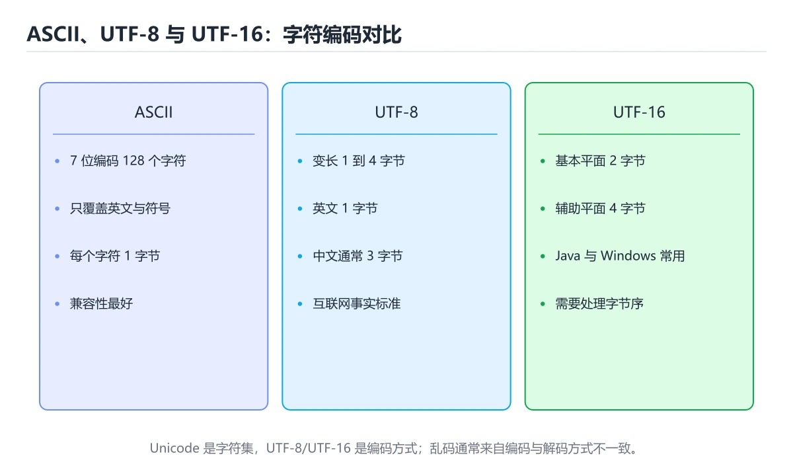
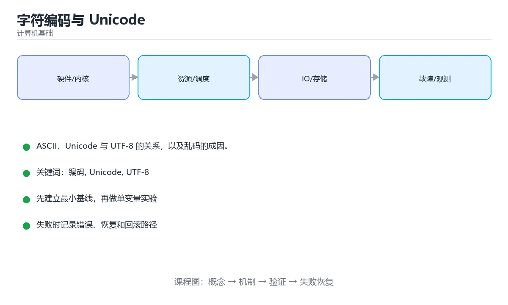

# 字符编码与 Unicode





> 内容更新时间：2026-10-06 · 学习阶段：基础 · 预计用时：40 分钟

## 本节知识框架

**课程定位**：所属分类 `fundamentals`（计算机基础），课程主题 `字符编码与 Unicode`，学习阶段 基础，建议用时 50 分钟。

本课主线：ASCII、Unicode 与 UTF-8 的关系，以及乱码的成因。

**学完本课应当能够**
- 说清 `码点` 与 `UTF-8` 的含义与区别，并各举一个正例和一个反例。
- 用本课示例验证 `字形` 的行为，记录输入、输出与失败条件。
- 遇到「Python」这类问题时，能说出触发条件与修复顺序。

### 复习清单

- [ ] 能不看正文复述本课核心术语，并指出一个边界或反例。
- [ ] 能运行或推演本课示例，记录输入、输出与失败现象。
- [ ] 能完成一次自测，并把错题对照错误表定位原因。

## 核心概念定义

| 术语 | 操作性定义 | 常见边界与风险 |
| --- | --- | --- |
| 码点 | 字符在 Unicode 中的编号，例如 U+4E2D，编码才是它在内存里的字节表示。 | 换编码、换字节序或换平台都可能改变结果，处理前先固定输入编码。 |
| UTF-8 | 变长编码，ASCII 占一字节、常用汉字占三字节，是文件与网络传输的事实标准。 | 换编码、换字节序或换平台都可能改变结果，处理前先固定输入编码。 |
| 字形 | 字符在字体里对应的图形，同一个码点在三种字体下字形并不相同。 | 只在「字符在字体里对应的图形，同一个码点在三种字体下字形并不相同」这一前提下成立，换输入或换环境要重新验证。 |
| BOM | 文件开头的字节顺序标记，UTF-8 场景通常不需要，带上反而会让某些解析器多读出一个字符。 | 换编码、换字节序或换平台都可能改变结果，处理前先固定输入编码。 |

## 原理与运行机制

### 机制总览

| 阶段 | 关注对象 | 失败时应检查 |
| --- | --- | --- |
| 输入 | 码点 | 类型、范围、编码、版本或前置状态是否满足定义。 |
| 处理 | UTF-8 | 顺序、可见性、锁、路由、事务或调度规则是否被破坏。 |
| 输出 | 字形 | 结果是否可复现，错误是否被正确传播而不是被吞掉。 |

**教材衔接：为什么需要编码**

计算机只存字节，字符必须映射成数字。这个映射规则就是字符编码。乱码的本质是**写入与读取用了不同的编码**。

**教材衔接：发展脉络**

| 编码 | 特点 |
| --- | --- |
| ASCII | 7 位表示 128 个字符，只有英文与符号 |
| GBK / Latin-1 | 各地区的单/双字节扩展，互不兼容 |
| Unicode | 为所有字符分配唯一码点（code point），如 `U+4E2D` 是「中」 |
| UTF-8 | Unicode 的变长编码：英文 1 字节、中文通常 3 字节 |
| UTF-16 / UTF-32 | 其他变长/定长实现，Java 字符串内部用 UTF-16 |

## 典型应用场景

- **Python**：典型现象是不指定 encoding 会用平台默认；正确做法是显式 `encoding="utf-8"`，读二进制用 `"rb"`。
- **JavaScript**：典型现象是字符串按 UTF-16 存储，`length` 是码元数；正确做法是emoji 长度可能为 2，用 `[...str].length` 取真实字符数。
- **Java**：典型现象是`String.length()` 同样是 UTF-16 码元数；正确做法是用 `codePointCount` 统计真实字符。
- **读写文件不指定编码**：典型现象是Windows 上按 GBK 解码导致乱码；正确做法是一律显式 encoding="utf-8"。

### 最小验证场景

- 准备：保留 `text` 示例的原始输入，先记录 `字符编码与 Unicode` 的基线输出和完整运行命令。
- 观察：先核对 调用了 `encode()`，再改变一个与 `码点` 相关的条件。
- 判定：新结果与 `字符编码与 Unicode` 的基线不同不等于错误；只有当差异破坏了 `码点` 的定义或错误表中的约束，才判定为失败。

### 选择与边界

- 使用 `码点` 时，先满足它的定义：字符在 Unicode 中的编号，例如 U+4E2D，编码才是它在内存里的字节表示；换编码、换字节序或换平台都可能改变结果，处理前先固定输入编码。
- 使用 `UTF-8` 时，先满足它的定义：变长编码，ASCII 占一字节、常用汉字占三字节，是文件与网络传输的事实标准；换编码、换字节序或换平台都可能改变结果，处理前先固定输入编码。
- 使用 `字形` 时，先满足它的定义：字符在字体里对应的图形，同一个码点在三种字体下字形并不相同；只在「字符在字体里对应的图形，同一个码点在三种字体下字形并不相同」这一前提下成立，换输入或换环境要重新验证。
- 使用 `BOM` 时，先满足它的定义：文件开头的字节顺序标记，UTF-8 场景通常不需要，带上反而会让某些解析器多读出一个字符；换编码、换字节序或换平台都可能改变结果，处理前先固定输入编码。

## 代码/协议/SQL 示例

### 最小可验证示例

```text
1 字节：0xxxxxxx                          ASCII 兼容
2 字节：110xxxxx 10xxxxxx
3 字节：1110xxxx 10xxxxxx 10xxxxxx        常用汉字在这段
4 字节：11110xxx 10xxxxxx 10xxxxxx 10xxxxxx   表情等增补字符
```

**教材衔接：UTF-8 编码规则**

```python
text = "中A"
data = text.encode("utf-8")
print(data)              # b'\xe4\xb8\xadA'，共 4 字节
print(len(text), len(data))   # 2 个字符，4 个字节
print(data.decode("utf-8"))
```

**教材衔接：编码速查**

| 编码 | 单位 | 特点 | 适用 |
| --- | --- | --- | --- |
| ASCII | 1 字节 | 0 到 127，只覆盖英文 | 历史遗留 |
| Latin-1 | 1 字节 | 0 到 255，西欧字符 | 老系统 |
| GBK | 1 到 2 字节 | 中文兼容 ASCII | 国内旧系统 |
| UTF-8 | 1 到 4 字节 | 兼容 ASCII，无字节序问题 | 网络与文件首选 |
| UTF-16 | 2 或 4 字节 | 有字节序问题，需 BOM | Windows API、Java 内部 |
| UTF-32 | 4 字节 | 定长，空间浪费 | 内部处理 |

| Unicode 范围 | UTF-8 字节数 | 示例 |
| --- | --- | --- |
| U+0000 到 U+007F | 1 | ASCII |
| U+0080 到 U+07FF | 2 | 拉丁扩展、希腊文 |
| U+0800 到 U+FFFF | 3 | 中文、日文汉字 |
| U+10000 到 U+10FFFF | 4 | Emoji、扩展汉字 |

```python
# 明确编码，避免平台差异
text = "你好，世界"
raw = text.encode("utf-8")
print(len(text), len(raw))          # 5 与 15：中文 3 字节，标点 3 字节
print(raw.decode("utf-8"))

# 处理非法字节：忽略、替换或用替代字符
bad = b"\xff\xfehello"
print(bad.decode("utf-8", errors="replace"))

# 读写文件统一 UTF-8
from pathlib import Path
path = Path("note.txt")
path.write_text(text, encoding="utf-8")
print(path.read_text(encoding="utf-8"))

# 需要 BOM 以兼容 Excel 时可写 utf-8-sig
Path("table.csv").write_text("名称,数量\n苹果,3\n", encoding="utf-8-sig")
```

**教材衔接：补充：UTF-8 编码规则、乱码排查与代码实践**

### 码点、编码与字形：三个概念分清

```text
码点（Code Point）  字符在 Unicode 表中的编号，如「中」= U+4E2D
编码（Encoding）    码点如何变成字节，如 UTF-8 用 3 字节表示 U+4E2D
字形（Glyph）       字体把码点画出来的样子

同一个码点在不同字体下字形可以不同；同一个字节序列用不同编码解释会得到不同字符
```

### UTF-8 的编码规则

| 码点范围 | 字节数 | 首字节格式 | 后续字节 |
| --- | --- | --- | --- |
| U+0000 ~ U+007F | 1 | `0xxxxxxx` | —— |
| U+0080 ~ U+07FF | 2 | `110xxxxx` | `10xxxxxx` |
| U+0800 ~ U+FFFF | 3 | `1110xxxx` | `10xxxxxx` × 2 |
| U+10000 ~ U+10FFFF | 4 | `11110xxx` | `10xxxxxx` × 3 |

```text
例：「中」= U+4E2D
  二进制：0100 1110 0010 1101
  填入三字节模板：1110[0100] 10[111000] 10[101101]
  得到：E4 B8 AD   ← 这正是 UTF-8 下的三个字节

自校验特性
  · 首字节的高位决定了「这个词有多长」
  · 后续字节都以 10 开头，因此从任意位置也能重新同步
```

### 常见乱码与成因对照

| 现象 | 典型成因 | 修法 |
| --- | --- | --- |
| `ä¸æ–‡` | UTF-8 字节被按 Latin-1 解读 | 统一声明 UTF-8 |
| `���` | 解码时遇到非法字节，被替换为 U+FFFD | 检查源文件与声明的编码是否一致 |
| `涓枃` | UTF-8 被按 GBK 解读 | 读写两端统一 UTF-8 |
| 首部多出 `` | 把 UTF-8 BOM 当成正文字符 | 读文件时忽略 BOM |
| Windows 下正常、Linux 乱码 | 依赖系统默认编码 | 显式指定 `encoding="utf-8"` |

```bash
# 排查：先看字节，再猜编码
file -i data.txt                  # 查看文件声明的编码
xxd data.txt | head -2            # 看真实字节
iconv -f gbk -t utf-8 bad.txt > fixed.txt   # 尝试转码
```

### 各语言里的三个易错点

| 语言 | 易错点 | 正确做法 |
| --- | --- | --- |
| Python | 不指定 encoding 会用平台默认 | 显式 `encoding="utf-8"`，读二进制用 `"rb"` |
| JavaScript | 字符串按 UTF-16 存储，`length` 是码元数 | emoji 长度可能为 2，用 `[...str].length` 取真实字符数 |
| Java | `String.length()` 同样是 UTF-16 码元数 | 用 `codePointCount` 统计真实字符 |

```javascript
const emoji = "👨‍👩‍👧";
console.log(emoji.length);          // 8（码元数，含零宽连接符）
console.log([...emoji].length);     // 5（码点数）
// 真实「人类感知的字符」还需要按字素簇切分：
console.log(Array.from(new Intl.Segmenter().segment(emoji)).length);  // 1
```

### BOM 该不该有

```text
UTF-8 BOM = EF BB BF（3 字节）

· Windows 记事本有时会写入 BOM
· 多数解析器能处理，但会污染首行内容（如 JSON 解析失败、CSV 首列名带怪字符）
· 规范建议：UTF-8 不使用 BOM

处理方式
  · 读文件时用 utf-8-sig（Python）或手动跳过 BOM
  · 服务端响应头声明 charset=utf-8，不要依赖 BOM
```

### 自查清单

- [ ] 能说出码点、编码、字形的区别
- [ ] 记得 UTF-8 的四种字节长度与首字节前缀
- [ ] 遇到乱码会先看字节再判断编码
- [ ] 知道 emoji 的 `length` 为什么不是 1
- [ ] 知道 BOM 的作用与为什么要避免它

**教材衔接：深挖「编码」的边界与代价**

### 二、把 ASCII 推到边界

下面是本课第一段代码（text），先原样运行一次作为基线：

| 变式 | 怎么改 | 先写下什么 | 观察点 |
| --- | --- | --- | --- |
| 边界输入 | 把 ASCII 的输入换成空值或最大值 | 预测输出 | 是否报错、是否静默返回 |
| 只改一处 | 把 xxxxxxx 的一个参数改成另一档 | 预测差异来源 | 输出变化能否用本课结论解释 |
| 去掉一步 | 注释掉 ASCII 之后的一行 | 预测哪一步先失败 | 错误位置是否与预期一致 |

### 四、测验复盘

| 题号 | 正确答案 | 最容易选错的干扰项 | 复盘动作 |
| --- | --- | --- | --- |
| 1 | 3 | 2 | 把干扰项改写成一句反例，再说明它违反本课哪条前提 |
| 2 | 写入与读取使用了不同的编码 | 内存不足（仅部分场景成立） | 把干扰项改写成一句反例，再说明它违反本课哪条前提 |
| 3 | 这段代码会产生可观察的输出，运行后能看到结果。 | 这段代码只做静态声明，没有循环、分支或可观察输出。 | 把干扰项改写成一句反例，再说明它违反本课哪条前提 |
| 4 | 验证 Unicode 时要固定版本并覆盖边界输入，结论才可复现 | 只要 编码 的常规示例通过，就可以跳过边界与异常路径 | 把干扰项改写成一句反例，再说明它违反本课哪条前提 |
| 5 | 某些解析器会把 BOM 当成正文内容，导致第一个字段出现异常字符 | 会让文件无法保存（只在边界情况下成立，不能回答本题） | 把干扰项改写成一句反例，再说明它违反本课哪条前提 |
| 6 | 0 | （无干扰项） | 把干扰项改写成一句反例，再说明它违反本课哪条前提 |

## 时间/空间复杂度或性能分析

**性能关注点（字符编码与 Unicode）**：关注资源换算与精度损失：记录单位换算误差、存储空间与实际耗时。

**本课特有开销（字符编码与 Unicode · 编码）**：缓存命中率比缓存实现本身更关键，先记录命中率与失效策略再谈优化。

**测量方法**：以 `字符编码与 Unicode` 的 `编码` 场景为对象，固定输入跑一遍记录基线，再把规模或并发度提高一个数量级复测；两次结果的差值与波动范围才是结论依据。

## 常见误区与易错点

| 容易写错的做法 | 实际现象 | 原因与正确做法 |
| --- | --- | --- |
| Python | 不指定 encoding 会用平台默认 | 显式 `encoding="utf-8"`，读二进制用 `"rb"` |
| JavaScript | 字符串按 UTF-16 存储，`length` 是码元数 | emoji 长度可能为 2，用 `[...str].length` 取真实字符数 |
| Java | `String.length()` 同样是 UTF-16 码元数 | 用 `codePointCount` 统计真实字符 |
| 读写文件不指定编码 | Windows 上按 GBK 解码导致乱码。 | 一律显式 encoding="utf-8"。 |
| 认为 len(str) 等于字节数 | 长度与存储量不符。 | 中文一个字通常 3 字节。 |
| 用 errors="ignore" 静默丢数据 | 数据悄悄缺失。 | 用 replace 或记录错误并告警。 |

### 现场 1：Python

**症状**：不指定 encoding 会用平台默认。

**根因与修复**：显式 `encoding="utf-8"`，读二进制用 `"rb"`。

**自检**：在本课示例里复现「Python」，改成显式 `encoding="utf-8"`，读二进制用 `"rb"`后重跑；如果症状消失且失败路径按预期变化，说明定位正确。

### 现场 2：JavaScript

**症状**：字符串按 UTF-16 存储，`length` 是码元数。

**根因与修复**：emoji 长度可能为 2，用 `[...str].length` 取真实字符数。

**自检**：在本课示例里复现「JavaScript」，改成emoji 长度可能为 2，用 `[...str].length` 取真实字符数后重跑；如果症状消失且失败路径按预期变化，说明定位正确。

### 现场 3：Java

**症状**：`String.length()` 同样是 UTF-16 码元数。

**根因与修复**：用 `codePointCount` 统计真实字符。

**自检**：在本课示例里复现「Java」，改成用 `codePointCount` 统计真实字符后重跑；如果症状消失且失败路径按预期变化，说明定位正确。

### 现场 4：读写文件不指定编码

**症状**：Windows 上按 GBK 解码导致乱码。

**根因与修复**：一律显式 encoding="utf-8"。

**自检**：在本课示例里复现「读写文件不指定编码」，改成一律显式 encoding="utf-8"后重跑；如果症状消失且失败路径按预期变化，说明定位正确。

### 现场 5：认为 len(str) 等于字节数

**症状**：长度与存储量不符。

**根因与修复**：中文一个字通常 3 字节。

**自检**：在本课示例里复现「认为 len(str) 等于字节数」，改成中文一个字通常 3 字节后重跑；如果症状消失且失败路径按预期变化，说明定位正确。

### 现场 6：用 errors="ignore" 静默丢数据

**症状**：数据悄悄缺失。

**根因与修复**：用 replace 或记录错误并告警。

**自检**：在本课示例里复现「用 errors="ignore" 静默丢数据」，改成用 replace 或记录错误并告警后重跑；如果症状消失且失败路径按预期变化，说明定位正确。

## 与其他知识点的关系

- **相关或后续**：`编译与程序运行原理`。本课术语会在这些课程里继续使用。
- **术语归属**：`码点`、`UTF-8`、`字形` 的定义以本课「核心概念定义」为准，换到其他课程时先确认定义是否被改写。

## 自测题与参考答案

> 先独立作答，再对照参考答案；答案都能在本课正文、术语表或错误表里找到依据。

### 自测 1（概念复述）

不看正文，写出 `码点` 的操作性定义，并说明它与 `UTF-8` 的区别。

**参考答案**：字符在 Unicode 中的编号，例如 U+4E2D，编码才是它在内存里的字节表示。

`UTF-8` 的定位是：变长编码，ASCII 占一字节、常用汉字占三字节，是文件与网络传输的事实标准；两者的差别要从适用对象与失败模式上说明。

### 自测 2（排错）

本课错误表记录了「Python」这类做法。请写出它会出现的现象、根因，以及修复顺序。

**参考答案**：现象是不指定 encoding 会用平台默认；正确做法是显式 `encoding="utf-8"`，读二进制用 `"rb"`。修复时先复现现象并保留证据，再改动一处假设重跑，确认现象消失。

### 自测 3（动手验证）

运行本课的 `text` 示例，把其中的 `1` 换成一个边界值后重新运行，记录输出与错误信息。

**参考答案**：正常输入下 `text` 示例应当复现正文给出的结果；把 `1` 换成边界值后，如果结果改变或报错，先核对它是否满足 `字符编码与 Unicode` 中`码点` 的适用范围，再检查错误表里是否有同类现象。

### 自测 4（代码阅读）

阅读本课开头的 `text` 示例，说明它体现了`码点` 的哪一条性质，并指出改动哪个输入会让这条性质不再成立。

**参考答案**：`码点` 的定义是 字符在 Unicode 中的编号，例如 U+4E2D，编码才是它在内存里的字节表示，示例正是在实现这条定义。改动与 `码点` 有关的一个输入后，如果结果不再符合 `字符编码与 Unicode` 的正文描述，就说明该性质只在当前前提成立。

### 自测 5（迁移）

把 `字符编码与 Unicode` 的方法迁移到自己的项目：围绕 `码点` 写出一个与错误表同类的风险点，并说明触发条件和检验方式。

**参考答案**：例如「用 errors="ignore" 静默丢数据」，它会导致数据悄悄缺失；检验方式是按用 replace 或记录错误并告警改一处再复现，确认现象消失且没有引入新的失败分支。

### 自测 6（对比）

用一个表格对比 `码点` 与 `UTF-8`：各写一行适用场景、一行失败表现。

**参考答案**：`码点` 的定义是字符在 Unicode 中的编号，例如 U+4E2D，编码才是它在内存里的字节表示；`UTF-8` 的定义是变长编码，ASCII 占一字节、常用汉字占三字节，是文件与网络传输的事实标准。两者的失败表现分别对应本课错误表里与本术语相关的行。

### 自测 7（排错顺序）

面对「Python」引发的问题，请把“复现 不指定 encoding 会用平台默认 → 保留证据 → 显式 `encoding="utf-8"`，读二进制用 `"rb"` → 回归验证”四步写成可执行的检查清单。

**参考答案**：第一步按不指定 encoding 会用平台默认复现；第二步记录输入、版本与完整报错；第三步按显式 `encoding="utf-8"`，读二进制用 `"rb"`只改一处；第四步重跑并确认失败路径也按预期变化。

### 自测 8（边界判断）

针对 `BOM`，分别写出“可以使用”的条件和“结论不再成立”的条件。

**参考答案**：换编码、换字节序或换平台都可能改变结果，处理前先固定输入编码。 同时要把 `BOM` 的定义 文件开头的字节顺序标记，UTF-8 场景通常不需要，带上反而会让某些解析器多读出一个字符 与实际输入逐项对照。

### 自测 9（机制重建）

不看正文，按输入、转换、输出、验证四段重建 `码点` → `UTF-8` → `字形` → `BOM` 的作用链。

**参考答案**：起点是 `码点` 的定义 字符在 Unicode 中的编号，例如 U+4E2D，编码才是它在内存里的字节表示；中间每一步都保留可观察状态；终点由 `BOM` 检查，失败时回到错误表定位第一个偏离定义的步骤。

### 自测 10（综合排错）

在 `字符编码与 Unicode` 中，现象是 数据悄悄缺失。请围绕 用 errors="ignore" 静默丢数据 写出最小复现、关键证据、修复动作和回归验证，并说明为什么不能只凭一次运行下结论。

**参考答案**：先复现 用 errors="ignore" 静默丢数据，记录输入与完整错误；再按 用 replace 或记录错误并告警 只改一处。回归时同时跑正常路径和边界路径，只有两次结果都可解释，才把修复视为完成。

### 自测 11（一分钟复述）

用每分钟约 200 字的速度复述 `字符编码与 Unicode`：先给主问题，再按顺序说出 `码点`、`UTF-8`、`字形`、`BOM`，最后给一个失败案例。

**自评标准**：主问题必须对应 ASCII、Unicode 与 UTF-8 的关系，以及乱码的成因；每个术语都要能接上一句定义或边界；失败案例必须写成可观察现象，不能用“可能有风险”代替证据。

## 术语速查

| 术语 | 一句话说明 |
| --- | --- |
| `码点` | 字符在 Unicode 中的编号，例如 U+4E2D，编码才是它在内存里的字节表示。 |
| `UTF-8` | 变长编码，ASCII 占一字节、常用汉字占三字节，是文件与网络传输的事实标准。 |
| `字形` | 字符在字体里对应的图形，同一个码点在三种字体下字形并不相同。 |
| `BOM` | 文件开头的字节顺序标记，UTF-8 场景通常不需要，带上反而会让某些解析器多读出一个字符。 |

**术语关系**：`码点`（字符在 Unicode 中的编号） → `UTF-8`（变长编码） → `字形`（字符在字体里对应的图形） → `BOM`（文件开头的字节顺序标记）。

## 考点精讲

`字符编码与 Unicode` 的题库有 6 道题，下面逐题给出题干、正确项与判断依据：先自己作答，再核对正确项，最后回到正文对应小节复核。

### 考点 1：第 1 题

- **题目**：UTF-8 中一个常用汉字通常占几个字节？
- **正确项**：3
- **判断依据**：术语 UTF-8（字符编码与 Unicode）：变长编码，ASCII 占一字节、常用汉字占三字节，是文件与网络传输的事实标准，本题取「3」这条。易错点是Python会造成不指定 encoding 会用平台默认，改法是显式 `encoding="utf-8"`，读二进制用 `"rb"`。

### 考点 2：第 2 题

- **题目**：出现乱码的最常见原因是？
- **正确项**：写入与读取使用了不同的编码
- **判断依据**：本题正确项是「写入与读取使用了不同的编码」。术语 码点（字符编码与 Unicode）：字符在 Unicode 中的编号，例如 U+4E2D，编码才是它在内存里的字节表示，本题取「写入与读取使用了不同的编码」这条。易错点是JavaScript，会造成字符串按 UTF-16 存储，`length` 是码元数，改法是emoji 长度可能为 2，用 `[...str].length` 取真实字符数。

### 考点 3：第 3 题

- **题目**：这段 `python` 代码对应 `字符编码与 Unicode` 的 `码点`。课程要解决的是ASCII、Unicode 与 UTF-8 的关系，以及乱码的成因。关于代码内容，哪一项说法准确？
- **正确项**：出现字面量 `utf-8`
- **判断依据**：本题正确项是「出现字面量 `utf-8`」。术语 码点（字符编码与 Unicode）：字符在 Unicode 中的编号，例如 U+4E2D，编码才是它在内存里的字节表示，本题取「出现字面量 `utf-8`」这条。易错点是Java，会造成`String.length()` 同样是 UTF-16 码元数，改法是用 `codePointCount` 统计真实字符。本题干扰项「出现字面量 `ok={elapsed > 0}`」不成立：展示代码里找不到 `ok={elapsed > 0}`。

### 考点 4：第 4 题

- **题目**：围绕“字符编码与 Unicode”中的 编码、Unicode、UTF-8，下列哪两项是本课强调的实践判断？
- **正确项**：验证 Unicode 时要固定版本并覆盖边界输入，结论才可复现；学习 编码 时要同时说明输入、输出和失败路径，不能只看正常流程
- **判断依据**：按《字符编码与 Unicode》的正文口径，本题要同时选中「验证 Unicode 时要固定版本并覆盖边界输入，结论才可复现」、「学习 编码 时要同时说明输入、输出和失败路径，不能只看正常流程」，漏掉任一项都算没答全。术语 UTF-8（字符编码与 Unicode）：变长编码，ASCII 占一字节、常用汉字占三字节，是文件与网络传输的事实标准。易错点是读写文件不指定编码，会造成Windows 上按 GBK 解码导致乱码，改法是一律显式 encoding="utf-8"。

### 考点 5：第 5 题

- **题目**：BOM（字节顺序标记）带来的常见问题是？
- **正确项**：某些解析器会把 BOM 当成正文内容，导致第一个字段出现异常字符
- **判断依据**：本题正确项是「某些解析器会把 BOM 当成正文内容，导致第一个字段出现异常字符」。术语 BOM（字符编码与 Unicode）：文件开头的字节顺序标记，UTF-8 场景通常不需要，带上反而会让某些解析器多读出一个字符，本题取「某些解析器会把 BOM 当成正文内容，导致第一个字段出现异常字符」这条。易错点是认为 len(str) 等于字节数，会造成长度与存储量不符，改法是中文一个字通常 3 字节。

### 考点 6：第 6 题

- **题目**：填空：补齐下面这段术语说明中的空缺。课程 `ASCII、Unicode 与 UTF-8 的关系，以及乱码的成因。`，这段说明是：字符在字体里对应的图形，同一个码点在三种字体下`____`并不相同。空缺处应填哪个术语？
- **正确项**：字形
- **判断依据**：《字符编码与 Unicode》这题的填空口径是「字形」，正文写法与其中任一项一致即可。术语「码点」在本课里的界定是字符在 Unicode 中的编号，例如 U+4E2D，编码才是它在内存里的字节表示，题干问的就是这一条。常见错法是Python，其后果是不指定 encoding 会用平台默认。正确做法是显式 `encoding="utf-8"`，读二进制用 `"rb"`。

### 考点 7：`码点`

- **要点**：字符在 Unicode 中的编号，例如 U+4E2D，编码才是它在内存里的字节表示。
- **码点 的边界**：换编码、换字节序或换平台都可能改变结果，处理前先固定输入编码。

### 考点 8：`UTF-8`

- **要点**：变长编码，ASCII 占一字节、常用汉字占三字节，是文件与网络传输的事实标准。
- **UTF-8 的边界**：换编码、换字节序或换平台都可能改变结果，处理前先固定输入编码。

### 考点 9：`字形`

- **要点**：字符在字体里对应的图形，同一个码点在三种字体下字形并不相同。
- **字形 的边界**：只在「字符在字体里对应的图形，同一个码点在三种字体下字形并不相同」这一前提下成立，换输入或换环境要重新验证。

### 考点 10：`BOM`

- **要点**：文件开头的字节顺序标记，UTF-8 场景通常不需要，带上反而会让某些解析器多读出一个字符。
- **BOM 的边界**：换编码、换字节序或换平台都可能改变结果，处理前先固定输入编码。

### 考点 11：排错——Python

- **现象**：不指定 encoding 会用平台默认。
- **处理**：显式 `encoding="utf-8"`，读二进制用 `"rb"`。

### 考点 12：排错——JavaScript

- **现象**：字符串按 UTF-16 存储，`length` 是码元数。
- **处理**：emoji 长度可能为 2，用 `[...str].length` 取真实字符数。

### 考点 13：综合辨析——`码点` 与 `BOM`

- **辨析点**：`码点` 的定义是 字符在 Unicode 中的编号，例如 U+4E2D，编码才是它在内存里的字节表示；`BOM` 的定义是 文件开头的字节顺序标记，UTF-8 场景通常不需要，带上反而会让某些解析器多读出一个字符。
- **答题要求**：面对 `字符编码与 Unicode` 的题目，先判断描述的是 `码点` 还是 `BOM`，再归到对应定义，最后写出一个会让该定义失效的边界输入。

### 考点 14：排错评分点

- **现象分**：能写出 不指定 encoding 会用平台默认，而不是只写“程序有错”。
- **证据分**：保留触发 Python 的输入、版本和错误原文。
- **修复分**：按 显式 `encoding="utf-8"`，读二进制用 `"rb"` 只改一处，并同时回归正常路径与边界路径。

## 内容元数据

- 内容版本：v2.0
- 最后更新：2026-10-06
- 学习阶段：基础
- 适用环境：通用计算机体系结构知识
；本课聚焦 编码。
- 内容来源：内置结构化课程与工程实践整理
- 相关主题：编码、Unicode、UTF-8、ASCII、乱码
- 质量版本：P0 测验标准 + P1 覆盖扩展 + P2 体验补全

## 参考资料与复核

- 最后复核：2026-10-04
- 下次复核：2027-03-17
- 复核范围：版本兼容、API 行为、安全建议与工程实践
- 来源性质：官方文档、标准或权威教材；本课核对关键词：编码、Unicode、UTF-8、ASCII、乱码。

| 参考资料 | 本课用途 |
| --- | --- |
| [NIST 二进制与数据表示](https://www.nist.gov/pml/owm/binary-information) | 二进制、位与数据单位 |
| [CS50 计算机科学导论](https://cs50.harvard.edu/x/) | 计算机科学综合入门 |
| [MIT 6.006 算法导论](https://ocw.mit.edu/courses/6-006-introduction-to-algorithms-spring-2020/) | 算法与数据结构基础 |

| [本课术语索引：字符编码与 Unicode](#核心概念定义) | 按本课输入、术语边界和错误表现逐项核对 |
> 「字符编码与 Unicode」的链接用于离线阅读后的延伸核对；App 不会自动联网。

<!-- p1-deep-dive:start -->