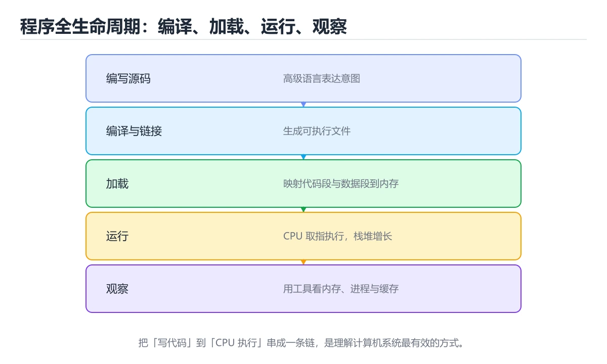
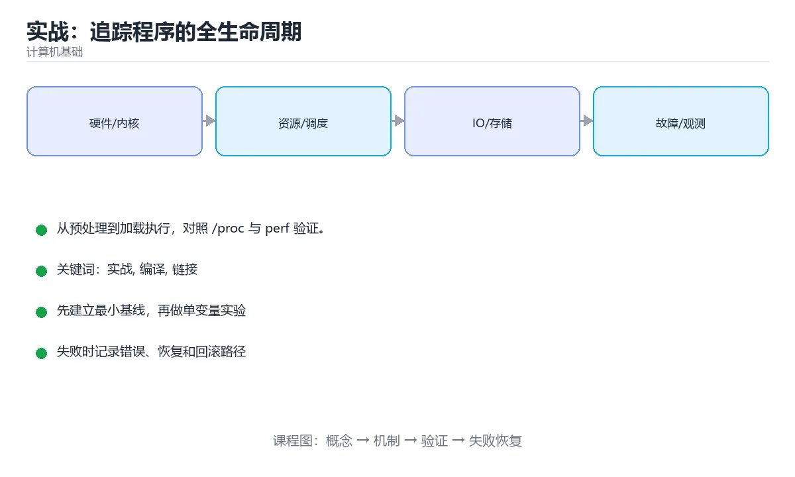

# 实战：追踪程序的全生命周期

> 内容更新时间：2026-10-06 · 学习阶段：进阶 · 预计用时：60 分钟





## 本节知识框架

**课程定位**：所属分类 `fundamentals`（计算机基础），课程主题 `实战：追踪程序的全生命周期`，学习阶段 进阶，建议用时 65 分钟。

本课主线：从预处理到加载执行，对照 /proc 与 perf 验证。

**学完本课应当能够**
- 说清 `实战` 与 `perf` 的含义与区别，并各举一个正例和一个反例。
- 用本课示例验证 `系统调用追踪` 的行为，记录输入、输出与失败条件。
- 遇到「只看应用日志」这类问题时，能说出触发条件与修复顺序。

### 复习清单

- [ ] 能用自己的话说明「实战：追踪程序的全生命周期」里的 实战，再举一个它不成立的场景。
- [ ] 能跑通 实战 的最小示例，记录一组正常输出和一组失败输出。
- [ ] 能完成一次自测，并把错题对照错误表定位原因。

## 核心概念定义

| 术语 | 操作性定义 | 常见边界与风险 |
| --- | --- | --- |
| 实战 | 实战：追踪程序的全生命周期解决了什么问题，而不是只背术语。 | 易错：把「程序能跑」当成理解，实战要能逐阶段解释作用并保留命令与失败证据，只看应用日志会错过系统层面原因。 |
| perf | 交付物：一份全生命周期笔记，含四阶段产物（预处理后的 .i、汇编 .s、目标文件 .o、可执行文件）、符号表与依赖库输出、/proc/<pid>/maps 的内存布局截图、strace 系统调用摘录、perf stat 关键指标解读。 | 易错：编译忘记加 -g 时 perf 采样映射不到源码行、只剩地址；在容器里跑 perf 还常因权限限制采不到数据。 |
| 系统调用追踪 | 用 strace、perf 观察进程发起的系统调用与耗时，判断卡在文件、网络还是锁上。 | 易错：用 strace 在生产全量跟踪会让性能严重下降；应限定要追的系统调用与时长，或改用采样工具。 |
| 火焰图 | 把采样到的调用栈按宽度堆叠成的图，越宽的栈占用 CPU 越多，用来找热点函数。 | 易错：把栈宽当成全部开销，火焰图只反映采样到的 CPU，锁等待与 IO 阻塞的时间不体现在宽度上。 |

## 原理与运行机制

### 机制总览

**教材衔接：目标**

写一个最小的 C 程序，亲手观察它从源码到运行的全过程：**预处理 → 编译 → 汇编 → 链接 → 加载 → 执行**，并对照计算机基础各篇的知识点。

**教材衔接：步骤与观察点**

| 步骤 | 命令 | 观察什么 |
| --- | --- | --- |
| 预处理 | `gcc -E main.c -o main.i` | 头文件展开、宏替换后的代码量 |
| 编译 | `gcc -S main.i -o main.s` | 生成的汇编（函数调用与栈帧） |
| 汇编 | `gcc -c main.s -o main.o` | 目标文件的符号表 `nm main.o` |
| 链接 | `gcc main.o -o app` | 依赖的动态库 `ldd app` |
| 加载执行 | `strace -f ./app` | 系统调用序列（open/read/write/mmap） |

**教材衔接：交付物**

一份笔记，包含：各阶段产物截图/输出、`/proc` 内存布局说明、perf 关键指标解读，以及"如果改成动态链接/静态链接，观察到的差异"。

**教材衔接：交付物与评分标准**

**交付物**：一份全生命周期笔记，含四阶段产物（预处理后的 .i、汇编 .s、目标文件 .o、可执行文件）、符号表与依赖库输出、`/proc/<pid>/maps` 的内存布局截图、`strace` 系统调用摘录、`perf stat` 关键指标解读。

**评分标准**：流程完整 30%（四阶段产物齐全）、观察准确 30%（能指出代码段/堆/栈/共享库的位置）、指标解读 25%（能解释指令数、缓存未命中率的含义）、结论 15%（能回答"改静态链接会有什么差异"）。

**常见失败案例**：① 只用 `-O2` 生成汇编，导致结构难以对应源码；② 忘记 `-g` 使 perf/strace 无法映射到源码行；③ 把"程序能跑"当作理解，无法解释任一步骤的作用；④ 在容器中做 perf 未注意权限限制。

**教材衔接：全生命周期排查速查**

| 阶段 | 关注点 | 常用工具 |
| --- | --- | --- |
| 源码 | 语法、类型、静态缺陷 | 编译器告警、linter、静态分析 |
| 编译 | 优化与生成 | `gcc -S`、`objdump`、LLVM 优化记录 |
| 链接 | 符号与依赖 | `nm`、`ldd`、`readelf` |
| 加载 | 依赖库、地址布局 | `strace`、`/proc/<pid>/maps` |
| 运行 | 系统调用、资源占用 | `strace`、`perf`、`top`、`pidstat` |
| 内存 | 泄漏、越界 | ASan、Valgrind、`pmap` |
| IO | 磁盘与网络 | `iostat`、`iotop`、`tcpdump` |
| 崩溃 | 堆栈与转储 | gdb、core dump、`dmesg` |

```bash
# 一条命令串起常见排查动作（示例：程序启动失败）
file ./app                          # 确认架构与动态链接类型
ldd ./app                           # 检查依赖库是否齐全
nm -C ./app | grep -i main          # 确认入口符号存在
strace -f -e trace=openat,execve ./app 2>&1 | tail -n 30   # 看加载与失败点

# 运行期观察
./app & pid=$!
cat /proc/$pid/maps | head          # 虚拟内存布局
cat /proc/$pid/status | grep -E 'VmRSS|Threads'
perf stat -p $pid sleep 5           # 硬件事件统计

# 崩溃后分析（需先开启 core dump）
ulimit -c unlimited
gdb -batch -ex run -ex bt ./app
```

```python
import subprocess

def run_diagnostics(binary: str) -> dict:
    """收集一个可执行文件的基础诊断信息。"""
    def capture(args):
        try:
            result = subprocess.run(args, capture_output=True, text=True, timeout=10)
            return result.stdout.strip()
        except (OSError, subprocess.SubprocessError) as exc:
            return f"执行失败：{exc}"

    return {
        "file": capture(["file", binary]),
        "deps": capture(["ldd", binary]),
        "missing_symbols": capture(["nm", "-u", binary]),
    }

info = run_diagnostics("/bin/ls")     # 换成自己的产物路径即可
print(info["file"])
```

**教材衔接：问题定位顺序速查**

| 现象 | 先查什么 | 再看什么 |
| --- | --- | --- |
| 启动即退出 | 退出码、依赖库 | `strace` 打开的文件 |
| 运行崩溃 | 堆栈、core dump | ASan 报告 |
| 内存持续增长 | RSS 曲线 | 分配热点、泄漏检测 |
| CPU 高但吞吐低 | 火焰图 | 锁竞争、系统调用 |
| IO 等待高 | `iostat`、`iotop` | 缓存命中率、文件访问模式 |
| 网络超时 | `ss`、`tcpdump` | DNS、TLS、重传 |
| 偶发错误 | 日志与追踪 ID | 复现条件与并发场景 |

**教材衔接：交付评审：评分表、决策记录与证据链**

### 一、「实战：追踪程序的全生命周期」的交付物评分表

| 交付物 | 权重 | 合格线 | 需要的证据 |
| --- | ---: | --- | --- |
| 一份全生命周期笔记 | 20% | 能在干净环境复现，且失败路径有明确处理 | 命令与输出、对应测试、一次失败与恢复记录 |
| 含四阶段产物（预处理后的 .i | 16% | 能在干净环境复现，且失败路径有明确处理 | 命令与输出、对应测试、一次失败与恢复记录 |
| 汇编 .s | 16% | 能在干净环境复现，且失败路径有明确处理 | 命令与输出、对应测试、一次失败与恢复记录 |
| 目标文件 .o | 16% | 能在干净环境复现，且失败路径有明确处理 | 命令与输出、对应测试、一次失败与恢复记录 |
| 可执行文件） | 16% | 能在干净环境复现，且失败路径有明确处理 | 命令与输出、对应测试、一次失败与恢复记录 |
| 符号表与依赖库输出 | 16% | 能在干净环境复现，且失败路径有明确处理 | 命令与输出、对应测试、一次失败与恢复记录 |

### 三、「实战：追踪程序的全生命周期」的交付证据链

本课未给出可执行命令，用下面的最小证据集代替：

### 五、评审记录模板

| 记录项 | 填写要求 |
| --- | --- |
| 项目标识 | `fundamentals_project` |
| 本次范围 | 说明这一轮交付了「实战：追踪程序的全生命周期」的哪些部分 |
| 未完成项 | 列出与 实战 相关但本轮未做的内容 |
| 证据位置 | 指向 evidence/ 目录下的具体文件 |
| 风险与回滚 | 写清剩余风险、回滚步骤和验证方式 |
| 结论 | 通过 / 有条件通过 / 不通过，三者选一 |

## 典型应用场景

**教材衔接：项目专属规格：实战：追踪程序的全生命周期**

### 核心场景

从预处理到加载执行，对照 /proc 与 perf 验证。 项目目标是把「实战、编译、链接、/proc、perf」落实为可运行、可测试、可回滚的交付物。

### 验收场景

1. 正常路径：最小输入得到预期输出，并留下日志与指标。
2. 边界路径：编译 在重复提交与超长输入下不产生额外副作用。
3. 失败路径：依赖超时或不可用时能快速失败、重试或降级。
4. 幂等路径：同一请求执行两次不会产生重复副作用。
5. 回滚路径：编译 的失败能按预案恢复，并记录影响范围。

**教材衔接：项目交付物**

### 建议仓库结构

```text
src/
tests/
docs/
README.md
```

### 验收数据

```json
{
  "project": "fundamentals_project",
  "scenario": "实战的正常路径",
  "input": {"case": "normal", "value": "run_diagnostics"},
  "expected": {"ok": true, "checks": ["实战可复现", "编译有记录"]},
  "failure_case": {"case": "编译越界或缺失", "error": "validation_error"},
  "idempotency_key": "fundamentals_project-001"
}
```

### 复盘模板

- **只看应用日志**：典型现象是错过系统层面原因；正确做法是结合 dmesg（OOM、IO 错误）。
- **用 strace 直接在生产跑全量**：典型现象是性能严重下降；正确做法是限定系统调用与时长，或用采样工具。
- **关闭优化靠猜 bug**：典型现象是掩盖真实问题；正确做法是用 ASan、UBSan 定位 UB。

### 最小验证场景

- 准备：保留 `bash` 示例的原始输入，先记录 `实战：追踪程序的全生命周期` 的基线输出和完整运行命令。
- 观察：先核对 出现字面量 `VmRSS|Threads`，再改变一个与 `实战` 相关的条件。
- 判定：新结果与 `实战：追踪程序的全生命周期` 的基线不同不等于错误；只有当差异破坏了 `实战` 的定义或错误表中的约束，才判定为失败。

### 选择与边界

- 使用 `实战` 时，实战：追踪程序的全生命周期解决了什么问题，而不是只背术语；越界、悬垂引用与释放顺序会破坏结论，必须在边界输入下复验。
- 使用 `perf` 时，交付物：一份全生命周期笔记，含四阶段产物（预处理后的 .i、汇编 .s、目标文件 .o、可执行文件）、符号表与依赖库输出、/proc/<pid>/maps 的内存布局截图、strace 系统调用摘录、perf stat 关键指标解读；不同版本与依赖组合的行为可能不同，升级或换环境前要按官方变更说明重新验证。
- 使用 `系统调用追踪` 时，用 strace、perf 观察进程发起的系统调用与耗时，判断卡在文件、网络还是锁上；共享状态与调度顺序会改变结论，单线程或串行测试通过不等于并发下成立。
- 使用 `火焰图` 时，把采样到的调用栈按宽度堆叠成的图，越宽的栈占用 CPU 越多，用来找热点函数；越界、悬垂引用与释放顺序会破坏结论，必须在边界输入下复验。

## 代码/协议/SQL 示例

### 最小可验证示例

**教材衔接：验证命令与预期输出**

「实战：追踪程序的全生命周期」不能只看「能编译」，还要能按固定命令复现结果。下表给出最低验证集：

| 阶段 | 命令 | 预期输出 |
| --- | --- | --- |
| 安装依赖 | `python -m pip install -r requirements.txt` | 依赖安装完成，没有版本冲突 |
| 语法检查 | `python -m compileall .` | 所有模块编译通过 |
| 运行测试 | `python -m pytest -q` | 测试全部通过，失败用例数为 0 |
| 启动示例 | `python main.py` | 服务启动并输出监听地址 |

### 验收证据

- [ ] 保存依赖安装和启动命令的完整输出。
- [ ] 测试覆盖 编译 的核心规则，并包含一次可预期的失败。
- [ ] 用同一个幂等键重放 run_diagnostics，确认结果与首次一致。
- [ ] 记录一次失败状态码、错误日志和恢复步骤。
- [ ] 写清 run_diagnostics 的运行前提、启动命令与失败回退方式。

### 回归与回滚

1. 用临时环境验证 run_diagnostics，确认无误后再对真实数据执行。
2. 修改一处逻辑后重跑全部验证命令，确认没有回归。
3. 若失败，回滚到上一个可运行版本并保留失败日志。
4. 定位原因后补一条自动化测试，再重新执行发布流程。
5. 把教训写入项目复盘或本课笔记，形成下一次的检查项。

**教材衔接：原文最小示例**

**运行方式**：运行 `实战：追踪程序的全生命周期` 的示例时，用 `bash 文件名.sh` 运行；先 `bash -n` 做语法检查更稳妥。

## 时间/空间复杂度或性能分析

**教材衔接：再看内存与进程**

运行一个长驻进程后，用 `cat /proc/<pid>/maps` 观察代码段、数据段、堆、栈与共享库的地址布局；用 `pmap -x <pid>` 看内存占用分布；用 `cat /proc/<pid>/status` 看 VmRSS 与上下文切换次数。

**测量方法**：以 `实战：追踪程序的全生命周期` 的 `实战` 场景为对象，固定输入跑一遍记录基线，再把规模或并发度提高一个数量级复测；两次结果的差值与波动范围才是结论依据。

## 常见误区与易错点

| 容易写错的做法 | 实际现象 | 原因与正确做法 |
| --- | --- | --- |
| 只看应用日志 | 错过系统层面原因。 | 结合 dmesg（OOM、IO 错误）。 |
| 用 strace 直接在生产跑全量 | 性能严重下降。 | 限定系统调用与时长，或用采样工具。 |
| 关闭优化靠猜 bug | 掩盖真实问题。 | 用 ASan、UBSan 定位 UB。 |

### 现场 1：只看应用日志

**症状**：错过系统层面原因。

**根因与修复**：结合 dmesg（OOM、IO 错误）。

**自检**：在本课示例里复现「只看应用日志」，改成结合 dmesg（OOM、IO 错误）后重跑；如果症状消失且失败路径按预期变化，说明定位正确。

### 现场 2：用 strace 直接在生产跑全量

**症状**：性能严重下降。

**根因与修复**：限定系统调用与时长，或用采样工具。

**自检**：在本课示例里复现「用 strace 直接在生产跑全量」，改成限定系统调用与时长，或用采样工具后重跑；如果症状消失且失败路径按预期变化，说明定位正确。

### 现场 3：关闭优化靠猜 bug

**症状**：掩盖真实问题。

**根因与修复**：用 ASan、UBSan 定位 UB。

**自检**：在本课示例里复现「关闭优化靠猜 bug」，改成用 ASan、UBSan 定位 UB后重跑；如果症状消失且失败路径按预期变化，说明定位正确。

## 与其他知识点的关系

| 关系 | 课程 | 为什么 |
| --- | --- | --- |
| 关联 | 《CPU 流水线与指令级并行》 | 用于横向比较或把本课结论迁移到相邻主题。 |
| 关联 | 《环境与编译流程》 | 用于横向比较或把本课结论迁移到相邻主题。 |
| 关联 | 《C 基础语法与编译流程》 | 用于横向比较或把本课结论迁移到相邻主题。 |
| 前置顺序 | 《性能度量与并行体系结构》 | 同分类中安排在本课之前，建议先完成其自测。 |
| 后续顺序 | 《嵌入式与 IoT 基础》 | 同分类中安排在本课之后，会继续使用本课术语。 |

- **相关或后续**：`CPU 流水线与指令级并行`、`环境与编译流程`、`C 基础语法与编译流程`。本课术语会在这些课程里继续使用。
- **术语归属**：`实战`、`perf`、`系统调用追踪` 的定义以本课「核心概念定义」为准，换到其他课程时先确认定义是否被改写。
- 同一分类的《编译与程序运行原理》也涉及 `编译`；两课衔接时先确认这个术语的定义是否一致。
- 同一分类的《链接与加载》也涉及 `链接`；两课衔接时先确认这个术语的定义是否一致。

## 自测题与参考答案

> 先独立作答，再对照参考答案；答案都能在本课正文、术语表或错误表里找到依据。

### 自测 1（概念复述）

不看正文，写出 `实战` 的操作性定义，并说明它与 `perf` 的区别。

**参考答案**：实战：追踪程序的全生命周期解决了什么问题，而不是只背术语。

`perf` 的定位是：交付物：一份全生命周期笔记，含四阶段产物（预处理后的 .i、汇编 .s、目标文件 .o、可执行文件）、符号表与依赖库输出、/proc/<pid>/maps 的内存布局截图、strace 系统调用摘录、perf stat 关键指标解读；两者的差别要从适用对象与失败模式上说明。

### 自测 2（排错）

本课错误表记录了「只看应用日志」这类做法。请写出它会出现的现象、根因，以及修复顺序。

**参考答案**：现象是错过系统层面原因；正确做法是结合 dmesg（OOM、IO 错误）。修复时先复现现象并保留证据，再改动一处假设重跑，确认现象消失。

### 自测 3（动手验证）

运行本课的 `bash` 示例，把其中的 `'VmRSS|Threads'` 换成一个边界值后重新运行，记录输出与错误信息。

**参考答案**：正常输入下 `bash` 示例应当复现正文给出的结果；把 `'VmRSS|Threads'` 换成边界值后，如果结果改变或报错，先核对它是否满足 `实战：追踪程序的全生命周期` 中`实战` 的适用范围，再检查错误表里是否有同类现象。

### 自测 4（代码阅读）

阅读本课开头的 `bash` 示例，说明它体现了`实战` 的哪一条性质，并指出改动哪个输入会让这条性质不再成立。

**参考答案**：`实战` 的定义是 实战：追踪程序的全生命周期解决了什么问题，而不是只背术语，示例正是在实现这条定义。改动与 `实战` 有关的一个输入后，如果结果不再符合 `实战：追踪程序的全生命周期` 的正文描述，就说明该性质只在当前前提成立。

### 自测 5（迁移）

把 `实战：追踪程序的全生命周期` 的方法迁移到自己的项目：围绕 `实战` 写出一个与错误表同类的风险点，并说明触发条件和检验方式。

**参考答案**：例如「关闭优化靠猜 bug」，它会导致掩盖真实问题；检验方式是按用 ASan、UBSan 定位 UB改一处再复现，确认现象消失且没有引入新的失败分支。

### 自测 6（对比）

用一个表格对比 `实战` 与 `perf`：各写一行适用场景、一行失败表现。

**参考答案**：`实战` 的定义是实战：追踪程序的全生命周期解决了什么问题，而不是只背术语；`perf` 的定义是交付物：一份全生命周期笔记，含四阶段产物（预处理后的 .i、汇编 .s、目标文件 .o、可执行文件）、符号表与依赖库输出、/proc/<pid>/maps 的内存布局截图、strace 系统调用摘录、perf stat 关键指标解读。两者的失败表现分别对应本课错误表里与本术语相关的行。

### 自测 7（排错顺序）

面对「只看应用日志」引发的问题，请把“复现 错过系统层面原因 → 保留证据 → 结合 dmesg（OOM、IO 错误） → 回归验证”四步写成可执行的检查清单。

**参考答案**：第一步按错过系统层面原因复现；第二步记录输入、版本与完整报错；第三步按结合 dmesg（OOM、IO 错误）只改一处；第四步重跑并确认失败路径也按预期变化。

### 自测 8（边界判断）

针对 `火焰图`，分别写出“可以使用”的条件和“结论不再成立”的条件。

**参考答案**：越界、悬垂引用与释放顺序会破坏结论，必须在边界输入下复验。 同时要把 `火焰图` 的定义 把采样到的调用栈按宽度堆叠成的图，越宽的栈占用 CPU 越多，用来找热点函数 与实际输入逐项对照。

### 自测 9（机制重建）

不看正文，按输入、转换、输出、验证四段重建 `实战` → `perf` → `系统调用追踪` → `火焰图` 的作用链。

**参考答案**：起点是 `实战` 的定义 实战：追踪程序的全生命周期解决了什么问题，而不是只背术语；中间每一步都保留可观察状态；终点由 `火焰图` 检查，失败时回到错误表定位第一个偏离定义的步骤。

### 自测 10（综合排错）

在 `实战：追踪程序的全生命周期` 中，现象是 掩盖真实问题。请围绕 关闭优化靠猜 bug 写出最小复现、关键证据、修复动作和回归验证，并说明为什么不能只凭一次运行下结论。

**参考答案**：先复现 关闭优化靠猜 bug，记录输入与完整错误；再按 用 ASan、UBSan 定位 UB 只改一处。回归时同时跑正常路径和边界路径，只有两次结果都可解释，才把修复视为完成。

### 自测 11（一分钟复述）

用每分钟约 200 字的速度复述 `实战：追踪程序的全生命周期`：先给主问题，再按顺序说出 `实战`、`perf`、`系统调用追踪`、`火焰图`，最后给一个失败案例。

**自评标准**：主问题必须对应 从预处理到加载执行，对照 /proc 与 perf 验证；每个术语都要能接上一句定义或边界；失败案例必须写成可观察现象，不能用“可能有风险”代替证据。

## 术语速查

| 术语 | 一句话说明 |
| --- | --- |
| `实战` | 实战：追踪程序的全生命周期解决了什么问题，而不是只背术语。 |
| `perf` | 交付物：一份全生命周期笔记，含四阶段产物（预处理后的 .i、汇编 .s、目标文件 .o、可执行文件）、符号表与依赖库输出、/proc/<pid>/maps 的内存布局截图、strace 系统调用摘录、perf stat 关键指标解读。 |
| `系统调用追踪` | 用 strace、perf 观察进程发起的系统调用与耗时，判断卡在文件、网络还是锁上。 |
| `火焰图` | 把采样到的调用栈按宽度堆叠成的图，越宽的栈占用 CPU 越多，用来找热点函数。 |

**术语关系**：`实战`（实战：追踪程序的全生命周期解决了什么问题） → `perf`（交付物：一份全生命周期笔记） → `系统调用追踪`（用 strace、perf 观察进程发起的系统调用与耗时） → `火焰图`（把采样到的调用栈按宽度堆叠成的图）。

## 考点精讲

`实战：追踪程序的全生命周期` 的题库有 6 道题，下面逐题给出题干、正确项与判断依据：先自己作答，再核对正确项，最后回到正文对应小节复核。

### 考点 1：第 1 题

- **题目**：围绕“实战：追踪程序的全生命周期”中的 实战、编译、链接，下列哪两项是本课强调的实践判断？
- **正确项**：验证 编译 时要固定版本并覆盖边界输入，结论才可复现；学习 实战 时要同时说明输入、输出和失败路径，不能只看正常流程
- **判断依据**：按《实战：追踪程序的全生命周期》的正文口径，本题要同时选中「验证 编译 时要固定版本并覆盖边界输入，结论才可复现」、「学习 实战 时要同时说明输入、输出和失败路径，不能只看正常流程」，漏掉任一项都算没答全。题干里的「围绕实战追踪程序的全生命周期中的」要放回《实战：追踪程序的全生命周期》的主线里看：从预处理到加载执行，对照 /proc 与 perf 验证。做「围绕实战追踪程序的全生命周期中的」这类判断时，常踩的坑是只看应用日志，其后果是错过系统层面原因。按本课口径，「围绕实战追踪程序的全生命周期中的」这类题应结合 dmesg（OOM、IO 错误）。干扰项「把 编译 的单次运行结果当成所有版本和规模都成立」与题干「围绕实战：追踪程序的全生命周期中的 实战、编译、链接，下列哪两项是本课强调的实践判断？」的要求对不上，应排除。

### 考点 2：第 2 题

- **题目**：这段 `bash` 代码对应 `实战：追踪程序的全生命周期` 的 `实战`。课程要解决的是从预处理到加载执行，对照 /proc 与 perf 验证。关于代码内容，哪一项说法准确？
- **正确项**：出现字面量 `deps`
- **判断依据**：按《实战：追踪程序的全生命周期》的正文口径，本题正确项是「出现字面量 `deps`」。题干里的「这段bash代码对应实战追踪程序」要放回《实战：追踪程序的全生命周期》的主线里看：从预处理到加载执行，对照 /proc 与 perf 验证。做「这段bash代码对应实战追踪程序」这类判断时，常踩的坑是只看应用日志，其后果是错过系统层面原因。按本课口径，「这段bash代码对应实战追踪程序」这类题应结合 dmesg（OOM、IO 错误）。

### 考点 3：第 3 题

- **题目**：查看进程的虚拟内存布局应读？
- **正确项**：/proc/<pid>/maps
- **判断依据**：按《实战：追踪程序的全生命周期》的正文口径，本题正确项是「/proc/<pid>/maps」。题干里的「查看进程的虚拟内存布局应读」要放回《实战：追踪程序的全生命周期》的主线里看：从预处理到加载执行，对照 /proc 与 perf 验证。做「查看进程的虚拟内存布局应读」这类判断时，常踩的坑是只看应用日志，其后果是错过系统层面原因。按本课口径，「查看进程的虚拟内存布局应读」这类题应结合 dmesg（OOM、IO 错误）。干扰项「/etc/hosts」与题干「查看进程的虚拟内存布局应读」的要求对不上，应排除。

### 考点 4：第 4 题

- **题目**：排查程序启动失败时，ldd 命令能帮我们看清什么信息？
- **正确项**：查看可执行文件依赖哪些动态库
- **判断依据**：按《实战：追踪程序的全生命周期》的正文口径，本题正确项是「查看可执行文件依赖哪些动态库」。题干里的「ldd命令的用途是」要放回《实战：追踪程序的全生命周期》的主线里看：从预处理到加载执行，对照 /proc 与 perf 验证。做「ldd命令的用途是」这类判断时，常踩的坑是只看应用日志，其后果是错过系统层面原因。按本课口径，「ldd命令的用途是」这类题应结合 dmesg（OOM、IO 错误）。干扰项「查看文件权限」与题干「ldd 命令的用途是」的要求对不上，应排除。

### 考点 5：第 5 题

- **题目**：perf stat 与 perf record 的分工是？
- **正确项**：stat 汇总硬件事件计数
- **判断依据**：本题正确项是「stat 汇总硬件事件计数」。术语 perf（实战：追踪程序的全生命周期）：交付物：一份全生命周期笔记，含四阶段产物（预处理后的 .i、汇编 .s、目标文件 .o、可执行文件）、符号表与依赖库输出、/proc/<pid>/maps 的内存布局截图、strace 系统调用摘录、perf stat 关键指标解读，本题取「stat 汇总硬件事件计数」这条。易错点是用 strace 直接在生产跑全量，会造成性能严重下降，改法是限定系统调用与时长，或用采样工具。

### 考点 6：第 6 题

- **题目**：填空：补齐下面这段术语说明中的空缺。课程 `从预处理到加载执行，对照 /proc 与 perf 验证。`，这段说明是：`____`：追踪程序的全生命周期解决了什么问题，而不是只背术语。空缺处应填哪个术语？
- **正确项**：实战
- **判断依据**：《实战：追踪程序的全生命周期》这题的填空口径是「实战」，正文写法与其中任一项一致即可。题干里的「填空补齐下面这段术语说明中的空缺」要放回《实战：追踪程序的全生命周期》的主线里看：从预处理到加载执行，对照 /proc 与 perf 验证。做「填空补齐下面这段术语说明中的空缺」这类判断时，常踩的坑是只看应用日志，其后果是错过系统层面原因。按本课口径，「填空补齐下面这段术语说明中的空缺」这类题应结合 dmesg（OOM、IO 错误）。

### 考点 7：`实战`

- **要点**：实战：追踪程序的全生命周期解决了什么问题，而不是只背术语。
- **实战 的边界**：越界、悬垂引用与释放顺序会破坏结论，必须在边界输入下复验。

### 考点 8：`perf`

- **要点**：交付物：一份全生命周期笔记，含四阶段产物（预处理后的 .i、汇编 .s、目标文件 .o、可执行文件）、符号表与依赖库输出、/proc/<pid>/maps 的内存布局截图、strace 系统调用摘录、perf stat 关键指标解读。
- **perf 的边界**：不同版本与依赖组合的行为可能不同，升级或换环境前要按官方变更说明重新验证。

### 考点 9：`系统调用追踪`

- **要点**：用 strace、perf 观察进程发起的系统调用与耗时，判断卡在文件、网络还是锁上。
- **系统调用追踪 的边界**：共享状态与调度顺序会改变结论，单线程或串行测试通过不等于并发下成立。

### 考点 10：`火焰图`

- **要点**：把采样到的调用栈按宽度堆叠成的图，越宽的栈占用 CPU 越多，用来找热点函数。
- **火焰图 的边界**：越界、悬垂引用与释放顺序会破坏结论，必须在边界输入下复验。

### 考点 11：排错——只看应用日志

- **现象**：错过系统层面原因。
- **处理**：结合 dmesg（OOM、IO 错误）。

### 考点 12：排错——用 strace 直接在生产跑全量

- **现象**：性能严重下降。
- **处理**：限定系统调用与时长，或用采样工具。

### 考点 13：综合辨析——`实战` 与 `火焰图`

- **辨析点**：`实战` 的定义是 实战：追踪程序的全生命周期解决了什么问题，而不是只背术语；`火焰图` 的定义是 把采样到的调用栈按宽度堆叠成的图，越宽的栈占用 CPU 越多，用来找热点函数。
- **答题要求**：面对 `实战：追踪程序的全生命周期` 的题目，先判断描述的是 `实战` 还是 `火焰图`，再归到对应定义，最后写出一个会让该定义失效的边界输入。

### 考点 14：排错评分点

- **现象分**：能写出 错过系统层面原因，而不是只写“程序有错”。
- **证据分**：保留触发 只看应用日志 的输入、版本和错误原文。
- **修复分**：按 结合 dmesg（OOM、IO 错误） 只改一处，并同时回归正常路径与边界路径。

## 内容元数据

- 内容版本：v2.0
- 最后更新：2026-10-06
- 学习阶段：进阶
- 适用环境：通用计算机体系结构知识；本课聚焦 实战。
- 内容来源：内置结构化课程与工程实践整理
- 相关主题：实战、编译、链接、/proc、perf
- 质量版本：P0 测验标准 + P1 覆盖扩展 + P2 体验补全

## 参考资料与复核

- 最后复核：2026-10-04
- 下次复核：2027-03-17
- 复核范围：版本兼容、API 行为、安全建议与工程实践
- 来源性质：官方文档、标准或权威教材；本课核对关键词：实战、编译、链接、/proc、perf。

| 参考资料 | 本课用途 |
| --- | --- |
| [Nand2Tetris](https://www.nand2tetris.org/) | 从逻辑门到计算机系统 |
| [Linux 内核文档](https://docs.kernel.org/) | 操作系统与硬件接口 |
| [MIT 6.006 算法导论](https://ocw.mit.edu/courses/6-006-introduction-to-algorithms-spring-2020/) | 算法与数据结构基础 |

| [本课术语索引：实战：追踪程序的全生命周期](#核心概念定义) | 按本课输入、术语边界和错误表现逐项核对 |
> 「实战：追踪程序的全生命周期」的链接用于离线阅读后的延伸核对；App 不会自动联网。

<!-- p1-project-review:start -->