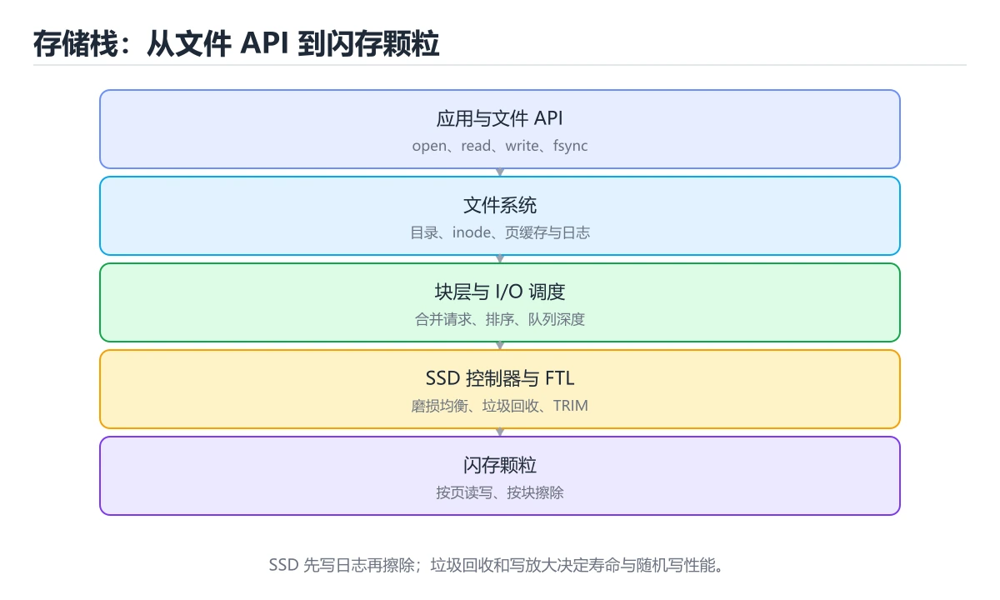
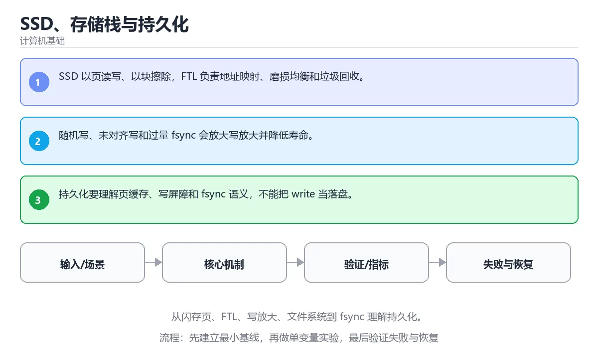

# SSD、存储栈与持久化

> 内容更新时间：2026-10-06 · 学习阶段：高级 · 预计用时：35 分钟





## 本节知识框架

**课程定位**：所属分类 `fundamentals`（计算机基础），课程主题 `SSD、存储栈与持久化`，学习阶段 高级，建议用时 45 分钟。

本课主线：从闪存页、FTL、写放大、文件系统到 fsync 理解持久化。

**学完本课应当能够**
- 说清 `SSD` 与 `写放大` 的含义与区别，并各举一个正例和一个反例。
- 用本课示例验证 `ftl` 的行为，记录输入、输出与失败条件。
- 遇到「把写入当成立即可靠」这类问题时，能说出触发条件与修复顺序。

### 复习清单

- [ ] 能不看正文复述本课核心术语，并指出一个边界或反例。
- [ ] 能运行或推演本课示例，记录输入、输出与失败现象。
- [ ] 能完成一次自测，并把错题对照错误表定位原因。

## 核心概念定义

| 术语 | 操作性定义 | 常见边界与风险 |
| --- | --- | --- |
| SSD | 用闪存保存数据、没有机械寻道、随机访问快的存储设备。 | 没有机械寻道不等于什么负载都快：只测顺序读写会低估随机访问，盘接近填满时长尾延迟还会陡增。 |
| 写放大 | 一次逻辑写入最终引起多倍物理写入，常见于日志与 SSD。 | 易错：固态盘寿命与性能同时下降；正确做法是对齐写入、减少小随机写，并启用回收指令。 |
| ftl | 闪存转换层：把闪存先擦后写、按块擦除的特性抽象成块设备，并负责磨损均衡与垃圾回收。 | 它替你挡掉按块擦除的怪癖，代价是映射表一改、回收一动，一次逻辑写就变成好几页物理写。 |
| 页缓存 | 内核把最近读写的文件页留在内存里的缓存，写入先进缓存，fsync 才保证落盘。 | 易错：把 `write` 返回 0 当成数据已在盘上；脏页还在内存排队，掉电就丢，反过来过量 fsync 又抬高写放大。 |

## 原理与运行机制

### 机制总览

**教材衔接：核心知识**

### 1. SSD 以页读写、以块擦除，FTL 负责地址映射、磨损均衡和垃圾回收。

- 关键做法：基线只保留 写放大 必需的部分，其余条件一次加一个。
- 验证标准：SSD 的结果可复现、错误可解释、失败能恢复。

一次 `write()` 在这条栈里往下走多远，就是"数据到底在哪一层"的答案：

```text
你的程序  write(fd, buf)
   ↓  libc 只是陷入内核，字节还全在内存里
内核页缓存（脏页在这里排队）
   ↓  write 返回 0 只说明"内核收到了"，不说明"盘上有了"
文件系统（ext4 / APFS / NTFS）：把字节切成块，记元数据
   ↓  fsync、O_SYNC 或写回线程把脏页压下去，顺带发 TRIM
块层与驱动：按逻辑块号下发请求
   ↓
FTL：逻辑块号 → 物理页的映射表，外加磨损均衡与垃圾回收
   ↓  闪存只能按页写、按块擦
NAND 颗粒
```

看图能记住三件事：一是 `write` 与"落盘"之间隔着好几层；二是"先擦后写"这个硬件怪癖被 FTL 用一层地址翻译挡掉了，所以你才敢当块设备用；三是你以为一次写入只动一页，映射表一改、垃圾回收一动，实际物理写入常常不止一页——写放大就是从这张图里长出来的。

### 2. 随机写、未对齐写和过量 fsync 会放大写放大并降低寿命。

把这条结论放回「SSD、存储栈与持久化」的完整流程里展开：

- 正文依据：能用自己的话解释：SSD 以页读写、以块擦除，FTL 负责地址映射、磨损均衡和垃圾回收。
- 落地检查：把「2. 随机写、未对齐写和过量 fsync 会放大写放大并降低寿命。」改写成一条可执行的核对项，逐条验证输入、超时与失败路径。

### 3. 持久化要理解页缓存、写屏障和 fsync 语义，不能把 write 当落盘。

把这条结论放回「SSD、存储栈与持久化」的完整流程里展开：

- 正文依据：能用自己的话解释：随机写、未对齐写和过量 fsync 会放大写放大并降低寿命。
- 落地检查：把「3. 持久化要理解页缓存、写屏障和 fsync 语义，不能把 write 当落盘。」改写成一条可执行的核对项，逐条验证输入、超时与失败路径。

**教材衔接：关键流程**

**教材衔接：实践路径**

**教材衔接：验证步骤**

## 典型应用场景

**教材衔接：深度拓展与实战**

这一节把 SSD 的定义、amplification 的代码与常见失败串成一条复习路线。

### 边界条件与常见反例

「SSD、存储栈与持久化」的边界不只包括最大最小值，还要覆盖空、重复和失败：

- 空：写 0 字节的记录仍然占一个页；日志文件刚创建就 fsync，需要落的是目录项，光 fsync 文件本身不够。
- 差一：写入大小取"页大小减 1"（4095 字节）照样吃掉一整页，剩下的 1 字节谁都塞不进来。
- 重复：同一逻辑块连写三次，FTL 只是把映射表换到三个新物理页，旧页变成垃圾等回收——测出来的写放大里含这一份。
- 错位：起始偏移没对齐时，一次 4096 字节的写会跨到两个对齐块，多出来的那一半要走读-改-写。
- 满盘：可用空间压到 90% 以上后，空闲块不足，垃圾回收开始搬家式写入，延迟长尾陡增；空盘测出来的数字不能当容量规划依据。
- 失败：中途拔电或内核崩溃时，已经返回成功的 `write` 可能整批丢失；只有做完 fsync 并检查返回值的那一笔，才有资格写进"已提交"列表。

### 工程检查表

- [ ] 能否用自己的话说明SSD、存储栈与持久化解决什么问题，以及它不负责什么？
- [ ] 能否用「SSD、存储栈与持久化」的最小示例复现一次失败并解释原因？
- [ ] 能否解释本课关键词在真实项目中的边界与取舍？
- [ ] 能否把 SSD 的方法迁移到相近问题，并说明需要改哪一步？

### 最小验证场景

- 准备：保留 `text` 示例的原始输入，先记录 `SSD、存储栈与持久化` 的基线输出和完整运行命令。
- 观察：先核对 调用了 `max()`，再改变一个与 `SSD` 相关的条件。
- 判定：新结果与 `SSD、存储栈与持久化` 的基线不同不等于错误；只有当差异破坏了 `SSD` 的定义或错误表中的约束，才判定为失败。

### 选择与边界

- 使用 `SSD` 时，先满足它的定义：用闪存保存数据、没有机械寻道、随机访问快的存储设备。
- 使用 `写放大` 时，先满足它的定义：一次逻辑写入最终引起多倍物理写入，常见于日志与 SSD；易错：固态盘寿命与性能同时下降；正确做法是对齐写入、减少小随机写，并启用回收指令。
- 使用 `ftl` 时，先满足它的定义：闪存转换层：把闪存先擦后写、按块擦除的特性抽象成块设备，并负责磨损均衡与垃圾回收。
- 使用 `页缓存` 时，先满足它的定义：内核把最近读写的文件页留在内存里的缓存，写入先进缓存，fsync 才保证落盘；越界、悬垂引用与释放顺序会破坏结论，必须在边界输入下复验。

## 代码/协议/SQL 示例

### 最小可验证示例

**教材衔接：最小可运行示例**

先用 amplification 跑通最小示例，然后只改一个与 SSD 相关的取值：

```python
block = 4096
for size in (100, 4096, 8192):
    amplification = max(1, -(-size // block))
    print(f"{size} 字节 -> 写放大 {amplification}x")
```

**教材衔接：预期输出**

```text
100 字节 -> 写放大 1x
4096 字节 -> 写放大 1x
8192 字节 -> 写放大 2x
```

### 对齐示例：同样写 4096 字节，代价差一倍

把偏移量也算进去，就能看见"未对齐"三个字到底多贵：

```python
PAGE = 4096  # 闪存页大小，也是对齐单位


def touched_blocks(size: int, offset: int) -> int:
    """这次写入横跨多少个对齐块：跨块的那一半要走读-改-写。"""
    first = offset // PAGE
    last = (offset + size - 1) // PAGE
    return last - first + 1


for size, offset in ((100, 0), (100, 4000), (4096, 0), (4096, 512), (8192, 0)):
    print(f"写 {size} 字节，偏移 {offset} -> 落到 {touched_blocks(size, offset)} 个对齐块")
```

```text
写 100 字节，偏移 0 -> 落到 1 个对齐块
写 100 字节，偏移 4000 -> 落到 2 个对齐块
写 4096 字节，偏移 0 -> 落到 1 个对齐块
写 4096 字节，偏移 512 -> 落到 2 个对齐块
写 8192 字节，偏移 0 -> 落到 2 个对齐块
```

第三行和第四行是同一笔 4096 字节的写，只是起点差了 512 字节，代价就从 1 块变成 2 块。日志、数据库页缓存这类模块喜欢"接着上次的位置往后写"，偏移量很容易不是 4 的倍数，这就是排查写放大时要先看对齐的原因。

### 落盘示例：write 之后还要不要 fsync

```python
import os

fd = os.open("wal.log", os.O_WRONLY | os.O_CREAT | os.O_TRUNC)
os.write(fd, b"commit\n")   # 到这一步只保证进了内核页缓存
os.fsync(fd)                 # 等脏页真正压到设备再返回

dir_fd = os.open(".", os.O_RDONLY)   # 新建的文件还要保证目录项落盘
os.fsync(dir_fd)
os.close(dir_fd)
os.close(fd)

print("已落盘")
```

```text
已落盘
```

跑两遍你会看到完全一样的输出——正常路径本来就该一样。差别只有拔掉电源才暴露：去掉 `os.fsync(fd)` 那行，`wal.log` 里的这笔记录可能整条不存在。动手验证的方式是写完立刻 `strace -e fsync python 你的脚本`（Linux）或用系统调用监控工具，看有没有真的发出 fsync，而不是靠肉眼读代码。

### 动手练习

1. 把上面循环里的 `(4096, 512)` 改成 `(4096, 4096)`，输出应该变回 1 个对齐块——这就是"对齐"的收益。
2. 把 `PAGE` 改成 512 重跑，前五行里有几行从 1 变成 2？想一想为什么扇区对齐比页对齐更宽松。
3. 在 fsync 示例里把 `os.fsync(fd)` 注释掉，用 `strace` 或日志确认这次系统调用真的消失了，再决定你的业务里哪几笔必须留它。

## 时间/空间复杂度或性能分析

**性能关注点（SSD、存储栈与持久化）**：关注资源换算与精度损失：记录单位换算误差、存储空间与实际耗时。

**本课特有开销（SSD、存储栈与持久化 · SSD）**：缓存命中率比缓存实现本身更关键，先记录命中率与失效策略再谈优化。

**测量方法**：以 `SSD、存储栈与持久化` 的 `SSD` 场景为对象，固定输入跑一遍记录基线，再把规模或并发度提高一个数量级复测；两次结果的差值与波动范围才是结论依据。

## 常见误区与易错点

| 容易写错的做法 | 实际现象 | 原因与正确做法 |
| --- | --- | --- |
| 把写入当成立即可靠 | 缓存未落盘，掉电就丢数据。 | 关键路径显式落盘，或按业务设定持久化级别。 |
| 忽略写放大与磨损 | 固态盘寿命与性能同时下降。 | 对齐写入、减少小随机写，并启用回收指令。 |
| 只测顺序读写 | 真实负载是随机访问，结论不成立。 | 用贴近业务的随机读写与队列深度测试。 |
| 拿空盘跑分做容量规划 | 占用爬到九成后延迟长尾突然炸开。 | 在 80%、90%、95% 三档占用下分别复测随机读写。 |
| 只对新文件的内容做 fsync | 掉电后目录里根本查不到这个文件。 | 新建或改名后，再对父目录的句柄 fsync 一次。 |

### 现场 1：把写入当成立即可靠

**症状**：缓存未落盘，掉电就丢数据。

**根因与修复**：关键路径显式落盘，或按业务设定持久化级别。

**自检**：在本课示例里复现「把写入当成立即可靠」，改成关键路径显式落盘，或按业务设定持久化级别后重跑；如果症状消失且失败路径按预期变化，说明定位正确。

### 现场 2：忽略写放大与磨损

**症状**：固态盘寿命与性能同时下降。

**根因与修复**：对齐写入、减少小随机写，并启用回收指令。

**自检**：在本课示例里复现「忽略写放大与磨损」，改成对齐写入、减少小随机写，并启用回收指令后重跑；如果症状消失且失败路径按预期变化，说明定位正确。

### 现场 3：只测顺序读写

**症状**：真实负载是随机访问，结论不成立。

**根因与修复**：用贴近业务的随机读写与队列深度测试。

**自检**：在本课示例里复现「只测顺序读写」，改成用贴近业务的随机读写与队列深度测试后重跑；如果症状消失且失败路径按预期变化，说明定位正确。

## 与其他知识点的关系

**教材衔接：复习与迁移**

## 自测题与参考答案

> 先独立作答，再对照参考答案；答案都能在本课正文、术语表或错误表里找到依据。

### 自测 1（概念复述）

不看正文，写出 `SSD` 的操作性定义，并说明它与 `写放大` 的区别。

**参考答案**：用闪存保存数据、没有机械寻道、随机访问快的存储设备。

`写放大` 的定位是：一次逻辑写入最终引起多倍物理写入，常见于日志与 SSD；两者的差别要从适用对象与失败模式上说明。

### 自测 2（排错）

本课错误表记录了「把写入当成立即可靠」这类做法。请写出它会出现的现象、根因，以及修复顺序。

**参考答案**：现象是缓存未落盘，掉电就丢数据；正确做法是关键路径显式落盘，或按业务设定持久化级别。修复时先复现现象并保留证据，再改动一处假设重跑，确认现象消失。

### 自测 3（动手验证）

运行本课的 `text` 示例，改动其中一个输入后重新运行，记录输出与错误信息。

**参考答案**：正常输入下 `text` 示例应当复现正文给出的结果；改动输入后，如果结果改变或报错，先核对它是否满足 `SSD、存储栈与持久化` 中`SSD` 的适用范围，再检查错误表里是否有同类现象。

### 自测 4（代码阅读）

阅读本课开头的 `text` 示例，说明它体现了`SSD` 的哪一条性质，并指出改动哪个输入会让这条性质不再成立。

**参考答案**：`SSD` 的定义是 用闪存保存数据、没有机械寻道、随机访问快的存储设备，示例正是在实现这条定义。改动与 `SSD` 有关的一个输入后，如果结果不再符合 `SSD、存储栈与持久化` 的正文描述，就说明该性质只在当前前提成立。

### 自测 5（迁移）

把 `SSD、存储栈与持久化` 的方法迁移到自己的项目：围绕 `SSD` 写出一个与错误表同类的风险点，并说明触发条件和检验方式。

**参考答案**：例如「只测顺序读写」，它会导致真实负载是随机访问，结论不成立；检验方式是按用贴近业务的随机读写与队列深度测试改一处再复现，确认现象消失且没有引入新的失败分支。

### 自测 6（对比）

用一个表格对比 `SSD` 与 `写放大`：各写一行适用场景、一行失败表现。

**参考答案**：`SSD` 的定义是用闪存保存数据、没有机械寻道、随机访问快的存储设备；`写放大` 的定义是一次逻辑写入最终引起多倍物理写入，常见于日志与 SSD。两者的失败表现分别对应本课错误表里与本术语相关的行。

### 自测 7（排错顺序）

面对「把写入当成立即可靠」引发的问题，请把“复现 缓存未落盘，掉电就丢数据 → 保留证据 → 关键路径显式落盘，或按业务设定持久化级别 → 回归验证”四步写成可执行的检查清单。

**参考答案**：第一步按缓存未落盘，掉电就丢数据复现；第二步记录输入、版本与完整报错；第三步按关键路径显式落盘，或按业务设定持久化级别只改一处；第四步重跑并确认失败路径也按预期变化。

### 自测 8（边界判断）

针对 `页缓存`，分别写出“可以使用”的条件和“结论不再成立”的条件。

**参考答案**：越界、悬垂引用与释放顺序会破坏结论，必须在边界输入下复验。 同时要把 `页缓存` 的定义 内核把最近读写的文件页留在内存里的缓存，写入先进缓存，fsync 才保证落盘 与实际输入逐项对照。

### 自测 9（机制重建）

不看正文，按输入、转换、输出、验证四段重建 `SSD` → `写放大` → `ftl` → `页缓存` 的作用链。

**参考答案**：起点是 `SSD` 的定义 用闪存保存数据、没有机械寻道、随机访问快的存储设备；中间每一步都保留可观察状态；终点由 `页缓存` 检查，失败时回到错误表定位第一个偏离定义的步骤。

### 自测 10（综合排错）

在 `SSD、存储栈与持久化` 中，现象是 真实负载是随机访问，结论不成立。请围绕 只测顺序读写 写出最小复现、关键证据、修复动作和回归验证，并说明为什么不能只凭一次运行下结论。

**参考答案**：先复现 只测顺序读写，记录输入与完整错误；再按 用贴近业务的随机读写与队列深度测试 只改一处。回归时同时跑正常路径和边界路径，只有两次结果都可解释，才把修复视为完成。

### 自测 11（一分钟复述）

用每分钟约 200 字的速度复述 `SSD、存储栈与持久化`：先给主问题，再按顺序说出 `SSD`、`写放大`、`ftl`、`页缓存`，最后给一个失败案例。

**自评标准**：主问题必须对应 从闪存页、FTL、写放大、文件系统到 fsync 理解持久化；每个术语都要能接上一句定义或边界；失败案例必须写成可观察现象，不能用“可能有风险”代替证据。

## 术语速查

| 术语 | 一句话说明 |
| --- | --- |
| `SSD` | 用闪存保存数据、没有机械寻道、随机访问快的存储设备。 |
| `写放大` | 一次逻辑写入最终引起多倍物理写入，常见于日志与 SSD。 |
| `ftl` | 闪存转换层：把闪存先擦后写、按块擦除的特性抽象成块设备，并负责磨损均衡与垃圾回收。 |
| `页缓存` | 内核把最近读写的文件页留在内存里的缓存，写入先进缓存，fsync 才保证落盘。 |
| `fsync` | 让内核等到这笔写入真正落到设备再返回的系统调用。 |
| `对齐写` | 起始偏移和长度都踩在页或扇区边界上，避免半块写入触发读-改-写。 |
| `TRIM` | 告诉固态盘哪些逻辑块已经没用了，让它提前把这些块擦掉、留出空闲池。 |
| `写屏障` | 强制"数据块先落、元数据后落"的顺序，防止掉电后日志比数据还新。 |

**术语关系**：`SSD`（用闪存保存数据、没有机械寻道、随机访问快的存储设备） → `写放大`（一次逻辑写入最终引起多倍物理写入） → `ftl`（闪存转换层：把闪存先擦后写、按块擦除的特性抽象成块设备） → `页缓存`（内核把最近读写的文件页留在内存里的缓存）。

## 考点精讲

`SSD、存储栈与持久化` 的题库有 6 道题，下面逐题给出题干、正确项与判断依据：先自己作答，再核对正确项，最后回到正文对应小节复核。

### 考点 1：第 1 题

- **题目**：在 `SSD、存储栈与持久化` 里，与 `SSD` 有关的说法中，哪一项最符合从闪存页、FTL、写放大、文件系统到 fsync 理解持久化？
- **正确项**：SSD 以页读写、以块擦除，FTL 负责地址映射、磨损均衡和垃圾回收。
- **判断依据**：本题正确项是「SSD 以页读写、以块擦除，FTL 负责地址映射、磨损均衡和垃圾回收」。术语 SSD（SSD、存储栈与持久化）：用闪存保存数据、没有机械寻道、随机访问快的存储设备，本题取「SSD 以页读写、以块擦除，FTL 负责地址映射、磨损均衡和垃圾回收」这条。易错点是把写入当成立即可靠，会造成缓存未落盘，掉电就丢数据，改法是关键路径显式落盘，或按业务设定持久化级别。

### 考点 2：第 2 题

- **题目**：在 `SSD、存储栈与持久化` 里，与 `SSD` 有关的说法中，哪一项最符合从闪存页、FTL、写放大、文件系统到 fsync 理解持久化？（SSD、存储栈与持久化·计算机基础 第 2 题）
- **正确项**：随机写、未对齐写和过量 fsync 会放大写放大并降低寿命。
- **判断依据**：本题正确项是「随机写、未对齐写和过量 fsync 会放大写放大并降低寿命」。术语 SSD（SSD、存储栈与持久化）：用闪存保存数据、没有机械寻道、随机访问快的存储设备，本题取「随机写、未对齐写和过量 fsync 会放大写放大并降低寿命」这条。易错点是忽略写放大与磨损，会造成固态盘寿命与性能同时下降，改法是对齐写入、减少小随机写，并启用回收指令。

### 考点 3：第 3 题

- **题目**：在 `SSD、存储栈与持久化` 里，与 `SSD` 有关的说法中，哪一项最符合从闪存页、FTL、写放大、文件系统到 fsync 理解持久化？（SSD、存储栈与持久化·计算机基础 第 3 题）
- **正确项**：持久化要理解页缓存，写屏障和 fsync 语义
- **判断依据**：本题正确项是「持久化要理解页缓存，写屏障和 fsync 语义」。术语 SSD（SSD、存储栈与持久化）：用闪存保存数据、没有机械寻道、随机访问快的存储设备，本题取「持久化要理解页缓存，写屏障和 fsync 语义」这条。易错点是只测顺序读写，会造成真实负载是随机访问，结论不成立，改法是用贴近业务的随机读写与队列深度测试。

### 考点 4：第 4 题

- **题目**：围绕“SSD、存储栈与持久化”中的 SSD、写放大、ftl，下列哪两项是本课强调的实践判断？
- **正确项**：验证 写放大 时要固定版本并覆盖边界输入，结论才可复现；学习 SSD 时要同时说明输入、输出和失败路径，不能只看正常流程
- **判断依据**：按《SSD、存储栈与持久化》的正文口径，本题要同时选中「验证 写放大 时要固定版本并覆盖边界输入，结论才可复现」、「学习 SSD 时要同时说明输入、输出和失败路径，不能只看正常流程」，漏掉任一项都算没答全。术语 SSD（SSD、存储栈与持久化）：用闪存保存数据、没有机械寻道、随机访问快的存储设备。易错点是把写入当成立即可靠，会造成缓存未落盘，掉电就丢数据，改法是关键路径显式落盘，或按业务设定持久化级别。

### 考点 5：第 5 题

- **题目**：填空：补齐下面这段术语说明中的空缺。课程 `从闪存页、FTL、写放大、文件系统到 fsync 理解持久化。`，这段说明是：`____`：一次逻辑写入最终引起多倍物理写入，常见于日志与 SSD。空缺处应填哪个术语？
- **正确项**：写放大
- **判断依据**：涉及术语 SSD：用闪存保存数据、没有机械寻道、随机访问快的存储设备。易错点：把写入当成立即可靠会造成缓存未落盘，掉电就丢数据。正确做法：关键路径显式落盘，或按业务设定持久化级别。判断时先确认输入和适用范围，对照 `SSD`、`写放大`、`ftl`、`fsync` 复现一次，最后把错误表现与正确做法逐项对照。

### 考点 6：第 6 题

- **题目**：`SSD、存储栈与持久化` 的示例代码服务于“从闪存页、FTL、写放大、文件系统到 fsync 理解持久化。”哪一条判断是正确的？
- **正确项**：SSD 以页读写、以块擦除，FTL 负责地址映射、磨损均衡和垃圾回收。
- **判断依据**：本题正确项是「SSD 以页读写、以块擦除，FTL 负责地址映射、磨损均衡和垃圾回收」。术语 SSD（SSD、存储栈与持久化）：用闪存保存数据、没有机械寻道、随机访问快的存储设备，本题取「SSD 以页读写、以块擦除，FTL 负责地址映射、磨损均衡和垃圾回收」这条。易错点是只测顺序读写，会造成真实负载是随机访问，结论不成立，改法是用贴近业务的随机读写与队列深度测试。

### 考点 7：`SSD`

- **要点**：用闪存保存数据、没有机械寻道、随机访问快的存储设备。

### 考点 8：`写放大`

- **要点**：一次逻辑写入最终引起多倍物理写入，常见于日志与 SSD。
- **写放大 的边界**：易错：固态盘寿命与性能同时下降；正确做法是对齐写入、减少小随机写，并启用回收指令。

### 考点 9：`ftl`

- **要点**：闪存转换层：把闪存先擦后写、按块擦除的特性抽象成块设备，并负责磨损均衡与垃圾回收。

### 考点 10：`页缓存`

- **要点**：内核把最近读写的文件页留在内存里的缓存，写入先进缓存，fsync 才保证落盘。
- **页缓存 的边界**：越界、悬垂引用与释放顺序会破坏结论，必须在边界输入下复验。

### 考点 11：排错——把写入当成立即可靠

- **现象**：缓存未落盘，掉电就丢数据。
- **处理**：关键路径显式落盘，或按业务设定持久化级别。

### 考点 12：排错——忽略写放大与磨损

- **现象**：固态盘寿命与性能同时下降。
- **处理**：对齐写入、减少小随机写，并启用回收指令。

### 考点 13：综合辨析——`SSD` 与 `页缓存`

- **辨析点**：`SSD` 的定义是 用闪存保存数据、没有机械寻道、随机访问快的存储设备；`页缓存` 的定义是 内核把最近读写的文件页留在内存里的缓存，写入先进缓存，fsync 才保证落盘。
- **答题要求**：面对 `SSD、存储栈与持久化` 的题目，先判断描述的是 `SSD` 还是 `页缓存`，再归到对应定义，最后写出一个会让该定义失效的边界输入。

### 考点 14：排错评分点

- **现象分**：能写出 缓存未落盘，掉电就丢数据，而不是只写“程序有错”。
- **证据分**：保留触发 把写入当成立即可靠 的输入、版本和错误原文。
- **修复分**：按 关键路径显式落盘，或按业务设定持久化级别 只改一处，并同时回归正常路径与边界路径。

## 内容元数据

- 内容版本：v2.0
- 最后更新：2026-10-06
- 学习阶段：高级
- 适用环境：通用计算机体系结构知识；本课聚焦 SSD。
- 内容来源：内置结构化课程与工程实践整理
- 相关主题：SSD、写放大、ftl、fsync
- 质量版本：P0 测验标准 + P1 覆盖扩展 + P2 体验补全

## 参考资料与复核

- 最后复核：2026-10-04
- 下次复核：2027-03-17
- 复核范围：版本兼容、API 行为、安全建议与工程实践
- 来源性质：官方文档、标准或权威教材；本课核对关键词：SSD、写放大、ftl、fsync。

| 参考资料 | 本课用途 |
| --- | --- |
| [MIT 6.033 计算机系统工程](https://ocw.mit.edu/courses/6-033-computer-system-engineering-spring-2018/) | 系统设计与并发 |
| [MIT 6.004 计算结构](https://ocw.mit.edu/courses/6-004-computation-structures-spring-2017/) | 数字逻辑、ISA 与计算机组织 |
| [Nand2Tetris](https://www.nand2tetris.org/) | 从逻辑门到计算机系统 |

| [本课术语索引：SSD、存储栈与持久化](#核心概念定义) | 按本课输入、术语边界和错误表现逐项核对 |
> 「SSD、存储栈与持久化」的链接用于离线阅读后的延伸核对；App 不会自动联网。