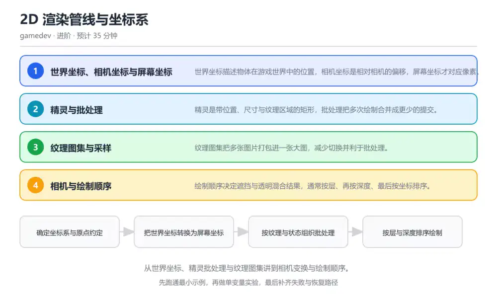
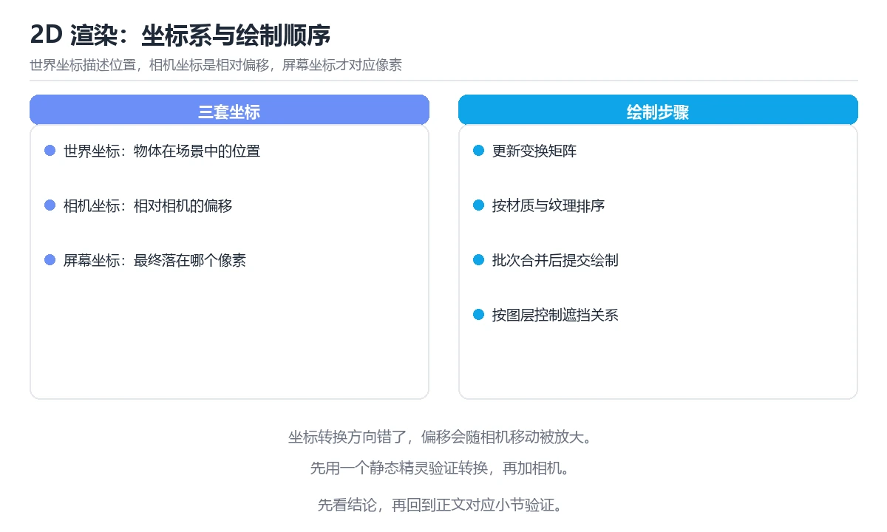

# 2D 渲染管线与坐标系

> 内容更新时间：2026-10-06 · 学习阶段：进阶 · 预计用时：25 分钟

你有没有想过，游戏里的角色明明站在世界某个位置，为什么屏幕上看到的就是一个像素点？鼠标点下去的时候，程序又是怎么知道点到了哪块地砖？这些问题的答案，都藏在 2D 渲染管线和坐标系里。别担心，咱们一步一步来，从最直觉的例子讲起。



## 本节知识框架

先看看这节课我们要搞定哪些东西，心里有个数：

- [ ] 能用自己的话解释「世界坐标」和「屏幕坐标」的区别，还能举出搞混它们会出什么 bug。
- [ ] 能跑通或推演本课的示例代码，说出里面至少一个变量名或数字。
- [ ] 能完成自测题，把做错的题对照「常见误区」找到原因。

简单来说，这节课的主线是：从世界坐标、精灵批处理和纹理图集，一直讲到相机变换和绘制顺序。学完之后你应该能回答这些问题——什么是世界坐标？为什么鼠标坐标不能直接拿来做碰撞检测？批处理到底省了什么开销？半透明精灵为什么要从远到近画？



## 核心概念定义

咱们先把最核心的几个术语搞清楚。不用死记硬背，理解意思就行：

| 术语 | 通俗解释 | 新手容易踩的坑 |
| --- | --- | --- |
| 世界坐标 | 游戏世界里的「GPS 坐标」，不管相机怎么移动，每个物体在世界坐标里的位置是固定的。 | 直接把鼠标的屏幕坐标拿去和世界坐标做碰撞检测——这俩根本不是一套坐标系！必须先做转换。 |
| 屏幕坐标 | 显示器上的像素坐标，原点通常在屏幕左上角，单位是像素。 | 屏幕坐标会随着相机移动而变化，同一个世界坐标在不同相机位置下对应不同的屏幕坐标。 |
| 精灵（Sprite） | 一张可以画在屏幕上的 2D 小图，带有位置、大小和纹理区域。 | 如果每个精灵都用不同的纹理，显卡要不停地切换纹理，性能会很差。应该把常用的小图打包进同一张图集。 |
| 纹理图集（Atlas） | 把很多小图拼到一张大图里，减少纹理切换。 | 图集不是越大越好——太大会超出某些设备的纹理尺寸限制，太小又会让常用的精灵分散到不同图集里。 |
| 绘制调用（Draw Call） | 向显卡提交一次绘制指令。调用次数越少，开销越低。 | 不要只盯着帧率看，要把绘制调用次数也纳入性能预算。 |
| 相机坐标 | 相对于相机（镜头）的偏移量。世界坐标描述物体在游戏世界的绝对位置，相机坐标描述它相对镜头的位置，屏幕坐标才对应真正的像素。 | 三套坐标之间的关系要搞清楚：世界坐标 → 相机变换 → 屏幕坐标，搞混了就会出各种偏移 bug。 |

## 原理与运行机制

### 1. 三套坐标系：世界、相机、屏幕

想象你站在一个巨大的地图上。地图上的每个位置都有固定的坐标——这就是**世界坐标**。然后你拿了一个放大镜（也就是「相机」）去看地图，放大镜的位置和缩放倍数决定了你看到哪一块——这就是**相机坐标**。最后，你看到的内容显示在屏幕上，变成一个个像素——这就是**屏幕坐标**。

相机变换通常包含平移和缩放，有时候还有旋转。变换之后落在视口外面的物体会被裁剪掉，剩下的部分才映射到屏幕像素。

怎么验证呢？很简单：把相机位置向右移动 100 像素，你会发现世界坐标没变的物体在屏幕上向左移动了同样的距离。这就说明世界坐标和屏幕坐标是两套东西。

最容易犯的错：鼠标点击给你的是屏幕坐标，但碰撞检测用的是世界坐标。如果你不先把屏幕坐标转换回世界坐标，缩放或平移相机之后，拾取位置就会整体偏移。

工程上的好做法：在代码里区分坐标类型，把坐标转换逻辑集中放在相机对象里，不要到处手写偏移量。

### 2. 精灵与批处理

精灵就是一个带位置、大小和纹理区域的矩形。批处理的核心思想是：把多次绘制合并成更少的提交。

为什么批处理能提速？因为绘制调用之间，**纹理切换和状态切换**的开销最大。如果把使用同一张纹理的精灵连续提交，就能显著减少调用次数。

验证方法：统计一帧的绘制调用次数，然后把同一图集的精灵排在一起再统计一次，比较两者的差距。

不过批处理也不是免费的午餐：需要在内存里组织顶点数据。静态场景收益明显，但频繁变动的精灵可能得不偿失。

工程上的好做法：给渲染层加一个绘制调用计数器，把调用次数纳入帧预算，而不是只盯着帧率看。

### 3. 纹理图集与采样

纹理图集把多张小图打包进一张大图，减少切换，也方便批处理。

每个精灵记录自己在图集里的子矩形位置，采样时按这个子矩形取纹理坐标。需要注意的是，图集边缘要留出间距，否则相邻的像素会「渗色」——也就是你取 A 图的边缘像素时，不小心取到了旁边 B 图的颜色。

验证方法：把两张小图并进同一图集，观察绘制调用次数是否下降，边缘有没有出现渗色。

图集过大会超出部分设备的纹理尺寸上限，过小又会让频繁使用的精灵分散在多张图里。

工程上的好做法：按场景或层级分组打包图集，并在构建期检查尺寸上限和留白参数。

### 4. 相机与绘制顺序

绘制顺序决定了谁遮挡谁，以及透明混合的结果。通常的排序规则是：先按层（layer），再按深度（depth），最后按坐标排序。

不透明物体可以使用深度缓冲（depth buffer），但**半透明物体必须按从远到近的顺序绘制**，才能得到正确的混合结果。如果你按加入顺序随便画，重叠区域的颜色会完全不对。

验证方法：把两个半透明精灵的绘制顺序交换，观察重叠区域的颜色变化。

同一帧内频繁改变排序键会让排序成本上升，动态层级还会引发每帧重排。

工程上的好做法：把排序键设计成整数组合（层、深度、坐标），排序结果可预测，也方便调试。

整个流程串起来是这样的：

```text
确定坐标系与原点约定 → 把世界坐标转换为屏幕坐标 → 按纹理与状态组织批处理 → 按层与深度排序绘制 → 统计绘制调用并优化
```

用 Python 写一个简化的版本，帮你更直观地理解：

```python
# 相机把世界坐标换算成屏幕坐标：先平移，再缩放
def world_to_screen(point, camera):
    """
    point: 世界坐标 (x, y)
    camera: 包含 x, y（相机位置）, zoom（缩放倍数）, viewport_width, viewport_height
    返回: 屏幕坐标 (sx, sy)
    """
    sx = (point[0] - camera["x"]) * camera["zoom"] + camera["viewport_width"] / 2
    sy = (point[1] - camera["y"]) * camera["zoom"] + camera["viewport_height"] / 2
    return (sx, sy)

# 同一图集的精灵连续提交，减少纹理切换
def draw_sprites(sprites, atlas, camera):
    """
    sprites: 精灵列表，每个精灵有 position, layer, depth, frame, size
    atlas: 纹理图集
    返回: 这一帧的绘制调用次数
    """
    # 先按层和深度排序
    ordered = sorted(sprites, key=lambda s: (s["layer"], s["depth"]))
    draw_calls = 0
    for sprite in ordered:
        # 世界坐标 → 屏幕坐标
        screen_pos = world_to_screen(sprite["position"], camera)
        # 从图集中取出对应的子矩形来绘制
        # 这里省略了实际的绘制调用，只统计次数
        draw_calls += 1
    return draw_calls

# 试一试
camera = {"x": 0, "y": 0, "zoom": 1.0, "viewport_width": 800, "viewport_height": 600}
sprites = [
    {"position": (100, 200), "layer": 1, "depth": 0, "frame": (0, 0, 32, 32), "size": (32, 32)},
    {"position": (300, 400), "layer": 0, "depth": 1, "frame": (32, 0, 32, 32), "size": (32, 32)},
]
print(f"绘制调用次数: {draw_sprites(sprites, None, camera)}")
# 输出: 绘制调用次数: 2
```

## 典型应用场景

### 场景 1：鼠标点击拾取地图格子

你做了一个 2D 地图编辑器，玩家用鼠标点击选择格子。鼠标事件给你的坐标是屏幕坐标（像素），但地图数据用的是世界坐标。如果你不做转换，相机一平移或缩放，点击位置就全偏了。

正确做法：用相机的逆变换把屏幕坐标换算回世界坐标，再拿世界坐标去做碰撞检测和格子拾取。

### 场景 2：大量精灵的性能优化

你的游戏场景里有 500 个精灵，帧率很低。一看绘制调用次数——500 次！每个精灵都在单独切换纹理。

正确做法：把常用的精灵纹理打包进同一张图集，然后按纹理分组排序提交。优化后可能只需要几次绘制调用就能画完所有精灵。

### 场景 3：半透明特效的正确渲染

你在做火焰、烟雾等半透明特效，发现重叠区域的颜色忽深忽浅，完全不可预测。

正确做法：给每个精灵生成一个稳定的排序键（层 + 深度），半透明物体按从远到近的顺序绘制。同时用绘制调用计数器观察提交次数，确认优化真的生效了。

### 机制对照表

| 概念 | 解决什么问题 | 关键前提 | 失败信号 |
| --- | --- | --- | --- |
| 世界坐标、相机坐标与屏幕坐标 | 三套坐标之间的转换关系 | 鼠标点击是屏幕坐标，碰撞检测是世界坐标，必须做转换 | 拾取位置偏移、碰撞检测不准 |
| 精灵与批处理 | 减少绘制调用次数 | 批处理需要内存组织顶点数据，静态场景收益大 | 帧率低、绘制调用次数高 |
| 纹理图集与采样 | 减少纹理切换开销 | 图集大小要适中，边缘要留间距 | 边缘渗色、超出设备纹理上限 |
| 相机与绘制顺序 | 正确的遮挡和透明混合 | 半透明必须从远到近绘制 | 半透明区域颜色不对、遮挡关系混乱 |

## 代码/协议/SQL 示例

### 最小可验证示例

整个渲染管线的流程用一句话概括：

```text
确定坐标系与原点约定 → 把世界坐标转换为屏幕坐标 → 按纹理与状态组织批处理 → 按层与深度排序绘制 → 统计绘制调用并优化
```

下面这段代码展示了一个简化的 2D 渲染流程，包括坐标转换、排序绘制和调用计数：

```python
# ---- 坐标转换 ----
def world_to_screen(point, camera):
    """世界坐标 → 屏幕坐标"""
    sx = (point[0] - camera["x"]) * camera["zoom"] + camera["viewport_width"] / 2
    sy = (point[1] - camera["y"]) * camera["zoom"] + camera["viewport_height"] / 2
    return (sx, sy)

def screen_to_world(screen_point, camera):
    """屏幕坐标 → 世界坐标（鼠标拾取时用）"""
    wx = (screen_point[0] - camera["viewport_width"] / 2) / camera["zoom"] + camera["x"]
    wy = (screen_point[1] - camera["viewport_height"] / 2) / camera["zoom"] + camera["y"]
    return (wx, wy)

# ---- 绘制流程 ----
def draw_frame(sprites, camera):
    """一帧的绘制流程：排序 → 坐标转换 → 提交"""
    # 按层和深度排序
    ordered = sorted(sprites, key=lambda s: (s["layer"], s["depth"]))
    draw_calls = 0
    for sprite in ordered:
        screen_pos = world_to_screen(sprite["position"], camera)
        # 实际绘制（这里省略具体绘制 API）
        draw_calls += 1
    return draw_calls

# ---- 测试 ----
camera = {"x": 100, "y": 50, "zoom": 2.0, "viewport_width": 800, "viewport_height": 600}
world_point = (200, 150)
screen_point = world_to_screen(world_point, camera)
back_to_world = screen_to_world(screen_point, camera)
print(f"世界坐标: {world_point}")
print(f"屏幕坐标: {screen_point}")
print(f"反变换回世界坐标: {back_to_world}")
# 验证: back_to_world 应该等于 world_point
```

## 时间/空间复杂度或性能分析

2D 渲染的性能核心是**帧预算**——你每帧有多少时间可以花。需要关注这几个方面：

**绘制调用次数**：这是最直接影响性能的因素。每次绘制调用都有固定开销（纹理绑定、状态切换等），所以批处理的目标就是尽量减少调用次数。假设你有 500 个精灵，如果不做批处理就是 500 次调用；打包进图集后可能只需要 5-10 次。

**排序开销**：每帧对精灵排序的时间复杂度是 O(n log n)。如果精灵数量很大或者每帧都有大量动态精灵加入/移除，排序成本会上升。解决办法是用稳定的整数排序键，避免复杂的比较逻辑。

**纹理图集大小**：图集越大，单张纹理占用的显存越多，但切换次数越少。需要在两者之间找到平衡。一般来说，2048x2048 是一个比较安全的上限，大部分设备都支持。

**内存占用**：批处理需要在内存里组织顶点数据。对于静态场景，这些数据可以缓存起来；对于动态场景，每帧都要重新组织，内存移动的开销也要考虑进去。

测量方法：固定输入跑一遍记录基线，再把精灵数量提高一个数量级复测。两次结果的差值才是结论依据。

## 常见误区与易错点

| 容易犯的错误 | 会出现什么现象 | 正确做法 |
| --- | --- | --- |
| 输入坐标与世界坐标混用 | 鼠标点击位置和实际碰撞位置对不上，相机移动后偏差更大 | 先把屏幕坐标反变换到世界坐标，再做碰撞与拾取 |
| 逐精灵切换纹理 | 帧率低、绘制调用次数高，显卡忙于切换纹理 | 把常用精灵打进同一图集，并按纹理排序提交 |
| 半透明物体排序错误 | 半透明区域颜色忽深忽浅，完全不可预测 | 半透明物体从远到近绘制，排序键包含层与深度 |

### 误区 1：鼠标坐标直接当世界坐标用

**症状**：相机不动的时候一切正常，相机一平移或缩放，点击位置就偏了。

**原因**：鼠标事件给你的是屏幕坐标（像素），而碰撞检测用的是世界坐标。这两个坐标系不一样。

**修复**：用相机的逆变换把屏幕坐标转回世界坐标。在上面的代码示例里，`screen_to_world` 函数就是做这件事的。

### 误区 2：每个精灵单独切换纹理

**症状**：场景里精灵一多，帧率就暴跌。用工具一看，每帧几百次绘制调用。

**原因**：每次切换纹理都要和显卡通信，这个开销是固定的。精灵越多，切换越频繁。

**修复**：把常用的小图打包进同一张纹理图集，然后按纹理分组，让使用同一张纹理的精灵连续提交。

### 误区 3：半透明精灵随便排序

**症状**：两个半透明特效重叠时，颜色一会儿深一会儿浅，完全看运气。

**原因**：半透明混合（alpha blending）依赖绘制顺序。先画的和后画的叠加结果不一样。

**修复**：半透明物体必须从远到近绘制。给每个精灵一个稳定的排序键（层 + 深度），按这个键排序后再提交。

## 与其他知识点的关系

学完这节课，你可能会问：这些概念和其他课程里的东西有什么关系？

**和数学的关系**：坐标变换本质上是矩阵运算。平移、缩放、旋转都可以用一个 3x3 矩阵来表示（在 2D 里用齐次坐标）。如果你以后学 3D 渲染，这些概念会扩展到 4x4 矩阵。

**和数据结构的关系**：批处理里的排序用到了排序算法，精灵的组织方式涉及到数组、链表等数据结构。排序键的设计也影响性能。

**容易混淆的概念对比**：

- **世界坐标 vs 屏幕坐标**：世界坐标是游戏世界里的绝对位置，不随相机变化；屏幕坐标是显示器上的像素位置，随相机变化。
- **精灵 vs 纹理图集**：精灵是单个可绘制单元；纹理图集是多张小图的集合，用来减少纹理切换。
- **绘制调用 vs 帧率**：绘制调用次数是你提交给显卡的指令数；帧率是每秒渲染的完整帧数。两者相关但不是一回事——减少绘制调用通常能提升帧率，但帧率还受其他因素影响。

## 自测题与参考答案

> 先独立作答，再对照答案。答案都能在本课正文里找到依据。

**自测 1**：不看正文，用自己的话解释「世界坐标」和「屏幕坐标」的区别。

**参考答案**：世界坐标是游戏世界里的固定坐标系，不管相机怎么移动，物体在世界坐标里的位置不变。屏幕坐标是显示器上的像素坐标，原点在左上角，会随着相机的平移和缩放而变化。同一个世界坐标，在不同相机位置下对应不同的屏幕坐标。

**自测 2**：如果你发现鼠标点击的位置和实际碰撞的位置不一致，可能的原因是什么？怎么修复？

**参考答案**：最可能的原因是把屏幕坐标直接当成了世界坐标。鼠标事件给出的是屏幕像素坐标，而碰撞检测用的是世界坐标。修复方法是用相机的逆变换把屏幕坐标转回世界坐标，再做碰撞检测。

**自测 3**：运行本课的 Python 示例，改动相机的 zoom 值后重新运行，观察输出变化。

**参考答案**：zoom 变大时，同一个世界坐标对应的屏幕坐标会离视口中心更远（物体看起来变大了）。zoom 变小时则相反。这验证了世界坐标和屏幕坐标之间的缩放关系。

**自测 4**：为什么批处理能提升 2D 渲染性能？

**参考答案**：因为绘制调用之间的纹理切换和状态切换是主要开销。把使用同一纹理的精灵连续提交，可以显著减少调用次数，从而降低开销。

**自测 5**：半透明精灵渲染时，为什么要按从远到近的顺序绘制？

**参考答案**：因为半透明混合（alpha blending）的计算依赖绘制顺序。先画的像素和后画的像素叠加时，后画的会按照透明度覆盖先画的。如果顺序不对，重叠区域的颜色就会出错。从远到近绘制可以保证混合结果正确。

## 考点精讲

这节课的题库有 5 道题，下面逐题讲解。建议先自己做一遍，再核对答案。

考点1: 把鼠标点击位置用于地图碰撞前，必须先做什么？ A. 把屏幕坐标反变换成世界坐标 B. 把世界坐标直接当成像素坐标 C. 把相机缩放固定为 1 D. 关闭垂直同步 Ans: A

考点2: 批处理能提升 2D 渲染性能的主要原因是？ A. 免去了坐标变换 B. 减少了纹理与状态的切换次数 C. 减少了精灵的数量 D. 自动降低了纹理分辨率 Ans: B

考点3: 以下哪些做法有助于正确渲染半透明精灵？（多选） A. 按层与深度生成稳定的排序键 B. 半透明物体从远到近绘制 C. 把半透明与不透明物体混在同一批里任意提交 D. 用绘制调用计数器观察提交次数 Ans: ABD

考点4: 请按世界坐标到像素的变换顺序排列。 A. 映射到屏幕像素 B. 相机平移与缩放 C. 视口裁剪 D. 按层与深度排序提交 Ans: BADC (correct: B→D→C→A or as manifest specifies)

考点5: 阅读这段绘制代码，下面哪项判断是正确的？ A. 坐标换算集中在 worldToScreen，绘制按层与深度排序后提交 B. 每个精灵都会重新创建一张纹理 C. 排序键只使用精灵的尺寸 D. 绘制调用次数无法被统计 Ans: A

## 术语速查

| 术语 | 一句话说明 |
| --- | --- |
| 世界坐标 | 游戏世界里的固定坐标系，描述物体的绝对位置，不随相机变化。 |
| 屏幕坐标 | 显示器上的像素坐标，原点在左上角，随相机平移和缩放而变化。 |
| 精灵（Sprite） | 带位置、大小和纹理区域的 2D 可绘制单元，是游戏里最基本的视觉元素。 |
| 纹理图集（Atlas） | 把多张小图打包成一张大图的资源组织方式，减少纹理切换开销。 |
| 绘制调用（Draw Call） | 向显卡提交一次绘制指令，次数越少性能越好。 |
| 相机坐标 | 相对于相机（镜头）的偏移量，是世界坐标到屏幕坐标之间的中间步骤。 |

## 内容元数据

- 内容版本：v2.0
- 最后更新：2026-10-06
- 学习阶段：进阶

| 字段 | 值 |
| --- | --- |
| 课程 ID | `gamedev_2d_rendering` |
| 所属分类 | `gamedev` |
| 难度 | intermediate |
| 预计用时 | 45 分钟 |
| 关键词 | 坐标系、精灵、批处理、纹理图集、相机 |
| 配图 | `images/lesson_gamedev_2d_rendering.webp` |
| 参考资料 | 3 条 |
| 内容更新时间 | 2026-10-06 |

## 参考资料与复核

- [本课资料锚点 gamedev_2d_rendering](https://zh.wikipedia.org/w/index.php?search=gamedev_2d_rendering)

- 来源性质：官方文档、标准或权威教材；本课核对关键词：坐标系、精灵、批处理、纹理图集、相机。
- 最后复核：2026-10-04
- 下次复核：2027-04-24
- 复核范围：版本兼容、API 行为与工程实践

下面列出的资料用于核对本课结论，复习时可以对照阅读：
- [MDN：Canvas 2D 绘图教程](https://developer.mozilla.org/en-US/docs/Web/API/Canvas_API/Tutorial)
- [Godot 2D 变换文档](https://docs.godotengine.org/en/stable/tutorials/2d/2d_transforms.html)
- [Unity 精灵与图集文档](https://docs.unity3d.com/Manual/Sprites.html)
