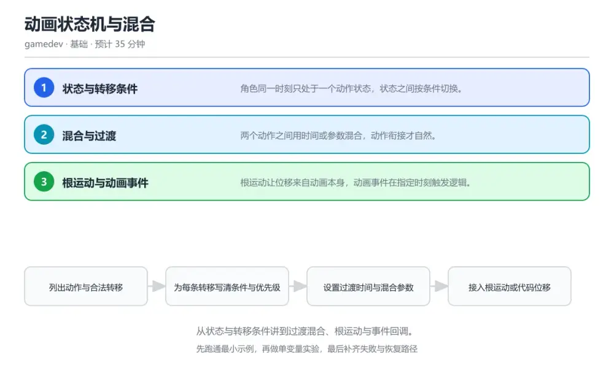
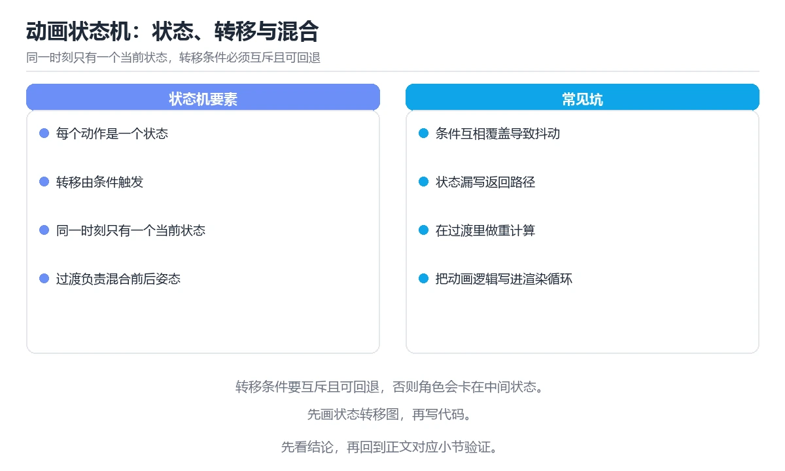

# 动画状态机与混合

> 内容更新时间：2026-10-06 · 学习阶段：基础 · 预计用时：35 分钟



## 本节知识框架

想象你正在做一个角色——站立、走路、跑步、跳跃。同一时刻你只能做一个动作，对吧？动画状态机就是帮角色"决定现在该做什么动作"的系统。

今天我们要搞懂三件事：
- 角色怎么在动作之间切换（状态机与转移条件）
- 切换的时候怎么让过渡看起来自然（混合与过渡）
- 角色走起来的时候，位移到底听谁的（根运动与动画事件）

学完这一课，你会：
- 理解状态机、过渡、混合空间、根运动、动画事件分别是什么
- 能解释"角色在走路和待机之间疯狂抖动"是怎么回事
- 知道怎么给动作切换设置合理的过渡时间

**先修与衔接**：本课是「图形与游戏开发」分类的第 2 课。建议先学完《游戏循环与帧时间》——你需要了解帧更新的基本概念。学完后按 `gamedev` 分类顺序继续。

### 复习清单

- [ ] 能用自己的话解释"状态机"和"过渡"的区别
- [ ] 能说出"角色抖动"问题的原因和修复方法
- [ ] 能按顺序描述一次动作切换的完整流程

**本课配图**



## 核心概念定义

先认识几个名词，后面的内容会反复用到：

| 术语 | 一句话说明 |
| --- | --- |
| 状态机 | 管理角色"当前在做什么"的系统——同一时刻只能处于一个状态，按条件切换到另一个状态。 |
| 过渡 | 两个动作之间的"渐变"过程，让切换看起来自然，而不是瞬间跳变。 |
| 混合空间 | 根据一个参数（比如速度）在多个动画之间平滑过渡的结构。 |
| 根运动 | 让角色的位移由动画本身驱动，而不是代码硬算。 |
| 动画事件 | 在动画播放到某一帧时触发的回调——比如落脚时播放脚步声。 |
| 转移条件 | 决定"什么时候从状态 A 切到状态 B"的判断规则。 |

## 原理与运行机制

### 状态机：角色同一时刻只做一个动作

你可以把状态机想象成一个"动作调度员"。它手里有一张表：

```text
当前状态    →  满足什么条件  →  切到哪个状态
待机(Idle)  →  速度 > 0.1   →  跑步(Run)
跑步(Run)   →  速度 <= 0.05 →  待机(Idle)
跑步(Run)   →  按下跳跃     →  跳跃(Jump)
```

角色每一帧都会检查：我现在在哪个状态？条件满足了吗？满足了就切换。

关键点：**角色同一时刻只能处于一个状态**。你不可能同时在跑步和待机——这在逻辑上说不通。

### 过渡：让切换不突兀

如果角色从跑步直接切到待机，画面会"啪"一下跳变，非常生硬。过渡就是让两个动作之间有一个混合的过程——像淡入淡出一样。

```text
跑步动画 ──(0.2秒混合)──→ 待机动画
  权重 1.0 ──────────→ 权重 0.0
  权重 0.0 ──────────→ 权重 1.0
```

过渡时间太短：动作跳变，看着像抽搐。
过渡时间太长：动作发飘，感觉角色在"滑步"。

经验值：跑步到待机大约 0.2 秒，跳跃起跳大约 0.08 秒。具体数值要根据动作节奏调整。

### 混合空间：用速度控制动作

走路、慢跑、跑步——这三个动画的区别其实就是速度不同。混合空间让你用一个参数（比如移动速度）在多个动画之间连续切换：

```text
速度 0.0  →  100% 待机
速度 1.0  →  100% 走路
速度 3.0  →  100% 跑步
速度 2.0  →  50% 走路 + 50% 跑步
```

这样角色加速时，动画会平滑地从走路过渡到跑步，不用硬切。

### 根运动：让动画自己推动角色

有些动画（比如走路）本身就包含了位移信息——角色在动画中的位置确实在移动。根运动就是把这段位移直接应用到角色身上。

问题来了：如果你的代码也在移动角色（比如 `transform.Translate`），再加上根运动，位移就被算了两次——角色会跑得飞快或者抖动。

解决办法很简单：**位移来源只选一个**。要么用根运动，要么用代码移动，不要同时用。

### 动画事件：在关键帧触发逻辑

攻击动画有一个"命中帧"——武器挥到最前面的那一帧。你怎么知道什么时候该检测伤害？

答案是动画事件：在动画的关键帧上挂一个回调，播到那一帧时自动触发。

```python
# 伪代码：动画事件回调
def on_foot_step():
    play_sound("footstep.wav")

def on_attack_hit():
    check_damage()
    spawn_effect("slash")
```

这样做的好处是：判定时机由动画时钟驱动，不用自己用计时器猜。

### 一次动作切换的完整流程

把上面的内容串起来，一次完整的动作切换是这样的：

```text
第 1 步：输入与物理状态更新（玩家按下方向键，物理系统算出速度）
第 2 步：评估转移条件（速度 > 0.1？满足跑步条件）
第 3 步：按权重开始过渡（从待机开始混合到跑步，权重从 0 渐变到 1）
第 4 步：进入目标状态播放动画（跑步动画完全接管）
第 5 步：在关键帧触发事件回调（落脚帧播放脚步声）
```

## 典型应用场景

### 场景 1：第三人称角色控制

最常见的用法：用混合空间管理移动速度，用状态机管理跳跃、落地、攻击等特殊状态。

```text
混合空间（水平轴 = 速度）：
  静止 → 走路 → 跑步

状态机：
  移动状态 ←→ 跳跃 → 落地 → 移动状态
  移动状态 → 攻击 → 移动状态
```

### 场景 2：2D 横版跳跃

2D 游戏的状态机通常更简单，但原理一样：

```python
# 简化的状态判定
if is_grounded and speed > 0.1:
    state = "run"
elif is_grounded and speed <= 0.05:
    state = "idle"
elif not is_grounded:
    state = "jump"
```

注意这里用了不同的阈值（0.1 和 0.05）——这就是"滞回"，防止速度在边界值附近时状态来回抖动。

### 场景 3：战斗系统的攻击判定

攻击动画的关键帧需要精确触发伤害检测。用动画事件而不是计时器：

```python
# 错误做法：用计时器猜
timer += dt
if timer > 0.3:  # 猜的，不一定准
    deal_damage()

# 正确做法：动画事件
def on_attack_hit_frame():  # 在动画关键帧上挂
    deal_damage()  # 动画播到这里自动触发
```

## 代码/协议/SQL 示例

### 最小示例：状态机判定

```python
# 简化状态机：条件集中判定，转移只做一件事
from enum import Enum

class State(Enum):
    IDLE = 0
    RUN = 1
    JUMP = 2
    LAND = 3

def evaluate(current, speed, grounded, jump_pressed):
    if current == State.IDLE:
        if speed > 0.1:
            return State.RUN
        if not grounded and jump_pressed:
            return State.JUMP
        return State.IDLE
    elif current == State.RUN:
        if speed <= 0.05:
            return State.IDLE
        return State.RUN
    elif current == State.JUMP:
        if grounded and speed < 0.1:
            return State.LAND
        return State.JUMP
    elif current == State.LAND:
        return State.RUN if speed > 0.1 else State.IDLE
    return State.IDLE

# 过渡时间按动作类型区分
def transition_time(from_state, to_state):
    if to_state == State.JUMP or from_state == State.JUMP:
        return 0.08
    return 0.2
```

跑一下看看效果：

```text
# 输入：当前待机，速度 0.5，站在地面
evaluate(State.IDLE, 0.5, True, False)
# 输出：State.RUN（速度 > 0.1，切到跑步）

# 输入：当前跑步，速度 0.03，站在地面
evaluate(State.RUN, 0.03, True, False)
# 输出：State.IDLE（速度 <= 0.05，切回待机）
```

### 带滞回的状态判定

```python
# 注意进入跑步的阈值(0.1)和回到待机的阈值(0.05)不同
# 这就是"滞回"——防止速度在 0.1 附近时状态来回跳

IDLE_TO_RUN_THRESHOLD = 0.1
RUN_TO_IDLE_THRESHOLD = 0.05

def evaluate_with_hysteresis(current, speed):
    if current == "idle" and speed > IDLE_TO_RUN_THRESHOLD:
        return "run"
    elif current == "run" and speed <= RUN_TO_IDLE_THRESHOLD:
        return "idle"
    return current
```

### 动手练一练

1. 把进入跑步和回到待机的阈值都改成 0.1，输入速度在 0.09 和 0.11 之间来回变，观察状态是否会抖动。
2. 把过渡时间从 0.2 改成 0.01，对比起停的观感差异。
3. 试着同时启用根运动和代码位移，观察角色速度是否异常。

## 时间/空间复杂度或性能分析

动画状态机本身的开销很小——每帧就是几次条件判断和浮点比较，通常在微秒级别。

真正需要注意的是：
- **状态数量**：状态越多，每帧评估的条件也越多。一般角色控制在 10-20 个状态以内。
- **过渡混合**：同时进行的过渡越多，混合计算的开销越大。避免多个过渡同时发生。
- **动画资源**：混合空间里放的动画越多，内存占用越大。低端设备上要做好资源分级。

性能优化的优先级：先保证逻辑正确，再考虑减少状态数，最后才做资源分级。

## 常见误区与易错点

| 容易犯的错误 | 会出现什么 | 怎么修 |
| --- | --- | --- |
| 两个状态的切换阈值写成同一个数 | 角色在走路和待机之间疯狂抖动 | 设置不同的进入/退出阈值（滞回），或加最小停留时间 |
| 同时启用根运动和代码位移 | 角色跑得飞快或者原地抖动 | 位移来源只选一个，不要同时用 |
| 攻击判定用计时器估算 | 判定时机不准，打不到或提前触发 | 在动画关键帧挂事件回调 |
| 所有过渡时间统一设成 0 | 动作瞬间跳变，看着很生硬 | 按动作类型设置不同的过渡时长 |
| 过渡时间设太长 | 动作发飘，角色像在溜冰 | 缩短过渡时间，与动作节奏匹配 |

### 重点讲两个必踩的坑

**坑 1：阈值相同导致抖动**

```python
# 错误：进入和退出用同一个阈值
if speed > 0.1:
    state = "run"
if speed <= 0.1:
    state = "idle"

# 速度在 0.1 附近微小波动时，两个条件轮流成立
# 结果：一帧内状态反复切换，角色抖动

# 正确：用不同的阈值形成滞回区间
if speed > 0.1:
    state = "run"
if speed <= 0.05:  # 退出阈值更低
    state = "idle"
```

**坑 2：根运动和代码位移叠加**

```python
# 错误：两个来源同时移动角色
apply_root_motion()          # 动画推动角色
transform.position += delta  # 代码也在推动角色
# 结果：位移被算两次，速度翻倍

# 正确：只选一个来源
if use_root_motion:
    apply_root_motion()
else:
    transform.position += delta
```

## 与其他知识点的关系

容易混淆的概念：
- **状态机 vs 过渡**：状态机决定"什么时候切换"，过渡决定"切换时怎么混合"。一个是逻辑，一个是表现。
- **过渡 vs 混合空间**：过渡是两个状态之间的渐变过程；混合空间是根据参数在多个动画之间连续加权。过渡是"两点之间"，混合空间是"多点之间"。
- **根运动 vs 代码位移**：都是移动角色，但来源不同。根运动来自动画数据，代码位移来自程序计算。两者不能同时用。

与本课关联的其他知识点：
- 《游戏循环与帧时间》：状态机每帧评估一次，帧时间决定了评估的频率。
- 后续课程会讲到更复杂的动画系统（IK、程序化动画等），状态机是它们的基础。

## 自测题与参考答案

> 先独立作答，再对照答案。

### 自测 1

用自己的话解释"状态机"和"过渡"的区别。

**参考答案**：状态机管理角色"当前在做什么"——决定什么时候从一个动作切到另一个动作。过渡管理"切换时怎么混合"——让两个动作之间的渐变看起来自然。一个管逻辑，一个管表现。

### 自测 2

角色在跑步和待机之间抖动，原因是什么？怎么修？

**参考答案**：原因是两个状态的切换阈值写在同一个数值上，速度在阈值附近波动时两个方向的条件轮流成立。修复方法：给进入和退出设置不同的阈值（滞回区间），或者加最小停留时间。

### 自测 3

为什么不能同时启用根运动和代码位移？

**参考答案**：因为两者都在移动角色，叠加后位移会被算两次，角色会跑得飞快或者抖动。正确做法是只选一个来源。

### 自测 4

按顺序写出一次动作切换的五个步骤。

**参考答案**：输入与物理状态更新 → 评估转移条件 → 按权重开始过渡 → 进入目标状态播放动画 → 在关键帧触发事件回调。

### 自测 5

为什么攻击判定要用动画事件而不是计时器？

**参考答案**：因为计时器是自己估算的时间，和动画实际播放进度不一定同步。动画事件挂在关键帧上，由动画时钟驱动，判定时机精确。

## 考点精讲

下面逐题讲解，先自己作答，再核对答案。

### 考点 1

**题目**：角色在跑步与待机之间高频抖动，最可能的原因是？

A. 动画资源分辨率过高
B. 骨骼数量过多
C. 过渡时间过短
D. 两个状态的切换阈值相同且没有滞回

**答案**：D

**讲解**：当进入跑步和回到待机的阈值写在同一个数值上时，速度在阈值附近微小波动就会让两个条件轮流成立，状态在一帧内反复切换。修复方法是设置不同的阈值形成滞回区间，或者加最小停留时间。

### 考点 2

**题目**：根运动与代码位移同时启用会导致？

A. 模型丢失骨骼
B. 过渡时间自动归零
C. 位移被重复叠加，出现速度异常与抖动
D. 动画无法播放

**答案**：C

**讲解**：根运动由动画根骨骼驱动角色位移，代码位移由程序直接修改 transform。两者同时生效时，位移被计算两次，角色速度约为预期的两倍，或者因为方向不一致而产生抖动。解决办法是只保留一种位移来源。

### 考点 3

**题目**：以下哪些做法能改善动作衔接观感？（多选）

A. 按动作类型设置不同过渡时长
B. 在速度参数上使用混合空间
C. 为关键转移加最小停留时间
D. 把所有过渡时间统一设为零

**答案**：ABC

**讲解**：A 让不同动作有合适的过渡节奏；B 让速度变化时动画平滑过渡而不是硬切；C 防止状态在边界抖动。D 会让所有动作瞬间跳变，反而更差。

### 考点 4

**题目**：请按一次动作切换的顺序排列。

A. 输入与物理状态更新
B. 评估转移条件
C. 按权重开始过渡
D. 进入目标状态播放动画
E. 在关键帧触发事件回调

**答案**：ABCDE

**讲解**：先更新输入和物理，得到当前速度等参数；然后评估转移条件，判断是否满足切换；满足后按权重开始过渡；过渡完成后进入目标状态播放动画；动画播放过程中在关键帧触发事件回调。

### 考点 5

**题目**：阅读这段转移判定，会造成什么问题？

```text
if (speed > 0.1f) state = State.Run;
if (speed <= 0.1f) state = State.Idle;   // 同一帧两个条件都可能命中
```

A. 没有滞回，速度在阈值附近时状态会来回抖动
B. 跳跃条件永远不会触发
C. 过渡时间过长
D. 事件回调缺失

**答案**：A

**讲解**：两条判定共用同一个阈值 0.1，速度在 0.1 附近微小波动时，上一帧 speed > 0.1 进入 Run，下一帧 speed <= 0.1 又回到 Idle，状态来回切换。正确做法是设置不同的阈值形成滞回区间。

## 术语速查

| 术语 | 一句话说明 |
| --- | --- |
| 状态机 | 管理角色"当前在做什么"的系统，同一时刻只处于一个状态。 |
| 过渡 | 两个动作之间按权重和时间进行的混合过程，让切换自然。 |
| 混合空间 | 根据参数（如速度）在多个动画之间连续加权。 |
| 根运动 | 由动画根骨骼驱动角色位移，不用代码硬算。 |
| 动画事件 | 在动画关键帧触发的回调，用于脚步声、攻击判定等。 |
| 转移条件 | 决定"什么时候从 A 切到 B"的判断规则。 |
| 滞回 | 进入和退出用不同的阈值，防止边界抖动。 |

## 内容元数据

- 内容版本：v2.0
- 最后更新：2026-10-06
- 学习阶段：基础

| 字段 | 值 |
| --- | --- |
| 课程 ID | `gamedev_animation_fsm` |
| 所属分类 | `gamedev` |
| 难度 | intermediate |
| 预计用时 | 45 分钟 |
| 关键词 | 动画状态机、转移条件、混合树、根运动、动画事件 |
| 配图 | `images/lesson_gamedev_animation_fsm.webp` |
| 参考资料 | 3 条 |
| 内容更新时间 | 2026-10-06 |

## 参考资料与复核

- 来源性质：官方文档、标准或权威教材；本课核对关键词：动画状态机、转移条件、混合树、根运动、动画事件。
- 最后复核：2026-10-04
- 下次复核：2027-04-24
- 复核范围：版本兼容、API 行为与工程实践

下面列出的资料用于核对本课结论，复习时可以对照阅读：
- [Unity 官方手册：动画状态机](https://docs.unity3d.com/Manual/AnimationStateMachines.html)
- [Godot 官方文档：动画树](https://docs.godotengine.org/en/stable/tutorials/animation/animation_tree.html)
- [Unreal Engine 文档：动画蓝图与状态机](https://dev.epicgames.com/documentation/en-us/unreal-engine/animation-state-machines-in-unreal-engine)

> 复核提示：《动画状态机与混合》的结论如与资料冲突，以资料中的规范文本为准，并在笔记里记录差异与日期。
