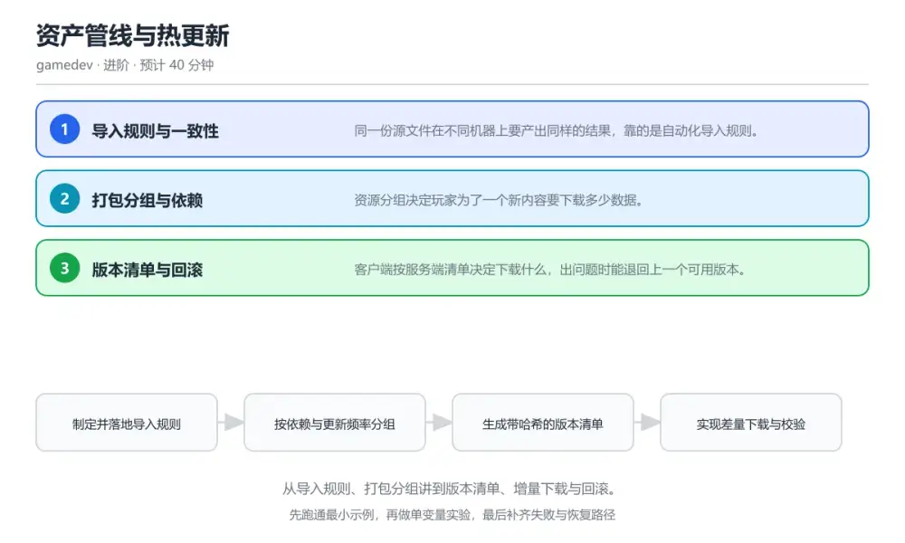
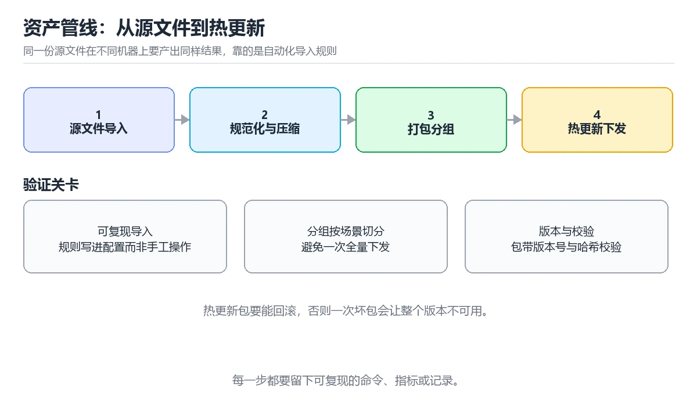

# 资产管线与热更新

> 内容更新时间：2026-10-06 · 学习阶段：intermediate · 预计用时：45 分钟



## 本节知识框架

想象你做了一个很好玩的手游，上线之后玩家越来越多。这时候你遇到了三个头疼的问题：

1. **美术资源太大了**——一个关卡的贴图、模型、音效加起来好几百 MB，玩家每次更新都要重新下载全部内容，流量吃不消。
2. **换台电脑打包就不一样了**——同事在他电脑上打出来的包，和你打出来的包，文件大小居然不一样，出了问题都不知道是谁的锅。
3. **更新出 bug 了，游戏直接打不开**——你推送了一个小更新，结果下载过程中断了，玩家手机上的资源变成了"新旧混杂"的半成品，游戏直接崩溃。

这一课就是来解决这三个问题的。我们会从「导入规则」讲起，经过「打包分组」和「版本清单」，最后到「增量下载」和「回滚」——这是一条完整的资产管线。

学完这一课，你会：
- 理解什么是导入规则，为什么它必须写成配置文件而不是靠手工设置
- 学会按功能和更新频率给资源分包，把共享资源抽到公共包
- 掌握版本清单的工作原理，知道怎么做增量下载和哈希校验
- 理解原子切换和回滚机制，保证玩家设备上始终有一份能用的资源

**先修与衔接**：本课是「图形与游戏开发」分类的第 6 课。没有专门的先修要求，但如果你了解基本的游戏开发流程会更好理解。下一课是《实体组件系统与性能剖析》。

### 复习清单

- [ ] 能说出导入规则、资源包、版本清单、差量下载、原子切换各自的含义
- [ ] 能按顺序描述一次完整的热更新流程
- [ ] 能指出"直接覆盖正式目录"这种做法的风险



## 核心概念定义

先认识几个核心名词，后面会反复遇到：

| 术语 | 一句话说明 |
| --- | --- |
| 导入规则 | 把源文件（比如 .png、.fbx）转换成游戏运行时能用的资产的自动化配置。 |
| 资源包 | 按依赖关系和更新频率打包的一组资产，玩家下载和加载的最小单位。 |
| 版本清单 | 一份索引文件，记录了每个资源文件的路径、哈希值和版本号，客户端靠它决定该下载什么。 |
| 差量下载 | 只下载与本地版本不同的文件，没变的不碰，省流量省时间。 |
| 原子切换 | 所有新资源下载校验完毕后，一次性切换到新版本，避免"更新到一半"的尴尬状态。 |

## 原理与运行机制

### 第一步：导入规则——让每台机器打出同样的包

你有没有遇到过这种事：同一份工程，在你电脑上打包一切正常，换到同事电脑上，打出来的包大小不一样，甚至运行效果也有差别。

问题出在哪？大概率是导入设置不一样。比如同一张纹理，你手动设成了 ASTC 压缩，同事忘了改，还是 RGBA32，出来的文件大小能差好几倍。

解决办法很简单：**把导入规则写成配置文件，跟工程一起放进版本管理**。这样不管谁、在哪台机器上构建，都会自动套用同一套参数。

```yaml
# 一个简化的导入规则配置文件示例
textures:
  - pattern: "Assets/Textures/UI/**/*.png"
    format: ASTC_6x6
    max_size: 1024
    generate_mipmaps: false
  - pattern: "Assets/Textures/Environment/**/*.png"
    format: ASTC_4x4
    max_size: 2048
    generate_mipmaps: true

models:
  - pattern: "Assets/Models/Characters/**/*.fbx"
    scale_factor: 0.01
    read_write_enabled: false
```

构建的时候，流水线自动读取这份配置，按规则处理所有源文件。最后把输出文件的哈希写进构建报告——下次换机器构建，哈希对得上，就说明导入规则生效了。

### 第二步：打包分组——让玩家少下载点东西

一个开放世界手游可能有几十个 GB 的资源。如果每次更新都让玩家下载全部内容，用户早跑了。

聪明的做法是**按功能和更新频率把资源分成多个包**：

- **基础包**：游戏启动必须的 UI、字体、音效，几乎不变，玩家只下载一次。
- **关卡包**：每个章节或关卡独立打包，玩家玩到哪下到哪。
- **公共包**：被多个关卡共享的贴图、模型，单独抽出来，避免重复打包。

把共享资源抽到公共包的主要好处就是**避免重复打包，减少下载量和内存占用**。假如一张通用贴图被 5 个关卡包都打了一份，玩家更新一个关卡就要下载 5 份同样的贴图——这显然不合理。

当然，分包也不是越细越好。分得太细会导致包数量爆炸，管理复杂度上升，而且有些资源在多个包里重复出现，反而增大了总体积。

```text
合理的分包策略：

基础包 (50 MB)     ← 启动必需，很少更新
公共包 (200 MB)    ← 被多个关卡共享的资源
关卡包_01 (150 MB) ← 第一章
关卡包_02 (180 MB) ← 第二章
活动包_春节 (300 MB) ← 限时活动，过期可删
```

工程上，把分组规则和体积阈值写进构建脚本。如果某个包超过了预设的大小上限，流水线直接报错，逼着开发者去优化。

### 第三步：版本清单——客户端怎么知道该下什么

服务端会维护一份**版本清单**（manifest），里面记录了每个资源文件的路径、哈希值和版本号。客户端本地也有一份自己的清单。

热更新的时候，客户端先把服务端的清单拉下来，跟本地清单逐项对比：

- 哈希一样 → 文件没变，跳过
- 哈希不一样 → 文件更新了，需要下载
- 本地没有 → 新增文件，需要下载

这样就实现了**差量下载**——只下载真正变化的部分。

```json
{
  "version": "1.2.3",
  "files": [
    {
      "path": "Assets/Textures/ui_icon_sword.png",
      "hash": "a3f2b8c1d4e5...",
      "size": 24576
    },
    {
      "path": "Assets/Models/char_warrior.fbx",
      "hash": "b7e9f2a1c3d8...",
      "size": 1048576
    }
  ]
}
```

### 第四步：下载、校验、切换——保证不出错

下载过程中什么都可能发生：网络中断、服务器出错、文件被篡改。所以每下载完一个文件，都要**校验它的哈希值**——跟清单里记录的一比对，不一样就说明文件有问题。

关键问题来了：校验失败怎么办？直接删掉所有资源重新下载？不行，玩家之前的版本就没了，游戏也打不开了。

正确做法是**回滚到上一份可用资源，并记录失败原因**。下载的新文件先写到一个临时目录，全部校验通过后再一次性切换到正式目录（这就是原子切换）。如果中途失败，临时目录直接丢弃，玩家的旧资源完好无损，游戏还能正常跑。

```text
热更新的完整流程：

1. 客户端拉取远端清单
2. 比对本地版本，生成差量下载计划
3. 逐个下载新文件，每下一个就校验哈希
4. 所有文件写入临时目录（不动正式目录）
5. 全部校验通过 → 原子切换（临时目录替换正式目录）
   任一校验失败 → 回滚（丢弃临时目录，保留旧版本，记录原因）
```

## 典型应用场景

### 场景 1：换机器打包结果变了

**现象**：你在一台机器上打包，纹理输出是 2 MB；换到另一台机器，同样的工程打出来是 8 MB。

**原因**：导入设置是手工配的，没有随工程管理。两个人的压缩格式、分辨率设置不一样。

**修复**：把导入规则写成配置文件，放进版本管理。构建在干净环境执行，输出哈希写进构建报告。以后不管谁打包，结果都一样。

### 场景 2：更新一个小关卡，下载量却很大

**现象**：你只改了一个小关卡里的一张贴图，结果玩家要下载 500 MB。

**原因**：资源分组太粗，这个关卡的贴图、模型、音效全打在一个包里，而且有些共享资源被重复打包了。

**修复**：按功能和更新频率细分资源包，共享资源抽到公共包。构建脚本里加上体积阈值检查，超标就报错。

### 场景 3：更新失败后游戏打不开

**现象**：推送更新后，部分玩家反馈游戏崩溃了，进不去。

**原因**：更新逻辑是边下载边覆盖正式目录，中途网络断了，本地资源变成了新旧混杂的半成品。

**修复**：先写临时目录，全部校验通过后再原子切换。失败时保留旧版本目录，记录切换原因。这样任何时刻玩家设备上都有能用的资源。

## 代码/协议/SQL 示例

### 资源更新的核心代码

下面是一段简化的热更新代码，展示了差量下载、哈希校验和原子切换的核心逻辑：

```csharp
// 资源更新：比对清单、差量下载、校验后原子切换
async Task<bool> UpdateAssets(Manifest remote, Manifest local) {
    var plan = remote.Diff(local);                 // 只下载哈希不同的文件
    long total = plan.Sum(f => f.Size);
    Debug.Log($"need {plan.Count} files, {total / 1024 / 1024} MB");

    foreach (var file in plan) {
        var data = await Download(file.Url, resumeFrom: LocalSize(file));  // 支持断点续传
        if (Hash(data) != file.Hash) {
            Rollback("hash mismatch: " + file.Path);   // 校验失败立即回滚
            return false;
        }
        WriteToStaging(file.Path, data);              // 先写临时目录
    }

    CommitStaging();   // 全部校验通过后一次性切换，避免半更新状态
    return true;
}
```

逐行解读：

- `remote.Diff(local)`：对比远端清单和本地清单，算出哪些文件需要更新。
- `Download(..., resumeFrom: LocalSize(file))`：支持断点续传，之前下了一部分的不从头来。
- `Hash(data) != file.Hash`：下载完立刻校验，哈希对不上就回滚。
- `WriteToStaging`：写入临时目录，不动正式目录。
- `CommitStaging()`：全部成功后才切换。

### 构建脚本中的体积检查

```python
# 构建脚本片段：检查资源包体积是否超过阈值
import os

BUNDLE_SIZE_LIMIT_MB = 200  # 单个包最大 200 MB

def check_bundle_sizes(build_output_dir):
    errors = []
    for bundle_name in os.listdir(build_output_dir):
        bundle_path = os.path.join(build_output_dir, bundle_name)
        if not os.path.isdir(bundle_path):
            continue
        total_size = sum(
            os.path.getsize(os.path.join(dp, f))
            for dp, _, fnames in os.walk(bundle_path)
            for f in fnames
        )
        size_mb = total_size / (1024 * 1024)
        if size_mb > BUNDLE_SIZE_LIMIT_MB:
            errors.append(f"{bundle_name}: {size_mb:.1f} MB exceeds limit")

    if errors:
        for e in errors:
            print(f"ERROR: {e}")
        raise SystemExit(1)
    print("All bundle sizes within limits.")
```

### 动手练一练

1. 假设你有 3 个关卡包，每个 300 MB，它们共享一套 100 MB 的 UI 资源。如果把这些 UI 资源分别打进每个关卡包，总下载量是多少？抽到公共包后呢？
2. 在上面 C# 代码中，如果把 `WriteToStaging` 改成直接写入正式目录，中途失败会怎样？
3. 尝试写一份简单的导入规则配置文件，给你的项目里的纹理按目录设定不同的压缩格式。

### 本课速查卡

| 复习项 | 本课要点 |
| --- | --- |
| 核心结论 | 导入规则保证一致性，分包减少下载量，版本清单驱动差量下载，原子切换保证安全。 |
| 关键流程 | 拉取清单 → 比对版本 → 差量下载 → 校验哈希 → 写临时目录 → 原子切换或回滚 |
| 最常见的错误 | 直接覆盖正式目录，中途失败导致资源损坏 |
| 出错先查什么 | 先看版本清单是否匹配，再看哈希校验日志，最后检查是否有回滚记录 |
| 怎么确认学会了 | 能完整描述热更新流程，能指出代码中的风险点 |

## 时间/空间复杂度或性能分析

资产管线的性能主要体现在三个方面：**构建时间、下载体积、内存占用**。

**构建时间**：导入规则越复杂（比如要生成多级 Mipmap、要做图集合并），构建越慢。但这是一次性开销，可以通过缓存和增量构建来优化。

**下载体积**：这是玩家最关心的。差量下载能把更新体积缩小到原来的几分之一。比如一个 500 MB 的关卡包，只改了一张贴图，差量下载可能只需要 2 MB。

**内存占用**：资源包分得越细，同时加载的包就越多，管理开销越大。但粗粒度的分包又会导致不必要的资源常驻内存。需要在两者之间找平衡。

**测量方法**：固定一个场景，先跑一次记录基线（构建时间、包大小、更新下载量），然后改变分包策略或导入参数再跑一次，对比差值。不要只看单次结果，多跑几次取平均值。

## 常见误区与易错点

| 容易犯的错误 | 会出现什么 | 怎么修 |
| --- | --- | --- |
| 导入设置靠手工配置 | 换台机器打包结果就变，构建不可复现 | 把导入规则写成配置文件，纳入版本管理 |
| 所有资源打在一个大包里 | 更新一小块内容也要下载全部内容 | 按功能和更新频率分包，共享资源抽到公共包 |
| 边下载边覆盖正式目录 | 中途失败会导致游戏无法启动 | 先写临时目录，校验通过后原子切换 |
| 下载后不做哈希校验 | 损坏的文件被悄悄使用，运行时崩溃 | 每个文件下载后立即校验哈希 |
| 校验失败后直接删除全部资源 | 玩家丢失已有的可用版本 | 回滚到上一份可用资源，记录失败原因 |
| 版本清单没有版本号 | 无法判断新旧，差量下载失效 | 清单必须带版本号，服务端保留多版本 |

### 重点讲两个最容易踩的坑

**坑 1：直接覆盖正式目录**

有些开发者写更新逻辑时图省事，下载完一个文件就直接覆盖到正式目录。看起来没问题，但一旦中途断网或闪退，本地资源就变成了"新文件写了一半、旧文件还剩一半"的状态——游戏启动时加载到不完整的资源，直接崩溃。

```csharp
// 错误做法：直接覆盖正式目录
foreach (var file in plan) {
    var data = await Download(file.Url);
    WriteToFormalDir(file.Path, data);  // 危险！中途失败就完了
}
```

```csharp
// 正确做法：先写临时目录，全部成功后再切换
foreach (var file in plan) {
    var data = await Download(file.Url);
    if (Hash(data) != file.Hash) {
        Rollback();
        return false;
    }
    WriteToStaging(file.Path, data);  // 写到临时目录
}
CommitStaging();  // 全部成功后一次性切换
```

**坑 2：共享资源重复打包**

一张通用 UI 贴图被 5 个关卡使用，如果每个关卡包都打了一份，玩家更新一个关卡就要下载 5 份同样的贴图。不仅浪费流量，还占内存。

解决办法：把被多个包共享的资源抽到一个公共包里。关卡包只包含自己独有的资源，公共包只下载一次。

## 与其他知识点的关系

- **先修**：了解基本的游戏开发流程，知道什么是资源导入和构建。
- **后续**：《实体组件系统与性能剖析》——资产管线的优化最终要反映在运行时性能上。
- **相关概念**：
  - **CDN 分发**：热更新的资源通常通过 CDN 下发，网络层的优化（比如压缩传输、边缘缓存）也影响更新速度。
  - **增量构建**：和差量下载类似，构建系统也只重新处理变化的资源，节省构建时间。
  - **资源加密**：版本清单里的哈希值除了校验完整性，还可以用于防止资源被篡改。

## 自测题与参考答案

> 先独立作答，再对照参考答案。

### 自测 1

不看正文，写出「导入规则」的含义，并说明它和「资源包」的区别。

**参考答案**：导入规则是把源文件（.png、.fbx 等）转换成游戏运行时能用的资产的自动化配置，通常以配置文件形式存在。资源包是按依赖关系和更新频率打包的一组资产，是玩家下载和加载的最小单位。两者的区别：导入规则解决的是"怎么把源文件变成游戏资产"的问题，资源包解决的是"怎么把资产组织起来方便下载和加载"的问题。

### 自测 2

换了一台电脑打包，结果文件大小不一样了。可能的原因是什么？怎么修？

**参考答案**：最可能的原因是导入设置没有随工程管理，不同机器上的手工配置不一样。修复方法：把导入规则写成配置文件（比如 YAML 或 JSON），放进版本管理。构建时在干净环境执行，把输出文件的哈希写进构建报告，这样就能验证不同机器的构建结果是否一致。

### 自测 3

描述一次完整的热更新流程，从客户端发起请求到更新完成。

**参考答案**：1) 客户端从服务端拉取最新的版本清单；2) 把远端清单和本地清单逐项对比，生成差量下载计划（哪些文件需要下载、哪些可以跳过）；3) 按计划逐个下载文件，每下载完一个就校验哈希值；4) 所有文件先写入临时目录，不动正式目录；5) 全部校验通过后，原子切换——把临时目录替换为正式目录。如果任一文件校验失败，丢弃临时目录，回滚到上一份可用资源，并记录失败原因。

### 自测 4

阅读下面这段代码，指出风险所在：

```csharp
foreach (var file in plan) {
    var data = await Download(file.Url);
    WriteToFormalDir(file.Path, data);
}
```

**参考答案**：风险在于直接覆盖正式目录。如果下载过程中网络中断或程序崩溃，本地资源就会处于"部分更新"的状态——有些文件是新的，有些还是旧的。游戏启动时加载到不一致的资源，很可能崩溃。正确做法是先写临时目录，全部下载并校验通过后再一次性切换。

### 自测 5

为什么要把共享资源抽到公共包？如果不这么做会怎样？

**参考答案**：共享资源如果不抽到公共包，就会被复制到每个引用它的资源包里，导致重复打包。玩家更新时要下载多份同样的数据，浪费流量和时间；运行时多个包同时加载，同一份资源在内存中存在多份，浪费内存。抽到公共包后，共享资源只打包一次、下载一次、加载一次。

## 术语速查

| 术语 | 一句话说明 |
| --- | --- |
| 导入规则 | 把源文件转换为运行时资产的自动化配置，写成配置文件随工程管理。 |
| 资源包 | 按依赖与更新频率打包的一组资产，是下载和加载的最小单位。 |
| 版本清单 | 记录文件路径、哈希与版本的索引文件，客户端靠它判断该下载什么。 |
| 差量下载 | 只下载与本地版本不同的文件，节省流量和时间。 |
| 原子切换 | 全部准备完成后一次性生效，避免中间状态导致资源损坏。 |
| 回滚 | 更新失败时退回到上一份可用资源，保证游戏能继续运行。 |
| 哈希校验 | 下载完文件后计算哈希值，与清单中的记录对比，确认文件完整性。 |

## 考点精讲

`资产管线与热更新` 的题库有 5 道题，下面逐题讲解。先自己试着作答，再核对答案和解析。

### 考点 1：第 1 题

- **题目**：\“把共享资源抽到公共包的主要收益是？\”
  - A. 减少美术制作投入，但这会引入新的复杂度
  - B. 让构建变慢
  - C. 避免重复打包，减少下载与内存占用
  - D. 提高贴图分辨率
- **答案**：C
- **解析**：共享资源（比如一张被多个关卡使用的 UI 贴图）如果不抽到公共包，就会在每个引用它的包里各存一份。结果就是：玩家更新任何一个包都要下载这份资源的副本，内存里也会同时存在多份。抽到公共包后，这份资源只打包一次、下载一次、加载一次，直接减少了下载量和内存占用。选项 A 说的\“减少美术制作投入\”不对——抽公共包反而增加了管理的复杂度；B 和 D 跟分包策略没有直接关系。

### 考点 2：第 2 题

- **题目**：\“下载校验失败后正确的处理是？\”
  - A. 忽略校验继续使用
  - B. 删除本地全部资源强制重下
  - C. 把版本号调高绕过校验
  - D. 回滚到上一份可用资源并记录原因
- **答案**：D
- **解析**：校验失败说明下载的文件不完整或被篡改，绝对不能继续使用（排除 A）。删除全部资源强制重下太激进，玩家之前的可用版本也没了（排除 B）。调版本号绕过校验是自欺欺人，问题还在（排除 C）。正确做法是回滚到上一份可用的资源，让游戏能继续运行，同时记录失败原因方便排查。

### 考点 3：第 3 题

- **题目**：\“以下哪些内容应纳入构建流水线？（多选）\”
  - A. 导入规则的自动化执行
  - B. 资源包体积阈值检查
  - C. 版本清单与哈希生成
  - D. 手工在个人机器上替换文件
- **答案**：A、B、C
- **解析**：构建流水线的核心目标是自动化和可复现。A（导入规则自动化执行）保证不同机器打包结果一致；B（体积阈值检查）防止某个包意外膨胀；C（版本清单与哈希生成）是差量下载和安全校验的基础。D（手工替换文件）恰恰是流水线要避免的——手工操作不可复现，也没有审计记录，出了问题无法追溯。

### 考点 4：第 4 题

- **题目**：\“请按一次热更新的顺序排列。\”
  - A. 客户端拉取远端清单
  - B. 比对本地版本生成差量计划
  - C. 下载并逐个校验哈希
  - D. 写入临时目录
  - E. 提交切换或失败回滚
- **答案**：A → B → C → D → E
- **解析**：热更新的流程是严格有序的。先拉清单（A），才知道远端有什么变化；再比对本地版本（B），算出哪些文件需要下载；然后逐个下载并校验（C），确保文件完整；下载的文件先写临时目录（D），不动正式目录；最后全部成功后提交切换，或者任一失败就回滚（E）。这个顺序保证了任何时刻玩家设备上都有可用的资源。

### 考点 5：第 5 题

- **题目**：\“阅读这段更新代码，风险是什么？\”
  - A. 直接覆盖正式目录，中途失败会让资源处于半更新状态
  - B. 下载速度过慢
  - C. 清单缺少版本号
  - D. 文件数量统计错误
- **答案**：A
- **解析**：这段代码的问题在于边下载边覆盖正式目录，没有临时目录做缓冲。一旦中途失败（断网、闪退、磁盘满），本地资源就变成了新旧混杂的状态——有些文件是新版，有些还是旧版，游戏启动时加载到不一致的资源就会崩溃。B、C、D 都不是这段代码的主要问题。正确做法是先写临时目录，全部校验通过后再原子切换。

## 内容元数据

- 内容版本：v2.0
- 最后更新：2026-10-06
- 学习阶段：intermediate
- 适用环境：Unity 2022+ / Unreal Engine 5+
- 内容来源：内置结构化课程与工程实践整理
- 相关主题：资产管线、打包分组、热更新、版本清单、增量下载

## 参考资料与复核

- 最后复核：2026-10-04
- 下次复核：2027-04-24
- 来源性质：官方文档、权威教材与工程实践整理

| 参考资料 | 本课用途 |
| --- | --- |
| [Unity 官方手册：资源包与 Addressables](https://docs.unity3d.com/Manual/AssetBundlesIntro.html) | 资源包分组与导入规则 |
| [Android 官方文档：Play Asset Delivery](https://developer.android.com/guide/playcore/asset-delivery) | 移动端资源分发与更新机制 |
| [Unity Addressables 包管理](https://docs.unity3d.com/Packages/com.unity.addressables@latest) | 版本清单与差量下载的引擎实现 |
