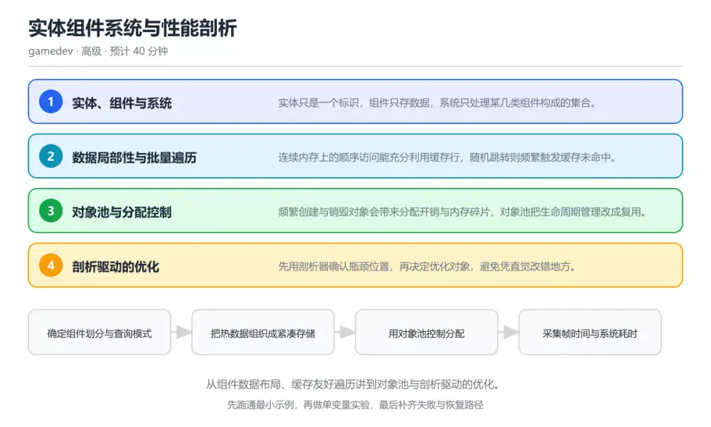
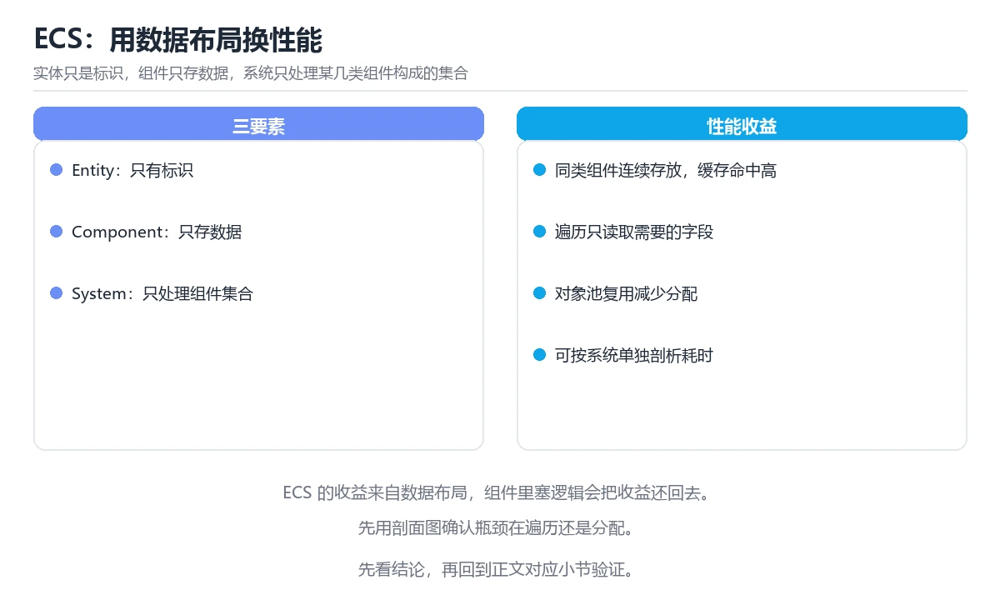

# 实体组件系统与性能剖析

> 内容更新时间：2026-10-06 · 学习阶段：高级 · 预计用时：30 分钟

你有没有想过，为什么有些游戏场景里几百个敌人同时移动也不卡，而另一些游戏几十个对象就开始掉帧？秘密往往藏在数据的组织方式里。这一课我们就聊聊 ECS（实体组件系统）是怎么组织游戏对象的，以及怎样用剖析器找到真正的性能瓶颈。

## 本节知识框架

这一课的主线是：先搞懂 ECS 三个核心概念，再理解数据布局为什么影响性能，最后学会用剖析数据指导优化。

**学完这一课，你应该能做到：**

- [ ] 用自己的话解释实体、组件、系统分别是什么，并各举一个游戏里的例子
- [ ] 说出为什么并列数组比指针数组更适合批量遍历
- [ ] 描述一次完整的剖析驱动优化流程：从采集数据到验证效果
- [ ] 识别对象池使用中至少两个常见错误



## 核心概念定义

先快速过一遍核心术语，后面会反复用到它们：

| 术语 | 一句话说明 |
| --- | --- |
| 实体（Entity） | 一个编号而已，不存任何数据——你可以把它想象成游戏世界里的身份证号 |
| 组件（Component） | 只存数据的结构体，比如位置、速度、血量，按类型分组存放 |
| 系统（System） | 读取特定组件、批量执行逻辑的函数，比如移动系统读取位置+速度 |
| 对象池（Object Pool） | 预先申请一批对象反复借用归还，避免运行时频繁 new/delete |
| 缓存行（Cache Line） | CPU 从内存搬数据的最小单位（通常 64 字节），决定了连续访问有多快 |
| 剖析器（Profiler） | 帮你测量每个函数、每帧花了多少时间的工具，是优化的指南针 |
| 帧时间直方图 | 把每一帧的耗时按区间归类统计出来的柱状图，专门用来逮偶发的长帧 |
| P99 尾延迟 | 第 99 百分位的帧耗时，代表"最差的 1% 有多差"，比平均值更贴近手感 |
| 热组件 / 冷组件 | 每帧都被系统读到的叫热组件（位置、速度），只在事件发生时才查的叫冷组件（血量、库存） |
| 组件掩码 | 用一个数的各个二进制位记录"这个实体拥有哪几种组件"，系统靠它快速筛选要处理的实体 |

## 原理与运行机制

### 第一步：理解 ECS 的分工

传统的面向对象写法里，一个敌人对象可能同时包含位置、动画、AI 逻辑、碰撞检测……所有东西揉在一起。ECS 的做法是把它拆成三块：

- **实体**：只是一个编号，比如 entity_id = 42。它不存数据，也不包含逻辑。
- **组件**：纯粹的数据。Position 组件只存 x、y；Velocity 组件只存 dx、dy。
- **系统**：纯粹的逻辑。移动系统读取所有同时拥有 Position 和 Velocity 的实体，批量更新位置。

打个比方：实体是酒店房间号，组件是房间里的家具，系统是保洁阿姨——她按清单打扫有特定家具的房间，不关心房间号本身。

### 第二步：数据布局决定性能

ECS 最大的性能优势来自缓存友好。现代 CPU 不是每次从内存取一个字节，而是一次搬一整块（64 字节的缓存行）。如果你的数据连续存放，CPU 预取器能提前把下一块搬到缓存里，访问速度可以差 10 倍以上。

**并列数组（好例子）**：把所有 Position 存一个数组，所有 Velocity 存另一个数组。遍历时按索引顺序访问，内存连续，缓存命中率高。

**指针数组（坏例子）**：每个对象散落在堆上，用指针串起来。遍历时指针跳来跳去，缓存频繁未命中，同样的计算量要花更多时间。

### 第三步：对象池减少分配开销

游戏里子弹、特效粒子这类东西创建销毁非常频繁。每次都 new 一块内存再 free，不仅慢，还会产生内存碎片。对象池的做法是：开局就申请好 1000 发子弹的内存，用的时候从空闲列表取一个，不用了还回来——只是改个索引，不涉及内存分配。

注意：归还时一定要重置所有字段！不然下一发子弹可能带着上一发的残余速度和标记。

### 第四步：用剖析数据指导优化

性能优化最忌讳的就是凭直觉。你觉得渲染最慢，结果剖析数据显示物理系统占了 60% 的时间。正确流程是：

1. 用剖析器采集帧时间和各系统耗时
2. 找到耗时占比最高的系统
3. 只改一个变量，重新测量
4. 在发布构建上验证优化效果

记住：调试构建里有断言和日志，性能数据不能代表真实情况，一定要在发布构建上复核。

```text
采集帧时间与系统耗时 → 定位耗时占比最高的系统 → 只改一个变量后重新测量 → 在发布构建上复核优化效果
```



### 第五步：为什么"组件只存数据"是硬规矩

如果 `Health` 结构体里塞了一个 `takeDamage()` 方法，还会牵出三个连锁问题：方法通常带虚表指针，对象就不再是紧凑的纯数据块，没法连续排进数组；逻辑绑死在组件上，同一个"扣血"规则想给敌人和玩家复用就得继承来继承去；最要命的是遍历顺序由对象自己决定，CPU 预取器帮不上忙。

把行为挪到系统里之后，规则变成"数据形状归组件，处理策略归系统"：想改伤害公式，只动一个战斗系统；想给某种敌人加特殊反应，加一个 `Stun` 组件让系统按掩码分支，而不是新增一个类。**组件是名词，系统是动词**，这条分工一旦破，ECS 就退化成了披着外壳的面向对象。

### 第六步：系统怎么知道该处理哪些实体

每个实体维护一张"我有哪些组件"的清单（位掩码或 archetype 索引），系统在注册时声明自己关心的组合，比如移动系统要 `Position + Velocity`。运行时真正的遍历发生在组件数组上：拥有该组合的实体的 Position 被排在同一段连续内存里，系统只要按索引扫这一段。

这就是为什么"多加一个组件"的代价不总是线性的：新组件会让原本同组的实体分裂成两组，数组被拆开、系统迭代次数增加。反过来说，把总是一起读的 `Position` 和 `Velocity` 合成一个 `Transform2D { float x, y, dx, dy; }` 存成一整段，通常能省掉一半的地址跳转。合并还是拆分，判据只有一个：**它们是否总在同一批循环里被一起访问。**

### 第七步：给缓存行算一笔账

一个 `Position { float x, y; }` 是 8 字节。CPU 一次搬运一条 64 字节的缓存行，于是**一次内存往返就顺手带回了 8 个实体的位置**。500 个实体的位置数组只占约 4KB，很可能整个都待在 L1/L2 里，读一次只要几个时钟周期。

同样 500 个敌人如果各自是堆上独立的对象，你拿到的是一个指针数组：指针本身连续，但 500 个对象散落在几 MB 的随机地址上。每读一个对象都可能触发一次内存往返，几十到上百个周期就没了，而且会把顺带预取进来的邻居白白丢掉。两次遍历做的**算术量完全一样**，差别全在"数据是不是挨着放"。

### 第八步：平均帧时间会骗人

60fps 的帧预算是 16.7 毫秒。假设 1000 帧里有 990 帧只用 8 毫秒、10 帧用了 200 毫秒，平均下来是 9.9 毫秒，看起来非常健康，玩家却会明确感到十次"顿一下"。剖析时把平均值和 P99、最坏单帧一起看，再点开那些长帧看它们内部谁在耗时，才能抓到来去匆匆的元凶——GC 瞬间、贴图首次解压、池扩容都属于这类只在长帧里露面的问题。

## 典型应用场景

### 场景一：大量敌人的移动更新

假设场景里有 500 个敌人需要每帧更新位置。用 ECS 的方式，移动系统只需要遍历 Position 数组和 Velocity 数组，按索引一一相加。数据连续存放，CPU 缓存命中率极高，500 个敌人的更新可能只需要不到 1 毫秒。

### 场景二：子弹管理

子弹是典型的短生命周期对象。用对象池管理：开局预分配 2000 发子弹，玩家射击时从池中取出一发、设置初始位置和速度，子弹飞出屏幕后归还到池中。整个过程没有 new/delete，帧率稳定。

### 场景三：定位帧率波动

游戏偶尔卡顿，但不知道卡在哪里。用剖析器录制 15 分钟的帧时间直方图，看 P99（第 99 百分位）对应的帧——那一帧里哪个系统耗时异常？定位到具体系统后再针对性优化，而不是到处乱改。

### 场景四：为对象池定容量

弹幕游戏里同屏最多出现过 1800 发子弹，玩家一旦开大还会瞬间翻倍。池容量不能拍脑袋：先跑一遍压力最大的关卡，记录每帧"已占用槽位数"的曲线，取峰值再上浮 20% 作为预分配量（这里就是 2160 左右）。曲线如果出现"顶到上限后立刻回落"的锯齿，说明池子被榨干了，此时行为要提前定好——是丢弃最老的子弹，还是允许临时扩容？允许扩容就把扩容代码写在加载阶段，绝不能让它发生在战斗中的一帧里，那正是长帧的来源。

### 场景五：系统执行顺序造成的隐性耦合

移动系统、碰撞系统、渲染系统在同一帧里按注册顺序跑，顺序一变结果就变。举例：先做碰撞再做移动，敌人会贴着墙卡住一帧才挤开；先移动再碰撞，表现就正常。这类 bug 剖析器看不出来（每个系统都不慢），只能靠"同一份初始状态跑两遍录屏对比"。实践做法是把顺序当成显式配置写在一处并加注释，禁止散落在各文件的构造里；每改一次顺序都要重新采集一次帧数据，因为顺序调整常常同时改变缓存访问模式。

### 场景六：只在需要时更新冷组件

血量、耐力、背包这些组件一秒钟才变一次，却被写进了每帧遍历的循环里，等于白白读了 500 次内存。改法是给这类数据挂一个"脏标记"组件或用事件队列，系统只遍历被标脏的那几十条；处理完立刻清标记。这就是冷热分离的具体形态：**热数据每帧连续扫，冷数据按需稀疏访问。**

## 代码/协议/SQL 示例

下面是一段典型的 ECS 移动系统伪代码，展示了并列数组的遍历方式和对象池的基本用法：

```cpp
// 组件定义：只存数据
struct Position { float x, y; };
struct Velocity { float dx, dy; };

// 并列数组：同类数据连续存放
std::vector<Position> positions;
std::vector<Velocity> velocities;

// 移动系统：按索引顺序遍历，缓存友好
void move_system(float dt) {
    size_t count = std::min(positions.size(), velocities.size());
    for (size_t i = 0; i < count; ++i) {
        positions[i].x += velocities[i].dx * dt;
        positions[i].y += velocities[i].dy * dt;
    }
}

// 对象池：取出和归还只操作索引
class BulletPool {
    std::vector<Bullet> bullets;
    std::vector<size_t> free_list;
public:
    Bullet* acquire() {
        size_t index = free_list.back();
        free_list.pop_back();
        return &bullets[index];
    }
    void release(Bullet* bullet) {
        bullet->reset();  // 关键：归还前重置所有字段
        free_list.push_back(bullet - bullets.data());
    }
};
```

### 冷组件的稀疏更新

上面的移动系统每帧扫全部实体，而血量这类低频数据不适合这么干：

```cpp
struct Health { float hp, maxHp; };   // 纯数据，没有任何方法

std::vector<Health> healths;          // 冷组件单独一组存储
std::vector<size_t> dirty;            // 只有变化的下标排队处理

void apply_damage(size_t entity, float amount) {
    healths[entity].hp -= amount;
    dirty.push_back(entity);          // 打标记，不立刻做后续逻辑
}

void health_system() {
    for (size_t i : dirty) {
        if (healths[i].hp <= 0.f) kill_entity(i);
    }
    dirty.clear();                    // 别忘了清空，否则下帧重复处理
}
```

对比一下遍历量：500 个敌人里每帧真正受伤的通常只有几个，稀疏更新把工作量从"每帧 500 次读"降到"每帧几次读"。代价是 `dirty` 里的下标是跳着访问的，缓存不友好——所以只有当组件真的冷、更新真的稀疏时才值得，把热组件也这么写反而更慢。

### 采集剖析数据并核对结论

```cpp
struct FrameStats {
    float ms[1024];
    size_t n = 0;
    void add(float v) { if (n < 1024) ms[n++] = v; }
    float percentile(float p) const {    // 简化版：先排序再取分位
        std::vector<float> s(ms, ms + n);
        std::sort(s.begin(), s.end());
        return s[std::min<size_t>(s.size() - 1, size_t(p * s.size()))];
    }
};
// 每帧结束处调用 stats.add(frameEndTime - frameStartTime);
// 跑完 15 分钟后打印 平均值、P99 与最大值三个数一起看
```

这段代码的用意不在精度，而在于强调"三个数一起看"：只看平均会漏掉卡顿，只看最大会被单个离群值带偏。采集环境也要固定——同一台设备、同一构建配置、同一场景与实体数量，只改一个变量再跑一遍，否则你无法确认收益是不是来自那次修改。

## 时间/空间复杂度或性能分析

ECS 的性能优势主要体现在批量遍历上。我们来对比一下两种方式：

- **并列数组遍历**：顺序访问连续内存，缓存命中率接近 100%。500 个实体的位置更新大约 0.5-1 毫秒（取决于平台）。时间复杂度 O(n)，但常数因子很小。
- **指针数组遍历**：每次访问都可能缓存未命中，延迟从几纳秒跳到几十纳秒。同样 500 个实体可能需要 3-5 毫秒。

对象池的收益体现在分配次数上：没有池的时候每秒可能分配/释放上千次，有了池之后降为零。代价是池需要预占内存，所以要统计峰值使用量来合理设置池容量。

剖析本身的开销通常很小（帧时间增加不到 5%），但要注意只在发布构建上采集最终数据，调试构建里的断言和日志会严重扭曲结果。

### 两种剖析方式的成本不一样

**采样式**剖析器每隔一小段时间（比如 1 毫秒）抓一次调用栈，开销几乎恒定，适合在真机上长时间开着看趋势，缺点是只能给出"某个函数出现在采样里多少次"这种统计结论，短函数容易被漏掉。**插桩式**则在每个测量区间的入口出口各埋一次计时，能拿到精确的微秒数和调用层次，代价是每次埋点都有成本，把区间切得过细（一帧埋几千个）时，仪器本身就能把帧拖长。合理用法是：先用采样定位到大方向，再用少量粗粒度插桩（每个系统一个区间）量化改动收益。

### 池容量的时间与空间账

预分配 2000 发子弹，意味着开局就占住 2000 × sizeof(Bullet) 的内存——一个 32 字节的子弹结构大约是 64KB，在桌面端无所谓，在低端手机上就要掂量。换来的是运行期零分配：`acquire()` 和 `release()` 都只是在空闲列表两端 push/pop，恒定时间。判断要不要上池，看的不是"对象大不大"，而是**每秒创建销毁的次数**：每秒几十次的敌人刷新用不用都行，每秒上千次的子弹与粒子不池化就会把帧时间喂给分配器。

### 数据布局收益有天花板

并列数组让遍历从"每次访问都可能未命中"变成"顺序流式读取"，实测常见的一档差距是 3 到 8 倍；但一旦系统瓶颈变成带宽或分支预测，继续合并组件就不会再有收益，反而让代码更难维护。判断饱和的办法很朴素：同一份改动前后各测三次，把 P99 的中位数列出来，若差异小于测量抖动，就到此为止，把精力挪去剖析报告里的下一个热点。

## 常见误区与易错点

| 错误 | 现象 | 修法 |
| --- | --- | --- |
| 凭直觉优化热点 | 花了一天重写某个系统，结果帧率没变——因为瓶颈根本不在这里 | 先用剖析器采样，找到耗时占比最高的系统再动手 |
| 组件散落在堆上用指针遍历 | 遍历指针数组时缓存频繁未命中，帧率随实体数量线性下降 | 把热组件改成并列数组或紧凑结构，让数据连续存放 |
| 对象池归还时不重置状态 | 新子弹带着上一发的残余速度，飞行轨迹诡异 | 归还时统一调用 reset() 清空所有字段 |
| 在调试构建上做性能判断 | 调试构建测出来物理系统最慢，发布构建后才发现是日志 IO | 最终性能数据必须在发布构建（Release）上采集 |
| 组件划分过细 | 一次遍历要拼接十几个小数组，索引开销反而超过了数据本身 | 把经常一起访问的组件合并到同一组存储里 |
| 把冷组件也塞进每帧遍历 | 血量、背包一秒才变一次却被读了几百次，帧时间被无效内存访问吃掉 | 用脏标记或事件队列做稀疏更新，只处理真正变化的那几条 |
| 只看平均帧时间下结论 | 平均值很漂亮，玩家却反复感到卡顿 | 平均值、P99、最坏单帧三个数一起看，长帧单独展开 |
| 在开发机或编辑器里定优化结论 | 编辑器自带绘制与调试开销，改完在真机上收益全无 | 目标平台的发布构建上重新采集，改动前后各测三遍 |
| 池顶到上限时才现场扩容 | 扩容发生在开大的一瞬间，直接制造一个长帧 | 按压力测试的峰值预分配，扩容逻辑留在加载阶段 |
| 为了"更 ECS"把每个字段拆成一个组件 | 系统要跨七八个数组同步索引，代码量与缓存跳跃同时上升 | 以访问模式为单位分组，总在一起读的字段就放同一个结构 |

## 与其他知识点的关系

ECS 不是孤立的知识点，它和很多主题都有联系：

- **游戏循环与帧时间**：ECS 系统的执行顺序由游戏循环驱动，帧时间预算决定了每个系统能用多少时间。
- **移动端性能与功耗优化**：在手机上，缓存未命中不仅影响帧率还增加功耗，ECS 的数据布局优化一举两得。
- **内存管理**：对象池是内存管理策略的一种，和分配器、内存对齐等概念紧密相关。
- **数据导向设计（DOD）**：ECS 是 DOD 思想在游戏领域的典型实践，核心都是让数据布局适配硬件特性。

**本课的两条主线怎么汇合**：ECS 负责把数据摆成适合扫描的形状，剖析负责告诉你"摆成这样到底有没有用"。只学布局不测量，容易为了合并组件而合并；只学测量不用 ECS，热点找到了也没有趁手的手段去改。所以每次布局改动都应当对应一次前后对照的采集，两个数字都记在同一页上。

**与相邻课的衔接**：《游戏循环与帧时间》给了"16.7 毫秒"这个预算，本课的移动系统与稀疏更新就是在这个预算里分配时间；《内存管理与分配器》解释了对象池为什么能省掉分配成本；《移动端性能与功耗》则把缓存命中率换算成电——同一次未命中在手机上不仅是几纳秒，还是电池上的一点点消耗。

## 自测题与参考答案

**自测 1**：ECS 中，实体是什么？

参考答案：实体只是一个编号（标识），不携带任何数据。就像酒店房间号只标识房间，本身不是家具。

**自测 2**：为什么要把组件存成并列数组而不是指针数组？

参考答案：并列数组让同类数据连续存放在内存中，遍历时 CPU 缓存命中率高。指针数组在堆上跳来跳去，缓存频繁未命中，同样的计算量要花更多时间等待内存。

**自测 3**：对象池归还对象时，最重要的一步是什么？

参考答案：重置所有字段。如果不清理上一轮的状态（速度、标记等），复用的对象会带着脏数据，导致各种奇怪的 bug。

**自测 4**：性能优化的第一步应该做什么？

参考答案：用剖析器采集数据。不要凭直觉猜哪里慢，先测量帧时间和各系统耗时，找到真正的瓶颈再动手。

## 考点精讲

下面逐题讲解，帮你把每道题的知识点吃透。建议先自己做一遍，再看解析。

### 考点 1

**题目**：“ECS 中组件的设计原则是什么？”
- A. 只存数据，不写行为
- B. 同时保存数据与业务逻辑
- C. 每个组件都继承同一个基类
- D. 组件必须包含渲染代码

**答案**：A

**解析**：ECS 的核心思想是数据与行为分离。组件只负责存储数据（比如位置、速度），不包含任何逻辑。行为由系统来执行。这样设计的好处是同类组件可以连续存放，方便 CPU 缓存批量读取。如果组件里塞了业务逻辑或渲染代码，就没法做到数据连续和灵活组合了。

### 考点 2

**题目**：“并列数组比指针数组更适合批量遍历的原因是什么？”
- A. 可以自动并行执行
- B. 顺序访问连续内存
- C. 占用的总内存一定更少
- D. 不需要索引就能访问元素

**答案**：B

**解析**：并列数组把同类型数据连续存放在内存中，遍历时按索引顺序访问，CPU 缓存预取器能高效工作。指针数组虽然也能遍历，但每个指针指向的对象可能散落在堆的不同位置，每次访问都可能触发缓存未命中。注意 C 选项说“一定更少”太绝对——并列数组可能因为对齐而浪费一些空间，优势在于访问模式而非总量。

### 考点 3

**题目**：“以下哪些做法属于剖析驱动的优化？（多选）”
- A. 用采样数据确认耗时占比最高的系统
- B. 采集帧时间直方图观察 P99
- C. 按代码行数判断哪里最慢
- D. 在发布构建上验证优化前后的差异

**答案**：ABD

**解析**：剖析驱动的核心是“先测量，再修改”。A 是采样定位热点，B 是分析尾延迟分布，D 是在真实环境下验证效果——这三步都是数据驱动的。C 按代码行数判断是最常见的直觉陷阱：代码多不代表执行慢，一个 10 行的矩阵运算可能比 100 行的 UI 逻辑慢 100 倍。

### 考点 4

**题目**：“请按一次剖析驱动的优化流程排列步骤。”
- A. 在发布构建上复核优化效果
- B. 采集成帧时间与系统耗时
- C. 定位耗时占比最高的系统
- D. 只改一个变量后重新测量

**答案**：BCDA

**解析**：正确顺序是先采集数据（B），再定位热点（C），然后只改一个变量重新测量（D），最后在发布构建上复核（A）。这个顺序的关键在于：每次只改一个变量才能确定收益来自哪里；最终必须在发布构建上验证，因为调试构建的数据不可靠。

### 考点 5

**题目**：“阅读这段 ECS 遍历代码，下面哪项判断是正确的？”
- A. 位置与速度存成并列数组，遍历按索引顺序访问连续内存
- B. 每次循环都会重新分配数组
- C. 对象池在运行期反复申请内存
- D. 遍历顺序由哈希表决定，因此无法预测

**答案**：A

**解析**：这段代码把 Position 和 Velocity 分别存在两个数组里，遍历时按索引 i 从 0 递增访问，内存地址连续，缓存预取有效。B 错误——数组在循环外分配好了，循环内只是读写。C 错误——对象池的取出和归还只操作索引，不涉及运行期内存分配。D 错误——遍历用的是数组索引，顺序完全可预测。

## 术语速查

快速回顾本课涉及的核心术语：

| 术语 | 一句话说明 |
| --- | --- |
| 实体（Entity） | 游戏世界里的唯一编号，只标识不存数据 |
| 组件（Component） | 纯数据结构，按类型分组连续存放 |
| 系统（System） | 读取特定组件组合、批量执行逻辑的函数 |
| 对象池（Object Pool） | 预分配对象并复用，避免运行时频繁分配释放 |
| 缓存行（Cache Line） | CPU 与内存间数据传输的最小单位，通常 64 字节 |
| 剖析器（Profiler） | 测量函数和帧耗时的工具，优化前必须先用它 |
| 帧预算（Frame Budget） | 每帧可用的时间上限，比如 60fps 对应约 16.7 毫秒 |
| 数据局部性（Data Locality） | 让相关数据在内存中相邻存放，提高缓存命中率的设计原则 |
| 插桩式剖析 | 在测量区间首尾埋计时点，数字精确但每次埋点都有开销 |
| 采样式剖析 | 周期性抓取调用栈，开销平稳，只能给出统计意义上的热点 |
| 脏标记 | 记录"这条数据变了"的标志位，让低频组件只做稀疏更新 |
| 长帧 | 明显超出帧预算的那一帧，往往就是玩家感觉到的卡顿 |

## 内容元数据

- 内容版本：v2.0
- 最后更新：2026-10-06
- 学习阶段：高级

| 字段 | 值 |
| --- | --- |
| 课程 ID | `gamedev_ecs_profiling` |
| 所属分类 | `gamedev` |
| 难度 | intermediate |
| 预计用时 | 45 分钟 |
| 关键词 | ECS、数据局部性、对象池、剖析器、帧预算 |
| 配图 | `images/lesson_gamedev_ecs_profiling.webp` |
| 参考资料 | 3 条 |
| 内容更新时间 | 2026-10-06 |

## 参考资料与复核

- 最后复核：2026-10-04
- 下次复核：2027-04-24
- 复核范围：ECS 框架版本兼容性、剖析器 API 行为与工程实践

下面这些资料可以用来核对课内结论，复习时对照阅读效果更好：

- [ECS FAQ — Sander Mertens](https://github.com/SanderMertens/ecs-faq)
- [Unity Entities 官方文档](https://docs.unity3d.com/Packages/com.unity.entities@1.0/manual/index.html)
- [Game Programming Patterns: Component](https://gameprogrammingpatterns.com/component.html)
