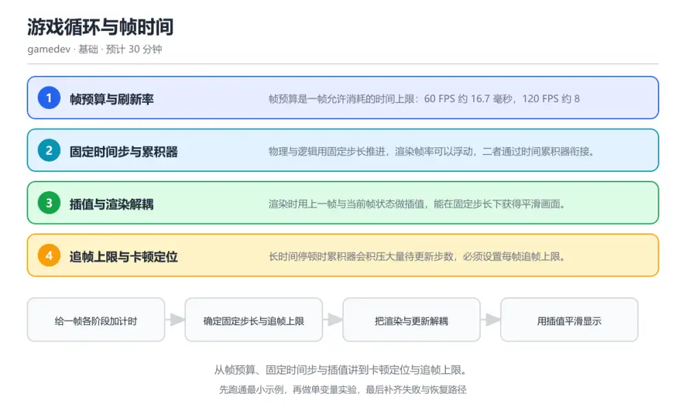

# 游戏循环与帧时间

> 内容更新时间：2026-10-06 · 学习阶段：基础 · 预计用时：30 分钟



想象你在翻一本手绘动画本：每一页就是一帧，你翻得多快，动画就有多流畅。游戏也是同理——引擎不停地"翻页"，每一页里要完成"听输入、算物理、画画面、交给显示器"这一整套动作，这套动作就是游戏循环。而"帧时间"就是你翻一页能花多久。翻得太慢，玩家就会觉得卡；翻得太快但时间忽长忽短，画面就会抖。这节课我们就从最直觉的"一帧该花多久"出发，一步步搞懂固定时间步、累积器、插值和追帧这些概念，让你以后写游戏循环时心里有数。

## 本节知识框架

这节课的主线很简单：先搞清楚一帧有多少时间可以花（帧预算），再学会让物理用固定步长跑（固定时间步），然后用累积器把真实时间和模拟时间接起来，接着用插值让画面丝滑，最后学会定位卡顿。

复习清单：

- [ ] 能口述"60 FPS 下一帧只有约 16.7 毫秒"这个数是怎么算出来的，以及它为什么重要。
- [ ] 能画出一帧内的典型流程：采集输入 → 更新逻辑 → 插值渲染 → 呈现画面。
- [ ] 能解释累积器、插值、追帧上限各自解决什么问题，以及三者之间的因果关系。
- [ ] 能说出至少两种让游戏卡顿的常见原因，并给出对应的排查手段。

## 核心概念定义

| 术语 | 一句话说明 |
| --- | --- |
| 帧预算 | 一帧允许花掉的时间上限，由目标帧率决定。比如 60 FPS 对应约 16.7 毫秒，120 FPS 对应约 8.3 毫秒。 |
| 固定时间步 | 物理和逻辑用固定的时间间隔推进，不管实际渲染帧率怎么波动，模拟结果都一致。就像节拍器，不管外面多吵，它自己按固定节奏走。 |
| 累积器 | 一个"攒时间"的小罐子：每帧把真实经过的时间倒进去，攒够一个固定步长就执行一次更新。它让物理推进次数和帧率彻底脱钩。 |
| 插值 | 渲染时根据"当前时刻落在两次更新之间的比例"，对前后两个状态做加权平均，让画面看起来平滑。就像在两帧关键帧之间补出过渡画面。 |
| 追帧 | 当累积器里攒了太多时间（比如卡了一下），在一帧内补跑多次更新来追上真实时间。但必须设上限，否则会越追越慢。 |
| 刷新率 | 显示器每秒刷新画面的次数。开了垂直同步后，游戏必须在下次刷新前把一帧准备好，否则就会出现撕裂或掉帧。 |
| 时间差（dt） | 相邻两帧之间真实过了多久，从渲染时钟读出来。它只负责喂累积器，不能直接交给物理。 |
| 状态快照 | 每次固定步长更新前留下的那份旧数据，插值时拿它和新状态加权，代价是多存一份物体信息。 |

## 原理与运行机制

### 一帧的时间从哪来？

先想一个最基本的问题：如果你的游戏目标是 60 FPS，那一帧有多少时间可以用？答案很简单——1 秒除以 60，大约 16.7 毫秒。这 16.7 毫秒就是你这帧的"预算"，采集输入、跑物理、算 AI、画画面全都要挤在这里面。超了怎么办？要么掉帧（画面晚一拍才出来），要么画面撕裂（显示器只画了一半你就交了新帧）。

你可以把帧预算想象成一个月的生活费：总共就这么多，吃饭、交通、娱乐都得在里面分配。如果某一项花超了，其他就得压缩，或者干脆透支。

### 为什么物理要用固定时间步？

假设你用每一帧的真实耗时去推进物理：这一帧花了 20 毫秒，下一帧花了 10 毫秒。物理引擎拿到的时间步长忽大忽小，结果就是同一个场景跑两次，小球弹跳的轨迹可能不一样。这在单机游戏里可能只是"手感不稳"，在联机游戏里就是"不同玩家看到的世界不一样"。

解决办法很直觉：物理引擎别管你渲染多快，它自己按固定节拍走。比如每 1/60 秒推进一步，不管外面帧率是 30 还是 120，物理世界都是确定性的。这就是固定时间步。

### 累积器：真实时间和模拟时间之间的翻译官

固定时间步听起来很美，但现实是渲染帧率不可能刚好等于 60 FPS。那怎么把"不规律的帧时间"和"规律的物理步长"对接起来呢？答案是累积器。

做法特别简单：每帧开始时，把这一帧实际经过的时间 dt 加到 accumulator 里。然后用一个 while 循环，只要 accumulator 攒够了一个步长（比如 1/60 秒），就执行一次物理更新，同时把步长从 accumulator 里减掉。这样不管帧率怎么波动，物理总是按固定步长推进的。

打个比方：累积器就像一个水桶，水龙头（真实时间）以不稳定的速度往里灌水，而物理更新就是一个固定大小的杯子，每攒满一杯就舀走一杯去"用"。

### 插值：让画面不再一抖一抖

固定时间步加累积器解决了物理确定性的问题，但带来一个新麻烦：渲染时刻不一定刚好落在物理更新的时间点上。如果直接拿最新的物理状态来画，画面就会在两次更新之间"跳"。

解决办法是插值。在累积器的 while 循环结束后，accumulator 里剩下的时间除以步长，就得到一个 0 到 1 之间的比例 alpha。渲染时用上一帧状态和当前状态按 alpha 做加权平均，就能得到一个"刚好在中间"的平滑位置。

注意：插值结果只给渲染看，绝对不能写回物理状态。否则渲染误差就会污染物理世界，越积越歪。

### 追帧上限：防止死亡螺旋

想象一个场景：玩家切出去看了一会儿网页，切回来时累积器里攒了好几秒的时间。如果没有保护，while 循环会一口气追几十次甚至几百次更新，这一帧直接卡死，然后下一帧又要追更多——这就是所谓的"死亡螺旋"。

解决办法是设一个每帧追帧上限（比如最多追 5 次）。超出的时间直接丢弃并记录下来。虽然物理时间会和真实时间有一点偏差，但至少游戏不会卡死。

### 一帧的典型流程

把上面的概念串起来，一帧从开始到结束的典型顺序是：

```text
采集输入 → 按固定步长更新物理与逻辑 → 插值后渲染 → 呈现并等待垂直同步
```

1. 先采集玩家的键盘、鼠标、手柄输入。
2. 把 dt 累加到 accumulator，然后按固定步长循环更新物理和逻辑。
3. 算出插值比例 alpha，用前后两个状态做插值渲染。
4. 把画面交给显示器，等待下一次垂直同步。

### 步长选多大，取决于最快的物体能跑多远

穿墙不是运气问题，而是能算出来的。两次更新之间物体走的距离约等于速度乘以步长：一颗 500 单位/秒的子弹，步长 1/30 时一步走 16.7 单位，1/60 时走 8.3 单位，1/120 时走 4.2 单位。墙厚若是 5 单位，前两种都会让它穿过去，因为两次采样正好落在墙的两侧。选步长时反过来问：最大速度是多少，最薄的碰撞体有多厚，要求"最大速度 × 步长"小于那层厚度的一半。全局步长减半确实能解决，但物理成本也翻倍，更常见的做法是步长不动，只给高速物体补一次射线检测。

### 垂直同步、限帧器、累积器是三件事

三者都会改变帧率，但只有最后一个影响模拟结果：垂直同步决定什么时候把画面交给显示器，限帧器决定什么时候允许开始下一帧，累积器决定这一帧里物理跑几次。想确认循环稳不稳有个便宜实验：把帧率分别限到 30、60、120，只改限帧和垂直同步、不动步长，再看小球在固定真实时间后停在哪。三处一致说明物理确实与帧率脱钩；不一致，问题在累积器或步长上。

### 用"匀速观察法"确认 alpha 有没有算错

alpha 写成 dt 除以步长时，取值会在 0 到几之间乱跳，症状很典型——运动方向没错，位置却逐帧来回打摆。调插值不必先上打印：让小球匀速走直线十几秒，盯住它就够，顺滑是对的，来回抖的就是 alpha 算错了。

## 典型应用场景

**场景一：动作游戏的手感调校**

动作游戏对帧时间特别敏感。如果物理步长不稳定，角色跳跃的高度可能每次都不一样，玩家会觉得"手感飘"。用固定时间步加累积器，就能保证跳跃轨迹完全确定，手感一致。

**场景二：联机游戏的确定性模拟**

联机游戏里，不同玩家的帧率可能天差地别。如果大家都用固定时间步，那同样的输入序列跑出来的结果一定相同，这就是"确定性模拟"的基础。累积器负责把网络延迟带来的帧时间波动消化掉。

**场景三：移动端省电降帧**

手机发热时系统会降频，帧率可能从 60 掉到 30。有了固定时间步和累积器，物理模拟不受帧率影响，游戏逻辑不会出错。配合插值，画面依然平滑，只是更新频率低了而已。

**场景四：回放与录像系统**

因为固定时间步让模拟结果与帧率无关，只要记录输入序列和随机种子，就能精确重放一局游戏。这在竞技游戏的回放系统和 Bug 复现中非常有用。

**场景五：切后台与长时间挂起的结算**

手机切后台、PC 最小化，回到前台时 dt 可能是好几秒。这段时间要拆成两类处理：实时推进的部分（波次倒计时、掉落计时器）应该丢掉并写一条日志，同时在存档里明确记"这段时间世界没有被模拟"，别让读档逻辑以为进度正常；带真实时间语义的部分（Buff 还剩 12 秒、活动几点结束）必须按挂钟单独结算，不能跟着累积器一起被扔掉。两类时间分开走，才不会出现"切出去一趟 Buff 全没了"或"倒计时被冻住十分钟"。

**场景六：慢动作与倍速快进**

慢动作别去改 STEP——步长一变，碰撞精度和确定性全跟着变，慢镜头里反而穿墙。做法是步长不动，只改每帧喂进累积器的真实时间比例：慢动作喂 0.25 倍，8 倍快进就喂 8 倍。代价是快进时一帧要追的步数成倍增加，所以 MAX_STEPS 必须按最大倍速一起放大，否则快进段会大量丢时间，逻辑明显比画面慢半拍。

## 代码/协议/SQL 示例

下面是一个最小但完整的游戏循环实现，涵盖了固定时间步、累积器、追帧上限和插值：

```python
STEP = 1 / 60          # 固定步长：物理与逻辑按 60 Hz 推进
MAX_STEPS = 5          # 每帧最多追 5 步，避免死亡螺旋

def frame(dt, state):
    state.accumulator += dt
    steps = 0
    while state.accumulator >= STEP and steps < MAX_STEPS:
        previous = state.snapshot()
        state.step(STEP)               # 固定步长更新物理
        state.accumulator -= STEP
        steps += 1
    if steps == MAX_STEPS:
        state.dropped += state.accumulator   # 记录被丢弃的时间
        state.accumulator = 0.0
    alpha = state.accumulator / STEP         # 插值比例，只用于渲染
    render(state.previous, state.current, alpha)
```

逐行解读：

- `STEP = 1 / 60`：物理每 1/60 秒推进一步。
- `MAX_STEPS = 5`：一帧最多追 5 次更新，防止死亡螺旋。
- `state.accumulator += dt`：把这一帧的真实耗时倒进水桶。
- `while state.accumulator >= STEP and steps < MAX_STEPS`：水桶攒满一杯就舀走一杯，但有次数上限。
- `state.step(STEP)`：用固定步长推进一次物理。
- `state.accumulator -= STEP`：舀走一杯后水桶里剩下的时间。
- `alpha = state.accumulator / STEP`：剩下不够一杯的部分占一杯的比例，用于插值。
- `render(state.previous, state.current, alpha)`：用前后两个状态按比例算出渲染位置。

下面用一个更直观的伪代码来展示一帧的完整流程：

```text
每一帧开始
  读取键盘和手柄输入
  把本帧耗时 dt 加到 accumulator
  循环（最多 MAX_STEPS 次）：
    如果 accumulator >= 固定步长：
      保存旧状态快照
      用固定步长更新物理
      accumulator 减去固定步长
    否则跳出循环
  如果追帧达到上限：
    丢弃剩余时间并记录
  计算 alpha = accumulator / 固定步长
  用 alpha 对旧状态和新状态做插值，渲染画面
  把画面交给显示器，等待垂直同步
```

### 把上面的循环改成"能回答卡在哪一段"的版本

给每个阶段单独计时，同时记录这一帧追了几步、丢了多长时间：

```python
STEP = 1 / 60
MAX_STEPS = 5

def frame(dt, state, log):
    t0 = now()
    poll_input(state)                       # 只采集一次，本帧所有步共用
    log.add("input", now() - t0); t0 = now()
    state.accumulator += dt
    steps = 0
    while state.accumulator >= STEP and steps < MAX_STEPS:
        state.previous = state.snapshot()   # 只存渲染要读的字段
        state.step(STEP)
        state.accumulator -= STEP
        steps += 1
    if steps == MAX_STEPS:                  # 追不完，剩下的时间丢掉并留痕
        state.dropped += state.accumulator
        state.accumulator = 0.0
    log.add("physics", now() - t0); t0 = now()
    render(state.previous, state.current, state.accumulator / STEP)
    log.add("render", now() - t0)
    log.add("steps", steps)
    log.add("dropped_ms", state.dropped * 1000)
```

steps 与 dropped_ms 要放在一起读：steps 长期为 1，说明渲染帧率贴着步长走；经常顶到 MAX_STEPS 且 dropped_ms 持续上涨，说明物理或渲染真的跑不完，这时该减工作量而不是提高上限；在 0 和 2 之间交替反而正常，因为真实帧时间几乎不可能刚好等于步长。

这套逻辑不开窗口也能做回归测试：造一串 dt 喂进循环，只数步数。`[1/60] * 60` 应跑出 60 步；换成忽快忽慢但总和同样是 1 秒的序列，例如 `1/60 - 0.004` 与 `1/60 + 0.004` 交替各 30 个，步数仍应是 60。第二串若跑出 59 或 61，先查两处：循环条件写成 `>` 而不是 `>=`，刚好攒满一步的那次被漏掉；或循环外把 accumulator 清成了 0。再把 MAX_STEPS 改成 1 重跑同一串，步数掉到 60 以下并伴随 dropped 上升，"上限设太小"的代价就此量化成两个数。

## 时间/空间复杂度或性能分析

游戏循环的性能核心不是算法复杂度，而是"一帧能不能在预算内跑完"。我们可以从几个维度来分析：

**时间维度**：固定步长更新一次的时间复杂度取决于物理引擎的实现，通常是 O(n) 到 O(n log n)，n 是场景中的物体数量。一帧内追帧次数越多，总耗时越长。所以 MAX_STEPS 不能设太大，否则一帧就爆了。

**内存维度**：插值需要保存上一帧的状态快照（previous），这意味着要额外存一份物体数据。对于大型场景，这个开销不可忽视。可以用对象池或只快照需要插值的字段来优化。

**最坏情况**：帧预算要用最坏情况衡量，不能只看平均值。一次垃圾回收、一次资源加载、一个断点暂停，都可能让某一帧耗时远超预算。所以压测时一定要看最慢的那几帧，而不是平均值。

**优化建议**：

- 给一帧的每个阶段（输入、物理、渲染）分别加计时，这样卡顿发生时能快速定位是哪个阶段超支。
- 固定步长写进配置文件，方便不同机型调整。
- 把追帧上限、丢弃时长和掉帧计数写入日志，线上就能区分偶发卡顿和持续超支。

**步长、上限和报警阈值是成对参数**：STEP 决定单位时间应有多少步，MAX_STEPS 决定一帧最多补几步，两者合起来才是"一帧最多消费多少真实时间"。STEP 为 1/60 时上限取 5，相当于最多消化约 83 毫秒；把 STEP 换成 1/120 而上限不动，一帧只够消化约 42 毫秒，同样的卡顿下丢的时间直接翻倍。所以动步长必须连带重审上限和"单帧丢弃多少毫秒要报警"的阈值。

## 常见误区与易错点

| 错误 | 现象 | 修法 |
| --- | --- | --- |
| 用渲染帧的时间直接推进物理 | 物理模拟不稳定，同一场景每次跑结果不同，小球弹跳轨迹飘忽不定 | 物理用固定步长推进，真实耗时只累加进累积器，让物理和帧率脱钩 |
| 不设追帧上限 | 切出游戏再切回来时画面卡死好几秒，越追越慢形成死亡螺旋 | 设置每帧追帧上限（如 MAX_STEPS=5），超出部分记录并丢弃 |
| 在渲染阶段回写物理状态 | 物体位置被插值结果污染，物理世界越积越歪，碰撞检测出错 | 渲染只读快照，状态修改只在固定步长更新里进行 |
| 只看平均帧率判断卡顿 | 平均 60 FPS 但偶尔掉到 20 FPS，玩家依然觉得卡 | 看帧时间的分布和最坏情况，给每个阶段分别加计时定位超支环节 |
| 把 alpha 写成 dt 除以步长 | 物体运动方向没错，但位置逐帧来回打摆 | 用循环结束后累积器里的余量除以步长 |
| 用挂钟时间推进游戏内的冷却与计时 | 帧率高的机器冷却转得更快，同一份存档进度不一致 | 游戏内时间由固定步长累加，挂钟时间只做显示和真实时长结算 |
| 掉帧时把步长从 1/60 改成 1/30 | 高速物体穿墙，跳跃高度和落点跟着变 | 先减渲染工作量，保持步长不动 |
| 输入只在帧首采集一次 | 一帧补跑多步时，后面几步用的是几步前的旧输入 | 给输入打时间戳，按各步的时间区间分配 |

**误区详解一：用渲染帧时间推进物理**

这是新手最常犯的错误。直觉上"这一帧花了 20 毫秒，那就让物理走 20 毫秒"听起来很合理，但问题是帧时间不稳定。上一帧 16 毫秒，下一帧 33 毫秒，物理引擎拿到的步长忽大忽小，结果就是模拟不可复现、手感飘忽。正确做法是让物理永远用固定步长，帧时间的波动由累积器来消化。

**误区详解二：不设追帧上限**

很多玩家会切出游戏看攻略再切回来，这时候累积器里可能攒了好几秒的时间。如果不设上限，while 循环会一口气追几十次更新，这一帧直接卡死，然后下一帧又要追更多，形成恶性循环。设一个 MAX_STEPS 就能避免这个问题。

**误区详解三：渲染回写物理**

插值算出来的位置是"给眼睛看的"，不是"给物理用的"。如果渲染时把插值位置写回了物体，那物理引擎下次拿到的就不是真实的模拟结果，而是被渲染污染过的数据。时间一长，误差越积越大。

## 与其他知识点的关系

游戏循环是游戏开发的"心脏"，几乎所有其他系统都挂在它上面：

- **动画状态机与混合**：动画的播放和混合在渲染阶段进行，需要用到插值比例 alpha，和游戏循环的插值机制一脉相承。
- **碰撞检测与物理基础**：物理引擎的更新频率由固定时间步决定，步长选择直接影响碰撞检测的精度。
- **多人同步与延迟处理**：联机游戏中的客户端预测和服务器校正，都依赖固定时间步保证确定性。
- **渲染管线与批次合并**：渲染阶段要在帧预算内完成所有绘制调用，帧时间的分配直接影响渲染能做多少事。
- **移动端性能与功耗优化**：手机发热降频时帧率波动更大，累积器和插值的组合能让游戏在低帧率下依然表现正常。

- **动画采样与缓动曲线**：动画进度应跟着模拟时间走而不是渲染帧走，否则帧率一变，同一个挥砍动作在不同机器上时长不同；这里的插值比例与循环里的 alpha 必须是同一个口径。
- **音频时钟与判定线**：音频由硬件时钟驱动，音游里"踩没踩中"要拿音频当前位置反推它对应第几步，而不是直接信渲染帧的 dt，否则会出现"听起来踩中了、判成晚 60 毫秒"。
- **动手顺序**：先写"每帧只更新一次"的朴素循环，再加固定步长与累积器，最后补插值和追帧上限。三层各自的验收现象是：把帧率限到 30 与 120 时小球停在同一个位置；帧时间忽快忽慢时弹跳轨迹可复现；画面从逐帧跳位变成连续滑动。

## 自测题与参考答案

**自测 1**：60 FPS 下一帧有多少毫秒？如果目标帧率改成 120 FPS 呢？

参考答案：60 FPS 下约 16.7 毫秒（1000 / 60），120 FPS 下约 8.3 毫秒（1000 / 120）。帧率翻倍，预算减半。

**自测 2**：为什么物理引擎不直接用每帧的真实耗时来推进？

参考答案：因为真实耗时不稳定，会导致模拟结果不可复现。用固定时间步可以保证同样的输入产生同样的结果，这对联机同步和回放系统至关重要。

**自测 3**：累积器里剩下的时间（不够一个步长的部分）有什么用？

参考答案：它除以步长得到 alpha，用于渲染插值。这样渲染就能在两次物理更新之间显示平滑的过渡画面，而不是跳跃。

**自测 4**：如果不设追帧上限，切出游戏再切回来会发生什么？

参考答案：累积器里攒了大量时间，while 循环会一口气追几十次甚至几百次更新，这一帧耗时爆炸，然后下一帧又要追更多，形成死亡螺旋，画面卡死。

**自测 5**：插值结果可以写回物理状态吗？为什么？

参考答案：不可以。插值只是为了让画面平滑，是"给眼睛看的"。如果写回物理状态，渲染误差会污染物理世界，越积越歪，导致碰撞和运动越来越不准。

## 考点精讲

考点1: 60 FPS 下单帧时间预算大约是多少？ A. 16.7 毫秒 B. 8.3 毫秒 C. 33.3 毫秒 D. 60 毫秒 Ans: A

考点2: 固定时间步方案里，累积器的作用是什么？ A. 保存玩家输入的历史记录 B. 记录尚未被固定步长消费的真实时间 C. 直接保存物体的最终位置 D. 统计渲染调用的次数 Ans: B

考点3: 以下哪些做法能降低卡顿风险？（多选） A. 给一帧各阶段加计时 B. 设置每帧追帧上限 C. 让渲染阶段回写物理状态 D. 压测最慢的一帧而不是只看平均值 Ans: ABD

考点4: 请按一帧内从采集输入到呈现的典型顺序排列。 A. 呈现并等待垂直同步 B. 采集输入 C. 按固定步长更新物理与逻辑 D. 插值后渲染 Ans: BCDA

考点5: 阅读这段游戏循环，下面哪项判断是正确的？ A. 累积器超过步长时才执行更新，且每帧追帧次数有上限 B. 每帧固定只更新一次，与真实耗时无关 C. 渲染阶段会修改物体位置 D. accumulator 永远为 0，因此不需要插值 Ans: A

## 术语速查

| 术语 | 一句话说明 |
| --- | --- |
| 帧预算 | 一帧允许花掉的时间上限，60 FPS 约 16.7 毫秒，120 FPS 约 8.3 毫秒。 |
| 固定时间步 | 物理和逻辑用固定间隔推进，不受渲染帧率波动影响。 |
| 累积器 | 攒真实时间的小罐子，攒够一个步长就触发一次物理更新。 |
| 插值 | 根据 alpha 比例在前后两个状态之间算出平滑的渲染位置。 |
| 追帧 | 一帧内补跑多次更新来追上真实时间，必须设上限防死亡螺旋。 |
| 垂直同步 | 把画面呈现时机对齐到显示器刷新，避免撕裂但可能引入延迟。 |
| 帧时间抖动 | 帧耗时忽长忽短，p95 和最慢帧比平均值更能暴露它。 |
| 死亡螺旋 | 超支换来更多追帧、追帧换来更多超支的恶性循环。 |
| 分段计时 | 输入、物理、渲染各自记耗时，用来指认超支的那一段。 |

## 内容元数据

内容版本：v2.0

| 字段 | 值 |
| --- | --- |
| 课程 ID | gamedev_game_loop |
| 所属分类 | gamedev |
| 难度 | intermediate |
| 预计用时 | 45 分钟 |
| 关键词 | 游戏循环、固定时间步、帧预算、垂直同步、插值 |
| 配图 | images/lesson_gamedev_game_loop.webp |
| 参考资料 | 3 条 |
| 内容更新时间 | 2026-10-06 |

## 参考资料与复核

- 最后复核：2026-10-04
- 下次复核：2027-04-24
- 复核范围：版本兼容、API 行为与工程实践

- [Game Programming Patterns: Game Loop](https://gameprogrammingpatterns.com/game-loop.html)
- [Fix Your Timestep](https://gafferongames.com/post/fix_your_timestep/)
- [MDN: Anatomy of a video game](https://developer.mozilla.org/en-US/docs/Games/Anatomy)
