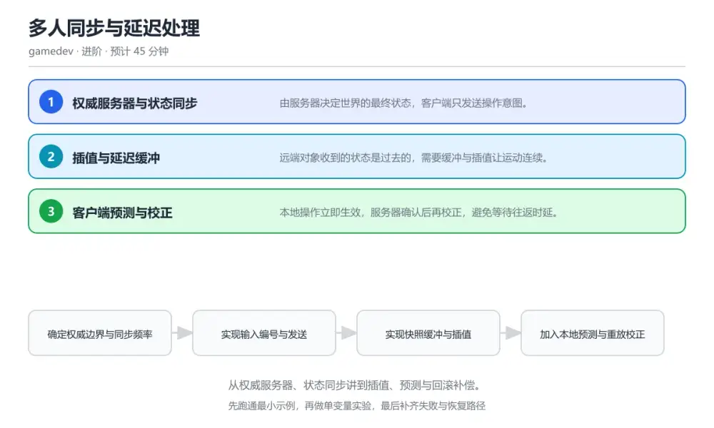
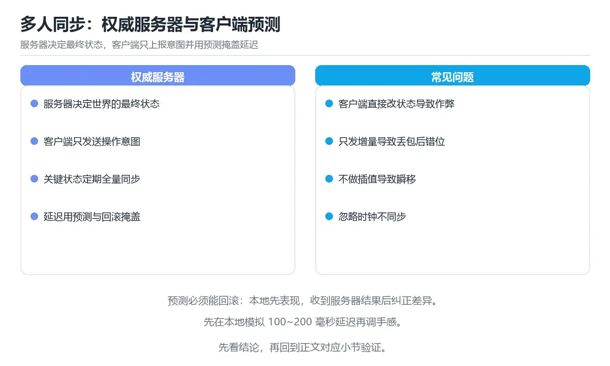

# 多人同步与延迟处理

> 内容更新时间：2026-10-06 · 学习阶段：进阶 · 预计用时：30 分钟

你有没有想过，和朋友联机打游戏的时候，你按下开火键到对面玩家倒下，中间到底发生了什么？网络有延迟、有丢包，为什么大家看到的游戏画面还能基本一致？这节课就来聊聊多人游戏背后的同步技术——搞懂它，你就能理解为什么有时候角色会"瞬移"，为什么射击游戏要"让服务器说了算"。



## 本节知识框架

今天的目标：**搞懂多人游戏是怎么让所有玩家看到同一个世界的。**

想象你和朋友在玩同一局游戏，你们各自坐在自己的电脑前。每个人看到的画面其实是自己的电脑"画"出来的，但大家必须觉得在玩同一个世界。这就像一群人各自在纸上画同一幅风景——得有人当"裁判"，告诉大家最终版本长什么样。

学完这一课，你会：
- 理解什么是"权威服务器"，以及为什么不能让客户端自己说了算
- 学会用"快照 + 插值"让远端角色的移动看起来平滑
- 掌握"客户端预测 + 服务器校正"的流程，理解为什么操作可以不卡
- 能看懂一段预测校正代码，并发现里面藏着的坑

**先修与衔接**：本课是「图形与游戏开发」分类的第 7 课。建议先了解基本的网络通信概念（比如 TCP/UDP 的区别）。学完后按 `gamedev` 分类顺序继续。

### 复习清单

- [ ] 能用自己的话解释"权威服务器"和"客户端预测"
- [ ] 能说出快照缓冲太短会导致什么问题
- [ ] 能按顺序描述一次带预测的操作流程

## 核心概念定义

先认识几个核心名词，后面会反复出现：

| 术语 | 一句话说明 |
| --- | --- |
| 权威服务器 | 由服务器决定世界的最终状态，客户端只负责发送操作意图和显示画面。 |
| 快照 | 服务器在某一时刻拍的一张"世界照片"，记录了所有物体的位置、血量等数据。 |
| 插值 | 拿到两张前后不同的"照片"后，在中间补出过渡画面，让运动看起来平滑。 |
| 客户端预测 | 不等服务器回复，本地先按你的操作"假装"执行，等服务器确认后再修正。 |
| 重放 | 发现预测和服务器结果不一样时，把还没被确认的操作重新跑一遍，收敛到正确状态。 |
| 差量快照 | 不重发整个世界的状态，只把这一 tick 里真正变了的字段发给客户端，用来压带宽。 |
| 固定步长模拟 | 服务器和客户端都以同一个时间增量推进物理逻辑，否则两边算出来的轨迹对不上。 |
| 抖动（Jitter） | 相邻数据包到达间隔不均匀。快照缓冲要吸收的正是它，而不是平均延迟本身。 |
| 外推（Extrapolation） | 快照断供时按最后已知速度往前猜位置，只能短时救急，猜久了必然偏离。 |
| 输入序号 | 每次操作带的递增编号，让客户端和服务器能对上"哪些操作已经生效"。 |

## 原理与运行机制

### 权威服务器：谁说了算？

多人游戏的核心问题是：当两个玩家的说法不一致时，听谁的？

答案很简单——**听服务器的**。这就是"权威服务器"模型。客户端把你的按键、鼠标操作打包发给服务器，服务器计算完结果后再把最新状态广播给所有人。

为什么要这样做？因为客户端环境不可信。如果伤害判定在客户端本地计算，作弊者可以直接修改内存，让自己"刀刀秒杀"。只有把关键逻辑放在服务器上，才能保证所有玩家看到的结果是一致的、公平的。

打个比方：你和朋友争论一道数学题的答案，与其各说各的，不如让老师来判——服务器就是那个老师。

### 快照与插值：让远端角色动起来

服务器算完状态后会定期广播"快照"——你可以理解为定时拍一张世界全景照。但网络不是完美的，快照到达的时间不均匀，有时候还会丢包。

如果收到快照就直接把角色"瞬移"到新位置，你看到的远端角色就会一顿一顿的，像瞬移一样。解决办法是**插值**：

1. 客户端维护一个快照缓冲区，存最近几帧的状态
2. 渲染时取相邻两个快照，在它们之间"插"出中间状态
3. 缓冲区的长度用来吸收网络抖动和丢包

缓冲区太短 → 快照不够用，角色抖动甚至瞬移
缓冲区太长 → 你看到的画面比实际延迟太多，操作反馈明显滞后

所以缓冲长度需要权衡，一般设在 100~200 毫秒左右。

### 客户端预测：不等服务器，先动手

如果每次操作都要等服务器回复才动，那延迟高的玩家就会觉得角色"粘手"。200ms 的往返延迟意味着你按下方向键后要等 0.2 秒角色才动——这在动作游戏里是不可接受的。

解决办法是**客户端预测**：你按下按键后，本地立刻执行操作，不等服务器。等服务器的确认回来了，再检查本地预测的结果对不对。

这就像你打电话点外卖：挂完电话你就开始想象外卖到了的场景（预测），等外卖真的到了（服务器确认），你再核对一下对不对。

### 预测校正：发现错了，悄悄修正

预测不可能每次都和服务器完全一致（比如你同时被别的玩家推了一下），这时候就需要校正。校正的流程是：

1. 每个输入都带一个递增的序号（输入编号）
2. 客户端保存所有已发出但还没被服务器确认的输入（历史记录）
3. 服务器返回它已处理到的最大序号
4. 客户端把本地状态设为服务器给的权威状态
5. 把还没被确认的输入重新跑一遍（重放），得到当前应该显示的位置

如果误差很小，就平滑过渡过去，玩家几乎感觉不到；如果误差太大（比如超过 0.1 米），就直接对齐，避免长期漂移。

### 把整条链路按时间轴走一遍

把"一次带预测的操作"按时间轴排出来，顺序就是这样，一步步数着走就不会错：

1. 客户端采集这一帧的输入，盖上递增序号 `Seq`，先存进本地历史 `pending`。
2. 本地立刻用同一份移动逻辑预测执行，画面当帧就有反应。
3. 把这个带序号的输入发给服务器（注意：入队和发送是并行的，不是发完再动）。
4. 服务器按固定步长模拟，判定结果，把权威状态和"已处理到第几号"一起广播回来。
5. 客户端收到后，丢掉已确认的输入，把剩下未确认的在权威状态上重放，得到该显示的位置。

第 3 步和第 4 步之间，玩家还在继续按键，所以 `pending` 是滚动增长的。理解这一点，就理解了为什么"清空 pending"是致命错误——那些输入代表的是服务器还不知道的未来动作。

### 为什么必须用固定步长

预测校正成立的前提是：客户端和服务器的模拟结果可比。如果本地按渲染帧的不等间隔（这帧 16ms、下帧 42ms）推进物理，服务器按 50ms 一步推进，两边的积分误差会一路累积，重放出来的位置永远差一点，校正就会不停"抖"。

做法是把模拟拆成固定的小步（`FixedDelta`），渲染帧只负责"攒够时间就走几步"。同一份逻辑代码编进客户端和服务器两端，参数（重力、摩擦、最大速度）也必须是同一份配置，而不是两边各写一遍数字。

### 快照断供时：插值、外推与"冻结"

缓冲区空了（严重丢包或服务器卡了一下）时你有三个选择，代价各不相同：

- **插值**：往后退一点点，用已有快照补中间帧。最稳，代价是画面比真实状态慢半拍。
- **外推**：按最后已知的速度往前猜。手感最跟手，但目标一旦转弯或停下就立刻穿帮，所以一般限制外推时长上限。
- **冻结**：停在最后一个可信状态，直到新快照到达，常配合"远处对象才允许冻结"的策略。

工程上的常见组合是：插值打底、有限度外推、超过阈值就冻结并提示网络质量下降。缓冲长度也别写死——按实测 RTT 和抖动动态调整，比固定 150ms 更能扛住波动。



## 典型应用场景

### 场景一：FPS 游戏中的射击判定

在射击游戏中，你看到敌人、按下开火、命中——整个过程必须在本地立刻有反馈。客户端预测让你按下鼠标就看到枪口冒烟，服务器负责判定这一枪到底有没有打中。如果服务器说你没打中，客户端会悄悄修正弹着点。关键判定（是否命中、扣多少血）永远在服务器执行，防止有人用外挂实现"自动瞄准"。

### 场景二：MOBA 游戏中的技能释放

MOBA 游戏里你按下技能键，角色必须立刻开始施法动作。客户端先播放动画和特效（预测），同时把"我要放技能"这个输入发给服务器。服务器检查蓝量够不够、冷却好了没、目标在不在范围内，然后广播结果。如果服务器拒绝了（比如蓝不够），客户端会取消动画并播放一个"施法失败"的反馈。

### 场景三：赛车游戏中的位置同步

赛车游戏对位置精度要求很高。每辆车的客户端本地预测自己的位置和碰撞，服务器定期广播所有车辆的权威位置。其他玩家的车通过插值来平滑移动。如果两辆车在客户端预测中发生了碰撞但服务器认为没有，就以服务器为准，客户端悄悄调整位置。

### 场景四：弱网与断线重连

玩家网络抖了一下，几十秒没收到服务器状态。这时候客户端不该继续把预测往前滚（角色会自己走出地图），而应该冻结本地模拟、放大缓冲并显示"重连中"。重连回来后，服务器的权威状态和"已处理到的序号"会一次性把本地纠正过来——所以输入序号在断线场景里同样是记账凭证，而不是只在正常帧有用。

### 场景五：低频同步的休闲与棋牌玩法

不是所有游戏都要 20Hz。棋牌、回合制、大地图策略只要状态改变时广播一次差量就够了，客户端也不需要预测，因为玩家对零点几秒的延迟不敏感。判断要不要做预测校正，先看这个玩法里"操作到反馈"的时间差会不会被玩家感知，再决定复杂度——把重放机制塞进一个回合制游戏只是自找麻烦。

## 代码/协议/SQL 示例

下面是一段客户端预测与校正的核心代码，来看看它是怎么工作的：

```csharp
// 客户端预测与校正：保存未确认输入，收到服务器状态后重放
struct InputFrame { public int Seq; public float MoveX; public float Jump; }

void OnServerState(PlayerState server, int lastAckedSeq) {
    // 1. 用服务器权威状态作为起点
    var state = server;

    // 2. 丢弃已被服务器处理的输入
    pending.RemoveAll(i => i.Seq <= lastAckedSeq);

    // 3. 重放尚未确认的输入，得到当前应显示的位置
    foreach (var input in pending) {
        state = Simulate(state, input, FixedDelta);
    }

    // 4. 误差小就平滑收敛，误差大直接对齐，避免长期漂移
    float error = Vector3.Distance(local.Position, state.Position);
    if (error < 0.1f) local.SmoothTo(state, 0.15f);
    else { local.SnapTo(state); Debug.Log($"correct {error:F2} m, replay {pending.Count} inputs"); }
}
```

逐行解释一下关键逻辑：

- `InputFrame` 结构体记录了每一次操作：序号 `Seq`、横向移动 `MoveX`、跳跃 `Jump`。序号是递增的，用来和服务器对账。
- `OnServerState` 在收到服务器状态时调用。参数 `lastAckedSeq` 是服务器已处理到的最大序号。
- 第一步把起点设为服务器的权威状态——这是"真相"。
- 第二步把已经被服务器处理过的输入从队列里删掉，它们不需要重放了。
- 第三步把剩下的（还没被确认的）输入依次重新模拟，得到"如果从真相出发，加上我还没被确认的操作，我现在应该在哪"。
- 第四步比较本地位置和重放后的位置：误差小就平滑过渡（`SmoothTo`），误差大就直接对齐（`SnapTo`），并打印日志方便调试。

这段代码的关键设计是**不丢弃未确认输入**。如果收到服务器状态后直接把 `pending` 清空而不去重放，玩家就会被拉回服务器快照时刻的位置——那可是几百毫秒前的位置，画面会明显"回弹"。

### 补齐闭环的另一半：采集、编号与入队

上面那段只处理"收到状态之后"。要让重放有东西可用，发送侧必须先把序号和历史管好：

```csharp
int nextSeq = 1;
List<InputFrame> pending = new();

void OnLocalInput(float moveX, float jump) {
    var input = new InputFrame { Seq = nextSeq++, MoveX = moveX, Jump = jump };
    pending.Add(input);                  // 先记账：这条输入服务器还不知道
    local = Simulate(local, input, FixedDelta);  // 再预测：本地当帧就动
    SendToServer(input);                 // 最后发出去，顺序不能反
}

void OnServerAcked(int lastAckedSeq) {
    pending.RemoveAll(i => i.Seq <= lastAckedSeq);  // 只对"已确认"的部分销账
}
```

三行的顺序有讲究：先入队再模拟再发送。如果先发后入队，服务器可能在队列还没建立时就把状态推回来，那条输入就凭空消失了，表现为"偶尔按一下没反应"。`lastAckedSeq` 是服务器累计确认到的最大序号，用它一次性销账比逐条比对省事，也天然容忍确认包晚到。

## 时间/空间复杂度或性能分析

多人同步的性能开销主要来自三个方面：

**网络带宽**：服务器要定期给每个客户端广播状态。如果房间里有 10 个玩家，服务器每秒要发 20 次状态包（20Hz tick），每次包大小取决于需要同步的对象数量。优化方法是只发"差量"（delta）——只告诉客户端哪些数据变了，而不是每次都发完整快照。

**客户端 CPU**：预测校正时需要重放未确认输入。如果网络延迟高，积压的未确认输入就多，重放的计算量就大。一般情况下重放几十个输入帧不是问题，但如果延迟突然飙升到几秒，就需要设上限，超出部分直接丢弃并对齐到服务器状态。

**内存**：快照缓冲区会占用一些内存。一般保留最近 1~2 秒的快照就够了。输入历史也类似，只保留未确认的部分。

一个实用的优化建议：把缓冲长度和丢包率做成可观测指标。当丢包率异常升高时，自动提示玩家网络质量下降，或者动态调整缓冲长度。

### 带宽这笔账怎么算

粗估公式：单客户端每秒字节数 ≈ tick 频率 × 每次差量包大小。10 人房间、20Hz、每次只发 6 个变化对象的差量包（每条约 20 字节），一路客户端每秒约 24 KB，服务器出口则是 10 路共 240 KB/s。数字本身不难看，难的是长尾：同屏对象数一多、状态一变复杂，"差量"就会退化接近全量，成本立刻翻倍。

所以压带宽的顺序通常是：先做差量与兴趣区域（只发客户端看得到的对象），再降频（远处对象每几个 tick 才更新一次），最后才考虑压缩和拆分通道。重放帧数则要看上限保护——延迟突增到数秒时，未确认输入可能积到上百条，必须截断并直接对齐，否则一帧里跑上百次模拟会当场卡住。

## 常见误区与易错点

| 错误做法 | 会出现什么 | 正确做法 |
| --- | --- | --- |
| 收到快照直接设置位置 | 远端角色一顿一顿，像在不断瞬移 | 保留快照缓冲区，在相邻快照之间插值 |
| 等服务器确认后才播放动作 | 操作延迟明显，高延迟玩家根本没法玩 | 本地立即预测执行，收到服务器状态后再校正 |
| 客户端和服务器用两套物理规则 | 状态长期漂移，预测永远对不上 | 共用同一份固定步长逻辑代码 |
| 先发送输入、再把它记进历史 | 偶尔有按键"石沉大海"，服务器收到了但客户端已经丢了记录 | 顺序固定为入队 → 本地预测 → 发送 |
| 外推不设时长上限 | 目标急停或转弯时角色冲过头再被拽回来 | 限定外推窗口，超时就冻结，等下一个快照 |
| 拿本地墙上时钟直接当插值时间轴 | 两边时钟一漂，画面忽快忽慢甚至往回退 | 用快照自带的时间戳推进，本地只做平滑不做裁决 |

### 误区详解：远端角色一顿一顿

这是新手最常遇到的问题。原因很简单：收到服务器的快照后，直接把角色位置设成快照里的值。网络稍有抖动，角色就会跳来跳去。

修复方法是维护一个快照缓冲区（比如存最近 5 个快照），渲染时取时间上最接近的两个快照，按比例插值出当前帧的位置。这样即使某个快照丢了，缓冲区里还有前后的快照可以用，画面依然平滑。

### 误区详解：操作总是慢半拍

如果你发现按下按键后角色要等一会儿才动，那很可能是没有做客户端预测。每次操作都在等服务器的往返延迟（RTT），延迟 100ms 就意味着操作要 100ms 后才生效。

修复方法是在本地立即执行操作（预测），同时把输入发给服务器。服务器确认后，客户端对比预测结果和权威结果，有差异就悄悄修正。玩家感受到的延迟几乎为零。

### 误区详解：校正代码里清空了 pending

来看一段有问题的代码：

```csharp
void OnServerState(PlayerState server) {
    pending.Clear();
    local.transform.position = server.Position;
}
```

这段代码收到服务器状态后，直接把所有未确认输入清空，然后跳到服务器位置。问题是：那些被清空的输入里，有服务器还没来得及处理的。清空后没有重放，玩家会被拉回几百毫秒前的位置，画面出现明显的"回弹"甚至来回拉扯。

## 与其他知识点的关系

本课的知识和以下几个主题紧密相关：

- **游戏循环与帧时间**：客户端预测的模拟必须用固定时间步长，否则和服务器算出来的结果对不上。如果你还没学过固定时间步的概念，建议先回顾《游戏循环与帧时间》。
- **碰撞与物理模拟**：预测校正时重放输入会调用物理模拟。如果碰撞检测不一致，预测结果就会和服务器偏差越来越大。
- **性能分析**：同步频率、缓冲大小、重放帧数都直接影响性能。了解帧预算的概念能帮你做出合理的权衡。

容易混淆的概念对比：

| 概念 A | 概念 B | 关键区别 |
| --- | --- | --- |
| 权威服务器 | 快照 | 前者是架构模型（谁说了算），后者是数据格式（某一时刻的世界状态） |
| 快照 | 插值 | 前者是离散的数据点，后者是在数据点之间补出过渡状态的方法 |
| 客户端预测 | 重放 | 前者是"先动手再校正"的策略，后者是校正时"把未确认操作重新跑一遍"的具体手段 |

## 自测题与参考答案

> 先独立作答，再对照答案。

**自测 1**：用自己的话解释什么是"权威服务器"，并说出一个如果不这样做会出问题的场景。

参考答案：权威服务器是指由服务器决定游戏世界最终状态的架构。客户端只发送操作意图，不做关键判定。如果不这样做，比如让客户端自己计算伤害，作弊者就可以修改本地数据实现"一刀999"。

**自测 2**：如果你发现远端角色移动时一顿一顿的，最可能的原因是什么？怎么修？

参考答案：最可能是收到快照后直接设置了位置，没有做插值缓冲。修复方法是维护快照缓冲区，在相邻两个快照之间插值，用缓冲吸收网络抖动和丢包。

**自测 3**：预测校正时，为什么不能把未确认的输入全部清空？

参考答案：因为那些输入里有一部分是服务器还没来得及处理的。如果全部清空而不重放，玩家位置会直接退回服务器快照时刻（可能是几百毫秒前），出现明显的回弹。正确做法是只删除已被服务器确认的输入，剩下的重放到权威状态上。

## 术语速查

| 术语 | 一句话说明 |
| --- | --- |
| 权威服务器 | 由服务器决定最终状态，客户端只发操作意图。 |
| 快照 | 服务器在某一时刻拍的世界状态照片。 |
| 插值 | 在两个快照之间补出过渡画面，让运动平滑。 |
| 客户端预测 | 本地先执行操作，不等服务器确认。 |
| 重放 | 把未确认的输入在权威状态上重新跑一遍来校正。 |
| RTT | 往返延迟（Round-Trip Time），从客户端发包到收到服务器回复的时间。 |
| Tick Rate | 服务器每秒模拟的次数，比如 20Hz 表示每秒模拟 20 次。 |

## 考点精讲

`多人同步与延迟处理` 的题库有 5 道题，下面逐题讲解。先自己试着作答，再核对答案和解析。

### 考点 1：第 1 题

- **题目**：“关键判定放在服务器执行的核心原因是？”
- **答案**：防止客户端篡改结果，并保证所有玩家看到一致状态
- **解析**：客户端环境是用户自己的电脑，可以被修改。如果把伤害判定、掉落判定这些关键逻辑放在客户端，作弊者就能改内存让自己无敌或者一刀秒杀。只有服务器来做这些判定，才能保证所有人看到的结果一致、公平。客户端只负责"表现"——播动画、播特效，但"结果"必须服务器说了算。

### 考点 2：第 2 题

- **题目**：“快照缓冲过短会带来什么现象？”
- **答案**：远端对象抖动甚至瞬移
- **解析**：快照缓冲区的作用是存储最近几帧的世界状态，用来在两个快照之间做插值。如果缓冲区太短，可用的快照就不够，插值算不出平滑的中间状态，远端角色就会一顿一顿地跳，看起来像在不断瞬移。但缓冲也不能太长，否则画面延迟太大。

### 考点 3：第 3 题

- **题目**：“实现预测校正闭环需要哪些要素？（多选）”
- **答案**：输入编号；未确认输入的历史记录；服务器返回已处理序号
- **解析**：预测校正的核心流程是"对账"。输入编号让每个操作都有唯一标识；历史记录保存了已发出但还没被确认的输入；服务器返回已处理序号告诉客户端"到哪儿了"。三者配合，客户端才能知道哪些输入需要重放、哪些可以丢弃。第四个选项"客户端独立维护另一套物理规则"是错的——如果客户端和服务器用不同的规则，预测结果永远对不上，校正就会不断出现明显回弹。

### 考点 4：第 4 题

- **题目**：“请按一次带预测的操作顺序排列。”
- **答案**：客户端采集输入并编号 → 本地立即预测执行 → 发送输入到服务器 → 服务器模拟并广播状态 → 客户端重放未确认输入完成校正
- **解析**：这个顺序就是预测校正的完整闭环。先采集输入并编号（给操作一个序号），然后本地立刻执行（不等服务器，保证手感流畅），同时把输入发给服务器。服务器模拟完后广播最新状态给所有客户端。客户端收到后，用权威状态加上还没被确认的输入重放一遍，把预测结果收敛到正确值。

### 考点 5：第 5 题

- **题目**：“阅读这段校正代码，会带来什么问题？”
- **答案**：校正时丢弃了所有未确认输入，玩家会被拉回过去的位置
- **解析**：这段代码收到服务器状态后直接 `pending.Clear()` 清空所有未确认输入，然后 `local.transform.position = server.Position` 直接跳到服务器位置。问题是那些还没被服务器处理的输入也被丢掉了，没有重放。玩家的位置会直接退回服务器快照时刻——那可能是几百毫秒前的位置，画面会出现明显的回弹甚至来回拉扯。正确做法是只删除已被确认的输入，剩下的重放到权威状态上。

## 工程检查表

动手实现多人同步时，按这个清单逐项检查：

- [ ] 确定哪些逻辑放在服务器（关键判定），哪些放在客户端（表现层）
- [ ] 确定同步频率（tick rate）和快照广播方式（全量 vs 差量）
- [ ] 实现输入编号与发送机制
- [ ] 实现快照缓冲区与插值渲染
- [ ] 实现客户端预测与重放校正
- [ ] 用网络模拟工具（如 Clumsy、Network Link Conditioner）测试延迟和丢包下的表现
- [ ] 监控校正幅度——如果频繁出现大幅校正，说明预测逻辑有问题
- [ ] 客户端和服务器共用同一份移动逻辑代码，避免规则分叉

## 内容元数据

- 内容版本：v2.0
- 最后更新：2026-10-06
- 学习阶段：进阶

| 字段 | 值 |
| --- | --- |
| 课程 ID | `gamedev_multiplayer_sync` |
| 所属分类 | `gamedev` |
| 难度 | 进阶 |
| 预计用时 | 45 分钟 |
| 关键词 | 权威服务器、状态同步、客户端预测、插值、回滚 |
| 配图 | `images/lesson_gamedev_multiplayer_sync.webp` |
| 参考资料 | 3 条 |
| 内容更新时间 | 2026-10-06 |

## 参考资料与复核

- 最后复核：2026-10-04
- 下次复核：2027-04-24
- 来源性质：官方文档、权威教材与工程实践整理

| 参考资料 | 本课用途 |
| --- | --- |
| [Valve 开发者社区：Source 多人网络](https://developer.valvesoftware.com/wiki/Source_Multiplayer_Networking) | 权威服务器架构与状态同步的经典参考 |
| [Gabriel Gambetta：快节奏多人游戏网络](https://www.gabrielgambetta.com/client-server-game-architecture.html) | 客户端预测、插值与回滚的完整教程 |
| [Gaffer On Games：网络物理架构](https://gafferongames.com/) | 状态同步、延迟补偿与工程实践的深入分析 |
