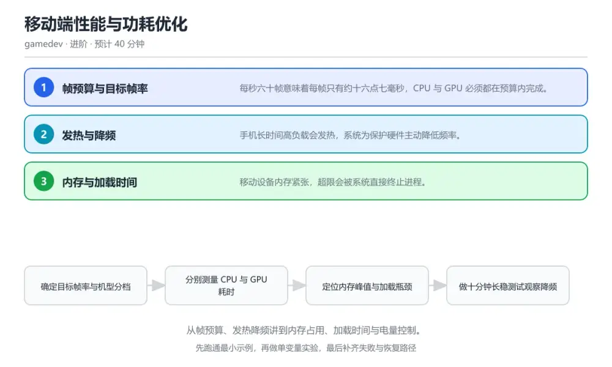
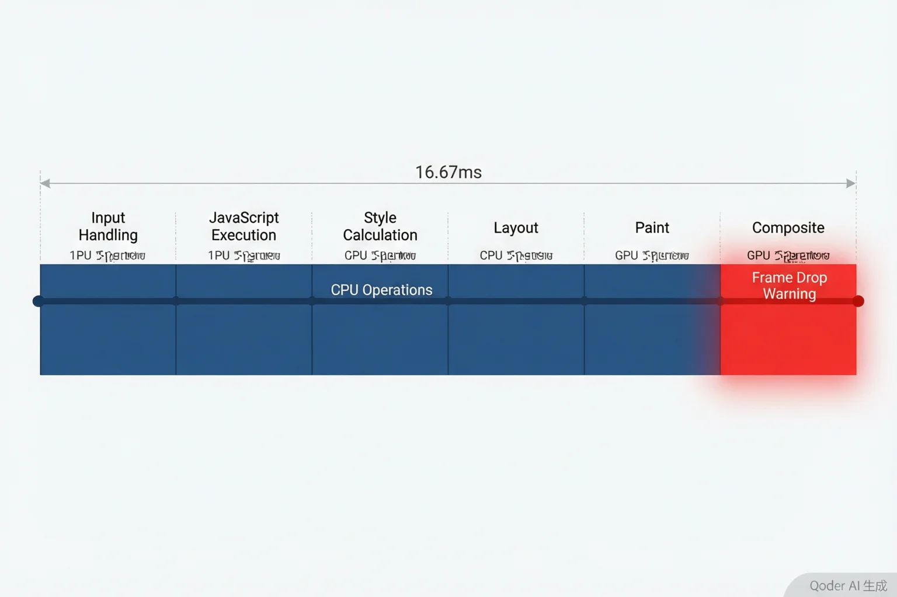

# 移动端性能与功耗优化

> 内容更新时间：2026-10-06 · 学习阶段：进阶 · 预计用时：25 分钟

分类：gamedev。关键词：帧预算、发热降频、内存、加载时间、功耗。你的手机游戏为什么玩十分钟就卡成PPT？为什么低端机直接闪退？这节课带你搞懂移动端性能优化的核心思路。



---

## 本节知识框架

想象你开了一家外卖店。厨房只有一口锅（CPU）和一个灶台（GPU），但你同时接了 100 份订单。如果你不管三七二十一把所有食材都堆进厨房（一次性加载全部资源），厨房直接爆炸；如果你让厨师从头到尾只做一道菜（每帧分配对象），效率低到顾客全跑了。

移动端性能优化的核心就是：**在有限的时间和空间里，把事情安排得明明白白**。

**本课主线**：从帧预算、发热降频讲到内存占用、加载时间与电量控制。

**学完本课你应当能够**：
- 用"厨房"类比说清 `帧预算` 与 `降频` 的含义与区别
- 用本课示例验证 `长稳测试` 的行为，记录输入、输出与失败条件
- 遇到「只看帧率不看功耗与温度」这类问题时，能说出触发条件与修复顺序

**复习清单**

- [ ] 能不看正文复述帧预算的计算公式，并说出 60fps 和 30fps 对应的帧预算
- [ ] 能解释为什么降频会导致帧率波动，并给出一个实际场景
- [ ] 能设计一个长稳测试方案，说明测试时长、监控指标和判定标准

## 核心概念定义

下面这张表是你的"速查卡片"。每个术语都有一句话定义和一个生活类比。建议先遮住右列，看自己能不能说出来。

| 术语 | 操作性定义 | 生活类比 | 常见边界与风险 |
| --- | --- | --- | --- |
| 帧预算 | 每帧允许消耗的最长时间，由目标帧率决定。 | 每道菜允许的最长烹饪时间——60 帧就是每帧 16.7 毫秒，超时就会掉帧。 | 只在"每帧允许消耗的最长时间，由目标帧率决定"这一前提下成立，换输入或换环境要重新验证。 |
| 降频 | 设备过热后主动降低频率以保护硬件。 | 厨房太热，厨师被强制减速——手机发热后 CPU/GPU 频率被限制，帧率随之波动。 | 易错：只看开局 30 秒帧率会得到过于乐观的结论，长时间稳定性才是真实体验。正确做法是做长稳测试并把降频后的帧率作为验收指标。 |
| 长稳测试 | 长时间连续运行观察性能稳定性的测试。 | 连续做 100 道菜看厨房会不会崩——运行 10 分钟以上观察帧率曲线是否稳定。 | 结论随输入规模变化，小规模成立不代表大规模成立，需要重新测量。 |
| 内存峰值 | 运行过程中占用内存的最大值。 | 厨房里同时堆放的最多食材量——纹理、网格、音频同时加载时的内存占用。 | 易错：只优化平均内存不关注峰值，仍会在切换场景时被系统杀掉进程。必须按场景划分资源加载与释放边界。 |
| 机型分档 | 按硬件能力分级配置画质与资源规格。 | 按厨房大小分级配置菜单——高端机用 2K 纹理，低端机用 1K 纹理。 | 只在"按硬件能力分级配置画质与资源规格"这一前提下成立，换输入或换环境要重新验证。 |
| 目标帧率 | 希望画面每秒更新的次数：按机型分档设定目标帧率与画质，最低档机型作为性能验收基线。 | 每秒要出多少道菜——高端机 60 帧，低端机 30 帧，最低档机型必须能跑通。 | 结论随输入规模变化，小规模成立不代表大规模成立，需要重新测量。 |

---

## 原理与运行机制

### 1. 帧预算与目标帧率——"每道菜的烹饪时间"

**类比**：想象你要在 1 秒内做 60 道菜（60 帧），每道菜只有 16.7 毫秒。如果你某道菜花了 20 毫秒，后面 59 道菜就全部延迟——这就是掉帧。

**关键规则**：
- 一帧内的逻辑、渲染、物理、音频必须都在预算内完成
- CPU 和 GPU 可以并行工作，但最慢的一项决定上限
- 只在模拟器上测性能会低估真实设备差异，模拟器显卡与真机完全不同

```csharp
// 帧预算计时器：把一帧拆成逻辑、渲染与其余部分分别统计
struct FrameProfile {
    public float LogicMs;
    public float RenderMs;
    public float OtherMs;
    public float TotalMs => LogicMs + RenderMs + OtherMs;
}

void Update() {
    var sw = Stopwatch.StartNew();
    UpdateGameplay();
    profile.LogicMs = (float)sw.Elapsed.TotalMilliseconds;

    sw.Restart();
    RenderScene();
    profile.RenderMs = (float)sw.Elapsed.TotalMilliseconds;

    // 帧预算按目标帧率计算：60 帧约 16.7 ms，30 帧约 33.3 ms
    float budget = TargetFps == 60 ? 16.7f : 33.3f;
    if (profile.TotalMs > budget) {
        WarnThrottled(profile, budget);   // 记录超支帧与主要原因
    }
}

// 纹理按目标机型分档，低端机使用半分辨率
int TextureSize(Tier tier) => tier == Tier.Low ? 1024 : 2048;
```

**工程做法**：按机型分档设定目标帧率与画质，最低档机型作为性能验收基线。



### 2. 发热与降频——"厨房太热，厨师被强制减速"

**类比**：厨房连续工作 10 分钟后温度飙升，老板为了保护设备强制让厨师放慢速度。这就是手机的"降频"——温度上升后 CPU/GPU 频率被限制，性能曲线在几分钟后出现明显下降。

**关键规则**：
- 只看开局 30 秒的帧率会得到过于乐观的结论
- 长时间稳定性才是真实体验
- 降频后的帧率才是真正的验收指标

**工程做法**：做长稳测试并把降频后的帧率作为验收指标，必要时提供画质档位让玩家自行取舍。

### 3. 内存与加载时间——"厨房里的食材堆积"

**类比**：如果你把一整天的食材一次性堆进厨房（一次性加载全部资源），厨房直接爆炸——内存超限被系统终止进程。正确做法是按场景划分资源加载与释放边界。

**关键规则**：
- 纹理、网格与音频占用峰值内存
- 加载时若一次性读入全部资源会出现长时间卡顿甚至闪退
- 只优化平均内存不关注峰值，仍会在切换场景时被系统杀掉进程

```text
错误示范：
void LoadLevel() {
    // 一次性加载整关所有资源——内存峰值爆炸
    LoadAllTextures();
    LoadAllMeshes();
    LoadAllAudio();
}

正确做法：
void LoadLevel() {
    // 按场景划分，按需加载并释放
    LoadResourcesForScene("scene_01");
    // 进入场景后释放上一场景资源
    UnloadResourcesForScene("scene_00");
}
```

**工程做法**：按场景划分资源加载与释放边界，给出目标机型的峰值内存上限并纳入自动检查。

### 关键流程总览

```text
确定目标帧率与机型分档 → 分别测量 CPU 与 GPU 耗时 → 定位内存峰值与加载瓶颈 → 做十分钟长稳测试观察降频 → 把指标写入发布检查清单
```

1. 确定目标帧率与机型分档
2. 分别测量 CPU 与 GPU 耗时
3. 定位内存峰值与加载瓶颈
4. 做十分钟长稳测试观察降频
5. 把指标写入发布检查清单

---

## 典型应用场景

### 场景 1：帧预算与目标帧率

**问题**：游戏在高端机上跑 60 帧很流畅，但低端机上卡成 PPT。

**根因**：没有按机型分档设定目标帧率与画质。

**修复**：
- 高端机：60 帧 + 2K 纹理
- 中端机：30 帧 + 1K 纹理
- 低端机：30 帧 + 半分辨率纹理

**自检**：在最低档机型上跑长稳测试，帧率是否稳定在目标值。

### 场景 2：发热与降频

**问题**：游戏开局 5 分钟很流畅，10 分钟后帧率暴跌。

**根因**：只看开局帧率，没做长稳测试，降频后帧率不达标。

**修复**：
- 连续运行 10 分钟记录帧率曲线
- 找出降频发生的时间点
- 把降频后的帧率作为验收指标
- 提供画质档位让玩家自行取舍

**自检**：长稳测试后帧率是否稳定在目标值，温度是否超过设备阈值。

### 场景 3：内存与加载时间

**问题**：切换场景时卡顿 5 秒，低端机直接闪退。

**根因**：一次性加载全部资源，内存峰值过高。

**修复**：
- 按场景划分资源加载与释放边界
- 给出目标机型的峰值内存上限
- 纳入自动检查

**自检**：在最低档机型上切换场景，内存峰值是否超过阈值，加载耗时是否达标。

### 机制对照表

| 概念 | 解决什么问题 | 关键前提 | 失败信号 |
| --- | --- | --- | --- |
| 帧预算与目标帧率 | 每秒六十帧意味着每帧只有约十六点七毫秒，CPU 与 GPU 必须都在预算内完成。 | 只在模拟器上测性能会低估真实设备差异，模拟器显卡与真机完全不同。 | 按机型分档设定目标帧率与画质，最低档机型作为性能验收基线。 |
| 发热与降频 | 手机长时间高负载会发热，系统为保护硬件主动降低频率。 | 只看开局三十秒的帧率会得到过于乐观的结论，长时间稳定性才是真实体验。 | 做长稳测试并把降频后的帧率作为验收指标，必要时提供画质档位让玩家自行取舍。 |
| 内存与加载时间 | 移动设备内存紧张，超限会被系统直接终止进程。 | 只优化平均内存不关注峰值，仍会在切换场景时被系统杀掉进程。 | 按场景划分资源加载与释放边界，给出目标机型的峰值内存上限并纳入自动检查。 |

---

## 代码/协议/SQL 示例

### 最小可验证示例

```csharp
// 帧预算计时器：把一帧拆成逻辑、渲染与其余部分分别统计
struct FrameProfile {
    public float LogicMs;
    public float RenderMs;
    public float OtherMs;
    public float TotalMs => LogicMs + RenderMs + OtherMs;
}

void Update() {
    var sw = Stopwatch.StartNew();
    UpdateGameplay();
    profile.LogicMs = (float)sw.Elapsed.TotalMilliseconds;

    sw.Restart();
    RenderScene();
    profile.RenderMs = (float)sw.Elapsed.TotalMilliseconds;

    // 帧预算按目标帧率计算：60 帧约 16.7 ms，30 帧约 33.3 ms
    float budget = TargetFps == 60 ? 16.7f : 33.3f;
    if (profile.TotalMs > budget) {
        WarnThrottled(profile, budget);   // 记录超支帧与主要原因
    }
}

// 纹理按目标机型分档，低端机使用半分辨率
int TextureSize(Tier tier) => tier == Tier.Low ? 1024 : 2048;
```

## 时间/空间复杂度或性能分析

**性能关注点**：帧预算决定体验——记录帧率与帧时间分布、峰值内存与加载耗时，低端机型要单独跑一遍。

**测量方法**：固定输入跑一遍记录基线，再把规模或并发度提高一个数量级复测；两次结果的差值与波动范围才是结论依据。

## 常见误区与易错点

| 容易写错的做法 | 实际现象 | 原因与正确做法 |
| --- | --- | --- |
| 只看帧率不看功耗与温度 | 手机发热降频，帧率随后下滑。 | 同时监控帧时间、占用率与温度。 |
| 每帧分配对象 | 垃圾回收造成周期性卡顿。 | 复用对象与缓冲池，避免热路径分配。 |
| 资源规格不分档 | 低端设备显存不足直接崩溃。 | 按设备分档资源，控制纹理尺寸与压缩格式。 |

### 现场 1：只看帧率不看功耗与温度

**症状**：手机发热降频，帧率随后下滑。

**根因与修复**：同时监控帧时间、占用率与温度。

**自检**：在本课示例里复现"只看帧率不看功耗与温度"，改成同时监控帧时间、占用率与温度后重跑；如果症状消失且失败路径按预期变化，说明定位正确。

### 现场 2：每帧分配对象

**症状**：垃圾回收造成周期性卡顿。

**根因与修复**：复用对象与缓冲池，避免热路径分配。

**自检**：在本课示例里复现"每帧分配对象"，改成复用对象与缓冲池，避免热路径分配后重跑；如果症状消失且失败路径按预期变化，说明定位正确。

### 现场 3：资源规格不分档

**症状**：低端设备显存不足直接崩溃。

**根因与修复**：按设备分档资源，控制纹理尺寸与压缩格式。

**自检**：在本课示例里复现"资源规格不分档"，改成按设备分档资源，控制纹理尺寸与压缩格式后重跑；如果症状消失且失败路径按预期变化，说明定位正确。

---

## 与其他知识点的关系

- **先修**：《游戏循环与时间步长》——帧预算是从"每一帧有多少毫秒可花"推算出来的，先理解固定步长与变步长，才能看懂为什么掉帧往往从逻辑阶段开始。
- **先修**：《移动端渲染管线》——Draw Call、批次合并与 Overdraw 决定了 GPU 侧的时间开销，本课的功耗优化大多落在这几个指标上。
- **后续**：《实体组件系统与性能剖析》——定位到具体是哪个系统吃掉了帧时间，需要 Profiler 与 ECS 的按系统计时配合。
- **相关概念**：
  - **资源管线与按需加载**：首包大小、纹理压缩格式直接影响冷启动时间与内存峰值，加载优化应与资源分档一起做。
  - **后台线程与任务调度**：把解算、解压挪到工作线程可以保住主线程帧预算，但线程过多会推高功耗，需要按冷热区权衡。
  - **热管理与降频**：SoC 的温度墙是硬约束，短时跑满不代表能长跑；长稳测试的本质就是在降频后的帧预算下重新验证一遍。

## 自测题与参考答案

> 先独立作答，再对照参考答案；答案都能在本课正文、术语表或错误表里找到依据。

### 自测 1（概念复述）

不看正文，写出 `帧预算` 的操作性定义，并说明它与 `降频` 的区别。

**参考答案**：每帧允许消耗的最长时间，由目标帧率决定。降频是设备过热后主动降低频率以保护硬件。两者的差别要从适用对象与失败模式上说明。

### 自测 2（排错）

本课错误表记录了「只看帧率不看功耗与温度」这类做法。请写出它会出现的现象、根因，以及修复顺序。

**参考答案**：现象是手机发热降频，帧率随后下滑；正确做法是同时监控帧时间、占用率与温度。修复时先复现现象并保留证据，再改动一处假设重跑，确认现象消失。

### 自测 3（动手验证）

运行本课示例，改动其中一个输入后重新运行，记录输出与错误信息。

**参考答案**：正常输入下示例应当复现正文给出的结果；改动输入后，如果结果改变或报错，先核对它是否满足 `帧预算` 的适用范围，再检查错误表里是否有同类现象。

### 自测 4（代码阅读）

阅读本课代码示例，说明它体现了 `帧预算` 的哪一条性质，并指出改动哪个输入会让这条性质不再成立。

**参考答案**：`帧预算` 的定义是每帧允许消耗的最长时间，由目标帧率决定，示例正是在实现这条定义。改动 `TargetFps` 后，如果结果不再符合正文描述，就说明该性质只在当前前提成立。

### 自测 5（迁移）

把本课的方法迁移到自己的项目：围绕 `帧预算` 写出一个与错误表同类的风险点，并说明触发条件和检验方式。

**参考答案**：例如「资源规格不分档」，它会导致低端设备显存不足直接崩溃；检验方式是按设备分档资源，控制纹理尺寸与压缩格式改一处再复现，确认现象消失且没有引入新的失败分支。

---

## 术语速查

| 术语 | 一句话说明 |
| --- | --- |
| `帧预算` | 每帧允许消耗的最长时间，由目标帧率决定。 |
| `降频` | 设备过热后主动降低频率以保护硬件。 |
| `长稳测试` | 长时间连续运行观察性能稳定性的测试。 |
| `内存峰值` | 运行过程中占用内存的最大值。 |
| `机型分档` | 按硬件能力分级配置画质与资源规格。 |
| `目标帧率` | 希望画面每秒更新的次数：按机型分档设定目标帧率与画质，最低档机型作为性能验收基线。 |

---

## 考点精讲

`移动端性能与功耗优化` 的题库有 5 道题，下面逐题给出题干、正确项与判断依据：先自己作答，再核对正确项，最后回到正文对应小节复核。

### 考点 1：第 1 题

- **题目**：目标六十帧时每帧的时间预算约为？
- **选项**：A. 33.3 毫秒 B. 60 毫秒 C. 6 毫秒 D. 16.7 毫秒
- **正确项**：D. 16.7 毫秒
- **判断依据**：本题正确项是16.7 毫秒。术语 帧预算（移动端性能与功耗优化）：每帧允许消耗的最长时间，由目标帧率决定，本题取16.7 毫秒这条。易错点是只看帧率不看功耗与温度，会造成手机发热降频，帧率随后下滑，改法是同时监控帧时间、占用率与温度。易错点是每帧分配对象，会造成垃圾回收造成周期性卡顿，改法是复用对象与缓冲池，避免热路径分配。

### 考点 2：第 2 题

- **题目**：判断性能瓶颈的第一步是？
- **选项**：A. 关闭所有特效 B. 换一台更高配的手机 C. 分别测量 CPU 与 GPU 各环节耗时 D. 直接降低分辨率
- **正确项**：C. 分别测量 CPU 与 GPU 各环节耗时
- **判断依据**：本题正确项是分别测量 CPU 与 GPU 各环节耗时。术语 帧预算（移动端性能与功耗优化）：每帧允许消耗的最长时间，由目标帧率决定，本题取分别测量 CPU 与 GPU 各环节耗时这条。易错点是每帧分配对象，会造成垃圾回收造成周期性卡顿，改法是复用对象与缓冲池，避免热路径分配。

### 考点 3：第 3 题

- **题目**：移动端发布前应纳入检查的指标有哪些？（多选）
- **选项**：A. 帧率与帧时间分布 B. 峰值内存占用 C. 加载耗时 D. 开发机上的理论性能
- **正确项**：A、B、C
- **判断依据**：本题正确项是帧率与帧时间分布。术语 帧预算（移动端性能与功耗优化）：每帧允许消耗的最长时间，由目标帧率决定，本题取帧率与帧时间分布这条。易错点是资源规格不分档，会造成低端设备显存不足直接崩溃，改法是按设备分档资源，控制纹理尺寸与压缩格式。

### 考点 4：第 4 题

- **题目**：请按一次移动端性能优化的顺序排列。
- **选项**：A. 确定目标帧率与机型分档 B. 在真机上采集性能数据 C. 定位超支环节与内存峰值 D. 实施针对性优化 E. 长稳复测并归档指标
- **正确项**：A → B → C → D → E
- **判断依据**：本题正确项是确定目标帧率与机型分档。术语 内存峰值（移动端性能与功耗优化）：运行过程中占用内存的最大值，本题取确定目标帧率与机型分档这条。易错点是只看帧率不看功耗与温度会造成手机发热降频，帧率随后下滑，改法是同时监控帧时间、占用率与温度。

### 考点 5：第 5 题

- **题目**：阅读这段加载代码，最可能导致什么问题？
```text
void LoadLevel() {
    LoadAllTextures();
    LoadAllMeshes();
    LoadAllAudio();
}
```
- **选项**：A. 一次性加载全部资源，进入关卡时内存峰值过高 B. 纹理尺寸过小 C. 帧率被限制在三十 D. 加载顺序按名称排序
- **正确项**：A. 一次性加载全部资源，进入关卡时内存峰值过高
- **判断依据**：这道题检验内存峰值的概念。把整关资源一次性读入会让内存峰值大幅升高，低端机在切换场景时容易被系统终止，应按需加载并释放。

---

## 内容元数据

- 内容版本：v2.0
- 最后更新：2026-10-06
- 学习阶段：进阶

| 字段 | 值 |
| --- | --- |
| 课程 ID | `gamedev_performance_mobile` |
| 所属分类 | `gamedev` |
| 难度 | intermediate |
| 预计用时 | 45 分钟 |
| 关键词 | 帧预算、发热降频、内存、加载时间、功耗 |
| 配图 | `images/lesson_gamedev_performance_mobile.webp` |
| 参考资料 | 3 条 |
| 内容更新时间 | 2026-10-06 |

---

## 参考资料与复核

- 来源性质：官方文档、标准或权威教材；本课核对关键词：帧预算、发热降频、内存、加载时间、功耗。
- 最后复核：2026-10-04
- 下次复核：2027-04-24
- 复核范围：版本兼容、API 行为与工程实践

下面列出的资料用于核对本课结论，复习时可以对照阅读：
- [Android 官方文档：性能与功耗](https://developer.android.com/topic/performance)
- [Unity 官方手册：移动端优化](https://docs.unity3d.com/Manual/MobileOptimizationPracticalGuide.html)
- [Apple 开发者文档：性能优化](https://developer.apple.com/documentation/xcode/improving-your-app-s-performance)

| [本课术语索引：移动端性能与功耗优化](#核心概念定义) | 按本课输入、术语边界和错误表现逐项核对 |
> 复核提示：《移动端性能与功耗优化》的结论如与资料冲突，以资料中的规范文本为准，并在笔记里记录差异与日期。
