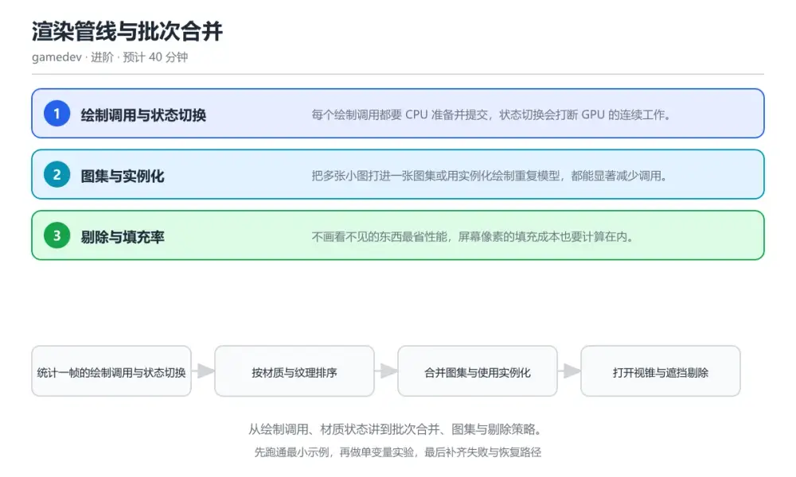

# 渲染管线与批次合并

> 内容更新时间：2026-10-06 · 学习阶段：进阶 · 预计用时：30 分钟

你有没有遇到过这种情况：场景里放了几百个物体，帧率就直线下降？其实问题往往不在模型有多复杂，而在于你的渲染器提交绘制的方式。这一节我们就来聊聊，一帧画面从"收集对象"到"最终上屏"到底经历了什么，以及怎么用"批次合并"把性能拉回来。



## 本节知识框架

先给你一个全局视角，知道我们要聊哪些东西，以及它们之间的先后关系：

- [ ] 理解什么是"绘制调用"（Draw Call），以及它为什么是性能开销
- [ ] 理解"批次"的概念——状态相同的对象可以合在一起画
- [ ] 掌握两种最常用的减调用手段：图集（Atlas）和实例化（Instancing）
- [ ] 了解剔除（Culling）和填充率（Fill Rate）对 GPU 压力的影响
- [ ] 能按"收集 → 剔除 → 排序 → 提交 → 后处理"的顺序复述一帧渲染流程

学完这节，你应该能对着自己的项目说清楚："我的帧时间花在哪了，该怎么改。"

**复习清单**

- [ ] 能用自己的话解释 Draw Call 和批次的区别
- [ ] 能说出至少两种减少绘制调用的方法，并解释原理
- [ ] 能看懂代码示例里的排序逻辑，说出它为什么能提升性能
- [ ] 能指出透明物体为什么要单独处理

## 核心概念定义

先把最关键的几个术语搞清楚，后面聊原理的时候就不会迷路：

| 术语 | 一句话说明 |
| --- | --- |
| 绘制调用（Draw Call） | CPU 告诉 GPU"画这个东西"的一次指令，每次调用都有开销 |
| 批次（Batch） | 状态（材质、纹理、着色器）相同的一组对象，可以合成一次调用来画 |
| 图集（Atlas） | 把很多小纹理拼到一张大图里，这样不同物体也能共享同一张纹理，减少切换 |
| 实例化（Instancing） | 同一个网格模型画很多次，每次只传不同的位置、旋转等参数，一次调用搞定 |
| 过度绘制（Overdraw） | 同一个像素被反复着色多次，比如半透明特效叠了好几层，白白浪费 GPU 算力 |
| 填充率（Fill Rate） | GPU 每秒能着色多少个像素，屏幕分辨率越高，填充压力越大 |
| 状态切换 | 换材质、换纹理、换着色器都要重新绑定一次，这段开销经常比"画一个三角形"本身还贵 |
| 光栅化 | 求出每个三角形到底覆盖了屏幕上哪些像素，然后交给片元着色器逐个处理 |
| 批次计数 | 一帧实际提交的组数。做减调用优化时盯的是这个数，而不是场景里的物体总数 |

## 原理与运行机制

### 一帧渲染的完整流程

想象你是渲染器的"调度员"，每一帧你要做这些事：

**第一步：收集场景对象**
遍历场景树，把所有需要渲染的物体收集到一个列表里。这一步就是"点名的过程"。

**第二步：剔除不可见对象**
相机看不到的东西就别画了。常用的剔除方式有：
- **视锥剔除**（Frustum Culling）：不在相机视野范围内的物体直接跳过
- **遮挡剔除**（Occlusion Culling）：被其他物体完全挡住的也跳过
- **距离分级**（LOD）：太远的物体用简化模型，或者直接不画

**第三步：按材质与纹理排序**
这一步是批次合并的关键。把可见物体按"用了什么材质、贴了什么纹理"排好队，这样相同状态的物体挨在一起，就能合成一个批次提交。

**第四步：提交批次绘制**
排好序之后，渲染器逐个批次绑定状态、提交绘制。相同材质和纹理的物体共用一次绑定，大幅减少状态切换。

**第五步：后处理并呈现画面**
所有物体画完之后，再做色调映射、泛光、抗锯齿等后处理效果，最终把画面送到屏幕上。

### 为什么透明物体要单独处理？

不透明物体谁先画谁后画都无所谓（反正会被深度测试覆盖掉），但透明物体不一样——透明混合的结果跟绘制顺序有关。如果近处的先画了，远处的再画上来，混合结果就错了，会出现穿插和闪烁。

所以正确做法是：
1. 先画所有不透明物体，按材质排序合并批次
2. 再画所有透明物体，按深度从远到近排序

### 批次合并的两种核心手段

**图集（Atlas）**：把角色行走动画的 8 帧小图拼成一张大图，这样不管画哪一帧，纹理都是同一张，状态不用切换。

**实例化（Instancing）**：场景里有 200 棵相同的树，不需要提交 200 次绘制。用实例化，一次调用就能把 200 棵树画出来，每次只传不同的世界矩阵。

### 状态切换为什么比"画"本身更贵

想象一个炒菜的厨师：一口锅炒完辣子鸡，要彻底刷干净擦干才能炒清淡的菜——洗锅的时间往往比炒菜还长。渲染里的"洗锅"就是状态切换：换材质要重填常量缓冲区，换纹理要重绑采样器，换着色器要重建管线状态对象，图形驱动还要在切换瞬间校验一遍参数合法性，这些活儿全落在 CPU 上。

于是有个反直觉的结论：**1 次绑定加 1 次提交画 200 个物体，通常比 200 次绑定加 200 次提交快一个数量级**。判断优化有没有生效，看的不是物体数量，而是这一帧里状态切换了几次、最终切出了几个批次。

### GPU 侧的四个耗时段落

前面讲的"收集 → 剔除 → 排序 → 提交"是 CPU 视角的调度流程。真正提交到 GPU 之后，一帧还要走过这么几段，每段对应不同的瓶颈：

- **输入装配与顶点处理**：顶点着色器逐个顶点跑一遍。网格越密、顶点越多，这段越忙。用实例化时同一份顶点数据会被反复复用，重复模型的顶点成本实际上只算一次。
- **图元装配与光栅化**：把顶点连成三角形，再算出每个三角形覆盖了哪些像素。这一步决定了后面究竟要着色多少个像素，是填充率压力的源头。
- **片元（像素）着色**：纹理采样、光照计算、半透明混合都在这里发生，是大面积特效最吃性能的一段。
- **输出合并与深度测试**：把着色结果写进帧缓冲，深度测试决定谁覆盖谁。因为后写的会盖住先写的，不透明物体才敢随便打乱顺序。

分清这四段很关键：降模型面数只缓解第一段，控制特效面积只缓解第三段。如果瓶颈本来在像素侧，砍面数砍得再狠也不会掉帧变少，这也是很多人"优化了半天帧率不动"的原因。

### 合批的硬性前提

能不能合进同一个批次，取决于三条同时成立：

1. 用的是同一个材质实例。注意是"同一个对象"，参数完全相同的两份材质也算两个实例，合不到一起。
2. 用的是同一个着色器变体。阴影投射开关、雾效开关、是否接收光照这些宏不同，就会生成不同变体，批次随之被切开。
3. 网格与变换兼容。静态合批要求顶点属性布局一致；动态合批还要求包围盒足够小、缩放接近 1，否则引擎重建顶点的成本比省下的提交成本还高。

最隐蔽的一种破功方式：运行时脚本改了一次 `renderer.material.color`，引擎顺手克隆出一份新材质实例，这个物体从此独占一个批次。想改颜色又想保住合批，就走顶点色、材质属性块或 uniform 数组，别去动材质对象本身。

## 典型应用场景

**场景一：2D 游戏里大量精灵**
一个平台跳跃游戏同屏有上百个金币、敌人、粒子。如果每个精灵都用独立纹理，每画一个就要切换一次纹理状态，帧率直接崩掉。把所有精灵打进一张图集后，绘制调用从上百降到个位数。

**场景二：3D 场景里大量重复物体**
一片森林有几千棵树、草丛。用实例化渲染，同一个网格模型只需要提交一次，GPU 自动根据每棵树的位置和缩放参数画出所有实例。

**场景三：大量半透明特效**
爆炸、烟雾、魔法技能特效叠加在一起，同一个像素可能被着色十几次（过度绘制）。这时候要控制特效面积和层数，或者用低分辨率的半透明缓冲区来缓解填充率压力。

**场景四：UI 界面里的一次性大批量绘制**
背包界面有 60 个格子，每格一张道具图标。如果每个道具都挂着独立纹理，一帧就是几十次纹理切换，界面滑动立刻变卡。把图标按"常驻库 + 当前活动库"分进两张图集，同一趟绘制只切一次纹理，绘制调用能压到个位数。这里有个踩过坑才知道的细节：一个格子的四角 UV 必须落在同一张图集里，只要有一角跨到别的页，这一格就自己拆出一个批次，前面合并的努力当场作废。

**场景五：开放世界里远近物体的分账**
远处的山体顶点极多但在屏上只占一小条，近处的草丛顶点很少却铺满半屏。对远山要提前拉高 LOD 切换距离（省顶点），对近草丛要限制半透明叶片的覆盖面积（省像素）。再叠加一条：手机上调高渲染分辨率时，批次和顶点数完全没变，只有像素数量按平方增长，帧率却会肉眼可见地掉——这是填充率的直接体现。两笔账分开做预算，才不会发生"砍了一半远景面数、帧率纹丝不动"的困惑。

## 代码/协议/SQL 示例

下面是一段简化的渲染帧代码，展示了"收集 → 剔除 → 排序 → 合批"的核心逻辑：

```csharp
// 每帧收集可见渲染项，按材质与纹理排序后再提交
void RenderFrame(Scene scene, Camera camera) {
    var visible = new List<RenderItem>();
    foreach (var item in scene.Items) {
        if (!camera.Frustum.Contains(item.Bounds)) continue;   // 视锥剔除
        if (item.Distance > item.MaxDistance) continue;        // 距离分级
        visible.Add(item);
    }

    // 排序键：先材质、再纹理，透明物体单独放最后
    visible.Sort((a, b) => {
        int cmp = a.MaterialId.CompareTo(b.MaterialId);
        if (cmp != 0) return cmp;
        return a.TextureId.CompareTo(b.TextureId);
    });

    int batches = 0;
    MaterialId current = MaterialId.None;
    foreach (var item in visible) {
        if (item.IsTransparent) continue;              // 透明单独一遍
        if (item.MaterialId != current) {
            BindMaterial(item.MaterialId);             // 只在必要时切换状态
            current = item.MaterialId;
            batches++;
        }
        Submit(item.Mesh, item.Transform);
    }
    Debug.Hud($"visible={visible.Count} batches={batches}");
}
```

这段代码的关键点：
- 先剔除不可见的，减少后续工作量
- 按 MaterialId 和 TextureId 排序，让状态相同的物体排在一起
- 只在 MaterialId 变化时才调用 BindMaterial，这就是"批次合并"
- 透明物体用 `continue` 跳过，留给另一遍单独处理

下面是一个反面教材，看看错误的写法是什么样的：

```csharp
// 错误示范：每个对象都单独绑定材质并提交
void RenderFrameBad(Scene scene, Camera camera) {
    foreach (var item in scene.Items) {
        BindMaterial(item.MaterialId);    // 每个对象都切换材质！
        BindTexture(item.TextureId);      // 每个对象都切换纹理！
        Submit(item.Mesh, item.Transform); // 每个对象一次 Draw Call
    }
}
```

这个写法的问题一目了然：100 个对象就是 100 次状态切换和 100 次绘制调用，性能当然崩。

### 实例化：一份网格画 N 棵树

实例化对应的顶点着色器（OpenGL ES 3.0 / GLSL）：

```glsl
#version 300 es
// 同一份网格画 N 次，每个实例只多读一条矩阵记录
layout(location = 0) in vec3 aPosition;
layout(location = 4) in mat4 aInstanceMatrix;   // 逐实例推进，不是逐顶点

uniform mat4 uViewProj;
out vec3 vWorldPos;

void main() {
    vec4 world = aInstanceMatrix * vec4(aPosition, 1.0);
    vWorldPos = world.xyz;
    gl_Position = uViewProj * world;
}
```

实例矩阵单独放在一条缓冲区里，用 `glVertexAttribDivisor(4, 1)` 告诉驱动"这个属性每画一个实例才前进一条"，其余顶点属性依旧逐顶点推进。于是 200 棵树只剩下一句 `glDrawArraysInstanced(GL_TRIANGLES, 0, vertexCount, 200)`。

排序判据也可以做得很省：把着色器变体、材质、纹理三段 ID 拼进同一个 64 位整数当排序键，比较一次就同时完成三级排序；排完之后"相邻键不同的次数加一"就是批次数，这个数可以直接打到调试 HUD 上当每帧指标看。

透明那一趟的排序键要换成相机距离而不是材质，所以透明物体基本放弃合批、先换正确性；同时关掉深度写入，否则先画的透明片元会挡住后面本该叠上来的内容。真要省调用，可行的折中是限制同屏大型特效的并存层数，或者把特效渲染到半分辨率缓冲再叠加。

## 时间/空间复杂度或性能分析

聊性能之前，先搞清楚一个核心问题：**你的瓶颈在 CPU 还是 GPU？**

**CPU 瓶颈的信号：**
- 绘制调用数量很高（比如上千次）
- 每帧花在排序和提交上的时间很长
- GPU 利用率反而不高，因为它在等 CPU 发指令

**GPU 瓶颈的信号：**
- 绘制调用不多，但帧率还是低
- 大面积半透明特效叠加，过度绘制严重
- 分辨率翻倍后帧率明显下降（填充率跟不上了）
- 同屏粒子数量巨大

**优化优先级建议：**
1. 先做剔除——不画看不见的东西，零成本收益
2. 再做批次合并——合并图集、使用实例化，减少 CPU 提交开销
3. 最后处理 GPU 侧——控制过度绘制、降低半透明面积、调整分辨率

记住一个原则：先测量，再优化。用引擎自带的 Profiler 看看帧时间到底花在哪了，不要凭感觉改。

### 每一步的量级

设场景对象总数 N、本帧可见数 V、最终批次数 B：

| 步骤 | 量级 | 说明 |
| --- | --- | --- |
| 收集对象 | O(N) | 遍历场景树，树越深、节点越多越慢 |
| 视锥剔除 | O(V) 或更低 | 朴素做法是每个包围盒比 6 个平面；配八叉树或 BVH 后只遍历可能可见的分支 |
| 排序 | O(V log V) | 键比较用单个 64 位整数比逐字段比较快得多 |
| 提交绘制 | 约 B 次绑定 + V 次提交 | 实例化后，同一批的提交次数还能再压一个数量级 |

真正决定帧时间形状的是 B，而不是 N 或 V。同屏 800 个精灵如果被切成 40 批，成本主要由 40 说话；如果因为材质碎片化被切成 300 批，物体一个没多，帧时间却可能翻好几倍。

### 一个能亲手跑的三档对照

同一份场景只改一个条件跑三遍，只看相对差值（绝对毫秒数随硬件变化，不必对号入座）：800 个精灵配 800 张独立纹理是基线，提交 800 次；全部并进 1 张图集后批次降到 1~4，帧时间明显下降；图集不动、只给一半物体开启投影，批次立刻被切成两组，收益吐回去一大半。

第三档才是这轮对照的重点：它证明"能不能合批"的判据不止材质和纹理，阴影投射、雾效开关这类管线标志同样会切批次。排查时把可疑标志逐个关掉、盯住批次计数看变化，比盲目重打图集有效得多。顺便提醒一句：图集本身不免费，一张 2048×2048 的 RGBA8 纹理常驻约 16 MB，加上 mipmap 还要再涨三分之一；把 UI、角色、场景全塞进一张巨型图集，换来的是显存吃紧和采样命中率下降。分组原则是"这一帧大概率会同时出现"，主界面、关卡内角色、通用特效各占一页。

## 常见误区与易错点

**误区一：不排序直接画**
很多新手写渲染循环，遍历场景里的物体就直接提交。这样每画一个物体就可能要切换材质和纹理，Draw Call 数量跟物体数量一样多。正确做法是先按材质和纹理排序，相同状态的合在一起画。

**误区二：透明和不透明混在一起排序**
如果透明物体和不透明物体混在一起按材质排序，透明物体的绘制顺序就乱了，会出现穿插和闪烁。正确做法是分两遍：先画不透明（按材质排序合批），再画透明（按深度从远到近排序）。

**误区三：剔除包围盒卡得太紧**
为了"精确剔除"，把物体的包围盒做得刚好贴合。但物体一旋转，包围盒没跟着更新，画面边缘的物体就会突然消失。正确做法是给包围盒留一点余量，旋转后重新计算，LOD 切换加一个滞后区间防止来回抖动。

**误区四：图集越大越好**
图集确实能减少纹理切换，但图集过大反而会占用大量显存、降低缓存命中率。应该按使用场景分组打图集，设置合理的尺寸上限。

把上面几条和实际项目里更高频的几种写法汇总成一张排查表：

| 容易写错的做法 | 会出现什么现象 | 原因与正确做法 |
| --- | --- | --- |
| 在每帧逻辑里改某个物体的材质颜色 | 材质被悄悄克隆，该物体掉出批次，绘制调用降不下来 | 走顶点色、材质属性块或 uniform 数组，材质实例保持共享 |
| 只盯 Draw Call 数字做优化 | 调用数降了，帧率却没变化 | 同时看批次数、顶点吞吐、像素覆盖层数三组指标，先定位瓶颈段 |
| 为了少切纹理把 UI 与场景打进同一张图集 | 大图集常驻显存飙升，mipmap 浪费严重 | 按"同帧大概率共存"分组，UI 与场景各用一页图集 |
| 静态合批照单全收 | 合批时重建网格的耗时超过省下的提交，加载卡顿 | 只对不动且顶点数适中的物体开静态合批，动态物体走实例化 |
| 透明物体也按材质排序 | 特效前后关系忽对忽错，出现穿插与闪烁 | 透明趟固定按相机距离从远到近，不追求合批 |

## 与其他知识点的关系

渲染管线不是孤立的，它跟你学过的很多概念都有关联：

- **着色器（Shader）**：批次合并的"状态"里就包括当前使用的着色器。不同着色器的物体不能合批，所以尽量减少场景里着色器的种类。
- **纹理与图集**：图集就是把多张小纹理拼成一张大纹理，减少纹理切换。这跟 UI 系统里的 SpriteAtlas 是同一个思路。
- **深度缓冲（Z-Buffer）**：不透明物体依赖深度测试来决定谁遮挡谁，所以绘制顺序不重要。但透明物体的混合计算依赖绘制顺序，必须从远到近。
- **LOD（细节层次）**：远处的物体用更简单的模型，既减少顶点数也减少填充率压力，是剔除之外的另一种优化手段。
- **后处理**：后处理效果（泛光、色调映射等）本身也会增加填充率开销，需要在性能预算里留出余量。
- **内存与缓存局部性**：图集改变的是纹理的访存布局，命中率高了显存带宽压力就小；这跟"连续数组比指针跳转友好"是同一类道理，不是渲染专属的技巧。
- **蒙皮动画与角色**：骨骼动画让每帧的世界矩阵都不一样，普通实例化只对"变换可参数化"的物体有效。蒙皮网格要走另一套 GPU 蒙皮实例化路径，别指望把不同角色合进一批。
- **多人同步**：客户端预测与插值算出来的画面同样要走这条管线。帧预算只有一份，模拟侧和提交侧抢的是同一毫秒，同步频率调高就要从渲染侧扣回来。

## 自测题与参考答案

先自己试着回答，再看参考答案。

**题目 1**：减少绘制调用最直接的两个手段是？
A. 增加模型面数
B. 关闭垂直同步
C. 合并图集与使用实例化
D. 提高分辨率与开启抗锯齿

<details>
<summary>参考答案</summary>
C。图集让多个精灵共享同一张纹理，实例化让同一网格一次提交多个实例，两者都直接减少了绘制调用和状态切换次数。
</details>

**题目 2**：透明物体为什么要单独排序绘制？
A. 透明物体必须在 CPU 上绘制
B. 需要按深度从远到近混合
C. 透明材质不能使用纹理
D. 透明物体不参与剔除

<details>
<summary>参考答案</summary>
B。透明混合的结果依赖绘制顺序。如果近处先画、远处后画，混合结果就错了，会出现穿插和闪烁。所以透明物体必须按深度从远到近单独排序绘制。
</details>

**题目 3**：以下哪些因素可能让 GPU 成为瓶颈？（多选）
A. 大面积半透明特效叠加
B. 分辨率翻倍导致填充率上升
C. 同屏粒子数量巨大
D. 绘制调用数量极少且模型简单

<details>
<summary>参考答案</summary>
ABC。半透明特效叠加导致过度绘制，分辨率翻倍让填充率需求翻倍，大量粒子增加像素着色量——这三项都会压垮 GPU。D 选项的场景 CPU 和 GPU 都很轻松，不会成为瓶颈。
</details>

**题目 4**：请按一帧渲染的主要顺序排列。
A. 收集场景对象
B. 剔除不可见对象
C. 按材质与纹理排序
D. 提交批次绘制
E. 后处理并呈现画面

<details>
<summary>参考答案</summary>
ABCDE。先收集所有场景对象，再剔除看不见的，然后按材质和纹理排序以便合批，接着提交批次绘制，最后做后处理并呈现画面。
</details>

**题目 5**：阅读这段渲染代码，主要性能问题是什么？

```text
for each object in scene:
    bind_material(object.material)
    bind_texture(object.texture)
    draw(object.mesh)
```

A. 每个对象单独绑定材质并提交，批次无法合并
B. 顶点数量过多
C. 相机视锥设置太小
D. 纹理分辨率不足

<details>
<summary>参考答案</summary>
A。循环里逐对象绑定材质和纹理，状态切换次数跟对象数量一样多，完全没有合批。应该先排序再合并批次，只在实际变化时切换状态。
</details>

## 考点精讲

下面逐题讲解，帮你把每道题背后的知识点吃透。

### 考点 1

**题目**：减少绘制调用最直接的两个手段是？
A. 增加模型面数
B. 关闭垂直同步
C. 合并图集与使用实例化
D. 提高分辨率与开启抗锯齿

**正确答案**：C

**讲解**：这道题考的是"怎么减少 Draw Call"。增加模型面数只会让 GPU 更累，关闭垂直同步跟 Draw Call 无关，提高分辨率和抗锯齿增加的是 GPU 填充压力。只有合并图集（减少纹理切换）和实例化（一次调用画多个相同模型）才是直接减少绘制调用的手段。

### 考点 2

**题目**：透明物体为什么要单独排序绘制？
A. 透明物体必须在 CPU 上绘制
B. 需要按深度从远到近混合
C. 透明材质不能使用纹理
D. 透明物体不参与剔除

**正确答案**：B

**讲解**：透明混合（Alpha Blending）的计算结果跟绘制顺序有关。画一个半透明玻璃窗，你必须先画远处的景物，再画近处的玻璃，这样混合才是对的。如果顺序反了，玻璃后面的东西就"透"不过来了。所以透明物体必须单独按深度从远到近排序。

### 考点 3

**题目**：以下哪些因素可能让 GPU 成为瓶颈？（多选）
A. 大面积半透明特效叠加
B. 分辨率翻倍导致填充率上升
C. 同屏粒子数量巨大
D. 绘制调用数量极少且模型简单

**正确答案**：ABC

**讲解**：GPU 瓶颈主要来自两方面——顶点处理压力和像素填充压力。A 和 C 都会造成大量过度绘制，同一个像素被反复着色很多次；B 让屏幕像素数量翻倍，填充率需求直接翻倍。D 的场景对 CPU 和 GPU 都很轻松，不会造成瓶颈。

### 考点 4

**题目**：请按一帧渲染的主要顺序排列。
A. 收集场景对象
B. 剔除不可见对象
C. 按材质与纹理排序
D. 提交批次绘制
E. 后处理并呈现画面

**正确答案**：ABCDE

**讲解**：这是一帧渲染的标准流程。先收集所有物体（不然你不知道要画什么），再剔除看不见的（减少后续工作量），然后按材质纹理排序（为合批做准备），接着提交批次绘制（真正调用 GPU），最后做后处理呈现画面。顺序不能乱——比如你先排序再剔除，排序就白做了。

### 考点 5

**题目**：阅读这段渲染代码，主要性能问题是什么？
A. 每个对象单独绑定材质并提交，批次无法合并
B. 顶点数量过多
C. 相机视锥设置太小
D. 纹理分辨率不足

**正确答案**：A

**讲解**：这段代码的问题在于循环内部每次都绑定材质、绑定纹理、提交绘制——100 个对象就是 100 次状态切换和 100 次 Draw Call。正确做法是先按材质和纹理排序，相同状态的物体共用一次绑定，只在实际变化时才切换。

## 术语速查

| 术语 | 一句话说明 |
| --- | --- |
| Draw Call | CPU 告诉 GPU 画一次东西的指令，每次都有开销 |
| 批次 | 状态相同、可以合在一起提交绘制的一组对象 |
| 图集 | 多张小纹理拼成一张大图，减少纹理切换 |
| 实例化 | 同一网格一次调用画多个实例，只传不同变换参数 |
| 过度绘制 | 同一像素被多次着色，浪费 GPU 填充带宽 |
| 填充率 | GPU 每秒能着色的像素数量，分辨率越高压越大 |
| 视锥剔除 | 不在相机视野内的物体直接跳过不画 |
| 深度排序 | 透明物体按从远到近的顺序绘制，保证混合正确 |
| 状态切换 | 换材质、换纹理、换着色器带来的重新绑定开销，通常比绘制本身更贵 |
| 着色器变体 | 同一份着色器在不同宏开关下编译出的不同版本，变体不同就合不进一批 |
| 绘制趟（Pass） | 一帧里分开跑的多轮提交，常见的是不透明趟、透明趟、后处理趟 |
| 深度写入 | 是否把当前像素的深度记进深度缓冲，透明物体一般要关掉它 |

## 内容元数据

- 内容版本：v2.0
- 最后更新：2026-10-06
- 学习阶段：进阶

| 字段 | 值 |
| --- | --- |
| 课程 ID | `gamedev_render_pipeline` |
| 所属分类 | `gamedev` |
| 难度 | intermediate |
| 预计用时 | 45 分钟 |
| 关键词 | 渲染管线、Draw Call、批次合并、图集、剔除 |
| 配图 | `images/lesson_gamedev_render_pipeline.webp` |
| 内容更新时间 | 2026-10-06 |

## 参考资料与复核

- 最后复核：2026-10-04
- 下次复核：2027-04-24
- 复核范围：版本兼容、API 行为与工程实践

下面这些资料可以帮你进一步深入，建议至少读前两篇：

- [Unity 官方文档：批处理与绘制调用优化](https://docs.unity3d.com/Manual/optimizing-draw-calls.html)
- [Godot 官方文档：渲染性能优化](https://docs.godotengine.org/en/stable/tutorials/performance/general_optimization.html)
- [NVIDIA GPU Architecture Overview](https://developer.nvidia.com/gpu-architecture)
- [LearnOpenGL: Advanced GLSL - Instancing](https://learnopengl.com/Advanced-OpenGL/Instancing)
