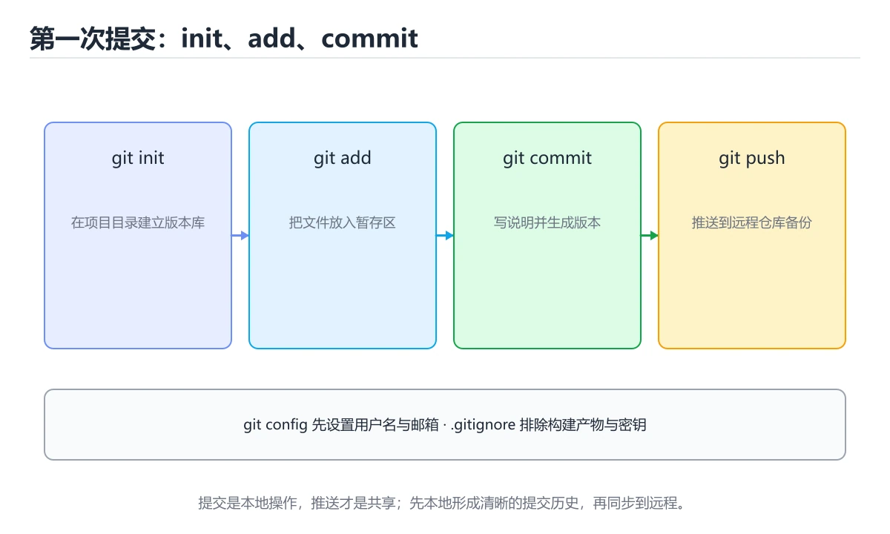
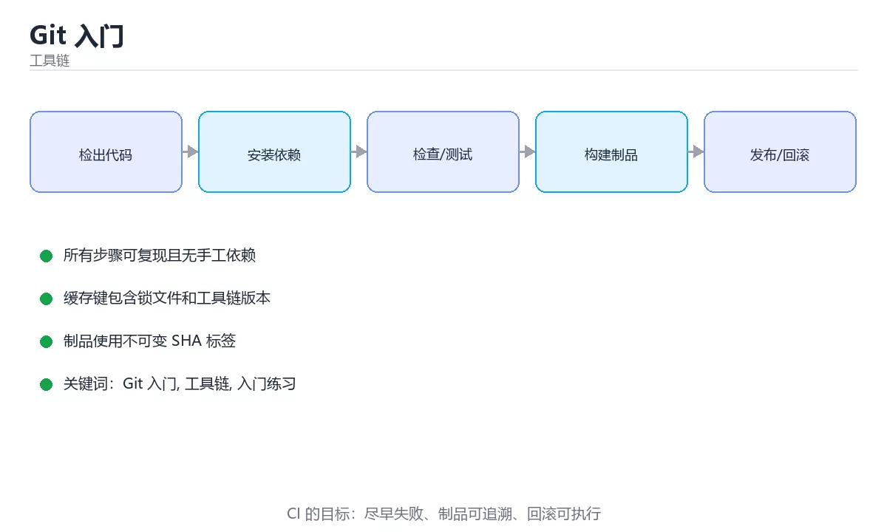

# Git 入门

> 内容更新时间：2026-10-06 · 学习阶段：入门 · 预计用时：30 分钟





## 本节知识框架

**课程定位**：所属分类 `toolchain`（工具链），课程主题 `Git 入门`，学习阶段 入门，建议用时 45 分钟。

本课主线：完成初始化、提交、分支和远程同步。

**学完本课应当能够**
- 说清 `仓库` 与 `提交（commit）` 的含义与区别，并各举一个正例和一个反例。
- 用本课示例验证 `暂存区` 的行为，记录输入、输出与失败条件。
- 遇到「直接在主干上改」这类问题时，能说出触发条件与修复顺序。

### 复习清单

- [ ] 能不看正文复述本课核心术语，并指出一个边界或反例。
- [ ] 能运行或推演本课示例，记录输入、输出与失败现象。
- [ ] 能完成一次自测，并把错题对照错误表定位原因。

## 核心概念定义

| 术语 | 操作性定义 | 常见边界与风险 |
| --- | --- | --- |
| 仓库 | 由 .git 目录保存全部提交历史的项目目录。 | 易错：以为改动落在项目目录里就算存好了；只有提交进 .git 的历史能回退，像游戏存档没存过的那一格被覆盖就找不回来。 |
| 提交（commit） | 一次带说明的历史快照，记录作者、时间与改动内容。 | 提交对象存的是父提交与整棵目录树，一次混入格式化、重构和功能变更，回滚时就会带走不相关内容。 |
| 暂存区 | 用 git add 把改动放进暂存区，再一次性提交，便于挑选改动。 | 易错：不看 `git diff --staged` 就把工作区改动一把提交；工作区、暂存区与 HEAD 三处可以不一致，得小步暂存、按单一目的提交。 |
| 分支 | 指向某次提交的可移动指针，用来隔离并行开发。 | 易错：多件事混在一起，无法回退；正确做法是用分支隔离改动，提交粒度保持小。 |
| 远程仓库 | 托管在服务器上的副本，push 上传、pull 拉取并合并。 | 远程不会自动同步，fetch 只下载对象与引用、push 才上传本地提交；已推送又被他人使用的提交别随意 rebase。 |

## 原理与运行机制

### 机制总览

**教材衔接：一句话入门**

完成初始化、提交、分支和远程同步。

**教材衔接：Git 的三个区域与一次提交**

Git 的核心模型是三个区域：工作区保存你正在编辑的文件，暂存区保存下一次提交的快照，本地仓库保存已经提交的历史。`git add` 把工作区变化放入暂存区，`git commit` 把暂存区内容写成一个新的提交对象。提交对象包含作者、时间、提交说明、父提交以及一棵完整的目录树，因此历史不是“文件差异的列表”，而是一串可以追溯和回放的状态快照。

`HEAD` 通常指向当前分支的最新提交，分支本质上只是一个可移动的提交指针。工作区、暂存区和 HEAD 三者不一致时，`git status` 会告诉你每个文件处于什么状态。修改文件后先看差异，再决定暂存哪些改动；`git diff` 看工作区与暂存区，`git diff --staged` 看暂存区与 HEAD。养成“小步暂存、单一目的提交”的习惯，比事后写一篇很长的提交说明更能保证历史清晰。

提交说明应说明“为什么做这个改动”，而不是重复文件名。一个好的提交可以独立回滚，也能让 reviewer 快速判断影响范围。如果一次提交同时包含格式化、重构和功能变更，回滚时就会被迫带走不相关的内容，这是最常见的历史污染。

**教材衔接：分支、合并与远程同步**

分支让你在不影响主线的情况下开发。创建分支只是新建一个指针，成本很低；真正需要处理的是合并时的差异。`merge` 会保留两条分支的历史并生成合并提交，`rebase` 则把你的提交重新放到目标分支之后，历史更线性但会改写提交 ID。已经推送并被他人使用的提交不要随意 rebase，否则会给协作者制造冲突。

远程仓库不是自动同步的。`fetch` 只把远程对象和引用下载到本地，`pull` 通常等于 fetch 后再 merge 或 rebase，`push` 才把本地提交上传。遇到冲突时，Git 会标记冲突文件，需要手动选择保留哪些内容，再 `git add` 并继续操作。冲突不是错误，而是两个分支对同一区域做了不同修改，解决时要同时理解两边的意图。

撤销操作要先判断影响范围：`git restore` 恢复工作区文件，`git revert` 创建一个反向提交，适合已经共享的历史；`git reset` 移动分支指针，可能改变暂存区或工作区，因此要格外谨慎。验证 Git 操作是否成功，不要只看命令退出码，还要用 `git status`、`git log --oneline --graph` 和差异命令确认最终状态。

### 三个区域之间怎么流动

想象你在写毕业论文：工作区是桌上摊开的草稿，暂存区是挑出来准备装订的那一叠，仓库区是交给档案室的存档。命令只负责在三层之间搬动改动：

```text
工作区   你正在编辑的 README.md
   |  git add README.md          挑进下一次要提交的篮子
   v
暂存区   下一次提交的快照
   |  git commit -m "docs: 添加说明"  盖章存档，HEAD 前移一格
   v
仓库区   只读的历史，git log 列出来的就是它
```

commit 像游戏存档：存过的那一格随时能回去，没存档的改动被覆盖就找不回来。分支用的是同一张图：`git switch -c note` 只是新挂一根指针，`git merge note` 把 `main` 挪到包含 note 改动的那一格，旧存档一行也没被改写。

## 典型应用场景

**教材衔接：代码实验：把示例跑成证据**

### 实验一：建立基线

```bash
git init -q demo
cd demo
printf '# 学习笔记\n' > README.md
git add README.md
git -c user.name=learner -c user.email=learner@example.com commit -q -m "docs: 添加说明"
git log -1 --format=%s
```

### 实验二：只改一个输入

沿用「Git 入门」的最小示例做一次单变量实验：

做完后用一句话写出「Git 入门」的结论：输入怎么变，结果才怎么变。

### 实验三：制造一个可控错误

在 Git 入门 相关命令里去掉引号或让管道前段失败，记录退出码与标准错误，确认错误是否被掩盖。

### 实验四：用三句话复述

1. Git 入门 的输入是什么，哪些取值合法，哪些属于边界或非法范围？
2. README 的执行顺序里，哪一步会写数据或产生外部副作用？
3. 输出如何验证，失败时第一条可观察证据是什么？

- **直接在主干上改**：典型现象是多件事混在一起，无法回退；正确做法是用分支隔离改动，提交粒度保持小。
- **提交信息写得太笼统**：典型现象是历史无法回溯问题来源；正确做法是写清改动目的与影响范围。
- **冲突随便选一边**：典型现象是丢失他人改动；正确做法是逐段理解双方意图后再决定保留内容。

### 最小验证场景

- 准备：保留 `bash` 示例的原始输入，先记录 `Git 入门` 的基线输出和完整运行命令。
- 观察：先核对 出现字面量 `docs: 添加说明`，再改变一个与 `仓库` 相关的条件。
- 判定：新结果与 `Git 入门` 的基线不同不等于错误；只有当差异破坏了 `仓库` 的定义或错误表中的约束，才判定为失败。

### 选择与边界

- 使用 `仓库` 时，由 .git 目录保存全部提交历史的项目目录；隔离级别与并发事务会影响可见性，换级别或换存储引擎后要重新验证。
- 使用 `提交（commit）` 时，一次带说明的历史快照，记录作者、时间与改动内容。
- 使用 `暂存区` 时，用 git add 把改动放进暂存区，再一次性提交，便于挑选改动；隔离级别与并发事务会影响可见性，换级别或换存储引擎后要重新验证。
- 使用 `分支` 时，指向某次提交的可移动指针，用来隔离并行开发；易错：多件事混在一起，无法回退；正确做法是用分支隔离改动，提交粒度保持小。
- 使用 `远程仓库` 时，托管在服务器上的副本，push 上传、pull 拉取并合并。

## 代码/协议/SQL 示例

**教材衔接：最小示例**

从空文件夹走到第一次提交，每一步都配一条能看见结果的检查命令：

```bash
mkdir hello-git && cd hello-git      # 1 先开一个普通文件夹
git init                             # 2 变成仓库，多出隐藏的 .git
printf '# 我的第一课\n' > note.md    # 3 工作区里多出一个文件
git status --short                   # 4 ?? note.md，还没进暂存区
git add note.md                      # 5 搬进暂存区，状态变成 A  note.md
git -c user.name=learner -c user.email=learner@example.com commit -m "first commit"  # 6 存档
git log --oneline                    # 7 只有一行标题，短哈希每次会变
```

少了 `git add`，第 6 步会停在 `no changes added to commit`；`git status --short` 的左列才是暂存区，出现 `A` 才算排进下一次提交。

**教材衔接：预期输出**

```text
docs: 添加说明
```

**运行方式**：运行 `Git 入门` 的示例时，用 `bash 文件名.sh` 运行；先 `bash -n` 做语法检查更稳妥。

## 时间/空间复杂度或性能分析

**性能关注点（Git 入门）**：构建与流水线看总时长：记录构建耗时、缓存命中率与失败重试次数。

**本课特有开销（Git 入门 · Git 入门）**：小文件看元数据开销，大文件看吞吐，两者要分别测量。

**测量方法**：以 `Git 入门` 的 `Git 入门` 场景为对象，固定输入跑一遍记录基线，再把规模或并发度提高一个数量级复测；两次结果的差值与波动范围才是结论依据。

## 常见误区与易错点

| 容易写错的做法 | 实际现象 | 原因与正确做法 |
| --- | --- | --- |
| 直接在主干上改 | 多件事混在一起，无法回退。 | 用分支隔离改动，提交粒度保持小。 |
| 提交信息写得太笼统 | 历史无法回溯问题来源。 | 写清改动目的与影响范围。 |
| 冲突随便选一边 | 丢失他人改动。 | 逐段理解双方意图后再决定保留内容。 |

### 现场 1：直接在主干上改

**症状**：多件事混在一起，无法回退。

**根因与修复**：用分支隔离改动，提交粒度保持小。

**自检**：在本课示例里复现「直接在主干上改」，改成用分支隔离改动，提交粒度保持小后重跑；如果症状消失且失败路径按预期变化，说明定位正确。

### 现场 2：提交信息写得太笼统

**症状**：历史无法回溯问题来源。

**根因与修复**：写清改动目的与影响范围。

**自检**：在本课示例里复现「提交信息写得太笼统」，改成写清改动目的与影响范围后重跑；如果症状消失且失败路径按预期变化，说明定位正确。

### 现场 3：冲突随便选一边

**症状**：丢失他人改动。

**根因与修复**：逐段理解双方意图后再决定保留内容。

**自检**：在本课示例里复现「冲突随便选一边」，改成逐段理解双方意图后再决定保留内容后重跑；如果症状消失且失败路径按预期变化，说明定位正确。

## 与其他知识点的关系

**教材衔接：复习与迁移**

## 自测题与参考答案

> 先独立作答，再对照参考答案；答案都能在本课正文、术语表或错误表里找到依据。

### 自测 1（概念复述）

不看正文，写出 `仓库` 的操作性定义，并说明它与 `提交（commit）` 的区别。

**参考答案**：由 .git 目录保存全部提交历史的项目目录。

`提交（commit）` 的定位是：一次带说明的历史快照，记录作者、时间与改动内容；两者的差别要从适用对象与失败模式上说明。

### 自测 2（排错）

本课错误表记录了「直接在主干上改」这类做法。请写出它会出现的现象、根因，以及修复顺序。

**参考答案**：现象是多件事混在一起，无法回退；正确做法是用分支隔离改动，提交粒度保持小。修复时先复现现象并保留证据，再改动一处假设重跑，确认现象消失。

### 自测 3（动手验证）

运行本课的 `bash` 示例，把其中的 `'# 学习笔记\n'` 换成一个边界值后重新运行，记录输出与错误信息。

**参考答案**：正常输入下 `bash` 示例应当复现正文给出的结果；把 `'# 学习笔记\n'` 换成边界值后，如果结果改变或报错，先核对它是否满足 `Git 入门` 中`仓库` 的适用范围，再检查错误表里是否有同类现象。

### 自测 4（代码阅读）

阅读本课开头的 `bash` 示例，说明它体现了`仓库` 的哪一条性质，并指出改动哪个输入会让这条性质不再成立。

**参考答案**：`仓库` 的定义是 由 .git 目录保存全部提交历史的项目目录，示例正是在实现这条定义。改动与 `仓库` 有关的一个输入后，如果结果不再符合 `Git 入门` 的正文描述，就说明该性质只在当前前提成立。

### 自测 5（迁移）

把 `Git 入门` 的方法迁移到自己的项目：围绕 `仓库` 写出一个与错误表同类的风险点，并说明触发条件和检验方式。

**参考答案**：例如「冲突随便选一边」，它会导致丢失他人改动；检验方式是按逐段理解双方意图后再决定保留内容改一处再复现，确认现象消失且没有引入新的失败分支。

### 自测 6（对比）

用一个表格对比 `仓库` 与 `提交（commit）`：各写一行适用场景、一行失败表现。

**参考答案**：`仓库` 的定义是由 .git 目录保存全部提交历史的项目目录；`提交（commit）` 的定义是一次带说明的历史快照，记录作者、时间与改动内容。两者的失败表现分别对应本课错误表里与本术语相关的行。

### 自测 7（排错顺序）

面对「直接在主干上改」引发的问题，请把“复现 多件事混在一起，无法回退 → 保留证据 → 用分支隔离改动，提交粒度保持小 → 回归验证”四步写成可执行的检查清单。

**参考答案**：第一步按多件事混在一起，无法回退复现；第二步记录输入、版本与完整报错；第三步按用分支隔离改动，提交粒度保持小只改一处；第四步重跑并确认失败路径也按预期变化。

### 自测 8（边界判断）

针对 `远程仓库`，分别写出“可以使用”的条件和“结论不再成立”的条件。

**参考答案**：要把 `远程仓库` 的定义 托管在服务器上的副本，push 上传、pull 拉取并合并 与实际输入逐项对照。

### 自测 9（机制重建）

不看正文，按输入、转换、输出、验证四段重建 `仓库` → `提交（commit）` → `暂存区` → `分支` 的作用链。

**参考答案**：起点是 `仓库` 的定义 由 .git 目录保存全部提交历史的项目目录；中间每一步都保留可观察状态；终点由 `远程仓库` 检查，失败时回到错误表定位第一个偏离定义的步骤。

### 自测 10（综合排错）

在 `Git 入门` 中，现象是 丢失他人改动。请围绕 冲突随便选一边 写出最小复现、关键证据、修复动作和回归验证，并说明为什么不能只凭一次运行下结论。

**参考答案**：先复现 冲突随便选一边，记录输入与完整错误；再按 逐段理解双方意图后再决定保留内容 只改一处。回归时同时跑正常路径和边界路径，只有两次结果都可解释，才把修复视为完成。

### 自测 11（一分钟复述）

用每分钟约 200 字的速度复述 `Git 入门`：先给主问题，再按顺序说出 `仓库`、`提交（commit）`、`暂存区`、`分支`，最后给一个失败案例。

**自评标准**：主问题必须对应 完成初始化、提交、分支和远程同步；每个术语都要能接上一句定义或边界；失败案例必须写成可观察现象，不能用“可能有风险”代替证据。

## 术语速查

| 术语 | 一句话说明 |
| --- | --- |
| `仓库` | 由 .git 目录保存全部提交历史的项目目录。 |
| `提交（commit）` | 一次带说明的历史快照，记录作者、时间与改动内容。 |
| `暂存区` | 用 git add 把改动放进暂存区，再一次性提交，便于挑选改动。 |
| `分支` | 指向某次提交的可移动指针，用来隔离并行开发。 |
| `远程仓库` | 托管在服务器上的副本，push 上传、pull 拉取并合并。 |

**术语关系**：`仓库`（由 .git 目录保存全部提交历史的项目目录） → `提交（commit）`（一次带说明的历史快照） → `暂存区`（用 git add 把改动放进暂存区） → `分支`（指向某次提交的可移动指针）。

## 考点精讲

`Git 入门` 的题库有 6 道题，下面逐题给出题干、正确项与判断依据：先自己作答，再核对正确项，最后回到正文对应小节复核。

### 考点 1：第 1 题

- **题目**：Git 中工作区、暂存区与提交之间的关系是？
- **正确项**：修改先进入工作区，用 add 放入暂存区
- **判断依据**：本题正确项是「修改先进入工作区，用 add 放入暂存区」。术语 暂存区（Git 入门）：用 git add 把改动放进暂存区，再一次性提交，便于挑选改动，本题取「修改先进入工作区，用 add 放入暂存区」这条。易错点是直接在主干上改，会造成多件事混在一起，无法回退，改法是用分支隔离改动，提交粒度保持小。

### 考点 2：第 2 题

- **题目**：git log -1 --format=%s 会输出什么？
- **正确项**：最近一次提交的标题行
- **判断依据**：本题正确项是「最近一次提交的标题行」。术语 仓库（Git 入门）：由 .git 目录保存全部提交历史的项目目录，本题取「最近一次提交的标题行」这条。易错点是提交信息写得太笼统，会造成历史无法回溯问题来源，改法是写清改动目的与影响范围。易错点是冲突随便选一边，会造成丢失他人改动，改法是逐段理解双方意图后再决定保留内容。

### 考点 3：第 3 题

- **题目**：把本地提交发布到远程仓库，通常使用哪个命令？
- **正确项**：git push，把本地提交推送到远程分支
- **判断依据**：本题正确项是「git push，把本地提交推送到远程分支」。术语 仓库（Git 入门）：由 .git 目录保存全部提交历史的项目目录，本题取「git push，把本地提交推送到远程分支」这条。易错点是冲突随便选一边，会造成丢失他人改动，改法是逐段理解双方意图后再决定保留内容。

### 考点 4：第 4 题

- **题目**：把 `Git 入门` 中与 `仓库` 有关的步骤调整为正确顺序；该课主线是完成初始化、提交、分支和远程同步。
- **正确项**：git init → git add . → git commit -m "first commit" → git push -u origin main
- **判断依据**：按《Git 入门》正文的先后，本题顺序是「git init」 → 「git add .」 → 「git commit -m "first commit"」 → 「git push -u origin main」。术语 仓库（Git 入门）：由 .git 目录保存全部提交历史的项目目录。易错点是直接在主干上改会造成多件事混在一起，无法回退，改法是用分支隔离改动，提交粒度保持小。

### 考点 5：第 5 题

- **题目**：关于 `仓库`，下列哪些说法与 `Git 入门` 的正文一致？判断时以完成初始化、提交、分支和远程同步。为主线。（多选）
- **正确项**：修改先进入工作区，用 add 放入暂存区，再用 commit 写入历史；最近一次提交的标题行
- **判断依据**：按《Git 入门》的正文口径，本题要同时选中「修改先进入工作区，用 add 放入暂存区，再用 commit 写入历史」、「最近一次提交的标题行」，漏掉任一项都算没答全。术语 仓库（Git 入门）：由 .git 目录保存全部提交历史的项目目录。易错点是提交信息写得太笼统，会造成历史无法回溯问题来源，改法是写清改动目的与影响范围。

### 考点 6：第 6 题

- **题目**：结合 `Git 入门` 中围绕 `仓库` 的代码，哪一项说法与“完成初始化、提交、分支和远程同步。”一致？
- **正确项**：修改先进入工作区，用 add 放入暂存区，再用 commit 写入历史
- **判断依据**：本题正确项是「修改先进入工作区，用 add 放入暂存区，再用 commit 写入历史」。术语 仓库（Git 入门）：由 .git 目录保存全部提交历史的项目目录，本题取「修改先进入工作区，用 add 放入暂存区，再用 commit 写入历史」这条。易错点是冲突随便选一边，会造成丢失他人改动，改法是逐段理解双方意图后再决定保留内容。

### 考点 7：`仓库`

- **要点**：由 .git 目录保存全部提交历史的项目目录。
- **仓库 的边界**：隔离级别与并发事务会影响可见性，换级别或换存储引擎后要重新验证。

### 考点 8：`提交（commit）`

- **要点**：一次带说明的历史快照，记录作者、时间与改动内容。

### 考点 9：`暂存区`

- **要点**：用 git add 把改动放进暂存区，再一次性提交，便于挑选改动。
- **暂存区 的边界**：隔离级别与并发事务会影响可见性，换级别或换存储引擎后要重新验证。

### 考点 10：`分支`

- **要点**：指向某次提交的可移动指针，用来隔离并行开发。
- **分支 的边界**：易错：多件事混在一起，无法回退；正确做法是用分支隔离改动，提交粒度保持小。

### 考点 11：`远程仓库`

- **要点**：托管在服务器上的副本，push 上传、pull 拉取并合并。

### 考点 12：排错——直接在主干上改

- **现象**：多件事混在一起，无法回退。
- **处理**：用分支隔离改动，提交粒度保持小。

### 考点 13：排错——提交信息写得太笼统

- **现象**：历史无法回溯问题来源。
- **处理**：写清改动目的与影响范围。

### 考点 14：综合辨析——`仓库` 与 `远程仓库`

- **辨析点**：`仓库` 的定义是 由 .git 目录保存全部提交历史的项目目录；`远程仓库` 的定义是 托管在服务器上的副本，push 上传、pull 拉取并合并。
- **答题要求**：面对 `Git 入门` 的题目，先判断描述的是 `仓库` 还是 `远程仓库`，再归到对应定义，最后写出一个会让该定义失效的边界输入。

### 考点 15：排错评分点

- **现象分**：能写出 多件事混在一起，无法回退，而不是只写“程序有错”。
- **证据分**：保留触发 直接在主干上改 的输入、版本和错误原文。
- **修复分**：按 用分支隔离改动，提交粒度保持小 只改一处，并同时回归正常路径与边界路径。

## 内容元数据

- 内容版本：v2.0
- 最后更新：2026-10-06
- 学习阶段：入门
- 适用环境：Git / Docker / Kubernetes / CI 平台；本课聚焦 Git 入门。
- 内容来源：内置结构化课程与工程实践整理
- 相关主题：Git 入门、工具链、入门练习
- 质量版本：P0 测验标准 + P1 覆盖扩展 + P2 体验补全

## 参考资料与复核

- 最后复核：2026-10-04
- 下次复核：2027-08-24
- 复核范围：版本兼容、API 行为、安全建议与工程实践
- 来源性质：官方文档、标准或权威教材；本课核对关键词：Git 入门、工具链、入门练习。

| 参考资料 | 本课用途 |
| --- | --- |
| [Pro Git](https://git-scm.com/book/zh/v2) | Git 原理与协作流程 |
| [CMake 文档](https://cmake.org/documentation/) | 跨平台构建与依赖 |
| [Kubernetes 文档](https://kubernetes.io/docs/) | 编排、服务与配置 |

| [本课术语索引：Git 入门](#核心概念定义) | 按本课输入、术语边界和错误表现逐项核对 |
> 「Git 入门」的链接用于离线阅读后的延伸核对；App 不会自动联网。