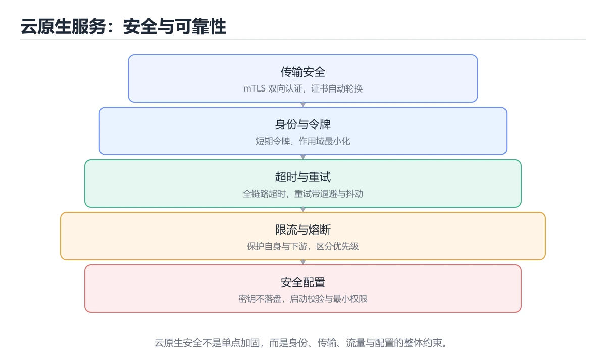
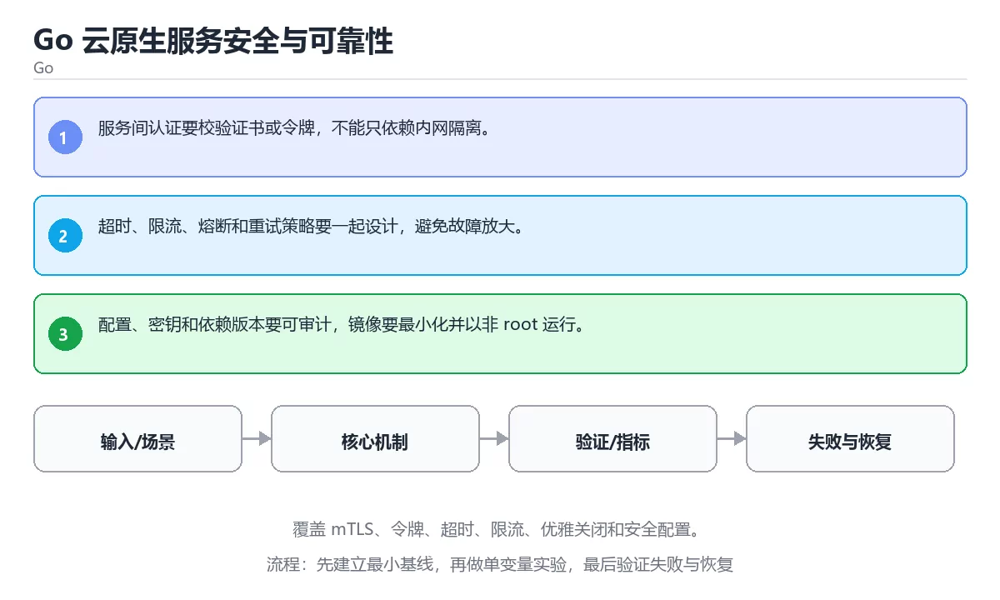

# Go 云原生服务安全与可靠性

> 内容更新时间：2026-10-06 · 学习阶段：高级 · 预计用时：30 分钟





## 本节知识框架

**课程定位**：所属分类 `go`（Go），课程主题 `Go 云原生服务安全与可靠性`，学习阶段 高级，建议用时 45 分钟。

本课主线：覆盖 mTLS、令牌、超时、限流、优雅关闭和安全配置。

**学完本课应当能够**
- 说清 `云原生` 与 `mTLS` 的含义与区别，并各举一个正例和一个反例。
- 用本课示例验证 `限流` 的行为，记录输入、输出与失败条件。
- 遇到「容器默认以 root 运行」这类问题时，能说出触发条件与修复顺序。

### 复习清单

- [ ] 能不看正文复述 云原生，并指出 mTLS 的一个边界或反例。
- [ ] 能推演 云原生 的示例：先写预期输出，再运行并记录差异与失败现象。
- [ ] 能完成一次自测，并把错题对照错误表定位原因。

## 核心概念定义

| 术语 | 操作性定义 | 常见边界与风险 |
| --- | --- | --- |
| 云原生 | 以容器、编排、声明式配置、微服务和可观测性为基础构建和运行应用。 | 本地容器里跑通不等于集群里同样行为：存活与就绪探针、关闭信号都要在编排环境验证，镜像不固定摘要还会让构建不可复现。 |
| mTLS | 双向 TLS：客户端与服务端互相验证证书，常用于服务网格中确认双方身份。 | 易错：以为内网隔离就够；证书或令牌仍要逐跳实际校验，否则任何进程都能冒充对端。 |
| 限流 | 按时间窗口限制请求速率（令牌桶或漏桶），保护后端不被突发流量打垮。 | 限流阈值要和超时、熔断、重试一起设计，单改一处会在故障时放大流量；只在小流量下试过的阈值挡不住突发。 |
| 优雅关闭 | 服务停止时先停止接收新请求，再等待在途任务完成并释放资源。 | 易错：没有健康检查与优雅退出，滚动发布时请求被中断；要先停接收、处理关闭信号，再等在途任务收尾。 |

## 原理与运行机制

### 机制总览

**教材衔接：核心知识**

### 1. 服务间认证要校验证书或令牌，不能只依赖内网隔离。

- 关键做法：先用 package 建立 云原生 的基线，再逐步加入边界与失败条件。
- 验证标准：mTLS 的异常路径有明确错误信息与恢复动作。

### 2. 超时、限流、熔断和重试策略要一起设计，避免故障放大。

把这条结论放回「Go 云原生服务安全与可靠性」的完整流程里展开：

- 正文依据：能用自己的话解释：超时、限流、熔断和重试策略要一起设计，避免故障放大。
- 落地检查：把「2. 超时、限流、熔断和重试策略要一起设计，避免故障放大。」改写成一条可执行的核对项，逐条验证输入、超时与失败路径。

### 3. 配置、密钥和依赖版本要可审计，镜像要最小化并以非 root 运行。

把这条结论放回「Go 云原生服务安全与可靠性」的完整流程里展开：

- 正文依据：合上教程，用 3～5 句话解释Go 云原生服务安全与可靠性。
- 落地检查：把「3. 配置、密钥和依赖版本要可审计，镜像要最小化并以非 root 运行。」改写成一条可执行的核对项，逐条验证输入、超时与失败路径。

**教材衔接：关键流程**

**教材衔接：实践路径**

**教材衔接：版本与时效**

- 升级「Go 云原生服务安全与可靠性」涉及的依赖前，先用 package 复现当前行为，再逐项核对版本说明与破坏性变更。
- 模块校验、最小版本选择与供应链安全是生产升级的重点
- 官方发布说明：https://go.dev/doc/devel/release

### 先建立一个直觉

本课的摘要可以当作一张地图：覆盖 mTLS、令牌、超时、限流、优雅关闭和安全配置。

### 逐步拆解

1. 澄清输入与目标。先写清「Go 云原生服务安全与可靠性」要解决的问题、合法输入范围和成功标准，再进入后续步骤。
2. 描述处理过程。把「云原生、mTLS、限流、优雅关闭」映射到具体步骤，每步都要求能单独验证。
3. 定义输出。把 package 的返回值、日志和失败信号都写清楚，缺一项都不算完整。
4. 让「Go 云原生服务安全与可靠性」的失败路径尽早暴露：把云原生推到边界值，记录错误信息、重试或降级动作，以及人工兜底条件。
5. 用同一个云原生输入跑两遍：一遍按正文步骤，一遍故意跳过一步，比较输出并解释为什么必须按顺序执行。

### 把正文串成一条执行链

- **1. 服务间认证要校验证书或令牌，不能只依赖内网隔离。**：在「Go 云原生服务安全与可靠性」里，「1. 服务间认证要校验证书或令牌，不能只依赖内网隔离。」这一步要先写清输入与预期，再记录实际结果和差异；结果不符时回到对应小节核对前提。
- **2. 超时、限流、熔断和重试策略要一起设计，避免故障放大。**：在「Go 云原生服务安全与可靠性」里，「2. 超时、限流、熔断和重试策略要一起设计，避免故障放大。」这一步要先写清输入与预期，再记录实际结果和差异；结果不符时回到对应小节核对前提。
- **3. 配置、密钥和依赖版本要可审计，镜像要最小化并以非 root 运行。**：在「Go 云原生服务安全与可靠性」里，「3. 配置、密钥和依赖版本要可审计，镜像要最小化并以非 root 运行。」这一步要先写清输入与预期，再记录实际结果和差异；结果不符时回到对应小节核对前提。
- **考点 1：围绕“Go 云原生服务安全与可靠性”中的 云原生、mTLS、限流，下列哪两项是本课强调的实践判断？**：先独立作答，再回到本课对应小节核对判断依据；答错时记录是哪一个前提被忽略。
- **考点 2：核心知识 的代码阅读题**：先独立作答，再回到本课正文核对 package 的执行路径；答错时记录是哪一个前提被忽略。
- **考点 3：关于「配置、密钥和依赖版本要可审计，镜像要最小化并以非 root 运行。」，下列说法正确的是？**：先独立作答，再回到本课对应小节核对判断依据；答错时记录是哪一个前提被忽略。

### 从测验反推易错点

- 参考判断：服务间认证要校验证书或令牌，不能只依赖内网隔离。
- 自问：如果去掉题干里的一个限定词，结论还成立吗？

- 参考判断：超时、限流、熔断和重试策略要一起设计，避免故障放大。

- 参考判断：配置、密钥和依赖版本要可审计，镜像要最小化并以非 root 运行。

**检查点 4：本课的核心学习目标是什么？**

- 参考判断：覆盖 mTLS、令牌、超时、限流、优雅关闭和安全配置。

- 参考判断：Timeout、timeout

### 变式训练

1. 把 云原生 放进一个只有单机、没有额外依赖的小项目，先保证正确再扩展。
2. 扩大 mTLS 的规模，记录本课结论在哪一个量级开始不成立。
3. 让 package 的外部依赖超时，确认系统能回滚或补偿，而不是留下脏数据。
5. 删掉一个看似必要的步骤（例如 云原生 相关的校验），观察哪个测试或指标先失败，用证据说明它为什么不能省。
6. 把 云原生 的方案切换到低资源设备，重新评估默认参数、超时和降级策略。

### 迁移案例库

换一个 mTLS 约束重做一次，确认结论在新条件下是否仍然成立。

#### 迁移案例 1：围绕「云原生」做一次小实验

**验收**：云原生的结论要有证据、差异可解释、失败可恢复；做不到时回到「核心知识」缩小问题范围。

#### 迁移案例 2：围绕「mTLS」做一次小实验

**步骤**：
1. 复述当前方案对「mTLS」的假设，写成一句可证伪的话。

#### 迁移案例 3：围绕「限流」做一次小实验

**步骤**：
1. 复述当前方案对「限流」的假设，写成一句可证伪的话。

#### 迁移案例 4：围绕「优雅关闭」做一次小实验

**步骤**：
1. 复述当前方案对「优雅关闭」的假设，写成一句可证伪的话。

#### 迁移案例 5：围绕「云原生」做一次小实验

**步骤**：

#### 迁移案例 6：围绕「mTLS」做一次小实验

**步骤**：

#### 迁移案例 7：围绕「限流」做一次小实验

**步骤**：

#### 迁移案例 8：围绕「优雅关闭」做一次小实验

**步骤**：

#### 迁移案例 9：围绕「云原生」做一次小实验

**步骤**：

#### 迁移案例 10：围绕「mTLS」做一次小实验

**步骤**：

#### 迁移案例 11：围绕「限流」做一次小实验

**步骤**：

#### 迁移案例 12：围绕「优雅关闭」做一次小实验

**步骤**：

#### 迁移案例 13：围绕「云原生」做一次小实验

**步骤**：

#### 迁移案例 14：围绕「mTLS」做一次小实验

**步骤**：

#### 迁移案例 15：围绕「限流」做一次小实验

**步骤**：

#### 迁移案例 16：围绕「优雅关闭」做一次小实验

**步骤**：

<!-- p0-depth-v2:end -->

**教材衔接：验证步骤**

## 典型应用场景

- **容器默认以 root 运行**：典型现象是逃逸后权限过大；正确做法是用非 root 用户运行并限制内核能力。
- **基础镜像不固定版本**：典型现象是构建结果不可复现，镜像可能被替换；正确做法是固定镜像摘要并定期扫描依赖漏洞。
- **没有健康检查与优雅退出**：典型现象是滚动发布时请求被中断；正确做法是提供存活与就绪探针，并处理关闭信号。

### 最小验证场景

- 准备：保留 `text` 示例的原始输入，先记录 `Go 云原生服务安全与可靠性` 的基线输出和完整运行命令。
- 观察：先核对 调用了 `main()`，再改变一个与 `云原生` 相关的条件。
- 判定：新结果与 `Go 云原生服务安全与可靠性` 的基线不同不等于错误；只有当差异破坏了 `云原生` 的定义或错误表中的约束，才判定为失败。

### 选择与边界

- 使用 `云原生` 时，以容器、编排、声明式配置、微服务和可观测性为基础构建和运行应用；容器与集群环境差异会改变行为，本地通过后仍需在目标编排环境复验。
- 使用 `mTLS` 时，双向 TLS：客户端与服务端互相验证证书，常用于服务网格中确认双方身份。
- 使用 `限流` 时，按时间窗口限制请求速率（令牌桶或漏桶），保护后端不被突发流量打垮；网络延迟、超时与版本协商会改变行为，只在真实链路或多版本客户端上验证才算数。
- 使用 `优雅关闭` 时，服务停止时先停止接收新请求，再等待在途任务完成并释放资源；网络延迟、超时与版本协商会改变行为，只在真实链路或多版本客户端上验证才算数。

## 代码/协议/SQL 示例

### 最小可验证示例

**教材衔接：最小可运行示例**

先用 package 跑通最小示例，然后只改一个与 云原生 相关的取值：

```go
package main

import (
	"fmt"
	"net/http"
	"time"
)

func main() {
	client := &http.Client{Timeout: 2 * time.Second}
	fmt.Println("timeout:", client.Timeout)
}
```

**教材衔接：预期输出**

```text
timeout: 2s
```

## 时间/空间复杂度或性能分析

**性能关注点（Go 云原生服务安全与可靠性）**：调度器与 GC 影响开销：记录 P99 延迟、协程数量与堆占用，优先用 pprof 采样。

**测量方法**：以 `Go 云原生服务安全与可靠性` 的 `云原生` 场景为对象，固定输入跑一遍记录基线，再把规模或并发度提高一个数量级复测；两次结果的差值与波动范围才是结论依据。

## 常见误区与易错点

| 容易写错的做法 | 实际现象 | 原因与正确做法 |
| --- | --- | --- |
| 容器默认以 root 运行 | 逃逸后权限过大。 | 用非 root 用户运行并限制内核能力。 |
| 基础镜像不固定版本 | 构建结果不可复现，镜像可能被替换。 | 固定镜像摘要并定期扫描依赖漏洞。 |
| 没有健康检查与优雅退出 | 滚动发布时请求被中断。 | 提供存活与就绪探针，并处理关闭信号。 |

### 现场 1：容器默认以 root 运行

**症状**：逃逸后权限过大。

**根因与修复**：用非 root 用户运行并限制内核能力。

**自检**：在本课示例里复现「容器默认以 root 运行」，改成用非 root 用户运行并限制内核能力后重跑；如果症状消失且失败路径按预期变化，说明定位正确。

### 现场 2：基础镜像不固定版本

**症状**：构建结果不可复现，镜像可能被替换。

**根因与修复**：固定镜像摘要并定期扫描依赖漏洞。

**自检**：在本课示例里复现「基础镜像不固定版本」，改成固定镜像摘要并定期扫描依赖漏洞后重跑；如果症状消失且失败路径按预期变化，说明定位正确。

### 现场 3：没有健康检查与优雅退出

**症状**：滚动发布时请求被中断。

**根因与修复**：提供存活与就绪探针，并处理关闭信号。

**自检**：在本课示例里复现「没有健康检查与优雅退出」，改成提供存活与就绪探针，并处理关闭信号后重跑；如果症状消失且失败路径按预期变化，说明定位正确。

## 与其他知识点的关系

| 关系 | 课程 | 为什么 |
| --- | --- | --- |
| 先修 | 《Go 性能剖析与调优（进阶）》 | 本课会直接使用它的概念或操作前提。 |
| 关联 | 《Go 第一个程序》 | 用于横向比较或把本课结论迁移到相邻主题。 |
| 前置顺序 | 《Go 性能剖析与调优（进阶）》 | 同分类中安排在本课之前，建议先完成其自测。 |

**教材衔接：复习与迁移**

### 测验回顾

1. 围绕“Go 云原生服务安全与可靠性”中的 云原生、mTLS、限流，下列哪两项是本课强调的实践判断？
   - 依据：本课把Go 云原生服务安全与可靠性拆成概念、示例与故障现场三部分，因此判断 云原生 时必须同时交代输入、输出和失败路径，这使“学习 云原生 时要同时说明输入、输出和失败路径，不能只看正常流程”成立。在Go 云原生服务安全与可靠性里，判断 mTLS 时要固定版本与边界输入，所以“验证 mTLS 时要固定版本并覆盖边界输入，结论才可复现”才可复现。
2. 下面这段 Go 代码摘自「Go 云原生服务安全与可靠性」的正文示例。关于这段代码，下面哪一项说法与实际内容相符？
   - 依据：在「Go 云原生服务安全与可靠性」里，这段代码把主要逻辑封装在函数或方法里，需要被调用才会执行。这段代码出自「Go 云原生服务安全与可靠性」的正文示例，围绕云原生、mTLS、限流展开；把输入或边界换成空值、极值或失败情况后，结论要以「Go 云原生服务安全与可靠性」的实际运行结果为准。
3. 关于「配置、密钥和依赖版本要可审计，镜像要最小化并以非 root 运行。」，下列说法正确的是？
   - 依据：在「Go 云原生服务安全与可靠性」里，配置、密钥和依赖版本要可审计，镜像要最小化并以非 root 运行。在「Go 云原生服务安全与可靠性」里，如果只凭关键词作答，很容易把只要小数据能跑通，大规模和异常情况也一定正确。「Go 云原生服务安全与可靠性」要求先交代云原生、mTLS、限流的前提再下结论，所以“配置、密钥和依赖版本要可审计”只在题干“配置、密钥和依赖版本要可审计”给定的条件下成立。
4. 「Go 云原生服务安全与可靠性」的核心学习目标是什么？
   - 依据：在「Go 云原生服务安全与可靠性」里，结论应落在「覆盖 mTLS、令牌、超时、限流、优雅关闭和安全配置」。在「Go 云原生服务安全与可靠性」里，结论应落在覆盖 mTLS、令牌、超时、限流、优雅关闭和安全配置。在「Go 云原生服务安全与可靠性」里，这道题要求区分概念与边界，覆盖 mTLS、令牌、超时、限流、优雅关闭和安全配置。
5. 补全代码：「Go 云原生服务安全与可靠性」示例中，下面这行代码缺少哪个关键字或函数名？请填入 ____。

## 自测题与参考答案

> 先独立作答，再对照参考答案；答案都能在本课正文、术语表或错误表里找到依据。

### 自测 1（概念复述）

不看正文，写出 `云原生` 的操作性定义，并说明它与 `mTLS` 的区别。

**参考答案**：以容器、编排、声明式配置、微服务和可观测性为基础构建和运行应用。

`mTLS` 的定位是：双向 TLS：客户端与服务端互相验证证书，常用于服务网格中确认双方身份；两者的差别要从适用对象与失败模式上说明。

### 自测 2（排错）

本课错误表记录了「容器默认以 root 运行」这类做法。请写出它会出现的现象、根因，以及修复顺序。

**参考答案**：现象是逃逸后权限过大；正确做法是用非 root 用户运行并限制内核能力。修复时先复现现象并保留证据，再改动一处假设重跑，确认现象消失。

### 自测 3（动手验证）

运行本课的 `text` 示例，把 mTLS 相关的一个值换成边界值，记录输出差异与错误信息。

**参考答案**：正常输入下 `text` 示例应当复现正文给出的结果；改动输入后，如果结果改变或报错，先核对它是否满足 `Go 云原生服务安全与可靠性` 中`云原生` 的适用范围，再检查错误表里是否有同类现象。

### 自测 4（代码阅读）

阅读本课开头的 `text` 示例，说明它体现了`云原生` 的哪一条性质，并指出改动哪个输入会让这条性质不再成立。

**参考答案**：`云原生` 的定义是 以容器、编排、声明式配置、微服务和可观测性为基础构建和运行应用，示例正是在实现这条定义。改动与 `云原生` 有关的一个输入后，如果结果不再符合 `Go 云原生服务安全与可靠性` 的正文描述，就说明该性质只在当前前提成立。

### 自测 5（迁移）

把 `Go 云原生服务安全与可靠性` 的方法迁移到自己的项目：围绕 `云原生` 写出一个与错误表同类的风险点，并说明触发条件和检验方式。

**参考答案**：例如「没有健康检查与优雅退出」，它会导致滚动发布时请求被中断；检验方式是按提供存活与就绪探针，并处理关闭信号改一处再复现，确认现象消失且没有引入新的失败分支。

### 自测 6（对比）

用一个表格对比 `云原生` 与 `mTLS`：各写一行适用场景、一行失败表现。

**参考答案**：`云原生` 的定义是以容器、编排、声明式配置、微服务和可观测性为基础构建和运行应用；`mTLS` 的定义是双向 TLS：客户端与服务端互相验证证书，常用于服务网格中确认双方身份。两者的失败表现分别对应本课错误表里与本术语相关的行。

### 自测 7（排错顺序）

面对「容器默认以 root 运行」引发的问题，请把“复现 逃逸后权限过大 → 保留证据 → 用非 root 用户运行并限制内核能力 → 回归验证”四步写成可执行的检查清单。

**参考答案**：第一步按逃逸后权限过大复现；第二步记录输入、版本与完整报错；第三步按用非 root 用户运行并限制内核能力只改一处；第四步重跑并确认失败路径也按预期变化。

### 自测 8（边界判断）

针对 `优雅关闭`，分别写出“可以使用”的条件和“结论不再成立”的条件。

**参考答案**：网络延迟、超时与版本协商会改变行为，只在真实链路或多版本客户端上验证才算数。 同时要把 `优雅关闭` 的定义 服务停止时先停止接收新请求，再等待在途任务完成并释放资源 与实际输入逐项对照。

### 自测 9（机制重建）

不看正文，按输入、转换、输出、验证四段重建 `云原生` → `mTLS` → `限流` → `优雅关闭` 的作用链。

**参考答案**：起点是 `云原生` 的定义 以容器、编排、声明式配置、微服务和可观测性为基础构建和运行应用；中间每一步都保留可观察状态；终点由 `优雅关闭` 检查，失败时回到错误表定位第一个偏离定义的步骤。

### 自测 10（综合排错）

在 `Go 云原生服务安全与可靠性` 中，现象是 滚动发布时请求被中断。请围绕 没有健康检查与优雅退出 写出最小复现、关键证据、修复动作和回归验证，并说明为什么不能只凭一次运行下结论。

**参考答案**：先复现 没有健康检查与优雅退出，记录输入与完整错误；再按 提供存活与就绪探针，并处理关闭信号 只改一处。回归时同时跑正常路径和边界路径，只有两次结果都可解释，才把修复视为完成。

### 自测 11（一分钟复述）

用每分钟约 200 字的速度复述 `Go 云原生服务安全与可靠性`：先给主问题，再按顺序说出 `云原生`、`mTLS`、`限流`、`优雅关闭`，最后给一个失败案例。

**自评标准**：主问题必须对应 覆盖 mTLS、令牌、超时、限流、优雅关闭和安全配置；每个术语都要能接上一句定义或边界；失败案例必须写成可观察现象，不能用“可能有风险”代替证据。

## 延伸阅读

想更直观地理解本课概念？推荐参阅以下图解专题：

- [图解 HTTPS 证书链与 TLS 握手](visual_https_cert.md)
- [图解 Kubernetes 调度与探针](visual_k8s_scheduling.md)

## 术语速查

| 术语 | 一句话说明 |
| --- | --- |
| `云原生` | 以容器、编排、声明式配置、微服务和可观测性为基础构建和运行应用。 |
| `mTLS` | 双向 TLS：客户端与服务端互相验证证书，常用于服务网格中确认双方身份。 |
| `限流` | 按时间窗口限制请求速率（令牌桶或漏桶），保护后端不被突发流量打垮。 |
| `优雅关闭` | 服务停止时先停止接收新请求，再等待在途任务完成并释放资源。 |

**术语关系**：`云原生`（以容器、编排、声明式配置、微服务和可观测性为基础构建和运行应用） → `mTLS`（双向 TLS：客户端与服务端互相验证证书） → `限流`（按时间窗口限制请求速率（令牌桶或漏桶）） → `优雅关闭`（服务停止时先停止接收新请求）。

## 考点精讲

`Go 云原生服务安全与可靠性` 的题库有 6 道题，下面逐题给出题干、正确项与判断依据：先自己作答，再核对正确项，最后回到正文对应小节复核。

### 考点 1：第 1 题

- **题目**：围绕“Go 云原生服务安全与可靠性”中的 云原生、mTLS、限流，下列哪两项是本课强调的实践判断？
- **正确项**：验证 mTLS 时要固定版本并覆盖边界输入，结论才可复现；学习 云原生 时要同时说明输入、输出和失败路径，不能只看正常流程
- **判断依据**：按《Go 云原生服务安全与可靠性》的正文口径，本题要同时选中「验证 mTLS 时要固定版本并覆盖边界输入，结论才可复现」、「学习 云原生 时要同时说明输入、输出和失败路径，不能只看正常流程」，漏掉任一项都算没答全。术语 云原生（Go 云原生服务安全与可靠性）：以容器、编排、声明式配置、微服务和可观测性为基础构建和运行应用。易错点是容器默认以 root 运行，会造成逃逸后权限过大，改法是用非 root 用户运行并限制内核能力。

### 考点 2：第 2 题

- **题目**：`Go 云原生服务安全与可靠性` 的示例代码用于验证 `云原生`，其背景是覆盖 mTLS、令牌、超时、限流、优雅关闭和安全配置。代码的真实内容是下面哪一项？
- **正确项**：出现字面量 `net/http`
- **判断依据**：本题正确项是「出现字面量 `net/http`」。术语 云原生（Go 云原生服务安全与可靠性）：以容器、编排、声明式配置、微服务和可观测性为基础构建和运行应用，本题取「出现字面量 `net/http`」这条。易错点是基础镜像不固定版本，会造成构建结果不可复现，镜像可能被替换，改法是固定镜像摘要并定期扫描依赖漏洞。本题干扰项「出现字面量 `输出过长：限制长度并要求结构化输出`」不成立：展示代码里找不到 `输出过长：限制长度并要求结构化输出`。

### 考点 3：第 3 题

- **题目**：在 `Go 云原生服务安全与可靠性` 里，与 `云原生` 有关的说法中，哪一项最符合覆盖 mTLS、令牌、超时、限流、优雅关闭和安全配置？
- **正确项**：配置、密钥和依赖版本要可审计，镜像要最小化并以非 root 运行。
- **判断依据**：本题正确项是「配置、密钥和依赖版本要可审计，镜像要最小化并以非 root 运行」。术语 云原生（Go 云原生服务安全与可靠性）：以容器、编排、声明式配置、微服务和可观测性为基础构建和运行应用，本题取「配置、密钥和依赖版本要可审计，镜像要最小化并以非 root 运行」这条。易错点是没有健康检查与优雅退出，会造成滚动发布时请求被中断，改法是提供存活与就绪探针，并处理关闭信号。

### 考点 4：第 4 题

- **题目**：`Go 云原生服务安全与可靠性` 的主线是：覆盖 mTLS、令牌、超时、限流、优雅关闭和安全配置。下面哪一项与这条主线一致？
- **正确项**：覆盖 mTLS、令牌、超时、限流、优雅关闭和安全配置。
- **判断依据**：本题正确项是「覆盖 mTLS、令牌、超时、限流、优雅关闭和安全配置」。术语 云原生（Go 云原生服务安全与可靠性）：以容器、编排、声明式配置、微服务和可观测性为基础构建和运行应用，本题取「覆盖 mTLS、令牌、超时、限流、优雅关闭和安全配置」这条。易错点是容器默认以 root 运行，会造成逃逸后权限过大，改法是用非 root 用户运行并限制内核能力。

### 考点 5：第 5 题

- **题目**：填空：补齐下面这段术语说明中的空缺。课程 `覆盖 mTLS、令牌、超时、限流、优雅关闭和安全配置。`，这段说明是：`____`：双向 TLS：客户端与服务端互相验证证书，常用于服务网格中确认双方身份。空缺处应填哪个术语？
- **正确项**：mTLS
- **判断依据**：《Go 云原生服务安全与可靠性》这题的填空口径是「mTLS」或「mtls」，正文写法与其中任一项一致即可。术语「mTLS」在本课里的界定是双向 TLS：客户端与服务端互相验证证书，常用于服务网格中确认双方身份，题干问的就是这一条。常见错法是容器默认以 root 运行，其后果是逃逸后权限过大。正确做法是用非 root 用户运行并限制内核能力。

### 考点 6：第 6 题

- **题目**：下面几项都与 `云原生` 有关，请按 `Go 云原生服务安全与可靠性` 的正文顺序排列；该课主线是覆盖 mTLS、令牌、超时、限流、优雅关闭和安全配置。
- **正确项**：云原生 → mTLS → 限流 → 优雅关闭
- **判断依据**：按《Go 云原生服务安全与可靠性》正文首次出现的先后，本题顺序是「云原生」 → 「mTLS」 → 「限流」 → 「优雅关闭」。术语「云原生」在本课里的界定是以容器、编排、声明式配置、微服务和可观测性为基础构建和运行应用，题干「下面几项都与 `云原生` 有关，请按 `Go 云原生服务安全与可靠性` 的正文顺序排列；该课主线是覆盖 mTLS、令牌、超时、限流、优雅关闭和安全配置。」问的就是这一条。常见错法是容器默认以 root 运行，其后果是逃逸后权限过大。正确做法是用非 root 用户运行并限制内核能力。

### 考点 7：`云原生`

- **要点**：以容器、编排、声明式配置、微服务和可观测性为基础构建和运行应用。
- **云原生 的边界**：容器与集群环境差异会改变行为，本地通过后仍需在目标编排环境复验。

### 考点 8：`mTLS`

- **要点**：双向 TLS：客户端与服务端互相验证证书，常用于服务网格中确认双方身份。

### 考点 9：`限流`

- **要点**：按时间窗口限制请求速率（令牌桶或漏桶），保护后端不被突发流量打垮。
- **限流 的边界**：网络延迟、超时与版本协商会改变行为，只在真实链路或多版本客户端上验证才算数。

### 考点 10：`优雅关闭`

- **要点**：服务停止时先停止接收新请求，再等待在途任务完成并释放资源。
- **优雅关闭 的边界**：网络延迟、超时与版本协商会改变行为，只在真实链路或多版本客户端上验证才算数。

### 考点 11：排错——容器默认以 root 运行

- **现象**：逃逸后权限过大。
- **处理**：用非 root 用户运行并限制内核能力。

### 考点 12：排错——基础镜像不固定版本

- **现象**：构建结果不可复现，镜像可能被替换。
- **处理**：固定镜像摘要并定期扫描依赖漏洞。

### 考点 13：综合辨析——`云原生` 与 `优雅关闭`

- **辨析点**：`云原生` 的定义是 以容器、编排、声明式配置、微服务和可观测性为基础构建和运行应用；`优雅关闭` 的定义是 服务停止时先停止接收新请求，再等待在途任务完成并释放资源。
- **答题要求**：面对 `Go 云原生服务安全与可靠性` 的题目，先判断描述的是 `云原生` 还是 `优雅关闭`，再归到对应定义，最后写出一个会让该定义失效的边界输入。

### 考点 14：排错评分点

- **现象分**：能写出 逃逸后权限过大，而不是只写“程序有错”。
- **证据分**：保留触发 容器默认以 root 运行 的输入、版本和错误原文。
- **修复分**：按 用非 root 用户运行并限制内核能力 只改一处，并同时回归正常路径与边界路径。

## 内容元数据

- 内容版本：v2.0
- 最后更新：2026-10-06
- 学习阶段：高级
- 适用环境：Go 1.24+；本课聚焦 云原生。
- 内容来源：内置结构化课程与工程实践整理
- 相关主题：云原生、mTLS、限流、优雅关闭
- 质量版本：P0 测验标准 + P1 覆盖扩展 + P2 体验补全

## 参考资料与复核

- 最后复核：2026-10-04
- 下次复核：2027-04-10
- 复核范围：版本兼容、API 行为、安全建议与工程实践
- 来源性质：官方文档、标准或权威教材；本课核对关键词：云原生、mTLS、限流、优雅关闭。

| 参考资料 | 本课用途 |
| --- | --- |
| [net/http](https://pkg.go.dev/net/http) | HTTP 客户端与服务端 |
| [Go 内存模型](https://go.dev/ref/mem) | 并发读写与同步语义 |
| [Go 测试](https://go.dev/doc/tutorial/add-a-test) | 测试、基准与覆盖率 |

| [本课术语索引：Go 云原生服务安全与可靠性](#核心概念定义) | 按本课输入、术语边界和错误表现逐项核对 |
> 「Go 云原生服务安全与可靠性」的链接用于离线阅读后的延伸核对；App 不会自动联网。