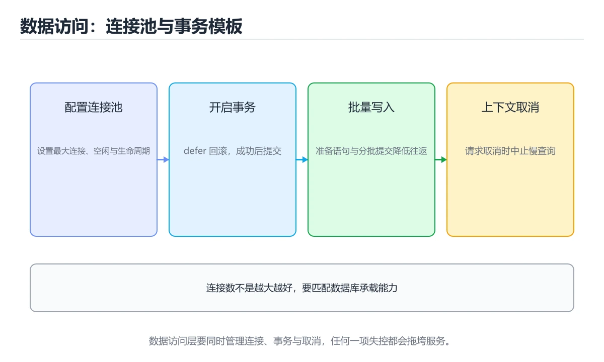
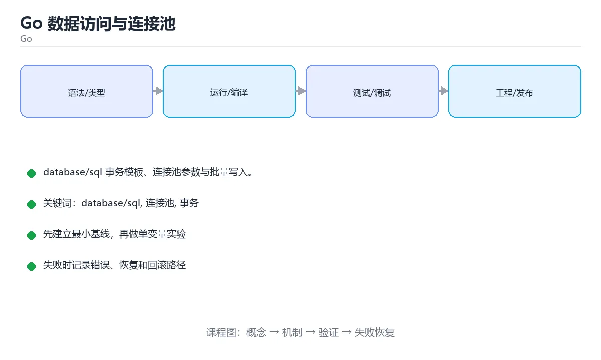

# Go 数据访问与连接池

> 内容更新时间：2026-10-06 · 学习阶段：进阶 · 预计用时：45 分钟





## 本节知识框架

**课程定位**：所属分类 `go`（Go），课程主题 `Go 数据访问与连接池`，学习阶段 进阶，建议用时 50 分钟。

本课主线：database/sql 事务模板、连接池参数与批量写入。

**学完本课应当能够**
- 说清 `连接池` 与 `事务` 的含义与区别，并各举一个正例和一个反例。
- 用本课示例验证 `批量插入` 的行为，记录输入、输出与失败条件。
- 遇到「以为 `sql.Open` 会连库」这类问题时，能说出触发条件与修复顺序。

### 复习清单

- [ ] 能讲清 database/sql 与 连接池 的分工，并指出其中一个前提失效的边界。
- [ ] 能运行「Go 数据访问与连接池」的示例，记录输入、输出与第一次失败的现象。
- [ ] 能完成一次自测，并把错题对照错误表定位原因。

## 核心概念定义

| 术语 | 操作性定义 | 常见边界与风险 |
| --- | --- | --- |
| 连接池 | 复用一组已建立的数据库连接，避免每次请求都握手；需要配好最大连接数与超时。 | 易错：数据库连接打满；正确做法是按数据库承载能力设定。 |
| 事务 | 一组要么全部成功要么全部回滚的数据库操作。 | 易错：回滚不生效；正确做法是用 `err =`。 |
| 批量插入 | 把多行数据合并成多值 INSERT 或批量语句，减少往返次数，是导入数据的基本优化。 | 循环里仍逐条执行等于没优化；合并成一个事务时还要保持短小，避免长时间持锁。 |
| 参数化查询 | 用占位符绑定参数而不是拼接 SQL，既防注入也让数据库复用执行计划。 | 易错：以为换成占位符查询就快了；计划能否复用还要看索引与参数，慢的时候该看执行计划而不是只确认结果正确。 |

## 原理与运行机制

### 机制总览

| 阶段 | 关注对象 | 失败时应检查 |
| --- | --- | --- |
| 输入 | 连接池 | 类型、范围、编码、版本或前置状态是否满足定义。 |
| 处理 | 事务 | 顺序、可见性、锁、路由、事务或调度规则是否被破坏。 |
| 输出 | 批量插入 | 结果是否可复现，错误是否被正确传播而不是被吞掉。 |

**教材衔接：方案选型速查**

| 方案 | 类型安全 | 学习成本 | 适用 |
| --- | --- | --- | --- |
| `database/sql` | 手写扫描 | 低 | 简单查询、完全掌控 SQL |
| sqlc | 由 SQL 生成类型安全代码 | 中 | 想要类型安全又不想写 ORM |
| GORM | 链式 API + 自动迁移 | 中 | 快速开发 CRUD |
| ent | 代码生成 + 图查询 | 中高 | 复杂关系模型 |

要点：**无论用哪种方案，SQL 与索引设计仍是性能的决定因素**，ORM 只改变写法。

**教材衔接：必守规则速查**

| 规则 | 原因 |
| --- | --- |
| 永远用参数化查询 | 防止 SQL 注入 |
| 每个查询带 context 超时 | 避免慢查询拖垮服务 |
| 用 `rows.Close()` 与检查 `rows.Err()` | 释放连接并发现遍历中的错误 |
| 只取需要的列 | 减少网络与内存开销 |
| 分页用游标而非大 OFFSET | 深分页会扫描大量行 |
| 不要在循环里单条查询 | N+1 问题，改批量或 JOIN |
| 事务保持短小 | 长事务持锁、放大主从延迟 |
| 连接池与数据库上限对齐 | 连接打满会导致整体不可用 |

**教材衔接：版本与时效**

- 升级前确认 database/sql 的兼容范围，把不可回退的改动单独拆成一次提交。
- 模块校验、最小版本选择与供应链安全是生产升级的重点
- 官方发布说明：https://go.dev/doc/devel/release

## 典型应用场景

- **以为 `sql.Open` 会连库**：典型现象是错误延后暴露；正确做法是用 `PingContext` 验证。
- **忘了 `rows.Close()`**：典型现象是连接泄漏，池被耗尽；正确做法是拿到 rows 立刻 defer。
- **漏检查 `rows.Err()`**：典型现象是遍历中途的错误被吞；正确做法是循环后必须检查。
- **用字符串拼 SQL**：典型现象是SQL 注入；正确做法是一律用参数占位。

### 最小验证场景

- 准备：保留 `go` 示例的原始输入，先记录 `Go 数据访问与连接池` 的基线输出和完整运行命令。
- 观察：先核对 调用了 `NewDB()`，再改变一个与 `连接池` 相关的条件。
- 判定：新结果与 `Go 数据访问与连接池` 的基线不同不等于错误；只有当差异破坏了 `连接池` 的定义或错误表中的约束，才判定为失败。

### 选择与边界

- 使用 `连接池` 时，复用一组已建立的数据库连接，避免每次请求都握手；需要配好最大连接数与超时；易错：数据库连接打满；正确做法是按数据库承载能力设定。
- 使用 `事务` 时，一组要么全部成功要么全部回滚的数据库操作；易错：回滚不生效；正确做法是用 `err =`。
- 使用 `批量插入` 时，把多行数据合并成多值 INSERT 或批量语句，减少往返次数，是导入数据的基本优化。
- 使用 `参数化查询` 时，用占位符绑定参数而不是拼接 SQL，既防注入也让数据库复用执行计划；索引命中与数据分布决定实际开销，判断前先看执行计划而不是只看结果是否正确。

## 代码/协议/SQL 示例

### 最小可验证示例

```go
// 初始化连接池：显式设置参数并验证连通性
func NewDB(ctx context.Context, dsn string) (*sql.DB, error) {
	db, err := sql.Open("pgx", dsn)
	if err != nil {
		return nil, fmt.Errorf("打开数据库: %w", err)
	}
	db.SetMaxOpenConns(20)
	db.SetMaxIdleConns(20)
	db.SetConnMaxLifetime(30 * time.Minute)
	db.SetConnMaxIdleTime(5 * time.Minute)

	pingCtx, cancel := context.WithTimeout(ctx, 3*time.Second)
	defer cancel()
	if err := db.PingContext(pingCtx); err != nil {
		return nil, fmt.Errorf("连接检测失败: %w", err)
	}
	return db, nil
}

// 事务模板：用 defer 保证回滚，提交失败也回滚
func Transfer(ctx context.Context, db *sql.DB, from, to int64, cents int64) error {
	tx, err := db.BeginTx(ctx, &sql.TxOptions{Isolation: sql.LevelReadCommitted})
	if err != nil {
		return fmt.Errorf("开启事务: %w", err)
	}
	defer func() {
		_ = tx.Rollback()               // 已提交时返回 ErrTxDone，可忽略
	}()

	if _, err := tx.ExecContext(ctx,
		`UPDATE accounts SET balance = balance - $1 WHERE id = $2 AND balance >= $1`,
		cents, from); err != nil {
		return fmt.Errorf("扣款: %w", err)
	}
	if _, err := tx.ExecContext(ctx,
		`UPDATE accounts SET balance = balance + $1 WHERE id = $2`,
		cents, to); err != nil {
		return fmt.Errorf("入账: %w", err)
	}
	return tx.Commit()
}

// 批量插入：预编译语句 + 单事务，避免 N 次往返
func BatchInsert(ctx context.Context, db *sql.DB, rows [][]any) error {
	tx, err := db.BeginTx(ctx, nil)
	if err != nil {
		return err
	}
	defer func() { _ = tx.Rollback() }()

	stmt, err := tx.PrepareContext(ctx, `INSERT INTO orders(user_id, amount_cents) VALUES ($1, $2)`)
	if err != nil {
		return err
	}
	defer stmt.Close()

	for _, row := range rows {
		if _, err := stmt.ExecContext(ctx, row...); err != nil {
			return fmt.Errorf("插入失败: %w", err)
		}
	}
	return tx.Commit()
}
```

**教材衔接：连接池参数速查**

| 参数 | 含义 | 建议 |
| --- | --- | --- |
| `SetMaxOpenConns` | 最大连接数 | 按数据库承载能力设定，避免打满 |
| `SetMaxIdleConns` | 空闲连接数 | 与最大连接数接近，减少频繁建连 |
| `SetConnMaxLifetime` | 连接最长存活 | 几分钟到半小时，避开数据库侧超时 |
| `SetConnMaxIdleTime` | 空闲多久回收 | 与负载波动匹配 |
| `context` 超时 | 单次查询超时 | 每个查询都要设 |

**教材衔接：零基础详解：Go 访问数据库**

### 一句话说清它是什么

Go 用 `database/sql` 统一访问各种数据库：**连接池 + 预编译语句 + context + 事务** 是四块基石。
用 ORM 也可以，但先理解这四块，出问题时才知道从哪查。

### 用生活比喻理解

| 概念 | 比喻 | 说明 |
| --- | --- | --- |
| 连接池 | 车队的车辆 | 复用连接，避免每次新建 |
| 预编译语句 | 固定模具 | SQL 结构与数据分离，防注入 |
| context | 任务时限 | 超时就取消，别一直等 |
| 事务 | 打包操作 | 要么全成功，要么全回滚 |
| N+1 查询 | 来回跑仓库 | 一次能取的别拆成 N 次 |

### 连接池的四个关键参数

```go
db, err := sql.Open("postgres", dsn)     // 注意：Open 不会真的连库
if err != nil {
    return err
}

db.SetMaxOpenConns(25)                   // 最大连接数
db.SetMaxIdleConns(10)                   // 空闲连接数
db.SetConnMaxLifetime(30 * time.Minute)  // 连接最长寿命
db.SetConnMaxIdleTime(5 * time.Minute)   // 空闲多久回收

ctx, cancel := context.WithTimeout(context.Background(), 3*time.Second)
defer cancel()
if err := db.PingContext(ctx); err != nil {   // 真正验证连通性
    return fmt.Errorf("数据库不可用: %w", err)
}
```

| 参数 | 设太小 | 设太大 |
| --- | --- | --- |
| MaxOpenConns | 请求排队 | 压垮数据库 |
| MaxIdleConns | 频繁建连 | 占用连接 |
| ConnMaxLifetime | 用到被服务端断开的连接 | 连接复用不足 |

### 查询三步：Query、Scan、Close

```go
func ListUsers(ctx context.Context, db *sql.DB, minAge int) ([]User, error) {
    const query = `
        SELECT id, name, age
        FROM users
        WHERE age >= $1
        ORDER BY id
        LIMIT 100`

    rows, err := db.QueryContext(ctx, query, minAge)   // 参数化，别拼接
    if err != nil {
        return nil, fmt.Errorf("查询用户: %w", err)
    }
    defer rows.Close()                                  // 必须关闭

    var users []User
    for rows.Next() {
        var u User
        if err := rows.Scan(&u.ID, &u.Name, &u.Age); err != nil {
            return nil, fmt.Errorf("扫描行: %w", err)
        }
        users = append(users, u)
    }
    if err := rows.Err(); err != nil {                  // 别漏掉这一步
        return nil, fmt.Errorf("遍历结果: %w", err)
    }
    return users, nil
}
```

**三个必须做的动作**：`defer rows.Close()`、检查 `rows.Err()`、用 `QueryContext` 传 context。

### 单行查询与「没找到」

```go
var u User
err := db.QueryRowContext(ctx, query, id).Scan(&u.ID, &u.Name, &u.Age)
switch {
case errors.Is(err, sql.ErrNoRows):
    return User{}, ErrNotFound        // 业务错误，不是系统错误
case err != nil:
    return User{}, fmt.Errorf("查询用户 %d: %w", id, err)
}
```

不要把 `sql.ErrNoRows` 当成 500 错误返回给用户。

### 事务：三步不能少

```go
func Transfer(ctx context.Context, db *sql.DB, from, to int, amount int) error {
    tx, err := db.BeginTx(ctx, &sql.TxOptions{Isolation: sql.LevelSerializable})
    if err != nil {
        return fmt.Errorf("开启事务: %w", err)
    }
    defer func() {
        if err != nil {                 // 出错就回滚
            _ = tx.Rollback()
        }
    }()

    if _, err = tx.ExecContext(ctx, `UPDATE accounts SET balance = balance - $1 WHERE id = $2`, amount, from); err != nil {
        return fmt.Errorf("扣款: %w", err)
    }
    if _, err = tx.ExecContext(ctx, `UPDATE accounts SET balance = balance + $1 WHERE id = $2`, amount, to); err != nil {
        return fmt.Errorf("入账: %w", err)
    }
    if err = tx.Commit(); err != nil {
        return fmt.Errorf("提交: %w", err)
    }
    return nil
}
```

注意 `defer` 里闭合的是外层的 `err` 变量，所以要用 `err =` 而不是 `:=`。

### 避免 N+1 查询

```go
// 反例：先查 100 个订单，再为每个订单查一次用户 —— 共 101 次查询
for _, o := range orders {
    _ = db.QueryRow("SELECT name FROM users WHERE id = $1", o.UserID)
}

// 正例：一次查回来，在内存里做映射
// SELECT id, name FROM users WHERE id = ANY($1)
nameByID := make(map[int]string, len(userIDs))
// ... 填充
```

### database/sql、sqlc、GORM 怎么选

| 方案 | 特点 | 适合 |
| --- | --- | --- |
| `database/sql` | 手写 SQL，最可控 | 追求性能与可控性 |
| `sqlc` | 写 SQL 自动生成类型安全代码 | **推荐的中间路线** |
| `GORM` | 全功能 ORM，上手快 | 快速开发、CRUD 多 |

### 新手最容易踩的八个坑

| 坑 | 现象 | 正确做法 |
| --- | --- | --- |
| 以为 `sql.Open` 会连库 | 错误延后暴露 | 用 `PingContext` 验证 |
| 忘了 `rows.Close()` | 连接泄漏，池被耗尽 | 拿到 rows 立刻 defer |
| 漏检查 `rows.Err()` | 遍历中途的错误被吞 | 循环后必须检查 |
| 用字符串拼 SQL | SQL 注入 | 一律用参数占位 |
| 事务里用 `:=` 重新声明 err | 回滚不生效 | 用 `err =` |
| 把 `sql.ErrNoRows` 当系统错误 | 用户看到 500 | 转成业务错误 |
| 请求级操作不带 context | 无法取消，慢查询拖垮服务 | 全部传 `ctx` |
| 循环里查数据库 | N+1，性能极差 | 批量查询 + 内存映射 |

### 手把手练习：带分页与批量查询

```go
type User struct {
    ID   int
    Name string
}

func ListByIDs(ctx context.Context, db *sql.DB, ids []int) ([]User, error) {
    if len(ids) == 0 {
        return nil, nil
    }

    // PostgreSQL 用 ANY($1)；MySQL 可用 IN (?,?,?) 动态占位
    rows, err := db.QueryContext(ctx,
        `SELECT id, name FROM users WHERE id = ANY($1)`, pq.Array(ids))
    if err != nil {
        return nil, fmt.Errorf("批量查询: %w", err)
    }
    defer rows.Close()

    users := make([]User, 0, len(ids))
    for rows.Next() {
        var u User
        if err := rows.Scan(&u.ID, &u.Name); err != nil {
            return nil, fmt.Errorf("扫描: %w", err)
        }
        users = append(users, u)
    }
    if err := rows.Err(); err != nil {
        return nil, fmt.Errorf("遍历: %w", err)
    }
    return users, nil
}
```

### 学完自测

- [ ] 能说出连接池四个参数各自的作用。
- [ ] 知道 `sql.Open` 与 `PingContext` 的区别。
- [ ] 能说出查询结果必须做的三个收尾动作。
- [ ] 知道事务里为什么要注意 `err` 的声明方式。
- [ ] 能说出 N+1 查询的成因与解决思路。

**运行方式**：运行 `Go 数据访问与连接池` 的示例时，用 `go run 文件名.go` 运行；模块依赖由 `go mod` 管理。

## 时间/空间复杂度或性能分析

**性能关注点（Go 数据访问与连接池）**：调度器与 GC 影响开销：记录 P99 延迟、协程数量与堆占用，优先用 pprof 采样。

**本课特有开销（Go 数据访问与连接池 · database/sql）**：长事务会放大锁等待，记录事务持续时间与锁冲突次数。

**测量方法**：以 `Go 数据访问与连接池` 的 `database/sql` 场景为对象，固定输入跑一遍记录基线，再把规模或并发度提高一个数量级复测；两次结果的差值与波动范围才是结论依据。

## 常见误区与易错点

| 容易写错的做法 | 实际现象 | 原因与正确做法 |
| --- | --- | --- |
| 以为 `sql.Open` 会连库 | 错误延后暴露 | 用 `PingContext` 验证 |
| 忘了 `rows.Close()` | 连接泄漏，池被耗尽 | 拿到 rows 立刻 defer |
| 漏检查 `rows.Err()` | 遍历中途的错误被吞 | 循环后必须检查 |
| 用字符串拼 SQL | SQL 注入 | 一律用参数占位 |
| 事务里用 `:=` 重新声明 err | 回滚不生效 | 用 `err =` |
| 把 `sql.ErrNoRows` 当系统错误 | 用户看到 500 | 转成业务错误 |
| 请求级操作不带 context | 无法取消，慢查询拖垮服务 | 全部传 `ctx` |
| 循环里查数据库 | N+1，性能极差 | 批量查询 + 内存映射 |
| 用字符串拼接 SQL | 注入漏洞 | 一律参数化 |
| 忘记 `rows.Close()` | 连接泄漏、池被耗尽 | `defer rows.Close()` |
| 不检查 `rows.Err()` | 中途错误被忽略 | 遍历后必须检查 |
| 事务里做网络调用 | 长事务、锁等待 | 外部调用放事务外 |
| 连接池设得过大 | 数据库连接打满 | 按数据库承载能力设定 |
| `sql.Open` 返回即认为连通 | 首次查询才报错 | 用 `PingContext` 验证 |
| 循环里逐条插入 | 极慢 | 预编译语句加单事务批处理 |
| 用 `SELECT *` | 列变更导致扫描错位 | 显式列出列 |
| 忘记 rows.Close() | 连接泄漏、池被耗尽。 | defer rows.Close()。 |
| 不检查 rows.Err() | 中途错误被忽略。 | 遍历后必须检查。 |

### 现场 1：以为 `sql.Open` 会连库

**症状**：错误延后暴露。

**根因与修复**：用 `PingContext` 验证。

**自检**：在本课示例里复现「以为 `sql.Open` 会连库」，改成用 `PingContext` 验证后重跑；如果症状消失且失败路径按预期变化，说明定位正确。

### 现场 2：忘了 `rows.Close()`

**症状**：连接泄漏，池被耗尽。

**根因与修复**：拿到 rows 立刻 defer。

**自检**：在本课示例里复现「忘了 `rows.Close()`」，改成拿到 rows 立刻 defer后重跑；如果症状消失且失败路径按预期变化，说明定位正确。

### 现场 3：漏检查 `rows.Err()`

**症状**：遍历中途的错误被吞。

**根因与修复**：循环后必须检查。

**自检**：在本课示例里复现「漏检查 `rows.Err()`」，改成循环后必须检查后重跑；如果症状消失且失败路径按预期变化，说明定位正确。

### 现场 4：用字符串拼 SQL

**症状**：SQL 注入。

**根因与修复**：一律用参数占位。

**自检**：在本课示例里复现「用字符串拼 SQL」，改成一律用参数占位后重跑；如果症状消失且失败路径按预期变化，说明定位正确。

### 现场 5：事务里用 `:=` 重新声明 err

**症状**：回滚不生效。

**根因与修复**：用 `err =`。

**自检**：在本课示例里复现「事务里用 `:=` 重新声明 err」，改成用 `err =`后重跑；如果症状消失且失败路径按预期变化，说明定位正确。

### 现场 6：把 `sql.ErrNoRows` 当系统错误

**症状**：用户看到 500。

**根因与修复**：转成业务错误。

**自检**：在本课示例里复现「把 `sql.ErrNoRows` 当系统错误」，改成转成业务错误后重跑；如果症状消失且失败路径按预期变化，说明定位正确。

### 现场 7：请求级操作不带 context

**症状**：无法取消，慢查询拖垮服务。

**根因与修复**：全部传 `ctx`。

**自检**：在本课示例里复现「请求级操作不带 context」，改成全部传 `ctx`后重跑；如果症状消失且失败路径按预期变化，说明定位正确。

### 现场 8：循环里查数据库

**症状**：N+1，性能极差。

**根因与修复**：批量查询 + 内存映射。

**自检**：在本课示例里复现「循环里查数据库」，改成批量查询 + 内存映射后重跑；如果症状消失且失败路径按预期变化，说明定位正确。

### 现场 9：用字符串拼接 SQL

**症状**：注入漏洞。

**根因与修复**：一律参数化。

**自检**：在本课示例里复现「用字符串拼接 SQL」，改成一律参数化后重跑；如果症状消失且失败路径按预期变化，说明定位正确。

## 与其他知识点的关系

- **先修**：`Go 测试进阶：基准、模糊与集成`。本课默认这些内容已经掌握。
- **相关或后续**：`实战：Go REST API 服务`、`数据库访问与 ORM：九种生态横向对照`。本课术语会在这些课程里继续使用。
- **术语归属**：`连接池`、`事务`、`批量插入` 的定义以本课「核心概念定义」为准，换到其他课程时先确认定义是否被改写。

## 自测题与参考答案

> 先独立作答，再对照参考答案；答案都能在本课正文、术语表或错误表里找到依据。

### 自测 1（概念复述）

不看正文，写出 `连接池` 的操作性定义，并说明它与 `事务` 的区别。

**参考答案**：复用一组已建立的数据库连接，避免每次请求都握手；需要配好最大连接数与超时。

`事务` 的定位是：一组要么全部成功要么全部回滚的数据库操作；两者的差别要从适用对象与失败模式上说明。

### 自测 2（排错）

本课错误表记录了「以为 `sql.Open` 会连库」这类做法。请写出它会出现的现象、根因，以及修复顺序。

**参考答案**：现象是错误延后暴露；正确做法是用 `PingContext` 验证。修复时先复现现象并保留证据，再改动一处假设重跑，确认现象消失。

### 自测 3（动手验证）

运行本课的 `go` 示例，把其中的 `"pgx"` 换成一个边界值后重新运行，记录输出与错误信息。

**参考答案**：正常输入下 `go` 示例应当复现正文给出的结果；把 `"pgx"` 换成边界值后，如果结果改变或报错，先核对它是否满足 `Go 数据访问与连接池` 中`连接池` 的适用范围，再检查错误表里是否有同类现象。

### 自测 4（代码阅读）

阅读本课开头的 `go` 示例，说明它体现了`连接池` 的哪一条性质，并指出改动哪个输入会让这条性质不再成立。

**参考答案**：`连接池` 的定义是 复用一组已建立的数据库连接，避免每次请求都握手，需要配好最大连接数与超时，示例正是在实现这条定义。改动与 `连接池` 有关的一个输入后，如果结果不再符合 `Go 数据访问与连接池` 的正文描述，就说明该性质只在当前前提成立。

### 自测 5（迁移）

把 `Go 数据访问与连接池` 的方法迁移到自己的项目：围绕 `连接池` 写出一个与错误表同类的风险点，并说明触发条件和检验方式。

**参考答案**：例如「不检查 rows.Err()」，它会导致中途错误被忽略；检验方式是按遍历后必须检查改一处再复现，确认现象消失且没有引入新的失败分支。

### 自测 6（对比）

用一个表格对比 `连接池` 与 `事务`：各写一行适用场景、一行失败表现。

**参考答案**：`连接池` 的定义是复用一组已建立的数据库连接，避免每次请求都握手；需要配好最大连接数与超时；`事务` 的定义是一组要么全部成功要么全部回滚的数据库操作。两者的失败表现分别对应本课错误表里与本术语相关的行。

### 自测 7（排错顺序）

面对「以为 `sql.Open` 会连库」引发的问题，请把“复现 错误延后暴露 → 保留证据 → 用 `PingContext` 验证 → 回归验证”四步写成可执行的检查清单。

**参考答案**：第一步按错误延后暴露复现；第二步记录输入、版本与完整报错；第三步按用 `PingContext` 验证只改一处；第四步重跑并确认失败路径也按预期变化。

### 自测 8（边界判断）

针对 `参数化查询`，分别写出“可以使用”的条件和“结论不再成立”的条件。

**参考答案**：索引命中与数据分布决定实际开销，判断前先看执行计划而不是只看结果是否正确。 同时要把 `参数化查询` 的定义 用占位符绑定参数而不是拼接 SQL，既防注入也让数据库复用执行计划 与实际输入逐项对照。

### 自测 9（机制重建）

不看正文，按输入、转换、输出、验证四段重建 `连接池` → `事务` → `批量插入` → `参数化查询` 的作用链。

**参考答案**：起点是 `连接池` 的定义 复用一组已建立的数据库连接，避免每次请求都握手；需要配好最大连接数与超时；中间每一步都保留可观察状态；终点由 `参数化查询` 检查，失败时回到错误表定位第一个偏离定义的步骤。

### 自测 10（综合排错）

在 `Go 数据访问与连接池` 中，现象是 中途错误被忽略。请围绕 不检查 rows.Err() 写出最小复现、关键证据、修复动作和回归验证，并说明为什么不能只凭一次运行下结论。

**参考答案**：先复现 不检查 rows.Err()，记录输入与完整错误；再按 遍历后必须检查 只改一处。回归时同时跑正常路径和边界路径，只有两次结果都可解释，才把修复视为完成。

### 自测 11（一分钟复述）

用每分钟约 200 字的速度复述 `Go 数据访问与连接池`：先给主问题，再按顺序说出 `连接池`、`事务`、`批量插入`、`参数化查询`，最后给一个失败案例。

**自评标准**：主问题必须对应 database/sql 事务模板、连接池参数与批量写入；每个术语都要能接上一句定义或边界；失败案例必须写成可观察现象，不能用“可能有风险”代替证据。

## 延伸阅读

想更直观地理解本课概念？推荐参阅以下图解专题：

- [图解 B+ 树与数据库索引](visual_btree_index.md)

## 术语速查

| 术语 | 一句话说明 |
| --- | --- |
| `连接池` | 复用一组已建立的数据库连接，避免每次请求都握手；需要配好最大连接数与超时。 |
| `事务` | 一组要么全部成功要么全部回滚的数据库操作。 |
| `批量插入` | 把多行数据合并成多值 INSERT 或批量语句，减少往返次数，是导入数据的基本优化。 |
| `参数化查询` | 用占位符绑定参数而不是拼接 SQL，既防注入也让数据库复用执行计划。 |

**术语关系**：`连接池`（复用一组已建立的数据库连接） → `事务`（一组要么全部成功要么全部回滚的数据库操作） → `批量插入`（把多行数据合并成多值 INSERT 或批量语句） → `参数化查询`（用占位符绑定参数而不是拼接 SQL）。

## 考点精讲

`Go 数据访问与连接池` 的题库有 6 道题，下面逐题给出题干、正确项与判断依据：先自己作答，再核对正确项，最后回到正文对应小节复核。

### 考点 1：第 1 题

- **题目**：`Go 数据访问与连接池` 的示例代码用于验证 `连接池`，其背景是database/sql 事务模板、连接池参数与批量写入。代码的真实内容是下面哪一项？
- **正确项**：出现字面量 `入账: %w`
- **判断依据**：本题正确项是「出现字面量 `入账: %w`」。术语 连接池（Go 数据访问与连接池）：复用一组已建立的数据库连接，避免每次请求都握手，需要配好最大连接数与超时，本题取「出现字面量 `入账: %w`」这条。易错点是以为 `sql.Open` 会连库，会造成错误延后暴露，改法是用 `PingContext` 验证。本题干扰项「出现字面量 `Effect`」不成立：展示代码里找不到 `Effect`。

### 考点 2：第 2 题

- **题目**：遍历 Query 结果集后，必须做什么？
- **正确项**：关闭 rows 并检查 rows.Err
- **判断依据**：本题正确项是「关闭 rows 并检查 rows.Err」。术语 连接池（Go 数据访问与连接池）：复用一组已建立的数据库连接，避免每次请求都握手，需要配好最大连接数与超时，本题取「关闭 rows 并检查 rows.Err」这条。易错点是忘了 `rows.Close()`，会造成连接泄漏，池被耗尽，改法是拿到 rows 立刻 defer。

### 考点 3：第 3 题

- **题目**：批量插入大量数据，性能最好的写法是？
- **正确项**：预编译语句加单个事务批量执行
- **判断依据**：本题正确项是「预编译语句加单个事务批量执行」。术语 事务（Go 数据访问与连接池）：一组要么全部成功要么全部回滚的数据库操作，本题取「预编译语句加单个事务批量执行」这条。易错点是漏检查 `rows.Err()`，会造成遍历中途的错误被吞，改法是循环后必须检查。

### 考点 4：第 4 题

- **题目**：关于事务，正确的做法是？
- **正确项**：事务尽量短小，外部调用放在事务外
- **判断依据**：本题正确项是「事务尽量短小，外部调用放在事务外」。术语 事务（Go 数据访问与连接池）：一组要么全部成功要么全部回滚的数据库操作，本题取「事务尽量短小，外部调用放在事务外」这条。易错点是用字符串拼 SQL，会造成SQL 注入，改法是一律用参数占位。

### 考点 5：第 5 题

- **题目**：围绕“Go 数据访问与连接池”中的 database/sql、连接池、事务，下列哪两项是本课强调的实践判断？
- **正确项**：学习 database/sql 时要同时说明输入、输出和失败路径，不能只看正常流程；验证 连接池 时要固定版本并覆盖边界输入，结论才可复现
- **判断依据**：按《Go 数据访问与连接池》的正文口径，本题要同时选中「学习 database/sql 时要同时说明输入、输出和失败路径，不能只看正常流程」、「验证 连接池 时要固定版本并覆盖边界输入，结论才可复现」，漏掉任一项都算没答全。术语 连接池（Go 数据访问与连接池）：复用一组已建立的数据库连接，避免每次请求都握手，需要配好最大连接数与超时。易错点是事务里用 `:=` 重新声明 err，会造成回滚不生效，改法是用 `err =`。

### 考点 6：第 6 题

- **题目**：填空：补齐下面这段术语说明中的空缺。课程 `database/sql 事务模板、连接池参数与批量写入。`，这段说明是：`____`：用占位符绑定参数而不是拼接 SQL，既防注入也让数据库复用执行计划。空缺处应填哪个术语？
- **正确项**：参数化查询
- **判断依据**：《Go 数据访问与连接池》这题的填空口径是「参数化查询」，正文写法与其中任一项一致即可。术语「连接池」在本课里的界定是复用一组已建立的数据库连接，避免每次请求都握手，需要配好最大连接数与超时，题干问的就是这一条。常见错法是以为 `sql.Open` 会连库，其后果是错误延后暴露。正确做法是用 `PingContext` 验证。

### 考点 7：`连接池`

- **要点**：复用一组已建立的数据库连接，避免每次请求都握手；需要配好最大连接数与超时。
- **连接池 的边界**：易错：数据库连接打满；正确做法是按数据库承载能力设定。

### 考点 8：`事务`

- **要点**：一组要么全部成功要么全部回滚的数据库操作。
- **事务 的边界**：易错：回滚不生效；正确做法是用 `err =`。

### 考点 9：`批量插入`

- **要点**：把多行数据合并成多值 INSERT 或批量语句，减少往返次数，是导入数据的基本优化。

### 考点 10：`参数化查询`

- **要点**：用占位符绑定参数而不是拼接 SQL，既防注入也让数据库复用执行计划。
- **参数化查询 的边界**：索引命中与数据分布决定实际开销，判断前先看执行计划而不是只看结果是否正确。

### 考点 11：排错——以为 `sql.Open` 会连库

- **现象**：错误延后暴露。
- **处理**：用 `PingContext` 验证。

### 考点 12：排错——忘了 `rows.Close()`

- **现象**：连接泄漏，池被耗尽。
- **处理**：拿到 rows 立刻 defer。

### 考点 13：综合辨析——`连接池` 与 `参数化查询`

- **辨析点**：`连接池` 的定义是 复用一组已建立的数据库连接，避免每次请求都握手；需要配好最大连接数与超时；`参数化查询` 的定义是 用占位符绑定参数而不是拼接 SQL，既防注入也让数据库复用执行计划。
- **答题要求**：面对 `Go 数据访问与连接池` 的题目，先判断描述的是 `连接池` 还是 `参数化查询`，再归到对应定义，最后写出一个会让该定义失效的边界输入。

### 考点 14：排错评分点

- **现象分**：能写出 错误延后暴露，而不是只写“程序有错”。
- **证据分**：保留触发 以为 `sql.Open` 会连库 的输入、版本和错误原文。
- **修复分**：按 用 `PingContext` 验证 只改一处，并同时回归正常路径与边界路径。

## 内容元数据

- 内容版本：v2.0
- 最后更新：2026-10-06
- 学习阶段：进阶
- 适用环境：Go 1.24+；本课聚焦 database/sql。
；本课聚焦 database/sql。
- 内容来源：内置结构化课程与工程实践整理
- 相关主题：database/sql、连接池、事务、批量插入、N+1、参数化查询
- 质量版本：P0 测验标准 + P1 覆盖扩展 + P2 体验补全

## 参考资料与复核

- 最后复核：2026-10-04
- 下次复核：2027-04-10
- 复核范围：版本兼容、API 行为、安全建议与工程实践
- 来源性质：官方文档、标准或权威教材；本课核对关键词：database/sql、连接池、事务、批量插入、N+1、参数化查询。

| 参考资料 | 本课用途 |
| --- | --- |
| [database/sql](https://pkg.go.dev/database/sql) | 数据库连接、事务与预编译 |
| [Go Modules](https://go.dev/doc/modules/) | 模块、版本与依赖 |
| [Go 官方教程](https://go.dev/tour/) | 语言基础与并发入门 |

| [本课术语索引：Go 数据访问与连接池](#核心概念定义) | 按本课输入、术语边界和错误表现逐项核对 |
> 「Go 数据访问与连接池」的链接用于离线阅读后的延伸核对；App 不会自动联网。