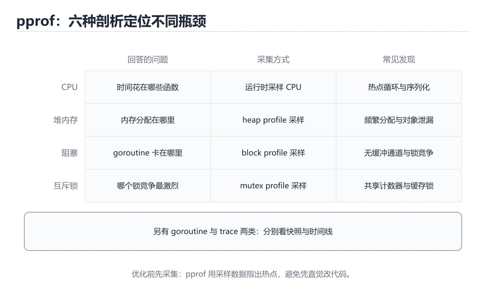
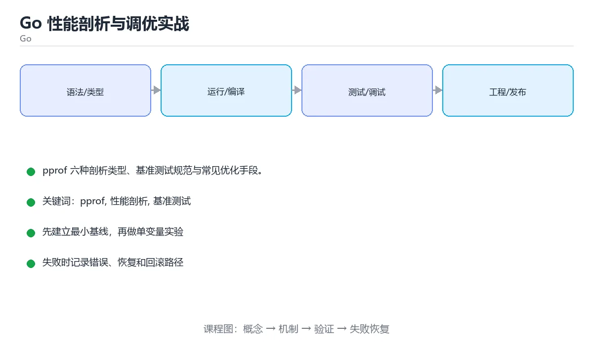

# Go 性能剖析与调优实战

> 内容更新时间：2026-10-06 · 学习阶段：进阶 · 预计用时：60 分钟





## 本节知识框架

**课程定位**：所属分类 `go`（Go），课程主题 `Go 性能剖析与调优实战`，学习阶段 进阶，建议用时 90 分钟。

本课主线：pprof 六种剖析类型、基准测试规范与常见优化手段。

**学完本课应当能够**
- 说清 `pprof` 与 `性能剖析` 的含义与区别，并各举一个正例和一个反例。
- 用本课示例验证 `基准测试` 的行为，记录输入、输出与失败条件。
- 遇到「CPU 热点在 `runtime.mallocgc`」这类问题时，能说出触发条件与修复顺序。

### 复习清单

- [ ] 能不看正文复述本课核心术语，并指出一个边界或反例。
- [ ] 能运行或推演本课示例，记录输入、输出与失败现象。
- [ ] 能完成一次自测，并把错题对照错误表定位原因。

## 核心概念定义

| 术语 | 操作性定义 | 常见边界与风险 |
| --- | --- | --- |
| pprof | Go 等语言的性能剖析工具，可采集 CPU、内存、阻塞和 Goroutine 数据。 | 易错：信息泄露、被滥用；正确做法是只监听内网或加鉴权。 |
| 性能剖析 | 用采样或插桩收集函数、调用栈和资源占用数据，定位真正的热点。 | 热点要采够时长才显形：采样太短或只采一次，偶发噪声会被当成结论，至少 30 秒并多次对比。 |
| 基准测试 | 在固定环境和输入下重复测量性能，得到可比较的基线。 | 基线只在同样输入与同样环境间可比：不预热就压测值偏高，改动后得用同一条基准复测再交 benchstat。 |
| GC | 垃圾回收，运行时自动回收不再可达的对象并管理内存。 | 易错：漏掉 GC 压力；正确做法是同时看 heap 与 alloc。 |
| CPU profile | 按频率采样调用栈 | 采样窗口太短时热点根本没进栈，至少采 30 秒；只按 `flat` 排还会漏掉调用链入口，要再跑一次 `top -cum`。 |
| Heap profile | 采样内存分配 | 只看 `inuse_space` 会漏掉频繁小对象，得连着 `-alloc_objects` 看谁在分配，否则 GC 压力会被当成内存不足。 |
| Goroutine profile | 抓取全部协程栈 | 单次快照只说明此刻有多少协程、各卡在哪一行，判泄漏要隔一会儿再抓一次比数量，只看一张图看不出持续增长。 |
| Block profile | 记录阻塞事件 | 默认不开采，不调 `runtime.SetBlockProfileRate(1)` 就采集不到等待数据；它给出的是谁在等锁或 channel，不是 CPU 消耗。 |
| Mutex profile | 记录锁竞争 | 锁竞争只在并发跑的时候才有数据，单线程基准里全是零；还得先开 mutex 采样，否则抢锁记录根本没采到。 |
| Trace | 记录运行时事件 | 同样要显式开启采集，窗口太短就抓不到偶发的等待事件；在生产长时间打开会拖累线上性能，只能降采样率或先灰度。 |

## 原理与运行机制

### 机制总览

**教材衔接：版本与时效**

- 升级前先用 BenchmarkParseConfig 建立基线：记录版本、命令和输出，升级后只比较这些可观察量。
- 模块校验、最小版本选择与供应链安全是生产升级的重点
- 官方发布说明：https://go.dev/doc/devel/release

### 三、「Go 性能剖析与调优实战」的交付证据链

本课未给出可执行命令，用下面的最小证据集代替：

### 五、评审记录模板

| 记录项 | 填写要求 |
| --- | --- |
| 项目标识 | `go_pprof` |
| 本次范围 | 说明这一轮交付了「Go 性能剖析与调优实战」的哪些部分 |
| 未完成项 | 列出与 pprof 相关但本轮未做的内容 |
| 证据位置 | 指向 evidence/ 目录下的具体文件 |
| 风险与回滚 | 写清剩余风险、回滚步骤和验证方式 |
| 结论 | 通过 / 有条件通过 / 不通过，三者选一 |

## 典型应用场景

**教材衔接：项目交付物**

### 建议仓库结构

```text
cmd/app/
internal/domain/
internal/infra/
pkg/
go.mod
```

### 验收数据

```json
{
  "project": "go_pprof",
  "scenario": "pprof的正常路径",
  "input": {"case": "normal", "value": "BenchmarkParseConfig"},
  "expected": {"ok": true, "checks": ["pprof可复现", "性能剖析有记录"]},
  "failure_case": {"case": "性能剖析越界或缺失", "error": "validation_error"},
  "idempotency_key": "go_pprof-001"
}
```

### 复盘模板

- **CPU 热点在 `runtime.mallocgc`**：典型现象是分配太多；正确做法是预分配、复用对象、`sync.Pool`。
- **热点在 `encoding/json`**：典型现象是序列化频繁；正确做法是换更快的库或减少字段。
- **goroutine 数持续增长**：典型现象是泄漏；正确做法是检查退出条件与 context。
- **block 里锁等待长**：典型现象是临界区太大；正确做法是缩小加锁范围。

### 最小验证场景

- 准备：保留 `text` 示例的原始输入，先记录 `Go 性能剖析与调优实战` 的基线输出和完整运行命令。
- 观察：先核对 出现字面量 `project`，再改变一个与 `pprof` 相关的条件。
- 判定：新结果与 `Go 性能剖析与调优实战` 的基线不同不等于错误；只有当差异破坏了 `pprof` 的定义或错误表中的约束，才判定为失败。

### 选择与边界

- 使用 `pprof` 时，Go 等语言的性能剖析工具，可采集 CPU、内存、阻塞和 Goroutine 数据；易错：信息泄露、被滥用；正确做法是只监听内网或加鉴权。
- 使用 `性能剖析` 时，用采样或插桩收集函数、调用栈和资源占用数据，定位真正的热点；越界、悬垂引用与释放顺序会破坏结论，必须在边界输入下复验。
- 使用 `基准测试` 时，在固定环境和输入下重复测量性能，得到可比较的基线；结论随输入规模变化，小规模成立不代表大规模成立，需要重新测量。
- 使用 `GC` 时，垃圾回收，运行时自动回收不再可达的对象并管理内存；易错：漏掉 GC 压力；正确做法是同时看 heap 与 alloc。

### 项目专属规格

- **交付目标**：完成 `Go 性能剖析与调优实战` 描述的可运行产物，并留下可复查的证据。
- **必须交付**：源代码、运行说明、测试或验证记录、失败路径说明。
- **验收标准**：按本课「项目交付物」和「考点精讲」逐项核对，不能只展示正常路径。
- **排错要求**：至少记录一次失败输入、现象、定位过程和修复结论。

## 代码/协议/SQL 示例

### 最小可验证示例

```bash
# 基准测试采集
go test -run=^$ -bench=. -benchmem -cpuprofile=cpu.out -memprofile=mem.out ./...
go tool pprof -http=:8080 cpu.out

# 运行时采集（net/http/pprof，仅内网暴露）
go tool pprof http://localhost:6060/debug/pprof/profile?seconds=30
go tool pprof http://localhost:6060/debug/pprof/heap
go tool pprof http://localhost:6060/debug/pprof/goroutine

# 火焰图与版本对比
go tool pprof -top -cum cpu.out | head -20
go tool pprof -diff_base=old.out new.out
go test -bench=. -count=10 > new.txt && benchstat old.txt new.txt
```

**教材衔接：采集方式速查**

```go
// 基准测试：报告内存分配并重置计时器，避免准备阶段污染数据
func BenchmarkParseConfig(b *testing.B) {
	raw := []byte(`{"name":"app","workers":8}`)
	b.ReportAllocs()
	b.ResetTimer()
	for i := 0; i < b.N; i++ {
		var cfg Config
		if err := json.Unmarshal(raw, &cfg); err != nil {
			b.Fatal(err)
		}
	}
}

// 用 sync.Pool 降低高频分配（仅用于可重建的临时对象）
var bufferPool = sync.Pool{New: func() any { return make([]byte, 0, 4096) }}

func encode(payload []byte) []byte {
	buf := bufferPool.Get().([]byte)
	defer bufferPool.Put(buf[:0])        // 归还前重置长度
	return append(buf, payload...)
}
```

**教材衔接：验证命令与预期输出**

pprof 的交付物要能用固定命令复现；下表是本项目的最低验证集：

| 阶段 | 命令 | 预期输出 |
| --- | --- | --- |
| 格式化检查 | `gofmt -l .` | 没有文件需要格式化 |
| 静态检查 | `go vet ./...` | 没有 vet 报告 |
| 运行测试 | `go test ./... -count=1` | 所有包测试通过 |

### 验收证据

- [ ] 保存依赖安装和启动命令的完整输出。
- [ ] 至少运行 3 条 pprof 相关测试，其中一条是非法输入或失败路径。
- [ ] 连续两次触发 性能剖析，检查数据与计数是否被重复累加。
- [ ] 记录一次失败状态码、错误日志和恢复步骤。
- [ ] 在 README 中写明 pprof 所需的环境版本、启动方式和回滚方式。

### 回归与回滚

1. 先在副本上执行 性能剖析，并记录前后差异。
2. 修改一处逻辑后重跑全部验证命令，确认没有回归。
3. 若失败，回滚到上一个可运行版本并保留失败日志。
4. 定位原因后补一条自动化测试，再重新执行发布流程。
5. 把教训写入项目复盘或本课笔记，形成下一次的检查项。

## 时间/空间复杂度或性能分析

| 现象 | 手段 |
| --- | --- |
| 分配过多、GC 频繁 | 预分配容量、复用对象、减少接口装箱 |
| 字符串拼接耗时 | 用 `strings.Builder` 并预分配 |
| 切片扩容拷贝 | `make([]T, 0, n)` |
| 锁竞争 | 减小锁粒度、分片锁、原子操作 |
| 大量小 JSON | 流式解码或换更快的库 |
| 系统调用多 | 批量读写、`bufio` 缓冲 |
| goroutine 泄漏 | 检查 channel 阻塞与 context 取消 |
| 内存持续增长 | 看 heap profile 的 inuse_space |

pprof 是 Go 自带的性能剖析工具，能回答四个问题：
**CPU 花在哪、内存被谁占、goroutine 卡在哪、谁在等锁**。

| Profile | 比喻 | 回答什么 |
| --- | --- | --- |
| CPU | 计时赛录像 | 时间花在哪些函数 |
| heap | 仓库盘点 | 谁占内存、谁在分配 |
| goroutine | 人员点名 | 有多少、卡在哪一行 |
| block | 堵车记录 | 谁在等锁或 channel |
| mutex | 锁竞争报告 | 哪把锁最抢手 |

```go
// 方式二：代码里手动采集（适合离线任务）
f, _ := os.Create("cpu.prof")
_ = pprof.StartCPUProfile(f)
defer pprof.StopCPUProfile()
doHeavyWork()

// 方式三：内存快照
f2, _ := os.Create("heap.prof")
defer f2.Close()
_ = pprof.WriteHeapProfile(f2)
```

```bash
# 采集 30 秒 CPU 数据
go tool pprof http://127.0.0.1:6060/debug/pprof/profile?seconds=30

# 内存
go tool pprof http://127.0.0.1:6060/debug/pprof/heap

# goroutine（查泄漏最有用）
go tool pprof http://127.0.0.1:6060/debug/pprof/goroutine

# 进入交互界面后的常用命令
(pprof) top          # 按占用排序
(pprof) top -cum     # 按累计时间排序（找调用链上游）
(pprof) list 函数名  # 逐行显示耗时
(pprof) web          # 生成调用图（需要 graphviz）
```

| 指标 | 含义 | 怎么用 |
| --- | --- | --- |
| `flat` | 函数自身消耗 | 找真正的热点 |
| `cum` | 含被调函数的累计 | 找调用链入口 |
| `alloc_objects` | 分配次数 | 找频繁小对象 |
| `inuse_space` | 当前占用 | 找内存大户 |

**技巧**：内存问题先看 `alloc_objects`（谁在频繁分配），再看 `inuse_space`（谁一直占着）。

### 基准测试配合 pprof

```bash
# 跑基准并同时采集 CPU 与内存
go test -bench . -cpuprofile cpu.out -memprofile mem.out ./...

go tool pprof -top cpu.out
go tool pprof -alloc_objects -top mem.out
```

| 坑 | 现象 | 正确做法 |
| --- | --- | --- |
| pprof 端点暴露公网 | 信息泄露、被滥用 | 只监听内网或加鉴权 |
| 采样时间太短 | 数据没有代表性 | 至少 30 秒或复现完整流程 |
| 只看 flat 不看 cum | 找不到调用链入口 | 两个都看 |
| 只采样一次就下结论 | 偶发噪声误导 | 多次采样对比 |
| 内存只看 inuse | 漏掉频繁小对象 | 同时看 alloc_objects |
| 忘了开 block/mutex 采样 | 采集不到等待数据 | `runtime.SetBlockProfileRate(1)` |
| 在生产直接 attach 长时间分析 | 影响线上性能 | 用低采样率或先灰度 |
| 改动后不复测 | 不知道是否真的变快 | 用同样的基准复测 |

### 手把手练习：定位一个内存热点

- [ ] 能说出四类 profile 各自回答什么问题。
- [ ] 知道 `flat` 与 `cum` 的区别。
- [ ] 能说出 goroutine 泄漏排查的四步。
- [ ] 知道内存问题为什么要同时看两个指标。
- [ ] 能说出 pprof 端点为什么不能暴露公网。

pprof 六种剖析类型、基准测试规范与常见优化手段。 项目目标是把「pprof、性能剖析、基准测试、benchstat、GC、火焰图」落实为可运行、可测试、可回滚的交付物。

**测量方法**：以 `Go 性能剖析与调优实战` 的 `pprof` 场景为对象，固定输入跑一遍记录基线，再把规模或并发度提高一个数量级复测；两次结果的差值与波动范围才是结论依据。

## 常见误区与易错点

| 容易写错的做法 | 实际现象 | 原因与正确做法 |
| --- | --- | --- |
| CPU 热点在 `runtime.mallocgc` | 分配太多 | 预分配、复用对象、`sync.Pool` |
| 热点在 `encoding/json` | 序列化频繁 | 换更快的库或减少字段 |
| goroutine 数持续增长 | 泄漏 | 检查退出条件与 context |
| block 里锁等待长 | 临界区太大 | 缩小加锁范围 |
| pprof 端点暴露公网 | 信息泄露、被滥用 | 只监听内网或加鉴权 |
| 采样时间太短 | 数据没有代表性 | 至少 30 秒或复现完整流程 |
| 只看 flat 不看 cum | 找不到调用链入口 | 两个都看 |
| 只采样一次就下结论 | 偶发噪声误导 | 多次采样对比 |
| 内存只看 inuse | 漏掉频繁小对象 | 同时看 alloc_objects |
| 忘了开 block/mutex 采样 | 采集不到等待数据 | `runtime.SetBlockProfileRate(1)` |
| 在生产直接 attach 长时间分析 | 影响线上性能 | 用低采样率或先灰度 |
| 改动后不复测 | 不知道是否真的变快 | 用同样的基准复测 |
| 不预热就直接压测 | 数据偏高 | 先跑几轮预热再采集 |
| 只看一次结果 | 噪声误导结论 | 多轮加 benchstat 对比 |
| 在生产公网暴露 pprof | 信息泄露与性能影响 | 只在内网或加鉴权 |
| 采样时间过短 | 热点没出现 | CPU 采样至少 30 秒 |
| 把 `sync.Pool` 当缓存用 | 对象随时消失，逻辑异常 | 只放可重建的临时对象 |
| 优化未测量的代码 | 复杂度上升但无收益 | 先 profile 再动手 |
| 只看 CPU 不看分配 | 漏掉 GC 压力 | 同时看 heap 与 alloc |
| 忽略 GC 指标 | 延迟抖动无法解释 | 观察 GC 停顿与内存上限 |
| 把 sync.Pool 当缓存用 | 对象随时消失，逻辑异常。 | 只放可重建的临时对象。 |

### 现场 1：CPU 热点在 `runtime.mallocgc`

**症状**：分配太多。

**根因与修复**：预分配、复用对象、`sync.Pool`。

**自检**：在本课示例里复现「CPU 热点在 `runtime.mallocgc`」，改成预分配、复用对象、`sync.Pool`后重跑；如果症状消失且失败路径按预期变化，说明定位正确。

### 现场 2：热点在 `encoding/json`

**症状**：序列化频繁。

**根因与修复**：换更快的库或减少字段。

**自检**：在本课示例里复现「热点在 `encoding/json`」，改成换更快的库或减少字段后重跑；如果症状消失且失败路径按预期变化，说明定位正确。

### 现场 3：goroutine 数持续增长

**症状**：泄漏。

**根因与修复**：检查退出条件与 context。

**自检**：在本课示例里复现「goroutine 数持续增长」，改成检查退出条件与 context后重跑；如果症状消失且失败路径按预期变化，说明定位正确。

### 现场 4：block 里锁等待长

**症状**：临界区太大。

**根因与修复**：缩小加锁范围。

**自检**：在本课示例里复现「block 里锁等待长」，改成缩小加锁范围后重跑；如果症状消失且失败路径按预期变化，说明定位正确。

### 现场 5：pprof 端点暴露公网

**症状**：信息泄露、被滥用。

**根因与修复**：只监听内网或加鉴权。

**自检**：在本课示例里复现「pprof 端点暴露公网」，改成只监听内网或加鉴权后重跑；如果症状消失且失败路径按预期变化，说明定位正确。

### 现场 6：采样时间太短

**症状**：数据没有代表性。

**根因与修复**：至少 30 秒或复现完整流程。

**自检**：在本课示例里复现「采样时间太短」，改成至少 30 秒或复现完整流程后重跑；如果症状消失且失败路径按预期变化，说明定位正确。

### 现场 7：只看 flat 不看 cum

**症状**：找不到调用链入口。

**根因与修复**：两个都看。

**自检**：在本课示例里复现「只看 flat 不看 cum」，改成两个都看后重跑；如果症状消失且失败路径按预期变化，说明定位正确。

### 现场 8：只采样一次就下结论

**症状**：偶发噪声误导。

**根因与修复**：多次采样对比。

**自检**：在本课示例里复现「只采样一次就下结论」，改成多次采样对比后重跑；如果症状消失且失败路径按预期变化，说明定位正确。

### 现场 9：内存只看 inuse

**症状**：漏掉频繁小对象。

**根因与修复**：同时看 alloc_objects。

**自检**：在本课示例里复现「内存只看 inuse」，改成同时看 alloc_objects后重跑；如果症状消失且失败路径按预期变化，说明定位正确。

## 与其他知识点的关系

- **先修**：`Go 微服务与可观测`。本课默认这些内容已经掌握。
- **相关或后续**：`gRPC 与 Protobuf 实践`、`性能剖析与基准测试：九种生态横向对照`。本课术语会在这些课程里继续使用。
- **术语归属**：`pprof`、`性能剖析`、`基准测试` 的定义以本课「核心概念定义」为准，换到其他课程时先确认定义是否被改写。
- 同一分类的《Go 工程实践》也涉及 `pprof`；两课衔接时先确认这个术语的定义是否一致。
- 同一分类的《Go 性能优化与内存》也涉及 `pprof`；两课衔接时先确认这个术语的定义是否一致。

## 自测题与参考答案

> 先独立作答，再对照参考答案；答案都能在本课正文、术语表或错误表里找到依据。

### 自测 1（概念复述）

不看正文，写出 `pprof` 的操作性定义，并说明它与 `性能剖析` 的区别。

**参考答案**：Go 等语言的性能剖析工具，可采集 CPU、内存、阻塞和 Goroutine 数据。

`性能剖析` 的定位是：用采样或插桩收集函数、调用栈和资源占用数据，定位真正的热点；两者的差别要从适用对象与失败模式上说明。

### 自测 2（排错）

本课错误表记录了「CPU 热点在 `runtime.mallocgc`」这类做法。请写出它会出现的现象、根因，以及修复顺序。

**参考答案**：现象是分配太多；正确做法是预分配、复用对象、`sync.Pool`。修复时先复现现象并保留证据，再改动一处假设重跑，确认现象消失。

### 自测 3（动手验证）

运行本课的 `text` 示例，改动其中一个输入后重新运行，记录输出与错误信息。

**参考答案**：正常输入下 `text` 示例应当复现正文给出的结果；改动输入后，如果结果改变或报错，先核对它是否满足 `Go 性能剖析与调优实战` 中`pprof` 的适用范围，再检查错误表里是否有同类现象。

### 自测 4（代码阅读）

阅读本课开头的 `text` 示例，说明它体现了`pprof` 的哪一条性质，并指出改动哪个输入会让这条性质不再成立。

**参考答案**：`pprof` 的定义是 Go 等语言的性能剖析工具，可采集 CPU、内存、阻塞和 Goroutine 数据，示例正是在实现这条定义。改动与 `pprof` 有关的一个输入后，如果结果不再符合 `Go 性能剖析与调优实战` 的正文描述，就说明该性质只在当前前提成立。

### 自测 5（迁移）

把 `Go 性能剖析与调优实战` 的方法迁移到自己的项目：围绕 `pprof` 写出一个与错误表同类的风险点，并说明触发条件和检验方式。

**参考答案**：例如「把 sync.Pool 当缓存用」，它会导致对象随时消失，逻辑异常；检验方式是按只放可重建的临时对象改一处再复现，确认现象消失且没有引入新的失败分支。

### 自测 6（对比）

用一个表格对比 `pprof` 与 `性能剖析`：各写一行适用场景、一行失败表现。

**参考答案**：`pprof` 的定义是Go 等语言的性能剖析工具，可采集 CPU、内存、阻塞和 Goroutine 数据；`性能剖析` 的定义是用采样或插桩收集函数、调用栈和资源占用数据，定位真正的热点。两者的失败表现分别对应本课错误表里与本术语相关的行。

### 自测 7（排错顺序）

面对「CPU 热点在 `runtime.mallocgc`」引发的问题，请把“复现 分配太多 → 保留证据 → 预分配、复用对象、`sync.Pool` → 回归验证”四步写成可执行的检查清单。

**参考答案**：第一步按分配太多复现；第二步记录输入、版本与完整报错；第三步按预分配、复用对象、`sync.Pool`只改一处；第四步重跑并确认失败路径也按预期变化。

### 自测 8（边界判断）

针对 `GC`，分别写出“可以使用”的条件和“结论不再成立”的条件。

**参考答案**：易错：漏掉 GC 压力；正确做法是同时看 heap 与 alloc。 同时要把 `GC` 的定义 垃圾回收，运行时自动回收不再可达的对象并管理内存 与实际输入逐项对照。

### 自测 9（机制重建）

不看正文，按输入、转换、输出、验证四段重建 `pprof` → `性能剖析` → `基准测试` → `GC` 的作用链。

**参考答案**：起点是 `pprof` 的定义 Go 等语言的性能剖析工具，可采集 CPU、内存、阻塞和 Goroutine 数据；中间每一步都保留可观察状态；终点由 `GC` 检查，失败时回到错误表定位第一个偏离定义的步骤。

### 自测 10（综合排错）

在 `Go 性能剖析与调优实战` 中，现象是 对象随时消失，逻辑异常。请围绕 把 sync.Pool 当缓存用 写出最小复现、关键证据、修复动作和回归验证，并说明为什么不能只凭一次运行下结论。

**参考答案**：先复现 把 sync.Pool 当缓存用，记录输入与完整错误；再按 只放可重建的临时对象 只改一处。回归时同时跑正常路径和边界路径，只有两次结果都可解释，才把修复视为完成。

### 自测 11（一分钟复述）

用每分钟约 200 字的速度复述 `Go 性能剖析与调优实战`：先给主问题，再按顺序说出 `pprof`、`性能剖析`、`基准测试`、`GC`，最后给一个失败案例。

**自评标准**：主问题必须对应 pprof 六种剖析类型、基准测试规范与常见优化手段；每个术语都要能接上一句定义或边界；失败案例必须写成可观察现象，不能用“可能有风险”代替证据。

## 术语速查

| 术语 | 一句话说明 |
| --- | --- |
| `pprof` | Go 等语言的性能剖析工具，可采集 CPU、内存、阻塞和 Goroutine 数据。 |
| `性能剖析` | 用采样或插桩收集函数、调用栈和资源占用数据，定位真正的热点。 |
| `基准测试` | 在固定环境和输入下重复测量性能，得到可比较的基线。 |
| `GC` | 垃圾回收，运行时自动回收不再可达的对象并管理内存。 |

**术语关系**：`pprof`（Go 等语言的性能剖析工具） → `性能剖析`（用采样或插桩收集函数、调用栈和资源占用数据） → `基准测试`（在固定环境和输入下重复测量性能） → `GC`（垃圾回收）。

## 考点精讲

`Go 性能剖析与调优实战` 的题库有 6 道题，下面逐题给出题干、正确项与判断依据：先自己作答，再核对正确项，最后回到正文对应小节复核。

### 考点 1：第 1 题

- **题目**：围绕“Go 性能剖析与调优实战”中的 pprof、性能剖析、基准测试，下列哪两项是本课强调的实践判断？
- **正确项**：学习 pprof 时要同时说明输入、输出和失败路径，不能只看正常流程；验证 性能剖析 时要固定版本并覆盖边界输入，结论才可复现
- **判断依据**：按《Go 性能剖析与调优实战》的正文口径，本题要同时选中「学习 pprof 时要同时说明输入、输出和失败路径，不能只看正常流程」、「验证 性能剖析 时要固定版本并覆盖边界输入，结论才可复现」，漏掉任一项都算没答全。术语 pprof（Go 性能剖析与调优实战）：Go 等语言的性能剖析工具，可采集 CPU、内存、阻塞和 Goroutine 数据。易错点是CPU 热点在 `runtime.mallocgc`，会造成分配太多，改法是预分配、复用对象、`sync.Pool`。

### 考点 2：第 2 题

- **题目**：代码语言为 `go`，选自 `Go 性能剖析与调优实战` 的 `pprof` 部分。课程问题为pprof 六种剖析类型、基准测试规范与常见优化手段。哪一项描述与代码一致？
- **正确项**：出现字面量 `性能剖析越界或缺失`
- **判断依据**：本题正确项是「出现字面量 `性能剖析越界或缺失`」。术语 pprof（Go 性能剖析与调优实战）：Go 等语言的性能剖析工具，可采集 CPU、内存、阻塞和 Goroutine 数据，本题取「出现字面量 `性能剖析越界或缺失`」这条。易错点是热点在 `encoding/json`，会造成序列化频繁，改法是换更快的库或减少字段。本题干扰项「出现字面量 `标题不能为空`」不成立：展示代码里找不到 `标题不能为空`。

### 考点 3：第 3 题

- **题目**：为什么生产环境的 pprof 端口不能暴露到公网？
- **正确项**：会泄露内部信息并可被用于性能攻击
- **判断依据**：本题正确项是「会泄露内部信息并可被用于性能攻击」。术语 pprof（Go 性能剖析与调优实战）：Go 等语言的性能剖析工具，可采集 CPU、内存、阻塞和 Goroutine 数据，本题取「会泄露内部信息并可被用于性能攻击」这条。易错点是goroutine 数持续增长，会造成泄漏，改法是检查退出条件与 context。

### 考点 4：第 4 题

- **题目**：关于 sync.Pool，正确的用法是？
- **正确项**：只存放可随时重建的临时对象
- **判断依据**：本题正确项是「只存放可随时重建的临时对象」。术语 pprof（Go 性能剖析与调优实战）：Go 等语言的性能剖析工具，可采集 CPU、内存、阻塞和 Goroutine 数据，本题取「只存放可随时重建的临时对象」这条。易错点是block 里锁等待长，会造成临界区太大，改法是缩小加锁范围。

### 考点 5：第 5 题

- **题目**：对比优化前后的基准数据，推荐？
- **正确项**：多次运行并用 benchstat 做统计对比
- **判断依据**：本题正确项是「多次运行并用 benchstat 做统计对比」。术语 pprof（Go 性能剖析与调优实战）：Go 等语言的性能剖析工具，可采集 CPU、内存、阻塞和 Goroutine 数据，本题取「多次运行并用 benchstat 做统计对比」这条。易错点是pprof 端点暴露公网，会造成信息泄露、被滥用，改法是只监听内网或加鉴权。

### 考点 6：第 6 题

- **题目**：填空：补齐下面这段术语说明中的空缺。课程 `pprof 六种剖析类型、基准测试规范与常见优化手段。`，这段说明是：`____`：在固定环境和输入下重复测量性能，得到可比较的基线。空缺处应填哪个术语？
- **正确项**：基准测试
- **判断依据**：涉及术语 pprof：Go 等语言的性能剖析工具，可采集 CPU、内存、阻塞和 Goroutine 数据。易错点：CPU 热点在 `runtime.mallocgc`会造成分配太多。正确做法：预分配、复用对象、`sync.Pool`。判断时先确认输入和适用范围，对照 `pprof`、`性能剖析`、`基准测试`、`benchstat` 复现一次，最后把错误表现与正确做法逐项对照。

### 考点 7：`pprof`

- **要点**：Go 等语言的性能剖析工具，可采集 CPU、内存、阻塞和 Goroutine 数据。
- **pprof 的边界**：易错：信息泄露、被滥用；正确做法是只监听内网或加鉴权。

### 考点 8：`性能剖析`

- **要点**：用采样或插桩收集函数、调用栈和资源占用数据，定位真正的热点。
- **性能剖析 的边界**：越界、悬垂引用与释放顺序会破坏结论，必须在边界输入下复验。

### 考点 9：`基准测试`

- **要点**：在固定环境和输入下重复测量性能，得到可比较的基线。
- **基准测试 的边界**：结论随输入规模变化，小规模成立不代表大规模成立，需要重新测量。

### 考点 10：`GC`

- **要点**：垃圾回收，运行时自动回收不再可达的对象并管理内存。
- **GC 的边界**：易错：漏掉 GC 压力；正确做法是同时看 heap 与 alloc。

### 考点 11：排错——CPU 热点在 `runtime.mallocgc`

- **现象**：分配太多。
- **处理**：预分配、复用对象、`sync.Pool`。

### 考点 12：排错——热点在 `encoding/json`

- **现象**：序列化频繁。
- **处理**：换更快的库或减少字段。

### 考点 13：综合辨析——`pprof` 与 `GC`

- **辨析点**：`pprof` 的定义是 Go 等语言的性能剖析工具，可采集 CPU、内存、阻塞和 Goroutine 数据；`GC` 的定义是 垃圾回收，运行时自动回收不再可达的对象并管理内存。
- **答题要求**：面对 `Go 性能剖析与调优实战` 的题目，先判断描述的是 `pprof` 还是 `GC`，再归到对应定义，最后写出一个会让该定义失效的边界输入。

### 考点 14：排错评分点

- **现象分**：能写出 分配太多，而不是只写“程序有错”。
- **证据分**：保留触发 CPU 热点在 `runtime.mallocgc` 的输入、版本和错误原文。
- **修复分**：按 预分配、复用对象、`sync.Pool` 只改一处，并同时回归正常路径与边界路径。

## 内容元数据

- 内容版本：v2.0
- 最后更新：2026-10-06
- 学习阶段：进阶
- 适用环境：Go 1.24+
；本课聚焦 pprof。
- 内容来源：内置结构化课程与工程实践整理
- 相关主题：pprof、性能剖析、基准测试、benchstat、GC、火焰图
- 质量版本：P0 测验标准 + P1 覆盖扩展 + P2 体验补全

## 参考资料与复核

- 最后复核：2026-10-04
- 下次复核：2027-04-10
- 复核范围：版本兼容、API 行为、安全建议与工程实践
- 来源性质：官方文档、标准或权威教材；本课核对关键词：pprof、性能剖析、基准测试、benchstat、GC、火焰图。

| 参考资料 | 本课用途 |
| --- | --- |
| [Go pprof](https://pkg.go.dev/net/http/pprof) | 性能剖析与火焰图 |
| [Go 测试](https://go.dev/doc/tutorial/add-a-test) | 测试、基准与覆盖率 |
| [Go 标准库](https://pkg.go.dev/std) | 标准库 API |

| [本课术语索引：Go 性能剖析与调优实战](#核心概念定义) | 按本课输入、术语边界和错误表现逐项核对 |
> 「Go 性能剖析与调优实战」的链接用于离线阅读后的延伸核对；App 不会自动联网。

<!-- p1-project-review:start -->