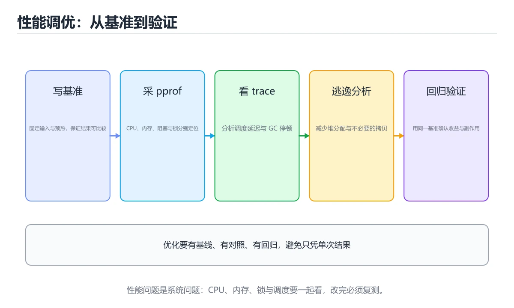
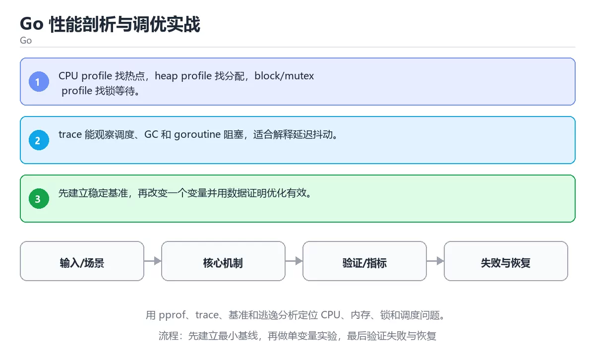

# Go 性能剖析与调优（进阶）

> 内容更新时间：2026-10-06 · 学习阶段：高级 · 预计用时：35 分钟





## 本节知识框架

**课程定位**：所属分类 `go`（Go），课程主题 `Go 性能剖析与调优（进阶）`，学习阶段 高级，建议用时 50 分钟。

本课主线：用 pprof、trace、基准和逃逸分析定位 CPU、内存、锁和调度问题。

**学完本课应当能够**
- 说清 `pprof` 与 `trace` 的含义与区别，并各举一个正例和一个反例。
- 用本课示例验证 `基准测试` 的行为，记录输入、输出与失败条件。
- 遇到「只做 CPU 剖析」这类问题时，能说出触发条件与修复顺序。

### 复习清单

- [ ] 能不看正文复述本课核心术语，并指出一个边界或反例。
- [ ] 能运行或推演本课示例，记录输入、输出与失败现象。
- [ ] 能完成一次自测，并把错题对照错误表定位原因。

## 核心概念定义

| 术语 | 操作性定义 | 常见边界与风险 |
| --- | --- | --- |
| pprof | Go 自带的性能剖析工具，可采集 CPU、内存与阻塞 profile。 | 结论随输入规模变化，小规模成立不代表大规模成立，需要重新测量。 |
| trace | 记录运行时事件的追踪工具，用来观察调度与 GC 时间线。 | 适合解释延迟抖动这类调度与阻塞问题；只做 CPU 剖析看不到阻塞，采集时间太短数据还会大幅波动。 |
| 基准测试 | 以 Benchmark 开头的测试函数，重复执行并报告每次耗时与内存分配。 | 越界、悬垂引用与释放顺序会破坏结论，必须在边界输入下复验。 |
| 逃逸分析 | 编译器判断变量能否分配在栈上，用 -gcflags=-m 查看结果。 | 静态检查只在编译期成立，运行期输入仍需校验。 |
| 内存分配剖析 | 用 -benchmem 与 memprofile 找出分配热点，减少不必要的堆分配。 | 越界、悬垂引用与释放顺序会破坏结论，必须在边界输入下复验。 |

## 原理与运行机制

### 机制总览

**教材衔接：核心知识**

### 1. CPU profile 找热点，heap profile 找分配，block/mutex profile 找锁等待。

- 关键做法：基线只保留 trace 必需的部分，其余条件一次加一个。
- 验证标准：trace 的异常路径有明确错误信息与恢复动作。

### 2. trace 能观察调度、GC 和 goroutine 阻塞，适合解释延迟抖动。

把这条结论放回「Go 性能剖析与调优（进阶）」的完整流程里展开：

- 正文依据：能用自己的话解释：trace 能观察调度、GC 和 goroutine 阻塞，适合解释延迟抖动。
- 落地检查：把「2. trace 能观察调度、GC 和 goroutine 阻塞，适合解释延迟抖动。」改写成一条可执行的核对项，逐条验证输入、超时与失败路径。

### 3. 先建立稳定基准，再改变一个变量并用数据证明优化有效。

把这条结论放回「Go 性能剖析与调优（进阶）」的完整流程里展开：

- 正文依据：本课关键词：pprof、trace、基准测试、逃逸分析。
- 落地检查：把「3. 先建立稳定基准，再改变一个变量并用数据证明优化有效。」改写成一条可执行的核对项，逐条验证输入、超时与失败路径。

**教材衔接：关键流程**

**教材衔接：实践路径**

**教材衔接：版本与时效**

- 升级「Go 性能剖析与调优（进阶）」涉及的依赖前，先用 go_profiling_deep 复现当前行为，再逐项核对版本说明与破坏性变更。
- 模块校验、最小版本选择与供应链安全是生产升级的重点
- 官方发布说明：https://go.dev/doc/devel/release

### 三、「Go 性能剖析与调优（进阶）」的交付证据链

本课未给出可执行命令，用下面的最小证据集代替：

### 五、评审记录模板

| 记录项 | 填写要求 |
| --- | --- |
| 项目标识 | `go_profiling_deep` |
| 本次范围 | 说明这一轮交付了「Go 性能剖析与调优（进阶）」的哪些部分 |
| 未完成项 | 列出与 pprof 相关但本轮未做的内容 |
| 证据位置 | 指向 evidence/ 目录下的具体文件 |
| 风险与回滚 | 写清剩余风险、回滚步骤和验证方式 |
| 结论 | 通过 / 有条件通过 / 不通过，三者选一 |

## 典型应用场景

**教材衔接：项目交付物**

### 建议仓库结构

```text
cmd/app/
internal/domain/
internal/infra/
pkg/
go.mod
```

### 验收数据

```json
{
  "project": "go_profiling_deep",
  "scenario": "pprof的正常路径",
  "input": {"case": "normal", "value": "go_profiling_deep"},
  "expected": {"ok": true, "checks": ["pprof可复现", "trace有记录"]},
  "failure_case": {"case": "trace越界或缺失", "error": "validation_error"},
  "idempotency_key": "go_profiling_deep-001"
}
```

### 复盘模板

- **只做 CPU 剖析**：典型现象是阻塞与内存问题看不到；正确做法是结合阻塞、互斥与堆剖析一起看。
- **采样时间过短**：典型现象是数据波动大，结论不可靠；正确做法是延长采集时间并重复验证。
- **优化后不做回归对比**：典型现象是无法证明改进有效；正确做法是保留基准与剖析快照做前后对比。

### 最小验证场景

- 准备：保留 `text` 示例的原始输入，先记录 `Go 性能剖析与调优（进阶）` 的基线输出和完整运行命令。
- 观察：先核对 出现字面量 `project`，再改变一个与 `pprof` 相关的条件。
- 判定：新结果与 `Go 性能剖析与调优（进阶）` 的基线不同不等于错误；只有当差异破坏了 `pprof` 的定义或错误表中的约束，才判定为失败。

### 选择与边界

- 使用 `pprof` 时，先满足它的定义：Go 自带的性能剖析工具，可采集 CPU、内存与阻塞 profile；结论随输入规模变化，小规模成立不代表大规模成立，需要重新测量。
- 使用 `trace` 时，先满足它的定义：记录运行时事件的追踪工具，用来观察调度与 GC 时间线。
- 使用 `基准测试` 时，先满足它的定义：以 Benchmark 开头的测试函数，重复执行并报告每次耗时与内存分配；越界、悬垂引用与释放顺序会破坏结论，必须在边界输入下复验。
- 使用 `逃逸分析` 时，先满足它的定义：编译器判断变量能否分配在栈上，用 -gcflags=-m 查看结果；静态检查只在编译期成立，运行期输入仍需校验。
- 使用 `内存分配剖析` 时，先满足它的定义：用 -benchmem 与 memprofile 找出分配热点，减少不必要的堆分配；越界、悬垂引用与释放顺序会破坏结论，必须在边界输入下复验。

## 代码/协议/SQL 示例

### 最小可验证示例

**教材衔接：验证命令与预期输出**

先让 go_profiling_deep 的结果可复现，再谈扩展。下表给出最低验证集：

| 阶段 | 命令 | 预期输出 |
| --- | --- | --- |
| 格式化检查 | `gofmt -l .` | 没有文件需要格式化 |
| 静态检查 | `go vet ./...` | 没有 vet 报告 |
| 运行测试 | `go test ./... -count=1` | 所有包测试通过 |

### 验收证据

- [ ] 保存依赖安装和启动命令的完整输出。
- [ ] 测试覆盖 trace 的核心规则，并包含一次可预期的失败。
- [ ] 连续两次触发 trace，检查数据与计数是否被重复累加。
- [ ] 记录一次失败状态码、错误日志和恢复步骤。
- [ ] 在 README 中写明 pprof 所需的环境版本、启动方式和回滚方式。

### 回归与回滚

1. 用临时环境验证 go_profiling_deep，确认无误后再对真实数据执行。
2. 修改一处逻辑后重跑全部验证命令，确认没有回归。
3. 若失败，回滚到上一个可运行版本并保留失败日志。
4. 定位原因后补一条自动化测试，再重新执行发布流程。
5. 把教训写入项目复盘或本课笔记，形成下一次的检查项。

**教材衔接：最小可运行示例**

下面示例用于验证「Go 性能剖析与调优实战」的最小输入、处理和输出。先原样运行，再只修改一个值：

```go
package main

import (
	"fmt"
	"testing"
)

func BenchmarkConcat(b *testing.B) {
	for i := 0; i < b.N; i++ {
		_ = fmt.Sprint("a", "b")
	}
}

func main() {
	result := testing.Benchmark(BenchmarkConcat)
	fmt.Println("rounds>0:", result.N > 0)
}
```

**教材衔接：预期输出**

```text
rounds>0: true
```

## 时间/空间复杂度或性能分析

本课的摘要可以当作一张地图：用 pprof、trace、基准和逃逸分析定位 CPU、内存、锁和调度问题。

1. 澄清输入与目标。先写清「Go 性能剖析与调优（进阶）」要解决的问题、合法输入范围和成功标准，再进入后续步骤。
2. 描述处理过程。把「pprof、trace、基准测试、逃逸分析」映射到具体步骤，每步都要求能单独验证。
3. 定义输出。明确 pprof 与 trace 各自的产物，以及失败时留下什么证据。
4. 先预测pprof会怎样失败，再实际触发一次；差异部分就是本课最需要补的前提。
5. 把「核心知识」里的最小示例抄成 go_profiling_deep 一行的输入，先手算结果再执行，确认两者一致。

- **1. CPU profile 找热点，heap profile 找分配，block/mutex profile 找锁等待。**：在「Go 性能剖析与调优（进阶）」里，「1. CPU profile 找热点，heap profile 找分配，block/mutex profile 找锁等待。」这一步要先写清输入与预期，再记录实际结果和差异；结果不符时回到对应小节核对前提。
- **2. trace 能观察调度、GC 和 goroutine 阻塞，适合解释延迟抖动。**：在「Go 性能剖析与调优（进阶）」里，「2. trace 能观察调度、GC 和 goroutine 阻塞，适合解释延迟抖动。」这一步要先写清输入与预期，再记录实际结果和差异；结果不符时回到对应小节核对前提。
- **3. 先建立稳定基准，再改变一个变量并用数据证明优化有效。**：在「Go 性能剖析与调优（进阶）」里，「3. 先建立稳定基准，再改变一个变量并用数据证明优化有效。」这一步要先写清输入与预期，再记录实际结果和差异；结果不符时回到对应小节核对前提。
- **验收证据**：- [ ] 保存依赖安装和启动命令的完整输出
- **回归与回滚**：1. 先在一个可丢弃的目录或临时数据库执行，避免污染真实数据
- **考点 1：核心知识 的代码阅读题**：先独立作答，再回到本课正文核对 go_profiling_deep 的执行路径；答错时记录是哪一个前提被忽略。

- 参考判断：先建立稳定基准，再改变一个变量并用数据证明优化有效。

- 参考判断：用 pprof，trace，基准和逃逸分析定位 CPU，内存

#### 迁移案例 3：围绕「基准测试」做一次小实验

**步骤**：
1. 复述当前方案对「基准测试」的假设，写成一句可证伪的话。

#### 迁移案例 15：围绕「基准测试」做一次小实验

用 pprof、trace、基准和逃逸分析定位 CPU、内存、锁和调度问题。 项目目标是把「pprof、trace、基准测试、逃逸分析」落实为可运行、可测试、可回滚的交付物。

**测量方法**：以 `Go 性能剖析与调优（进阶）` 的 `pprof` 场景为对象，固定输入跑一遍记录基线，再把规模或并发度提高一个数量级复测；两次结果的差值与波动范围才是结论依据。

## 常见误区与易错点

| 容易写错的做法 | 实际现象 | 原因与正确做法 |
| --- | --- | --- |
| 只做 CPU 剖析 | 阻塞与内存问题看不到。 | 结合阻塞、互斥与堆剖析一起看。 |
| 采样时间过短 | 数据波动大，结论不可靠。 | 延长采集时间并重复验证。 |
| 优化后不做回归对比 | 无法证明改进有效。 | 保留基准与剖析快照做前后对比。 |

### 现场 1：只做 CPU 剖析

**症状**：阻塞与内存问题看不到。

**根因与修复**：结合阻塞、互斥与堆剖析一起看。

**自检**：在本课示例里复现「只做 CPU 剖析」，改成结合阻塞、互斥与堆剖析一起看后重跑；如果症状消失且失败路径按预期变化，说明定位正确。

### 现场 2：采样时间过短

**症状**：数据波动大，结论不可靠。

**根因与修复**：延长采集时间并重复验证。

**自检**：在本课示例里复现「采样时间过短」，改成延长采集时间并重复验证后重跑；如果症状消失且失败路径按预期变化，说明定位正确。

### 现场 3：优化后不做回归对比

**症状**：无法证明改进有效。

**根因与修复**：保留基准与剖析快照做前后对比。

**自检**：在本课示例里复现「优化后不做回归对比」，改成保留基准与剖析快照做前后对比后重跑；如果症状消失且失败路径按预期变化，说明定位正确。

## 与其他知识点的关系

- **先修**：`Go 泛型深入与约束设计`。本课默认这些内容已经掌握。
- **相关或后续**：`Go 云原生服务安全与可靠性`。本课术语会在这些课程里继续使用。
- **术语归属**：`pprof`、`trace`、`基准测试` 的定义以本课「核心概念定义」为准，换到其他课程时先确认定义是否被改写。
- 同一分类的《Go 工程实践》也涉及 `pprof`；两课衔接时先确认这个术语的定义是否一致。
- 同一分类的《Go 性能优化与内存》也涉及 `pprof`；两课衔接时先确认这个术语的定义是否一致。

## 自测题与参考答案

> 先独立作答，再对照参考答案；答案都能在本课正文、术语表或错误表里找到依据。

### 自测 1（概念复述）

不看正文，写出 `pprof` 的操作性定义，并说明它与 `trace` 的区别。

**参考答案**：Go 自带的性能剖析工具，可采集 CPU、内存与阻塞 profile。

`trace` 的定位是：记录运行时事件的追踪工具，用来观察调度与 GC 时间线；两者的差别要从适用对象与失败模式上说明。

### 自测 2（排错）

本课错误表记录了「只做 CPU 剖析」这类做法。请写出它会出现的现象、根因，以及修复顺序。

**参考答案**：现象是阻塞与内存问题看不到；正确做法是结合阻塞、互斥与堆剖析一起看。修复时先复现现象并保留证据，再改动一处假设重跑，确认现象消失。

### 自测 3（动手验证）

运行本课的 `text` 示例，改动其中一个输入后重新运行，记录输出与错误信息。

**参考答案**：正常输入下 `text` 示例应当复现正文给出的结果；改动输入后，如果结果改变或报错，先核对它是否满足 `Go 性能剖析与调优（进阶）` 中`pprof` 的适用范围，再检查错误表里是否有同类现象。

### 自测 4（代码阅读）

阅读本课开头的 `text` 示例，说明它体现了`pprof` 的哪一条性质，并指出改动哪个输入会让这条性质不再成立。

**参考答案**：`pprof` 的定义是 Go 自带的性能剖析工具，可采集 CPU、内存与阻塞 profile，示例正是在实现这条定义。改动与 `pprof` 有关的一个输入后，如果结果不再符合 `Go 性能剖析与调优（进阶）` 的正文描述，就说明该性质只在当前前提成立。

### 自测 5（迁移）

把 `Go 性能剖析与调优（进阶）` 的方法迁移到自己的项目：围绕 `pprof` 写出一个与错误表同类的风险点，并说明触发条件和检验方式。

**参考答案**：例如「优化后不做回归对比」，它会导致无法证明改进有效；检验方式是按保留基准与剖析快照做前后对比改一处再复现，确认现象消失且没有引入新的失败分支。

### 自测 6（对比）

用一个表格对比 `pprof` 与 `trace`：各写一行适用场景、一行失败表现。

**参考答案**：`pprof` 的定义是Go 自带的性能剖析工具，可采集 CPU、内存与阻塞 profile；`trace` 的定义是记录运行时事件的追踪工具，用来观察调度与 GC 时间线。两者的失败表现分别对应本课错误表里与本术语相关的行。

### 自测 7（排错顺序）

面对「只做 CPU 剖析」引发的问题，请把“复现 阻塞与内存问题看不到 → 保留证据 → 结合阻塞、互斥与堆剖析一起看 → 回归验证”四步写成可执行的检查清单。

**参考答案**：第一步按阻塞与内存问题看不到复现；第二步记录输入、版本与完整报错；第三步按结合阻塞、互斥与堆剖析一起看只改一处；第四步重跑并确认失败路径也按预期变化。

### 自测 8（边界判断）

针对 `内存分配剖析`，分别写出“可以使用”的条件和“结论不再成立”的条件。

**参考答案**：越界、悬垂引用与释放顺序会破坏结论，必须在边界输入下复验。 同时要把 `内存分配剖析` 的定义 用 -benchmem 与 memprofile 找出分配热点，减少不必要的堆分配 与实际输入逐项对照。

### 自测 9（机制重建）

不看正文，按输入、转换、输出、验证四段重建 `pprof` → `trace` → `基准测试` → `逃逸分析` 的作用链。

**参考答案**：起点是 `pprof` 的定义 Go 自带的性能剖析工具，可采集 CPU、内存与阻塞 profile；中间每一步都保留可观察状态；终点由 `内存分配剖析` 检查，失败时回到错误表定位第一个偏离定义的步骤。

### 自测 10（综合排错）

在 `Go 性能剖析与调优（进阶）` 中，现象是 无法证明改进有效。请围绕 优化后不做回归对比 写出最小复现、关键证据、修复动作和回归验证，并说明为什么不能只凭一次运行下结论。

**参考答案**：先复现 优化后不做回归对比，记录输入与完整错误；再按 保留基准与剖析快照做前后对比 只改一处。回归时同时跑正常路径和边界路径，只有两次结果都可解释，才把修复视为完成。

### 自测 11（一分钟复述）

用每分钟约 200 字的速度复述 `Go 性能剖析与调优（进阶）`：先给主问题，再按顺序说出 `pprof`、`trace`、`基准测试`、`逃逸分析`，最后给一个失败案例。

**自评标准**：主问题必须对应 用 pprof、trace、基准和逃逸分析定位 CPU、内存、锁和调度问题；每个术语都要能接上一句定义或边界；失败案例必须写成可观察现象，不能用“可能有风险”代替证据。

## 术语速查

| 术语 | 一句话说明 |
| --- | --- |
| `pprof` | Go 自带的性能剖析工具，可采集 CPU、内存与阻塞 profile。 |
| `trace` | 记录运行时事件的追踪工具，用来观察调度与 GC 时间线。 |
| `基准测试` | 以 Benchmark 开头的测试函数，重复执行并报告每次耗时与内存分配。 |
| `逃逸分析` | 编译器判断变量能否分配在栈上，用 -gcflags=-m 查看结果。 |
| `内存分配剖析` | 用 -benchmem 与 memprofile 找出分配热点，减少不必要的堆分配。 |

**术语关系**：`pprof`（Go 自带的性能剖析工具） → `trace`（记录运行时事件的追踪工具） → `基准测试`（以 Benchmark 开头的测试函数） → `逃逸分析`（编译器判断变量能否分配在栈上）。

## 考点精讲

`Go 性能剖析与调优（进阶）` 的题库有 6 道题，下面逐题给出题干、正确项与判断依据：先自己作答，再核对正确项，最后回到正文对应小节复核。

### 考点 1：第 1 题

- **题目**：这段 `go` 代码对应 `Go 性能剖析与调优（进阶）` 的 `pprof`。课程要解决的是用 pprof、trace、基准和逃逸分析定位 CPU、内存、锁和调度问题。关于代码内容，哪一项说法准确？
- **正确项**：调用了 `fmt.Sprint()`
- **判断依据**：按《Go 性能剖析与调优（进阶）》的正文口径，本题正确项是「调用了 `fmt.Sprint()`」。题干里的「这段go代码对应Go性能剖析与调」要放回《Go 性能剖析与调优（进阶）》的主线里看：用 pprof、trace、基准和逃逸分析定位 CPU、内存、锁和调度问题。做「这段go代码对应Go性能剖析与调」这类判断时，常踩的坑是只做 CPU 剖析，其后果是阻塞与内存问题看不到。按本课口径，「这段go代码对应Go性能剖析与调」这类题应结合阻塞、互斥与堆剖析一起看。

### 考点 2：第 2 题

- **题目**：在 `Go 性能剖析与调优（进阶）` 里，与 `pprof` 有关的说法中，哪一项最符合用 pprof、trace、基准和逃逸分析定位 CPU、内存、锁和调度问题？
- **正确项**：trace 能观察调度，GC 和 goroutine 阻塞
- **判断依据**：按《Go 性能剖析与调优（进阶）》的正文口径，本题正确项是「trace 能观察调度，GC 和 goroutine 阻塞」。题干里的「在Go性能剖析与调优（进阶）里与」要放回《Go 性能剖析与调优（进阶）》的主线里看：用 pprof、trace、基准和逃逸分析定位 CPU、内存、锁和调度问题。做「在Go性能剖析与调优（进阶）里与」这类判断时，常踩的坑是只做 CPU 剖析，其后果是阻塞与内存问题看不到。按本课口径，「在Go性能剖析与调优（进阶）里与」这类题应结合阻塞、互斥与堆剖析一起看。干扰项「只要小数据能跑通，大规模和异常情况也一定正确。」与题干「在 `Go 性能剖析与调优（进阶）` 里，与 `pprof` 有关的说法中，哪一项最符合用 pprof、trace、基准和逃逸分析定位 CPU、内存、锁和调度问题？」的要求对不上，应排除。

### 考点 3：第 3 题

- **题目**：围绕“Go 性能剖析与调优（进阶）”中的 pprof、trace、基准测试，下列哪两项是本课强调的实践判断？
- **正确项**：验证 trace 时要固定版本并覆盖边界输入，结论才可复现；学习 pprof 时要同时说明输入、输出和失败路径，不能只看正常流程
- **判断依据**：按《Go 性能剖析与调优（进阶）》的正文口径，本题要同时选中「验证 trace 时要固定版本并覆盖边界输入，结论才可复现」、「学习 pprof 时要同时说明输入、输出和失败路径，不能只看正常流程」，漏掉任一项都算没答全。题干里的「围绕Go性能剖析与调优（进阶）中」要放回《Go 性能剖析与调优（进阶）》的主线里看：用 pprof、trace、基准和逃逸分析定位 CPU、内存、锁和调度问题。做「围绕Go性能剖析与调优（进阶）中」这类判断时，常踩的坑是只做 CPU 剖析，其后果是阻塞与内存问题看不到。按本课口径，「围绕Go性能剖析与调优（进阶）中」这类题应结合阻塞、互斥与堆剖析一起看。干扰项「把 trace 的单次运行结果当成所有版本和规模都成立」与题干「围绕Go 性能剖析与调优（进阶）中的 pprof、trace、基准测试，下列哪两项是本课强调的实践判断？」的要求对不上，应排除。

### 考点 4：第 4 题

- **题目**：`Go 性能剖析与调优（进阶）` 的主线是：用 pprof、trace、基准和逃逸分析定位 CPU、内存、锁和调度问题。下面哪一项与这条主线一致？
- **正确项**：用 pprof，trace，基准和逃逸分析定位 CPU，内存
- **判断依据**：按《Go 性能剖析与调优（进阶）》的正文口径，本题正确项是「用 pprof，trace，基准和逃逸分析定位 CPU，内存」。题干里的「Go性能剖析与调优（进阶）的主线」要放回《Go 性能剖析与调优（进阶）》的主线里看：用 pprof、trace、基准和逃逸分析定位 CPU、内存、锁和调度问题。做「Go性能剖析与调优（进阶）的主线」这类判断时，常踩的坑是只做 CPU 剖析，其后果是阻塞与内存问题看不到。按本课口径，「Go性能剖析与调优（进阶）的主线」这类题应结合阻塞、互斥与堆剖析一起看。干扰项「理解类型参数、约束、类型集合和泛型性能。」与题干「`Go 性能剖析与调优（进阶）` 的主线是：用 pprof、trace、基准和逃逸分析定位 CPU、内存、锁和调度问题。下面哪一项与这条主线一致？」的要求对不上，应排除。

### 考点 5：第 5 题

- **题目**：填空：补齐下面这段术语说明中的空缺。课程 `用 pprof、trace、基准和逃逸分析定位 CPU、内存、锁和调度问题。`，这段说明是：`____`：记录运行时事件的追踪工具，用来观察调度与 GC 时间线。空缺处应填哪个术语？
- **正确项**：trace
- **判断依据**：涉及术语 pprof：Go 自带的性能剖析工具，可采集 CPU、内存与阻塞 profile。易错点：只做 CPU 剖析会造成阻塞与内存问题看不到。正确做法：结合阻塞、互斥与堆剖析一起看。判断时先确认输入和适用范围，对照 `pprof`、`trace`、`基准测试`、`逃逸分析` 复现一次，最后把错误表现与正确做法逐项对照。

### 考点 6：第 6 题

- **题目**：下面几项都与 `pprof` 有关，请按 `Go 性能剖析与调优（进阶）` 的正文顺序排列；该课主线是用 pprof、trace、基准和逃逸分析定位 CPU、内存、锁和调度问题。
- **正确项**：核心知识 → 关键流程 → 实践路径 → 常见误区
- **判断依据**：按《Go 性能剖析与调优（进阶）》正文的先后，本题顺序是「核心知识」 → 「关键流程」 → 「实践路径」 → 「常见误区」。题干里的「下面几项都与pprof有关请按G」要放回《Go 性能剖析与调优（进阶）》的主线里看：用 pprof、trace、基准和逃逸分析定位 CPU、内存、锁和调度问题。做「下面几项都与pprof有关请按G」这类判断时，常踩的坑是只做 CPU 剖析，其后果是阻塞与内存问题看不到。按本课口径，「下面几项都与pprof有关请按G」这类题应结合阻塞、互斥与堆剖析一起看。

### 考点 7：`pprof`

- **要点**：Go 自带的性能剖析工具，可采集 CPU、内存与阻塞 profile。
- **pprof 的边界**：结论随输入规模变化，小规模成立不代表大规模成立，需要重新测量。

### 考点 8：`trace`

- **要点**：记录运行时事件的追踪工具，用来观察调度与 GC 时间线。

### 考点 9：`基准测试`

- **要点**：以 Benchmark 开头的测试函数，重复执行并报告每次耗时与内存分配。
- **基准测试 的边界**：越界、悬垂引用与释放顺序会破坏结论，必须在边界输入下复验。

### 考点 10：`逃逸分析`

- **要点**：编译器判断变量能否分配在栈上，用 -gcflags=-m 查看结果。
- **逃逸分析 的边界**：静态检查只在编译期成立，运行期输入仍需校验。

### 考点 11：`内存分配剖析`

- **要点**：用 -benchmem 与 memprofile 找出分配热点，减少不必要的堆分配。
- **内存分配剖析 的边界**：越界、悬垂引用与释放顺序会破坏结论，必须在边界输入下复验。

### 考点 12：排错——只做 CPU 剖析

- **现象**：阻塞与内存问题看不到。
- **处理**：结合阻塞、互斥与堆剖析一起看。

### 考点 13：排错——采样时间过短

- **现象**：数据波动大，结论不可靠。
- **处理**：延长采集时间并重复验证。

### 考点 14：综合辨析——`pprof` 与 `内存分配剖析`

- **辨析点**：`pprof` 的定义是 Go 自带的性能剖析工具，可采集 CPU、内存与阻塞 profile；`内存分配剖析` 的定义是 用 -benchmem 与 memprofile 找出分配热点，减少不必要的堆分配。
- **答题要求**：面对 `Go 性能剖析与调优（进阶）` 的题目，先判断描述的是 `pprof` 还是 `内存分配剖析`，再归到对应定义，最后写出一个会让该定义失效的边界输入。

### 考点 15：排错评分点

- **现象分**：能写出 阻塞与内存问题看不到，而不是只写“程序有错”。
- **证据分**：保留触发 只做 CPU 剖析 的输入、版本和错误原文。
- **修复分**：按 结合阻塞、互斥与堆剖析一起看 只改一处，并同时回归正常路径与边界路径。

## 内容元数据

- 内容版本：v2.0
- 最后更新：2026-10-06
- 学习阶段：高级
- 适用环境：Go 1.24+；本课聚焦 pprof。
- 内容来源：内置结构化课程与工程实践整理
- 相关主题：pprof、trace、基准测试、逃逸分析
- 质量版本：P0 测验标准 + P1 覆盖扩展 + P2 体验补全

## 参考资料与复核

- 最后复核：2026-10-04
- 下次复核：2027-04-10
- 复核范围：版本兼容、API 行为、安全建议与工程实践
- 来源性质：官方文档、标准或权威教材；本课核对关键词：pprof、trace、基准测试、逃逸分析。

| 参考资料 | 本课用途 |
| --- | --- |
| [Go pprof](https://pkg.go.dev/net/http/pprof) | 性能剖析与火焰图 |
| [Effective Go](https://go.dev/doc/effective_go) | 惯用写法与接口设计 |
| [Go Modules](https://go.dev/doc/modules/) | 模块、版本与依赖 |

| [本课术语索引：Go 性能剖析与调优（进阶）](#核心概念定义) | 按本课输入、术语边界和错误表现逐项核对 |
> 「Go 性能剖析与调优（进阶）」的链接用于离线阅读后的延伸核对；App 不会自动联网。

<!-- p1-project-review:start -->