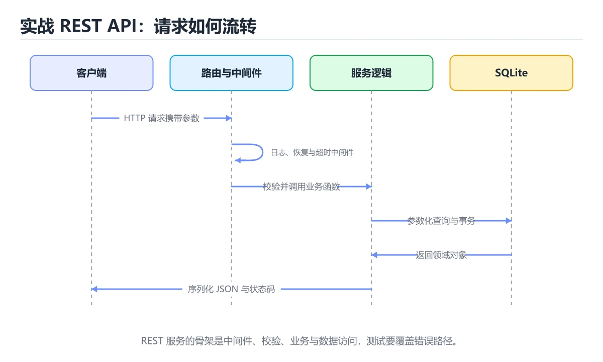
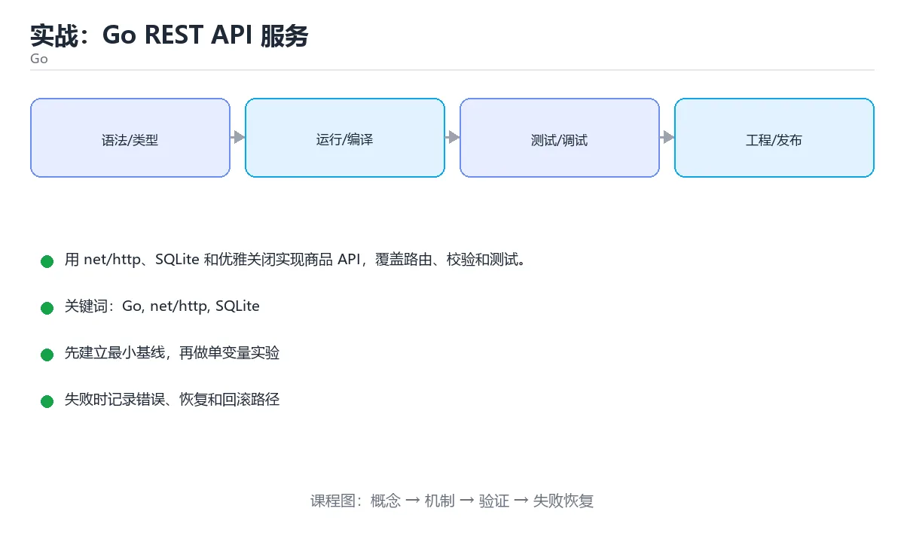

# 实战：Go REST API 服务





> 内容更新时间：2026-10-06 · 学习阶段：高级 · 预计用时：60 分钟

## 本节知识框架

**课程定位**：所属分类 `go`（Go），课程主题 `实战：Go REST API 服务`，学习阶段 高级，建议用时 70 分钟。

本课主线：用 net/http、SQLite 和优雅关闭实现商品 API，覆盖路由、校验和测试。

**学完本课应当能够**
- 说清 `Go` 与 `优雅关闭` 的含义与区别，并各举一个正例和一个反例。
- 用本课示例验证 `中间件` 的行为，记录输入、输出与失败条件。
- 遇到「忽略 http.Server 超时」这类问题时，能说出触发条件与修复顺序。

### 复习清单

- [ ] 能不看正文复述本课核心术语，并指出一个边界或反例。
- [ ] 能运行或推演本课示例，记录输入、输出与失败现象。
- [ ] 能完成一次自测，并把错题对照错误表定位原因。

## 核心概念定义

| 术语 | 操作性定义 | 常见边界与风险 |
| --- | --- | --- |
| Go | 谷歌开源的静态编译语言：goroutine 与 channel 原生支持并发，编译产物是单个二进制文件。 | 共享状态与调度顺序会改变结论，单线程或串行测试通过不等于并发下成立。 |
| 优雅关闭 | 用 net/http、SQLite 和优雅关闭实现商品 API，覆盖路由、校验和测试。 | 不同版本与依赖组合的行为可能不同，升级或换环境前要按官方变更说明重新验证。 |
| 中间件 | 在 handler 前后统一处理日志、鉴权、超时等横切逻辑的函数包装。 | 网络延迟、超时与版本协商会改变行为，只在真实链路或多版本客户端上验证才算数。 |
| httptest | 标准库提供的测试工具，不启真实端口就能构造请求并断言响应。 | 网络延迟、超时与版本协商会改变行为，只在真实链路或多版本客户端上验证才算数。 |
| 可观测性 | 由日志、指标与链路追踪组成，能在不重启、不改代码的前提下问出新问题 | 只在「由日志、指标与链路追踪组成，能在不重启、不改代码的前提下问出新问题」这一前提下成立，换输入或换环境要重新验证。 |

## 原理与运行机制

### 机制总览

**教材衔接：技术栈**

- 版本提示：Go 的行为在最近几个大版本里有过调整，升级「实战：Go REST API 服务」前先用 HandleFunc 复现当前输出，再对照官方发布说明逐条核对。
- net/http
- database/sql
- SQLite
- testing

**教材衔接：架构与数据流**

- 查询 net/http 时限定字段与分页范围，把全表扫描留作最后手段。
- 写路径要明确 Go 的事务边界、幂等键和失败补偿，不能留下半完成状态。
- 外部调用要设置超时、重试上限和降级策略。
- 每个关键阶段都要留下日志、指标或测试证据。

**教材衔接：功能范围**

- [ ] 商品 CRUD
- [ ] 分页查询
- [ ] 健康检查
- [ ] 请求超时与优雅关闭

**教材衔接：实施步骤**

### 步骤 1：定义领域模型和错误

- 先列出 HandleFunc 这一步的输入、输出与中间产物，再动手实现。
- 为 net/http 补一个最小用例，明确通过标准再扩展规模。
- 失败处理：记录 Go 的错误类型、回滚动作和重试条件，避免把问题带到下一步。
- 证据留存：保留命令、输出、日志或截图，方便评审与复盘。

### 步骤 2：实现 SQLite 仓储

- 定位：这一节说明步骤 2：实现 SQLite 仓储在「实战：Go REST API 服务」知识体系里的位置。
- 要点：熟悉命令行、依赖管理、测试和 Git 基本操作。
- 自检：能否用一个最小例子解释步骤 2：实现 SQLite 仓储？

### 步骤 3：编写 HTTP handler 与中间件

把这条结论放回「实战：Go REST API 服务」的完整流程里展开：

- 正文依据：本课涉及：Go、net/http、SQLite、优雅关闭、测试。
- 落地检查：把「步骤 3：编写 HTTP handler 与中间件」改写成一条可执行的核对项，逐条验证输入、超时与失败路径。

### 步骤 4：加入请求超时和结构化日志

- 定位：这一节说明步骤 4：加入请求超时和结构化日志在「实战：Go REST API 服务」知识体系里的位置。
- 要点：一个商品服务需要支持创建、查询、更新和删除，使用标准库优先，二进制可直接部署，并在收到终止信号时优雅关闭。
- 自检：能否用一个最小例子解释步骤 4：加入请求超时和结构化日志？

### 步骤 5：实现信号监听和优雅关闭

- 定位：这一节说明步骤 5：实现信号监听和优雅关闭在「实战：Go REST API 服务」知识体系里的位置。
- 要点：一句话摘要：用 net/http、SQLite 和优雅关闭实现商品 API，覆盖路由、校验和测试。
- 自检：能否用一个最小例子解释步骤 5：实现信号监听和优雅关闭？

### 步骤 6：用 httptest 和基准测试验收

- 定位：这一节说明步骤 6：用 httptest 和基准测试验收在「实战：Go REST API 服务」知识体系里的位置。
- 要点：验证方法：用最小请求、最小数据集或单元测试证明本步结果正确。
- 自检：能否用一个最小例子解释步骤 6：用 httptest 和基准测试验收？

**教材衔接：建议目录结构**

```text
src/
  entry/        启动与配置
  domain/       业务模型与规则
  service/      用例编排
  infra/        数据库、HTTP、消息等适配器
tests/          单元、集成与接口测试
```

**教材衔接：质量门禁**

- [ ] 格式化和静态检查通过，不遗留明显警告。
- [ ] 测试分层：核心规则用单元测试，net/http 的边界用集成测试。
- [ ] 错误响应不泄露堆栈、SQL 和密钥。
- [ ] 配置来自环境变量或配置文件，不硬编码敏感信息。
- [ ] README 写清启动、测试、配置和回滚步骤。

**教材衔接：安全、成本与可观测性**

- 权限遵循最小授权：Go 用到的数据库账号、云资源和令牌都不能使用管理员默认权限。
- 所有进入 Go 的外部输入都要校验、限长并转义，错误信息不能泄露内部路径。
- 密钥通过环境变量或密钥管理服务注入，并记录轮换方式。
- HandleFunc 的并发度要有上限，并在达到上限时给出可解释的拒绝。
- 监控 net/http 的延迟与成本，出现拐点时能追溯到具体变更。
- Go 出现异常时，要能从日志和指标还原时间线，而不是只看到「服务不可用」。

**教材衔接：扩展任务**

- 加入 JWT 认证
- 接入 Prometheus 指标
- 用容器和多阶段构建发布

**教材衔接：实施记录与复盘**

每完成一步，记录以下内容：

1. 本步的输入、命令和输出是什么？
2. 遇到的最小失败是什么，如何定位和修复？
3. 哪个假设被验证或推翻？
4. 下一步的风险是什么，如何回滚？
5. 把 HandleFunc 的负载提高一个数量级，预期哪一项指标先触顶？

**教材衔接：完成标准**

- [ ] 能从干净环境按 README 启动项目。
- [ ] 为 HandleFunc 补三条测试：正常、边界、失败各一条。
- [ ] 能演示一次错误、一次恢复和一次回滚。
- [ ] 有一份资源或性能基线，能说明瓶颈在哪里。
- [ ] 能说清一个尚未解决的问题和下一步验证方法。

**教材衔接：版本与时效**

- 升级前确认 Go 的兼容范围，把不可回退的改动单独拆成一次提交。
- 模块校验、最小版本选择与供应链安全是生产升级的重点
- 官方发布说明：https://go.dev/doc/devel/release

### 一、「实战：Go REST API 服务」的交付物评分表

| 交付物 | 权重 | 合格线 | 需要的证据 |
| --- | ---: | --- | --- |
| 核心链路 | 34% | 能在干净环境复现，且失败路径有明确处理 | 命令与输出、对应测试、一次失败与恢复记录 |
| 测试与验收记录 | 33% | 能在干净环境复现，且失败路径有明确处理 | 命令与输出、对应测试、一次失败与恢复记录 |
| 运行与回滚说明 | 33% | 能在干净环境复现，且失败路径有明确处理 | 命令与输出、对应测试、一次失败与恢复记录 |

「实战：Go REST API 服务」的评分先看证据再打分：任意一项只要拿不出可复现的命令或测试，该项按 0 分计，不允许用「基本完成」代替。

### 三、「实战：Go REST API 服务」的交付证据链

| # | 命令 | 这条命令要留下的证据 |
| ---: | --- | --- |
| 1 | `1. 安装依赖并启动项目` | 完整输出、退出码、耗时，以及与「实战：Go REST API 服务」验收口径的对应关系 |
| 2 | `2. 执行至少 3 条自动化测试，其中包含 1 条失败路径` | 完整输出、退出码、耗时，以及与「实战：Go REST API 服务」验收口径的对应关系 |
| 3 | `3. 用正常请求验证成功响应` | 完整输出、退出码、耗时，以及与「实战：Go REST API 服务」验收口径的对应关系 |
| 4 | `4. 用非法输入验证错误响应` | 完整输出、退出码、耗时，以及与「实战：Go REST API 服务」验收口径的对应关系 |
| 5 | `5. 重复执行一次，确认没有重复写入或副作用` | 完整输出、退出码、耗时，以及与「实战：Go REST API 服务」验收口径的对应关系 |

### 四、「实战：Go REST API 服务」的验收指标

| 指标 | 目标值 | 测量方式 | 不达标时的动作 |
| --- | --- | --- | --- |
| | 延迟 | 记录 P50/P95/P99 | 用固定数据集逐步增加并发 | P99 持续上升或超时率增加 | | 用本课正文给出的阈值，没有就写实测基线 | 固定环境重复三次取中位数 | 回到对应小节定位，先修原因再重测 |
| | 存储 | 记录数据增长与索引大小 | 导入 10 倍数据并观察查询 | 磁盘、连接或锁等待成为瓶颈 | | 用本课正文给出的阈值，没有就写实测基线 | 固定环境重复三次取中位数 | 回到对应小节定位，先修原因再重测 |

### 五、评审记录模板

| 记录项 | 填写要求 |
| --- | --- |
| 项目标识 | `go_project_rest_api` |
| 本次范围 | 说明这一轮交付了「实战：Go REST API 服务」的哪些部分 |
| 未完成项 | 列出与 Go 相关但本轮未做的内容 |
| 证据位置 | 指向 evidence/ 目录下的具体文件 |
| 风险与回滚 | 写清剩余风险、回滚步骤和验证方式 |
| 结论 | 通过 / 有条件通过 / 不通过，三者选一 |

## 典型应用场景

**教材衔接：项目背景**

一个商品服务需要支持创建、查询、更新和删除，使用标准库优先，二进制可直接部署，并在收到终止信号时优雅关闭。

一句话摘要：用 net/http、SQLite 和优雅关闭实现商品 API，覆盖路由、校验和测试。

**教材衔接：项目专属规格：实战：Go REST API 服务**

### 核心场景

用 net/http、SQLite 和优雅关闭实现商品 API，覆盖路由、校验和测试。 项目目标是把「Go、net/http、SQLite、优雅关闭、测试」落实为可运行、可测试、可回滚的交付物。

### 验收场景

1. 正常路径：最小输入得到预期输出，并留下日志与指标。
2. 边界路径：把 HandleFunc 的输入推到上下限，确认返回结果可解释。
3. 失败路径：依赖超时或不可用时能快速失败、重试或降级。
4. 幂等路径：同一请求执行两次不会产生重复副作用。
5. 回滚路径：net/http 的失败能按预案恢复，并记录影响范围。

**教材衔接：项目交付物**

### 建议仓库结构

```text
cmd/app/
internal/domain/
internal/infra/
pkg/
go.mod
```

### 测试矩阵

| 层级 | 覆盖内容 | 最低数量 | 通过标准 |
| --- | --- | ---: | --- |
| 单元测试 | 领域规则、边界和错误分类 | 8 | 正常、边界、失败路径全部通过 |
| 集成测试 | 数据库、网络、文件或平台边界 | 3 | 使用真实边界且可重复运行 |
| 端到端测试 | 核心用户路径 | 1 | 从输入到输出完整跑通 |
| 手动验收 | 文档中列出的 5 个场景 | 5 | 有命令、输出和结论记录 |

### 验收数据

```json
{
  "project": "go_project_rest_api",
  "scenario": "Go的正常路径",
  "input": {"case": "normal", "value": "HandleFunc"},
  "expected": {"ok": true, "checks": ["Go可复现", "net/http有记录"]},
  "failure_case": {"case": "net/http越界或缺失", "error": "validation_error"},
  "idempotency_key": "go_project_rest_api-001"
}
```

### 复盘模板

- **忽略 http.Server 超时**：典型现象是慢连接耗尽资源；正确做法是设置读写和空闲超时。
- **错误直接写 500**：典型现象是客户端无法区分；正确做法是定义领域错误到状态码映射。
- **数据库句柄未关闭**：典型现象是连接泄漏；正确做法是defer db.Close 并管理生命周期。
- **goroutine 泄漏**：典型现象是进程无法退出；正确做法是用 context 取消并等待 goroutine。

### 最小验证场景

- 准备：保留 `text` 示例的原始输入，先记录 `实战：Go REST API 服务` 的基线输出和完整运行命令。
- 判定：新结果与 `实战：Go REST API 服务` 的基线不同不等于错误；只有当差异破坏了 `Go` 的定义或错误表中的约束，才判定为失败。

### 选择与边界

- 使用 `Go` 时，先满足它的定义：谷歌开源的静态编译语言：goroutine 与 channel 原生支持并发，编译产物是单个二进制文件；共享状态与调度顺序会改变结论，单线程或串行测试通过不等于并发下成立。
- 使用 `优雅关闭` 时，先满足它的定义：用 net/http、SQLite 和优雅关闭实现商品 API，覆盖路由、校验和测试；不同版本与依赖组合的行为可能不同，升级或换环境前要按官方变更说明重新验证。
- 使用 `中间件` 时，先满足它的定义：在 handler 前后统一处理日志、鉴权、超时等横切逻辑的函数包装；网络延迟、超时与版本协商会改变行为，只在真实链路或多版本客户端上验证才算数。
- 使用 `httptest` 时，先满足它的定义：标准库提供的测试工具，不启真实端口就能构造请求并断言响应；网络延迟、超时与版本协商会改变行为，只在真实链路或多版本客户端上验证才算数。
- 使用 `可观测性` 时，先满足它的定义：由日志、指标与链路追踪组成，能在不重启、不改代码的前提下问出新问题；只在「由日志、指标与链路追踪组成，能在不重启、不改代码的前提下问出新问题」这一前提下成立，换输入或换环境要重新验证。

## 代码/协议/SQL 示例

### 最小可验证示例

**教材衔接：示例数据与边界**

**教材衔接：关键代码**

```go
func main() {
  mux := http.NewServeMux()
  mux.HandleFunc("GET /health", func(w http.ResponseWriter, r *http.Request) {
    w.Header().Set("Content-Type", "application/json")
    w.Write([]byte(`{"status":"ok"}`))
  })
  server := &http.Server{Addr: ":8080", Handler: mux, ReadHeaderTimeout: 2 * time.Second}
  log.Fatal(server.ListenAndServe())
}
```

**教材衔接：验证命令与预期输出**

```text
1. 安装依赖并启动项目
2. 执行至少 3 条自动化测试，其中包含 1 条失败路径
3. 用正常请求验证成功响应
4. 用非法输入验证错误响应
5. 重复执行一次，确认没有重复写入或副作用
```

**教材衔接：测试与验收**

- 非法 ID 返回 400
- 不存在商品返回 404
- 并发请求下 SQLite 写入不损坏

### 验收记录表

| 检查项 | 证据 | 结果 | 备注 |
| --- | --- | --- | --- |
| 最小路径可运行 | 启动命令与输出 |  |  |
| 失败路径可恢复 | 错误日志与重试 |  |  |
| 自动化测试通过 | 测试报告 |  |  |
| 配置和密钥安全 | 配置检查 |  |  |

## 时间/空间复杂度或性能分析

**性能关注点（实战：Go REST API 服务）**：调度器与 GC 影响开销：记录 P99 延迟、协程数量与堆占用，优先用 pprof 采样。

**本课特有开销（实战：Go REST API 服务 · Go）**：并发度提高后要观察是否出现拐点：延迟上升而吞吐不增，说明瓶颈已转移。

**测量方法**：以 `实战：Go REST API 服务` 的 `Go` 场景为对象，固定输入跑一遍记录基线，再把规模或并发度提高一个数量级复测；两次结果的差值与波动范围才是结论依据。

## 常见误区与易错点

| 容易写错的做法 | 实际现象 | 原因与正确做法 |
| --- | --- | --- |
| 忽略 http.Server 超时 | 慢连接耗尽资源 | 设置读写和空闲超时 |
| 错误直接写 500 | 客户端无法区分 | 定义领域错误到状态码映射 |
| 数据库句柄未关闭 | 连接泄漏 | defer db.Close 并管理生命周期 |
| goroutine 泄漏 | 进程无法退出 | 用 context 取消并等待 goroutine |

### 现场 1：忽略 http.Server 超时

**症状**：慢连接耗尽资源。

**根因与修复**：设置读写和空闲超时。

**自检**：在本课示例里复现「忽略 http.Server 超时」，改成设置读写和空闲超时后重跑；如果症状消失且失败路径按预期变化，说明定位正确。

### 现场 2：错误直接写 500

**症状**：客户端无法区分。

**根因与修复**：定义领域错误到状态码映射。

**自检**：在本课示例里复现「错误直接写 500」，改成定义领域错误到状态码映射后重跑；如果症状消失且失败路径按预期变化，说明定位正确。

### 现场 3：数据库句柄未关闭

**症状**：连接泄漏。

**根因与修复**：defer db.Close 并管理生命周期。

**自检**：在本课示例里复现「数据库句柄未关闭」，改成defer db.Close 并管理生命周期后重跑；如果症状消失且失败路径按预期变化，说明定位正确。

### 现场 4：goroutine 泄漏

**症状**：进程无法退出。

**根因与修复**：用 context 取消并等待 goroutine。

**自检**：在本课示例里复现「goroutine 泄漏」，改成用 context 取消并等待 goroutine后重跑；如果症状消失且失败路径按预期变化，说明定位正确。

## 与其他知识点的关系

**教材衔接：复习与迁移**

## 自测题与参考答案

> 先独立作答，再对照参考答案；答案都能在本课正文、术语表或错误表里找到依据。

### 自测 1（概念复述）

不看正文，写出 `Go` 的操作性定义，并说明它与 `优雅关闭` 的区别。

**参考答案**：谷歌开源的静态编译语言：goroutine 与 channel 原生支持并发，编译产物是单个二进制文件。

`优雅关闭` 的定位是：用 net/http、SQLite 和优雅关闭实现商品 API，覆盖路由、校验和测试；两者的差别要从适用对象与失败模式上说明。

### 自测 2（排错）

本课错误表记录了「忽略 http.Server 超时」这类做法。请写出它会出现的现象、根因，以及修复顺序。

**参考答案**：现象是慢连接耗尽资源；正确做法是设置读写和空闲超时。修复时先复现现象并保留证据，再改动一处假设重跑，确认现象消失。

### 自测 3（动手验证）

运行本课的 `text` 示例，改动其中一个输入后重新运行，记录输出与错误信息。

**参考答案**：正常输入下 `text` 示例应当复现正文给出的结果；改动输入后，如果结果改变或报错，先核对它是否满足 `实战：Go REST API 服务` 中`Go` 的适用范围，再检查错误表里是否有同类现象。

### 自测 4（代码阅读）

阅读本课开头的 `text` 示例，说明它体现了`Go` 的哪一条性质，并指出改动哪个输入会让这条性质不再成立。

**参考答案**：`Go` 的定义是 谷歌开源的静态编译语言：goroutine 与 channel 原生支持并发，编译产物是单个二进制文件，示例正是在实现这条定义。改动与 `Go` 有关的一个输入后，如果结果不再符合 `实战：Go REST API 服务` 的正文描述，就说明该性质只在当前前提成立。

### 自测 5（迁移）

把 `实战：Go REST API 服务` 的方法迁移到自己的项目：围绕 `Go` 写出一个与错误表同类的风险点，并说明触发条件和检验方式。

**参考答案**：例如「goroutine 泄漏」，它会导致进程无法退出；检验方式是按用 context 取消并等待 goroutine改一处再复现，确认现象消失且没有引入新的失败分支。

### 自测 6（对比）

用一个表格对比 `Go` 与 `优雅关闭`：各写一行适用场景、一行失败表现。

**参考答案**：`Go` 的定义是谷歌开源的静态编译语言：goroutine 与 channel 原生支持并发，编译产物是单个二进制文件；`优雅关闭` 的定义是用 net/http、SQLite 和优雅关闭实现商品 API，覆盖路由、校验和测试。两者的失败表现分别对应本课错误表里与本术语相关的行。

### 自测 7（排错顺序）

面对「忽略 http.Server 超时」引发的问题，请把“复现 慢连接耗尽资源 → 保留证据 → 设置读写和空闲超时 → 回归验证”四步写成可执行的检查清单。

**参考答案**：第一步按慢连接耗尽资源复现；第二步记录输入、版本与完整报错；第三步按设置读写和空闲超时只改一处；第四步重跑并确认失败路径也按预期变化。

### 自测 8（边界判断）

针对 `可观测性`，分别写出“可以使用”的条件和“结论不再成立”的条件。

**参考答案**：只在「由日志、指标与链路追踪组成，能在不重启、不改代码的前提下问出新问题」这一前提下成立，换输入或换环境要重新验证。 同时要把 `可观测性` 的定义 由日志、指标与链路追踪组成，能在不重启、不改代码的前提下问出新问题 与实际输入逐项对照。

### 自测 9（机制重建）

不看正文，按输入、转换、输出、验证四段重建 `Go` → `优雅关闭` → `中间件` → `httptest` 的作用链。

**参考答案**：起点是 `Go` 的定义 谷歌开源的静态编译语言：goroutine 与 channel 原生支持并发，编译产物是单个二进制文件；中间每一步都保留可观察状态；终点由 `可观测性` 检查，失败时回到错误表定位第一个偏离定义的步骤。

### 自测 10（综合排错）

在 `实战：Go REST API 服务` 中，现象是 进程无法退出。请围绕 goroutine 泄漏 写出最小复现、关键证据、修复动作和回归验证，并说明为什么不能只凭一次运行下结论。

**参考答案**：先复现 goroutine 泄漏，记录输入与完整错误；再按 用 context 取消并等待 goroutine 只改一处。回归时同时跑正常路径和边界路径，只有两次结果都可解释，才把修复视为完成。

### 自测 11（一分钟复述）

用每分钟约 200 字的速度复述 `实战：Go REST API 服务`：先给主问题，再按顺序说出 `Go`、`优雅关闭`、`中间件`、`httptest`，最后给一个失败案例。

**自评标准**：主问题必须对应 用 net/http、SQLite 和优雅关闭实现商品 API，覆盖路由、校验和测试；每个术语都要能接上一句定义或边界；失败案例必须写成可观察现象，不能用“可能有风险”代替证据。

## 延伸阅读

想更直观地理解本课概念？推荐参阅以下图解专题：

- [图解一次网页请求的完整链路](visual_http_timeline.md)

## 术语速查

| 术语 | 一句话说明 |
| --- | --- |
| `Go` | 谷歌开源的静态编译语言：goroutine 与 channel 原生支持并发，编译产物是单个二进制文件。 |
| `优雅关闭` | 用 net/http、SQLite 和优雅关闭实现商品 API，覆盖路由、校验和测试。 |
| `中间件` | 在 handler 前后统一处理日志、鉴权、超时等横切逻辑的函数包装。 |
| `httptest` | 标准库提供的测试工具，不启真实端口就能构造请求并断言响应。 |
| `可观测性` | 由日志、指标与链路追踪组成，能在不重启、不改代码的前提下问出新问题。 |

**术语关系**：`Go`（谷歌开源的静态编译语言：goroutine 与 channel 原生支持并发） → `优雅关闭`（用 net/http、SQLite 和优雅关闭实现商品 API） → `中间件`（在 handler 前后统一处理日志、鉴权、超时等横切逻辑的函数包装） → `httptest`（标准库提供的测试工具）。

## 考点精讲

`实战：Go REST API 服务` 的题库有 6 道题，下面逐题给出题干、正确项与判断依据：先自己作答，再核对正确项，最后回到正文对应小节复核。

### 考点 1：第 1 题

- **题目**：按“实战：Go REST API 服务”中 Go、net/http、SQLite 的实践顺序，把四个步骤排成从准备到复盘的合理顺序。
- **正确项**：先明确 Go 的输入、输出与约束 → 写出最小示例并核对 net/http 的基线结果 → 只改一个变量，记录边界与失败路径的变化 → 固定版本与证据，把“实战：Go REST API 服务”的结论写成可复现记录
- **判断依据**：按《实战：Go REST API 服务》正文的先后，本题顺序是「先明确 Go 的输入、输出与约束」 → 「写出最小示例并核对 net/http 的基线结果」 → 「只改一个变量，记录边界与失败路径的变化」 → 「固定版本与证据，把“实战：Go REST API 服务”的结论写成可复现记录」。术语 Go（实战：Go REST API 服务）：谷歌开源的静态编译语言：goroutine 与 channel 原生支持并发，编译产物是单个二进制文件。易错点是忽略 http.Server 超时会造成慢连接耗尽资源，改法是设置读写和空闲超时。

### 考点 2：第 2 题

- **题目**：优雅关闭的第一步是什么？
- **正确项**：监听终止信号并停止接收新请求
- **判断依据**：本题正确项是「监听终止信号并停止接收新请求」。术语 优雅关闭（实战：Go REST API 服务）：用 net/http、SQLite 和优雅关闭实现商品 API，覆盖路由、校验和测试，本题取「监听终止信号并停止接收新请求」这条。易错点是错误直接写 500，会造成客户端无法区分，改法是定义领域错误到状态码映射。

### 考点 3：第 3 题

- **题目**：httptest 主要用于什么？
- **正确项**：在不启动真实端口的情况下测试 handler
- **判断依据**：本题正确项是「在不启动真实端口的情况下测试 handler」。术语 httptest（实战：Go REST API 服务）：标准库提供的测试工具，不启真实端口就能构造请求并断言响应，本题取「在不启动真实端口的情况下测试 handler」这条。易错点是数据库句柄未关闭，会造成连接泄漏，改法是defer db.Close 并管理生命周期。

### 考点 4：第 4 题

- **题目**：context 在服务中通常传递什么？
- **正确项**：取消、超时和请求范围数据
- **判断依据**：本题正确项是「取消、超时和请求范围数据」。术语 Go（实战：Go REST API 服务）：谷歌开源的静态编译语言：goroutine 与 channel 原生支持并发，编译产物是单个二进制文件，本题取「取消、超时和请求范围数据」这条。易错点是goroutine 泄漏，会造成进程无法退出，改法是用 context 取消并等待 goroutine。

### 考点 5：第 5 题

- **题目**：下面 HTTP 服务设置了 ReadHeaderTimeout，主要目的是什么？
- **正确项**：防止慢速请求长期占用连接
- **判断依据**：本题正确项是「防止慢速请求长期占用连接」。术语 Go（实战：Go REST API 服务）：谷歌开源的静态编译语言：goroutine 与 channel 原生支持并发，编译产物是单个二进制文件，本题取「防止慢速请求长期占用连接」这条。易错点是忽略 http.Server 超时，会造成慢连接耗尽资源，改法是设置读写和空闲超时。

### 考点 6：第 6 题

- **题目**：关于 `Go`，下列哪些说法与 `实战：Go REST API 服务` 的正文一致？判断时以用 net/http、SQLite 和优雅关闭实现商品 API，覆盖路由、校验和测试。为主线。（多选）
- **正确项**：避免慢连接占满资源；监听终止信号并停止接收新请求
- **判断依据**：按《实战：Go REST API 服务》的正文口径，本题要同时选中「避免慢连接占满资源」、「监听终止信号并停止接收新请求」，漏掉任一项都算没答全。术语 Go（实战：Go REST API 服务）：谷歌开源的静态编译语言：goroutine 与 channel 原生支持并发，编译产物是单个二进制文件。易错点是错误直接写 500，会造成客户端无法区分，改法是定义领域错误到状态码映射。

### 考点 7：`Go`

- **要点**：谷歌开源的静态编译语言：goroutine 与 channel 原生支持并发，编译产物是单个二进制文件。
- **Go 的边界**：共享状态与调度顺序会改变结论，单线程或串行测试通过不等于并发下成立。

### 考点 8：`优雅关闭`

- **要点**：用 net/http、SQLite 和优雅关闭实现商品 API，覆盖路由、校验和测试。
- **优雅关闭 的边界**：不同版本与依赖组合的行为可能不同，升级或换环境前要按官方变更说明重新验证。

### 考点 9：`中间件`

- **要点**：在 handler 前后统一处理日志、鉴权、超时等横切逻辑的函数包装。
- **中间件 的边界**：网络延迟、超时与版本协商会改变行为，只在真实链路或多版本客户端上验证才算数。

### 考点 10：`httptest`

- **要点**：标准库提供的测试工具，不启真实端口就能构造请求并断言响应。
- **httptest 的边界**：网络延迟、超时与版本协商会改变行为，只在真实链路或多版本客户端上验证才算数。

### 考点 11：`可观测性`

- **要点**：由日志、指标与链路追踪组成，能在不重启、不改代码的前提下问出新问题
- **可观测性 的边界**：只在「由日志、指标与链路追踪组成，能在不重启、不改代码的前提下问出新问题」这一前提下成立，换输入或换环境要重新验证。

### 考点 12：排错——忽略 http.Server 超时

- **现象**：慢连接耗尽资源。
- **处理**：设置读写和空闲超时。

### 考点 13：排错——错误直接写 500

- **现象**：客户端无法区分。
- **处理**：定义领域错误到状态码映射。

### 考点 14：综合辨析——`Go` 与 `可观测性`

- **辨析点**：`Go` 的定义是 谷歌开源的静态编译语言：goroutine 与 channel 原生支持并发，编译产物是单个二进制文件；`可观测性` 的定义是 由日志、指标与链路追踪组成，能在不重启、不改代码的前提下问出新问题。
- **答题要求**：面对 `实战：Go REST API 服务` 的题目，先判断描述的是 `Go` 还是 `可观测性`，再归到对应定义，最后写出一个会让该定义失效的边界输入。

### 考点 15：排错评分点

- **现象分**：能写出 慢连接耗尽资源，而不是只写“程序有错”。
- **证据分**：保留触发 忽略 http.Server 超时 的输入、版本和错误原文。
- **修复分**：按 设置读写和空闲超时 只改一处，并同时回归正常路径与边界路径。

## 内容元数据

- 内容版本：v2.0
- 最后更新：2026-10-06
- 学习阶段：高级
- 适用环境：Go 1.24+
；本课聚焦 Go。
- 内容来源：内置结构化课程与工程实践整理
- 相关主题：Go、net/http、SQLite、优雅关闭、测试
- 质量版本：P0 测验标准 + P1 覆盖扩展 + P2 体验补全

## 参考资料与复核

- 最后复核：2026-10-04
- 下次复核：2027-04-10
- 复核范围：版本兼容、API 行为、安全建议与工程实践
- 来源性质：官方文档、标准或权威教材；本课核对关键词：Go、net/http、SQLite、优雅关闭、测试。

| 参考资料 | 本课用途 |
| --- | --- |
| [net/http](https://pkg.go.dev/net/http) | HTTP 客户端与服务端 |
| [Go 测试](https://go.dev/doc/tutorial/add-a-test) | 测试、基准与覆盖率 |
| [Go 并发](https://go.dev/talks/2012/concurrency.slide) | goroutine 与 channel |

| [本课术语索引：实战：Go REST API 服务](#核心概念定义) | 按本课输入、术语边界和错误表现逐项核对 |
> 「实战：Go REST API 服务」的链接用于离线阅读后的延伸核对；App 不会自动联网。