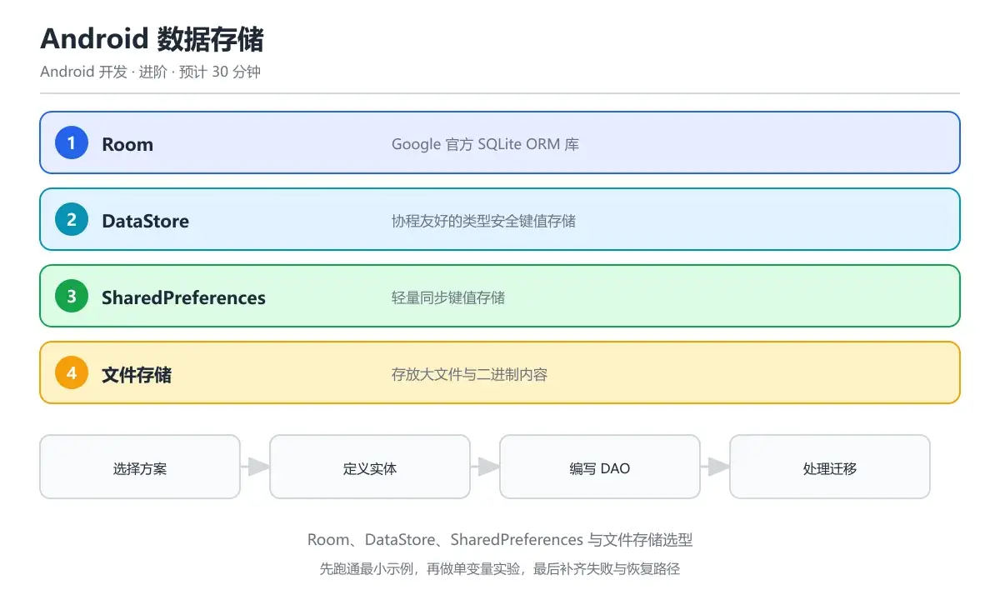

# ArkUI 声明式 UI 首个页面



> 内容更新时间：2026-10-06 · 学习阶段：移动 · 预计用时：45 分钟

## 本节知识框架

**课程定位**：所属分类 `harmonyos`（鸿蒙 HarmonyOS NEXT），课程主题 `ArkUI 声明式 UI 首个页面`，学习阶段 移动，建议用时 45 分钟。

本课主线：从一个能跑起来的首页出发，把 ArkUI 声明式写法的三要素——组件、属性链、事件回调——逐个钉牢；再讲清 `@Entry`、`@Component`、`@Builder` 三种标注各自负责的粒度，以及 `@Styles`、`@Extend` 两套样式复用机制的适用边界，最后补齐资源引用与深色模式适配，让第一个页面就能直接扩展到工程里。

**学完本课应当能够**

- 独立写出含 `@Entry`、`@Component`、`build()` 的最小合法页面，并说明页面为什么必须在 `main_pages.json` 里登记。
- 正确使用 `Text`、`Image`、`Button`、`TextInput`、`Toggle` 五类高频组件及其属性链与事件回调。
- 判断一段重复样式该用 `@Styles` 还是 `@Extend`，并说出 `@Builder` 与自定义组件在复用粒度上的差异。

### 复习清单

- [ ] 能不看正文默写一个带输入框与按钮的页面骨架，编译一次通过。
- [ ] 能说清链式属性为什么不能跨类型调用，以及 @Extend 如何解决这个问题。
- [ ] 能完成一次自测，把错题对照易错点表定位是装饰器粒度还是样式作用域没弄清。

## 核心概念定义

| 术语 | 操作性定义 | 常见边界与风险 |
| --- | --- | --- |
| 声明式 UI | 用代码描述「界面是什么」而不是「怎么改界面」，状态变化时框架重算组件树并做差异更新。 | 易错：仍想找 findViewById 一类的节点句柄去手动改属性。 |
| struct | ArkUI 组件的声明载体，必须实现 `build()`，不能有继承与构造重载。 | 易错：给 struct 写 constructor 会直接编译失败。 |
| @Entry | 把一个自定义组件标记为页面入口，一个页面文件最多一个。 | 易错：忘记在 `main_pages.json` 登记导致路由不到。 |
| @Component | 标记可复用的自定义组件，可被其它组件在 build 中调用。 | 易错：把 @Entry 与 @Component 的角色对调理解。 |
| @Builder | 组件内部的轻量复用函数，产出一段 UI 描述而非独立组件实例。 | 易错：以为它有独立生命周期与独立状态作用域。 |
| 属性链 | 组件构造后以点式调用叠加通用属性与私有属性，返回同类型。 | 易错：把父容器属性写到子组件上，或用错类型的扩展。 |
| @Styles | 无参数的通用样式集合，可被多个不同组件引用。 | 易错：想传参数进来，`@Styles` 不支持参数。 |
| @Extend | 针对某一具体组件的样式与属性扩展，可以带参数。 | 易错：跨组件通用，`@Extend(Text)` 只能给 Text 用。 |

## 原理与运行机制

### 机制总览：一次渲染走过的四步

写下一个页面时，编译器把 `build()` 里的描述转换成组件树构造代码。运行期依次经历：状态读取、组件树构建、布局测量与绘制、事件绑定。用户点按钮改变 `@State` 后，框架只重跑受影响组件的构建与差异比对，因此「声明式」的关键不是少写代码，而是把「谁依赖谁」交给框架维护。

**教材衔接：三种复用粒度的分工**

| 粒度 | 语法 | 是否有独立生命周期 | 典型用途 |
| --- | --- | --- | --- |
| 页面 | `@Entry @Component struct` | 有，含 onPageShow 等 | 一个可路由的完整界面 |
| 组件 | `@Component struct` | 有 aboutToAppear/aboutToDisappear | 卡片、列表项、表单块 |
| 片段 | `@Builder` 函数 | 无 | 同一组件内重复的几行描述 |
| 样式 | `@Styles` / `@Extend` | 无 | 尺寸颜色与组件专属属性封装 |

**教材衔接：属性链的类型约束**

ArkUI 的通用属性由框架生成，调用后返回同类型，所以可以在链上继续叠加；组件私有属性只存在于该组件类型上，一旦回到通用属性链再想调用私有属性就不合法。`@Extend` 的价值正在于此：把「只属于某个组件的多层设置」压成一次调用，让链式书写保持可读。

```typescript
@Extend(Text)
function caption() {
  .fontSize(13)
  .fontColor('#7A7A7A')
  .maxLines(1)
  .textOverflow({ overflow: TextOverflow.Ellipsis })
}

@Styles
function cardSurface() {
  .backgroundColor(Color.White)
  .borderRadius(12)
  .padding(14)
  .shadow({ radius: 8, color: '#14000000', offsetY: 2 })
}
```

**教材衔接：五个高频组件的最小可用组合**

首个页面通常只需要「标题 + 内容 + 输入 + 操作」四件事。`Text` 负责展示，`Image` 支持本地资源、网络地址与像素图三种数据源，`Button` 既能接受子组件也能接受字符串，`TextInput` 通过 `onChange` 输出实时文本，`Toggle` 表达开关语义。它们的共同点是：所有可见变化都来自属性，而不是来自外部对节点的直接修改。

**教材衔接：资源引用与深浅色**

硬编码字符串与颜色会同时丢掉多语言与深色模式支持。ArkUI 用 `$r('app.type.name')` 引用资源目录里的条目，用 `$rawfile()` 引用原始文件，框架会根据限定词目录（如 `dark`、`zh_CN`）自动选择版本。把颜色定义成资源而不是常量，是后续做主题切换成本最低的做法。

```json
{
  "string": [
    { "name": "greeting_title", "value": "今天想学点什么" },
    { "name": "greeting_hint", "value": "输入关键词开始搜索" }
  ],
  "color": [
    { "name": "brand_primary", "value": "#0A59F7" },
    { "name": "brand_on_primary", "value": "#FFFFFF" }
  ]
}
```

## 典型应用场景

| 场景 | 典型输入或前提 | 期望产物 |
| --- | --- | --- |
| 落地页首屏 | 一句标题、一张头图、一个主按钮 | 支持深浅色与字号缩放的静态首屏组件 |
| 搜索输入行 | 需要实时响应输入并展示清除按钮 | TextInput 加 onChange 状态驱动的条件渲染 |
| 表单里的重复字段块 | 五个字段布局一致 | 用 @Builder 抽片段，用 @Extend 统一标签样式 |

- 典型现象：界面在手机上正常，横屏后按钮被挤出屏幕。正确做法：根容器用百分比宽度并让内部可滚动，不要写死像素。
- 典型现象：把 `Text` 的 `maxLines` 写在 Column 上不生效。正确做法：文本截断是 `Text` 的私有属性，必须挂在文本组件自己身上。
- 典型现象：`@Builder` 里的文本不随外部变量更新。正确做法：使用按引用传递的参数对象，按值传参只在重建时生效。

### 最小验证场景

- 准备：新建 Empty Ability 工程，把默认页面替换成本课的搜索首屏，输入框绑定状态，按钮打印当前关键词。
- 观察：连续输入五个字符，观察 `onChange` 回调触发次数；点击按钮后确认文本随状态刷新；切到深色模式确认颜色来自资源。
- 判定：状态改变必然带来界面刷新、样式全部走资源、页面文件已在路由表中登记，三项满足即视为首个页面达标。

## 代码/协议/SQL 示例

**教材衔接：一个可以直接替换首页的完整页面**

下面这段把标题、图片、输入、按钮四种组件串起来，并用 `if` 做条件渲染展示占位文案。刻意只用最基础的属性，方便逐行对照文档。

```typescript
@Entry
@Component
struct HomePage {
  @State keyword: string = '';

  build() {
    Column({ space: 16 }) {
      Text('今天想学点什么')
        .fontSize(26)
        .fontWeight(FontWeight.Bold)
        .width('100%')

      Image($r('app.media.banner'))
        .width('100%')
        .height(150)
        .borderRadius(12)
        .objectFit(ImageFit.Cover)

      TextInput({ placeholder: '输入关键词开始搜索', text: this.keyword })
        .onChange((value: string) => {
          this.keyword = value;
        })

      Button('搜索')
        .width('100%')
        .enabled(this.keyword.length > 0)
        .onClick(() => {
          console.info(`search: ${this.keyword}`);
        })

      if (this.keyword.length === 0) {
        Text('还没有输入内容')
          .caption()
      }
    }
    .padding(16)
    .width('100%')
    .height('100%')
  }
}
```

**教材衔接：@Builder 抽取重复片段**

当同一段描述在页面里出现三次以上，先考虑 `@Builder` 而不是新建组件：它没有独立状态作用域，调用点写起来更像模板片段，重建成本也更低。

```typescript
@Component
struct StatRow {
  @Builder
  cell(label: string, value: string) {
    Column() {
      Text(value).fontSize(20).fontWeight(FontWeight.Medium)
      Text(label).fontSize(12).fontColor('#8A8A8A')
    }
    .layoutWeight(1)
  }

  build() {
    Row() {
      this.cell('连续学习', '12 天')
      this.cell('完成课时', '48')
      this.cell('错题剩余', '7')
    }
  }
}
```

错误表现：想给样式集合传参数，于是把 `@Styles` 写成函数形式，编译直接拒绝。

```typescript
@Styles
function box(size: number) {   // 非法：@Styles 不支持参数
  .width(size)
  .height(size)
}
```

正确写法：需要参数就改用 `@Extend`，它按组件类型扩展并且允许形参。

```typescript
@Extend(Image)
function squareBox(size: number) {
  .width(size)
  .height(size)
  .borderRadius(size / 8)
}
```

## 时间/空间复杂度或性能分析

| 关注点 | 成本来源 | 典型表现 | 控制手段 |
| --- | --- | --- | --- |
| 首帧构建 | 组件节点数量与深度 | 数百节点约数十毫秒 | 精简层级，占位后异步补齐 |
| 状态刷新 | 依赖该状态的组件重建 | 粗粒度状态导致整页重绘 | 把 @State 下放到最小组件 |
| 图片解码 | 尺寸与像素格式 | 大图明显掉帧 | 指定宽高，用合适尺寸资源 |
| 属性链长度 | 每层调用产生配置写入 | 首帧略慢，滚动无感 | 抽 @Extend 但不滥用嵌套 |
| 条件渲染 | if 分支重建子树 | 分支频繁切换时抖动 | 用可见性控制稳定子树 |

页面复杂度大致与节点数线性相关，但真正影响体验的是「一次状态改变重建了多少节点」。把 `@State` 提到页面级组件，任何字段变化都会重跑整个 `build()`；把每个可独立刷新的块拆成子组件，让状态停留在最内层，是 ArkUI 里最直接的性能红利。另一个常见陷阱是让 `Image` 参与高频重建：没有显式指定宽高时，解码与重新布局会在列表滚动中放大，务必给出尺寸并用稳定数据源。

组件复用方面，`@Builder` 比自定义组件轻，但复用范围局限在所属组件；`@Reusable` 装饰的组件在列表场景可被回收再绑定，能显著降低长列表滚动时的创建成本，代价是复用时必须自己重置内部状态，否则会出现「滚动回来内容错位」的现象。

到首个页面这一层，三项指标已经可以被粗略预测。启动耗时与首屏组件数量近似线性相关，每多一层容器就多一次测量与布局求解，因此把装饰性节点合并进属性而不是新建组件是零成本收益。帧率的风险点在属性链的书写位置：能被状态驱动的链式属性都会在状态变化时重新求值，写在循环或高频回调里时容易形成连锁更新。渲染方面要留意动画属性与通用属性的分工，改位移与透明度的代价远小于改尺寸与圆角。包体上首个页面几乎不引入额外资源，成本主要来自代码本身。

## 常见误区与易错点

- **以为声明式就是少写代码。** 它省下的是命令式同步的工作，但要求你想清楚状态归属，归属错了会出现大面积重绘。
- **`@Entry` 当成 `@Component` 用。** 页面入口必须同时具备两者，且页面文件要出现在路由表中才能被加载。
- **给 struct 写构造函数。** 自定义组件不支持自定义 constructor，初始化应放在成员默认值或 `aboutToAppear`。
- **私有属性挂到容器上。** 文本截断、占位提示等只属于对应组件，写在父容器上不报错但也不生效。
- **混用 `@Styles` 与 `@Extend`。** 前者无参数、跨组件通用；后者绑定具体组件、可带参数，方向搞反就是编译错误。
- **`@Builder` 里写副作用。** 它是 UI 描述函数，网络请求与定时器应放生命周期或事件回调。
- **字符串与颜色硬编码。** 失去多语言与深色模式支持，后续补做主题要全量改动。
- **列表项里堆过深层级。** 每个条目都是一个子树，层级越深滚动时布局与绘制成本越高。
- **条件分支频繁切换。** `if` 会重建子树，纯显隐需求更适合用 visibility 属性控制。
- **忽略图片显式尺寸。** 解码后再布局会造成一次性跳动，长列表里表现为滚动抖动。

## 与其他知识点的关系

**教材衔接：与另外两个声明式框架的心智对照**

如果你写过 Compose 或 SwiftUI，可以把 `struct + build()` 对应到 Composable 或 View 的 body，把属性链对应到 Modifier 链或视图修饰符；差异在装饰器体系——ArkUI 用一组 `@` 标注表达状态归属，而不是把普通函数当组件调用。本课只讲语法基线，状态归属的具体规则留给状态管理课。

- 向上承接 `harmonyos_arkts_basics`：`build()` 里的合法语句边界来自语言层约束。
- 向下打开 `harmonyos_layout_system`：本页面的 Column 结构会在那一课扩展成完整布局体系。
- 与 `harmonyos_state_management` 互为表里：组件写好后，刷新行为完全由状态装饰器决定。
- 平行对照 `android_development_compose`：组合式 UI 的重建与跳过策略与 ArkUI 的 diff 思路相通。
- 平行对照 `swiftui_layout`：修饰符链与属性链在可读性与类型约束上面对同样的问题。

| 关联课程 ID | 关联主题 | 关系说明 |
| --- | --- | --- |
| harmonyos_arkts_basics | ArkTS 语言基础 | 该课的可空与收窄规则决定组件参数怎么写才通过编译 |
| harmonyos_layout_system | 布局系统 | 本课的 Column 与 Row 在该课展开为完整布局与响应式方案 |
| harmonyos_state_management | 状态管理 | 组件间数据传递与刷新粒度是本页面的下一层问题 |
| harmonyos_navigation | 路由与导航 | 页面登记进路由表后才能被跳转，该课给出完整导航栈 |
| android_development_compose | Jetpack Compose | 同类声明式范式，可用于对照重建与复用策略 |

## 自测题与参考答案

**教材衔接：题号 1** — `@Entry` 装饰器在一个页面文件中的作用是？

**参考答案**：把一个组件标记为页面入口。

本题正确项是「把一个组件标记为页面入口」。它告诉框架这个自定义组件对应一个可加载页面，需要与组件装饰器同时出现，并在页面路由表里登记后才能被跳转。可复用组件由 `@Component` 表达，组件内的轻量片段由 `@Builder` 表达，组件内部状态由 `@State` 表达，三者描述的都是复用粒度或数据归属，与「页面入口」这一职责无关。

**教材衔接：题号 2** — 关于 `@Builder` 的说法，下列哪项成立？

**参考答案**：用于抽取组件内的复用片段。

本题正确项是「用于抽取组件内的复用片段」。它定义在自定义组件内部，被调用时把一段界面描述就地展开，因此没有独立生命周期，也不拥有独立状态作用域。组件外部同样可以定义全局构建函数，所以「只能在外部」不成立；它不需要返回实例，内部仍受声明式语句边界约束，不能随手塞命令式循环，这一点与普通函数不同。

**教材衔接：题号 3** — `@Styles` 与 `@Extend` 的关键差别是？

**参考答案**：前者可跨组件通用后者限定类型。

本题正确项是「前者可跨组件通用后者限定类型」。样式集合可以被任何支持这些属性的组件引用，但不接受参数；按组件扩展的写法绑定具体组件类型，可以带形参，因此需要按尺寸或颜色参数化时必须走后者，选项一把方向说反了。两者都不是文本组件专属，作用域与参数能力都不同，说等价会让人在编译错误面前无从下手。

**教材衔接：题号 4** — 要在用户输入时实时拿到文本内容，最直接的写法是？

**参考答案**：在 onChange 里写入状态变量。

本题正确项是「在 onChange 里写入状态变量」。输入组件每次文本变化都会触发该回调，把值写进可观察状态后，依赖它的组件自动刷新，这是声明式框架里唯一可靠的取值路径。出现回调只在组件挂载时执行一次拿不到过程值，ArkUI 没有公开的命令式节点查询接口，在生命周期里轮询既消耗主线程也无法覆盖用户正在输入的每一个字符。

**教材衔接：题号 5** — 点击一次按钮后，屏幕上 Text 显示的内容是？
@Component
struct T {
  @State tip: string = 'hi';
  build() {
    Column() {
      Text(this.tip + ' !').fontSize(24)
      Button('go').onClick(() => { this.tip = 'ok'; })
    }
  }
}

**参考答案**：显示 ok !。

本题正确项是「显示 ok !」。按钮回调把可观察状态从 hi 改成 ok，框架据此重建该组件并重新计算字符串拼接结果，因此屏幕上只剩新值加一个感叹号。若变量没有被状态装饰器修饰，才会停在首次渲染的旧值；两个值并列的写法需要额外的累加逻辑，回调里只是整体赋值，不会产生拼接残留。

## 考点精讲

**教材衔接：高频考点**

1. `@Entry` / `@Component` / `@Builder` 三种粒度各自负责什么，是概念题的母题。
2. `@Styles` 与 `@Extend` 的作用域与参数能力差异，常以排错形式出现。
3. 输入类组件的取值路径：事件回调写状态，状态驱动刷新。
4. 属性链的类型边界：通用属性与组件私有属性不能混挂。

**教材衔接：命题规律**

- 装饰器类题目四个选项通常各对应一种装饰器，考的是职责而非拼写。
- 代码题偏爱给一段最小页面，问点击或输入后的显示结果，答案落在刷新机制上。
- 样式类题目会给一段非法写法，正确项往往点出「是否支持参数」或「是否限定组件」。

**教材衔接：常见考点**

问：`@Entry` 装饰器在一个页面文件中的作用是？
答：把一个组件标记为页面入口。

问：关于 `@Builder` 的说法，下列哪项成立？
答：用于抽取组件内的复用片段。

问：`@Styles` 与 `@Extend` 的关键差别是？
答：前者可跨组件通用后者限定类型。

问：要在用户输入时实时拿到文本内容，最直接的写法是？
答：在 onChange 里写入状态变量。

问：点击一次按钮后，屏幕上 Text 显示的内容是？
@Component
struct T {
  @State tip: string = 'hi';
  build() {
    Column() {
      Text(this.tip + ' !').fontSize(24)
      Button('go').onClick(() => { this.tip = 'ok'; })
    }
  }
}
答：显示 ok !。

## 术语速查

| 术语 | 一句话说明 |
| --- | --- |
| build() | 组件必须实现的构建方法，用来描述界面结构。 |
| @Entry | 标记页面入口，与 @Component 搭配并需登记到路由表。 |
| @Component | 标记可复用自定义组件，拥有自己的生命周期回调。 |
| @Builder | 组件内的轻量 UI 片段函数，无独立状态作用域。 |
| 属性链 | 以点式调用叠加通用与私有属性，逐层返回同类型。 |
| @Styles | 无参数的通用样式集合，可被多种组件引用。 |
| @Extend | 针对具体组件的样式扩展，支持带参数调用。 |
| $r 资源引用 | 按限定词目录自动选择文本、颜色或媒体资源。 |

## 内容元数据

- 内容版本：v2.0
- 最后更新：2026-11-10
- 学习阶段：移动
- 适用环境：DevEco Studio NEXT / HarmonyOS API 12+；真机需 HarmonyOS 4/5 NEXT；构建产物为 HAP/HSP/AppPack
- 内容来源：华为官方文档与工程实践整理
- 相关主题：ArkTS、ArkUI、分布式软总线、上架 AppGallery

## 参考资料与复核

- 最后复核：2026-10-04
- 下次复核：2026-11-10
- [HarmonyOS NEXT 开发者官网](https://developer.huawei.com/consumer/cn/harmonyos-next/)
- [ArkUI 声明式开发框架概览](https://developer.huawei.com/consumer/cn/doc/harmonyos-guides/ui-js-overview)
- [ArkUI 常用基础组件参考](https://developer.huawei.com/consumer/cn/doc/harmonyos-references/js-apis-basiccomponents-text)
- [自定义组件与 @Builder 用法](https://developer.huawei.com/consumer/cn/doc/harmonyos-guides/arkui-builder)
- [应用资源分类与全场景访问](https://developer.huawei.com/consumer/cn/doc/harmonyos-guides/resource-access)
