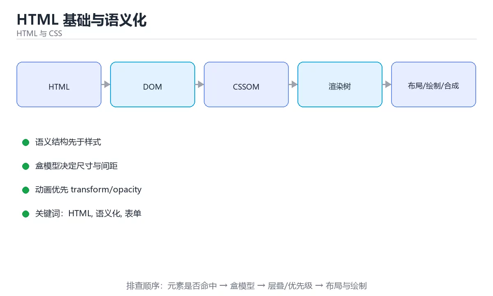

# HTML 基础与语义化

> 内容更新时间：2026-10-06 · 学习阶段：beginner · 预计用时：40 分钟



## 本节知识框架

这篇教程带你从零搞懂 HTML 到底是什么，以及为什么\“语义化\”这么重要。我们会沿着四条主线往前走：认识 HTML → 理解语义化 → 写出表单 → 关注可访问性。

学完之后，你应该能做到：

- 用自己的话说清楚 HTML 和语义化分别是什么，并且能举出正反例子。
- 跑通本课的示例代码，观察表单和语义标签在浏览器里的真实表现。
- 碰到\“全用 div 堆页面\”这种典型问题时，知道该怎么改、先改哪里。

### 复习清单

- [ ] 能不看正文，写出 HTML、语义化、表单、可访问性各自的一句话定义。
- [ ] 能独立运行本课的 HTML 示例，并指出里面至少三个语义化标签。
- [ ] 能完成下面的自测题，把错题对照\“常见误区\”表找到原因。
- [ ] 能把自己的一个旧页面从\“div 汤\”改成用语义标签的版本。

## 核心概念定义

先花两分钟把这几个词搞清楚，后面所有内容都会围绕它们展开。

| 术语 | 一句话说明 |
| --- | --- |
| HTML | 一种用\“标签\”来描述网页结构和内容含义的标记语言，浏览器靠它来渲染你看到的页面。 |
| 语义化 | 选用恰当的 HTML 标签来表达内容的\“意思\”，而不是只看外观。比如导航用 `<nav>`、正文用 `<main>`。 |
| 表单 | 页面里用来收集用户输入的区域，核心标签是 `<form>`、`<input>`、`<label>`、`<button>` 等。 |
| 可访问性 | 让所有人——包括使用屏幕阅读器、键盘操作或辅助设备的人——都能理解并使用你的网页。 |

这四个概念是层层递进的：先有 HTML 作为基础语言，再用语义化让结构清晰，接着用表单和用户交互，最后用可访问性保证每个人都能用。

## 原理与运行机制

### 浏览器怎么\“读\”一个网页

当你在浏览器里打开一个 HTML 文件时，浏览器会做三件事：

1. **解析标签**：从上到下读 HTML 代码，把每个标签变成 DOM 树里的一个节点。
2. **构建渲染树**：结合 CSS 计算出每个节点的样式和位置。
3. **绘制到屏幕**：把最终结果画出来，你就能看到了。

所以 HTML 的核心任务就是\“告诉浏览器这段内容是什么\”。你用 `<h1>` 浏览器就知道这是大标题，用 `<nav>` 就知道这是导航——但如果你全用 `<div>`，浏览器就分不清了。

### 一个最小页面的骨架

```html
<!DOCTYPE html>
<html lang="zh-CN">
  <head>
    <meta charset="utf-8" />
    <meta name="viewport" content="width=device-width, initial-scale=1" />
    <title>我的第一个页面</title>
  </head>
  <body>
    <h1>你好，世界</h1>
    <p>这是一个最简单的 HTML 页面。</p>
  </body>
</html>
```

逐行解释一下：

- `<!DOCTYPE html>`：告诉浏览器\“这是 HTML5\”，写第一行就对了。
- `<html lang="zh-CN">`：声明页面语言是中文，屏幕阅读器会据此选择发音。
- `<head>` 里放\“元信息\”：编码、视口、标题等，用户看不到但浏览器需要。
- `<body>` 里放\“用户看到的内容\”：标题、段落、图片、表单等等。

### 语义化标签到底有什么用

想象你在整理一本书的 Word 文档。如果你把所有内容都写成\“正文\”格式，目录就生成不了。HTML 也一样——你得用对标签，机器才能理解结构。

常用的语义化标签：

| 标签 | 用在哪里 |
| --- | --- |
| `<header>` | 页面或区块的头部 |
| `<nav>` | 导航链接区域 |
| `<main>` | 页面主体内容，一页只用一个 |
| `<section>` | 有主题的内容块，通常带标题 |
| `<article>` | 可以独立分发的内容，比如一篇文章 |
| `<aside>` | 侧边栏或补充说明 |
| `<footer>` | 页面或区块的底部 |

全用 `<div>` 不是不行，但就像一本书没有章节标题——人和机器都很难快速找到重点。

## 典型应用场景

来看看几个新手最容易踩的坑，以及怎么修：

- **全用 div 堆页面**：屏幕阅读器分不清导航和正文。修法：把导航换成 `<nav>`，正文换成 `<main>`，侧边栏换成 `<aside>`。
- **用 `<a href="#">` 当按钮**：键盘用户按回车不会触发点击，语义也错了。修法：用 `<button>` 元素。
- **图片不写 alt**：图片加载失败时一片空白，屏幕阅读器也没法描述。修法：内容图片写描述，纯装饰图片写 `alt=""`。
- **标题乱跳级**：比如从 `<h1>` 直接到 `<h4>`，结构混乱。修法：按 h1→h2→h3 顺序来，一页通常只有一个 h1。
- **表单不配 label**：用户点文字没法聚焦到输入框，可访问性差。修法：用 `<label for="id">` 关联输入框。

## 代码/协议/SQL 示例

下面是一个完整的语义化页面示例，包含了文档结构、语义标签、表单和可访问性的关键写法。你可以直接保存成 `.html` 文件在浏览器里打开。

```html
<!DOCTYPE html>
<html lang="zh-CN">
  <head>
    <meta charset="utf-8" />
    <meta name="viewport" content="width=device-width, initial-scale=1" />
    <title>课程详情</title>
    <meta name="description" content="离线可用的计算机与编程学习课程" />
  </head>
  <body>
    <a class="skip-link" href="#main">跳到主内容</a>
    <header>
      <nav aria-label="主导航">
        <a href="/">首页</a>
        <a href="/learn" aria-current="page">学习</a>
      </nav>
    </header>
    <main id="main">
      <article>
        <h1>Flutter 基础</h1>
        <figure>
          
          <figcaption>Widget 树结构示意</figcaption>
        </figure>
        <form>
          <label for="note">学习笔记</label>
          <textarea id="note" name="note" aria-describedby="note-hint"></textarea>
          <p id="note-hint">最多 200 字，保存在本机。</p>
          <button type="submit">保存</button>
        </form>
      </article>
    </main>
    <footer><p>© 2025 计算机与编程学习</p></footer>
  </body>
</html>
```

这个示例里有几个值得注意的细节：

1. `lang="zh-CN"` 声明了语言，帮助屏幕阅读器用中文朗读。
2. `skip-link` 让键盘用户可以跳过导航直达正文。
3. `<label for="note">` 和 `<textarea id="note">` 通过 for/id 关联，点击文字就能聚焦。
4. `aria-describedby="note-hint"` 把提示文字和输入框关联起来。
5. `<button type="submit">` 明确指定了按钮类型，避免意外提交。
6. `img` 的 `alt` 描述了图片内容，而不是写\“图片\”两个字。

再看一个文本形式的结构示意：

```text
页面骨架：
├── <!DOCTYPE html>          → 声明文档类型
├── <html lang="zh-CN">     → 声明语言
│   ├── <head>              → 元信息（编码、视口、标题）
│   └── <body>              → 用户可见内容
│       ├── <header>        → 页头
│       │   └── <nav>       → 导航
│       ├── <main>          → 主体（一页一个）
│       │   └── <article>   → 独立内容
│       └── <footer>        → 页脚
```

## 时间/空间复杂度或性能分析

HTML 本身很轻量，但写得不好也会拖慢页面。几个值得关注的点：

- **文件体积**：HTML 文件通常很小（几 KB 到几十 KB），但如果内联了大量 CSS 或 JS，首屏加载会变慢。建议把关键 CSS 内联，其余用 `<link>` 外部引入。
- **DOM 节点数量**：每个标签都会变成 DOM 节点。节点越多，浏览器构建渲染树越慢。一般建议控制在 1500 个节点以内。
- **图片导致的布局抖动**：如果 `` 没写 `width` 和 `height`，图片加载完会撑开布局，造成 CLS（累积布局偏移）分数变差。始终给图片设定尺寸。
- **语义标签不会拖慢性能**：`<nav>`、`<main>`、`<article>` 这些标签和 `<div>` 在性能上没有区别，放心用。
- **表单校验用原生属性**：`required`、`type="email"`、`minlength` 这些浏览器原生校验比 JS 校验更快，也更省资源。

## 常见误区与易错点

| 错误 | 现象 | 修法 |
| --- | --- | --- |
| 全用 `<div>` 堆结构 | 屏幕阅读器无法理解页面结构 | 用语义标签：`<nav>`、`<main>`、`<article>` 等 |
| 用 `<a href="#">` 当按钮 | 键盘操作异常，语义不对 | 改用 `<button>` 元素 |
| 图片不写 `alt` | 无障碍不达标，图片加载失败时无提示 | 内容图写描述，装饰图写 `alt=""` |
| 多个 `<h1>` 或跳级标题 | 文档结构混乱，SEO 受影响 | 一页一个 `<h1>`，按 h1→h2→h3 递进 |
| 缺少 `lang` 属性 | 屏幕阅读器朗读和断词异常 | 加 `<html lang="zh-CN">` |
| 忘记写 `viewport` meta | 移动端页面显示异常、缩放失控 | 加 `<meta name="viewport" content="width=device-width, initial-scale=1">` |
| 表单元素没有 `<label>` | 点击区域小，可访问性差 | 用 `<label for="id">` 关联对应控件 |
| `outline: none` 去掉焦点样式 | 键盘用户找不到当前焦点在哪 | 保留焦点样式，或用 `:focus-visible` 自定义 |
| 用表格 `<table>` 做页面布局 | 语义错误，响应式适配困难 | 改用 Flexbox 或 Grid 布局 |
| 纯图标按钮没有文字说明 | 屏幕阅读器无法识别按钮用途 | 加 `aria-label` 提供可访问名称 |

## 与其他知识点的关系

HTML 是前端三件套的第一块拼图。学完本课之后，你会自然地接触到以下内容：

- **CSS 基础：选择器与盒模型**：HTML 搭结构，CSS 管外观。本课学的语义标签就是 CSS 选择器的\“目标\”。比如你写了 `<nav>`，CSS 就可以用 `nav { ... }` 来给它加样式。
- **可访问性与 ARIA 实战**：本课提到了 `aria-label`、`aria-describedby`，下一课会系统讲 ARIA 的完整用法。
- **实战：响应式落地页**：把本课的语义化骨架和 CSS 结合起来，做一个真正能在手机上正常显示的页面。

容易混淆的地方：

- **HTML vs 语义化**：HTML 是\“工具\”——标签怎么写；语义化是\“原则\”——该选哪个标签。就像你有各种颜色的笔（HTML），语义化就是\“标题用红色、正文用黑色\”这种规则。
- **`<button>` vs `<a>`**：`<button>` 用于\“在页面上执行操作\”（提交表单、打开弹窗），`<a>` 用于\“跳转到另一个页面或位置\”。别混用。
- **`alt` vs `title`**：`alt` 是图片的\“替代文字\”，图片加载失败或屏幕阅读器会用到；`title` 是鼠标悬停时显示的提示。两者作用完全不同。

## 自测题与参考答案

先自己想一想，再往下看答案。

**自测 1**：HTML 是什么？用自己的话说一句话。

参考答案：HTML 是一种用标签来描述网页结构和内容含义的标记语言。浏览器读取 HTML 后，就能知道哪里是标题、哪里是导航、哪里是正文。

**自测 2**：为什么不应该全用 `<div>` 来搭建页面？

参考答案：因为 `<div>` 没有任何语义信息。屏幕阅读器无法区分导航和正文，搜索引擎也难以理解页面结构。用语义标签（`<nav>`、`<main>`、`<article>` 等）可以让页面\“自解释\”。

**自测 3**：`<label for="email">` 里的 `for` 属性有什么用？

参考答案：`for` 的值对应输入框的 `id`，这样点击标签文字就能让对应的输入框获得焦点，既增大了点击区域，也提升了可访问性。

**自测 4**：为什么 `` 要写 `alt`？装饰性图片怎么办？

参考答案：`alt` 提供图片的替代文字。图片加载失败时会显示这段文字，屏幕阅读器也会朗读它。纯装饰性的图片（不传达任何信息）应该写 `alt=""`，让屏幕阅读器跳过它。

**自测 5**：`<button>` 和 `<a href="#">` 都能点击，区别是什么？

参考答案：`<button>` 表示\“执行一个操作\”，比如提交表单、切换面板；`<a>` 表示\“跳转到另一个位置\”。键盘操作上，两者都能被 Tab 聚焦和回车触发，但语义不同——屏幕阅读器会对它们做不同的播报。页面上的可点击操作（非跳转）应该用 button 元素。

## 考点精讲

下面这 6 道题覆盖了本课的核心知识点。建议先自己做一遍，再核对答案。

### 考点 1

**题目**：`HTML 基础与语义化` 的示例代码用于验证 `HTML`，其背景是文档结构、语义标签、表单与可访问性。代码的真实内容是下面哪一项？

- A. 出现字面量 `外部排序第一步：分块排序后写临时文件（示意）。`
- B. 出现字面量 `./dist/index.js`
- C. 出现字面量 `normal`
- D. 出现字面量 `note-hint`

**答案**：D

**讲解**：回到本课的 HTML 示例代码，`<textarea>` 上有 `aria-describedby="note-hint"`，下方有 `<p id="note-hint">` 这段提示文字。所以代码里确实出现了 `note-hint` 这个字面量。其他几个选项跟 HTML 基础与语义化没有关系。

### 考点 2

**题目**：页面上的可点击操作（非跳转）应该用？

- A. div 加 onclick
- B. button 元素
- C. span
- D. a 无 href

**答案**：B

**讲解**：需要在页面上执行操作（比如提交、展开、切换）时，应该用 `<button>` 元素。`<button>` 天然支持键盘聚焦和回车触发，屏幕阅读器也能正确识别。`<div>` 和 `<span>` 不是交互元素，`<a>` 没有 `href` 时行为也不标准。

### 考点 3

**题目**：meta viewport 的作用是？

- A. 只负责引入页面的全局样式
- B. 设置编码
- C. 移动端页面适配的前提
- D. 定义标题

**答案**：C

**讲解**：`<meta name="viewport" content="width=device-width, initial-scale=1">` 告诉浏览器按设备宽度来显示页面。没有这行 meta，手机会按桌面宽度渲染然后缩小，字会非常小。所以 viewport 是移动端适配的前提条件。

### 考点 4

**题目**：按“HTML 基础与语义化”中 HTML、语义化、表单 的实践顺序，把四个步骤排成从准备到复盘的合理顺序。

- A. 先明确 HTML 的输入、输出与约束
- B. 写出最小示例并核对语义化的基线结果
- C. 只改一个变量，记录边界与失败路径的变化
- D. 固定版本与证据，把\“HTML 基础与语义化\”的结论写成可复现记录

**答案**：ABCD

**讲解**：这是一个从准备到复盘的完整流程。先搞清楚要做什么（A），再写出最小可运行版本验证思路对不对（B），然后每次只改一个变量来观察变化（C），最后把结论固定下来方便以后复查（D）。

### 考点 5

**题目**：表单里 label 的 for 属性作用是？

- A. 控制控件的宽度
- B. 设置校验规则
- C. 给控件设置默认值
- D. 关联对应控件

**答案**：D

**讲解**：`<label for="email">` 中的 `for` 值要和输入框的 `id` 一致。这样点击 label 文字就能让对应输入框聚焦，既方便鼠标用户，也让屏幕阅读器能正确播报标签内容。

### 考点 6

**题目**：关于 `HTML`，下列哪些说法与 `HTML 基础与语义化` 的正文一致？判断时以文档结构、语义标签、表单与可访问性。为主线。（多选）

- A. 只要记住术语，不需要理解输入和边界条件
- B. 改变一个前提不会影响结论，因此可以忽略条件
- C. button 元素
- D. 图片无法显示时展示

**答案**：C

**讲解**：选项 A 和 B 都是错误的学习态度——学 HTML 不能只背术语，要理解每个标签的适用条件；改变前提（比如去掉 `lang` 属性）确实会影响结果。选项 C 正确，`<button>` 是语义化标签的代表，本课反复强调页面上的可点击操作应该用 button 元素。

## 术语速查

| 术语 | 一句话说明 |
| --- | --- |
| HTML | 用标签描述网页结构和语义的标记语言，浏览器靠它来渲染页面。 |
| 语义化 | 选用恰当的 HTML 标签表达内容含义，让机器和人都能理解页面结构。 |
| 表单 | 页面中收集用户输入的区域，由 `<form>`、`<input>`、`<label>` 等标签组成。 |
| 可访问性 | 确保所有人（包括使用辅助设备的用户）都能理解并操作网页。 |
| DOM | 浏览器解析 HTML 后生成的树形结构，JavaScript 通过它来操作页面。 |
| ARIA | 一组 HTML 属性，用来在原生语义不够用时补充可访问性信息。 |

## 内容元数据

- 内容版本：v2.0
- 最后更新：2026-10-06
- 学习阶段：beginner
- 适用环境：现代浏览器（Chrome / Firefox / Safari / Edge）
- 内容来源：内置结构化课程与工程实践整理
- 相关主题：HTML、语义化、表单、可访问性

## 参考资料与复核

- [本课资料锚点 html_basics](https://zh.wikipedia.org/w/index.php?search=html_basics)

- 最后复核：2026-10-04
- 下次复核：2027-08-17
- 复核范围：HTML 标准更新、浏览器兼容性、可访问性规范变化

| 参考资料 | 本课用途 |
| --- | --- |
| [MDN HTML 元素参考](https://developer.mozilla.org/docs/Web/HTML/Element) | 查阅所有 HTML 标签的用法和属性 |
| [MDN 可访问性指南](https://developer.mozilla.org/docs/Web/Accessibility) | 理解语义化与可访问性的最佳实践 |
| [W3C HTML 规范](https://html.spec.whatwg.org/) | HTML 标准的权威定义 |
| [WebAIM 可访问性检查清单](https://webaim.org/standards/wcag/checklist) | WCAG 标准的实用检查清单 |
