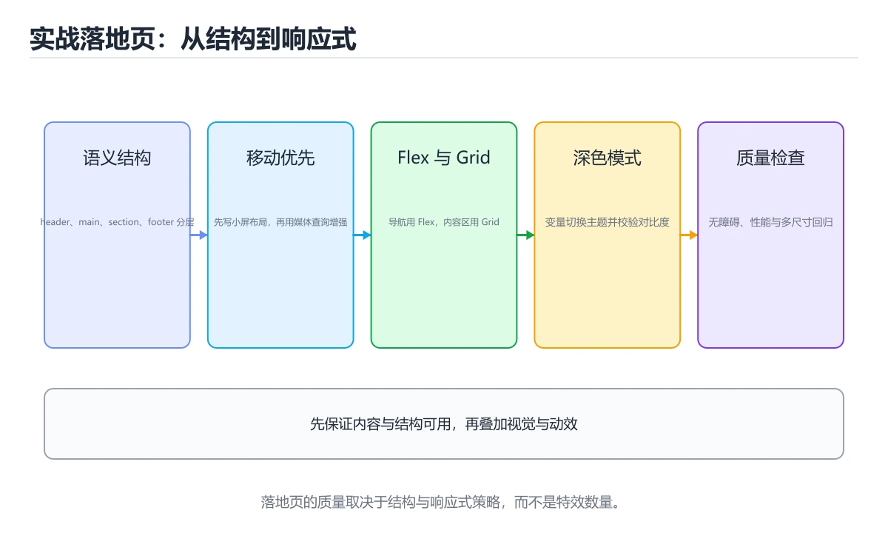
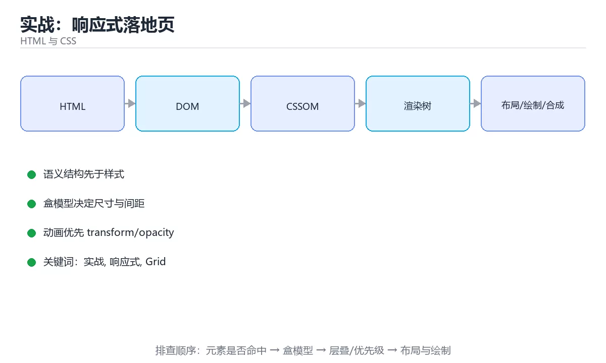

# 实战：响应式落地页





> 内容更新时间：2026-10-06 · 学习阶段：高级 · 预计用时：60 分钟

欢迎来到我们的第一个完整项目！在这一课里，我们将把之前学到的 HTML 语义化、CSS 盒模型、Flexbox、Grid 布局以及深色模式等知识点全部串起来，亲手做一个**产品落地页**。

这个项目不依赖任何框架（如 React 或 Vue），只用纯 HTML 和 CSS。我们会遵循"移动优先"的原则，让页面在手机、平板和电脑上都能完美展示，并支持系统的深色模式。

## 本节知识框架

**课程定位**：所属分类 `html_css`（HTML 与 CSS），课程主题 `实战：响应式落地页`，学习阶段 advanced，建议用时 60 分钟。

本课主线：语义结构、Flex/Grid 布局、深色模式与质量检查。

**学完本课你能够：**
- 理解什么是真正的"实战"——不只是写代码，而是解决实际问题，并能说明输入、输出和失败的情况。
- 掌握"响应式"设计的核心：让页面在不同屏幕尺寸下自动调整布局。
- 学会使用 Grid 布局创建自适应的卡片网格。
- 实现跟随系统设置的深色模式。
- 了解如何通过工具（如 Lighthouse）检查页面的可访问性和性能。

### 复习清单

- [ ] 能不看正文复述本课核心术语，并指出一个边界或反例。
- [ ] 能运行或推演本课示例，记录输入、输出与失败现象。
- [ ] 能完成一次自测，并把错题对照错误表定位原因。

## 核心概念定义

| 术语 | 操作性定义 | 常见边界与风险 |
| --- | --- | --- |
| 实战 | 实战：响应式落地页解决了什么问题，而不是只背术语。 | 易错：只把正常路径跑通就算交付；本课要求同时写清输入、输出与失败路径并留下证据。 |
| 响应式 | 这个实战把 语义化 HTML + 盒模型 + Flex/Grid + 响应式 + 变量主题 串起来；把三个断点都调通，HTML/CSS 的基础就算过关。 | 易错：加载慢、浪费流量；正确做法是响应式图片 + 懒加载。 |
| 可访问性 | 让不同能力、设备和辅助技术的用户都能理解并操作界面。 | 易错：为好看去掉焦点轮廓、只用鼠标验证；键盘到不了的交互对部分用户等于不存在。 |
| CLS | 用纯 HTML + CSS（不依赖框架）做一个产品落地页，要求：语义化结构、移动优先响应式、深色模式、可访问性达标、无布局抖动（CLS < 0.1）。 | 易错：图片与广告位没预留尺寸，加载后把下方内容顶开；写宽高或用 `aspect-ratio` 占位才压得住。 |

## 原理与运行机制

### 机制总览

**教材衔接：目标与验收**

用纯 HTML + CSS（不依赖框架）做一个产品落地页，要求：语义化结构、移动优先响应式、深色模式、可访问性达标、无布局抖动（CLS < 0.1）。

**教材衔接：结构规划**

```text
header（logo + nav）
main
  section.hero（主标题 + 说明 + CTA 按钮）
  section.features（卡片网格）
  section.pricing（三档价格对比）
  section.faq（details/summary 折叠）
footer（链接与版权）
```

用 header/nav/main/section/footer 等语义标签，标题层级从 h1 递进；所有图片写 alt，所有交互元素可键盘到达。

**教材衔接：布局要点**

1. 全局 `box-sizing: border-box` 与 CSS 变量（颜色、间距、圆角）。
2. 导航用 Flex（`justify-content: space-between`），移动端折叠为汉堡菜单（可用 `<details>` 或 checkbox hack）。
3. 特性卡片用 Grid：`repeat(auto-fill, minmax(260px, 1fr))` + `gap`。
4. 定价表在小屏堆叠、大屏三列（媒体查询或 Grid 自适应）。
5. Hero 用 `clamp()` 控制字号，避免小屏溢出。

**教材衔接：深色模式与动效**

用 `prefers-color-scheme` 覆盖变量实现深色主题；用 `prefers-reduced-motion` 关闭动画；CTA 按钮加 `:hover`/`:focus-visible` 状态反馈。动画只改 transform/opacity，时长 150~250ms。

**教材衔接：质量检查清单**

| 检查项 | 标准 |
| --- | --- |
| 响应式 | 360 / 768 / 1440 三个宽度无横向滚动、无文字溢出 |
| 可访问性 | 键盘可完整操作、焦点可见、对比度 ≥ 4.5:1 |
| 性能 | 图片有 width/height 或 aspect-ratio 防抖动；Lighthouse 性能 ≥ 90 |
| 兼容 | 主流浏览器表现一致，必要时加渐进增强 |

**教材衔接：页面结构速查**

| 区块 | 语义 | 要点 |
| --- | --- | --- |
| 页头 | `header` | 品牌、主导航、语言切换 |
| 主体内容 | `main` | 唯一，包含各 section |
| 特性区 | `section` | 每块有标题与简短说明 |
| 价格或方案 | `section` + 列表 | 用列表而非表格表达选项 |
| 行动号召 | `section` + 按钮 | 主按钮唯一且明显 |
| 页脚 | `footer` | 版权、链接、备案信息 |

**教材衔接：交付评审：评分表、决策记录与证据链**

### 三、「实战：响应式落地页」的交付证据链

本课未给出可执行命令，用下面的最小证据集代替：

### 五、评审记录模板

| 记录项 | 填写要求 |
| --- | --- |
| 项目标识 | `html_css_project` |
| 本次范围 | 说明这一轮交付了「实战：响应式落地页」的哪些部分 |
| 未完成项 | 列出与 实战 相关但本轮未做的内容 |
| 证据位置 | 指向 evidence/ 目录下的具体文件 |
| 风险与回滚 | 写清剩余风险、回滚步骤和验证方式 |
| 结论 | 通过 / 有条件通过 / 不通过，三者选一 |

## 典型应用场景

**教材衔接：项目专属规格：实战：响应式落地页**

### 核心场景

语义结构、Flex/Grid 布局、深色模式与质量检查。 项目目标是把「实战、响应式、Grid、可访问性、CLS」落实为可运行、可测试、可回滚的交付物。

### 验收场景

1. 正常路径：最小输入得到预期输出，并留下日志与指标。
2. 边界路径：把 features 的输入推到上下限，确认返回结果可解释。
3. 失败路径：依赖超时或不可用时能快速失败、重试或降级。
4. 幂等路径：同一请求执行两次不会产生重复副作用。
5. 回滚路径：响应式 的失败能按预案恢复，并记录影响范围。

**教材衔接：项目交付物**

### 建议仓库结构

```text
src/
tests/
docs/
README.md
```

### 验收数据

```json
{
  "project": "html_css_project",
  "scenario": "实战的正常路径",
  "input": {"case": "normal", "value": "features"},
  "expected": {"ok": true, "checks": ["实战可复现", "响应式有记录"]},
  "failure_case": {"case": "响应式越界或缺失", "error": "validation_error"},
  "idempotency_key": "html_css_project-001"
}
```

### 复盘模板

- **用 div 堆砌所有区块**：典型现象是结构无语义、SEO 差；正确做法是用语义标签。
- **大小屏共用固定宽度**：典型现象是小屏溢出；正确做法是`max-width` + 网格自适应。
- **深色模式只改背景色**：典型现象是文字看不清；正确做法是变量统一改文字与边框。
- **图片直接放原图**：典型现象是加载慢、浪费流量；正确做法是响应式图片 + 懒加载。

### 最小验证场景

- 准备：保留 `text` 示例的原始输入，先记录 `实战：响应式落地页` 的基线输出和完整运行命令。
- 判定：新结果与 `实战：响应式落地页` 的基线不同不等于错误；只有当差异破坏了 `实战` 的定义或错误表中的约束，才判定为失败。

### 选择与边界

- 使用 `实战` 时，实战：响应式落地页解决了什么问题，而不是只背术语；网络延迟、超时与版本协商会改变行为，只在真实链路或多版本客户端上验证才算数。
- 使用 `响应式` 时，这个实战把 语义化 HTML + 盒模型 + Flex/Grid + 响应式 + 变量主题 串起来；把三个断点都调通，HTML/CSS 的基础就算过关；易错：加载慢、浪费流量；正确做法是响应式图片 + 懒加载。
- 使用 `可访问性` 时，让不同能力、设备和辅助技术的用户都能理解并操作界面。
- 使用 `CLS` 时，用纯 HTML + CSS（不依赖框架）做一个产品落地页，要求：语义化结构、移动优先响应式、深色模式、可访问性达标、无布局抖动（CLS < 0.1）；不同版本与依赖组合的行为可能不同，升级或换环境前要按官方变更说明重新验证。

## 代码/协议/SQL 示例

### 最小可验证示例

**教材衔接：样式组织速查**

| 组织方式 | 适用 |
| --- | --- |
| 按层（reset、base、components、utilities） | 中大型项目 |
| 按组件文件 | 组件库与设计系统 |
| 命名约定（BEM 或语义化类名） | 避免样式冲突 |
| 变量集中定义 | 主题与间距统一 |
| 工具类辅助 | 局部微调，不替代组件样式 |

```css
/* 落地页骨架：响应式特性网格 + 深色模式支持 */
:root {
  --brand: #2563eb;
  --bg: #ffffff;
  --fg: #0f172a;
  --muted: #64748b;
  --card: #f8fafc;
  --radius: 8px;
  --space: clamp(1rem, 3vw, 2rem);
}

@media (prefers-color-scheme: dark) {
  :root {
    --bg: #0b1220;
    --fg: #e5e7eb;
    --muted: #94a3b8;
    --card: #111c31;
  }
}

body {
  margin: 0;
  background: var(--bg);
  color: var(--fg);
  font-family: system-ui, sans-serif;
  line-height: 1.6;
}

.container {
  max-width: 72rem;
  margin-inline: auto;
  padding-inline: var(--space);
}

.features {
  display: grid;
  gap: var(--space);
  grid-template-columns: repeat(auto-fit, minmax(240px, 1fr));
}

.feature {
  background: var(--card);
  border-radius: var(--radius);
  padding: var(--space);
}

.cta {
  display: inline-flex;
  align-items: center;
  gap: 0.5rem;
  padding: 0.75rem 1.25rem;
  border-radius: var(--radius);
  background: var(--brand);
  color: #ffffff;
  text-decoration: none;
  font-weight: 600;
}

.cta:focus-visible {
  outline: 2px solid var(--fg);
  outline-offset: 3px;
}
```

**教材衔接：验证命令与预期输出**

先让 features 的结果可复现，再谈扩展。下表给出最低验证集：

### 验收证据

- [ ] 保存依赖安装和启动命令的完整输出。
- [ ] 至少运行 3 条 实战 相关测试，其中一条是非法输入或失败路径。
- [ ] 连续两次触发 响应式，检查数据与计数是否被重复累加。
- [ ] 记录一次失败状态码、错误日志和恢复步骤。
- [ ] 记录 features 的运行环境与复现命令，并补一段回滚说明。

### 回归与回滚

1. 先在可丢弃的目录或临时库里跑 实战，避免污染真实数据。
2. 修改一处逻辑后重跑全部验证命令，确认没有回归。
3. 若失败，回滚到上一个可运行版本并保留失败日志。
4. 定位原因后补一条自动化测试，再重新执行发布流程。
5. 把教训写入项目复盘或本课笔记，形成下一次的检查项。

## 时间/空间复杂度或性能分析

**性能关注点（实战：响应式落地页）**：浏览器渲染是关键路径：关注首屏时间、重排与重绘次数、资源体积。

**测量方法**：以 `实战：响应式落地页` 的 `实战` 场景为对象，固定输入跑一遍记录基线，再把规模或并发度提高一个数量级复测；两次结果的差值与波动范围才是结论依据。

## 常见误区与易错点

| 容易写错的做法 | 实际现象 | 原因与正确做法 |
| --- | --- | --- |
| 用 div 堆砌所有区块 | 结构无语义、SEO 差 | 用语义标签 |
| 大小屏共用固定宽度 | 小屏溢出 | `max-width` + 网格自适应 |
| 深色模式只改背景色 | 文字看不清 | 变量统一改文字与边框 |
| 图片直接放原图 | 加载慢、浪费流量 | 响应式图片 + 懒加载 |
| 无对比度检查 | 无障碍不达标 | 用工具检查对比度 |
| 焦点样式被移除 | 键盘不可用 | 保留 `:focus-visible` |
| 文案写死在多处 | 改文案要改多处 | 集中管理或使用变量 |
| 不测长文本 | 多语言溢出 | 用弹性布局与截断 |
| 只测 Chrome | 其他浏览器布局错乱 | 多浏览器验证 |
| 忽略首屏关键样式 | 首屏闪烁 | 内联关键 CSS 并延迟其余 |

### 现场 1：用 div 堆砌所有区块

**症状**：结构无语义、SEO 差。

**根因与修复**：用语义标签。

**自检**：在本课示例里复现「用 div 堆砌所有区块」，改成用语义标签后重跑；如果症状消失且失败路径按预期变化，说明定位正确。

### 现场 2：大小屏共用固定宽度

**症状**：小屏溢出。

**根因与修复**：`max-width` + 网格自适应。

**自检**：在本课示例里复现「大小屏共用固定宽度」，改成`max-width` + 网格自适应后重跑；如果症状消失且失败路径按预期变化，说明定位正确。

### 现场 3：深色模式只改背景色

**症状**：文字看不清。

**根因与修复**：变量统一改文字与边框。

**自检**：在本课示例里复现「深色模式只改背景色」，改成变量统一改文字与边框后重跑；如果症状消失且失败路径按预期变化，说明定位正确。

### 现场 4：图片直接放原图

**症状**：加载慢、浪费流量。

**根因与修复**：响应式图片 + 懒加载。

**自检**：在本课示例里复现「图片直接放原图」，改成响应式图片 + 懒加载后重跑；如果症状消失且失败路径按预期变化，说明定位正确。

### 现场 5：无对比度检查

**症状**：无障碍不达标。

**根因与修复**：用工具检查对比度。

**自检**：在本课示例里复现「无对比度检查」，改成用工具检查对比度后重跑；如果症状消失且失败路径按预期变化，说明定位正确。

### 现场 6：焦点样式被移除

**症状**：键盘不可用。

**根因与修复**：保留 `:focus-visible`。

**自检**：在本课示例里复现「焦点样式被移除」，改成保留 `:focus-visible`后重跑；如果症状消失且失败路径按预期变化，说明定位正确。

### 现场 7：文案写死在多处

**症状**：改文案要改多处。

**根因与修复**：集中管理或使用变量。

**自检**：在本课示例里复现「文案写死在多处」，改成集中管理或使用变量后重跑；如果症状消失且失败路径按预期变化，说明定位正确。

### 现场 8：不测长文本

**症状**：多语言溢出。

**根因与修复**：用弹性布局与截断。

**自检**：在本课示例里复现「不测长文本」，改成用弹性布局与截断后重跑；如果症状消失且失败路径按预期变化，说明定位正确。

### 现场 9：只测 Chrome

**症状**：其他浏览器布局错乱。

**根因与修复**：多浏览器验证。

**自检**：在本课示例里复现「只测 Chrome」，改成多浏览器验证后重跑；如果症状消失且失败路径按预期变化，说明定位正确。

## 与其他知识点的关系

- **先修**：`CSS 进阶：变量、伪类与现代特性`。本课默认这些内容已经掌握。
- **相关或后续**：`前端性能优化实战`。本课术语会在这些课程里继续使用。
- **术语归属**：`实战`、`响应式`、`可访问性` 的定义以本课「核心概念定义」为准，换到其他课程时先确认定义是否被改写。
- 同一分类的《HTML 基础与语义化》也涉及 `可访问性`；两课衔接时先确认这个术语的定义是否一致。
- 同一分类的《CSS 布局：Flex、Grid 与响应式》也涉及 `Grid`；两课衔接时先确认这个术语的定义是否一致。

## 自测题与参考答案

> 先独立作答，再对照参考答案；答案都能在本课正文、术语表或错误表里找到依据。

### 自测 1（概念复述）

不看正文，写出 `实战` 的操作性定义，并说明它与 `响应式` 的区别。

**参考答案**：实战：响应式落地页解决了什么问题，而不是只背术语。

`响应式` 的定位是：这个实战把 语义化 HTML + 盒模型 + Flex/Grid + 响应式 + 变量主题 串起来；把三个断点都调通，HTML/CSS 的基础就算过关；两者的差别要从适用对象与失败模式上说明。

### 自测 2（排错）

本课错误表记录了「用 div 堆砌所有区块」这类做法。请写出它会出现的现象、根因，以及修复顺序。

**参考答案**：现象是结构无语义、SEO 差；正确做法是用语义标签。修复时先复现现象并保留证据，再改动一处假设重跑，确认现象消失。

### 自测 3（动手验证）

运行本课的 `text` 示例，改动其中一个输入后重新运行，记录输出与错误信息。

**参考答案**：正常输入下 `text` 示例应当复现正文给出的结果；改动输入后，如果结果改变或报错，先核对它是否满足 `实战：响应式落地页` 中`实战` 的适用范围，再检查错误表里是否有同类现象。

### 自测 4（代码阅读）

阅读本课开头的 `text` 示例，说明它体现了`实战` 的哪一条性质，并指出改动哪个输入会让这条性质不再成立。

**参考答案**：`实战` 的定义是 实战：响应式落地页解决了什么问题，而不是只背术语，示例正是在实现这条定义。改动与 `实战` 有关的一个输入后，如果结果不再符合 `实战：响应式落地页` 的正文描述，就说明该性质只在当前前提成立。

### 自测 5（迁移）

把 `实战：响应式落地页` 的方法迁移到自己的项目：围绕 `实战` 写出一个与错误表同类的风险点，并说明触发条件和检验方式。

**参考答案**：例如「忽略首屏关键样式」，它会导致首屏闪烁；检验方式是按内联关键 CSS 并延迟其余改一处再复现，确认现象消失且没有引入新的失败分支。

### 自测 6（对比）

用一个表格对比 `实战` 与 `响应式`：各写一行适用场景、一行失败表现。

**参考答案**：`实战` 的定义是实战：响应式落地页解决了什么问题，而不是只背术语；`响应式` 的定义是这个实战把 语义化 HTML + 盒模型 + Flex/Grid + 响应式 + 变量主题 串起来；把三个断点都调通，HTML/CSS 的基础就算过关。两者的失败表现分别对应本课错误表里与本术语相关的行。

### 自测 7（排错顺序）

面对「用 div 堆砌所有区块」引发的问题，请把"复现 结构无语义、SEO 差 → 保留证据 → 用语义标签 → 回归验证"四步写成可执行的检查清单。

**参考答案**：第一步按结构无语义、SEO 差复现；第二步记录输入、版本与完整报错；第三步按用语义标签只改一处；第四步重跑并确认失败路径也按预期变化。

### 自测 8（边界判断）

针对 `CLS`，分别写出"可以使用"的条件和"结论不再成立"的条件。

**参考答案**：不同版本与依赖组合的行为可能不同，升级或换环境前要按官方变更说明重新验证。 同时要把 `CLS` 的定义 用纯 HTML + CSS（不依赖框架）做一个产品落地页，要求：语义化结构、移动优先响应式、深色模式、可访问性达标、无布局抖动（CLS < 0.1） 与实际输入逐项对照。

### 自测 9（机制重建）

不看正文，按输入、转换、输出、验证四段重建 `实战` → `响应式` → `可访问性` → `CLS` 的作用链。

**参考答案**：起点是 `实战` 的定义 实战：响应式落地页解决了什么问题，而不是只背术语；中间每一步都保留可观察状态；终点由 `CLS` 检查，失败时回到错误表定位第一个偏离定义的步骤。

### 自测 10（综合排错）

在 `实战：响应式落地页` 中，现象是 首屏闪烁。请围绕 忽略首屏关键样式 写出最小复现、关键证据、修复动作和回归验证，并说明为什么不能只凭一次运行下结论。

**参考答案**：先复现 忽略首屏关键样式，记录输入与完整错误；再按 内联关键 CSS 并延迟其余 只改一处。回归时同时跑正常路径和边界路径，只有两次结果都可解释，才把修复视为完成。

### 自测 11（一分钟复述）

用每分钟约 200 字的速度复述 `实战：响应式落地页`：先给主问题，再按顺序说出 `实战`、`响应式`、`可访问性`、`CLS`，最后给一个失败案例。

**自评标准**：主问题必须对应 语义结构、Flex/Grid 布局、深色模式与质量检查；每个术语都要能接上一句定义或边界；失败案例必须写成可观察现象，不能用"可能有风险"代替证据。

## 术语速查

| 术语 | 一句话说明 |
| --- | --- |
| `实战` | 实战：响应式落地页解决了什么问题，而不是只背术语。 |
| `响应式` | 这个实战把 语义化 HTML + 盒模型 + Flex/Grid + 响应式 + 变量主题 串起来；把三个断点都调通，HTML/CSS 的基础就算过关。 |
| `可访问性` | 让不同能力、设备和辅助技术的用户都能理解并操作界面。 |
| `CLS` | 用纯 HTML + CSS（不依赖框架）做一个产品落地页，要求：语义化结构、移动优先响应式、深色模式、可访问性达标、无布局抖动（CLS < 0.1）。 |

**术语关系**：`实战`（实战：响应式落地页解决了什么问题） → `响应式`（这个实战把 语义化 HTML + 盒模型 + Flex/Grid + 响应式 + 变量主题 串起来） → `可访问性`（让不同能力、设备和辅助技术的用户都能理解并操作界面） → `CLS`（用纯 HTML + CSS（不依赖框架）做一个产品落地页）。

## 考点精讲

`实战：响应式落地页` 的题库有 6 道题，下面逐题给出题干、正确项与判断依据：先自己作答，再核对正确项，最后回到正文对应小节复核。

### 考点 1：第 1 题

- **题目**：围绕“实战：响应式落地页”中的 实战、响应式、Grid，下列哪两项是本课强调的实践判断？ A. 把 响应式 的单次运行结果当成所有版本和规模都成立 B. 学习 实战 时要同时说明输入、输出和失败路径，不能只看正常流程 C. 只要 实战 的常规示例通过，就可以跳过边界与异常路径 D. 验证 响应式 时要固定版本并覆盖边界输入，结论才可复现 Ans: BD
- **正确项**：学习 实战 时要同时说明输入、输出和失败路径，不能只看正常流程；验证 响应式 时要固定版本并覆盖边界输入，结论才可复现
- **判断依据**：这道题落在术语 `实战` 上：实战：响应式落地页解决了什么问题，而不是只背术语。复习时把 `实战` 的定义、适用边界和一个反例一起说清楚，再回到「核心概念定义」核对原文。

### 考点 2：第 2 题

- **题目**：下面这段 `css` 代码来自 `实战：响应式落地页`。课程主线是语义结构、Flex/Grid 布局、深色模式与质量检查。代码与 `实战` 有关。哪一项是代码里真实出现的内容？ A. 代码里出现了 `subprocess` 这个名字 B. 代码里出现了 `响应式` 这个名字 C. 代码里出现了 `对撞指针` 这个名字 D. 代码里出现了 `一元 RPC` 这个名字 Ans: B
- **正确项**：代码里出现了 `响应式` 这个名字
- **判断依据**：这道题落在术语 `实战` 上：实战：响应式落地页解决了什么问题，而不是只背术语。复习时把 `实战` 的定义、适用边界和一个反例一起说清楚，再回到「核心概念定义」核对原文。

### 考点 3：第 3 题

- **题目**：为防止累积布局偏移（CLS），图片应该？ A. 只用 background-image 展示图片，而它无法提前预留占位空间 B. 只设 width C. 同时设 width/height 或用 aspect-ratio 占位 D. 懒加载即可 Ans: C
- **正确项**：同时设 width/height 或用 aspect-ratio 占位
- **判断依据**：这道题落在术语 `CLS` 上：用纯 HTML + CSS（不依赖框架）做一个产品落地页，要求：语义化结构、移动优先响应式、深色模式、可访问性达标、无布局抖动（CLS < 0.1）。复习时把 `CLS` 的定义、适用边界和一个反例一起说清楚，再回到「核心概念定义」核对原文。

### 考点 4：第 4 题

- **题目**：想让页面跟随系统深色模式，应该用哪个媒体查询？ A. min-width B. prefers-color-scheme C. print D. orientation 这类设备方向查询 Ans: B
- **正确项**：prefers-color-scheme
- **判断依据**：这道题检验本课主问题：语义结构、Flex/Grid 布局、深色模式与质量检查。复习时先复述本课主问题，再举一个会让结论失效的输入。

### 考点 5：第 5 题

- **题目**：Lighthouse / axe 这类工具在项目中的主要用途是？ A. 替代单元测试 B. 生成 HTML 结构 C. 自动检测性能 D. 自动压缩图片 Ans: C
- **正确项**：自动检测性能
- **判断依据**：这道题检验本课主问题：语义结构、Flex/Grid 布局、深色模式与质量检查。复习时先复述本课主问题，再举一个会让结论失效的输入。

### 考点 6：第 6 题

- **题目**：填空：补齐下面这段术语说明中的空缺。课程 `语义结构、Flex/Grid 布局、深色模式与质量检查。`，这段说明是：这个实战把 语义化 HTML + 盒模型 + Flex/Grid + `____` + 变量主题 串起来；把三个断点都调通，HTML/CSS 的基础就算过关。空缺处应填哪个术语？
- **正确项**：落地页
- **判断依据**：《实战：响应式落地页》这题的填空口径是「响应式」，正文写法与其中任一项一致即可。题干要放回《实战：响应式落地页》的主线里看：语义结构、Flex/Grid 布局、深色模式与质量检查。作答时先回到《实战：响应式落地页》对应小节核对定义，再逐项排除与题干不符的说法。

### 考点 7：`实战`

- **要点**：实战：响应式落地页解决了什么问题，而不是只背术语。
- **实战 的边界**：网络延迟、超时与版本协商会改变行为，只在真实链路或多版本客户端上验证才算数。

### 考点 8：`响应式`

- **要点**：这个实战把 语义化 HTML + 盒模型 + Flex/Grid + 响应式 + 变量主题 串起来；把三个断点都调通，HTML/CSS 的基础就算过关。
- **响应式 的边界**：易错：加载慢、浪费流量；正确做法是响应式图片 + 懒加载。

### 考点 9：`可访问性`

- **要点**：让不同能力、设备和辅助技术的用户都能理解并操作界面。

### 考点 10：`CLS`

- **要点**：用纯 HTML + CSS（不依赖框架）做一个产品落地页，要求：语义化结构、移动优先响应式、深色模式、可访问性达标、无布局抖动（CLS < 0.1）。
- **CLS 的边界**：不同版本与依赖组合的行为可能不同，升级或换环境前要按官方变更说明重新验证。

### 考点 11：排错——用 div 堆砌所有区块

- **现象**：结构无语义、SEO 差。
- **处理**：用语义标签。

### 考点 12：排错——大小屏共用固定宽度

- **现象**：小屏溢出。
- **处理**：`max-width` + 网格自适应。

### 考点 13：综合辨析——`实战` 与 `CLS`

- **辨析点**：`实战` 的定义是 实战：响应式落地页解决了什么问题，而不是只背术语；`CLS` 的定义是 用纯 HTML + CSS（不依赖框架）做一个产品落地页，要求：语义化结构、移动优先响应式、深色模式、可访问性达标、无布局抖动（CLS < 0.1）。
- **答题要求**：面对 `实战：响应式落地页` 的题目，先判断描述的是 `实战` 还是 `CLS`，再归到对应定义，最后写出一个会让该定义失效的边界输入。

### 考点 14：排错评分点

- **现象分**：能写出 结构无语义、SEO 差，而不是只写"程序有错"。
- **证据分**：保留触发 用 div 堆砌所有区块 的输入、版本和错误原文。
- **修复分**：按 用语义标签 只改一处，并同时回归正常路径与边界路径。

## 内容元数据

- 内容版本：v2.0
- 最后更新：2026-10-06
- 学习阶段：高级
- 适用环境：现代浏览器（Chrome/Firefox/Safari）；本课聚焦 实战。
- 内容来源：内置结构化课程与工程实践整理
- 相关主题：实战、响应式、Grid、可访问性、CLS
- 质量版本：P0 测验标准 + P1 覆盖扩展 + P2 体验补全

## 参考资料与复核

- 最后复核：2026-10-04
- 下次复核：2027-08-17
- 复核范围：版本兼容、API 行为、安全建议与工程实践
- 来源性质：官方文档、标准或权威教材；本课核对关键词：实战、响应式、Grid、可访问性、CLS。

| 参考资料 | 本课用途 |
| --- | --- |
| [MDN HTML](https://developer.mozilla.org/docs/Web/HTML) | HTML 语义与文档结构 |
| [MDN 无障碍](https://developer.mozilla.org/docs/Web/Accessibility) | 可访问性与语义 |
| [W3C Web 标准](https://www.w3.org/TR/) | HTML、CSS 与 Web 标准 |

| [本课术语索引：实战：响应式落地页](#核心概念定义) | 按本课输入、术语边界和错误表现逐项核对 |
> 「实战：响应式落地页」的链接用于离线阅读后的延伸核对；App 不会自动联网。

<!-- p1-project-review:start -->
