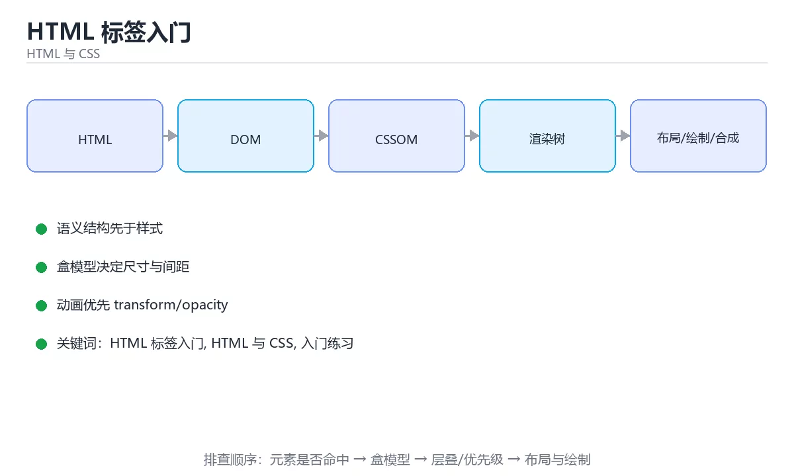

# HTML 标签入门

> 内容更新时间：2026-10-06 · 学习阶段：beginner · 预计用时：40 分钟



## 本节知识框架

- [ ] 能说出标签、属性、语义化标签各自是什么，并各举一个例子
- [ ] 能写出一个包含标题、段落、列表的最小 HTML 页面
- [ ] 能指出"全用 div 堆结构"的问题并改成语义化写法

## 核心概念定义

| 术语 | 一句话说明 |
| --- | --- |
| 标签（Tag） | 尖括号包起来的元素标记，成对的开始与结束标签界定内容范围 |
| 属性（Attribute） | 写在开始标签里的键值对，描述 id、链接、图片地址等附加信息 |
| 语义化标签 | 用 header、nav、main、article 等表达结构含义，而不是一律用 div |
| 文档骨架 | html、head、body 三层结构：head 放元信息，body 放可见内容 |
| alt 文本 | 图片的替代文字，加载失败或被屏幕阅读器朗读时使用 |

## 原理与运行机制

把网页想象成一份报纸。报纸有标题、正文、列表、图片、链接——HTML 标签就是告诉浏览器"这段内容是标题""那段内容是列表"的标记。你可以把 HTML 理解成网页的骨架，CSS 是皮肤和衣服，JavaScript 是肌肉和神经系统。骨架决定了页面的基本结构，没有骨架，其他东西都搭不起来。

浏览器打开一个网页时，会从上到下扫描 HTML 代码。遇到 `<h1>` 就知道这是大标题，遇到 `<p>` 就知道这是段落，遇到 `<ul>` 就知道这是一个无序列表。这个过程就像读报纸时自动识别版面一样。浏览器把扫描结果组织成一棵 DOM 树（文档对象模型），后续的 CSS 样式和 JavaScript 交互都挂在这棵树上。

HTML 标签不仅决定"看起来是什么"，更决定内容的语义。`h1`～`h6` 表示标题层级，`p` 表示段落，`ul` 和 `ol` 表示无序与有序列表，`a` 表示链接，`img` 表示图片。浏览器、搜索引擎、屏幕阅读器都依赖这些语义来理解页面。比如搜索引擎看到 `<h1>` 会认为这是页面最重要的主题，看到 `<nav>` 会知道这是导航区域。

如果把所有元素都写成 `div`，再靠 CSS 模拟外观，页面能显示，但键盘操作、朗读顺序和表单行为都会变差。就像把报纸所有内容都塞进一个文本框，虽然能看，但失去了版面结构。屏幕阅读器遇到一堆 `div` 时，无法告诉视障用户哪里是标题、哪里是导航、哪里是正文。

一个基本文档包含 `<!DOCTYPE html>`、`html`、`head` 和 `body`。`head` 放元信息，例如字符集、视口、标题；`body` 放用户可见内容。字符集通常使用 UTF-8，移动端要设置 `viewport`，否则页面会按桌面宽度缩放。可以把 `head` 想象成快递包裹上的标签——收件地址、重量、易碎标记都写在这里，而 `body` 才是包裹里的实物。

标签还有嵌套和闭合规则。大多数标签成对出现：`<p>` 开头，`</p>` 结尾，中间是内容。少数标签是自闭合的，比如 `` 和 `<br>`，它们不需要结束标签。块级元素（如 `div`、`p`、`h1`）可以包含行内元素（如 `span`、`a`、`strong`），但行内元素一般不能反过来包含块级元素。列表项 `li` 必须直接位于列表容器 `ul` 或 `ol` 内，不能随便放到别的地方。属性值要用引号包起来，布尔属性（如 `disabled`、`checked`）只写属性名即可。`img` 必须提供有意义的 `alt`：图片传达信息时描述信息，纯装饰图片使用空 `alt`。

表单控件要有关联的 `label`，这样点击文字也能聚焦输入框，屏幕阅读器也能读出字段含义。按钮要使用 `button` 或 `input type="button"`，不要用 `div` 模拟点击。链接用于导航，按钮用于触发动作，混用会让用户预期落空。记住一个简单的原则：能跳转的用 `a`，能点击做事的用 `button`。

## 典型应用场景

- 写博客文章：用 `h1` 做标题，`h2` 做章节标题，`p` 写正文，`ul`/`ol` 列要点，`a` 插入参考链接
- 做导航菜单：用 `nav` 包裹，`a` 做链接，`ul`/`li` 做列表项。这样屏幕阅读器可以直接跳到导航区
- 展示产品列表：用 `article` 包裹每个产品，`img` 放图片，`h3` 做产品名，`p` 写描述
- 写简历页面：用 `header` 放个人信息，`section` 分区，`dl` 做技能列表，`footer` 放联系方式
- 做表单页面：用 `form` 包裹，`label` 关联每个 `input`，`button` 提交数据

## 代码/协议/SQL 示例

```html
<h1>学习笔记</h1>
<p>今天完成了第一个 HTML 页面。</p>
<ul>
  <li>标题</li>
  <li>段落</li>
</ul>
```

```text
页面显示一级标题"学习笔记"、一段文字和一个两项列表。
```

```html
<!DOCTYPE html>
<html lang="zh-CN">
<head>
  <meta charset="UTF-8">
  <meta name="viewport" content="width=device-width, initial-scale=1.0">
  <title>我的第一个网页</title>
</head>
<body>
  <h1>欢迎来到我的网站</h1>
  <p>这是一个用 HTML 标签搭建的页面。</p>
  <h2>我的兴趣爱好</h2>
  <ul>
    <li>编程</li>
    <li>阅读</li>
    <li>跑步</li>
  </ul>
  <h2>学习计划</h2>
  <ol>
    <li>学 HTML</li>
    <li>学 CSS</li>
    <li>学 JavaScript</li>
  </ol>
  <p>想了解更多？访问 <a href="https://example.com">示例网站</a>。</p>
  
</body>
</html>
```

## 时间/空间复杂度或性能分析

HTML 页面本身的"复杂度"不在算法层面，而在渲染层面。浏览器解析 HTML 时会构建 DOM 树，标签嵌套越深、节点越多，构建时间越长。

性能关注点：浏览器渲染是关键路径——关注首屏时间、重排与重绘次数、资源体积。

小文件看元数据开销，大文件看吞吐，两者要分别测量。测量方法：固定输入跑一遍记录基线，再把规模提高一个数量级复测；两次结果的差值与波动范围才是结论依据。

优化建议：
- 减少不必要的嵌套层级
- 避免过深的 DOM 结构（一般不超过 15 层）
- 图片使用合适的尺寸和格式
- 把 CSS 放在 `head`，JavaScript 放在 `body` 底部或使用 `defer`

## 常见误区与易错点

| 错误 | 现象 | 修法 |
| --- | --- | --- |
| 全用 div 堆结构 | 无障碍工具与搜索引擎读不懂页面 | 按语义选择 nav、main、article 等标签 |
| 标签没有闭合 | 浏览器容错掩盖结构错误 | 保持标签配对，并用校验工具检查 |
| 属性值不加引号 | 属性解析出错，图片无法被辅助技术读出 | 属性统一加引号，图片补齐 alt 文本 |
| 用 div 模拟按钮 | 键盘用户无法操作，屏幕阅读器识别不了 | 用 button 或 input type="button" |
| 标题层级跳级 | 搜索引擎和辅助技术无法理解页面结构 | 按 h1→h2→h3 顺序使用，不要跳过 |

## 与其他知识点的关系

HTML 标签是前端三件套的第一块。学完本课后，下一步是《CSS 选择器入门》，用 CSS 给 HTML 标签加样式。打个比方：HTML 是房子的框架，CSS 是装修风格，JavaScript 是智能家居系统。你得先搭好框架，才能谈装修和自动化。

概念关系：
- `标签（Tag）` 是 HTML 的基本单位，`属性（Attribute）` 是标签的附加信息——标签决定"是什么"，属性决定"长什么样、怎么行为"
- `语义化标签` 是标签的一种用法，强调用正确的标签表达正确的含义，而不是什么都用 div
- `文档骨架` 是 HTML 文档的整体结构，所有标签都嵌套在里面，就像房子的地基和楼层
- `alt 文本` 是 `img` 标签的一个属性，用于图片无法加载时的替代说明，也是无障碍的重要组成部分

后续课程会用到：
- CSS 选择器：通过标签名、类名、id 选中元素并添加样式
- JavaScript DOM 操作：通过标签创建、修改、删除元素，实现动态交互
- 表单处理：用 `input`、`button`、`form` 等标签收集用户输入
- 响应式设计：用 CSS 媒体查询让同一套 HTML 适配不同屏幕尺寸

## 自测题与参考答案

**自测 1**：不看正文，写出 `标签（Tag）` 的定义，并说明它与 `属性（Attribute）` 的区别。

参考答案：标签是尖括号包起来的元素标记，成对的开始与结束标签界定内容范围。属性是写在开始标签里的键值对，描述 id、链接、图片地址等附加信息。标签是容器，属性是容器的配置。

**自测 2**：本课错误表记录了"全用 div 堆结构"这类做法。请写出它会出现的现象和修复方法。

参考答案：现象是无障碍工具与搜索引擎读不懂页面。修复方法是按语义选择 nav、main、article 等标签，让每个区域都有明确含义。

**自测 3**：运行本课的 `html` 示例，改动其中一个输入后重新运行，记录输出与错误信息。

参考答案：正常输入下示例应当显示标题、段落和列表。如果把 `</ul>` 删掉，浏览器会尝试自动闭合，可能导致后续内容被错误包裹。用开发者工具查看 DOM 结构可以确认实际效果。

**自测 4**：阅读本课开头的 `html` 示例，说明它体现了 `标签（Tag）` 的哪一条性质。

参考答案：示例中 `<h1>`、`<p>`、`<ul>`、`<li>` 都是成对出现的标签，开始标签和结束标签之间的内容就是该标签的作用范围。这体现了标签界定内容范围的性质。

## 考点精讲

1. 无序列表和有序列表分别对应哪组标签？
A. 无序列表用 ul，有序列表用 ol
B. 无序列表用 ol，有序列表用 ul
C. 无序列表用 dl，有序列表用 table
D. 两者都用 li，列表类型由 CSS 决定
答案：A

2. 给页面标题使用 h1 而不用 div 加样式，主要好处是？
A. 让标题在搜索引擎里的排名自动提升
B. 比 div 少写一半的 CSS 样式代码
C. 可以避免标题在移动端出现换行
D. 向浏览器和辅助技术表达标题的语义层级
答案：D

3. 代码语言为 `html`，选自 `HTML 标签入门` 的 `标签（Tag）` 部分。课程问题为用标题、段落、列表和链接组织页面。哪一项描述与代码一致？
A. 这段示例用于说明本课术语 alt 文本的行为
B. 代码里出现了循环这个名字
C. 代码里出现了 SOLID 这个名字
D. 代码里出现了降采样这个名字
答案：A

4. 本课最小示例渲染出的页面包含哪些内容？
A. 二级标题、一张图片和一个输入框
B. 三个段落，没有任何标题或列表
C. 一级标题、一段文字和一个两项列表
D. 一个表格，包含两行三列的数据
答案：C

5. 填空：补齐下面这段术语说明中的空缺。课程 `用标题、段落、列表和链接组织页面。`，这段说明是：`____`：写在开始标签里的键值对，描述 id、链接、图片地址等附加信息。空缺处应填哪个术语？
答案：属性

6. 关于 `标签（Tag）`，下列哪些说法与 `HTML 标签入门` 的正文一致？判断时以用标题、段落、列表和链接组织页面。为主线。（多选）
A. 无序列表用 ul，有序列表用 ol
B. 无序列表用 ol，有序列表用 ul
C. 两者都用 li，列表类型由 CSS 决定
D. 向浏览器和辅助技术表达标题的语义层级
答案：AD

## 术语速查

| 术语 | 一句话说明 |
| --- | --- |
| 标签（Tag） | 尖括号包起来的元素标记，成对的开始与结束标签界定内容范围 |
| 属性（Attribute） | 写在开始标签里的键值对，描述 id、链接、图片地址等附加信息 |
| 语义化标签 | 用 header、nav、main、article 等表达结构含义，而不是一律用 div |
| 文档骨架 | html、head、body 三层结构：head 放元信息，body 放可见内容 |
| alt 文本 | 图片的替代文字，加载失败或被屏幕阅读器朗读时使用 |

## 内容元数据

- 内容版本：v2.0
- 最后更新：2026-10-06
- 学习阶段：入门
- 适用环境：现代浏览器（Chrome/Firefox/Safari）
- 内容来源：内置结构化课程与工程实践整理
- 相关主题：HTML 标签入门、HTML 与 CSS、入门练习

## 参考资料与复核

- 最后复核：2026-10-04
- 下次复核：2027-08-17
- 复核范围：版本兼容、API 行为、安全建议与工程实践

| 参考资料 | 本课用途 |
| --- | --- |
| [MDN HTML 元素参考](https://developer.mozilla.org/zh-CN/docs/Web/HTML/Element) | 查阅所有 HTML 标签的用法和属性 |
| [W3C HTML 规范](https://www.w3.org/TR/html52/) | 了解 HTML 标准和规范定义 |
| [HTML 验证工具](https://validator.w3.org/) | 检查 HTML 代码是否有语法错误或结构问题 |
