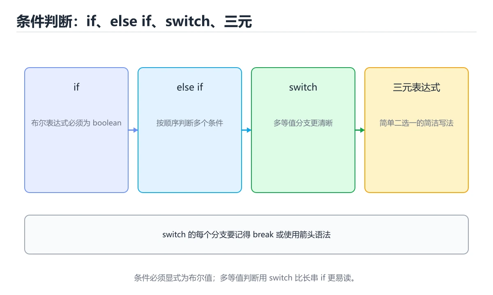
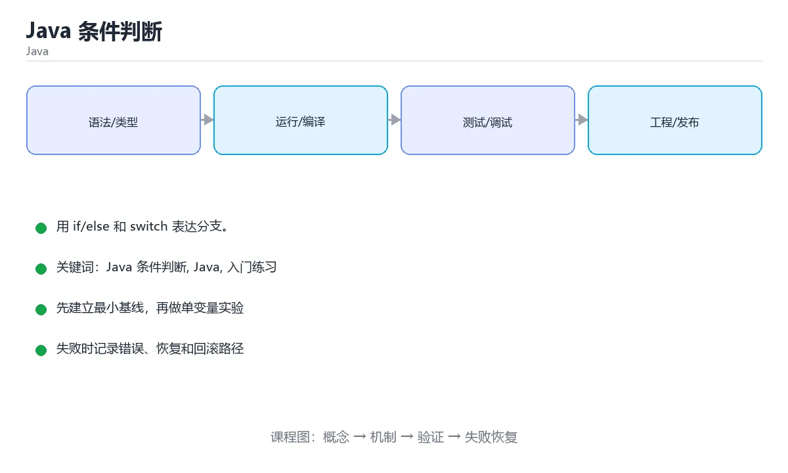

# Java 条件判断

> 内容更新时间：2026-10-06 · 学习阶段：入门 · 预计用时：35 分钟





## 本节知识框架

上一课你学会了用变量「记住」数据。但光记住还不够——程序需要根据不同的情况做不同的事。比如成绩大于等于 60 就输出「及格」，否则输出「不及格」。这就是**条件判断**。

想象你站在一个岔路口：左边通往「及格」，右边通往「不及格」。路牌上写着条件——「成绩 >= 60？」你抬头看一眼，答案是「是」就往左走，答案是「否」就往右走。Java 的 `if/else` 就是这个岔路口。

**学完这一课，你会**：
- 理解 `boolean` 类型和条件表达式的关系
- 熟练使用 `if/else if/else` 和 `switch` 表达分支逻辑
- 避开「用 == 比较字符串」「浮点数直接比较」这些经典陷阱

**先修**：《Java 变量与输出》。**后续**：《Java 循环入门》。

### 复习清单

- [ ] 能不看正文写出 `if/else if/else` 的完整结构。
- [ ] 能解释为什么比较字符串内容要用 `equals` 而不是 `==`。
- [ ] 能用 `switch` 表达式重写一个多分支的 `if/else` 结构。

## 核心概念定义

| 术语 | 一句话说明 |
| --- | --- |
| `boolean` | 只有 true 与 false 的类型，条件表达式必须得到它。 |
| `if-else` | 按条件选择分支，else if 依次判断直到命中。 |
| `switch` | 按离散取值分支，case 后要用 break 或新式箭头写法避免贯穿。 |
| `三元运算符` | 条件 ? 值1 : 值2，用于在表达式位置二选一。 |
| `JVM` | Java 源码编译成平台无关的字节码，JVM 负责加载、验证、解释和即时编译。 |
| `字符串` | 字符串不可变，拼接会产生新对象，循环中应使用 StringBuilder。 |

## 原理与运行机制

### boolean：非真即假

Java 的条件必须是 `boolean` 类型——只有两个值：`true` 和 `false`。比较运算（`>`、`<`、`==`、`!=`）和逻辑运算（`&&`、`||`、`!`）的结果都是 boolean。

和 C 语言不同，Java 不接受整数当条件。`if (1)` 在 C 里合法，在 Java 里直接编译报错。这其实更安全——避免了「把 `=` 误写成 `==`」时悄悄把赋值当条件的 bug。

### if / else if / else：按顺序判断

```java
int score = 72;

if (score >= 90) {
    System.out.println("优秀");
} else if (score >= 60) {
    System.out.println("及格");
} else {
    System.out.println("需要补考");
}
```

执行顺序：从上往下，第一个条件为 `true` 的分支执行，后面的全部跳过。如果所有条件都是 `false`，走 `else` 兜底分支。

注意：分支顺序很重要！如果先判断低档条件，高档条件就永远进不去。比如先写 `score >= 60`，那 95 分也会被判为「及格」。

### switch：按离散取值分支

当你的条件是几个固定的值时，`switch` 比 `if/else` 更清晰：

```java
int day = 3;
switch (day) {
    case 1:
        System.out.println("周一");
        break;
    case 2:
        System.out.println("周二");
        break;
    case 3:
        System.out.println("周三");
        break;
    default:
        System.out.println("其他");
}
```

Java 14+ 引入了箭头写法，更简洁也更安全（不会忘记 break 导致贯穿）：

```java
switch (day) {
    case 1 -> System.out.println("周一");
    case 2 -> System.out.println("周二");
    case 3 -> System.out.println("周三");
    default -> System.out.println("其他");
}
```

### 三元运算符：简洁的二选一

```java
int temperature = 31;
String result = temperature > 30 ? "hot" : "normal";
System.out.println(result);  // hot
```

`条件 ? 值1 : 值2` 的意思是：条件为 true 取值1，否则取值2。适合简单的二选一场景，嵌套太多层会降低可读性。

### 字符串比较的陷阱

这是 Java 新手最常犯的错误之一：

```java
String a = new String("hello");
String b = new String("hello");

System.out.println(a == b);      // false！比较的是引用地址
System.out.println(a.equals(b)); // true，比较的是内容
```

`==` 比较的是两个引用是否指向同一个对象，`equals` 比较的是字符串内容是否一致。比较字符串内容**一律用 `equals`**，而且最好先判断空值：`"hello".equals(str)` 比 `str.equals("hello")` 更安全，因为前者不会抛 `NullPointerException`。

### 浮点数比较的陷阱

```java
double a = 0.1 + 0.2;
System.out.println(a == 0.3);  // false！
System.out.println(a);         // 0.30000000000000004
```

二进制浮点数无法精确表示十进制小数。比较浮点数应该用容差：

```java
Math.abs(a - 0.3) < 1e-9  // true
```

金额计算应该用 `BigDecimal`，不要用 `double`。

## 典型应用场景

### 场景一：成绩等级判断

```java
public class Main {
    public static void main(String[] args) {
        int score = 72;

        if (score >= 90) {
            System.out.println("优秀");
        } else if (score >= 60) {
            System.out.println("及格");
        } else {
            System.out.println("需要补考");
        }
    }
}
```

### 场景二：温度判断（三元运算符）

```java
public class Main {
    public static void main(String[] args) {
        int temperature = 31;
        System.out.println(temperature > 30 ? "hot" : "normal");
    }
}
```

### 场景三：switch 按星期分支

```java
public class Main {
    public static void main(String[] args) {
        int day = 3;
        String dayName = switch (day) {
            case 1 -> "周一";
            case 2 -> "周二";
            case 3 -> "周三";
            case 4 -> "周四";
            case 5 -> "周五";
            default -> "周末";
        };
        System.out.println(dayName);
    }
}
```

## 代码/协议/SQL 示例

### 最小可验证示例

```java
public class Main {
    public static void main(String[] args) {
        int temperature = 31;
        System.out.println(temperature > 30 ? "hot" : "normal");
    }
}
```

预期输出：

```text
hot
```

### 完整的 if/else 链

```java
public class Main {
    public static void main(String[] args) {
        int score = 72;

        if (score >= 90) {
            System.out.println("优秀");
        } else if (score >= 80) {
            System.out.println("良好");
        } else if (score >= 60) {
            System.out.println("及格");
        } else {
            System.out.println("需要补考");
        }
    }
}
```

### 字符串比较的正确姿势

```java
public class Main {
    public static void main(String[] args) {
        String status = "active";

        // 正确：用 equals 比较内容，常量放前面防空指针
        if ("active".equals(status)) {
            System.out.println("账户已激活");
        } else {
            System.out.println("账户未激活");
        }
    }
}
```

## 时间/空间复杂度或性能分析

条件判断本身的开销几乎为零——就是一条比较指令加一次跳转。但有几个值得注意的点：

- **分支预测**：现代 CPU 会猜测条件分支的方向。如果条件经常变化（随机 true/false），分支预测失败会导致流水线清空，性能下降。
- **switch vs if/else**：当 case 数量很多且值密集时，JVM 会用「跳转表」实现 switch，时间复杂度 O(1)；值稀疏时退化为线性查找。
- **短路求值**：`&&` 和 `||` 是短路的——`a && b` 中 a 为 false 就不再计算 b。这不仅是优化，也是安全特性（比如 `str != null && str.length() > 0`）。

测量方法：固定输入跑一遍记录基线，再提高规模复测，两次结果的差值才是结论依据。

## 常见误区与易错点

| 容易写错的做法 | 实际现象 | 原因与正确做法 |
| --- | --- | --- |
| 用等号比较字符串内容 | 比较的是引用地址，结果时对时错。 | 用 equals 比较内容，并先判断空值。 |
| switch 缺少默认分支 | 新增枚举值后没有兜底行为。 | 写默认分支，或用 switch 表达式穷尽枚举。 |
| 浮点数直接用等号比较 | 精度误差让分支不稳定。 | 用容差比较，金额类计算改用高精度类型。 |

### 误区一：`if (score)` 代替 `if (score >= 60)`

Java 不接受整数当条件，编译直接报错。必须写成完整的布尔表达式。

### 误区二：`=` 和 `==` 混淆

`if (score = 90)` 在 Java 里是编译错误（因为赋值表达式的类型是 int 不是 boolean），这比 C 语言安全得多。但 `if (flag = true)` 如果 flag 是 Boolean 包装类型，可能不会报错但逻辑错误。

### 误区三：漏写花括号

```java
if (score >= 60)
    System.out.println("及格");
    System.out.println("恭喜");  // 这行不在 if 里！
```

第二行 `println` 不在 if 的控制范围内。建议**永远加上花括号**，即使只有一行。

## 与其他知识点的关系

- **先修**：《Java 变量与输出》。本课默认你已经会声明变量和使用基本类型。
- **后续**：《Java 循环入门》会结合条件和循环实现更复杂的逻辑。
- **术语衔接**：本课定义的 `boolean`、`if-else`、`switch`、`三元运算符` 会在后续课程反复出现。

### 概念地图

```text
boolean（条件必须是 true/false）
  └─ if-else（按顺序判断分支）
       └─ switch（按离散取值分支）
            └─ 三元运算符（简洁的二选一）
                 └─ 字符串（equals 比较内容）
```

## 自测题与参考答案

### 自测 1

**问**：`boolean` 类型有几个可能的值？为什么 Java 不允许用整数当条件？

**答**：两个值：true 和 false。Java 的类型系统要求条件表达式必须是 boolean 类型，整数不是 boolean，编译直接报错。这比 C 语言更安全，避免了 `if (0)` 这类隐式转换。

### 自测 2

**问**：比较两个字符串内容是否相同应该用什么方法？

**答**：使用 equals，它比较字符序列的内容是否一致。`==` 比较的是引用地址，不是内容。

### 自测 3

**问**：`switch` 语句中忘记写 `break` 会发生什么？

**答**：会发生「贯穿」——从匹配的 case 开始，后面的 case 不判断条件就直接执行。Java 14+ 的箭头写法 `case X ->` 不会贯穿。

### 自测 4

**问**：为什么 `0.1 + 0.2 == 0.3` 返回 false？

**答**：二进制浮点存在表示误差，相等比较可能不符合直觉。应该用容差比较：`Math.abs(a - b) < 1e-9`。

### 自测 5

**问**：三元运算符 `temperature > 30 ? "hot" : "normal"` 等价于什么 if/else 结构？

**答**：等价于 `if (temperature > 30) { result = "hot"; } else { result = "normal"; }`。三元运算符适合简单的二选一。

## 考点精讲

`Java 条件判断` 的题库有 5 道题，下面逐题给出题干、正确项与判断依据：先自己作答，再核对正确项，最后回到正文对应小节复核。

### 考点 1：第 1 题

- **题目**：这段 `java` 代码对应 `Java 条件判断` 的 `boolean`。课程要解决的是用 if/else 和 switch 表达分支。关于代码内容，哪一项说法准确？
- **正确项**：调用了 `main()`
- **判断依据**：这道题落在术语 `boolean` 上：只有 true 与 false 的类型，条件表达式必须得到它。复习时把 `boolean` 的定义、适用边界和一个反例一起说清楚，再回到「核心概念定义」核对原文。

### 考点 2：第 2 题

- **题目**：Java 中比较两个字符串内容是否相同，应该使用哪个方法？
- **正确项**：使用 equals，它比较字符序列的内容是否一致
- **判断依据**：这道题落在术语 `字符串` 上：字符串不可变，拼接会产生新对象，循环中应使用 StringBuilder。复习时把 `字符串` 的定义、适用边界和一个反例一起说清楚，再回到「核心概念定义」核对原文。

### 考点 3：第 3 题

- - **题目**：围绕“Java 条件判断”中的 Java 条件判断、Java、入门练习，下列哪两项是本课强调的实践判断？
- **正确项**：学习 Java 条件判断 时要同时说明输入、输出和失败路径，不能只看正常流程；验证 Java 时要固定版本并覆盖边界输入，结论才可复现
- **判断依据**：这道题检验本课主问题：用 if/else 和 switch 表达分支。复习时先复述本课主问题，再举一个会让结论失效的输入。

### 考点 4：第 4 题

- **题目**：条件判断中的浮点数比较，为什么要格外小心？
- **正确项**：二进制浮点存在表示误差，相等比较可能不符合直觉
- **判断依据**：这道题检验本课主问题：用 if/else 和 switch 表达分支。复习时先复述本课主问题，再举一个会让结论失效的输入。

### 考点 5：第 5 题

- **题目**：填空：补齐下面这段术语说明中的空缺。课程 `用 if/else 和 switch 表达分支。`，这段说明是：`____`：按离散取值分支，case 后要用 break 或新式箭头写法避免贯穿。空缺处应填哪个术语？
- **正确项**：switch
- **判断依据**：这道题落在术语 `switch` 上：按离散取值分支，case 后要用 break 或新式箭头写法避免贯穿。复习时把 `switch` 的定义、适用边界和一个反例一起说清楚，再回到「核心概念定义」核对原文。

## 术语速查

| 术语 | 一句话说明 |
| --- | --- |
| `boolean` | 只有 true 与 false 的类型，条件表达式必须得到它。 |
| `if-else` | 按条件选择分支，else if 依次判断直到命中。 |
| `switch` | 按离散取值分支，case 后要用 break 或新式箭头写法避免贯穿。 |
| `三元运算符` | 条件 ? 值1 : 值2，用于在表达式位置二选一。 |
| `JVM` | Java 源码编译成平台无关的字节码，JVM 负责加载、验证、解释和即时编译。 |
| `字符串` | 字符串不可变，拼接会产生新对象，循环中应使用 StringBuilder。 |

## 参考资料与复核

- [本课资料锚点 java_conditions](https://zh.wikipedia.org/w/index.php?search=java_conditions)

- 最后复核：2026-10-04
- 下次复核：2027-02-24
- 复核范围：版本兼容、API 行为、安全建议与工程实践

| 参考资料 | 本课用途 |
| --- | --- |
| [dev.java 学习](https://dev.java/learn/) | 现代 Java 官方教程 |
| [Java 语言规范](https://docs.oracle.com/javase/specs/jls/se21/html/index.html) | 语言语义与类型规则 |
| [Java 并发教程](https://docs.oracle.com/javase/tutorial/essential/concurrency/) | 线程、同步与并发工具 |

## 内容元数据

- 内容版本：v2.0
- 最后更新：2026-10-06
- 学习阶段：入门
- 适用环境：Java 21+ / Maven 或 Gradle；本课聚焦 Java 条件判断。
- 内容来源：内置结构化课程与工程实践整理
- 相关主题：Java 条件判断、Java、入门练习
