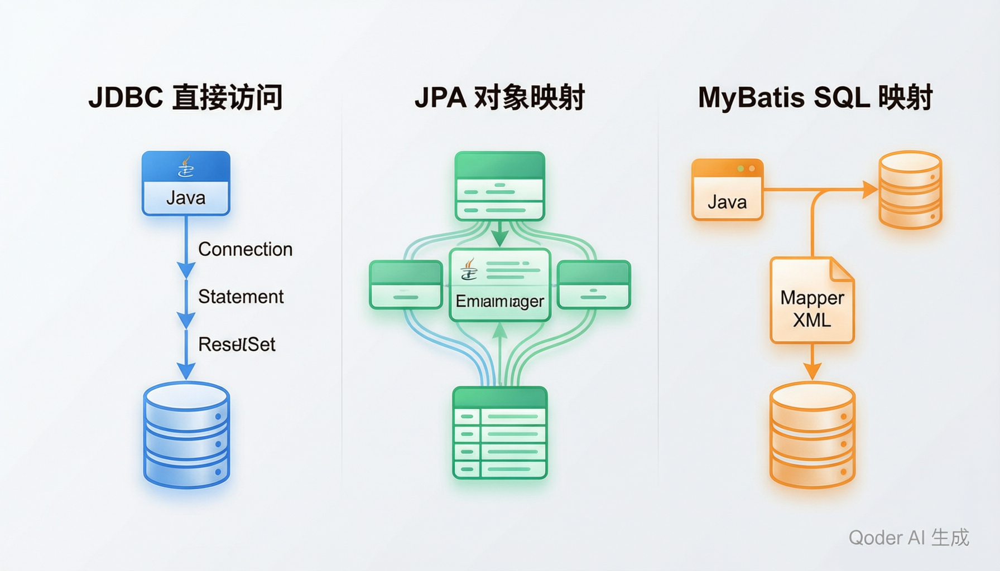

# 数据访问与持久化

> 内容更新时间：2026-10-20 · 学习阶段：高级 · 预计用时：55 分钟

> 学习阶段：高级 · 预计用时：55 分钟 · 配图：数据访问架构对比



## 本节知识框架

想象你开了一家快递站。客户（Java 程序）要寄包裹（数据）到仓库（数据库），但中间怎么送，有三种方式：

- **JDBC**：你自己骑三轮车一趟一趟送——最直接，但每趟都要自己搬货、填单子、对地址，非常累。
- **JPA**：你雇了一个全自动物流系统。只要把包裹贴上标签（注解），系统自动帮你分类、装车、送达，你甚至不用知道包裹走的是哪条路。
- **MyBatis**：你有一个半自动系统——你只需要写好快递单（SQL 语句），剩下的搬运和路线规划系统帮你完成。

三种方式各有利弊：JDBC 最灵活但最繁琐，JPA 最省事但不够透明，MyBatis 居中——SQL 你写、苦力活它干。

**本课知识地图**

```text
JDBC 基础 → DataSource 与连接池 → JPA 与 ORM → MyBatis 映射 → 事务管理 → 选型对比
```

**学完本课你将能够**：

1. 使用 JDBC 完成数据库的增删改查（CRUD）操作。
2. 理解连接池（HikariCP）的作用和配置方式。
3. 使用 JPA 注解定义实体并通过 Repository 访问数据。
4. 使用 MyBatis 的 Mapper XML 编写 SQL 并映射到 Java 对象。
5. 根据项目需求在三种方案中做出合理选型。

**先修知识**：你需要了解 Java 基础语法和面向对象（来自《Java 基础》），SQL 基本操作（来自《SQL 入门》），以及 Servlet 的基本概念（来自《Servlet 与 JSP 基础》）。

### 复习清单

- [ ] 能不看正文画出 JDBC、JPA、MyBatis 三种方式的数据访问流程。
- [ ] 能解释为什么生产环境不能每次查询都新建数据库连接。
- [ ] 能说出 `@Transactional` 注解背后发生了什么，以及连接池在其中扮演什么角色。

---

## 核心概念定义

我们先用一张"生活对照表"来认识本课的核心术语。

| 术语 | 一句话定义 | 生活类比 |
| --- | --- | --- |
| JDBC | Java Database Connectivity，Java 访问数据库的标准 API，提供 Connection、Statement、ResultSet 等核心接口。 | 快递站的"标准操作流程手册"——不管哪家快递公司，按这个手册都能寄包裹。 |
| DataSource | 获取数据库连接的工厂接口，替代了早期 DriverManager 的硬编码方式。 | 快递站的"调度中心"——告诉系统去哪个仓库取车（连接）。 |
| Connection Pool（连接池） | 预先创建并维护一组数据库连接，用完后归还而非关闭，避免频繁创建/销毁的开销。 | 快递站的"车队"——车一直在，用完还回来，不用每次都买新车。 |
| JPA | Java Persistence API，Java 官方的 ORM 规范，定义了一套注解和接口标准。 | 全自动物流系统的"行业标准"——所有物流商都得遵守的服务规范。 |
| EntityManager | JPA 的核心接口，负责实体的增删改查和持久化操作。 | 物流系统的"调度员"——你告诉它要寄什么，它帮你搞定一切。 |
| ORM | Object-Relational Mapping，把 Java 对象和数据库表自动对应起来的技术。 | 把"包裹上的商品清单"自动翻译成"仓库货架编号"——人和机器各说各的话，ORM 做翻译。 |
| MyBatis | 半自动 ORM 框架，开发者手写 SQL，框架负责参数绑定和结果映射。 | 你自己写快递单内容，但系统帮你贴单、分拣、送达。 |
| Mapper | MyBatis 中的接口或 XML 文件，定义了 SQL 语句与 Java 方法的对应关系。 | 快递单模板——每种包裹对应一种固定格式的单子。 |
| SqlSession | MyBatis 的核心会话对象，负责执行 SQL 和管理事务。 | 快递站的一次"值班"——从开门到关门，处理所有包裹。 |
| 事务管理 | 保证一组数据库操作要么全部成功、要么全部回滚的机制（ACID 特性）。 | 转账——扣钱和加钱必须同时成功，否则钱就丢了。 |
| @Transactional | Spring 提供的声明式事务注解，加在方法或类上，自动管理事务边界。 | 在快递单上盖一个"保价"章——系统自动帮你处理理赔流程，不用自己跑。 |
| 连接池（HikariCP） | Spring Boot 默认的高性能连接池，以极低的开销和快速连接获取著称。 | 快递站的"闪电车队"——取车还车速度极快，几乎不耽误寄件。 |

---

## 原理与运行机制

### JDBC：最底层的数据库访问

JDBC 是 Java 访问数据库的"老祖宗"——所有上层框架最终都在和 JDBC 打交道。

**工作流程**（想象你亲自去仓库取货）：

1. **加载驱动**：告诉 Java 你要连哪种数据库（MySQL？PostgreSQL？）。
2. **获取连接**：通过 DriverManager 或 DataSource 拿到一个 Connection。
3. **创建语句**：用 Connection 创建 Statement 或 PreparedStatement。
4. **执行查询**：发送 SQL，拿到 ResultSet。
5. **处理结果**：遍历 ResultSet，把数据转成 Java 对象。
6. **关闭资源**：依次关闭 ResultSet、Statement、Connection。

```java
// JDBC 查询示例——每一步都要手动处理
Class.forName("com.mysql.cj.jdbc.Driver");                       // 1. 加载驱动
Connection conn = DriverManager.getConnection(                    // 2. 获取连接
    "jdbc:mysql://localhost:3306/shop", "root", "123456");
PreparedStatement ps = conn.prepareStatement(                     // 3. 创建语句
    "SELECT id, name, price FROM products WHERE id = ?");
ps.setInt(1, 1);                                                  // 4. 设置参数
ResultSet rs = ps.executeQuery();                                 // 5. 执行查询
while (rs.next()) {
    String name = rs.getString("name");
    double price = rs.getDouble("price");
    System.out.println(name + " - " + price);
}
rs.close();                                                       // 6. 关闭资源
ps.close();
conn.close();
```

问题很明显：代码冗长、资源管理容易遗漏、每次查询都要新建连接。

### JPA：全自动 ORM

JPA 的核心思想是"你只管对象，不管 SQL"。你定义好 Java 类和数据库表的映射关系（通过注解），JPA 自动生成 SQL 并执行。

**工作流程**（想象全自动物流）：

1. **定义实体**：用 `@Entity`、`@Table`、`@Id`、`@GeneratedValue` 等注解标注 Java 类。
2. **创建 EntityManager**：通过 Persistence 或 Spring 注入获取。
3. **操作对象**：调用 `persist()`、`find()`、`merge()`、`remove()` 等方法。
4. **JPA 翻译**：框架自动把对象操作翻译成 SQL 并执行。

```java
// JPA 实体定义——只需要关心 Java 对象
@Entity
@Table(name = "products")
public class Product {
    @Id
    @GeneratedValue(strategy = GenerationType.IDENTITY)
    private Long id;

    @Column(name = "name", nullable = false)
    private String name;

    @Column(name = "price")
    private Double price;

    // getter/setter 省略
}

// JPA 查询——一行代码搞定
Product product = entityManager.find(Product.class, 1L);  // 自动 SELECT * FROM products WHERE id = 1
```

### MyBatis：半自动 SQL 映射

MyBatis 走中间路线——SQL 由你手写（放在 XML 或注解里），但参数绑定和结果映射由框架完成。

**工作流程**（想象半自动物流）：

1. **编写 Mapper XML**：在 XML 文件中定义 SQL 语句和参数映射。
2. **定义 Mapper 接口**：Java 接口方法对应 XML 中的 SQL。
3. **获取 SqlSession**：通过 SqlSessionFactory 创建。
4. **执行操作**：调用 Mapper 接口方法，MyBatis 自动执行 SQL 并映射结果。

```java
// MyBatis Mapper 接口——方法名对应 XML 中的 SQL id
public interface ProductMapper {
    Product findById(Long id);
    List<Product> findAll();
    void insert(Product product);
}
```

### 事务管理

事务是数据库操作的"安全网"。没有事务，转账可能出现"扣了钱但没加上"的灾难。

**JDBC 手动事务**：

```java
conn.setAutoCommit(false);    // 关闭自动提交
try {
    // 操作 1：扣钱
    ps1.executeUpdate();
    // 操作 2：加钱
    ps2.executeUpdate();
    conn.commit();              // 全部成功才提交
} catch (Exception e) {
    conn.rollback();            // 出错就回滚
}
```

**Spring 声明式事务**（推荐）：

```java
@Service
public class TransferService {
    @Transactional   // 加上这一个注解，Spring 自动管理事务
    public void transfer(Long fromId, Long toId, BigDecimal amount) {
        accountDao.deduct(fromId, amount);
        accountDao.add(toId, amount);
    }
}
```

`@Transactional` 背后是 AOP 代理——Spring 在方法执行前开启事务，正常结束则提交，抛出异常则回滚。

### 连接池（HikariCP）

每次数据库操作都新建连接，就像每次寄快递都买一辆新车——太浪费了。连接池预先创建一组连接，用完归还。

**HikariCP 为什么快？**

- 字节码级别的优化，几乎零开销
- 精心设计的无锁数据结构
- 连接存活时间智能管理
- Spring Boot 2.x+ 默认连接池

```yaml
# application.yml 配置
spring:
  datasource:
    url: jdbc:mysql://localhost:3306/shop
    username: root
    password: 123456
    hikari:
      maximum-pool-size: 10      # 最大连接数
      minimum-idle: 5            # 最小空闲连接
      connection-timeout: 30000  # 获取连接超时（毫秒）
      idle-timeout: 600000       # 空闲连接存活时间
      max-lifetime: 1800000      # 连接最大存活时间
```

---

## 典型应用场景

| 场景 | 推荐方案 | 原因 |
| --- | --- | --- |
| 简单查询、存储过程调用 | JDBC | 不需要框架 overhead，直接执行 SQL |
| 标准 CRUD 的企业应用 | JPA（Spring Data JPA） | 开发效率高，自动生成 SQL |
| 复杂 SQL、报表查询、遗留系统 | MyBatis | SQL 可控，方便优化复杂查询 |
| 高并发 Web 应用 | 任意 + HikariCP | 连接池是必须的，与框架选择无关 |
| 微服务 + 多数据源 | MyBatis-Plus 或 JPA | 配合 Spring Boot 自动配置 |

---

## 代码/协议/SQL 示例

### 示例 1：JDBC 完整 CRUD

**pom.xml 依赖**

```xml
<dependencies>
    <dependency>
        <groupId>com.mysql</groupId>
        <artifactId>mysql-connector-j</artifactId>
        <version>8.2.0</version>
    </dependency>
    <dependency>
        <groupId>com.zaxxer</groupId>
        <artifactId>HikariCP</artifactId>
        <version>5.1.0</version>
    </dependency>
</dependencies>
```

**JdbcProductDao.java**

```java
public class JdbcProductDao {
    private DataSource dataSource;

    public JdbcProductDao(DataSource dataSource) {
        this.dataSource = dataSource;
    }

    // 创建（Create）
    public void insert(String name, double price) throws SQLException {
        String sql = "INSERT INTO products (name, price) VALUES (?, ?)";
        try (Connection conn = dataSource.getConnection();
             PreparedStatement ps = conn.prepareStatement(sql)) {
            ps.setString(1, name);
            ps.setDouble(2, price);
            ps.executeUpdate();
        }
    }

    // 查询（Read）
    public Product findById(long id) throws SQLException {
        String sql = "SELECT id, name, price FROM products WHERE id = ?";
        try (Connection conn = dataSource.getConnection();
             PreparedStatement ps = conn.prepareStatement(sql)) {
            ps.setLong(1, id);
            try (ResultSet rs = ps.executeQuery()) {
                if (rs.next()) {
                    return new Product(
                        rs.getLong("id"),
                        rs.getString("name"),
                        rs.getDouble("price")
                    );
                }
            }
        }
        return null;
    }

    // 更新（Update）
    public void update(Product product) throws SQLException {
        String sql = "UPDATE products SET name = ?, price = ? WHERE id = ?";
        try (Connection conn = dataSource.getConnection();
             PreparedStatement ps = conn.prepareStatement(sql)) {
            ps.setString(1, product.getName());
            ps.setDouble(2, product.getPrice());
            ps.setLong(3, product.getId());
            ps.executeUpdate();
        }
    }

    // 删除（Delete）
    public void delete(long id) throws SQLException {
        String sql = "DELETE FROM products WHERE id = ?";
        try (Connection conn = dataSource.getConnection();
             PreparedStatement ps = conn.prepareStatement(sql)) {
            ps.setLong(1, id);
            ps.executeUpdate();
        }
    }
}
```

### 示例 2：JPA Entity + Repository（Spring Data JPA）

**pom.xml 依赖**

```xml
<dependencies>
    <dependency>
        <groupId>org.springframework.boot</groupId>
        <artifactId>spring-boot-starter-data-jpa</artifactId>
    </dependency>
    <dependency>
        <groupId>com.mysql</groupId>
        <artifactId>mysql-connector-j</artifactId>
    </dependency>
</dependencies>
```

**Product.java（实体）**

```java
import jakarta.persistence.*;

@Entity
@Table(name = "products")
public class Product {

    @Id
    @GeneratedValue(strategy = GenerationType.IDENTITY)
    private Long id;

    @Column(nullable = false, length = 100)
    private String name;

    @Column(nullable = false)
    private Double price;

    public Product() {}

    public Product(String name, Double price) {
        this.name = name;
        this.price = price;
    }

    // getter/setter 省略
}
```

**ProductRepository.java（仓储接口）**

```java
import org.springframework.data.jpa.repository.JpaRepository;
import java.util.List;

public interface ProductRepository extends JpaRepository<Product, Long> {
    // Spring Data JPA 自动生成 SQL——方法名就是查询条件

    List<Product> findByNameContaining(String keyword);   // SELECT * WHERE name LIKE '%keyword%'

    List<Product> findByPriceGreaterThan(Double minPrice); // SELECT * WHERE price > ?

    List<Product> findByPriceBetween(Double low, Double high); // SELECT * WHERE price BETWEEN ? AND ?
}
```

**ProductService.java（使用示例）**

```java
@Service
public class ProductService {

    private final ProductRepository repo;

    public ProductService(ProductRepository repo) {
        this.repo = repo;
    }

    @Transactional
    public Product create(String name, double price) {
        return repo.save(new Product(name, price));
    }

    public List<Product> search(String keyword) {
        return repo.findByNameContaining(keyword);
    }

    @Transactional
    public void delete(long id) {
        repo.deleteById(id);
    }
}
```

### 示例 3：MyBatis Mapper XML

**pom.xml 依赖**

```xml
<dependencies>
    <dependency>
        <groupId>org.mybatis.spring.boot</groupId>
        <artifactId>mybatis-spring-boot-starter</artifactId>
        <version>3.0.3</version>
    </dependency>
    <dependency>
        <groupId>com.mysql</groupId>
        <artifactId>mysql-connector-j</artifactId>
    </dependency>
</dependencies>
```

**Product.java（普通 POJO，无需注解）**

```java
public class Product {
    private Long id;
    private String name;
    private Double price;
    // getter/setter/构造器 省略
}
```

**ProductMapper.java（接口）**

```java
import org.apache.ibatis.annotations.Mapper;
import java.util.List;

@Mapper
public interface ProductMapper {
    Product findById(Long id);
    List<Product> findAll();
    void insert(Product product);
    void update(Product product);
    void deleteById(Long id);
}
```

**ProductMapper.xml（SQL 映射文件）**

```xml
<?xml version="1.0" encoding="UTF-8" ?>
<!DOCTYPE mapper PUBLIC "-//mybatis.org//DTD Mapper 3.0//EN"
    "http://mybatis.org/dtd/mybatis-3-mapper.dtd">

<mapper namespace="com.example.mapper.ProductMapper">

    <!-- 结果映射：数据库列 → Java 字段 -->
    <resultMap id="productResult" type="com.example.pojo.Product">
        <id property="id" column="id"/>
        <result property="name" column="name"/>
        <result property="price" column="price"/>
    </resultMap>

    <select id="findById" resultMap="productResult">
        SELECT id, name, price FROM products WHERE id = #{id}
    </select>

    <select id="findAll" resultMap="productResult">
        SELECT id, name, price FROM products
    </select>

    <insert id="insert" useGeneratedKeys="true" keyProperty="id">
        INSERT INTO products (name, price) VALUES (#{name}, #{price})
    </insert>

    <update id="update">
        UPDATE products SET name = #{name}, price = #{price} WHERE id = #{id}
    </update>

    <delete id="deleteById">
        DELETE FROM products WHERE id = #{id}
    </delete>

</mapper>
```

**application.yml**

```yaml
mybatis:
  mapper-locations: classpath:mapper/*.xml
  type-aliases-package: com.example.pojo
  configuration:
    map-underscore-to-camel-case: true   # 数据库 user_name → Java userName
```

---

## 时间/空间复杂度或性能分析

| 维度 | JDBC | JPA | MyBatis |
| --- | --- | --- | --- |
| 开发效率 | 低（大量样板代码） | 高（自动生成 SQL） | 中（手写 SQL 但框架映射） |
| 运行性能 | 最高（无中间层开销） | 中（一级/二级缓存、SQL 生成有开销） | 较高（接近 JDBC，缓存可控） |
| SQL 可控性 | 完全可控 | 低（复杂查询需 JPQL 或 native SQL） | 高（SQL 自己写） |
| 学习曲线 | 低（只需懂 SQL） | 高（注解、生命周期、N+1 问题） | 中（懂 SQL + XML 配置） |
| 适用场景 | 简单/高性能场景 | 标准 CRUD 企业应用 | 复杂查询/报表/遗留系统 |
| 内存占用 | 低 | 较高（EntityManager 缓存实体） | 低 |

**关键性能陷阱**：

- **JDBC**：不使用连接池时，每次操作新建连接约需 50-200ms，高并发下直接崩溃。
- **JPA N+1 问题**：查询 100 条订单，如果每条订单再单独查商品信息，就变成 1 + 100 = 101 次查询。解决办法是用 `JOIN FETCH` 或 `@EntityGraph`。
- **MyBatis**：性能最接近 JDBC，但要注意 `#{}` 和 `${}` 的区别——`${}` 直接拼接 SQL，有注入风险。

---

## 常见误区与易错点

| 错误 | 现象 | 正确做法 |
| --- | --- | --- |
| JDBC 不关闭连接 | 连接泄漏，数据库连接池耗尽，应用卡死 | 使用 try-with-resources 或连接池自动管理 |
| JPA 实体没有无参构造器 | 运行时抛出 InstantiationException | 始终保留 `public Entity() {}` |
| MyBatis 用 `${}` 拼接用户输入 | SQL 注入漏洞 | 参数一律用 `#{}`，仅在动态表名/列名时考虑 `${}` |
| 在 Service 方法里手动开事务 | 事务管理混乱，嵌套事务行为不可预期 | 使用 `@Transactional` 声明式事务，让 Spring 管理 |
| 连接池设太大 | 数据库连接数超限，反而变慢 | 根据数据库最大连接数合理设置（通常 10-50） |
| JPA 的 `equals`/`hashCode` 用所有字段 | 懒加载触发额外查询，性能劣化 | 只基于业务主键实现 `equals`/`hashCode` |
| 忘记加 `@Transactional` 导致数据不一致 | 部分操作成功部分失败，没有回滚 | 涉及多表写操作的方法必须加 `@Transactional` |
| PreparedStatement 用字符串拼接 SQL | SQL 注入 + 无法利用预编译缓存 | 始终使用 `?` 占位符 + `setXxx()` 方法 |

---

## 与其他知识点的关系

- **先修**：《Java 基础》、《SQL 入门》、《Servlet 与 JSP 基础》
- **并行**：《Spring Framework 核心》——事务管理依赖 AOP 和 IoC
- **后续**：《Spring Boot 入门》、《Spring Data JPA 进阶》、《实战：Spring Boot REST API》
- **相关**：《数据库设计》、《数据库事务与锁》、《Redis 缓存》

---

## 自测题与参考答案

**Q1**：JDBC 中，为什么推荐使用 `PreparedStatement` 而不是 `Statement`？

<details>
<summary>点击查看答案</summary>

`PreparedStatement` 有两个优势：（1）使用 `?` 占位符自动防止 SQL 注入，因为参数会被当作值而非 SQL 片段处理；（2）数据库可以预编译 SQL 模板并缓存执行计划，重复执行相同结构的 SQL 时性能更好。`Statement` 每次都要完整拼接 SQL 字符串，既不安全又低效。
</details>

**Q2**：JPA 的 N+1 查询问题是什么？怎么解决？

<details>
<summary>点击查看答案</summary>

N+1 问题：查询 N 条主记录（如订单）后，JPA 为每条记录单独发一条 SQL 查关联数据（如商品），总共 1 + N 次查询。解决方案：（1）使用 `JOIN FETCH` 在 JPQL 中一次性加载关联实体；（2）使用 `@EntityGraph` 注解指定加载图；（3）使用 `@BatchSize` 批量加载。核心思路是减少 SQL 次数，把 N 次查询合并为 1-2 次。
</details>

**Q3**：MyBatis 中 `#{}` 和 `${}` 有什么区别？分别用在什么场景？

<details>
<summary>点击查看答案</summary>

`#{}` 是预编译参数占位符，MyBatis 会将其替换为 `?` 并通过 PreparedStatement 的 `setXxx()` 方法设值，安全且高效，适用于绝大多数参数传递场景。`${}` 是字符串直接替换，直接把值拼接到 SQL 中，存在 SQL 注入风险。仅在需要动态传入表名、列名等无法使用预编译的场景下才考虑 `${}`，且必须确保输入来源可信。
</details>

---

## 考点精讲

### 考点 1

在 JDBC 中，推荐使用 `PreparedStatement` 而非 `Statement` 的主要原因是什么？

A. `PreparedStatement` 能防止 SQL 注入并支持预编译缓存，提高安全性和性能  
B. `PreparedStatement` 可以自动管理数据库连接池  
C. `PreparedStatement` 支持自动事务回滚  
D. `PreparedStatement` 可以同时执行多条不同结构的 SQL 语句  

**正确答案：A**

**详细解释：** `PreparedStatement` 使用 `?` 占位符进行参数绑定，数据库驱动会将参数当作值而非 SQL 片段处理，从而有效防止 SQL 注入攻击。同时，数据库可以预编译 SQL 模板并缓存执行计划，当重复执行相同结构的 SQL 时，无需重新编译，性能显著优于每次都要完整拼接 SQL 字符串的 `Statement`。

---

### 考点 2

JPA 的 N+1 查询问题的根本原因和推荐解决方案是什么？

A. 数据库连接数不足导致查询变慢；解决方案是增大连接池大小  
B. JPA 的缓存机制失效导致重复查询；解决方案是改用 MyBatis 框架  
C. SQL 语句未使用索引导致全表扫描；解决方案是为关联字段添加索引  
D. 查询 N 条主记录后，JPA 为每条记录单独查询关联数据，共产生 1+N 次查询；解决方案是使用 JOIN FETCH 或 @EntityGraph 合并加载  

**正确答案：D**

**详细解释：** N+1 问题的根本原因是 JPA 在加载主记录（如订单列表）后，访问每条记录的关联属性（如商品信息）时会单独发送一条 SQL 查询，导致总共执行 1 + N 次查询。解决方案包括：在 JPQL 中使用 `JOIN FETCH` 一次性加载关联实体，或使用 `@EntityGraph` 注解指定加载图，也可以用 `@BatchSize` 进行批量加载。核心思路是将 N 次单独查询合并为 1~2 次查询。

---

### 考点 3

MyBatis 中 `#{}` 和 `${}` 的核心区别是什么？

A. `#{}` 用于整数类型参数，`${}` 用于字符串类型参数
B. `#{}` 是字符串直接替换，`${}` 是预编译参数占位符
C. `${}` 是字符串直接替换，存在 SQL 注入风险；`#{}` 使用预编译占位符，安全且高效
D. 两者功能完全相同，只是书写风格不同

**正确答案：C**

**详细解释：** `${}` 是字符串直接替换机制，MyBatis 会将参数值直接拼接到 SQL 语句中，如果参数来自用户输入，攻击者可以构造恶意字符串实现 SQL 注入。`#{}` 是预编译参数占位符，MyBatis 会将其替换为 `?` 并通过 `PreparedStatement` 的 `setXxx()` 方法安全设值，参数不会被当作 SQL 代码执行。因此，参数传递应一律使用 `#{}`，仅在需要动态传入表名或列名等无法使用预编译的特殊场景下才考虑 `${}`，且必须确保输入来源可信。

---

### 考点 4

关于 HikariCP 连接池配置，`maximum-pool-size` 参数的作用是什么？

A. 设置数据库允许的最大并发用户数  
B. 设置数据库服务器的最大内存使用量  
C. 设置应用程序的最大线程数  
D. 设置连接池维持的最大连接数量，超出后新请求将等待直到有连接可用或超时  

**正确答案：D**

**详细解释：** `maximum-pool-size` 定义了 HikariCP 连接池可以同时维持的最大数据库连接数。当应用程序请求连接且池中所有连接都被占用时，新请求会进入等待队列，直到有连接被归还或超过 `connection-timeout` 设定的超时时间。该值不宜设置过大，应根据数据库的最大连接数限制合理配置，通常推荐 10~50 个连接，过大的连接池反而会因为数据库端的连接争抢导致性能下降。

---

### 考点 5

Spring 的 `@Transactional` 注解背后使用了什么机制来实现事务管理？

A. 直接在方法体内插入 try-catch 代码块  
B. 通过 JDBC 的 Savepoint 机制实现部分回滚  
C. 修改数据库的自动提交配置为手动模式  
D. 使用 AOP 代理，在方法执行前开启事务，正常结束则提交，抛出异常则回滚  

**正确答案：D**

**详细解释：** `@Transactional` 的背后是 Spring AOP（面向切面编程）代理机制。当 Spring 检测到该方法被调用时，代理会先在方法执行前开启一个数据库事务，然后执行目标方法的业务逻辑。如果方法正常返回，代理自动提交事务；如果方法抛出运行时异常（默认情况下），代理自动回滚事务。开发者无需手动编写 `conn.commit()` 或 `conn.rollback()` 等事务管理代码，实现了声明式事务管理，极大简化了事务边界的控制。

---

## 术语速查

| 术语 | 一句话说明 |
| --- | --- |
| JDBC | Java 访问数据库的标准 API |
| DataSource | 获取数据库连接的工厂接口 |
| Connection Pool | 预创建并复用数据库连接的机制 |
| HikariCP | Spring Boot 默认的高性能连接池 |
| JPA | Java 官方的 ORM 规范 |
| EntityManager | JPA 核心接口，管理实体持久化 |
| ORM | 对象-关系映射，Java 对象 ↔ 数据库表 |
| MyBatis | 半自动 ORM 框架，手写 SQL + 框架映射 |
| Mapper | MyBatis 中 SQL 与 Java 方法的映射 |
| SqlSession | MyBatis 的核心会话对象 |
| @Transactional | Spring 声明式事务注解 |
| PreparedStatement | JDBC 预编译 SQL 语句，防注入 |

---

## 参考资料与复核

- [本课资料锚点 java_data_access](https://zh.wikipedia.org/w/index.php?search=java_data_access)

| 参考资料 | 本课用途 |
| --- | --- |
| [JDBC 官方教程](https://docs.oracle.com/javase/tutorial/jdbc/) | 数据库连接与事务基础 |
| [Spring Data JPA 文档](https://docs.spring.io/spring-data/jpa/docs/current/reference/html/) | JPA 仓储与查询映射 |
| [MyBatis 官方文档](https://mybatis.org/mybatis-3/zh/index.html) | SQL 映射与 XML 配置 |
| [HikariCP GitHub](https://github.com/brettwooldridge/HikariCP) | 连接池配置与性能调优 |
| [Java SE API 文档](https://docs.oracle.com/en/java/javase/21/docs/api/) | JDBC 标准库 API 查阅 |

- 最后复核：2026-10-20
- 下次复核：2027-02-20
- 复核范围：JDBC/JPA/MyBatis 三种数据访问方式的原理、配置、性能与选型
- 来源性质：官方文档与权威技术社区；本课核对关键词：JDBC、JPA、MyBatis、连接池、事务管理
- 最后复核：2026-10-04
- 下次复核：2026-10-20

---

## 内容元数据

- 内容更新时间：2026-10-06

- 内容版本：v2.0
- 最后更新：2026-10-20
- 学习阶段：高级
- 适用环境：Java 17+ / Spring Boot 3.x / Maven 或 Gradle；本课聚焦 JDBC、JPA 与 MyBatis 三种数据访问方案。
- 内容来源：内置结构化课程与工程实践整理
- 相关主题：JDBC、JPA、MyBatis、连接池、事务管理、ORM


