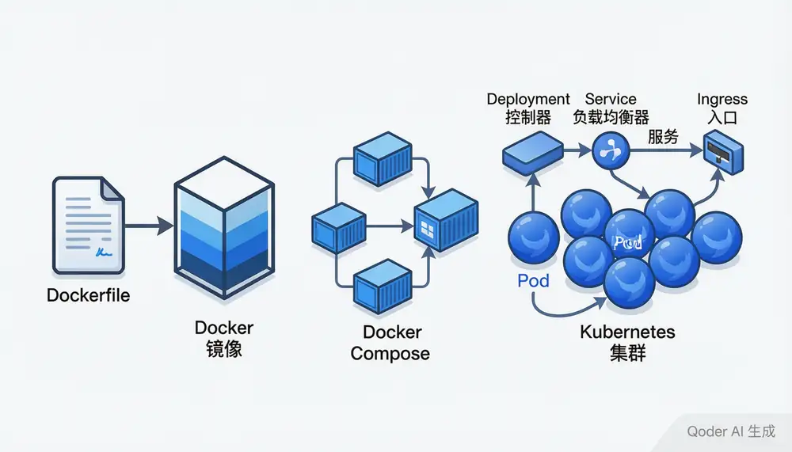

# 部署与容器化

> 内容更新时间：2026-10-20 · 学习阶段：高级 · 预计用时：45 分钟



## 本节知识框架

想象你开了一家连锁奶茶店。最初你只有一家店，自己煮茶、加料、封口、递给顾客——所有事情亲力亲为。后来生意好了，你要开 10 家店。问题来了：每家店的设备不一样、配方版本不同、员工操作有差异，顾客喝到的味道参差不齐。

**Docker** 就像是给奶茶店做了一套"标准移动厨房"——把煮茶机、原料、配方、操作流程全部打包进一个标准集装箱。不管这个集装箱放到哪家店，打开就能用，味道一模一样。

**Kubernetes（K8s）** 则像是连锁店的"总调度中心"。它管理着几十上百个这样的标准厨房，自动决定哪个厨房忙了要加人手、哪个厨房空闲了可以缩减、某个厨房出故障了立刻换一个新的顶上。

**本课知识地图**

```text
Docker 基础概念 → Dockerfile 编写 → Docker Compose 编排 → Kubernetes 核心架构 → Pod/Deployment/Service → Ingress 与配置管理 → 部署策略与实战
```

**学完本课你将能够**：

1. 理解 Docker 容器化的核心思想，能编写 Dockerfile 将 Spring Boot 应用打包为镜像。
2. 使用 Docker Compose 编排多容器应用（应用 + 数据库 + 缓存）。
3. 理解 Kubernetes 的架构，能编写 Deployment、Service、Ingress 等核心资源清单。
4. 掌握滚动更新、蓝绿部署等常见部署策略。
5. 了解 ConfigMap、Secret、持久化存储在 Kubernetes 中的使用方式。

**先修知识**：你需要了解 Spring Boot 基础（来自《Spring Boot 入门》）、Linux 基本命令操作，以及 HTTP 协议和网络基础概念。

**复习清单**

- [ ] 能独立编写一个 Spring Boot 应用的 Dockerfile，理解每一层的作用
- [ ] 能用 Docker Compose 编排包含应用、数据库、缓存的多容器项目
- [ ] 能编写 Kubernetes 的 Deployment、Service、Ingress 清单文件
- [ ] 能解释滚动更新与蓝绿部署的区别和适用场景
- [ ] 能说明 ConfigMap 与 Secret 的用途及挂载方式

---

## 核心概念定义

| 术语 | 一句话定义 | 生活类比 |
| --- | --- | --- |
| Docker | 一个开源的容器化平台，把应用及其依赖打包成标准化的单元（容器），在任何环境中一致运行。 | 标准集装箱——不管里面装什么货物，外面的接口（尺寸、吊装卸口）统一，轮船、卡车、火车都能运。 |
| 镜像（Image） | 容器的"模板"，包含运行应用所需的全部文件：代码、运行时、库、环境变量。镜像是只读的。 | 奶茶的配方卡——记录了用什么茶叶、多少糖、多少奶，但本身不是奶茶。 |
| 容器（Container） | 镜像的运行实例。每个容器互相隔离，共享宿主机操作系统内核，但拥有自己的文件系统、网络和进程空间。 | 按照配方卡做出来的那杯奶茶——可以喝（运行），而且每次做出来味道一样。 |
| Dockerfile | 定义镜像构建步骤的文本文件。每一行指令（FROM、COPY、RUN 等）都会在镜像中增加一层。 | 奶茶制作流程说明书——第一步煮茶、第二步加糖、第三步加奶……按步骤执行就能做出奶茶。 |
| Docker Compose | 用 YAML 文件定义和运行多容器 Docker 应用的工具。一条 `docker compose up` 就能启动所有服务。 | 连锁店的开业清单——"这家店需要 1 台煮茶机、1 台封口机、1 个收银台"，一次性全部配齐。 |
| Kubernetes（K8s） | 开源的容器编排平台，自动化部署、扩缩容和管理容器化应用。由 Google 内部系统 Borg 演化而来。 | 连锁奶茶店的总调度中心——管理所有分店，自动调配资源、处理故障、应对客流高峰。 |
| Pod | Kubernetes 中最小的部署单元，包含一个或多个紧密相关的容器。同一 Pod 内的容器共享网络和存储。 | 一个工位——上面可能坐一个人（单容器），也可能坐一对搭档（多容器），他们共享桌面和电源。 |
| Deployment | 声明式管理 Pod 的控制器。你告诉它"我要 3 个副本"，它会自动确保始终有 3 个 Pod 在运行。 | 排班表——"早班需要 3 个店员"，如果有人请假（Pod 挂了），店长（Deployment）会自动找人补上。 |
| Service | 为一组 Pod 提供稳定的网络入口（IP + 端口），即使 Pod 重启 IP 变了，Service 地址不变。 | 店铺的统一电话号码——不管哪个店员接电话（哪个 Pod 处理请求），顾客只需要拨这一个号。 |
| Ingress | 管理外部流量如何进入集群内部，提供 HTTP/HTTPS 路由、SSL 终止、域名绑定等功能。 | 商场大门口的导引牌——"奶茶店走左边、火锅店走右边"，根据 URL 路径把请求分发到不同服务。 |
| ConfigMap | 存储非机密配置数据的 API 对象，以键值对形式保存，可注入到容器作为环境变量或配置文件。 | 店铺的公告栏——贴着今日推荐配方、营业时间等公开信息，所有员工都能看到。 |
| Secret | 存储敏感数据（密码、Token、证书）的 API 对象，数据经过 Base64 编码（非加密），可限制访问权限。 | 店长的保险柜——存放银行账号、密码等敏感信息，只有授权人员才能打开。 |
| 持久化存储（PV/PVC） | PV（PersistentVolume）是集群级别的存储资源，PVC（PersistentVolumeClaim）是用户对存储的申请。Pod 重启后数据不丢失。 | 仓库租赁合同——PV 是仓库本身，PVC 是你租的仓位。即使店铺搬迁（Pod 重建），仓库里的货（数据）还在。 |

---

## 原理与运行机制

### Docker 容器化原理

Docker 利用 Linux 内核的 **Namespace**（命名空间）和 **Cgroups**（控制组）两大特性实现容器隔离：

- **Namespace**：让每个容器以为自己独占整台机器——有自己的进程树（PID Namespace）、网络栈（Network Namespace）、文件系统（Mount Namespace）。
- **Cgroups**：限制每个容器能用的 CPU、内存等资源，防止某个容器"吃光"宿主机资源。

**镜像分层机制**：Dockerfile 的每一行指令都会生成一个只读层。多层镜像叠加在一起，最上面加一个可写层就是容器。这种设计让镜像可以复用——10 个基于同一基础镜像的应用，底层只存一份。

```text
┌──────────────────────┐
│  可写容器层 (Read-Write)  │  ← 容器运行时新增
├──────────────────────┤
│  应用代码层 (COPY .)      │  ← 只读
├──────────────────────┤
│  依赖安装层 (RUN apt)     │  ← 只读
├──────────────────────┤
│  JDK 基础镜像层 (FROM)    │  ← 只读，可被其他镜像共享
└──────────────────────┘
```

### Kubernetes 编排原理

Kubernetes 采用 **声明式 API** 和 **控制循环（Reconciliation Loop）** 机制：

1. 你提交一个期望状态（"我要 3 个 Pod 副本"）
2. **API Server** 接收请求，将状态存入 **etcd**（分布式键值数据库）
3. **Controller Manager** 持续对比"期望状态"和"实际状态"，发现差异就执行调整
4. **Scheduler** 决定新 Pod 应该放到哪台节点上（考虑资源、亲和性等）
5. **kubelet**（每个节点上的代理）负责启动和管理本节点上的容器

```text
用户 → kubectl apply → API Server → etcd（存储期望状态）
                                        ↓
                              Controller Manager（对比期望 vs 实际）
                                        ↓
                              Scheduler（选择节点）→ kubelet（执行调度）
```

### 部署策略

| 策略 | 原理 | 优点 | 缺点 |
| --- | --- | --- | --- |
| 滚动更新（Rolling Update） | 逐步用新版本 Pod 替换旧版本 Pod，期间服务始终可用 | 零停机、节省资源 | 回滚需要再滚动一次 |
| 蓝绿部署（Blue-Green） | 同时运行新旧两套完整环境，切换流量一步到位 | 回滚极快（切回旧环境） | 需要双倍资源 |
| 金丝雀发布（Canary） | 先让少量流量（如 5%）进入新版本，观察无异常后逐步放大 | 风险可控 | 实现复杂度较高 |

### 服务发现机制

Kubernetes 中的服务发现有两种方式：

1. **环境变量**：Pod 启动时，Kubernetes 自动注入所有已有 Service 的 IP 和端口为环境变量。
2. **DNS**：CoreDNS 组件为每个 Service 分配域名，格式为 `<service-name>.<namespace>.svc.cluster.local`。应用直接用域名访问即可。

---

## 典型应用场景

- **微服务部署**：每个微服务打包为 Docker 镜像，通过 Kubernetes 统一编排和管理，实现独立部署、独立扩缩容。
- **CI/CD 流水线**：代码提交后自动构建镜像、推送到镜像仓库、触发 Kubernetes 滚动更新，实现持续交付。
- **弹性伸缩**：电商大促期间，Kubernetes HPA（Horizontal Pod Autoscaler）根据 CPU 或 QPS 自动增加 Pod 副本数，高峰过后自动缩回。
- **多环境管理**：开发、测试、生产环境使用不同的 Kubernetes Namespace 隔离，共享集群但互不干扰。
- **混合云部署**：Kubernetes 屏蔽了底层基础设施差异，同一套应用可以同时跑在阿里云、AWS 或自建机房。
- **数据库有状态服务**：通过 StatefulSet + PV/PVC 部署 MySQL、Redis 等有状态服务，保证数据持久化。

---

## 代码/协议/SQL 示例

### 示例 1：Spring Boot 应用的 Dockerfile

以下是一个生产级 Spring Boot 应用的多阶段构建 Dockerfile：

```dockerfile
# ===== 第一阶段：构建 =====
FROM eclipse-temurin:21-jdk AS builder
WORKDIR /app

# 先复制 Gradle 文件，利用 Docker 缓存层加速依赖下载
COPY build.gradle settings.gradle gradlew ./
COPY gradle ./gradle
RUN ./gradlew dependencies --no-daemon || true

# 再复制源码并构建
COPY src ./src
RUN ./gradlew bootJar --no-daemon

# ===== 第二阶段：运行 =====
FROM eclipse-temurin:21-jre-alpine
WORKDIR /app

# 创建非 root 用户运行应用（安全最佳实践）
RUN addgroup -S appgroup && adduser -S appuser -G appgroup

# 从构建阶段复制 jar 包
COPY --from=builder /app/build/libs/*.jar app.jar

# 设置 JVM 参数（可通过环境变量覆盖）
ENV JAVA_OPTS="-Xms256m -Xmx512m -XX:+UseG1GC"

# 暴露应用端口
EXPOSE 8080

# 切换到非 root 用户
USER appuser

# 健康检查：每 30 秒探测一次 /actuator/health
HEALTHCHECK --interval=30s --timeout=3s --retries=3 \
  CMD wget -qO- http://localhost:8080/actuator/health || exit 1

ENTRYPOINT ["sh", "-c", "java $JAVA_OPTS -jar app.jar"]
```

**逐行解释**：
- `FROM ... AS builder`：多阶段构建，第一阶段用于编译打包，第二阶段只包含运行所需的最小环境。
- `COPY build.gradle ... RUN ./gradlew dependencies`：先复制构建配置并下载依赖，利用 Docker 缓存——源码没变时不需要重新下载。
- `eclipse-temurin:21-jre-alpine`：运行阶段只需 JRE，不需要 JDK；Alpine 镜像体积小（约 50MB vs 300MB+）。
- `HEALTHCHECK`：让 Docker 和 Kubernetes 知道容器是否健康。

### 示例 2：Docker Compose 编排多容器应用

```yaml
# docker-compose.yml
version: "3.9"

services:
  # Spring Boot 应用
  app:
    build:
      context: .
      dockerfile: Dockerfile
    ports:
      - "8080:8080"
    environment:
      - SPRING_PROFILES_ACTIVE=prod
      - DB_HOST=db
      - DB_PORT=5432
      - DB_NAME=shopdb
      - DB_USER=${DB_USER:-appuser}
      - DB_PASSWORD=${DB_PASSWORD:?请设置数据库密码}
      - REDIS_HOST=redis
    depends_on:
      db:
        condition: service_healthy
      redis:
        condition: service_started
    restart: unless-stopped
    networks:
      - backend

  # PostgreSQL 数据库
  db:
    image: postgres:16-alpine
    volumes:
      - pgdata:/var/lib/postgresql/data
      - ./sql/init.sql:/docker-entrypoint-initdb.d/init.sql
    environment:
      - POSTGRES_DB=shopdb
      - POSTGRES_USER=${DB_USER:-appuser}
      - POSTGRES_PASSWORD=${DB_PASSWORD:?请设置数据库密码}
    healthcheck:
      test: ["CMD-SHELL", "pg_isready -U appuser -d shopdb"]
      interval: 10s
      timeout: 5s
      retries: 5
    ports:
      - "5432:5432"
    networks:
      - backend

  # Redis 缓存
  redis:
    image: redis:7-alpine
    command: redis-server --requirepass ${REDIS_PASSWORD:-redis123}
    volumes:
      - redisdata:/data
    ports:
      - "6379:6379"
    networks:
      - backend

volumes:
  pgdata:
  redisdata:

networks:
  backend:
    driver: bridge
```

**关键点**：
- `depends_on` + `condition`：确保数据库健康后才启动应用，避免连接失败。
- `${VAR:-default}`：支持环境变量默认值。`${VAR:?message}`：强制要求设置。
- `volumes`：数据持久化，容器删除后数据不丢失。
- `networks`：所有服务在同一网络中，可以通过服务名（如 `db`、`redis`）互相访问。

### 示例 3：Kubernetes Deployment 清单

```yaml
# deployment.yaml
apiVersion: apps/v1
kind: Deployment
metadata:
  name: shop-app
  labels:
    app: shop
spec:
  replicas: 3                    # 运行 3 个 Pod 副本
  strategy:
    type: RollingUpdate          # 滚动更新策略
    rollingUpdate:
      maxSurge: 1                # 更新时最多多出 1 个 Pod
      maxUnavailable: 0          # 更新时不允许有 Pod 不可用
  selector:
    matchLabels:
      app: shop
  template:
    metadata:
      labels:
        app: shop
    spec:
      containers:
        - name: shop-app
          image: registry.example.com/shop-app:1.2.0
          ports:
            - containerPort: 8080
          resources:
            requests:              # 最低资源保障
              cpu: "250m"          # 0.25 核 CPU
              memory: "256Mi"      # 256 MB 内存
            limits:                # 资源上限
              cpu: "1000m"         # 1 核 CPU
              memory: "512Mi"      # 512 MB 内存
          env:
            - name: SPRING_PROFILES_ACTIVE
              value: "prod"
            - name: DB_PASSWORD
              valueFrom:
                secretKeyRef:
                  name: db-secret
                  key: password
          envFrom:
            - configMapRef:
                name: app-config
          readinessProbe:          # 就绪探针：通过后才接收流量
            httpGet:
              path: /actuator/health/readiness
              port: 8080
            initialDelaySeconds: 15
            periodSeconds: 10
          livenessProbe:           # 存活探针：失败则重启容器
            httpGet:
              path: /actuator/health/liveness
              port: 8080
            initialDelaySeconds: 30
            periodSeconds: 15
          volumeMounts:
            - name: config-volume
              mountPath: /app/config
      volumes:
        - name: config-volume
          configMap:
            name: app-config-files
```

### 示例 4：Kubernetes Service 清单

```yaml
# service.yaml
apiVersion: v1
kind: Service
metadata:
  name: shop-service
  labels:
    app: shop
spec:
  type: ClusterIP               # 集群内部访问
  selector:
    app: shop                    # 匹配标签为 app=shop 的 Pod
  ports:
    - protocol: TCP
      port: 80                   # Service 暴露的端口
      targetPort: 8080           # Pod 容器的端口
```

### 示例 5：Kubernetes Ingress 清单

```yaml
# ingress.yaml
apiVersion: networking.k8s.io/v1
kind: Ingress
metadata:
  name: shop-ingress
  annotations:
    nginx.ingress.kubernetes.io/ssl-redirect: "true"
    nginx.ingress.kubernetes.io/rate-limit: "100"    # 每分钟最多 100 次请求
spec:
  ingressClassName: nginx
  tls:
    - hosts:
        - shop.example.com
      secretName: shop-tls-secret
  rules:
    - host: shop.example.com
      http:
        paths:
          - path: /api
            pathType: Prefix
            backend:
              service:
                name: shop-service
                port:
                  number: 80
          - path: /
            pathType: Prefix
            backend:
              service:
                name: shop-frontend
                port:
                  number: 80
```

### 示例 6：ConfigMap 与 Secret

```yaml
# configmap.yaml
apiVersion: v1
kind: ConfigMap
metadata:
  name: app-config
data:
  SPRING_DATASOURCE_URL: "jdbc:postgresql://db:5432/shopdb"
  LOGGING_LEVEL_ROOT: "INFO"
  APP_FEATURE_FLAG_NEW_UI: "true"
---
# secret.yaml（实际使用中应通过 kubectl create secret 或外部工具生成）
apiVersion: v1
kind: Secret
metadata:
  name: db-secret
type: Opaque
data:
  password: cEB1c3N3MHJkMTIz        # Base64 编码后的密码
```

---

## 时间/空间复杂度或性能分析

### 资源消耗分析

| 维度 | Docker 单机 | Kubernetes 集群 |
| --- | --- | --- |
| 内存开销 | 容器本身几乎无额外开销，共享宿主机内核 | 控制面组件（API Server、etcd、Scheduler、Controller）约需 1-2 GB |
| CPU 开销 | 无虚拟化开销，接近裸机性能 | kubelet 和代理组件占用约 5-10% 节点资源 |
| 启动速度 | 秒级启动（毫秒级创建容器进程） | Pod 调度 + 拉镜像 + 启动，通常 10-60 秒 |
| 存储开销 | 镜像分层复用，基础层只存一份 | 加上 PV/PVC 管理、镜像仓库，存储需求显著增加 |

### 性能优化要点

- **镜像体积**：使用多阶段构建 + Alpine 基础镜像，可将 Spring Boot 镜像从 500MB+ 压缩到 100MB 以内。镜像越小，拉取越快，部署越迅速。
- **健康检查间隔**：`readinessProbe` 和 `livenessProbe` 的间隔不宜过短——过于频繁会增加应用负担；过长则故障响应慢。通常 10-15 秒为宜。
- **资源限制**：务必设置 `resources.limits`，防止某个 Pod 内存泄漏导致整个节点 OOM（Out of Memory）。
- **HPA 响应延迟**：HPA 默认每 15 秒采集一次指标，从流量激增到 Pod 扩容完成约需 1-3 分钟。对于突发流量，建议配合预热机制或使用 KEDA 基于消息队列扩缩。

---

## 常见误区与易错点

| 误区 | 现象 | 正确做法 |
| --- | --- | --- |
| 在 Dockerfile 中用 `latest` 标签 | 每次构建可能拉到不同版本的镜像，导致"在我机器上能跑"问题 | 始终使用固定版本标签，如 `eclipse-temurin:21.0.3-jre-alpine` |
| 容器里以 root 运行应用 | 安全漏洞：容器逃逸后攻击者获得宿主机 root 权限 | 创建非 root 用户（`USER appuser`），以最小权限运行 |
| 把敏感信息写死在 Dockerfile 或 YAML 中 | 密码泄露到 Git 仓库，任何人都能看到 | 使用 Kubernetes Secret、外部密钥管理（Vault）或环境变量注入 |
| 忘记设置资源限制（resources.limits） | 某个 Pod 内存泄漏，拖垮整个节点上的其他 Pod | 始终为每个容器设置 requests 和 limits |
| 用 `docker commit` 保存容器状态作为镜像 | 镜像不可复现、体积大、层数多、难以维护 | 始终通过 Dockerfile 构建镜像，保证可复现性 |
| Deployment 的 selector 和 template labels 不匹配 | Pod 无法创建，Deployment 报告 "0 available" | 确保 `spec.selector.matchLabels` 与 `spec.template.metadata.labels` 完全一致 |
| Service 的 selector 选不到任何 Pod | Service 创建成功但 Endpoints 为空，请求无法转发 | 检查 label 是否拼写正确，Pod 是否处于 Running 状态 |
| 探针配置不当导致 Pod 反复重启 | `livenessProbe` 超时太短或路径错误，kubelet 不断杀死容器 | 设置合理的 `initialDelaySeconds`，确保探针路径返回 200 |
| 忽略镜像拉取策略 | 节点缓存了旧镜像，更新后 Pod 仍使用旧版本 | 生产环境使用 `imagePullPolicy: Always` 或固定镜像 tag |
| PV 回收策略设为 Retain 但忘记清理 | 删除 PVC 后 PV 变为 Released 状态，无法被新 PVC 绑定 | 根据需求选择 `Delete` 策略，或手动清理 Released 的 PV |

---

## 与其他知识点的关系

- **先修**：《Spring Boot 入门》（应用打包）、《Linux 基础》（命令行操作）、《计算机网络》（HTTP、DNS、端口）
- **后续**：《CI/CD 流水线》（Jenkins/GitLab CI 自动构建部署）、《云原生架构》（Service Mesh、Serverless）
- **相关**：《Nginx 反向代理》（Ingress 底层实现）、《MySQL 运维》（有状态服务部署）、《微服务架构》（服务拆分与独立部署）

---

## 自测题与参考答案

**Q1**：Docker 镜像的分层机制有什么好处？为什么多阶段构建能减小镜像体积？

<details>
<summary>点击查看答案</summary>

镜像分层的好处：（1）层可以复用——多个镜像共享同一基础层（如 JDK），节省磁盘空间和网络传输；（2）层有缓存——Dockerfile 中未变更的层不需要重新构建，加速镜像构建。多阶段构建能减小镜像体积，是因为最终镜像只包含运行阶段（第二阶段）的文件，构建阶段（第一阶段）的编译器、源码、中间产物等全部被丢弃。例如 Spring Boot 应用，构建阶段需要 JDK + Gradle（约 500MB），运行阶段只需要 JRE + jar 包（约 100MB）。
</details>

**Q2**：Kubernetes 中 Deployment 的 `maxSurge` 和 `maxUnavailable` 分别是什么意思？如果 `replicas=3`、`maxSurge=1`、`maxUnavailable=0`，滚动更新时最多会有几个 Pod 同时运行？

<details>
<summary>点击查看答案</summary>

`maxSurge` 是更新过程中允许多出的 Pod 数量上限（超过期望副本数）；`maxUnavailable` 是允许不可用的 Pod 数量上限（低于期望副本数）。当 `replicas=3`、`maxSurge=1`、`maxUnavailable=0` 时，滚动更新过程中最多同时运行 4 个 Pod（3 + 1 = 4），且必须始终保持 3 个 Pod 可用。更新流程：先创建 1 个新 Pod → 新 Pod 就绪后删除 1 个旧 Pod → 循环直到全部更新完成。
</details>

**Q3**：ConfigMap 和 Secret 有什么区别？为什么说 Secret 的 Base64 编码不算真正的加密？生产环境中应该如何管理敏感配置？

<details>
<summary>点击查看答案</summary>

ConfigMap 存储非机密的配置数据（如 URL、日志级别），以明文存储；Secret 存储敏感数据（如密码、Token），数据经过 Base64 编码。Base64 只是编码方式（类似"翻译"），不是加密（类似"上锁"）——任何人都可以瞬间解码还原原文。生产环境中管理敏感配置应：（1）启用 etcd 静态加密（Encryption at Rest）；（2）使用外部密钥管理系统如 HashiCorp Vault、AWS Secrets Manager；（3）通过 RBAC 限制 Secret 的访问权限；（4）使用 Sealed Secrets 等工具在 Git 中安全存储加密后的 Secret。
</details>

---

## 考点精讲

### 问题1

Docker 镜像的分层机制有什么好处？为什么多阶段构建能减小镜像体积？

A. 分层机制没有任何好处，多阶段构建只是为了让 Dockerfile 更复杂  
B. 分层机制仅用于版本管理，与镜像体积无关  
C. 分层会增加镜像体积，多阶段构建会增大镜像体积  
D. 分层可以复用和缓存加速构建；多阶段构建的最终镜像只包含运行阶段文件，构建阶段的编译器、源码等全部被丢弃  

**正确答案：D**

**详细解释：** Docker 镜像分层的好处有两点：（1）层可以复用——多个镜像共享同一基础层（如 JDK 基础镜像），节省磁盘空间和网络传输；（2）层有缓存——Dockerfile 中未变更的层不需要重新构建，加速镜像构建过程。多阶段构建（`FROM ... AS builder`）能显著减小镜像体积，是因为最终镜像只包含运行阶段（第二阶段）的文件。例如 Spring Boot 应用，构建阶段需要 JDK + Gradle（约 500MB），而运行阶段只需要 JRE + jar 包（约 100MB），构建阶段的编译器、源码和中间产物全部被丢弃，不会出现在最终镜像中。

---

### 问题2

Kubernetes 中 Deployment 的 `maxSurge` 和 `maxUnavailable` 分别是什么意思？如果 `replicas=3`、`maxSurge=1`、`maxUnavailable=0`，滚动更新时最多会有几个 Pod 同时运行？

A. 最多 3 个 Pod；maxSurge 和 maxUnavailable 不影响 Pod 总数  
B. 最多 2 个 Pod；更新时必须先删除旧 Pod 再创建新 Pod  
C. 最多 5 个 Pod；maxSurge 和 maxUnavailable 各自独立计算  
D. 最多 4 个 Pod；maxSurge 控制更新时允许超出期望副本数的上限，maxUnavailable 控制允许不可用的下限  

**正确答案：D**

**详细解释：** `maxSurge` 是更新过程中允许多出的 Pod 数量上限（超过期望副本数），`maxUnavailable` 是允许不可用的 Pod 数量上限（低于期望副本数）。当 `replicas=3`、`maxSurge=1`、`maxUnavailable=0` 时，滚动更新过程中最多同时运行 4 个 Pod（3 + 1 = 4），且必须始终保持至少 3 个 Pod 处于可用状态。更新流程为：先创建 1 个新 Pod → 新 Pod 就绪后删除 1 个旧 Pod → 循环直到全部更新完成。这种配置实现了零停机更新。

---

### 问题3

在 Dockerfile 中，使用多阶段构建（multi-stage build）的主要目的是什么？

A. 让 Dockerfile 支持多个操作系统  
B. 让容器可以同时运行多个应用  
C. 让多个开发者可以同时构建同一个项目  
D. 将构建环境和运行环境分离，最终镜像只包含运行所需的最小文件集，显著减小镜像体积  

**正确答案：D**

**详细解释：** 多阶段构建的核心目的是分离构建环境和运行环境。第一阶段（builder）使用完整的 JDK + 构建工具（如 Gradle）进行编译打包，产生 jar 包等构建产物；第二阶段使用轻量的 JRE + Alpine 基础镜像，仅通过 `COPY --from=builder` 复制运行所需的 jar 包。最终镜像不包含编译器、源码、构建工具和中间产物，体积可从 500MB+ 压缩到 100MB 以内。镜像越小，拉取越快，部署越迅速，同时减少了攻击面，提升了安全性。

---

### 问题4

Kubernetes 中 ConfigMap 和 Secret 的区别是什么？为什么说 Secret 的 Base64 编码不算真正的加密？

A. ConfigMap 和 Secret 完全相同，没有区别  
B. Secret 使用 AES-256 加密，安全性极高  
C. ConfigMap 用于存储密码，Secret 用于存储日志级别  
D. ConfigMap 存储非机密配置数据（明文），Secret 存储敏感数据；Base64 只是编码方式而非加密，任何人可以瞬间解码还原原文  

**正确答案：D**

**详细解释：** ConfigMap 用于存储非机密的配置数据（如数据库 URL、日志级别），以明文形式存储和展示。Secret 用于存储敏感数据（如密码、Token、证书），数据经过 Base64 编码。但 Base64 只是一种编码方式（类似\u201c翻译\u201d），不是加密（类似\u201c上锁\u201d）——任何人都可以瞬间解码还原原文，没有任何安全性。生产环境管理敏感配置应：启用 etcd 静态加密（Encryption at Rest），使用外部密钥管理系统（如 HashiCorp Vault），通过 RBAC 限制 Secret 的访问权限，或使用 Sealed Secrets 等工具在 Git 中安全存储加密后的 Secret。

---

### 问题5

在 Kubernetes 中，Service 资源的核心作用是什么？

A. 为一组 Pod 提供稳定的网络入口（IP + 端口），即使 Pod 重启 IP 变化，Service 地址保持不变  
B. 直接运行应用程序的代码  
C. 管理 Docker 镜像的构建和推送  
D. 存储应用的配置文件和环境变量  

**正确答案：A**

**详细解释：** Kubernetes 中的 Pod 是临时的——Pod 可能因为更新、故障或节点缩容而被销毁和重建，每次重建后 IP 地址都会变化。Service 为一组具有相同标签的 Pod 提供一个稳定的网络入口（固定的 ClusterIP 和端口），通过 selector 匹配后端 Pod。即使后端 Pod 的 IP 发生变化，Service 的地址始终不变，其他服务或客户端只需访问 Service 地址即可。Service 还支持负载均衡，将请求自动分发到后端的多个 Pod 实例上，类似于一个店铺的统一电话号码——不管哪个店员接电话，顾客只需要拨这一个号。

---

## 术语速查

| 术语 | 一句话说明 |
| --- | --- |
| Docker | 容器化平台，把应用和依赖打包成标准容器 |
| Image | 只读的容器模板，包含运行所需全部文件 |
| Container | 镜像的运行实例，互相隔离的轻量级进程 |
| Dockerfile | 定义镜像构建步骤的文本文件 |
| Docker Compose | 多容器编排工具，用 YAML 定义服务组合 |
| Kubernetes（K8s） | 容器编排平台，自动化部署和扩缩容 |
| Pod | K8s 最小部署单元，包含一个或多个容器 |
| Deployment | 声明式管理 Pod 副本数和更新策略的控制器 |
| Service | 为 Pod 提供稳定网络入口的抽象 |
| Ingress | HTTP/HTTPS 路由和外部流量入口 |
| ConfigMap | 存储非机密配置数据的 K8s 对象 |
| Secret | 存储敏感数据的 K8s 对象（Base64 编码） |
| PV/PVC | 持久化存储卷与存储卷申请 |
| Namespace | 集群内的逻辑隔离空间 |
| etcd | 分布式键值数据库，存储 K8s 集群状态 |
| kubelet | 节点代理，管理本节点上的容器 |
| HPA | 水平 Pod 自动扩缩容控制器 |
| Rolling Update | 滚动更新，逐步替换旧版本 Pod |
| Blue-Green | 蓝绿部署，新旧环境并行切换 |
| Canary | 金丝雀发布，小流量验证后逐步放量 |

---

## 参考资料与复核
- 下次复核：2026-11-09

- [本课资料锚点 java_deployment](https://zh.wikipedia.org/w/index.php?search=java_deployment)

| 资料 | 说明 |
| --- | --- |
| [Docker 官方文档](https://docs.docker.com/) | Docker 引擎、CLI、Compose 的权威参考 |
| [Kubernetes 官方文档](https://kubernetes.io/docs/) | K8s 核心概念、API 参考和教程 |
| [Spring Boot Docker 指南](https://spring.io/guides/topicals/spring-boot-docker/) | Spring Boot 官方提供的容器化最佳实践 |
| [Dockerfile 最佳实践](https://docs.docker.com/develop/develop-images/dockerfile_best-practices/) | 编写高效 Dockerfile 的官方建议 |
| [Kubernetes Deployment 策略](https://kubernetes.io/docs/concepts/workloads/controllers/deployment/#strategy) | 滚动更新与蓝绿部署的官方说明 |
- 最后复核：2026-10-04

---

## 内容元数据

- 内容更新时间：2026-10-06

- 课程 ID：java_deployment
- 分类：Java Web 开发
- 难度：高级
- 预计用时：45 分钟
- 先修课程：Spring Boot 入门、Linux 基础、计算机网络
- 后续课程：CI/CD 流水线、云原生架构
- 内容版本：v2.0


