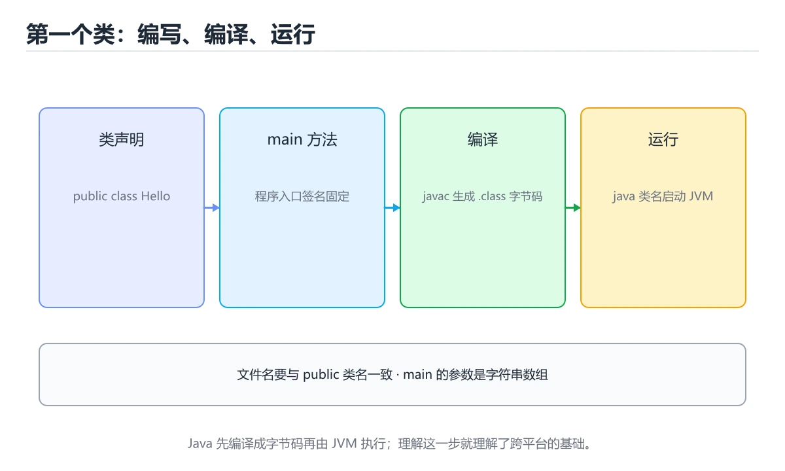
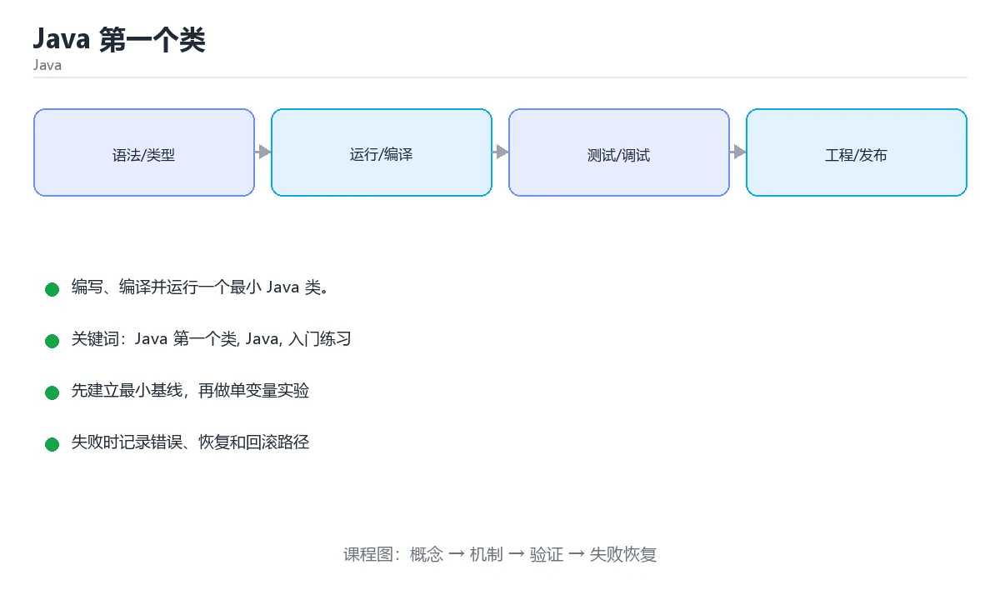

# Java 第一个类

> 内容更新时间：2026-10-06 · 学习阶段：入门 · 预计用时：30 分钟





## 本节知识框架

欢迎来到 Java 世界！本课是你写下的第一行 Java 代码。我们会一起完成一件很有仪式感的事：编写、编译并运行一个最小的 Java 程序。

想象你刚买了一个全新的咖啡机——先得学会怎么开机、怎么放杯子、怎么按按钮，才能喝到第一杯咖啡。Java 也一样，`class` 就是咖啡机的外壳，`main` 方法就是那个启动按钮，`System.out.println` 就是出咖啡的口。

**学完这一课，你会**：
- 知道 Java 程序为什么需要一个 `class` 和一个 `main` 方法
- 亲手把一个 `.java` 文件变成屏幕上的一行输出
- 遇到「文件名和类名不一致」这种新手常见报错时，能立刻反应过来

**先修**：无（本课是 Java 第 1 课）。**后续**：《Java 变量与输出》。

### 复习清单

- [ ] 能不看正文写出 `public class Main { public static void main(String[] args) { ... } }` 的骨架。
- [ ] 能说出编译（javac）和运行（java）两条命令分别做了什么。
- [ ] 能复现「文件名与公共类名不一致」的报错，并知道怎么修。

## 核心概念定义

| 术语 | 一句话说明 |
| --- | --- |
| `class` | Java 的基本组织单位，一个文件可以定义多个类，公开类名要与文件名一致。 |
| `main 方法` | 入口方法，签名固定为 public static void main(String[] args)。 |
| `System.out.println` | 向标准输出打印一行文本并换行。 |
| `javac 与 java` | 先用 javac 编译成字节码，再用 java 在 JVM 上运行。 |
| `JVM` | 执行字节码的虚拟机，让同一份字节码可以跨平台运行。 |
| `字符串` | 字符串不可变，拼接会产生新对象，循环中应使用 StringBuilder。 |
| `字节码` | 源码经 `javac` 翻译后的 JVM 指令，扩展名是 `.class`；它不是某颗 CPU 的机器码，所以同一份文件能被不同系统的 JVM 执行。 |
| `标准输出` | 进程默认的那条输出通道，`System.out` 就往这里写；不重定向时它的读者恰好是终端窗口。 |
| `args 数组` | `main` 唯一的入参，装载命令行里类名之后的每个词；参数个数可以是 0，取值之前得先看 `args.length`。 |
| `JIT 编译` | JVM 在运行期把反复执行的字节码翻译成机器码，于是「第一次跑」和「跑热之后」的耗时不是一个量级。 |

## 原理与运行机制

### 从一个文件到一行输出

Java 的世界有一条铁律：**所有代码都必须住在类（class）里面**。你可以把类想成一个文件夹——文件夹必须有名字，而且如果这个文件夹是公开的（`public`），那它的名字必须和文件名一模一样。

当 JVM 启动一个程序时，它会到处找一扇门——这扇门的形状必须恰好是 `public static void main(String[] args)`。找到了，程序就开始运行；找不到，JVM 就直接罢工。

### 编译和运行是两步

很多语言（比如 Python）写完代码直接就能跑。Java 不一样，它分两步：

1. **编译**（`javac Main.java`）：把人类能读的 Java 源码翻译成 JVM 能懂的字节码（`Main.class`）。就像把中文翻译成世界语。
2. **运行**（`java Main`）：JVM 加载字节码，找到 `main` 方法，开始执行。注意这里写的是类名，不带 `.class` 后缀。

为什么多这一步？因为字节码是平台无关的——Windows、Linux、macOS 上的 JVM 都能跑同一份 `.class` 文件。这就是 Java 那句著名的口号：「一次编写，到处运行」。

### JVM 到底做了什么

JVM 全称 Java Virtual Machine，它就像一个翻译官：读入字节码，一边解释执行一边把热门代码即时编译（JIT）成机器指令。它还帮你管内存——不用的对象会被垃圾回收器（GC）自动清理，你不需要像 C 语言那样手动 `free`。

### 字符串的小秘密

Java 里的字符串（`String`）一旦创建就不能修改。每次你用 `+` 拼接字符串，其实是在创建一个新对象。如果在循环里拼接大量字符串，应该用 `StringBuilder`，否则会产生很多临时对象，拖慢程序。

### 静态入口背后那个「鸡生蛋」问题

`main` 必须写成 `static`，不是代码风格，而是被启动顺序逼出来的。JVM 启动程序的动作为：定位类文件 → 加载 `Main` → 在方法表里找签名恰好是 `public static void main(String[])` 的条目 → 直接调用。注意此刻堆里还没有任何 `Main` 的实例。假如 `main` 是实例方法，JVM 就得先 `new Main()` 才谈得上调用，可它不知道该用哪个构造器、要不要传参、构造器里会不会又依赖别的资源——死结就此形成。`static` 的含义正是「这个方法属于类本身」，入口因此能在没有对象的情况下被按下。

把 `static` 删掉试一次：`javac` 不会拦你，因为「非静态的 main 方法」在语法上完全合法；拦住你的是运行阶段，`java Main` 会报找不到主方法的错误。这就是「编译通过不等于能运行」的第一个现场。

### 一行 println 走过的完整链路

`System.out.println("hello from Java")` 看着只有一步，实际有六步：字面量在编译期进入常量池，运行时随类加载进来；`System` 初始化时准备好 `out`，一个包住文件描述符 1 的 `PrintStream`；`println` 先写文本再追加 `line.separator`，这是它与 `print` 唯一的行为差别；换行处发生刷新，字节进入操作系统；终端按自己的编码（Windows 常见 GBK，Linux 与 macOS 常见 UTF-8）把字节画成字形；一旦你做重定向或接管道，前面几步全都不变，只是读者换成了文件或另一个进程。

所以「输出到屏幕」这个说法并不精确：`println` 保证的只是写到标准输出，屏幕恰好是默认读者。描述一段代码的行为时，写成「输入是什么、标准输出多了哪一行、出错时是什么现象」这三句，比笼统一句「能跑」有用得多。中文打出来成问号时先别改代码：源文件保存编码、`javac` 读源码的编码（可用 `-encoding UTF-8` 指定）、终端显示编码三处都要对齐，Java 内部的字符串一直是 UTF-16，不受影响。

### 验证一个结论前先固定这三件事

本课示例都该按同一套口径复现。第一，记下 `javac -version` 与 `java -version` 的输出：不同 JDK 的错误文案不一样，「找不到主类」在较新版本里可能写成「找不到主方法」，版本不固定，两次实验的报错就不可比。第二，至少跑三类输入——正常参数、没有参数、非法输入（类名写错、当前目录不对）；只看正常流程得出的「能用」不足以支撑结论。第三，保存失败时的完整原文而不是「报错了」三个字。至于规模：一个 `Main.java` 的规律不能直接外推到几百个类的工程，跨版本、跨规模下结论之前先补一次实测。

## 典型应用场景

### 场景一：你的第一个程序

打开编辑器，输入下面的代码，保存为 `Main.java`：

```java
public class Main {
    public static void main(String[] args) {
        System.out.println("hello from Java");
    }
}
```

打开终端，进入文件所在目录：

```text
javac Main.java
java Main
```

屏幕上出现 `hello from Java`，恭喜你，第一个 Java 程序跑通了！

### 场景二：改一个字看效果

把 `"hello from Java"` 换成你的名字，比如 `"你好，我是小明"`。重新运行前，必须先重新 `javac Main.java`——因为 JVM 跑的是字节码，源码改了不重新编译，看到的还是旧输出。

### 场景三：故意犯个错

把文件名改成 `main.java`（小写 m），再编译。你会看到：

```text
error: class Main is public, should be declared in a file named Main.java
```

这就是「文件名与公共类名不一致」的经典报错。记住：**public 类的名字 = 文件名（不含 .java）**。

## 代码/协议/SQL 示例

### 最小可运行示例

```java
public class Main {
    public static void main(String[] args) {
        System.out.println("hello from Java");
    }
}
```

预期输出：

```text
hello from Java
```

### 逐行拆解

- `public class Main`：定义一个公开的类，名字叫 Main。文件名必须是 `Main.java`。
- `public static void main(String[] args)`：JVM 寻找的入口。`public` 让 JVM 能访问，`static` 让 JVM 不用创建对象就能调用，`void` 表示不返回值，`String[] args` 接收命令行参数。
- `System.out.println(...)`：把括号里的内容打印到屏幕并换行。`System` 是 Java 内置类，`out` 是标准输出流，`println` 是打印方法。
- 行末的分号 `;` 不能省——这是 Java 和 Python 最明显的区别之一。

### 多行输出

```java
public class Main {
    public static void main(String[] args) {
        System.out.println("第一行");
        System.out.println("第二行");
        System.out.println("第三行");
    }
}
```

### 带命令行参数

```java
public class Main {
    public static void main(String[] args) {
        if (args.length > 0) {
            System.out.println("你好，" + args[0] + "！");
        } else {
            System.out.println("你好，陌生人！");
        }
    }
}
```

运行：`java Main 小明` 输出 `你好，小明！`

### 完整示例：带版本提示与失败路径

```java
public class Main {
    public static void main(String[] args) {
        System.out.println("运行在 " + System.getProperty("java.version"));
        if (args.length == 0) {
            System.out.println("用法：java Main <名字>");
            return;                       // 没给参数就早退，别硬取 args[0]
        }
        for (String name : args) {
            System.out.println("你好，" + name);
        }
    }
}
```

不传参数时它打印版本号和用法后正常结束；传 `java Main 小明 小红` 时逐个回答问好，`args.length` 为 0 是常态而不是错误。很多新手在这里写 `if (args[0] == null)` 想防御一下，结果在取 `args[0]` 的那一刻就抛 `ArrayIndexOutOfBoundsException`：先判长度、再取元素，这个顺序不能反。

### 练习一：三行改动的边界训练

1. 把 `"hello from Java"` 换成 `""`，先猜输出，再看是不是一个空行。
2. 把 `println` 换成 `print` 并连打两次，观察两段文本怎样粘在同一行。
3. 把类名改成 `Hello` 而文件名不动，先猜报错原文，再用 `javac Hello.java` 验证。
4. 依次去掉入口签名里的 `static`、把 `main` 写成 `Main`、把参数改成 `String args`：三种改法编译都能通过，运行都会失败，这正是「签名要逐字对齐」的原因。

### 练习二：把拼接放进循环量一次

在同一个 `main` 里先做 `n` 次 `s = s + "x"` 并用 `System.nanoTime()` 记下耗时，再做同样次数的 `StringBuilder.append('x')`。`n` 取 2000 时两组看不出差距，取 20000 时第一组大约慢两三个数量级；把 `n` 翻倍，第一组耗时约变四倍，第二组只变两倍——这就是「字符串不可变」落到运行时间上的样子。

## 时间/空间复杂度或性能分析

对于入门小程序，性能不是首要关注点。但了解一些基本概念有助于养成好习惯：

- **JVM 预热**：JVM 刚启动时会先解释执行字节码，跑一段时间后才会把热点代码编译成机器码。所以第一次运行总是比较慢，后续会快很多。
- **字符串拼接**：少量拼接没问题，编译器会自动优化。但如果在循环里拼接成千上万次，应该改用 `StringBuilder`。
- **GC 影响**：小程序几乎感觉不到垃圾回收。大程序如果频繁创建临时对象，GC 停顿会影响响应速度。

测量方法：固定输入跑一遍记录基线，再提高规模复测，两次结果的差值才是结论依据。

## 常见误区与易错点

| 容易写错的做法 | 实际现象 | 原因与正确做法 |
| --- | --- | --- |
| 文件名与公共类名不一致 | 编译直接失败。 | 保持文件名与公共类名一致。 |
| 入口方法签名不标准 | 运行时提示找不到主类。 | 使用标准入口签名并核对参数类型。 |
| 混淆静态成员与实例成员 | 编译错误或逻辑错乱。 | 明确成员是否依赖实例状态。 |
| 运行命令写成 `java Main.class` 或 `java Main.java` | 报找不到或无法加载主类。 | `java` 后面只写类名，扩展名由 JVM 自己补；`java Main.java` 属于单文件源码模式，规则另有一套。 |
| 改了源码就直接 `java Main` | 屏幕还是上一次的旧输出。 | 每次改动都要重新 `javac`，真正被运行的是字节码。 |
| 用 `print` 却期待自动换行 | 多段输出粘成一行，比对结果时读错行。 | 要换行就用 `println`，或在末尾显式补一个换行。 |
| 把 `args` 当成键盘输入 | 程序照常结束，参数始终是空的。 | `args` 只接收命令行里类名之后的词，交互式输入得用 `Scanner`。 |

### 误区一：`main` 拼成 `Main` 或 `mian`

Java 区分大小写。`Main` 和 `main` 是完全不同的名字。入口方法必须是小写的 `main`。

### 误区二：忘写 `String[] args`

`public static void main()` 少了参数列表，JVM 找不到入口。即使你不用命令行参数，`String[] args` 也必须写在签名里。

### 误区三：运行时报 `NoClassDefFoundError`

通常是 `javac` 编译失败后仍去运行，或者当前目录不对。先确认编译成功生成了 `.class` 文件。

### 误区四：把 `println` 写成 `printIn`

小写字母 `l` 和大写字母 `I` 长得很像。`println` 是 "print line" 的缩写，不是 "printIn"。

## 与其他知识点的关系

- **先修**：无。本课是 Java 的起点。
- **后续**：《Java 变量与输出》会用到本课的 `class`、`main` 和 `System.out.println`。
- **术语衔接**：本课定义的 `class`、`main 方法`、`System.out.println`、`javac 与 java`、`JVM`、`字符串` 会在后续课程反复出现。

### 概念地图

```text
class（代码住在哪里）
  └─ main 方法（程序从哪里开始）
       └─ System.out.println（怎么把结果展示出来）
            └─ javac 与 java（怎么让代码跑起来）
                 └─ JVM（谁在背后执行字节码）
```

## 自测题与参考答案

### 自测 1

**问**：`class` 的操作性定义是什么？它和 `main 方法` 有什么区别？

**答**：Java 的基本组织单位，一个文件可以定义多个类，公开类名要与文件名一致。`main 方法` 是入口方法，签名固定为 public static void main(String[] args)。class 是代码的容器，main 是容器的启动开关。

### 自测 2

**问**：文件名与公共类名不一致时，会出现什么现象？怎么修？

**答**：编译直接失败。正确做法是保持文件名与公共类名一致。

### 自测 3

**问**：运行本课示例，把 `"hello from Java"` 换成空字符串 `""`，输出是什么？

**答**：输出一个空行。`println("")` 会打印一个换行符。

### 自测 4

**问**：为什么 `java Main` 不写 `.class` 后缀？

**答**：因为 `java` 命令后面跟的是类名，不是文件名。JVM 会自动去找 `Main.class`。

### 自测 5

**问**：`static` 关键字在 `main` 方法中的作用是什么？

**答**：让 JVM 无需创建对象就能直接调用这个入口方法。

## 考点精讲

`Java 第一个类` 的题库有 5 道题，下面逐题给出题干、正确项与判断依据：先自己作答，再核对正确项，最后回到正文对应小节复核。

### 考点 1：第 1 题

- **题目**：围绕“Java 第一个类”中的 Java 第一个类、Java、入门练习，下列哪两项是本课强调的实践判断？
- **正确项**：验证 Java 时要固定版本并覆盖边界输入，结论才可复现；学习 Java 第一个类 时要同时说明输入、输出和失败路径，不能只看正常流程
- **判断依据**：按《Java 第一个类》的正文口径，本题要同时选中「验证 Java 时要固定版本并覆盖边界输入，结论才可复现」、「学习 Java 第一个类 时要同时说明输入、输出和失败路径，不能只看正常流程」，漏掉任一项都算没答全。术语 class（Java 第一个类）：Java 的基本组织单位，一个文件可以定义多个类，公开类名要与文件名一致。易错点是文件名与公共类名不一致，会造成编译直接失败，改法是保持文件名与公共类名一致。

### 考点 2：第 2 题

- **题目**：public static void main(String[] args) 中 static 的作用是？
- **正确项**：让 JVM 无需创建对象就能直接调用这个入口方法
- **判断依据**：本题正确项是「让 JVM 无需创建对象就能直接调用这个入口方法」。术语 JVM（Java 第一个类）：执行字节码的虚拟机，让同一份字节码可以跨平台运行，本题取「让 JVM 无需创建对象就能直接调用这个入口方法」这条。易错点是入口方法签名不标准，会造成运行时提示找不到主类，改法是使用标准入口签名并核对参数类型。

### 考点 3：第 3 题

- **题目**：这段 `java` 代码对应 `Java 第一个类` 的 `class`。课程要解决的是编写、编译并运行一个最小 Java 类。关于代码内容，哪一项说法准确？
- **正确项**：出现字面量 `hello from Java`
- **判断依据**：本题正确项是「出现字面量 `hello from Java`」。术语 class（Java 第一个类）：Java 的基本组织单位，一个文件可以定义多个类，公开类名要与文件名一致，本题取「出现字面量 `hello from Java`」这条。易错点是混淆静态成员与实例成员，会造成编译错误或逻辑错乱，改法是明确成员是否依赖实例状态。本题干扰项「出现字面量 `string`」不成立：展示代码里找不到 `string`。

### 考点 4：第 4 题

- **题目**：System.out.println("hello from Java") 的输出行为是？
- **正确项**：把文本写到标准输出，并在末尾追加换行
- **判断依据**：本题正确项是「把文本写到标准输出，并在末尾追加换行」。术语 System.out.println（Java 第一个类）：向标准输出打印一行文本并换行，本题取「把文本写到标准输出，并在末尾追加换行」这条。易错点是文件名与公共类名不一致，会造成编译直接失败，改法是保持文件名与公共类名一致。

### 考点 5：第 5 题

- **题目**：填空：补齐下面这段术语说明中的空缺。课程 `编写、编译并运行一个最小 Java 类。`，这段说明是：`____`：先用 javac 编译成字节码，再用 java 在 JVM 上运行。空缺处应填哪个术语？
- **正确项**：javac 与 java
- **判断依据**：正确项：「javac 与 java」。涉及术语 javac 与 java：先用 javac 编译成字节码，再用 java 在 JVM 上运行。易错点：文件名与公共类名不一致会造成编译直接失败。正确做法：保持文件名与公共类名一致。判断时先确认输入和适用范围，对照 `Java 第一个类`、`Java`、`入门练习` 复现一次，最后把错误表现与正确做法逐项对照。

## 术语速查

| 术语 | 一句话说明 |
| --- | --- |
| `class` | Java 的基本组织单位，一个文件可以定义多个类，公开类名要与文件名一致。 |
| `main 方法` | 入口方法，签名固定为 public static void main(String[] args)。 |
| `System.out.println` | 向标准输出打印一行文本并换行。 |
| `javac 与 java` | 先用 javac 编译成字节码，再用 java 在 JVM 上运行。 |
| `JVM` | 执行字节码的虚拟机，让同一份字节码可以跨平台运行。 |
| `字符串` | 字符串不可变，拼接会产生新对象，循环中应使用 StringBuilder。 |

## 参考资料与复核

- 最后复核：2026-10-04
- 下次复核：2027-02-24
- 复核范围：版本兼容、API 行为、安全建议与工程实践

| 参考资料 | 本课用途 |
| --- | --- |
| [dev.java 学习](https://dev.java/learn/) | 现代 Java 官方教程 |
| [JVM 规范](https://docs.oracle.com/javase/specs/jvms/se21/html/index.html) | 字节码与运行时行为 |
| [Java SE API](https://docs.oracle.com/en/java/javase/21/docs/api/) | 标准库 API |

## 内容元数据

- 内容版本：v2.0
- 最后更新：2026-10-06
- 学习阶段：入门
- 适用环境：Java 21+ / Maven 或 Gradle；本课聚焦 Java 第一个类。
- 内容来源：内置结构化课程与工程实践整理
- 相关主题：Java 第一个类、Java、入门练习
