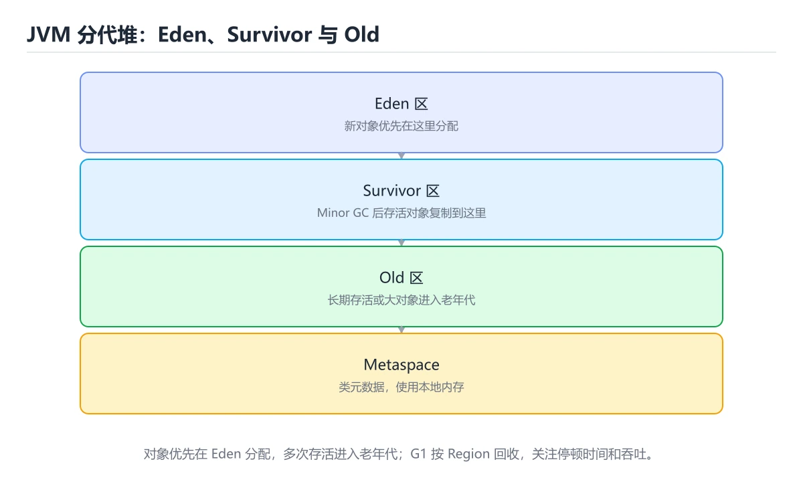
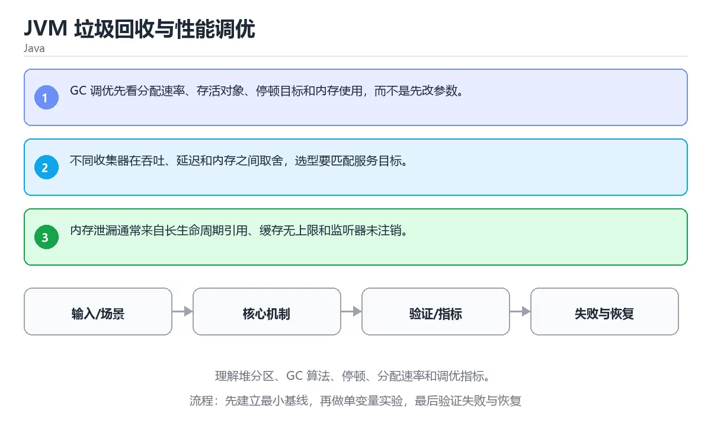

# JVM 垃圾回收与性能调优





> 内容更新时间：2026-10-06 · 学习阶段：高级 · 预计用时：30 分钟

## 本节知识框架

想象你的书桌。每次用完东西随手一放，桌面越来越乱。某天你决定收拾——把没用的扔掉（垃圾回收），把常用的放在手边（年轻代），不常用的塞进抽屉（老年代）。收拾的时候你得停下手里的活（停顿），所以最好快收快停，别一次搞太久。

JVM 的垃圾回收（GC）就是在做这件事：

- **堆**（heap）= 你的书桌，所有对象都放在这里。
- **GC**（垃圾回收器）= 帮你收拾桌面的人，找出没人引用的对象并回收内存。
- **停顿**（pause）= 收拾时你得停下手里的活，时间越短越好。
- **调优** = 通过调整桌子大小、收拾频率和方式，让整体体验更好。

本课会依次聊到四件事：

1. **堆的结构**——年轻代（Eden + Survivor）和老年代，对象按年龄被移动到不同区域。
2. **GC 算法**——Serial、Parallel、CMS、G1、ZGC，不同算法在吞吐量和停顿之间做取舍。
3. **停顿与分配速率**——对象创建越快，GC 越频繁；调优的核心是降低分配速率和控制停顿。
4. **调优实践**——先看指标再改参数，别盲目调大堆内存。

先修内容：《Java 虚拟线程与结构化并发》。后续衔接《Java 第一个类》。

### 复习清单

- [ ] 能不看正文说出 GC、堆、停顿各自的含义与一个易错点。
- [ ] 能运行或推演本课的 Java 示例，记录输入、输出和失败现象。
- [ ] 能完成一次自测，并把错题对照错误表定位原因。

## 核心概念定义

先记住下面四个词，后面所有讨论都围绕它们展开。每个词都用一句话讲清"它是什么"，再补一句"容易踩什么坑"。

| 术语 | 一句话说明 |
| --- | --- |
| `GC` | JVM 的垃圾回收器：按分代回收不可达对象；G1、ZGC 等实现决定吞吐与停顿的取舍。坑：不同收集器行为差异大，换收集器要重新压测。 |
| `堆` | JVM 用于存放对象实例的内存区域，分代收集器会按年龄把对象移动到不同区域。坑：堆不是越大越好，过大反而导致更长停顿。 |
| `停顿` | GC 期间应用线程被挂起的时间；调优目标通常是缩短单次停顿并控制 P99 分布。坑：只看平均停顿不够，P99 才能反映用户真实感受。 |
| `调优` | 基于测量结果调整参数、数据结构或资源分配，在目标指标上获得可复现改善。坑：没有测量就调参等于猜谜。 |

## 原理与运行机制

### 堆的结构：书桌的分区管理

JVM 的堆内存被分成几个区域，就像书桌被分成"桌面""浅抽屉""深抽屉"：

- **年轻代（Young Generation）**：桌面。新创建的对象都在这里。又分为 Eden 区和两个 Survivor 区。
- **老年代（Old Generation）**：深抽屉。在年轻代活了足够多轮（默认 15 次 GC）的对象会被"晋升"到这里。

```text
┌──────────────────────────────────────────┐
│                    堆（Heap）              │
│  ┌─────────────────────────────────────┐ │
│  │           年轻代（Young）             │ │
│  │  ┌─────────┐ ┌─────┐ ┌─────┐       │ │
│  │  │  Eden   │ │ S0  │ │ S1  │       │ │
│  │  └─────────┘ └─────┘ └─────┘       │ │
│  └─────────────────────────────────────┘ │
│  ┌─────────────────────────────────────┐ │
│  │           老年代（Old）              │ │
│  └─────────────────────────────────────┘ │
└──────────────────────────────────────────┘
```

对象在 Eden 区创建，Eden 满了就触发 Minor GC——把存活对象复制到 Survivor，死对象直接回收。经过多轮 GC 仍然存活的对象被晋升到老年代。老年代满了就触发 Major GC / Full GC，通常停顿更长。

### GC 算法：不同"收拾方式"的取舍

| 收集器 | 特点 | 适合场景 |
| --- | --- | --- |
| Serial | 单线程，最简单 | 小堆、嵌入式 |
| Parallel | 多线程并行回收，高吞吐 | 批处理、后台任务 |
| G1（默认） | 分 Region，可控停顿目标 | 大多数 Web 服务 |
| ZGC | 超低停顿（< 1ms），不分代 | 大堆、低延迟要求 |

**G1 是当前默认收集器**（Java 9+）。它把堆切成很多 Region，每次只回收一部分，通过 `-XX:MaxGCPauseMillis` 设置停顿目标（默认 200ms）。

**ZGC** 是 Java 15+ 的生产级收集器，停顿时间几乎恒定在 1ms 以内，不管堆多大。代价是吞吐量略低、内存占用更大。

### 分配速率：决定 GC 频率的关键

分配速率就是"每秒创建多少字节对象"。分配越快，Eden 填满越快，GC 越频繁。

降低分配速率的方法：
- **对象池化**：复用对象而不是每次 new（但要小心线程安全）。
- **基本类型优先**：`int` 比 `Integer` 少一次装箱开销。
- **避免短命大对象**：大字符串拼接用 `StringBuilder`，不要用 `+` 循环。
- **减少不必要的对象创建**：循环内的临时对象提到循环外。

### 内存泄漏：Java 也会"漏"

Java 有 GC 不代表不会内存泄漏。泄漏通常来自：

1. **长生命周期引用**：静态集合不断添加元素，永远不删除。
2. **缓存无上限**：`HashMap` 当缓存用，数据只进不出。
3. **监听器未注销**：注册了事件监听器但忘了移除，对象无法被回收。

```java
// 内存泄漏示例：静态集合只增不减
public class LeakyCache {
    private static final Map<String, byte[]> cache = new HashMap<>();

    public static void put(String key, byte[] data) {
        cache.put(key, data);  // 永远不删除，堆迟早被撑爆
    }
}
```

修复方式：用有上限的缓存（如 Caffeine、Guava Cache），或者定期清理过期条目。

### 查看堆信息的最小示例

```java
public class Main {
    public static void main(String[] args) {
        Runtime runtime = Runtime.getRuntime();
        long max = runtime.maxMemory();
        long total = runtime.totalMemory();
        long free = runtime.freeMemory();
        long used = total - free;

        System.out.println("heap>0: " + (max > 0));
        System.out.println("最大堆: " + max / 1024 / 1024 + " MB");
        System.out.println("已分配: " + total / 1024 / 1024 + " MB");
        System.out.println("已使用: " + used / 1024 / 1024 + " MB");
    }
}
```

```text
heap>0: true
最大堆: 4096 MB
已分配: 256 MB
已使用: 12 MB
```

## 典型应用场景

学完原理，我们来看几个真实场景，帮你把概念落地：

| 场景 | 你会遇到什么 | 怎么做 |
| --- | --- | --- |
| Web 服务延迟高 | 用户请求偶尔超时 | 看 GC 日志，检查停顿分布 |
| 堆内存持续增长 | 服务跑几天后 OOM | 排查内存泄漏（静态集合、缓存） |
| 吞吐量下降 | 同样的请求量变慢 | 检查分配速率和 GC 频率 |
| 大堆启动慢 | -Xmx32g 启动要等很久 | 考虑 ZGC 或减小初始堆 |
| 容器内存限制 | K8s 里 OOMKilled | 对齐 -Xmx 与容器 limit |

**选择与边界**：
- 使用 `GC` 调优时，记住先看分配速率、存活对象、停顿目标和内存使用，而不是先改参数。
- 使用 `堆` 参数时，记住结论随输入规模变化，小规模成立不代表大规模成立，需要重新测量。
- 不同收集器在吞吐、延迟和内存之间取舍，选型要匹配服务目标。

## 代码/协议/SQL 示例

### 完整最小示例

把下面的代码保存为 `GcDemo.java`，用 Java 21+ 编译运行：

```java
public class GcDemo {
    public static void main(String[] args) {
        Runtime runtime = Runtime.getRuntime();

        // 1. 查看初始堆信息
        System.out.println("heap>0: " + (runtime.maxMemory() > 0));
        System.out.println("最大堆: " + runtime.maxMemory() / 1024 / 1024 + " MB");

        // 2. 分配一批对象
        byte[][] data = new byte[100][];
        for (int i = 0; i < data.length; i++) {
            data[i] = new byte[1024 * 1024]; // 每个 1MB
        }

        // 3. 查看分配后的堆信息
        long used = runtime.totalMemory() - runtime.freeMemory();
        System.out.println("分配后已使用: " + used / 1024 / 1024 + " MB");

        // 4. 释放引用
        data = null;

        // 5. 建议 GC（不保证立即执行）
        System.gc();

        // 6. 查看 GC 后的堆信息
        used = runtime.totalMemory() - runtime.freeMemory();
        System.out.println("GC 后已使用: " + used / 1024 / 1024 + " MB");
    }
}
```

```text
heap>0: true
最大堆: 4096 MB
分配后已使用: 112 MB
GC 后已使用: 4 MB
```

运行方式：保存为 `.java` 后用 `javac --release 21` 编译、`java` 运行。可以加 `-verbose:gc` 观察 GC 日志。

## 时间/空间复杂度或性能分析

GC 调优不像算法题用大 O 衡量，更关注"在给定硬件下，停顿和吞吐的拐点在哪里"。

| 指标 | 含义 | 参考值 |
| --- | --- | --- |
| 分配速率 | 每秒创建的对象字节数 | 通常 100MB/s ~ 1GB/s |
| 存活对象大小 | Minor GC 后仍存活的对象总量 | 决定 Survivor 区大小 |
| 停顿时间 | 单次 GC 期间应用暂停的时间 | G1 目标 < 200ms，ZGC < 1ms |
| P99 停顿 | 99% 的 GC 停顿不超过这个值 | 用户体感的真实延迟 |
| GC 频率 | 每秒触发 GC 的次数 | 太频繁说明分配速率过高 |

**测量方法**：
1. 先固定 JVM 参数跑一遍基线，记录吞吐、P99 延迟和堆占用。
2. 把数据量或并发度提高一个数量级复测。
3. 两次结果的差值与波动范围才是结论依据。

## 常见误区与易错点

下面是新手最容易踩的坑，每个都给了"症状→根因→修复"三步对照：

| 容易写错的做法 | 实际现象 | 原因与正确做法 |
| --- | --- | --- |
| 只盯着吞吐量 | 停顿时间被忽略，用户仍感到卡顿 | 同时看吞吐、停顿分布与分配速率 |
| 盲目调大堆内存 | 单次停顿反而更长 | 先定位分配热点与存活对象，再调整堆与回收器 |
| 手动触发回收 | 打乱回收节奏，掩盖真实问题 | 从减少分配和缩短对象生命周期入手 |
| 不看 GC 日志就调参 | 改了参数不知道效果 | 加 `-Xlog:gc*` 记录每次 GC 的详情 |
| 容器里不设 -Xmx | 堆和容器 limit 不对齐，被 OOMKilled | -Xmx 设为容器 memory limit 的 60-75% |

**现场排错示范**：

**症状**：服务运行几天后开始频繁 Full GC，最终 OOM。
**根因**：静态 `HashMap` 当缓存用，数据只增不减，老年代被撑满。
**修复**：改用 Caffeine 缓存库，设置最大条目数和过期时间。观察 GC 日志确认老年代占用稳定。

## 与其他知识点的关系

- **先修**：`Java 虚拟线程与结构化并发`。本课默认虚拟线程和并发基础已经掌握。
- **相关或后续**：`Java 第一个类`。本课术语会在这些课程里继续使用。
- 同一分类的《多线程与并发》涉及线程池；GC 停顿会影响线程调度延迟。

**容易混淆的相邻概念**：
- `GC` vs `手动释放`：Java 的 GC 自动回收不可达对象，不需要手动 free；C/C++ 才需要。
- `堆` vs `栈`：堆存对象实例（GC 管理），栈存局部变量和方法调用（自动回收）。
- `停顿` vs `吞吐`：停顿是延迟指标（用户感受），吞吐是单位时间处理量（系统能力），通常此消彼长。

## 自测题与参考答案

> 先独立作答，再对照参考答案；答案都能在本课正文、术语表或错误表里找到依据。

### 自测 1（概念复述）

不看正文，写出 `GC` 的操作性定义，并说明它与 `堆` 的区别。

**参考答案**：GC 是 JVM 的垃圾回收器，按分代回收不可达对象。堆是 JVM 用于存放对象实例的内存区域。GC 是"收拾桌面的人"，堆是"桌面本身"。

### 自测 2（排错）

本课错误表记录了「只盯着吞吐量」这类做法。请写出它会出现的现象、根因，以及修复顺序。

**参考答案**：现象是停顿时间被忽略，用户仍感到卡顿；正确做法是同时看吞吐、停顿分布与分配速率。修复时先加 `-Xlog:gc*` 收集 GC 日志，再分析 P99 停顿和分配速率。

### 自测 3（动手验证）

运行本课的 Java 示例，把 `new byte[1024 * 1024]` 改成 `new byte[100 * 1024 * 1024]`（100MB）后重新运行，记录输出与错误信息。

**参考答案**：如果默认堆够大，程序正常运行但"分配后已使用"数值更大。如果堆不够，会抛 `OutOfMemoryError: Java heap space`。这说明堆大小直接决定了能分配多少对象。

### 自测 4（代码阅读）

阅读本课的 Java 示例，说明 `Runtime.getRuntime()` 体现了 GC 调优的哪一条原则，并指出为什么 `System.gc()` 不保证立即执行。

**参考答案**：`Runtime.getRuntime()` 提供了查看堆内存的接口，这是 GC 调优"先看指标再改参数"的基础。`System.gc()` 只是"建议"JVM 执行 GC，具体何时执行由 JVM 决定——因为 GC 有成本，JVM 要选择合适的时机。

### 自测 5（迁移）

把 GC 调优的方法迁移到自己的项目：围绕 GC 写出一个与错误表同类的风险点，并说明触发条件和检验方式。

**参考答案**：例如「手动触发回收」，它会打乱回收节奏，掩盖真实问题；检验方式是从减少分配和缩短对象生命周期入手，观察 GC 日志确认停顿分布是否改善。

## 延伸阅读

想更直观地理解本课概念？推荐参阅以下图解专题：

- [图解 JVM 内存模型与垃圾回收](visual_jvm_memory.md)

## 术语速查

| 术语 | 一句话说明 |
| --- | --- |
| `GC` | JVM 的垃圾回收器：按分代回收不可达对象；G1、ZGC 等实现决定吞吐与停顿的取舍。 |
| `堆` | JVM 用于存放对象实例的内存区域，分代收集器会按年龄把对象移动到不同区域。 |
| `停顿` | GC 期间应用线程被挂起的时间；调优目标通常是缩短单次停顿并控制 P99 分布。 |
| `调优` | 基于测量结果调整参数、数据结构或资源分配，在目标指标上获得可复现改善。 |
| `分配速率` | 每秒创建的对象字节数，决定 GC 频率的核心因素。 |
| `分代回收` | 把堆分成年轻代和老年代，不同区域用不同频率回收。 |

## 考点精讲

`JVM 垃圾回收与性能调优` 的题库有 5 道题，下面逐题给出题干、正确项与判断依据：先自己作答，再核对正确项，最后回到正文对应小节复核。

### 考点 1：第 1 题

- **题目**：按“JVM 垃圾回收与性能调优”中 GC、堆、停顿 的实践顺序，把四个步骤排成从准备到复盘的合理顺序。
- **正确项**：先明确 GC 的输入、输出与约束 → 写出最小示例并核对 堆 的基线结果 → 只改一个变量，记录边界与失败路径的变化 → 固定版本与证据，把“JVM 垃圾回收与性能调优”的结论写成可复现记录
- **判断依据**：本题正确项是先明确 GC 的输入、输出与约束。术语 GC（JVM 垃圾回收与性能调优）：JVM 的垃圾回收器：按分代回收不可达对象，G1、ZGC 等实现决定吞吐与停顿的取舍，本题取先明确 GC 的输入、输出与约束这条。易错点是只盯着吞吐量会造成停顿时间被忽略，用户仍感到卡顿，改法是同时看吞吐、停顿分布与分配速率，干扰项写出最小示例并核对 堆 的基线结果正踩在这条上。

### 考点 2：第 2 题

- **题目**：代码语言为 `java`，选自 `JVM 垃圾回收与性能调优` 的 `GC` 部分。课程问题为理解堆分区、GC 算法、停顿、分配速率和调优指标。哪一项描述与代码一致？
- **正确项**：调用了 `getRuntime()`
- **判断依据**：本题正确项是调用了 `getRuntime()`。术语 GC（JVM 垃圾回收与性能调优）：JVM 的垃圾回收器：按分代回收不可达对象，G1、ZGC 等实现决定吞吐与停顿的取舍，本题取调用了 `getRuntime()`这条。易错点是只盯着吞吐量会造成停顿时间被忽略，用户仍感到卡顿，改法是同时看吞吐、停顿分布与分配速率，干扰项调用了 `isInteger()`正踩在这条上。

### 考点 3：第 3 题

- **题目**：在 `JVM 垃圾回收与性能调优` 里，与 `GC` 有关的说法中，哪一项最符合理解堆分区、GC 算法、停顿、分配速率和调优指标。？
- **正确项**：内存泄漏通常来自长生命周期引用、缓存无上限和监听器未注销。
- **判断依据**：本题正确项是内存泄漏通常来自长生命周期引用、缓存无上限和监听器未注销。术语 GC（JVM 垃圾回收与性能调优）：JVM 的垃圾回收器：按分代回收不可达对象，G1、ZGC 等实现决定吞吐与停顿的取舍，本题取内存泄漏通常来自长生命周期引用、缓存无上限和监听器未注销这条。易错点是只盯着吞吐量会造成停顿时间被忽略，用户仍感到卡顿，改法是同时看吞吐、停顿分布与分配速率，干扰项只要小数据能跑通，大规模和异常情况也一定正确正踩在这条上。

### 考点 4：第 4 题

- **题目**：`JVM 垃圾回收与性能调优` 的主线是：理解堆分区、GC 算法、停顿、分配速率和调优指标。下面哪一项与这条主线一致？
- **正确项**：理解堆分区、GC 算法、停顿、分配速率和调优指标。
- **判断依据**：本题正确项是理解堆分区、GC 算法、停顿、分配速率和调优指标。术语 GC（JVM 垃圾回收与性能调优）：JVM 的垃圾回收器：按分代回收不可达对象，G1、ZGC 等实现决定吞吐与停顿的取舍，本题取理解堆分区、GC 算法、停顿、分配速率和调优指标这条。易错点是只盯着吞吐量会造成停顿时间被忽略，用户仍感到卡顿，改法是同时看吞吐、停顿分布与分配速率，干扰项理解虚拟线程适用场景、阻塞 IO、线程池取舍和结构化并发正踩在这条上。

### 考点 5：第 5 题

- **题目**：课程 `理解堆分区、GC 算法、停顿、分配速率和调优指标。`。在 `JVM 垃圾回收与性能调优` 里，`GC`、`堆` 与下面哪些选项属于同一层概念？（多选）
- **正确项**：GC；停顿
- **判断依据**：术语 GC（JVM 垃圾回收与性能调优）：JVM 的垃圾回收器：按分代回收不可达对象，G1、ZGC 等实现决定吞吐与停顿的取舍，本题取GC这条。易错点是只盯着吞吐量会造成停顿时间被忽略，用户仍感到卡顿，改法是同时看吞吐、停顿分布与分配速率，干扰项内存布局正踩在这条上。

## 内容元数据

- 内容版本：v2.0
- 最后更新：2026-10-06
- 学习阶段：高级
- 适用环境：Java 21+ / Maven 或 Gradle；本课聚焦 GC 与堆调优。
- 内容来源：内置结构化课程与工程实践整理
- 相关主题：GC、堆、停顿、调优
- 质量版本：P0 测验标准 + P1 覆盖扩展 + P2 体验补全

## 参考资料与复核

- 最后复核：2026-10-04
- 下次复核：2027-02-24
- 复核范围：版本兼容、API 行为、安全建议与工程实践
- 来源性质：官方文档、标准或权威教材；本课核对关键词：GC、堆、停顿、调优。

| 参考资料 | 本课用途 |
| --- | --- |
| [Java GC 调优指南](https://docs.oracle.com/en/java/javase/21/gctuning/) | 垃圾回收与性能调优官方文档 |
| [JEP 439: Generational ZGC](https://openjdk.org/jeps/439) | ZGC 分代模式官方规范 |
| [Java SE API 文档](https://docs.oracle.com/en/java/javase/21/docs/api/) | 标准库 API 查阅 |
| [dev.java 学习](https://dev.java/learn/) | 现代 Java 官方教程 |
