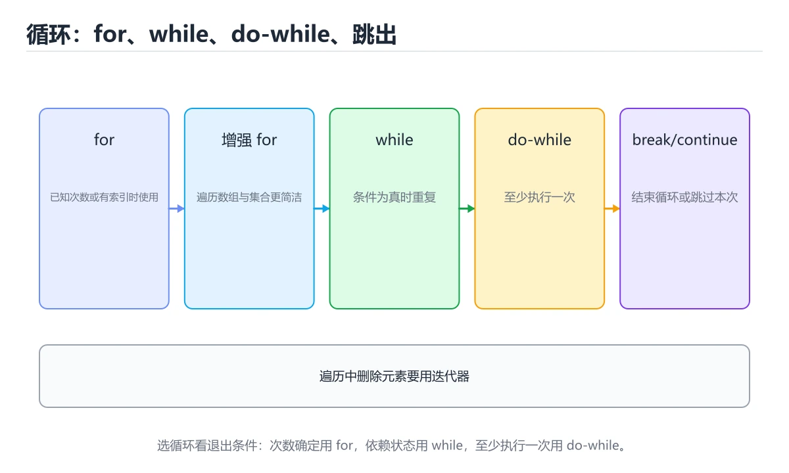
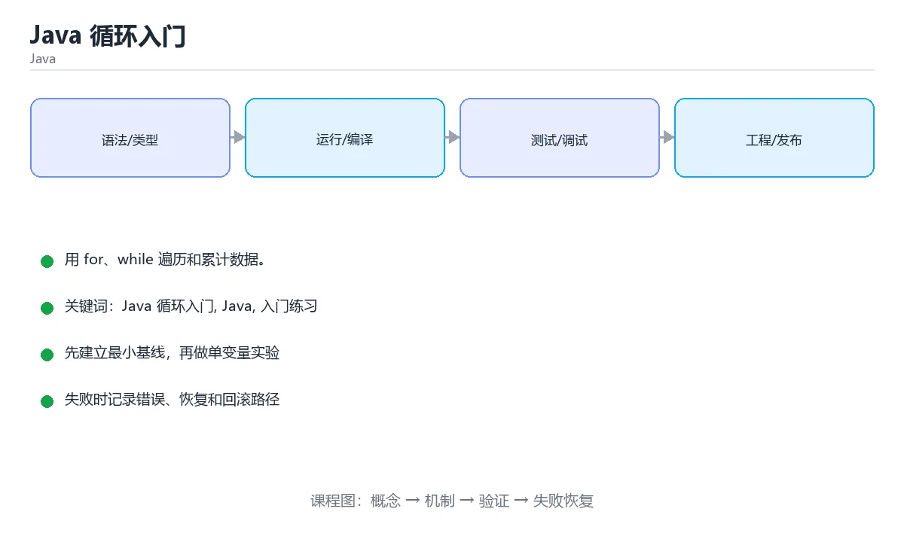

# Java 循环入门

> 内容更新时间：2026-10-06 · 学习阶段：入门 · 预计用时：25 分钟





## 本节知识框架

上一课你学会了让程序「做选择」——条件判断。但生活中很多事不是做一次就够的：跑操要跑 10 圈，背单词要把一本词典从头翻到尾，数钱要从第一张数到最后一张。这些重复性的操作，用**循环**来做最合适。

Java 提供了三种循环方式：`for` 循环适合「已知次数」的场景，`while` 循环适合「做到某个条件满足为止」的场景，`do-while` 循环则是「至少做一次再说」。本课重点掌握前两种。

**学完这一课，你会**：
- 熟练使用 `for` 循环遍历数字序列并做累加
- 用 `while` 循环处理「不确定次数，靠条件退出」的场景
- 知道增强 for 循环（for-each）怎么遍历数组和集合
- 避开「死循环」「循环里拼字符串」这些常见陷阱

**先修**：《Java 条件判断》。**后续**：《Java 方法入门》。

### 复习清单

- [ ] 能不看正文写出 `for (int i = 0; i < n; i++)` 的结构并说出每部分含义。
- [ ] 能解释 `while (true)` 循环为什么需要 `break` 退出。
- [ ] 能用增强 for 循环遍历一个 `int[]` 数组并求和。

## 核心概念定义

| 术语 | 一句话说明 |
| --- | --- |
| `for 循环` | 把初始化、条件、更新写在一行，适合次数确定的循环。 |
| `while 循环` | 条件为真就执行，适合次数取决于运行状态的循环。 |
| `增强 for 循环` | for (int value : array) 的简写，依次访问每个元素。 |
| `break` | 立即退出当前循环，跳到循环体后面。 |
| `continue` | 跳过本次循环剩余部分，进入下一次迭代。 |
| `StringBuilder` | 可变的字符序列，循环中拼接字符串应使用它。 |

## 原理与运行机制

### for 循环：三件事写在一行

`for` 循环把三件事压缩到一行里：

```java
for (int i = 1; i <= 5; i++) {
    // 循环体
}
```

执行顺序：初始化 → 判断条件 → 执行循环体 → 更新 → 再判断条件 → ...直到条件为 false。

最经典的用法——从 1 累加到 5：

```java
int total = 0;
for (int i = 1; i <= 5; i++) {
    total += i;
}
System.out.println("total=" + total);  // total=15
```

### while 循环：条件为真就一直做

```java
int count = 1;
while (count <= 5) {
    System.out.println("第 " + count + " 次");
    count++;
}
```

`while` 先判断条件，条件为 true 才执行循环体。如果一开始条件就是 false，循环体一次都不执行。

### 增强 for 循环（for-each）

遍历数组或集合时，如果不需要索引，用增强 for 最简洁：

```java
int[] numbers = {10, 20, 30, 40, 50};
int sum = 0;
for (int value : numbers) {
    sum += value;
}
System.out.println("总和：" + sum);  // 150
```

### break 和 continue

- `break`：立即退出整个循环
- `continue`：跳过本次循环的剩余部分，进入下一轮迭代

### while (true) 与死循环

`while (true)` 创建一个永远为真的循环，必须靠 `break` 退出。如果忘记写退出条件，程序会永远卡在这个循环里——这就是「死循环」。必须存在可到达的退出条件，否则线程会一直占用。

## 典型应用场景

### 场景一：累加求和

```java
public class Main {
    public static void main(String[] args) {
        int total = 0;
        for (int i = 1; i <= 5; i++) {
            total += i;
        }
        System.out.println("total=" + total);
    }
}
```

### 场景二：遍历数组求平均

```java
public class Main {
    public static void main(String[] args) {
        int[] scores = {85, 92, 78, 63, 95};
        int sum = 0;
        for (int score : scores) {
            sum += score;
        }
        double average = (double) sum / scores.length;
        System.out.printf("平均分：%.1f%n", average);
    }
}
```

### 场景三：用 while 找第一个满足条件的数

```java
public class Main {
    public static void main(String[] args) {
        int n = 1;
        while (n * n < 100) {
            n++;
        }
        System.out.println("第一个平方 >= 100 的数：" + n);
    }
}
```

## 代码/协议/SQL 示例

### 最小可验证示例

```java
public class Main {
    public static void main(String[] args) {
        int total = 0;
        for (int i = 1; i <= 5; i++) {
            total += i;
        }
        System.out.println("total=" + total);
    }
}
```

预期输出：

```text
total=15
```

### 循环中正确拼接字符串

```java
public class Main {
    public static void main(String[] args) {
        StringBuilder sb = new StringBuilder();
        for (int i = 1; i <= 5; i++) {
            if (i > 1) sb.append(", ");
            sb.append("item").append(i);
        }
        System.out.println(sb.toString());
    }
}
```

## 时间/空间复杂度或性能分析

循环是程序性能的关键区域：

- **时间复杂度**：一层 for 从 1 到 n 是 O(n)，两层嵌套是 O(n^2)。
- **字符串拼接陷阱**：在循环里用 `+` 拼接字符串，每次都会创建新的 String 对象。应该用 `StringBuilder`。
- **增强 for vs 普通 for**：遍历 `LinkedList` 时增强 for 是 O(n)，而用索引访问是 O(n^2)。

测量方法：固定输入跑一遍记录基线，再提高规模复测，两次结果的差值才是结论依据。

## 常见误区与易错点

| 容易写错的做法 | 实际现象 | 原因与正确做法 |
| --- | --- | --- |
| 循环里拼接字符串 | 产生大量临时对象。 | 改用 StringBuilder 并在循环外创建。 |
| 边遍历边删除集合元素 | 抛出并发修改异常。 | 用迭代器删除，或先收集再统一处理。 |
| 下标边界差一 | 越界异常或漏掉元素。 | 用增强 for，或写清区间开闭。 |

### 误区一：`for (int i = 0; i <= n; i++)` 多了一次

从 0 到 n（含），一共执行 n+1 次。如果本意是执行 n 次，条件应该是 `i < n`。

### 误区二：循环变量在循环外使用

for 循环变量 `i` 的作用域只在循环内，出了循环就不能再用。

### 误区三：在循环里修改集合

增强 for 循环中不能直接修改集合，需要用 `Iterator` 的 `remove` 方法或 `removeIf`。

## 与其他知识点的关系

- **先修**：《Java 条件判断》。本课默认你已经会用 if/else 做分支判断。
- **后续**：《Java 方法入门》会把循环逻辑封装到方法里复用。
- **术语衔接**：本课定义的 `for 循环`、`while 循环`、`增强 for 循环`、`break`、`continue`、`StringBuilder` 会在后续课程反复出现。

### 概念地图

```text
for 循环（初始化; 条件; 更新）
  └─ while 循环（条件为真就执行）
       └─ 增强 for 循环（遍历每个元素）
            └─ break（退出循环）
                 └─ continue（跳过本轮）
                      └─ StringBuilder（循环中拼接字符串的正确方式）
```

## 自测题与参考答案

### 自测 1

**问**：`for` 循环的三个部分分别是什么？

**答**：初始化（设置循环变量初值）、条件（判断是否继续循环）、更新（每轮结束后修改变量）。把初始化、条件、更新写在一行，适合次数确定的循环。

### 自测 2

**问**：增强 for 循环适合什么场景？

**答**：依次访问数组或集合中的每个元素。不需要索引、不需要修改元素时最方便。

### 自测 3

**问**：`while (true)` 循环有什么风险？

**答**：必须存在可到达的退出条件，否则线程会一直占用。忘记写 `break` 就会造成死循环。

### 自测 4

**问**：循环里拼接字符串为什么推荐用 `StringBuilder`？

**答**：String 不可变，每次 `+` 都会创建新对象。循环里拼接会产生大量临时对象。改用 StringBuilder 并在循环外创建，性能更好。

### 自测 5

**问**：`for (int i = 1; i <= 5; i++)` 循环体执行几次？

**答**：5 次。i 从 1 到 5，每轮 i 加 1，当 i 变成 6 时条件为 false，循环结束。

## 考点精讲

`Java 循环入门` 的题库有 5 道题，下面逐题给出题干、正确项与判断依据：先自己作答，再核对正确项，最后回到正文对应小节复核。

### 考点 1：第 1 题

- **题目**：下面这段 `java` 代码来自 `Java 循环入门`。课程主线是用 for、while 遍历和累计数据。代码与 `for 循环` 有关。哪一项是代码里真实出现的内容？
- **正确项**：出现字面量 `total=`
- **判断依据**：这道题落在术语 `for 循环` 上：把初始化、条件、更新写在一行，适合次数确定的循环。复习时把 `for 循环` 的定义、适用边界和一个反例一起说清楚，再回到「核心概念定义」核对原文。

### 考点 2：第 2 题

- **题目**：Java 的增强 for 循环 for (int value : numbers) 适合什么场景？
- **正确项**：依次访问数组或集合中的每个元素
- **判断依据**：这道题落在术语 `for 循环` 上：把初始化、条件、更新写在一行，适合次数确定的循环。复习时把 `for 循环` 的定义、适用边界和一个反例一起说清楚，再回到「核心概念定义」核对原文。

### 考点 3：第 3 题

- - **题目**：围绕“Java 循环入门”中的 Java 循环入门、Java、入门练习，下列哪两项是本课强调的实践判断？
- **正确项**：学习 Java 循环入门 时要同时说明输入、输出和失败路径，不能只看正常流程；验证 Java 时要固定版本并覆盖边界输入，结论才可复现
- **判断依据**：这道题检验本课主问题：用 for、while 遍历和累计数据。复习时先复述本课主问题，再举一个会让结论失效的输入。

### 考点 4：第 4 题

- **题目**：while (true) 循环中最需要注意的风险是？
- **正确项**：必须存在可到达的退出条件，否则线程会一直占用
- **判断依据**：这道题检验本课主问题：用 for、while 遍历和累计数据。复习时先复述本课主问题，再举一个会让结论失效的输入。

### 考点 5：第 5 题

- **题目**：填空：补齐下面这段术语说明中的空缺。课程 `用 for、while 遍历和累计数据。`，这段说明是：`____`：条件为真就执行，适合次数取决于运行状态的循环。空缺处应填哪个术语？
- **正确项**：while 循环
- **判断依据**：这道题落在术语 `while 循环` 上：条件为真就执行，适合次数取决于运行状态的循环。复习时把 `while 循环` 的定义、适用边界和一个反例一起说清楚，再回到「核心概念定义」核对原文。

## 术语速查

| 术语 | 一句话说明 |
| --- | --- |
| `for 循环` | 把初始化、条件、更新写在一行，适合次数确定的循环。 |
| `while 循环` | 条件为真就执行，适合次数取决于运行状态的循环。 |
| `增强 for 循环` | for (int value : array) 的简写，依次访问每个元素。 |
| `break` | 立即退出当前循环，跳到循环体后面。 |
| `continue` | 跳过本次循环剩余部分，进入下一次迭代。 |
| `StringBuilder` | 可变的字符序列，循环中拼接字符串应使用它。 |

## 参考资料与复核

- [本课资料锚点 java_loops](https://zh.wikipedia.org/w/index.php?search=java_loops)

- 最后复核：2026-10-04
- [Oracle Java Tutorials - For Loop](https://docs.oracle.com/javase/tutorial/java/nutsandbolts/for.html)
- 下次复核：2027-02-24
- 复核范围：版本兼容、API 行为、安全建议与工程实践

| 参考资料 | 本课用途 |
| --- | --- |
| [dev.java 学习](https://dev.java/learn/) | 现代 Java 官方教程 |
| [Java 集合框架教程](https://docs.oracle.com/javase/tutorial/collections/) | 集合遍历与迭代器 |
| [Java SE API](https://docs.oracle.com/en/java/javase/21/docs/api/) | StringBuilder 等标准库 API |

## 内容元数据

- 内容版本：v2.0
- 最后更新：2026-10-06
- 学习阶段：入门
- 适用环境：Java 21+ / Maven 或 Gradle；本课聚焦 Java 循环入门。
- 内容来源：内置结构化课程与工程实践整理
- 相关主题：Java 循环入门、Java、入门练习
