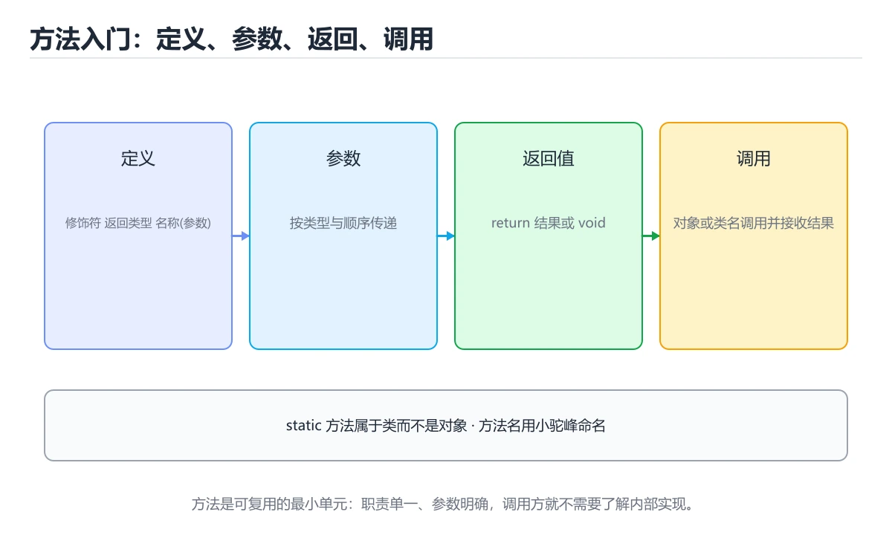
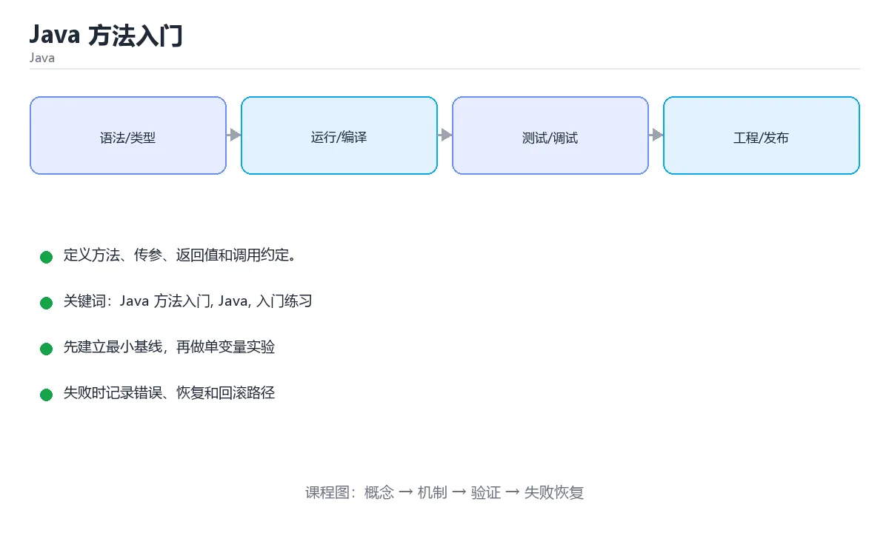

# Java 方法入门

> 内容更新时间：2026-10-06 · 学习阶段：基础 · 预计用时：25 分钟





## 本节知识框架

前几课你写了所有代码都挤在 `main` 方法里。但真实程序不可能把所有逻辑都塞在一个方法里——就像一家餐厅不可能让一个服务员同时当厨师、收银员、清洁工。你需要把不同的任务拆给不同的「工人」，在 Java 里这些工人就是**方法**。

方法是把一段逻辑打包起来，取个名字，需要的时候就调用它。方法可以接收参数（输入），也可以返回结果（输出）。这就像一台榨汁机：你塞进去水果（参数），它给你一杯果汁（返回值）。

**学完这一课，你会**：
- 知道怎么定义一个方法、传参数、拿返回值
- 理解 Java 的参数传递方式（一律按值传递）
- 避开「重载方法签名过于相似」「void 方法用 return 提前退出」这些常见陷阱

**先修**：《Java 循环入门》。**后续**：后续课程会大量使用方法。

### 复习清单

- [ ] 能不看正文写出 `static int add(int a, int b) { return a + b; }` 的方法定义。
- [ ] 能解释 Java 的参数传递是「按值传递」还是「按引用传递」。
- [ ] 能说出 `void` 方法中 `return;` 的作用。

## 核心概念定义

| 术语 | 一句话说明 |
| --- | --- |
| `方法签名` | 方法名加参数列表共同构成签名，是重载区分的依据。 |
| `参数与返回值` | 参数是输入，return 把结果交回调用方，类型必须匹配。 |
| `void` | 表示方法不返回任何值。 |
| `方法重载` | 同一个类里同名方法通过参数列表不同来区分。 |
| `访问修饰符` | public 对外可见，private 只在本类内可见，用来约束调用范围。 |
| `JVM` | Java 源码编译成平台无关的字节码，JVM 负责加载、验证、解释和即时编译。 |

## 原理与运行机制

### 方法就像一台机器

方法接收输入（参数），执行一段逻辑，交出结果（返回值）。

```java
static int square(int n) {
    return n * n;
}
```

- `static`：属于类本身，不需要创建对象就能调用
- `int`：返回值类型
- `square`：方法名
- `(int n)`：参数列表，n 是形参
- `return n * n;`：计算结果并返回

调用时传入实参：`square(7)` 返回 49。

### 参数传递：一律按值

Java 的参数传递永远是对值的拷贝：

- **基本类型**：拷贝值本身。方法里改参数不影响调用方的变量。
- **对象引用**：拷贝的是引用的副本。方法里可以通过引用修改对象内容，但不能让调用方的引用指向新对象。

```java
static void tryChange(int x) {
    x = 100;  // 只改了副本，调用方的变量不受影响
}

static void modifyArray(int[] arr) {
    arr[0] = 999;  // 通过引用副本修改了同一个对象的内容
}
```

### void 方法：不需要返回值

有些方法只是执行一个动作，不需要返回结果。用 `void` 声明：

```java
static void greet(String name) {
    System.out.println("你好，" + name + "！");
}
```

void 方法里也可以用 `return;` 提前退出——它不返回任何值，只是立即结束方法执行，把控制权交回调用方。

### 方法重载

同一个类里可以有多个同名方法，只要参数列表不同：

```java
static int add(int a, int b) { return a + b; }
static double add(double a, double b) { return a + b; }
static int add(int a, int b, int c) { return a + b + c; }
```

方法签名 = 方法名 + 参数列表。返回类型不参与签名区分——只改返回类型不算重载，算重复定义。

### 访问修饰符

- `public`：任何地方都能调用
- `private`：只有本类内部能调用
- 不写（包级私有）：同一个包内能调用

封装的核心思想：对外暴露尽量少的接口，把实现细节藏起来。

## 典型应用场景

### 场景一：定义并调用一个简单方法

```java
public class Main {
    static int square(int n) {
        return n * n;
    }

    public static void main(String[] args) {
        System.out.println("square(7)=" + square(7));
    }
}
```

### 场景二：带多个参数的方法

```java
public class Main {
    static double average(double a, double b, double c) {
        return (a + b + c) / 3;
    }

    public static void main(String[] args) {
        System.out.printf("平均分：%.1f%n", average(85, 92, 78));
    }
}
```

### 场景三：void 方法提前退出

```java
public class Main {
    static void printPositive(int n) {
        if (n <= 0) {
            return;  // 立即退出，不打印
        }
        System.out.println("正数：" + n);
    }

    public static void main(String[] args) {
        printPositive(5);   // 输出：正数：5
        printPositive(-3);  // 什么都不输出
    }
}
```

## 代码/协议/SQL 示例

### 最小可验证示例

```java
public class Main {
    static int square(int n) {
        return n * n;
    }

    public static void main(String[] args) {
        System.out.println("square(7)=" + square(7));
    }
}
```

预期输出：

```text
square(7)=49
```

### 方法重载示例

```java
public class Main {
    static String describe(int n) {
        return "整数：" + n;
    }

    static String describe(String s) {
        return "字符串：" + s;
    }

    public static void main(String[] args) {
        System.out.println(describe(42));
        System.out.println(describe("hello"));
    }
}
```

## 时间/空间复杂度或性能分析

方法调用本身的开销非常小——只是压栈、跳转、出栈。但有几个值得注意的点：

- **递归深度**：每次递归调用都会在栈上分配一帧。递归太深会导致 `StackOverflowError`。一般几千层就会出问题。
- **方法内创建对象**：如果方法每次调用都创建大量临时对象，GC 压力会增大。
- **JIT 内联**：JVM 会自动把短小的方法内联到调用处，消除调用开销。所以不用刻意为了避免调用开销而把代码写在一起。

测量方法：固定输入跑一遍记录基线，再提高规模复测，两次结果的差值才是结论依据。

## 常见误区与易错点

| 容易写错的做法 | 实际现象 | 原因与正确做法 |
| --- | --- | --- |
| 重载方法签名过于相似 | 调用被解析到意外的方法。 | 控制重载数量，让参数差异足够明确。 |
| 修改传入的可变对象 | 调用方状态被意外改变。 | 需要只读语义时复制或使用不可变对象。 |
| 一个方法承担多项职责 | 难测试也难复用。 | 按单一职责拆分方法。 |

### 误区一：把方法写在 main 里面

Java 不支持嵌套方法定义。所有方法都必须写在类里面、其他方法外面。

### 误区二：以为方法能修改基本类型参数

传进去的是值的副本，改副本不影响调用方的变量。

### 误区三：重载只看返回类型

重载必须参数列表不同。只改返回类型编译器会报重复定义错误。

## 与其他知识点的关系

- **先修**：《Java 循环入门》。本课默认你已经会用 for、while 循环。
- **后续**：后续所有课程都会大量使用方法。
- **术语衔接**：本课定义的 `方法签名`、`参数与返回值`、`void`、`方法重载`、`访问修饰符` 会在后续课程反复出现。

### 概念地图

```text
方法签名（方法名 + 参数列表）
  └─ 参数与返回值（输入 → return → 输出）
       └─ void（不返回值）
            └─ 方法重载（同名不同参）
                 └─ 访问修饰符（控制可见范围）
```

## 自测题与参考答案

### 自测 1

**问**：方法签名由什么组成？

**答**：方法名加参数列表共同构成签名，是重载区分的依据。返回类型不是签名的一部分。

### 自测 2

**问**：Java 方法的参数传递方式是？

**答**：一律按值传递，对象传递的是引用的副本。基本类型传值的副本，对象传引用的副本。

### 自测 3

**问**：`void` 方法中 `return;` 的作用是什么？

**答**：立即结束方法执行，把控制权交回调用方。不返回任何值。

### 自测 4

**问**：为什么不能只靠返回类型来区分重载方法？

**答**：因为方法签名只包含方法名和参数列表。编译器在调用时根据实参类型选择方法，返回类型不参与选择。

### 自测 5

**问**：`static` 方法有什么限制？

**答**：static 方法不能直接访问实例字段和实例方法，因为它不依赖于任何对象实例。

## 考点精讲

`Java 方法入门` 的题库有 5 道题，下面逐题给出题干、正确项与判断依据：先自己作答，再核对正确项，最后回到正文对应小节复核。

### 考点 1：第 1 题

- **题目**：这段 `java` 代码对应 `Java 方法入门` 的 `方法签名`。课程要解决的是定义方法、传参、返回值和调用约定。关于代码内容，哪一项说法准确？
- **正确项**：出现字面量 `square(7)=`
- **判断依据**：这道题落在术语 `方法签名` 上：方法名加参数列表共同构成签名，是重载区分的依据。复习时把 `方法签名` 的定义、适用边界和一个反例一起说清楚，再回到「核心概念定义」核对原文。

### 考点 2：第 2 题

- **题目**：Java 方法的参数传递方式是？
- **正确项**：一律按值传递，对象传递的是引用的副本
- **判断依据**：这道题检验本课主问题：定义方法、传参、返回值和调用约定。复习时先复述本课主问题，再举一个会让结论失效的输入。

### 考点 3：第 3 题

- - **题目**：围绕“Java 方法入门”中的 Java 方法入门、Java、入门练习，下列哪两项是本课强调的实践判断？
- **正确项**：学习 Java 方法入门 时要同时说明输入、输出和失败路径，不能只看正常流程；验证 Java 时要固定版本并覆盖边界输入，结论才可复现
- **判断依据**：这道题检验本课主问题：定义方法、传参、返回值和调用约定。复习时先复述本课主问题，再举一个会让结论失效的输入。

### 考点 4：第 4 题

- **题目**：void 方法中使用 return; 语句的含义是？
- **正确项**：立即结束方法执行，把控制权交回调用方
- **判断依据**：这道题落在术语 `void` 上：表示方法不返回任何值。复习时把 `void` 的定义、适用边界和一个反例一起说清楚，再回到「核心概念定义」核对原文。

### 考点 5：第 5 题

- **题目**：填空：补齐下面这段术语说明中的空缺。课程 `定义方法、传参、返回值和调用约定。`，这段说明是：`____`：参数是输入，return 把结果交回调用方，类型必须匹配。空缺处应填哪个术语？
- **正确项**：参数与返回值
- **判断依据**：这道题落在术语 `参数与返回值` 上：参数是输入，return 把结果交回调用方，类型必须匹配。复习时把 `参数与返回值` 的定义、适用边界和一个反例一起说清楚，再回到「核心概念定义」核对原文。

## 术语速查

| 术语 | 一句话说明 |
| --- | --- |
| `方法签名` | 方法名加参数列表共同构成签名，是重载区分的依据。 |
| `参数与返回值` | 参数是输入，return 把结果交回调用方，类型必须匹配。 |
| `void` | 表示方法不返回任何值。 |
| `方法重载` | 同一个类里同名方法通过参数列表不同来区分。 |
| `访问修饰符` | public 对外可见，private 只在本类内可见，用来约束调用范围。 |
| `JVM` | Java 源码编译成平台无关的字节码，JVM 负责加载、验证、解释和即时编译。 |

## 参考资料与复核

- [本课资料锚点 java_methods_intro](https://zh.wikipedia.org/w/index.php?search=java_methods_intro)

- 最后复核：2026-10-04
- [Oracle Java Tutorials - Methods](https://docs.oracle.com/javase/tutorial/java/javaOO/methods.html)
- 下次复核：2027-02-24
- 复核范围：版本兼容、API 行为、安全建议与工程实践

| 参考资料 | 本课用途 |
| --- | --- |
| [dev.java 学习](https://dev.java/learn/) | 现代 Java 官方教程 |
| [Java SE API](https://docs.oracle.com/en/java/javase/21/docs/api/) | 标准库 API 查阅 |
| [Java 语言规范](https://docs.oracle.com/javase/specs/jls/se21/html/index.html) | 方法签名与重载规则 |

## 内容元数据

- 内容版本：v2.0
- 最后更新：2026-10-06
- 学习阶段：基础
- 适用环境：Java 21+ / Maven 或 Gradle；本课聚焦 Java 方法入门。
- 内容来源：内置结构化课程与工程实践整理
- 相关主题：Java 方法入门、Java、入门练习
