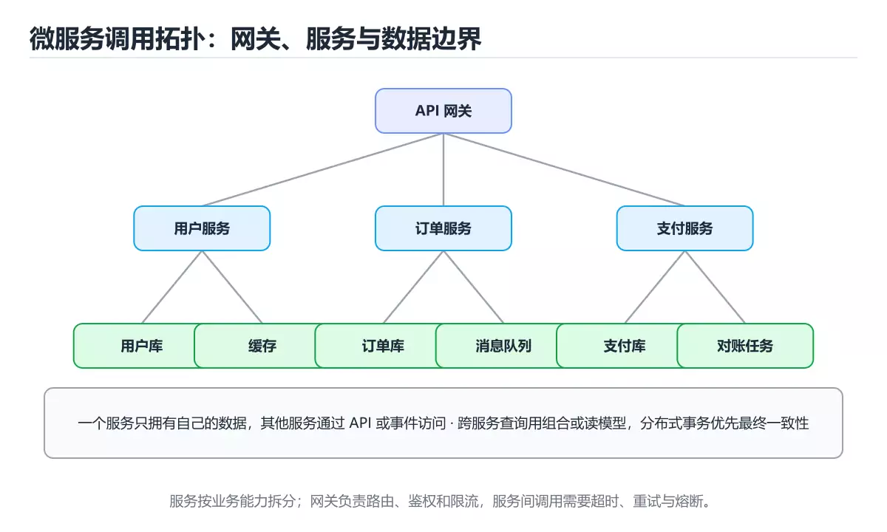

# 微服务架构设计

> 内容更新时间：2026-10-20 · 学习阶段：高级 · 预计用时：65 分钟



## 本节知识框架

想象你经营一家大型连锁餐厅。最初只有一家小店，一个厨师包揽所有菜——点菜、切菜、炒菜、端盘全是他一个人。这就像**单体应用**：所有功能写在一个程序里。随着生意越来越好，顾客排起了长队，厨师忙不过来了。怎么办？你决定把餐厅拆分成多个专门档口：凉菜档、热菜档、面点档、饮品档，每个档口独立运作，互相配合。这就是**微服务**的核心思想——把一个大系统拆成多个小服务，各自独立部署、独立扩展。

但拆分之后又面临新问题：档口之间怎么沟通？谁来统一接待顾客？某个档口临时关门了怎么办？Spring Cloud 就像一套"餐厅管理系统"，帮你解决服务注册、配置管理、流量路由、故障隔离等一系列问题。

**本课知识地图**

```text
微服务是什么 → 服务注册与发现 → 配置中心 → API 网关 → 负载均衡 → 熔断器 → 链路追踪 → 服务间通信 → 完整实战
```

**学完本课你将能够**：

1. 解释微服务架构的核心概念，以及它和单体架构的区别。
2. 理解 Spring Cloud 各组件（Eureka/Nacos、Config、Gateway、Ribbon、Hystrix/Sentinel、Sleuth/Zipkin、Feign）的作用。
3. 搭建一个包含服务注册中心、配置中心、API 网关和两个微服务的完整系统。
4. 分析微服务架构的优缺点，在实际项目中做出合理的技术选型。

**先修知识**：你需要了解 Java 基础与面向对象（来自《Java 基础》）、Servlet 基本概念（来自《Servlet 与 JSP 基础》）、以及 Spring IoC 和 AOP 的使用（来自《Spring Framework 核心》）。建议同时了解 Spring Boot 的基本使用。

**复习清单**

- [ ] 回顾单体架构与微服务架构的区别，能用自己的话解释为什么要拆分服务
- [ ] 默写 Spring Cloud 八大组件的名称和各自职责
- [ ] 动手跑通本课的完整代码示例，观察服务注册与调用的全过程
- [ ] 总结熔断器的三种状态（关闭、打开、半开），并画出状态转换图

---

## 核心概念定义

| 术语 | 一句话定义 | 生活类比 |
| --- | --- | --- |
| 微服务（Microservice） | 将一个大型应用拆分为一组小型、独立部署的服务，每个服务负责一个业务功能。 | 连锁餐厅把"一个厨师做所有菜"改成"凉菜档、热菜档、面点档"各司其职。 |
| 服务注册与发现（Eureka / Nacos） | 每个服务启动时把自己的地址登记到注册中心，调用其他服务时从注册中心查询地址。 | 餐厅各档口把"我在几号窗口"告诉前台，顾客点菜时前台帮忙找到对应档口。 |
| 配置中心（Spring Cloud Config） | 集中管理所有微服务的配置文件，修改配置不需要重新部署服务。 | 餐厅总部统一更新菜单价格和配方，各分店同步收到最新版本，不用一家一家跑。 |
| API 网关（Spring Cloud Gateway） | 所有外部请求的统一入口，负责路由转发、鉴权、限流等。 | 餐厅的总前台——顾客不用自己去找档口，所有点单都经过前台，前台再分配到各档口。 |
| 负载均衡（Ribbon / LoadBalancer） | 当同一个服务有多个实例时，负载均衡器决定把请求发给哪个实例。 | 餐厅有 3 个热菜档口，前台轮流把订单分给它们，避免某个档口排长队。 |
| 熔断器（Hystrix / Sentinel） | 当某个下游服务出现故障或响应过慢时，自动"断开"调用，防止故障蔓延。 | 如果面点档口排了 50 个人的队，前台就暂时不再往那边派单，先告诉顾客"面点暂时售罄"。 |
| 链路追踪（Sleuth / Zipkin） | 记录一个请求在多个微服务之间的完整调用链路，方便排查问题。 | 给每个订单装一个 GPS 追踪器，能看到它经过了哪些档口、每个环节花了多久。 |
| 服务间通信（Feign / RestTemplate） | 微服务之间通过 HTTP 调用彼此的接口，Feign 让调用像调用本地方法一样简单。 | 凉菜档需要热菜档帮忙加热，不用自己跑过去，打个电话（HTTP 请求）就行。 |

---

## 原理与运行机制

### 微服务架构是怎么运作的？

在单体架构中，所有功能（用户管理、订单处理、商品展示）都打包在一个 WAR 包里，部署在一台服务器上。一旦某个功能出 bug，整个应用都要重启。

微服务架构把系统拆成多个独立的服务：

```text
┌─────────────────────────────────────────────────┐
│                  API 网关（Gateway）              │
│            统一入口 · 路由 · 鉴权 · 限流           │
└──────┬──────────┬──────────┬──────────┬─────────┘
       │          │          │          │
  ┌────▼───┐ ┌───▼────┐ ┌──▼───┐ ┌───▼────┐
  │用户服务 │ │订单服务 │ │商品服务│ │支付服务 │
  │ :8081  │ │ :8082  │ │:8083 │ │ :8084  │
  └────┬───┘ └───┬────┘ └──┬───┘ └───┬────┘
       │         │         │         │
       └─────────┴────┬────┴─────────┘
                 ┌────▼────┐
                 │ 注册中心 │
                 │ (Nacos) │
                 └─────────┘
```

每个服务：
- **独立开发**：每个团队负责自己的服务，使用自己合适的技术栈
- **独立部署**：修改一个服务只需要重新部署那一个服务
- **独立扩展**：哪个服务压力大就扩展哪个，不用整体扩容
- **独立数据库**：每个服务有自己的数据库，避免数据耦合

### 服务注册与发现的流程

服务注册与发现是微服务的"通讯录"。没有它，服务之间找不到对方。

**流程如下**：

1. **服务启动**时，向注册中心发送自己的信息（服务名、IP、端口）
2. **注册中心**把这个信息保存下来
3. **服务消费者**从注册中心查询目标服务的地址列表
4. **负载均衡器**从地址列表中选择一个实例，发起调用
5. **注册中心**定期检查服务是否存活（心跳机制），剔除掉线的服务

```text
时间线：
  t0  订单服务启动 → 向 Nacos 注册：我是 order-service，地址 192.168.1.10:8082
  t1  用户服务启动 → 向 Nacos 注册：我是 user-service，地址 192.168.1.11:8081
  t2  订单服务需要调用用户服务 → 从 Nacos 查询 user-service 的地址
  t3  Nacos 返回 [192.168.1.11:8081] → 订单服务发起 HTTP 调用
  t4  用户服务宕机 → Nacos 心跳检测失败 → 从列表中移除
```

### 熔断器的工作原理

熔断器的名字来自电路中的保险丝——当电流过大时，保险丝熔断，保护后面的电路。微服务中的熔断器也一样：当某个下游服务频繁超时或报错，熔断器自动"跳闸"，不再继续调用，而是直接返回一个降级响应。

熔断器有三种状态：

```text
         失败率超阈值
  ┌──────────┐  ──────────►  ┌──────────┐
  │  关闭    │               │  打开    │
  │ CLOSED   │               │  OPEN    │
  └──────────┘  ◄──────────  └──────────┘
         ▲           超时后           │
         │        ┌──────────┐       │ 尝试调用
         │        │  半开    │       │ 成功
         └────────│ HALF-OPEN│◄──────┘
                  └──────────┘
                       │ 尝试调用
                       │ 失败
                       ▼
                  回到 OPEN
```

- **CLOSED（关闭）**：正常状态，请求正常通过。熔断器在背后默默统计失败次数。
- **OPEN（打开）**：失败率超过阈值（比如 50%），熔断器跳闸。后续请求直接走降级逻辑，不再调用下游服务。
- **HALF-OPEN（半开）**：等待一段时间后，熔断器放少量请求去试探。如果成功了，恢复到 CLOSED；如果还是失败，回到 OPEN。

### API 网关的作用

API 网关是微服务系统的"大门"。所有来自外部的请求都先经过网关，网关负责：

- **路由**：根据 URL 路径把请求转发到对应的服务。比如 `/api/users/**` 转发给用户服务，`/api/orders/**` 转发给订单服务。
- **鉴权**：在网关层统一校验 Token，不需要每个服务自己实现鉴权逻辑。
- **限流**：控制每秒请求数，防止系统被打垮。
- **跨域处理**：统一处理 CORS，简化各服务的配置。

---

## 典型应用场景

- **电商平台**：用户服务、商品服务、订单服务、支付服务、物流服务各自独立。大促时可以单独扩展订单服务和支付服务。
- **在线教育**：课程服务、直播服务、作业服务、消息通知服务分开部署。直播服务在上课高峰期单独扩容。
- **金融系统**：账户服务、交易服务、风控服务、报表服务。风控服务需要高可用，可以部署多个实例。
- **物流追踪**：订单服务、仓储服务、运输服务、配送服务。每个服务由不同团队维护，独立迭代。
- **社交网络**：动态服务、消息服务、推荐服务、搜索服务。推荐服务计算量大，可以使用 GPU 服务器独立部署。

---

## 代码/协议/SQL 示例

下面搭建一个完整的微服务系统，包含 5 个部分：服务注册中心、配置中心、API 网关、用户服务、订单服务。

### 第一步：服务注册中心（Eureka Server）

注册中心就像餐厅的前台——所有档口都在这里登记自己的位置。

**pom.xml**

```xml
<dependencies>
    <dependency>
        <groupId>org.springframework.cloud</groupId>
        <artifactId>spring-cloud-starter-netflix-eureka-server</artifactId>
    </dependency>
</dependencies>
```

**EurekaServerApplication.java**

```java
@SpringBootApplication
@EnableEurekaServer  // 标记为注册中心
public class EurekaServerApplication {
    public static void main(String[] args) {
        SpringApplication.run(EurekaServerApplication.class, args);
    }
}
```

**application.yml**

```yaml
server:
  port: 8761  # 注册中心默认端口

eureka:
  client:
    register-with-eureka: false  # 自己不注册自己
    fetch-registry: false        # 不需要拉取注册表
  server:
    enable-self-preservation: false  # 开发环境关闭自我保护
```

### 第二步：配置中心（Spring Cloud Config Server）

配置中心就像餐厅总部的"配方管理系统"，所有分店从这里获取最新配方。

**ConfigServerApplication.java**

```java
@SpringBootApplication
@EnableConfigServer  // 标记为配置中心
public class ConfigServerApplication {
    public static void main(String[] args) {
        SpringApplication.run(ConfigServerApplication.class, args);
    }
}
```

**application.yml**

```yaml
server:
  port: 8888

spring:
  cloud:
    config:
      server:
        git:
          uri: https://github.com/your-org/config-repo  # 配置文件存放在 Git 仓库
          default-label: main
```

### 第三步：API 网关（Spring Cloud Gateway）

网关就像餐厅总前台，所有顾客都从这里进入。

**GatewayApplication.java**

```java
@SpringBootApplication
@EnableDiscoveryClient
public class GatewayApplication {
    public static void main(String[] args) {
        SpringApplication.run(GatewayApplication.class, args);
    }
}
```

**application.yml**

```yaml
server:
  port: 9000

spring:
  application:
    name: api-gateway
  cloud:
    gateway:
      routes:
        - id: user-service
          uri: lb://user-service     # lb:// 表示使用负载均衡
          predicates:
            - Path=/api/users/**     # 匹配 /api/users/ 开头的请求
        - id: order-service
          uri: lb://order-service
          predicates:
            - Path=/api/orders/**

eureka:
  client:
    service-url:
      defaultZone: http://localhost:8761/eureka/
```

### 第四步：用户服务（User Service）

用户服务就像一个独立的"用户信息档口"。

**UserServiceApplication.java**

```java
@SpringBootApplication
@EnableDiscoveryClient
@RestController
public class UserServiceApplication {

    @GetMapping("/api/users/{id}")
    public User getUser(@PathVariable Long id) {
        // 模拟从数据库查询
        return new User(id, "张三", "zhangsan@example.com");
    }

    public static void main(String[] args) {
        SpringApplication.run(UserServiceApplication.class, args);
    }
}
```

**User.java**

```java
public class User {
    private Long id;
    private String name;
    private String email;

    public User(Long id, String name, String email) {
        this.id = id;
        this.name = name;
        this.email = email;
    }
    // getter、setter 省略
}
```

**application.yml**

```yaml
server:
  port: 8081

spring:
  application:
    name: user-service  # 服务名，注册中心用这个名字找到我们

eureka:
  client:
    service-url:
      defaultZone: http://localhost:8761/eureka/
```

### 第五步：订单服务（Order Service）—— 使用 Feign 调用用户服务

订单服务需要查询用户信息，但不直接知道用户服务的地址。它通过 Feign 像调用本地方法一样调用远程服务。

**OrderServiceApplication.java**

```java
@SpringBootApplication
@EnableDiscoveryClient
@EnableFeignClients  // 启用 Feign 远程调用
@RestController
public class OrderServiceApplication {

    @Autowired
    private UserClient userClient;  // Feign 客户端

    @GetMapping("/api/orders/{orderId}")
    public OrderDetail getOrder(@PathVariable Long orderId) {
        // 模拟查询订单
        Order order = new Order(orderId, 1L, "iPhone 16", 5999.0);
        // 通过 Feign 调用用户服务获取用户信息
        User user = userClient.getUser(order.getUserId());
        return new OrderDetail(order, user);
    }

    public static void main(String[] args) {
        SpringApplication.run(OrderServiceApplication.class, args);
    }
}
```

**UserClient.java —— Feign 接口定义**

```java
@FeignClient(name = "user-service")  // 指定要调用的服务名
public interface UserClient {

    @GetMapping("/api/users/{id}")
    User getUser(@PathVariable("id") Long id);
}
```

**application.yml**

```yaml
server:
  port: 8082

spring:
  application:
    name: order-service

eureka:
  client:
    service-url:
      defaultZone: http://localhost:8761/eureka/
  instance:
    prefer-ip-address: true  # 注册时使用 IP 地址
```

### 调用流程总结

```text
用户请求 → http://localhost:9000/api/orders/1
    ↓
API 网关（9000端口）→ 匹配 /api/orders/** → 路由到 order-service
    ↓
订单服务（8082端口）→ 需要用户信息 → 通过 Feign 调用 user-service
    ↓
Feign → 从 Eureka 查询 user-service 地址 → [192.168.1.11:8081]
    ↓
用户服务（8081端口）→ 返回用户信息
    ↓
订单服务 → 组装 OrderDetail → 返回给网关 → 返回给用户
```

---

## 时间/空间复杂度或性能分析

| 维度 | 分析 | 说明 |
| --- | --- | --- |
| 网络延迟 | 每次服务间调用增加 1-5ms 延迟 | 单体应用内部方法调用是纳秒级，微服务是 HTTP 调用，至少毫秒级 |
| 注册中心开销 | 心跳检测每 30 秒一次 | 服务数量多时注册中心压力大，可用 Nacos 集群分担 |
| 网关延迟 | 增加约 2-10ms | 网关做路由、鉴权、限流都需要时间 |
| 内存占用 | 每个服务独立 JVM，内存翻倍 | 10 个服务 × 512MB = 5GB，而单体可能只要 1GB |
| 启动时间 | 每个服务独立启动，总启动时间长 | 可用 Docker 并行启动缓解 |
| 运维复杂度 | 需要容器编排、日志聚合、监控告警 | 通常搭配 Kubernetes、ELK、Prometheus 使用 |

**关键结论**：微服务用"运维复杂度"换取"开发灵活度"。团队小于 10 人、业务不复杂时，单体架构可能更合适。

---

## 常见误区与易错点

| 错误 | 现象 | 正确做法 |
| --- | --- | --- |
| 过度拆分微服务 | 服务数量爆炸，一个简单功能要调用 5、6 个服务 | 先按业务域粗粒度拆分，后续根据需要再细化 |
| 微服务之间共享数据库 | 数据一致性难保证，失去了微服务的意义 | 每个服务拥有自己的数据库，通过 API 或事件通信 |
| 忽略熔断和降级 | 一个服务挂掉导致整个系统雪崩 | 所有远程调用都要配置熔断器和降级逻辑 |
| 服务间使用同步调用链太长 | A→B→C→D→E，延迟叠加，任何一环超时都失败 | 长链路考虑改为异步消息（如 RabbitMQ、Kafka） |
| 注册中心单点部署 | 注册中心挂了所有服务互相找不到 | 生产环境注册中心必须集群部署（至少 3 节点） |
| 网关不做限流 | 突发流量打垮后端所有服务 | 在网关层配置限流规则，如每秒最多 1000 个请求 |
| 忘记配置负载均衡 | 请求总是打到同一个实例 | 确保使用 `lb://` 协议或集成 Ribbon/LoadBalancer |
| 链路追踪没接入 | 出了问题不知道在哪个服务、哪个环节 | 开发初期就接入 Sleuth + Zipkin，别等上线后补 |

---

## 与其他知识点的关系

- **先修**：《Java 基础》、《Servlet 与 JSP 基础》、《Spring Framework 核心》
- **相关**：《Spring Boot 入门》（微服务基于 Spring Boot 构建）、《RESTful API 设计》（服务间接口规范）
- **后续**：《Docker 与容器化》（微服务部署）、《Kubernetes 编排》（服务编排与扩缩容）、《消息队列》（异步通信）
- **对比**：单体架构 vs 微服务架构、Spring Cloud vs Dubbo（国内常用 RPC 框架）

---

## 自测题与参考答案

**Q1**：在微服务架构中，当一个服务需要调用另一个服务时，它是怎样知道对方地址的？

<details>
<summary>点击查看答案</summary>

服务消费者从**服务注册中心**（如 Eureka、Nacos）查询目标服务的地址列表。服务提供者在启动时把自己的 IP 和端口注册到注册中心，注册中心维护一份"服务名 → 地址列表"的映射表。消费者通过服务名查询，拿到地址后再发起 HTTP 调用。如果提供者有多个实例，负载均衡器会从中选择一个。
</details>

**Q2**：熔断器（Circuit Breaker）的三种状态分别是什么？在什么情况下会从 CLOSED 变成 OPEN？

<details>
<summary>点击查看答案</summary>

三种状态：**CLOSED（关闭）**——正常放行请求；**OPEN（打开）**——直接拒绝请求，走降级逻辑；**HALF-OPEN（半开）**——放少量请求试探下游是否恢复。当下游服务的失败率超过设定阈值（例如 50%），熔断器从 CLOSED 变为 OPEN，防止故障蔓延。等待一段超时时间后进入 HALF-OPEN 状态，如果试探请求成功则恢复为 CLOSED，否则回到 OPEN。
</details>

**Q3**：API 网关在微服务架构中承担哪些职责？为什么说它是"统一入口"？

<details>
<summary>点击查看答案</summary>

API 网关是所有外部请求进入微服务系统的唯一入口，承担以下职责：**路由转发**（根据 URL 路径将请求分发到对应服务）、**身份鉴权**（统一校验 Token）、**限流**（控制请求速率防止系统过载）、**跨域处理**（统一配置 CORS）。之所以叫"统一入口"，是因为客户端不需要知道后端有多少个服务、各自的地址是什么，只需要访问网关地址，由网关负责内部分发。
</details>

---

## 考点精讲

### 问题1

在微服务架构中，当一个服务需要调用另一个服务时，它是怎样知道对方地址的？

A. 直接硬编码目标服务的 IP 地址和端口号
B. 通过服务注册中心（如 Nacos、Eureka）查询目标服务的地址列表，再由负载均衡器选择一个实例发起调用
C. 通过 API 网关转发所有请求，不需要知道目标服务地址
D. 通过配置文件静态指定所有服务的地址

**正确答案：B**

**详细解释：** 微服务架构中，每个服务启动时会把自己的服务名、IP 和端口注册到服务注册中心（如 Nacos 或 Eureka），并定期发送心跳保持注册信息有效。当服务消费者需要调用另一个服务时，它通过服务名向注册中心查询该服务的可用地址列表，然后由负载均衡器（如 Ribbon 或 LoadBalancer）从列表中选择一个实例发起 HTTP 调用。注册中心还会通过心跳机制检测服务是否存活，自动剔除掉线的服务实例。

---

### 问题2

熔断器（Circuit Breaker）的三种状态分别是什么？在什么情况下会从 CLOSED 变为 OPEN？

A. RUNNING、STOPPED、PAUSED；当 CPU 使用率超过阈值时从 RUNNING 变为 STOPPED
B. CLOSED、OPEN、HALF-OPEN；当下游服务的失败率超过设定阈值时从 CLOSED 变为 OPEN
C. ACTIVE、INACTIVE、STANDBY；当网络延迟超过阈值时从 ACTIVE 变为 INACTIVE
D. ENABLED、DISABLED、DEGRADED；当请求量超过限流阈值时从 ENABLED 变为 DEGRADED

**正确答案：B**

**详细解释：** 熔断器有三种状态：CLOSED（关闭）——正常状态，请求正常通过，熔断器在背后统计失败次数；OPEN（打开）——当下游服务的失败率超过设定阈值（如 50%），熔断器跳闸，后续请求直接走降级逻辑，不再调用下游服务，防止故障蔓延；HALF-OPEN（半开）——等待一段超时时间后，熔断器放少量请求去试探下游是否恢复，如果成功则恢复到 CLOSED，如果仍然失败则回到 OPEN。这种机制类似于电路中的保险丝，能有效防止微服务架构中的级联故障和系统雪崩。

---

### 问题3

API 网关在微服务架构中承担的核心职责是什么？

A. 只负责将请求转发到后端服务，不做任何其他处理  
B. 负责微服务之间的数据库共享和分布式事务管理  
C. 替代注册中心进行服务发现和地址管理  
D. 作为所有外部请求的统一入口，负责路由转发、身份鉴权、限流和跨域处理  

**正确答案：D**

**详细解释：** API 网关（如 Spring Cloud Gateway）是微服务系统的\u201c大门\u201d，所有来自外部的请求都先经过网关。它承担四大核心职责：路由转发——根据 URL 路径将请求分发到对应的后端服务；身份鉴权——在网关层统一校验 Token，无需每个服务单独实现鉴权逻辑；限流——控制每秒请求数，防止突发流量打垮后端服务；跨域处理——统一配置 CORS 策略。客户端不需要知道后端有多少个服务以及各自的地址，只需访问网关地址即可。

---

### 问题4

在微服务架构中，Feign 的主要作用是什么？

A. 提供服务注册与发现功能
B. 作为声明式 HTTP 客户端，让微服务之间的远程调用像调用本地方法一样简单
C. 管理微服务的配置文件和密钥
D. 实现分布式链路追踪和日志收集

**正确答案：B**

**详细解释：** Feign 是 Spring Cloud 提供的声明式 HTTP 客户端。开发者只需定义一个接口并用 `@FeignClient` 注解指定目标服务名，然后在接口方法上用 `@GetMapping` 等注解声明要调用的远程 API 路径，Feign 就会自动生成实现类，将远程 HTTP 调用封装为本地方法调用。配合服务注册中心，Feign 能自动从注册中心获取目标服务的地址列表，并结合负载均衡器选择一个实例发起请求，极大简化了微服务之间的通信代码。

---

### 问题5

微服务架构中，为什么不能忽略熔断器和降级机制的配置？

A. 不配置熔断器会导致数据库连接池自动扩容
B. 忽略熔断和降级会导致一个服务故障时请求不断重试，故障蔓延至整个系统，引发雪崩效应
C. 不配置熔断器会影响 API 网关的路由转发效率
D. 缺少熔断器会导致服务注册中心无法正常工作

**正确答案：B**

**详细解释：** 在微服务架构中，服务之间存在复杂的调用依赖关系。如果某个下游服务出现故障或响应过慢，而上游服务没有配置熔断器和降级机制，上游会不断重试或等待，导致自身线程池被耗尽，进而无法处理其他正常请求。这种故障会沿着调用链逐级传播，最终导致整个系统不可用，即\u201c雪崩效应\u201d。因此，所有远程调用都应配置熔断器和降级逻辑，在故障发生时快速失败并返回兜底响应，保护系统整体稳定性。

---

## 术语速查

| 术语 | 一句话说明 |
| --- | --- |
| Microservice | 微服务，独立部署的小型业务服务 |
| Eureka / Nacos | 服务注册与发现中心 |
| Spring Cloud Config | 集中配置管理中心 |
| Spring Cloud Gateway | API 网关，统一路由入口 |
| Ribbon / LoadBalancer | 客户端负载均衡器 |
| Hystrix / Sentinel | 熔断器，防止故障蔓延 |
| Sleuth / Zipkin | 分布式链路追踪系统 |
| Feign | 声明式 HTTP 客户端，简化服务间调用 |
| RestTemplate | Spring 提供的 HTTP 调用工具 |
| Circuit Breaker | 熔断器模式，三种状态保护下游 |
| Service Discovery | 服务发现，从注册中心获取服务地址 |
| Fallback | 降级，服务不可用时返回兜底数据 |

---

## 参考资料与复核
- 下次复核：2026-10-25

- [本课资料锚点 java_microservices](https://zh.wikipedia.org/w/index.php?search=java_microservices)

| 资料 | 说明 |
| --- | --- |
| [Spring Cloud 官方文档](https://spring.io/projects/spring-cloud) | Spring Cloud 项目总览与版本说明 |
| [Spring Cloud Gateway 参考文档](https://docs.spring.io/spring-cloud-gateway/docs/current/reference/html/) | 网关配置与路由规则详解 |
| [Alibaba Nacos 官方文档](https://nacos.io/docs/latest/what-is-nacos/) | Nacos 服务发现与配置管理 |
| [Alibaba Sentinel 官方文档](https://sentinelguard.io/zh-cn/docs/quick-start.html) | 流量控制与熔断降级 |
| [OpenFeign 官方文档](https://docs.spring.io/spring-cloud-openfeign/docs/current/reference/html/) | 声明式 REST 客户端 |

复核日期：2026-10-20
- 最后复核：2026-10-04

---

## 内容元数据

- 内容更新时间：2026-10-06

- 课程 ID：java_microservices
- 分类：Java Web 开发
- 难度：高级
- 预计用时：65 分钟
- 先修课程：Java 基础、Servlet 与 JSP 基础、Spring Framework 核心
- 后续课程：Docker 与容器化、Kubernetes 编排、消息队列
- 内容版本：v2.0


