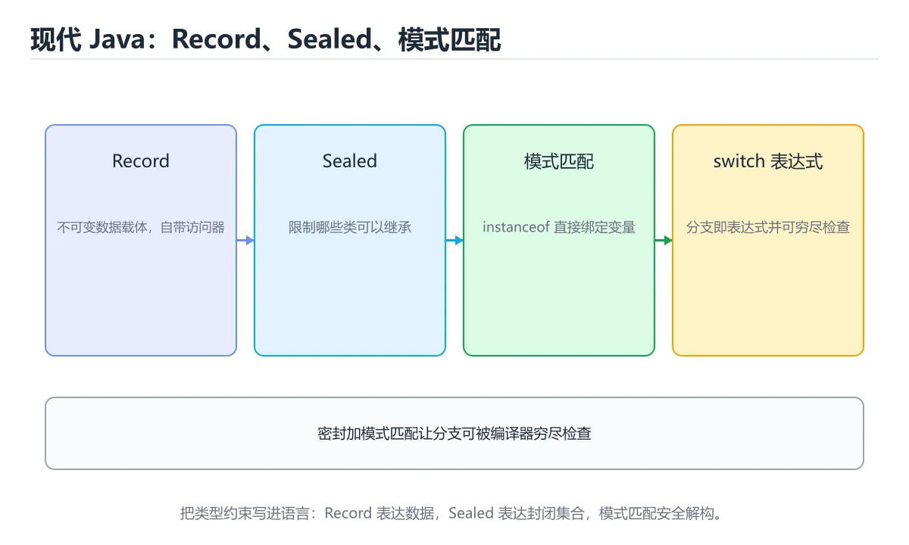
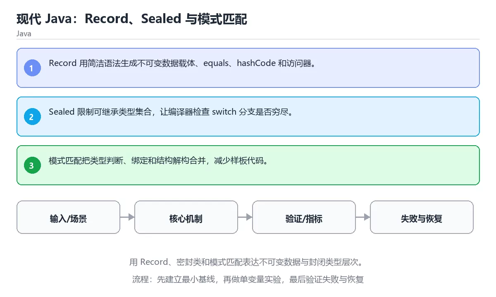

# 现代 Java：Record、Sealed 与模式匹配





> 内容更新时间：2026-10-06 · 学习阶段：高级 · 预计用时：35 分钟

## 本节知识框架

想象你要寄一个快递。传统做法是拿一张表格，手写收件人、地址、电话——格式全靠自己约定，写错了也没人提醒。现代 Java 的三大新特性就像帮你把这件事自动化了：

- **Record**：快递单模板自动生成，填好就不能改（不可变数据载体）。
- **Sealed**：只允许指定的几种快递类型（普通、加急、冷链），编译器帮你检查有没有漏掉。
- **模式匹配**：拿到快递直接看类型、拆内容，不用先 `instanceof` 再强转。

本课会依次聊到四件事：

1. **Record**——用一行代码声明一个不可变的数据类，自动生成 `equals`、`hashCode`、`toString` 和访问器。
2. **Sealed 类**——限定哪些类可以继承或实现，配合 switch 做穷尽性检查。
3. **模式匹配**——用 `instanceof` 或 `switch` 直接完成类型判断、变量绑定与结构解构。
4. **三者协作**——Record + Sealed + 模式匹配 = 用最少代码表达"不可变数据 + 封闭类型层次"。

先修内容：《实战：Java 并发订单处理服务》里的并发与 ExecutorService。后续衔接《Java 虚拟线程与结构化并发》。

### 复习清单

- [ ] 能不看正文说出 Record、Sealed、模式匹配各自的含义与一个易错点。
- [ ] 能运行或推演本课的 Java 示例，记录输入、输出和失败现象。
- [ ] 能完成一次自测，并把错题对照错误表定位原因。

## 核心概念定义

先记住下面四个词，后面所有讨论都围绕它们展开。每个词都用一句话讲清"它是什么"，再补一句"容易踩什么坑"。

| 术语 | 一句话说明 |
| --- | --- |
| `Record` | Java 16+ 引入的不可变数据载体，编译器自动生成 equals、hashCode、toString 和访问器。坑：在 record 里放可变字段会破坏值语义。 |
| `Sealed` | 密封类型：用 sealed 限定哪些类可以继承或实现，配合 switch 模式匹配可做穷尽性检查。坑：子类分散在不同模块时穷尽检查失效。 |
| `模式匹配` | 用 instanceof 或 switch 直接完成类型判断、变量绑定与结构解构，减少样板代码。坑：模式顺序颠倒会导致宽泛模式吞掉具体分支。 |
| `不可变` | 对象创建后状态不再改变，更新时生成新对象，从而减少共享状态和并发错误。坑：record 内部的引用类型字段仍可被修改，需要额外约束。 |

## 原理与运行机制

### Record：一行代码搞定数据类

以前写一个数据类，你要手写构造函数、getter、`equals`、`hashCode`、`toString`——五段代码说的都是同一件事。Record 就像一张自动打印的表格：你只声明"有哪些字段"，其余全部自动生成。

```java
// 传统写法：30+ 行
public class Point {
    private final int x, y;
    public Point(int x, int y) { this.x = x; this.y = y; }
    public int x() { return x; }
    public int y() { return y; }
    // equals, hashCode, toString 省略...
}

// Record 写法：1 行
record Point(int x, int y) {}
```

Record 生成的访问器不叫 `getX()`，而是直接叫 `x()`——因为它不是 JavaBean，而是一个纯粹的数据载体。

**紧凑构造器**：如果想在创建时做校验，不用写完整构造函数，用"紧凑构造器"即可：

```java
record Point(int x, int y) {
    public Point {
        if (x < 0 || y < 0) throw new IllegalArgumentException("坐标不能为负");
    }
}
```

### Sealed 类：给继承画一个圈

普通类谁都能继承，但有时候你明确知道"只有这几种情况"。比如形状只有圆形、矩形、三角形——你不希望别人随便加一个"四维形状"进来。`sealed` 就是给继承画一个圈：

```java
sealed interface Shape permits Circle, Rectangle, Triangle {}
record Circle(double radius) implements Shape {}
record Rectangle(double width, double height) implements Shape {}
record Triangle(double base, double height) implements Shape {}
```

注意这里 Sealed 和 Record 经常一起出现：子类型用 record 表达，天然不可变、天然有 `equals`。

### 模式匹配：告别 instanceof + 强转

以前判断类型要写两步：先 `instanceof`，再手动强转。模式匹配把这两步合成一步：

```java
// 旧写法
if (obj instanceof String s) {
    System.out.println(s.length());
}

// switch 模式匹配（Java 21+）
String label = switch (shape) {
    case Circle(var r)    -> "圆形，半径" + r;
    case Rectangle(var w, var h) -> "矩形，" + w + "x" + h;
    case Triangle(var b, var h)  -> "三角形，底" + b + "高" + h;
};
```

当 `Shape` 是 sealed 的，编译器知道只有三种情况。如果你漏写了一种，编译直接报错——这就是"穷尽性检查"。

### 三者协作的完整示例

```java
record Point(int x, int y) {}

public class Main {
    public static void main(String[] args) {
        Object value = new Point(2, 3);
        String label = switch (value) {
            case Point(int x, int y) when x == 0 && y == 0 -> "origin";
            case Point(int x, int y) -> "point " + x + "," + y;
            default -> "unknown";
        };
        System.out.println(label);
    }
}
```

```text
point 2,3
```

这段代码里：`Point` 是 Record（不可变数据），`switch` 用了模式匹配（结构解构 + 条件守卫），`default` 分支兜底。如果 `value` 的类型是 sealed 的，连 `default` 都可以省掉。

## 典型应用场景

学完原理，我们来看几个真实场景，帮你把概念落地：

| 场景 | 你会遇到什么 | 怎么做 |
| --- | --- | --- |
| API 返回值 | 需要不可变的 DTO | 用 `record` 代替 class + getter |
| 领域建模 | 类型有限（如订单状态） | 用 `sealed interface` + record 子类 |
| 解析 JSON | 根据类型做不同处理 | 用 switch 模式匹配代替 if-else 链 |
| 事件系统 | 事件种类固定 | sealed + record 让编译器帮你穷举 |
| 数据库行映射 | 一行数据不可变 | record 天然适合 |

**选择与边界**：
- 使用 `Record` 时，记住它是不可变的——如果你需要 setter，record 不适合。
- 使用 `Sealed` 时，确保所有子类型都在同一模块里，否则穷尽检查失效。
- 使用 `模式匹配` 时，注意排列顺序：具体模式在前，宽泛模式在后，否则宽泛模式会吞掉具体分支。

## 代码/协议/SQL 示例

### 完整最小示例

把下面的代码保存为 `ModernJavaDemo.java`，用 Java 21+ 编译运行：

```java
// 1. Record 定义不可变数据
record Point(int x, int y) {
    public Point {
        if (x < 0 || y < 0) throw new IllegalArgumentException("坐标不能为负");
    }
}

// 2. Sealed 限定类型层次
sealed interface Shape permits Circle, Rect {}
record Circle(double radius) implements Shape {}
record Rect(double w, double h) implements Shape {}

// 3. 模式匹配 + switch 穷尽分支
public class ModernJavaDemo {
    static String describe(Shape s) {
        return switch (s) {
            case Circle(var r) -> "圆形，半径=" + r;
            case Rect(var w, var h) -> "矩形，" + w + "x" + h;
        };
    }

    public static void main(String[] args) {
        Point p = new Point(3, 4);
        System.out.println(p);                    // Point[x=3, y=4]
        System.out.println(p.x());                // 3
        System.out.println(p.equals(new Point(3, 4))); // true

        Shape[] shapes = {new Circle(5), new Rect(2, 3)};
        for (Shape s : shapes) {
            System.out.println(describe(s));
        }
    }
}
```

```text
Point[x=3, y=4]
3
true
圆形，半径=5.0
矩形，2.0x3.0
```

运行方式：保存为 `.java` 后用 `javac --release 21` 编译、`java` 运行。

## 时间/空间复杂度或性能分析

Record、Sealed 和模式匹配在性能上几乎零开销：

| 关注点 | 说明 |
| --- | --- |
| Record 创建 | 与普通 final class 相同，JVM 不做额外分配 |
| equals / hashCode | 编译器按字段逐一比较，与手写实现复杂度相同（O(n) 字段数） |
| Sealed switch | 编译期穷尽检查，运行期退化为普通 switch（tableswitch / lookupswitch） |
| 模式匹配解构 | 编译后就是 instanceof + 强转，零额外开销 |

**测量方法**：固定输入跑一遍记录基线，再把对象数量提高一个数量级复测；两次结果的差值才是结论依据。对于绝大多数业务场景，Record 的开销可以忽略不计。

## 常见误区与易错点

下面是新手最容易踩的坑，每个都给了"症状→根因→修复"三步对照：

| 容易写错的做法 | 实际现象 | 原因与正确做法 |
| --- | --- | --- |
| 在 record 里放可变字段 | 值语义被破坏，比较结果不符合预期 | record 保持不可变，用紧凑构造器做校验 |
| sealed 子类分散或遗漏 | 模式匹配无法穷尽，编译告警被忽略 | 把子类集中在同一模块，并让分支穷尽 |
| 模式匹配顺序颠倒 | 宽泛模式吞掉具体分支 | 从具体到宽泛排列模式 |
| 用 record 存 List 并外部修改 | 内容变了但 record 引用没变，equals 仍为 true | 用不可变集合 `List.copyOf()` 包装 |
| 以为 record 是 enum | record 是数据载体，enum 是单例集合 | 有限固定值用 enum，有字段的数据用 record |

**现场排错示范**：

**症状**：在 record 里放了 `List<String>` 字段，外部修改列表后发现两个"相同"的 record 比较结果不一致。
**根因**：record 的 equals 比较的是引用，列表内容变了但引用没变。
**修复**：在紧凑构造器里用 `List.copyOf(items)` 做防御性拷贝，保证不可变语义。

## 与其他知识点的关系

- **先修**：`实战：Java 并发订单处理服务`。本课默认并发与 ExecutorService 已经掌握。
- **相关或后续**：`Java 虚拟线程与结构化并发`、`C# Record、模式匹配与不可变数据`。本课术语会在这些课程里继续使用。
- 同一分类的《多线程与并发》涉及线程池；两课衔接时先确认术语定义是否一致。

**容易混淆的相邻概念**：
- `Record` vs `class`：record 是不可变数据载体，自动生成 equals/hashCode；class 可以自由定义可变状态。
- `Sealed` vs `abstract`：sealed 明确限定子类集合，abstract 允许任意类继承。
- `模式匹配` vs `instanceof`：模式匹配在判断类型的同时完成变量绑定和结构解构，instanceof 只判断类型。

## 自测题与参考答案

> 先独立作答，再对照参考答案；答案都能在本课正文、术语表或错误表里找到依据。

### 自测 1（概念复述）

不看正文，写出 `Record` 的操作性定义，并说明它与 `Sealed` 的区别。

**参考答案**：Record 是 Java 16+ 引入的不可变数据载体，编译器自动生成 equals、hashCode、toString 和访问器。Sealed 是密封类型，限定哪些类可以继承或实现。前者关注"数据不可变"，后者关注"类型层次封闭"。

### 自测 2（排错）

本课错误表记录了「在 record 里放可变字段」这类做法。请写出它会出现的现象、根因，以及修复顺序。

**参考答案**：现象是值语义被破坏，比较结果不符合预期；正确做法是 record 保持不可变，用紧凑构造器做校验。修复时先复现现象并保留证据，再改动一处假设重跑，确认现象消失。

### 自测 3（动手验证）

运行本课的 Java 示例，把 `new Point(2, 3)` 改成 `new Point(-1, 0)` 后重新运行，记录输出与错误信息。

**参考答案**：紧凑构造器会抛出 `IllegalArgumentException("坐标不能为负")`。这说明 Record 的校验逻辑在创建时就生效了，而不是等到使用时才发现问题。

### 自测 4（代码阅读）

阅读本课的 switch 模式匹配示例，说明它体现了模式匹配的哪一条性质，并指出如果删掉 `default` 分支会发生什么。

**参考答案**：模式匹配把类型判断、变量绑定与结构解构合并，减少样板代码。如果 Shape 是 sealed 的且所有子类都已覆盖，删掉 default 分支编译通过；否则编译器会报错"switch 没有穷尽所有情况"。

### 自测 5（迁移）

把 Record + Sealed + 模式匹配的方法迁移到自己的项目：围绕"订单状态"写出一个使用场景。

**参考答案**：例如 `sealed interface OrderState permits Pending, Paid, Shipped, Delivered {}`，每个状态用 record 携带不同数据，switch 模式匹配做穷尽处理。这样新增状态时编译器会提醒你补全所有分支。

## 术语速查

| 术语 | 一句话说明 |
| --- | --- |
| `Record` | 不可变数据载体，编译器自动生成 equals、hashCode、toString 和访问器。 |
| `Sealed` | 密封类型：限定哪些类可以继承或实现，配合 switch 做穷尽性检查。 |
| `模式匹配` | 用 instanceof 或 switch 直接完成类型判断、变量绑定与结构解构。 |
| `不可变` | 对象创建后状态不再改变，更新时生成新对象。 |
| `紧凑构造器` | Record 中省略参数列表的构造器写法，用于在创建时做校验。 |
| `穷尽性检查` | 编译器验证 switch 是否覆盖了 sealed 类型的所有子类型。 |

## 考点精讲

`现代 Java：Record、Sealed 与模式匹配` 的题库有 6 道题，下面逐题给出题干、正确项与判断依据：先自己作答，再核对正确项，最后回到正文对应小节复核。

### 考点 1：第 1 题

- **题目**：按“现代 Java：Record、Sealed 与模式匹配”中 Record、Sealed、模式匹配 的实践顺序，把四个步骤排成从准备到复盘的合理顺序。
- **正确项**：先明确 Record 的输入、输出与约束 → 写出最小示例并核对 Sealed 的基线结果 → 只改一个变量，记录边界与失败路径的变化 → 固定版本与证据，把“现代 Java：Record、Sealed 与模式匹配”的结论写成可复现记录
- **判断依据**：按《现代 Java：Record、Sealed 与模式匹配》正文的先后，本题顺序是「先明确 Record 的输入、输出与约束」 → 「写出最小示例并核对 Sealed 的基线结果」 → 「只改一个变量，记录边界与失败路径的变化」 → 「固定版本与证据，把“现代 Java：Record、Sealed 与模式匹配”的结论写成可复现记录」。术语 Record（现代 Java：Record、Sealed 与模式匹配）：按“现代 Java：Record、Sealed 与模式匹配”中 Record、Sealed、模式匹配 的实践顺序，把四个步骤排成从准备到复盘的合理顺序。易错点是在 record 里放可变字段会造成值语义被破坏，比较结果不符合预期，改法是record 保持不可变，用紧凑构造器做校验。

### 考点 2：第 2 题

- **题目**：在 `现代 Java：Record、Sealed 与模式匹配` 里，与 `Record` 有关的说法中，哪一项最符合用 Record、密封类和模式匹配表达不可变数据与封闭类型层次。？（现代 Java：Record、Sealed 与模式匹配·Java 第 3 题）
- **正确项**：Sealed 限制可继承类型集合
- **判断依据**：本题正确项是「模式匹配把类型判断、绑定和结构解构合并，减少样板代码」。术语 Record（现代 Java：Record、Sealed 与模式匹配）：按“现代 Java：Record、Sealed 与模式匹配”中 Record、Sealed、模式匹配 的实践顺序，把四个步骤排成从准备到复盘的合理顺序，本题取「模式匹配把类型判断、绑定和结构解构合并，减少样板代码」这条。易错点是模式匹配顺序颠倒，会造成宽泛模式吞掉具体分支，改法是从具体到宽泛排列模式。：Record、Sealed 与模式匹配` 里，与 `Record` 有关的说法中，哪一项最符合用 Record、密封类和模式匹配表达不可变数据与封闭类型层次。？（现代 Java：Record、Sealed 与模式匹配·Java 第 3 题）
- **正确项**：模式匹配把类型判断、绑定和结构解构合并，减少样板代码。
- **判断依据**：本题正确项是「模式匹配把类型判断、绑定和结构解构合并，减少样板代码」。术语 Record（现代 Java：Record、Sealed 与模式匹配）：按“现代 Java：Record、Sealed 与模式匹配”中 Record、Sealed、模式匹配 的实践顺序，把四个步骤排成从准备到复盘的合理顺序，本题取「模式匹配把类型判断、绑定和结构解构合并，减少样板代码」这条。易错点是在 record 里放可变字段会造成值语义被破坏，比较结果不符合预期，改法是record 保持不可变，用紧凑构造器做校验。

### 考点 4：第 4 题

- **题目**：`现代 Java：Record、Sealed 与模式匹配` 的主线是：用 Record、密封类和模式匹配表达不可变数据与封闭类型层次。下面哪一项与这条主线一致？
- **正确项**：用 Record、密封类和模式匹配表达不可变数据与封闭类型层次。
- **判断依据**：本题正确项是「用 Record、密封类和模式匹配表达不可变数据与封闭类型层次」。术语 Record（现代 Java：Record、Sealed 与模式匹配）：按“现代 Java：Record、Sealed 与模式匹配”中 Record、Sealed、模式匹配 的实践顺序，把四个步骤排成从准备到复盘的合理顺序，本题取「用 Record、密封类和模式匹配表达不可变数据与封闭类型层次」这条。易错点是用 record 存 List 并外部修改，会造成内容变了但 record 引用没变，equals 仍为 true，改法是用不可变集合 `List.copyOf()` 包装。

### 考点 5：第 5 题

- **题目**：课程 `用 Record、密封类和模式匹配表达不可变数据与封闭类型层次。`。在 `现代 Java：Record、Sealed 与模式匹配` 里，`Record`、`Sealed` 与下面哪些选项属于同一层概念？（多选）
- **正确项**：Record；Sealed
- **判断依据**：按《现代 Java：Record、Sealed 与模式匹配》的正文口径，本题要同时选中「Record」、「Sealed」，漏掉任一项都算没答全。术语 Record（现代 Java：Record、Sealed 与模式匹配）：按“现代 Java：Record、Sealed 与模式匹配”中 Record、Sealed、模式匹配 的实践顺序，把四个步骤排成从准备到复盘的合理顺序。易错点是以为 record 是 enum，会造成record 是数据载体，enum 是单例集合，改法是有限固定值用 enum，有字段的数据用 record。

### 考点 6：第 6 题

- **题目**：结合 `现代 Java：Record、Sealed 与模式匹配` 中围绕 `Record` 的代码，哪一项说法与“用 Record、密封类和模式匹配表达不可变数据与封闭类型层次。”一致？
- **正确项**：Record 用简洁语法生成不可变数据载体，equals
- **判断依据**：本题正确项是「Record 用简洁语法生成不可变数据载体，equals」。术语 Record（现代 Java：Record、Sealed 与模式匹配）：按“现代 Java：Record、Sealed 与模式匹配”中 Record、Sealed、模式匹配 的实践顺序，把四个步骤排成从准备到复盘的合理顺序，本题取「Record 用简洁语法生成不可变数据载体，equals」这条。易错点是在 record 里放可变字段，会造成值语义被破坏，比较结果不符合预期，改法是record 保持不可变，用紧凑构造器做校验。

## 内容元数据

- 内容版本：v2.0
- 最后更新：2026-10-06
- 学习阶段：高级
- 适用环境：Java 21+ / Maven 或 Gradle；本课聚焦 Record、Sealed 与模式匹配。
- 内容来源：内置结构化课程与工程实践整理
- 相关主题：Record、Sealed、模式匹配、不可变
- 质量版本：P0 测验标准 + P1 覆盖扩展 + P2 体验补全

## 参考资料与复核

- 最后复核：2026-10-04
- 下次复核：2027-02-24
- 复核范围：版本兼容、API 行为、安全建议与工程实践
- 来源性质：官方文档、标准或权威教材；本课核对关键词：Record、Sealed、模式匹配、不可变。

| 参考资料 | 本课用途 |
| --- | --- |
| [JEP 440: Record Patterns](https://openjdk.org/jeps/440) | Record 模式匹配官方规范 |
| [JEP 409: Sealed Classes](https://openjdk.org/jeps/409) | Sealed 类官方规范 |
| [dev.java 学习](https://dev.java/learn/) | 现代 Java 官方教程 |
| [Java SE API 文档](https://docs.oracle.com/en/java/javase/21/docs/api/) | 标准库 API 查阅 |
