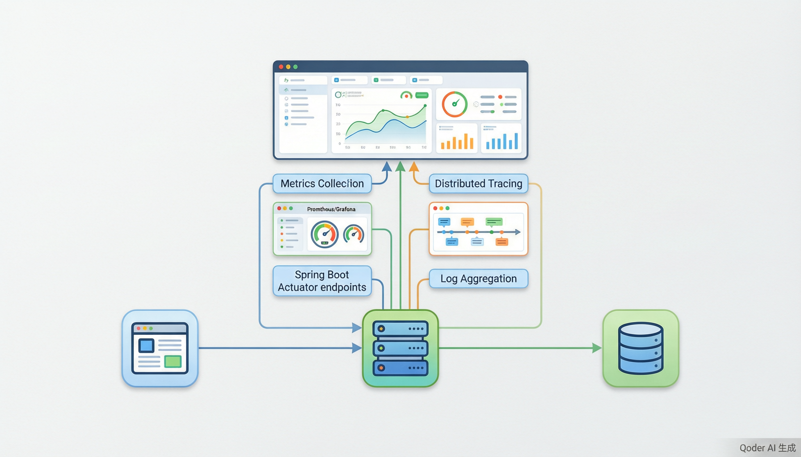

# 性能监控与调优

> 内容更新时间：2026-10-20 · 学习阶段：高级 · 预计用时：40 分钟



## 本节知识框架

想象你开了一家连锁餐厅。你不可能每天亲自跑到每家店去数客人、看厨房、查账本。你需要一套"监控系统"：门口有计数器统计客流量（指标），厨房有温度计确保食物安全（健康检查），每道菜从下单到上桌都有时间记录（追踪），出了问题可以翻看监控录像（日志）。这套系统让你坐在办公室就能看到所有门店的运营状况，并在出问题时第一时间收到警报。

Spring Boot 的性能优化与监控做的就是这件事：

- **Actuator** = 餐厅的监控系统总控台，提供一系列开箱即用的"检查窗口"。
- **健康检查（Health Check）** = 门口那块"营业中 / 暂停营业"的牌子，告诉外界"我还活着吗"。
- **指标（Metrics）** = 客流量计数器，记录每秒请求数、响应时间、JVM 内存使用等数字。
- **追踪（Tracing）** = 每道菜的时间线——从下单、备料、烹饪到上桌，经过了几步、每步花了多久。
- **日志管理** = 监控录像，记录系统里发生的每一件事，出问题时可以回放。
- **性能调优** = 根据监控数据调整厨房布局、人员配置、出菜流程，让餐厅跑得更快。

本课会依次聊到五件事：

1. **Spring Boot Actuator**——开箱即用的监控端点，让你通过 HTTP 查看应用状态。
2. **指标采集与可视化**——用 Micrometer 收集指标，对接 Prometheus + Grafana 做仪表盘。
3. **分布式追踪**——用 Micrometer Tracing 跟踪请求在多个服务之间的流转。
4. **日志管理**——配置 Logback，按级别输出日志，接入集中式日志系统。
5. **性能调优实战**——JVM 调优、数据库优化、缓存策略的具体做法。

**先修知识**：你需要了解 Spring Boot 基础（来自《Spring Framework 核心》），以及 JVM 内存与 GC 的基本概念（来自《JVM 垃圾回收与性能调优》）。

### 复习清单

- [ ] 能不看正文说出 Actuator、Metrics、Tracing、Health Check 各自的含义与一个易错点。
- [ ] 能运行本课的 Spring Boot 示例，访问 `/actuator/health` 和 `/actuator/metrics` 并记录输出。
- [ ] 能完成一次自测，并把错题对照错误表定位原因。

---

## 核心概念定义

| 术语 | 一句话定义 | 生活类比 |
| --- | --- | --- |
| Actuator | Spring Boot 提供的生产级监控模块，暴露一系列 HTTP 端点用于查看应用内部状态。 | 餐厅的监控总控台——一块屏幕看到所有门店的运营数据。 |
| 健康检查（Health Check） | 告诉外部系统"我是否正常运行"的机制，通常返回 UP 或 DOWN 状态。 | 门口那块"营业中 / 暂停营业"的牌子。 |
| 指标（Metrics） | 系统运行时采集的数值数据，如 QPS、响应时间、内存占用，用于量化系统行为。 | 客流量计数器——每秒进来多少人、平均消费多少。 |
| 追踪（Tracing） | 记录一个请求在多个服务之间的完整调用链路和每一步的耗时。 | 每道菜从下单到上桌的全流程时间记录。 |
| 日志管理 | 按级别（DEBUG/INFO/WARN/ERROR）记录系统事件，支持输出到文件、远程服务器等。 | 监控录像——记录一切，出问题时可以回放。 |
| 性能调优 | 基于监控数据调整系统参数、代码结构或资源配置，使关键指标获得可测量的改善。 | 根据客流数据调整厨房布局、人员排班和出菜流程。 |
| JVM 调优 | 调整 JVM 的堆大小、GC 策略、线程池参数等，使 Java 应用运行更高效。 | 调整餐厅的灶台数量、厨师人数和备料区域大小。 |
| 数据库优化 | 通过索引、查询改写、连接池配置等手段提升数据库访问性能。 | 优化仓库取菜路线，让厨师更快拿到食材。 |
| 缓存策略 | 把频繁访问的数据放在离计算更近的地方（内存、CDN），减少重复计算或 IO。 | 把常用调料放在灶台旁边，不用每次都跑去仓库。 |
| APM（Application Performance Monitoring） | 应用性能监控的统称，涵盖指标、追踪、日志三大支柱，提供端到端的可观测性。 | 整套餐厅管理系统——监控 + 报表 + 报警 + 录像回放。 |

---

## 原理与运行机制

### Spring Boot Actuator 端点是怎么工作的？

Actuator 就像餐厅监控系统的"检查窗口"。每个窗口暴露一类信息，你通过 HTTP 请求访问它们：

```text
GET /actuator/health      → 应用是否健康（UP / DOWN / OUT_OF_SERVICE）
GET /actuator/info        → 应用自定义信息（版本号、描述等）
GET /actuator/metrics     → 所有可用指标的列表
GET /actuator/metrics/jvm.memory.used → 某个具体指标的值
GET /actuator/loggers     → 查看所有日志记录器的级别
GET /actuator/env         → 查看当前环境变量和配置属性
GET /actuator/threaddump  → 当前线程快照（排查死锁）
GET /actuator/heapdump    → 堆内存快照（排查内存泄漏）
```

默认情况下，Spring Boot 只暴露 `health` 和 `info` 两个端点。你需要在配置文件中显式开启其他端点。

### 指标采集：Micrometer + Prometheus + Grafana

指标采集分三层，就像餐厅的数据流：

1. **Micrometer**（采集层）= 餐厅的传感器。它在代码中埋点，自动收集 JVM 内存、GC 次数、HTTP 请求延迟等数据。
2. **Prometheus**（存储层）= 餐厅的数据中心。它定时来"拉"（pull）数据，存到时序数据库里。
3. **Grafana**（展示层）= 餐厅的大屏仪表盘。它从 Prometheus 读数据，画出漂亮的图表和报警规则。

```text
Spring Boot App                Prometheus              Grafana
┌─────────────────┐           ┌──────────┐           ┌──────────┐
│  Micrometer     │  /metrics │          │  query     │          │
│  ┌───────────┐  │ ────────→ │ 时序数据库│ ────────→ │ 仪表盘   │
│  │ 计数器     │  │           │          │           │ 图表     │
│  │ 仪表盘     │  │           │          │           │ 报警     │
│  │ 直方图     │  │           │          │           │          │
│  └───────────┘  │           └──────────┘           └──────────┘
└─────────────────┘
```

### 分布式追踪：Micrometer Tracing

在微服务架构中，一个用户请求可能经过网关、用户服务、订单服务、支付服务。出了问题，怎么知道是哪个环节慢？

分布式追踪给每个请求分配一个 **Trace ID**，请求每经过一个服务就记录一个 **Span**。就像快递单号——包裹每到一个中转站都扫一次码，你可以看到完整的物流时间线。

```text
用户请求 → [网关(Span1)] → [用户服务(Span2)] → [订单服务(Span3)] → [支付服务(Span4)]
Trace ID: abc123 贯穿全链路
```

常用后端：**Zipkin**、**Jaeger**、**OpenTelemetry**。

### 日志配置：Logback

Spring Boot 默认使用 Logback 作为日志框架。日志按级别分类：

| 级别 | 用途 | 示例 |
| --- | --- | --- |
| ERROR | 严重错误，需要立即处理 | 数据库连接失败 |
| WARN | 潜在问题，但还能运行 | 缓存命中率低于阈值 |
| INFO | 关键业务事件 | 用户登录成功、订单创建完成 |
| DEBUG | 调试信息，开发时使用 | SQL 语句详情、方法入参 |
| TRACE | 最细粒度的追踪 | 每个变量的值变化 |

生产环境通常设置为 INFO 或 WARN，开发时设为 DEBUG。

---

## 典型应用场景

| 场景 | 你会遇到什么 | 怎么做 |
| --- | --- | --- |
| 接口响应变慢 | 用户反馈页面加载慢 | 查看 Actuator metrics 中的 P99 延迟，定位慢接口 |
| 服务突然不可用 | 健康检查返回 DOWN | 访问 `/actuator/health` 查看具体哪个组件出了问题 |
| 内存泄漏 | 服务跑几天后 OOM | 导出 heapdump，用 MAT 或 VisualVM 分析 |
| 微服务调用链过长 | 不知道哪个服务慢 | 接入分布式追踪，查看 Trace 时间线 |
| 数据库查询慢 | 某些接口特别慢 | 开启慢查询日志，用 EXPLAIN 分析 SQL 执行计划 |
| 高并发下线程死锁 | 请求卡住不返回 | 导出 threaddump，分析线程状态 |

---

## 代码/协议/SQL 示例

### 最小示例：开启 Actuator 端点

**pom.xml**

```xml
<dependencies>
    <dependency>
        <groupId>org.springframework.boot</groupId>
        <artifactId>spring-boot-starter-actuator</artifactId>
    </dependency>
    <dependency>
        <groupId>org.springframework.boot</groupId>
        <artifactId>spring-boot-starter-web</artifactId>
    </dependency>
</dependencies>
```

**application.yml**

```yaml
management:
  endpoints:
    web:
      exposure:
        include: health,info,metrics,loggers,env
  endpoint:
    health:
      show-details: always
  metrics:
    tags:
      application: ${spring.application.name}
```

启动后访问 `http://localhost:8080/actuator/health`，你会看到：

```json
{
  "status": "UP",
  "components": {
    "db": {
      "status": "UP",
      "database": "MySQL",
      "validationQuery": "isValid()"
    },
    "diskSpace": {
      "status": "UP",
      "total": 500107862016,
      "free": 123456789012,
      "threshold": 10485760
    }
  }
}
```

### 自定义指标：用 Micrometer 埋点

```java
import io.micrometer.core.instrument.Counter;
import io.micrometer.core.instrument.MeterRegistry;
import io.micrometer.core.instrument.Timer;
import org.springframework.stereotype.Service;

@Service
public class OrderService {

    private final Counter orderCounter;
    private final Timer orderTimer;

    public OrderService(MeterRegistry registry) {
        // 计数器：记录订单创建总数
        this.orderCounter = Counter.builder("orders.created")
                .description("Total number of orders created")
                .tag("type", "web")
                .register(registry);

        // 计时器：记录订单处理耗时
        this.orderTimer = Timer.builder("orders.processing.time")
                .description("Time to process an order")
                .register(registry);
    }

    public void createOrder(Order order) {
        orderTimer.record(() -> {
            // 业务逻辑
            saveOrder(order);
            orderCounter.increment();  // 每次创建订单，计数器 +1
        });
    }
}
```

访问 `http://localhost:8080/actuator/metrics/orders.created` 就能看到订单计数。

### 自定义健康检查

```java
import org.springframework.boot.actuate.health.Health;
import org.springframework.boot.actuate.health.HealthIndicator;
import org.springframework.stereotype.Component;

@Component
public class PaymentServiceHealthIndicator implements HealthIndicator {

    @Override
    public Health health() {
        // 检查支付网关是否可达
        boolean isReachable = checkPaymentGateway();

        if (isReachable) {
            return Health.up()
                    .withDetail("gateway", "支付网关连接正常")
                    .build();
        } else {
            return Health.down()
                    .withDetail("gateway", "支付网关不可达")
                    .build();
        }
    }

    private boolean checkPaymentGateway() {
        // 实际项目中这里会发起一个 HTTP 请求或 TCP 探测
        return true;
    }
}
```

### 日志配置：logback-spring.xml

```xml
<?xml version="1.0" encoding="UTF-8"?>
<configuration>
    <!-- 控制台输出 -->
    <appender name="CONSOLE" class="ch.qos.logback.core.ConsoleAppender">
        <encoder>
            <pattern>%d{yyyy-MM-dd HH:mm:ss} [%thread] %-5level %logger{36} - %msg%n</pattern>
        </encoder>
    </appender>

    <!-- 文件输出（按天滚动） -->
    <appender name="FILE" class="ch.qos.logback.core.rolling.RollingFileAppender">
        <file>logs/app.log</file>
        <rollingPolicy class="ch.qos.logback.core.rolling.TimeBasedRollingPolicy">
            <fileNamePattern>logs/app.%d{yyyy-MM-dd}.log</fileNamePattern>
            <maxHistory>30</maxHistory>
        </rollingPolicy>
        <encoder>
            <pattern>%d{yyyy-MM-dd HH:mm:ss} [%thread] %-5level %logger{36} - %msg%n</pattern>
        </encoder>
    </appender>

    <!-- 按包设置日志级别 -->
    <logger name="com.example.service" level="DEBUG" />
    <logger name="org.springframework" level="INFO" />
    <logger name="org.hibernate.SQL" level="DEBUG" />

    <root level="INFO">
        <appender-ref ref="CONSOLE" />
        <appender-ref ref="FILE" />
    </root>
</configuration>
```

### 性能调优实战：数据库连接池配置

```yaml
# application.yml — HikariCP 连接池优化
spring:
  datasource:
    hikari:
      maximum-pool-size: 20        # 最大连接数（公式：CPU 核数 * 2 + 磁盘数）
      minimum-idle: 5              # 最小空闲连接
      idle-timeout: 300000         # 空闲连接存活时间（5 分钟）
      max-lifetime: 1800000        # 连接最大存活时间（30 分钟）
      connection-timeout: 30000    # 获取连接超时时间（30 秒）
      leak-detection-threshold: 60000  # 连接泄漏检测阈值（1 分钟）
```

### 性能调优实战：缓存策略

```java
import org.springframework.cache.annotation.Cacheable;
import org.springframework.cache.annotation.CacheEvict;
import org.springframework.stereotype.Service;

@Service
public class UserService {

    // 缓存用户信息，key 为 userId
    @Cacheable(value = "users", key = "#userId")
    public User getUserById(Long userId) {
        // 这里会查数据库，但结果会被缓存
        // 下次调用同样的 userId 时直接返回缓存
        return userRepository.findById(userId).orElse(null);
    }

    // 更新用户时清除缓存
    @CacheEvict(value = "users", key = "#user.id")
    public void updateUser(User user) {
        userRepository.save(user);
    }
}
```

---

## 时间/空间复杂度或性能分析

性能监控不像算法题用大 O 衡量，更关注"在给定负载下，关键指标的拐点在哪里"。

| 指标 | 含义 | 参考值 |
| --- | --- | --- |
| QPS（Queries Per Second） | 每秒处理的请求数 | 取决于业务复杂度，通常 100 ~ 10000 |
| P50 延迟 | 50% 的请求在这个时间内完成 | 通常 < 100ms |
| P99 延迟 | 99% 的请求在这个时间内完成 | 通常 < 500ms |
| 错误率 | 返回 5xx 的请求占比 | 通常 < 0.1% |
| CPU 使用率 | JVM 进程占用的 CPU 百分比 | 通常 < 70%（留余量应对突发） |
| 堆内存使用率 | 已用堆 / 最大堆 | 通常 < 80% |
| GC 停顿时间 | 单次 GC 暂停应用的时间 | G1 < 200ms，ZGC < 1ms |

**测量方法**：
1. 先用 Actuator 端点获取基线数据。
2. 用压测工具（JMeter、wrk）模拟真实负载。
3. 对比压测前后的 P99 延迟、错误率和资源占用。

---

## 常见误区与易错点

| 容易写错的做法 | 实际现象 | 原因与正确做法 |
| --- | --- | --- |
| 暴露所有 Actuator 端点 | 安全风险，env 和 heapdump 泄露敏感信息 | 生产环境只暴露 health、metrics、info，其余通过安全认证控制 |
| 只看平均响应时间 | 掩盖了少量用户的极端慢请求 | 看 P99 或 P999 延迟，这才是用户真实体感 |
| 连接池设得越大越好 | 数据库连接争抢，反而变慢 | 根据 CPU 核数和磁盘数计算合理值（通常 10~30） |
| 缓存不设过期时间 | 数据陈旧，用户看到旧信息 | 所有缓存都设 TTL，关键数据用主动失效 |
| 日志级别设为 DEBUG 上生产 | 磁盘被日志撑爆，IO 性能下降 | 生产环境用 INFO 或 WARN，DEBUG 只在排查问题时临时开启 |
| 没有监控就上线 | 出了问题不知道，等用户投诉才发现 | 上线前必须配置健康检查、核心指标和报警规则 |
| 一次改多个参数调优 | 不知道哪个改动起了作用 | 每次只改一个变量，记录前后对比 |

**现场排错示范**：

**症状**：接口 P99 延迟突然从 50ms 飙升到 2 秒。
**排查步骤**：
1. 看 Actuator metrics——确认是哪些接口变慢。
2. 看分布式追踪——发现慢在数据库查询环节。
3. 看慢查询日志——发现一条没有索引的 SQL。
4. 加索引后 P99 恢复到 60ms。

---

## 与其他知识点的关系

- **先修**：`Spring Framework 核心`、`JVM 垃圾回收与性能调优`。本课默认 Spring Boot 和 JVM 基础已经掌握。
- **相关或后续**：《微服务架构》、《容器化与 Kubernetes》。监控数据在微服务和容器环境中更加重要。
- 同一分类的《多线程与并发》涉及线程池调优；《数据库优化》涉及 SQL 性能分析。

**容易混淆的相邻概念**：
- `Metrics` vs `Logging`：Metrics 是数值型时间序列数据（适合画图表），Logging 是事件型文本记录（适合排查问题）。两者互补，不可替代。
- `Tracing` vs `Metrics`：Tracing 追踪单个请求的完整链路，Metrics 聚合统计所有请求的整体表现。一个看"个案"，一个看"全局"。
- `Actuator` vs `APM`：Actuator 是 Spring Boot 内置的轻量级监控端点，APM 是完整的商业级应用性能监控方案（如 SkyWalking、New Relic）。

---

## 自测题与参考答案

> 先独立作答，再对照参考答案；答案都能在本课正文、术语表或错误表里找到依据。

**Q1**：Spring Boot Actuator 默认暴露哪些端点？为什么生产环境不能暴露所有端点？

<details>
<summary>点击查看答案</summary>

默认只暴露 `health` 和 `info` 两个端点。生产环境不能暴露所有端点，因为 `env` 会泄露环境变量中的密码和密钥，`heapdump` 会导出整个堆内存（包含敏感数据），`threaddump` 会暴露线程信息。正确做法是只暴露必要的端点，其余通过 Spring Security 进行认证控制。
</details>

**Q2**：为什么只看平均响应时间不够？应该看什么指标？

<details>
<summary>点击查看答案</summary>

平均响应时间会掩盖极端情况。比如 100 个请求中 99 个是 10ms，1 个是 10 秒，平均值只有 110ms，看起来很好，但那个 10 秒的用户体验很差。应该看 P99 或 P999 延迟——P99 表示 99% 的请求在这个时间内完成，能反映"最差的 1% 用户"的真实体感。
</details>

**Q3**：分布式追踪中，Trace ID 和 Span ID 分别是什么？它们如何配合工作？

<details>
<summary>点击查看答案</summary>

Trace ID 是一个请求的全局唯一标识，贯穿整个调用链。Span ID 是每个服务处理步骤的标识，代表一个"工作单元"。一个 Trace 包含多个 Span，通过 Trace ID 串联起来。就像快递单号（Trace ID）标识一个包裹的全程，每个中转站的扫描记录（Span ID）标识一段运输。通过 Trace ID 可以查到一个请求经过的所有服务和每步耗时。
</details>

---

## 考点精讲

### 考点 1

Spring Boot Actuator 默认暴露哪些端点？为什么生产环境不能暴露所有端点？

A. 默认暴露所有端点，无需额外配置  
B. 默认只暴露 metrics 和 loggers；因为其他端点会影响应用性能  
C. 默认不暴露任何端点，需要手动开启  
D. 默认只暴露 health 和 info；因为 env 会泄露密码和密钥，heapdump 会导出堆内存中的敏感数据，存在安全风险  

**正确答案：D**

**详细解释：** Spring Boot Actuator 默认只暴露 `health` 和 `info` 两个端点。生产环境不能暴露所有端点（如通过 `include: "*"`），因为 `env` 端点会暴露环境变量中的密码、密钥等敏感信息，`heapdump` 端点会导出整个 JVM 堆内存（其中可能包含用户数据和密钥），`threaddump` 会暴露线程信息。正确做法是通过 `management.endpoints.web.exposure.include` 只暴露必要的端点（如 health、metrics、info），其余敏感端点通过 Spring Security 进行认证控制。

---

### 考点 2

在性能监控中，为什么只看平均响应时间不够？应该关注什么指标？

A. 平均响应时间已经足够反映系统性能，无需其他指标
B. 平均值会掩盖极端情况，应关注 P99 或 P999 延迟，它反映\u201c最差的 1%用户\u201d的真实体感
C. 应该只关注最快请求的响应时间
D. 应该关注总请求数而非响应时间

**正确答案：B**

**详细解释：** 平均响应时间会掩盖长尾问题。例如 100 个请求中 99 个耗时 10ms，1 个耗时 10 秒，平均值仅约 110ms，看起来很好，但那 1 个用户的体验极差。P99 延迟表示 99% 的请求在这个时间内完成，能真实反映\u201c最差的那 1%用户\u201d的体感。类似地，P999 延迟反映千分之一的极端情况。生产环境中应同时关注 P50（中位数）、P99 和 P999 延迟，才能全面了解系统的响应质量。

---

### 考点 3

在指标采集架构中，Micrometer、Prometheus 和 Grafana 分别承担什么角色？

A. Micrometer 存储数据，Prometheus 展示图表，Grafana 采集指标
B. Micrometer 是采集层（埋点收集数据），Prometheus 是存储层（时序数据库，通过 pull 模式拉取数据），Grafana 是展示层（可视化仪表盘）
C. Micrometer 是展示层，Prometheus 是采集层，Grafana 是存储层
D. 三者功能相同，可以任意替换使用

**正确答案：B**

**详细解释：** 指标采集分三层协作：Micrometer 是采集层，相当于\u201c传感器\u201d，它在 Spring Boot 应用中埋点，自动收集 JVM 内存、GC 次数、HTTP 请求延迟等数据并暴露为端点；Prometheus 是存储层，相当于\u201c数据中心\u201d，它定时通过 pull 模式从应用端点拉取指标数据，存储到时序数据库中；Grafana 是展示层，相当于\u201c大屏仪表盘\u201d，它从 Prometheus 读取数据，绘制可视化图表并配置报警规则。三者各司其职，构成完整的可观测性数据采集与展示链路。

---

### 考点 4

分布式追踪中，Trace ID 和 Span ID 分别代表什么？它们如何配合工作？

A. Trace ID 标识单个服务的处理时间，Span ID 标识数据库查询时间  
B. Trace ID 用于标识数据库连接，Span ID 用于标识 HTTP 连接  
C. Trace ID 和 Span ID 是同一个概念的不同名称  
D. Trace ID 是一个请求的全局唯一标识，贯穿整个调用链；Span ID 是每个服务处理步骤的标识，一个 Trace 包含多个 Span  

**正确答案：D**

**详细解释：** 在分布式追踪中，Trace ID 是一个用户请求的全局唯一标识符，从请求进入系统到最终响应，贯穿整个调用链路。Span ID 代表一个\u201c工作单元\u201d，每个服务处理请求时都会产生一个 Span，记录该步骤的耗时和状态。一个 Trace 包含多个 Span，通过共同的 Trace ID 串联起来，就像快递单号（Trace ID）标识一个包裹的全程物流，每个中转站的扫描记录（Span ID）标识一段运输。通过 Trace ID 可以查看一个请求经过的所有服务以及每一步的耗时，快速定位性能瓶颈。

---

### 考点 5

生产环境中，为什么不能将日志级别设为 DEBUG？

A. DEBUG 级别的日志会导致应用无法正常运行
B. DEBUG 级别会产生大量日志输出，导致磁盘空间被撑爆，IO 性能下降；生产环境应使用 INFO 或 WARN 级别
C. DEBUG 级别会泄露数据库密码
D. DEBUG 级别只适用于单元测试环境

**正确答案：B**

**详细解释：** DEBUG 级别的日志会记录非常详细的信息，包括 SQL 语句详情、方法入参、变量值等。在生产环境的高并发场景下，这些日志量极其庞大，会迅速占满磁盘空间，同时大量的日志写入操作会严重影响磁盘 IO 性能，进而拖慢应用本身的响应速度。正确做法是：生产环境将日志级别设为 INFO 或 WARN，只记录关键业务事件和潜在问题；当需要排查特定问题时，可以通过 Actuator 的 `/actuator/loggers` 端点动态临时调整某个包的日志级别为 DEBUG，排查完毕后恢复。

---

## 术语速查

| 术语 | 一句话说明 |
| --- | --- |
| Actuator | Spring Boot 内置的监控模块，提供 health、metrics、env 等 HTTP 端点 |
| Health Check | 健康检查，返回应用及其依赖组件的运行状态 |
| Metrics | 指标，数值型时间序列数据（QPS、延迟、内存使用等） |
| Tracing | 分布式追踪，记录请求在多个服务间的调用链路和耗时 |
| Micrometer | Spring 生态的指标采集门面，类似 SLF4J 之于日志 |
| Prometheus | 开源时序数据库和监控系统，通过 pull 模式采集指标 |
| Grafana | 开源可视化平台，从 Prometheus 等数据源绘制仪表盘 |
| APM | 应用性能监控的统称，涵盖 Metrics + Tracing + Logging |
| P99 延迟 | 99% 的请求在这个时间内完成，反映长尾用户体验 |
| HikariCP | Spring Boot 默认的高性能数据库连接池 |
| Logback | Spring Boot 默认的日志框架，支持按级别、按文件输出 |

---

## 内容元数据

- 内容更新时间：2026-10-06

- 内容版本：v2.0
- 最后更新：2026-10-20
- 学习阶段：高级
- 适用环境：Java 21+ / Spring Boot 3.x / Maven 或 Gradle；本课聚焦性能优化与监控。
- 内容来源：内置结构化课程与工程实践整理
- 相关主题：Actuator、Metrics、Tracing、日志管理、性能调优
- 质量版本：P0 测验标准 + P1 覆盖扩展 + P2 体验补全

---

## 参考资料与复核

- 最后复核：2026-10-20
- 下次复核：2027-02-20
- 复核范围：版本兼容、API 行为、安全建议与工程实践
- 来源性质：官方文档、标准或权威教材；本课核对关键词：Actuator、Metrics、Tracing、日志管理、性能调优。

| 参考资料 | 本课用途 |
| --- | --- |
| [Spring Boot Actuator 官方文档](https://docs.spring.io/spring-boot/docs/current/actuator/html/) | Actuator 端点配置与使用 |
| [Micrometer 文档](https://micrometer.io/docs) | 指标采集门面库官方文档 |
| [Prometheus 入门](https://prometheus.io/docs/introduction/overview/) | 时序数据库与监控系统 |
| [Micrometer Tracing 文档](https://micrometer.io/docs/tracing) | 分布式追踪官方指南 |
| [HikariCP 性能调优](https://github.com/brettwooldridge/HikariCP/wiki/About-Pool-Sizing) | 数据库连接池配置最佳实践 |
| [Logback 官方文档](https://logback.qos.ch/manual/) | 日志框架配置与使用 |
- 最后复核：2026-10-04
- 下次复核：2026-11-04
