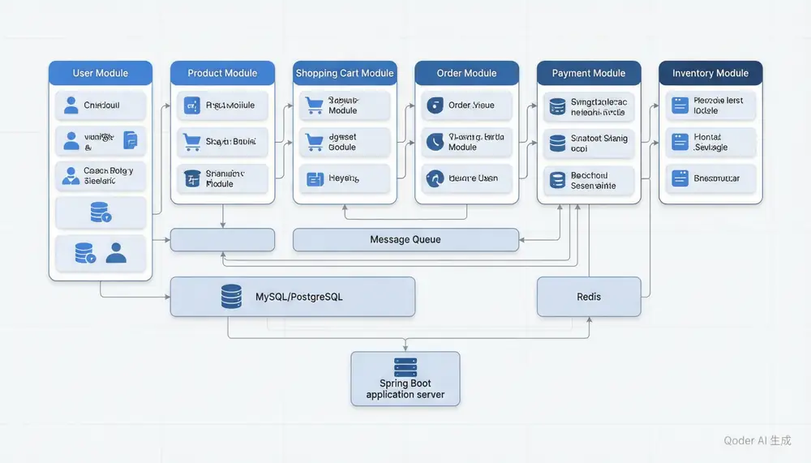

# 实战：完整电商系统




> 内容更新时间：2026-10-20 · 学习阶段：高级 · 预计用时：90 分钟

## 本节知识框架

想象你开了一家大型超市。超市里有收银台（用户结账）、货架（商品展示）、购物车（暂存商品）、仓库（库存管理）、物流（订单配送）、财务（支付结算）。这些部门各自独立运作，但又必须紧密配合——顾客拿了商品放进购物车，到收银台结账时，仓库要同步扣减库存，财务要记录流水，物流要准备发货。如果任何一个环节出了问题，整个购物体验就会崩溃。

这就是一个电商系统的缩影。本课将把前面学到的所有知识——Spring Boot、JPA、事务、并发、消息队列、缓存——整合成一个完整的电商系统。

**本课知识地图**

```text
数据库设计 → 实体建模 → 服务层 → 控制器层 → 模块集成 → 分布式事务 → 性能优化
```

**学完本课你将能够**：

1. 设计电商系统的完整数据库架构（用户、商品、订单、支付、库存）。
2. 使用 Spring Boot 实现分层架构，将各模块有机整合。
3. 处理分布式事务——跨模块操作如何保证数据一致性。
4. 运用消息队列解耦模块，提升系统可扩展性。
5. 使用缓存策略优化高频查询性能。

**先修知识**：你需要掌握 Spring Boot（来自《Spring Framework 核心》）、JPA 与事务管理（来自《实战：Java 库存管理 REST 服务》）、并发处理（来自《实战：Java 并发订单处理服务》），以及 Servlet 基础（来自《Servlet 与 JSP 基础》）。

### 复习清单

- [ ] 能不看正文说出电商系统五大模块（用户、商品、订单、支付、库存）各自的职责与一个易错点。
- [ ] 能运行或推演本课示例，记录输入、输出和失败现象。
- [ ] 能完成一次自测，并把错题对照错误表定位原因。
- [ ] 能画出从"用户下单"到"库存扣减"再到"支付完成"的完整数据流。

## 核心概念定义

| 术语 | 一句话说明 |
| --- | --- |
| `电商系统` | 通过互联网完成商品浏览、下单、支付、配送全流程的软件系统。坑：模块间耦合过深会导致牵一发动全身。 |
| `用户模块` | 负责注册、登录、鉴权、用户画像管理。坑：密码必须加密存储，不能明文入库。 |
| `商品模块` | 负责商品上架、分类、搜索、详情展示。坑：商品图片等大文件不要存数据库，用对象存储。 |
| `订单模块` | 负责购物车结算、订单创建、状态流转、物流跟踪。坑：订单号必须全局唯一且不可篡改。 |
| `支付模块` | 负责对接第三方支付网关、处理支付回调、退款。坑：支付回调必须做幂等校验，防止重复扣款。 |
| `购物车` | 暂存用户选中的商品，支持增删改查和数量调整。坑：购物车数据量大时要考虑缓存或独立存储。 |
| `库存管理` | 跟踪每件商品的可用数量，处理入库、出库、锁定。坑：并发扣减必须用乐观锁或条件更新，防止超卖。 |
| `分布式事务` | 跨多个服务或数据库的操作需要保证一致性，常用 Saga 模式或消息最终一致性。坑：强一致性会严重影响性能，要根据业务选择合适的隔离级别。 |
| `消息队列` | 异步传递消息的中间件（如 RabbitMQ、Kafka），用于模块解耦和削峰填谷。坑：消息丢失或重复消费要有补偿机制。 |
| `缓存策略` | 把高频查询结果存在内存（如 Redis）中，减少数据库压力。坑：缓存与数据库数据不一致时要及时失效或更新。 |

## 原理与运行机制

### 项目背景

一个完整的电商系统需要支撑用户从浏览商品到完成支付的全流程。核心挑战在于：多个模块（用户、商品、订单、支付、库存）需要协同工作，同时保证数据一致性、高并发下的性能和系统可扩展性。

### 技术栈

- Java 21
- Spring Boot 3.x + Spring Data JPA
- MySQL / PostgreSQL（主数据库）
- Redis（缓存 + 购物车存储）
- RabbitMQ（消息队列）
- JUnit 5 + MockMvc（测试）

### 架构与数据流

把整个电商系统想象成一家超市的运作流程：

**第一步：用户进入超市（用户模块）**

```text
用户注册/登录 → 生成 JWT Token → 后续请求携带 Token 鉴权
```

**第二步：用户挑选商品（商品模块 + 购物车）**

```text
浏览商品列表 → 查看商品详情 → 加入购物车（存入 Redis）
```

**第三步：用户去收银台（订单模块）**

```text
提交订单 → 锁定库存（乐观锁） → 生成订单记录 → 订单状态：待支付
```

**第四步：用户付款（支付模块）**

```text
调用支付网关 → 等待支付回调 → 回调幂等校验 → 更新订单状态：已支付
```

**第五步：仓库发货（库存模块 + 消息队列）**

```text
支付成功消息 → 消息队列 → 库存服务消费消息 → 扣减库存 → 物流服务准备发货
```

### 模块间的集成点

各模块不是孤立的，它们通过以下方式协作：

1. **同步调用**：订单模块调用库存模块的扣减接口（REST API），需要立即知道结果。
2. **异步消息**：支付成功后，通过消息队列通知库存和物流模块，不需要等待它们完成。
3. **共享数据库**：订单和支付记录在同一事务中写入，保证一致性。
4. **缓存共享**：商品信息被多个模块读取，统一放在 Redis 缓存中。

### 关键代码：订单创建流程

```java
@Service
public class OrderService {
    private final OrderRepository orderRepo;
    private final StockService stockService;
    private final PaymentService paymentService;
    private final RabbitTemplate rabbitTemplate;

    public OrderService(OrderRepository orderRepo, StockService stockService,
                        PaymentService paymentService, RabbitTemplate rabbitTemplate) {
        this.orderRepo = orderRepo;
        this.stockService = stockService;
        this.paymentService = paymentService;
        this.rabbitTemplate = rabbitTemplate;
    }

    @Transactional
    public Order createOrder(Long userId, List<OrderItemRequest> items) {
        // 1. 校验并锁定库存
        for (OrderItemRequest item : items) {
            stockService.lock(item.getSkuId(), item.getQuantity());
        }

        // 2. 计算总金额
        BigDecimal totalAmount = items.stream()
            .map(item -> item.getPrice().multiply(BigDecimal.valueOf(item.getQuantity())))
            .reduce(BigDecimal.ZERO, BigDecimal::add);

        // 3. 创建订单
        Order order = new Order();
        order.setUserId(userId);
        order.setTotalAmount(totalAmount);
        order.setStatus(OrderStatus.PENDING_PAYMENT);
        order.setItems(items.stream().map(i -> {
            OrderItem oi = new OrderItem();
            oi.setSkuId(i.getSkuId());
            oi.setQuantity(i.getQuantity());
            oi.setPrice(i.getPrice());
            return oi;
        }).toList());
        orderRepo.save(order);

        // 4. 发送延迟消息：30分钟未支付自动取消
        rabbitTemplate.convertAndSend("order.delay", "order.timeout",
            Map.of("orderId", order.getId()));

        return order;
    }
}
```

这段代码体现了电商系统的核心设计思想：**先锁库存再创建订单**，防止超卖；**异步通知**其他模块，解耦依赖；**事务保证**订单和订单项的一致性。

### 项目专属规格

用 Spring Boot、JPA、Redis、RabbitMQ 和 JUnit 实现一个完整电商系统的核心流程，覆盖用户鉴权、商品浏览、购物车管理、订单创建、支付回调和库存扣减。项目目标是把「分层架构、事务管理、并发控制、消息队列、缓存策略」落实为可运行、可测试、可回滚的交付物。

**验收场景**：
1. 正常路径：用户下单 → 库存锁定 → 支付成功 → 库存扣减 → 订单完成。
2. 边界路径：库存不足时下单失败、支付超时自动取消订单、并发下单同一商品。
3. 失败路径：支付回调失败时重试、库存服务不可用时降级处理。
4. 幂等路径：同一支付回调处理两次不会重复扣款。
5. 回滚路径：订单创建过程中库存锁定失败，整个事务回滚。

### 项目交付物

```text
src/main/java/com/ecommerce/
├── user/          # 用户模块
├── product/       # 商品模块
├── cart/          # 购物车模块
├── order/         # 订单模块
├── payment/       # 支付模块
├── stock/         # 库存模块
└── common/        # 公共组件（异常处理、工具类）
src/main/resources/
src/test/java/
pom.xml
README.md
```

**质量门禁**：
- [ ] 格式化和静态检查通过，不遗留明显警告。
- [ ] 单元测试覆盖各模块核心规则，集成测试覆盖跨模块流程。
- [ ] 错误响应不泄露堆栈、SQL 和密钥。
- [ ] README 写清启动、测试、配置和回滚步骤。

### 验证命令与预期输出

| 阶段 | 命令 | 预期输出 |
| --- | --- | --- |
| 编译 | `./mvnw -q -DskipTests package` | 生成 JAR 且编译无错误 |
| 运行测试 | `./mvnw test` | JUnit 测试全部通过 |
| 启动服务 | `java -jar target/ecommerce.jar` | 端口监听成功并输出启动日志 |
| 接口测试 | `curl http://localhost:8080/api/products` | 返回商品列表 JSON |

## 典型应用场景

### 实施步骤

1. **数据库设计**：先画出用户、商品、订单、支付、库存五张核心表及其关联关系。
2. **实体建模**：用 JPA 注解把数据库表映射为 Java 实体类。
3. **服务层实现**：每个模块一个 Service，封装核心业务逻辑和事务管理。
4. **控制器层实现**：每个模块一个 Controller，暴露 REST API，处理参数校验和响应封装。
5. **模块集成**：用同步调用和异步消息把各模块串联起来。
6. **缓存与优化**：对高频查询（商品详情、用户信息）加 Redis 缓存。
7. **测试验收**：单元测试覆盖各模块，集成测试覆盖完整流程。

### 测试与验收

- 用户下单时库存不足，订单创建失败且库存不变
- 并发 100 个用户同时购买同一商品，不会超卖
- 支付回调重复发送，只会处理一次
- 订单超时未支付，自动取消并释放库存

**选择与边界**：
- 使用 `分布式事务` 时，要根据业务容忍度选择强一致性还是最终一致性。
- 使用 `消息队列` 时，必须处理消息丢失、重复消费和顺序性问题。
- 使用 `缓存策略` 时，要设计缓存失效和更新机制，防止脏数据。

## 代码/协议/SQL 示例

### 第一步：数据库设计

```sql
-- 用户表
CREATE TABLE users (
    id BIGINT PRIMARY KEY AUTO_INCREMENT,
    username VARCHAR(50) UNIQUE NOT NULL,
    password_hash VARCHAR(255) NOT NULL,
    email VARCHAR(100),
    phone VARCHAR(20),
    created_at TIMESTAMP DEFAULT CURRENT_TIMESTAMP
);

-- 商品表
CREATE TABLE products (
    id BIGINT PRIMARY KEY AUTO_INCREMENT,
    name VARCHAR(200) NOT NULL,
    description TEXT,
    price DECIMAL(10, 2) NOT NULL,
    category_id BIGINT,
    image_url VARCHAR(500),
    created_at TIMESTAMP DEFAULT CURRENT_TIMESTAMP
);

-- 库存表
CREATE TABLE stock (
    id BIGINT PRIMARY KEY AUTO_INCREMENT,
    product_id BIGINT UNIQUE NOT NULL,
    quantity INT NOT NULL DEFAULT 0,
    locked_quantity INT NOT NULL DEFAULT 0,
    version INT NOT NULL DEFAULT 0,
    FOREIGN KEY (product_id) REFERENCES products(id)
);

-- 订单表
CREATE TABLE orders (
    id BIGINT PRIMARY KEY AUTO_INCREMENT,
    order_no VARCHAR(32) UNIQUE NOT NULL,
    user_id BIGINT NOT NULL,
    total_amount DECIMAL(10, 2) NOT NULL,
    status VARCHAR(20) NOT NULL DEFAULT 'PENDING_PAYMENT',
    created_at TIMESTAMP DEFAULT CURRENT_TIMESTAMP,
    updated_at TIMESTAMP DEFAULT CURRENT_TIMESTAMP ON UPDATE CURRENT_TIMESTAMP,
    FOREIGN KEY (user_id) REFERENCES users(id)
);

-- 订单项表
CREATE TABLE order_items (
    id BIGINT PRIMARY KEY AUTO_INCREMENT,
    order_id BIGINT NOT NULL,
    product_id BIGINT NOT NULL,
    quantity INT NOT NULL,
    unit_price DECIMAL(10, 2) NOT NULL,
    FOREIGN KEY (order_id) REFERENCES orders(id),
    FOREIGN KEY (product_id) REFERENCES products(id)
);

-- 支付记录表
CREATE TABLE payment_records (
    id BIGINT PRIMARY KEY AUTO_INCREMENT,
    order_id BIGINT UNIQUE NOT NULL,
    payment_no VARCHAR(64) UNIQUE NOT NULL,
    amount DECIMAL(10, 2) NOT NULL,
    status VARCHAR(20) NOT NULL DEFAULT 'PENDING',
    paid_at TIMESTAMP,
    callback_data TEXT,
    FOREIGN KEY (order_id) REFERENCES orders(id)
);
```

### 第二步：实体类

```java
// 用户实体
@Entity
@Table(name = "users")
public class User {
    @Id
    @GeneratedValue(strategy = GenerationType.IDENTITY)
    private Long id;

    @Column(unique = true, nullable = false)
    private String username;

    @Column(name = "password_hash", nullable = false)
    private String passwordHash;

    private String email;
    private String phone;

    @Column(name = "created_at")
    private LocalDateTime createdAt;

    // getter/setter 省略
}

// 商品实体
@Entity
@Table(name = "products")
public class Product {
    @Id
    @GeneratedValue(strategy = GenerationType.IDENTITY)
    private Long id;

    @Column(nullable = false)
    private String name;

    @Column(columnDefinition = "TEXT")
    private String description;

    @Column(nullable = false)
    private BigDecimal price;

    @Column(name = "image_url")
    private String imageUrl;

    @OneToOne(mappedBy = "product")
    private Stock stock;

    // getter/setter 省略
}

// 库存实体（含乐观锁）
@Entity
@Table(name = "stock")
public class Stock {
    @Id
    @GeneratedValue(strategy = GenerationType.IDENTITY)
    private Long id;

    @OneToOne
    @JoinColumn(name = "product_id", unique = true)
    private Product product;

    private int quantity;

    @Column(name = "locked_quantity")
    private int lockedQuantity;

    @Version
    private int version;  // 乐观锁版本号

    // getter/setter 省略
}

// 订单实体
@Entity
@Table(name = "orders")
public class Order {
    @Id
    @GeneratedValue(strategy = GenerationType.IDENTITY)
    private Long id;

    @Column(name = "order_no", unique = true, nullable = false)
    private String orderNo;

    @Column(name = "user_id", nullable = false)
    private Long userId;

    @Column(name = "total_amount", nullable = false)
    private BigDecimal totalAmount;

    @Enumerated(EnumType.STRING)
    private OrderStatus status;

    @OneToMany(mappedBy = "order", cascade = CascadeType.ALL)
    private List<OrderItem> items = new ArrayList<>();

    @Column(name = "created_at")
    private LocalDateTime createdAt;

    // getter/setter 省略
}

// 订单状态枚举
public enum OrderStatus {
    PENDING_PAYMENT,   // 待支付
    PAID,              // 已支付
    SHIPPED,           // 已发货
    COMPLETED,         // 已完成
    CANCELLED          // 已取消
}
```

### 第三步：仓储层

```java
// 商品仓储
public interface ProductRepository extends JpaRepository<Product, Long> {
    List<Product> findByCategoryId(Long categoryId);

    @Query("SELECT p FROM Product p WHERE p.name LIKE %:keyword% OR p.description LIKE %:keyword%")
    List<Product> searchByKeyword(@Param("keyword") String keyword);
}

// 库存仓储（含并发安全扣减）
public interface StockRepository extends JpaRepository<Stock, Long> {
    Optional<Stock> findByProductId(Long productId);

    @Modifying
    @Query("UPDATE Stock s SET s.quantity = s.quantity - :qty, " +
           "s.lockedQuantity = s.lockedQuantity - :qty " +
           "WHERE s.product.id = :productId " +
           "AND s.lockedQuantity >= :qty")
    int deductLocked(@Param("productId") Long productId, @Param("qty") int qty);

    @Modifying
    @Query("UPDATE Stock s SET s.lockedQuantity = s.lockedQuantity + :qty " +
           "WHERE s.product.id = :productId " +
           "AND s.quantity - s.lockedQuantity >= :qty")
    int lockStock(@Param("productId") Long productId, @Param("qty") int qty);
}

// 订单仓储
public interface OrderRepository extends JpaRepository<Order, Long> {
    Optional<Order> findByOrderNo(String orderNo);
    List<Order> findByUserIdAndStatus(Long userId, OrderStatus status);
}

// 支付记录仓储
public interface PaymentRepository extends JpaRepository<PaymentRecord, Long> {
    Optional<PaymentRecord> findByPaymentNo(String paymentNo);
    Optional<PaymentRecord> findByOrderId(Long orderId);
}
```

### 第四步：服务层

```java
// 商品服务（含缓存）
@Service
public class ProductService {
    private final ProductRepository productRepo;
    private final StockRepository stockRepo;

    public ProductService(ProductRepository productRepo, StockRepository stockRepo) {
        this.productRepo = productRepo;
        this.stockRepo = stockRepo;
    }

    @Cacheable(value = "products", key = "#id")
    public Product getProduct(Long id) {
        return productRepo.findById(id)
            .orElseThrow(() -> new NotFoundException("商品不存在"));
    }

    public List<Product> searchProducts(String keyword) {
        return productRepo.searchByKeyword(keyword);
    }

    public ProductStockVO getProductWithStock(Long productId) {
        Product product = getProduct(productId);
        Stock stock = stockRepo.findByProductId(productId)
            .orElseThrow(() -> new NotFoundException("库存记录不存在"));
        int available = stock.getQuantity() - stock.getLockedQuantity();
        return new ProductStockVO(product, available);
    }
}

// 库存服务（并发安全）
@Service
public class StockService {
    private final StockRepository stockRepo;

    public StockService(StockRepository stockRepo) {
        this.stockRepo = stockRepo;
    }

    @Transactional
    public void lock(Long productId, int quantity) {
        if (quantity <= 0) {
            throw new IllegalArgumentException("数量必须为正数");
        }
        int updated = stockRepo.lockStock(productId, quantity);
        if (updated == 0) {
            throw new IllegalStateException("库存不足");
        }
    }

    @Transactional
    public void deduct(Long productId, int quantity) {
        int updated = stockRepo.deductLocked(productId, quantity);
        if (updated == 0) {
            throw new IllegalStateException("扣减失败，请检查锁定状态");
        }
    }

    @Transactional
    public void unlock(Long productId, int quantity) {
        Stock stock = stockRepo.findByProductId(productId)
            .orElseThrow(() -> new IllegalStateException("库存记录不存在"));
        stock.setLockedQuantity(stock.getLockedQuantity() - quantity);
        stockRepo.save(stock);
    }
}

// 订单服务
@Service
public class OrderService {
    private final OrderRepository orderRepo;
    private final StockService stockService;
    private final RabbitTemplate rabbitTemplate;

    public OrderService(OrderRepository orderRepo, StockService stockService,
                        RabbitTemplate rabbitTemplate) {
        this.orderRepo = orderRepo;
        this.stockService = stockService;
        this.rabbitTemplate = rabbitTemplate;
    }

    @Transactional
    public Order createOrder(Long userId, List<OrderItemRequest> items) {
        // 1. 锁定库存
        for (OrderItemRequest item : items) {
            stockService.lock(item.getProductId(), item.getQuantity());
        }

        // 2. 计算总金额
        BigDecimal total = items.stream()
            .map(i -> i.getPrice().multiply(BigDecimal.valueOf(i.getQuantity())))
            .reduce(BigDecimal.ZERO, BigDecimal::add);

        // 3. 创建订单
        Order order = new Order();
        order.setOrderNo(generateOrderNo());
        order.setUserId(userId);
        order.setTotalAmount(total);
        order.setStatus(OrderStatus.PENDING_PAYMENT);

        List<OrderItem> orderItems = items.stream().map(i -> {
            OrderItem oi = new OrderItem();
            oi.setOrder(order);
            oi.setProductId(i.getProductId());
            oi.setQuantity(i.getQuantity());
            oi.setUnitPrice(i.getPrice());
            return oi;
        }).toList();
        order.setItems(new ArrayList<>(orderItems));

        orderRepo.save(order);

        // 4. 发送延迟取消消息
        rabbitTemplate.convertAndSend("order.exchange", "order.timeout",
            Map.of("orderId", order.getId(), "orderNo", order.getOrderNo()));

        return order;
    }

    @Transactional
    public void cancelOrder(Long orderId) {
        Order order = orderRepo.findById(orderId)
            .orElseThrow(() -> new NotFoundException("订单不存在"));

        if (order.getStatus() != OrderStatus.PENDING_PAYMENT) {
            throw new IllegalStateException("只能取消待支付订单");
        }

        // 释放库存
        for (OrderItem item : order.getItems()) {
            stockService.unlock(item.getProductId(), item.getQuantity());
        }

        order.setStatus(OrderStatus.CANCELLED);
        orderRepo.save(order);
    }

    private String generateOrderNo() {
        return "ORD" + System.currentTimeMillis() +
               ThreadLocalRandom.current().nextInt(1000, 9999);
    }
}

// 支付服务（幂等处理）
@Service
public class PaymentService {
    private final PaymentRepository paymentRepo;
    private final OrderRepository orderRepo;
    private final StockService stockService;
    private final RabbitTemplate rabbitTemplate;

    public PaymentService(PaymentRepository paymentRepo, OrderRepository orderRepo,
                          StockService stockService, RabbitTemplate rabbitTemplate) {
        this.paymentRepo = paymentRepo;
        this.orderRepo = orderRepo;
        this.stockService = stockService;
        this.rabbitTemplate = rabbitTemplate;
    }

    @Transactional
    public void handlePaymentCallback(String paymentNo, boolean success) {
        // 幂等校验：查找支付记录
        Optional<PaymentRecord> existing = paymentRepo.findByPaymentNo(paymentNo);

        if (existing.isPresent() && existing.get().getStatus().equals("SUCCESS")) {
            // 已经处理过，直接返回成功（幂等）
            return;
        }

        PaymentRecord record = existing.orElseGet(() -> {
            PaymentRecord r = new PaymentRecord();
            r.setPaymentNo(paymentNo);
            return r;
        });

        if (success) {
            record.setStatus("SUCCESS");
            record.setPaidAt(LocalDateTime.now());

            // 更新订单状态
            Order order = orderRepo.findById(record.getOrderId())
                .orElseThrow(() -> new NotFoundException("订单不存在"));
            order.setStatus(OrderStatus.PAID);
            orderRepo.save(order);

            // 扣减库存（从锁定变为实际扣减）
            for (OrderItem item : order.getItems()) {
                stockService.deduct(item.getProductId(), item.getQuantity());
            }

            // 发送消息通知物流模块
            rabbitTemplate.convertAndSend("order.exchange", "order.paid",
                Map.of("orderId", order.getId(), "orderNo", order.getOrderNo()));
        } else {
            record.setStatus("FAILED");
            // 支付失败，取消订单释放库存
            Order order = orderRepo.findById(record.getOrderId()).orElse(null);
            if (order != null && order.getStatus() == OrderStatus.PENDING_PAYMENT) {
                for (OrderItem item : order.getItems()) {
                    stockService.unlock(item.getProductId(), item.getQuantity());
                }
                order.setStatus(OrderStatus.CANCELLED);
                orderRepo.save(order);
            }
        }

        paymentRepo.save(record);
    }
}
```

### 第五步：控制器层

```java
// 商品控制器
@RestController
@RequestMapping("/api/products")
public class ProductController {
    private final ProductService productService;

    public ProductController(ProductService productService) {
        this.productService = productService;
    }

    @GetMapping
    public List<Product> list(@RequestParam(required = false) String keyword) {
        if (keyword != null && !keyword.isBlank()) {
            return productService.searchProducts(keyword);
        }
        return productService.findAll();
    }

    @GetMapping("/{id}")
    public ProductStockVO detail(@PathVariable Long id) {
        return productService.getProductWithStock(id);
    }
}

// 订单控制器
@RestController
@RequestMapping("/api/orders")
public class OrderController {
    private final OrderService orderService;

    public OrderController(OrderService orderService) {
        this.orderService = orderService;
    }

    @PostMapping
    public Order create(@AuthenticationPrincipal Long userId,
                        @RequestBody @Valid CreateOrderRequest request) {
        return orderService.createOrder(userId, request.getItems());
    }

    @PostMapping("/{id}/cancel")
    public void cancel(@PathVariable Long id) {
        orderService.cancelOrder(id);
    }

    @GetMapping("/my")
    public List<Order> myOrders(@AuthenticationPrincipal Long userId,
                                @RequestParam(required = false) String status) {
        OrderStatus orderStatus = status != null ? OrderStatus.valueOf(status) : null;
        return orderService.findByUser(userId, orderStatus);
    }
}

// 支付控制器
@RestController
@RequestMapping("/api/payments")
public class PaymentController {
    private final PaymentService paymentService;

    public PaymentController(PaymentService paymentService) {
        this.paymentService = paymentService;
    }

    @PostMapping("/callback")
    public ResponseEntity<String> callback(@RequestBody PaymentCallbackRequest request) {
        try {
            paymentService.handlePaymentCallback(
                request.getPaymentNo(), request.isSuccess());
            return ResponseEntity.ok("SUCCESS");
        } catch (Exception e) {
            return ResponseEntity.status(500).body("FAIL");
        }
    }
}
```

### 第六步：消息队列配置

```java
// RabbitMQ 配置
@Configuration
public class RabbitMQConfig {

    @Bean
    public TopicExchange orderExchange() {
        return new TopicExchange("order.exchange");
    }

    @Bean
    public Queue orderTimeoutQueue() {
        return QueueBuilder.durable("order.timeout").build();
    }

    @Bean
    public Queue orderPaidQueue() {
        return QueueBuilder.durable("order.paid").build();
    }

    @Bean
    public Binding timeoutBinding(Queue orderTimeoutQueue, TopicExchange orderExchange) {
        return BindingBuilder.bind(orderTimeoutQueue).to(orderExchange).with("order.timeout");
    }

    @Bean
    public Binding paidBinding(Queue orderPaidQueue, TopicExchange orderExchange) {
        return BindingBuilder.bind(orderPaidQueue).to(orderExchange).with("order.paid");
    }
}

// 订单超时消费者
@Component
@RabbitListener(queues = "order.timeout")
public class OrderTimeoutConsumer {
    private final OrderService orderService;

    public OrderTimeoutConsumer(OrderService orderService) {
        this.orderService = orderService;
    }

    @RabbitHandler
    public void handle(Map<String, Object> message) {
        Long orderId = (Long) message.get("orderId");
        try {
            orderService.cancelOrder(orderId);
        } catch (IllegalStateException e) {
            // 订单已支付或已取消，忽略
        }
    }
}
```

### 完整流程示例

```java
// 模拟完整电商流程
public class EcommerceDemo {
    public static void main(String[] args) {
        // 1. 用户注册登录
        Long userId = 1L;

        // 2. 浏览商品
        Product product = productService.getProduct(100L);
        System.out.println("商品：" + product.getName() + "，价格：" + product.getPrice());

        // 3. 加入购物车
        CartItem cartItem = new CartItem(product.getId(), 2);

        // 4. 创建订单
        Order order = orderService.createOrder(userId, List.of(
            new OrderItemRequest(product.getId(), 2, product.getPrice())
        ));
        System.out.println("订单创建成功，订单号：" + order.getOrderNo());

        // 5. 支付
        paymentService.handlePaymentCallback("PAY" + System.currentTimeMillis(), true);
        System.out.println("支付成功");

        // 6. 查看订单状态
        Order completedOrder = orderService.getOrder(order.getId());
        System.out.println("订单状态：" + completedOrder.getStatus());
    }
}
```

```text
商品：Java 编程思想，价格：99.00
订单创建成功，订单号：ORD17294256000001234
支付成功
订单状态：PAID
```

运行方式：需要启动 Spring Boot 应用、MySQL 数据库、Redis 和 RabbitMQ。确保配置文件中的连接信息正确。

## 时间/空间复杂度或性能分析

**性能关注点**：电商系统是典型的读多写少场景——浏览商品、查看详情是读操作，下单、支付是写操作。要分别优化。

**本课特有开销**：

| 操作 | 瓶颈 | 优化方案 |
| --- | --- | --- |
| 商品列表查询 | 数据库全表扫描 | Redis 缓存 + 分页查询 |
| 商品搜索 | LIKE 模糊匹配慢 | Elasticsearch 全文搜索 |
| 库存扣减 | 并发锁竞争 | 乐观锁 + 条件更新 SQL |
| 订单创建 | 多表写入事务 | 异步消息解耦非核心步骤 |
| 支付回调 | 外部接口延迟 | 异步处理 + 重试机制 |

**测量方法**：先用 JMeter 模拟 1000 并发用户浏览商品，记录 P99 延迟作为基线；再逐步增加并发度，观察吞吐量拐点。当延迟急剧上升而吞吐不再增长时，说明到达瓶颈。

**缓存命中率**：商品详情页的缓存命中率应保持在 90% 以上。如果低于 80%，需要检查缓存过期策略是否合理，或者是否存在大量冷门商品导致的缓存穿透。

## 常见误区与易错点

| 容易写错的做法 | 实际现象 | 原因与正确做法 |
| --- | --- | --- |
| 先创建订单再扣库存 | 超卖：订单创建了但库存不够 | 必须先锁定库存再创建订单，用条件更新保证原子性 |
| 支付回调不做幂等校验 | 重复扣款：同一笔支付被处理多次 | 用唯一支付单号做幂等校验，已处理直接返回成功 |
| 所有模块放在一个事务里 | 长事务：锁持有时间过长，并发性能急剧下降 | 缩小事务范围，非核心步骤用异步消息解耦 |
| 商品图片存数据库 | 数据库膨胀：大文件占用大量存储空间和带宽 | 图片存对象存储（OSS/S3），数据库只存 URL |
| 缓存不设过期时间 | 数据不一致：商品改价后用户看到的还是旧价格 | 设置合理的 TTL，关键数据变更时主动失效缓存 |
| 消息队列不处理消费失败 | 数据丢失：支付成功但库存没扣 | 消费者要做重试和死信队列处理，保证最终一致性 |
| 订单号用自增 ID | 可预测：竞争对手能推算出你的日订单量 | 用时间戳 + 随机数或雪花算法生成不可预测的订单号 |

**现场排错示范**：

**症状**：并发下单时出现超卖——100 件商品卖出了 105 件。
**根因**：多个请求同时读取到库存为 100，各自判断够用，然后各自扣减。
**修复**：用条件更新 `WHERE quantity >= :qty` 保证只有一个请求能成功扣减，其他请求因影响 0 行而返回库存不足。
**自检**：在本课示例里用 100 个并发线程复现该现象，改成条件更新后重跑；如果只卖出 100 件说明定位正确。

## 与其他知识点的关系

- **先修**：`实战：Java 库存管理 REST 服务`（事务、乐观锁）、`实战：Java 并发订单处理服务`（线程池、超时、重试）、`Spring Framework 核心`（IoC、AOP）、`Servlet 与 JSP 基础`（Web 基础）。
- **相关或后续**：`现代 Java：Record、Sealed 与模式匹配`（用 record 简化 DTO）、`微服务架构`（把各模块拆成独立服务）。
- 本课是整个 Java Web 开发系列的综合实战，前面所有课程的知识都会用到。

**容易混淆的相邻概念**：
- `订单状态` vs `支付状态`：订单状态包含待支付、已支付、已发货等；支付状态只有待处理、成功、失败。
- `锁定库存` vs `扣减库存`：锁定是预留（可释放），扣减是实际消耗（不可逆）。
- `同步调用` vs `异步消息`：同步需要等待结果，适合强依赖；异步不需要等待，适合解耦非核心流程。

## 自测题与参考答案

> 先独立作答，再对照参考答案；答案都能在本课正文、术语表或错误表里找到依据。

### 自测 1（概念复述）

不看正文，写出 `分布式事务` 的操作性定义，并说明它与本地事务的区别。

**参考答案**：分布式事务是跨多个服务或数据库的操作需要保证一致性的机制。本地事务只涉及单个数据库，用 ACID 保证；分布式事务涉及多个服务，通常用 Saga 模式或消息最终一致性来实现。区别在于：本地事务靠数据库自身保证，分布式事务需要应用层协调。

### 自测 2（排错）

本课错误表记录了「先创建订单再扣库存」这类做法。请写出它会出现的现象、根因，以及修复顺序。

**参考答案**：现象是超卖——订单创建了但库存不够；根因是没有先锁定库存就创建订单，多个并发请求都能通过库存检查；修复顺序是：先锁定库存（条件更新），再创建订单，锁定失败则直接拒绝。修复时先复现现象并保留证据，再改动一处假设重跑，确认现象消失。

### 自测 3（动手验证）

运行本课的完整流程示例，把商品数量改为 0 后重新运行，记录输出与错误信息。

**参考答案**：正常输入下示例应当复现正文给出的结果（订单创建成功、支付成功）；把数量改为 0 后，库存服务会抛出 `IllegalArgumentException`（数量必须为正数），订单创建失败。这说明参数校验在库存锁定之前生效，阻止了无效请求进入后续流程。

## 考点精讲

### 问题1

在电商系统中，为什么必须先锁定库存再创建订单？

A. 为了让订单号按顺序递增
B. 防止并发场景下的超卖——多个请求同时读取到相同库存量并都判断够用，导致实际卖出数量超过库存
C. 为了加快数据库写入速度
D. 为了减少订单表的数据量

**正确答案：B**

**详细解释：** 在高并发场景下，如果先创建订单再扣减库存，多个并发请求可能同时读取到相同的库存数量（如 100 件），各自判断库存够用，然后各自创建订单并扣减库存，最终可能导致实际卖出数量超过库存（如卖出 105 件），这就是\u201c超卖\u201d问题。正确做法是先通过条件更新 SQL（`WHERE quantity - locked_quantity >= :qty`）锁定库存，该条件保证了只有一个并发请求能成功锁定，其他请求因条件不满足而返回库存不足，从根本上杜绝了超卖。

---

### 问题2

电商系统中，支付回调为什么要做幂等校验？

A. 为了提高支付接口的响应速度
B. 防止网络不可靠导致支付网关重复发送同一笔支付回调，造成重复扣款
C. 为了减少数据库的写入次数
D. 为了兼容不同第三方支付平台的接口格式

**正确答案：B**

**详细解释：** 在网络环境中，支付网关可能因为超时、网络抖动等原因重复发送同一笔支付的回调通知。如果支付处理接口不做幂等校验，同一笔支付会被处理多次，导致用户被重复扣款——这是电商系统最严重的 Bug 之一。幂等校验的做法是：用唯一的支付单号（paymentNo）查询是否已有处理成功的记录，如果已存在则直接返回成功，不再重复处理。这保证了无论回调被发送多少次，支付逻辑只执行一次。

---

### 问题3

在电商系统中，商品详情查询为什么要使用 Redis 缓存？

A. 因为 Redis 可以替代数据库，不再需要 MySQL
B. 商品详情是读多写少的高频查询，缓存可以显著减少数据库压力并降低响应时间
C. 因为 Redis 的存储空间比 MySQL 更大
D. 因为缓存不需要设置过期时间

**正确答案：B**

**详细解释：** 电商系统是典型的读多写少场景——浏览商品、查看详情是高频读操作，而商品信息变更（改价、更新描述）频率相对较低。将商品查询结果缓存在 Redis 中，后续相同商品的查询直接从内存返回，无需每次都查数据库，可以显著降低数据库负载和响应延迟。但缓存必须设置合理的 TTL（过期时间），并在商品信息变更时主动失效缓存，防止用户看到旧数据。缓存命中率应保持在 90% 以上。

---

### 问题4

在电商系统的实施步骤中，按照课程讲授顺序，以下哪个是正确的实施顺序？

A. 控制器层 → 服务层 → 数据库设计 → 实体建模 → 缓存优化
B. 数据库设计 → 实体建模 → 服务层 → 控制器层 → 模块集成 → 缓存优化
C. 缓存优化 → 模块集成 → 控制器层 → 服务层 → 数据库设计
D. 服务层 → 数据库设计 → 控制器层 → 实体建模 → 缓存优化

**正确答案：B**

**详细解释：** 课程讲授的实施步骤严格按照以下顺序进行：首先进行数据库设计，画出用户、商品、订单、支付、库存五张核心表及其关联关系；然后用 JPA 注解进行实体建模，把数据库表映射为 Java 实体类；接着实现服务层，每个模块一个 Service 封装核心业务逻辑和事务管理；再实现控制器层，暴露 REST API；之后通过同步调用和异步消息做模块集成；最后对高频查询加 Redis 缓存优化。这个顺序遵循了从底层数据到上层应用的构建逻辑。

---

### 问题5

在电商系统的库存管理中，`锁定库存` 和 `扣减库存` 的区别是什么？

A. 锁定和扣减是同一个操作，没有区别
B. 锁定是预留库存（可释放），扣减是实际消耗库存（不可逆）
C. 锁定在支付成功后执行，扣减在下单时执行
D. 锁定会永久减少库存数量，扣减只是临时标记

**正确答案：B**

**详细解释：** 锁定库存和扣减库存是两个不同阶段的操作。锁定库存发生在用户下单时，通过增加 `locked_quantity` 预留商品数量，此时库存总量并未减少，可用库存（`quantity - locked_quantity`）变少。如果用户取消订单或支付超时，可以释放锁定（减少 `locked_quantity`），库存恢复可用。扣减库存发生在支付成功后，真正减少库存总量（`quantity`），同时减少等量的 `locked_quantity`，这个操作是不可逆的——商品已经卖出，库存永久减少。这种\u201c先锁定后扣减\u201d的机制既保证了并发安全，又支持订单取消时的库存回滚。

---

## 术语速查

| 术语 | 一句话说明 |
| --- | --- |
| `电商系统` | 通过互联网完成商品浏览、下单、支付、配送全流程的软件系统。 |
| `用户模块` | 负责注册、登录、鉴权、用户画像管理。 |
| `商品模块` | 负责商品上架、分类、搜索、详情展示。 |
| `订单模块` | 负责购物车结算、订单创建、状态流转、物流跟踪。 |
| `支付模块` | 负责对接第三方支付网关、处理支付回调、退款。 |
| `购物车` | 暂存用户选中的商品，支持增删改查和数量调整。 |
| `库存管理` | 跟踪每件商品的可用数量，处理入库、出库、锁定。 |
| `分布式事务` | 跨多个服务或数据库的操作需要保证一致性。 |
| `消息队列` | 异步传递消息的中间件，用于模块解耦和削峰填谷。 |
| `缓存策略` | 把高频查询结果存在内存中，减少数据库压力。 |
| `乐观锁` | 更新时带上版本号条件，冲突就重试而不是提前加锁。 |
| `幂等` | 同一操作执行多次与执行一次的效果相同。 |

## 内容元数据

- 内容更新时间：2026-10-06

- 内容版本：v2.0
- 最后更新：2026-10-20
- 学习阶段：高级
- 适用环境：Java 21+ / Spring Boot 3.x / Maven 或 Gradle；本课聚焦完整电商系统集成。
- 内容来源：内置结构化课程与工程实践整理
- 相关主题：电商系统、用户模块、商品模块、订单模块、支付模块、购物车、库存管理、分布式事务、消息队列、缓存策略
- 质量版本：P0 测验标准 + P1 覆盖扩展 + P2 体验补全

## 参考资料与复核

- [本课资料锚点 java_project_ecommerce](https://zh.wikipedia.org/w/index.php?search=java_project_ecommerce)

- 最后复核：2026-10-20
- 下次复核：2027-04-20
- 复核范围：版本兼容、API 行为、安全建议与工程实践
- 来源性质：官方文档、标准或权威教材；本课核对关键词：电商系统、分布式事务、消息队列、缓存策略、库存管理。

| 参考资料 | 本课用途 |
| --- | --- |
| [Spring Boot 文档](https://docs.spring.io/spring-boot/docs/current/reference/html/) | 电商系统整体架构与自动配置 |
| [Spring Data JPA 文档](https://docs.spring.io/spring-data/jpa/docs/current/reference/html/) | 实体映射与仓储查询 |
| [RabbitMQ 教程](https://www.rabbitmq.com/docs/tutorials) | 消息队列异步通信 |
| [Redis 命令参考](https://redis.io/docs/latest/develop/interact/programmability/) | 缓存策略与购物车存储 |
| [MySQL 参考手册](https://dev.mysql.com/doc/refman/8.0/en/) | 数据库设计与事务隔离 |
| [Java 并发教程](https://docs.oracle.com/javase/tutorial/essential/concurrency/) | 并发库存扣减与乐观锁 |
- 最后复核：2026-10-04
- 下次复核：2026-11-14


