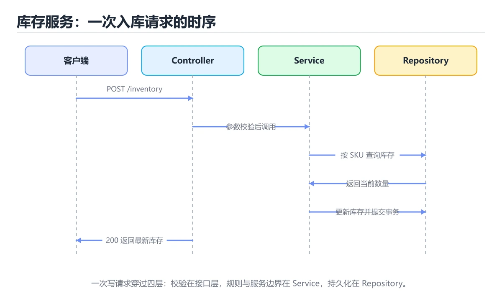
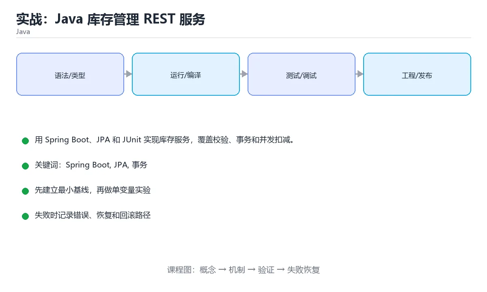

# 实战：Java 库存管理 REST 服务





> 内容更新时间：2026-10-06 · 学习阶段：高级 · 预计用时：60 分钟

## 本节知识框架

想象你开了一家网店，仓库里有各种商品。顾客下单要扣库存，退货要加库存，管理员要查库存——这些操作看起来简单，但如果两个顾客同时下单同一件商品，库存只够一件，怎么办？

这就是本课要解决的问题。我们会用 Spring Boot 搭一个库存管理服务，核心挑战是：

1. **Spring Boot**——快速搭建 Web 服务，约定优于配置，内嵌 Tomcat 开箱即用。
2. **事务**——一组操作要么全成功要么全回滚，不能出现"扣了库存但没写流水"的半成品。
3. **库存**——入库、出库、查询、低库存告警，多请求可能同时扣减同一商品。
4. **乐观锁**——更新时带上版本号条件，冲突就重试而不是提前加锁，适合读多写少的场景。
5. **可观测性**——日志、指标与链路追踪，出了问题能快速定位。
6. **JUnit**——用自动化测试验证每一步是否正确。

先修内容：《实战：Spring Boot REST API》。后续衔接：《实战：Java 并发订单处理服务》。

### 复习清单

- [ ] 能不看正文说出 Spring Boot、事务、库存各自的含义与一个易错点。
- [ ] 能运行或推演本课示例，记录输入、输出和失败现象。
- [ ] 能完成一次自测，并把错题对照错误表定位原因。

## 核心概念定义

| 术语 | 一句话说明 |
| --- | --- |
| `Spring Boot` | 基于 Spring 的快速开发框架：约定优于配置、内嵌容器，起步依赖即可跑起 Web 服务。坑：升级前要重新验证。 |
| `事务` | 一组要么全部成功要么全部回滚的数据库操作。坑：隔离级别与并发事务会影响可见性。 |
| `库存` | 用 Spring Boot、JPA 和 JUnit 实现库存服务，覆盖校验、事务和并发扣减。坑：单线程通过不代表并发下成立。 |
| `乐观锁` | 更新时带上版本号条件，冲突就重试而不是提前加锁，适合读多写少的场景。坑：高冲突场景重试次数要多。 |
| `可观测性` | 由日志、指标与链路追踪组成，能在不重启、不改代码的前提下问出新问题。坑：只在当前前提下成立。 |
| `JUnit` | Java 常用的单元测试框架，用注解声明测试、断言和生命周期。坑：必须在边界输入下复验。 |
| `DTO` | 只承载接口出入参的数据对象，把外部契约和内部实体隔开，改表结构不牵连接口。 |
| `集成测试` | 用真实或 H2 内存数据库跑一遍，覆盖单元测试测不到的映射、事务和唯一约束。 |

## 原理与运行机制

### 项目背景

仓库需要管理商品库存：入库、出库、查询和低库存告警。多个请求可能同时扣减同一商品，必须避免超卖并保留完整审计记录。

### 技术栈

- Java 21
- Spring Boot + Spring Data JPA
- H2/PostgreSQL
- JUnit 5

### 架构与数据流

把库存服务想象成一个流水线：

1. **请求进来** → Controller 校验参数（数量必须为正数）
2. **Service 处理** → 开启事务，检查库存是否足够
3. **Repository 执行** → 用条件更新扣减库存（`deductIfEnough`）
4. **写流水** → 记录每次变动的审计日志
5. **返回结果** → 成功返回新库存量，失败返回明确错误

### 关键代码：事务 + 乐观锁

```java
@Transactional
public void deduct(Long skuId, int quantity) {
    if (quantity <= 0) throw new IllegalArgumentException("quantity must be positive");
    int updated = stockRepository.deductIfEnough(skuId, quantity);
    if (updated == 0) throw new IllegalStateException("insufficient stock");
    flowRepository.save(new StockFlow(skuId, -quantity));
}
```

这段代码的关键在于：`deductIfEnough` 是一条 SQL 条件更新——只有库存足够时才扣减，否则影响 0 行。事务保证扣减和写流水要么都成功，要么都回滚。

### 项目专属规格

用 Spring Boot、JPA 和 JUnit 实现库存服务，覆盖校验、事务和并发扣减。项目目标是把「Spring Boot、JPA、事务、JUnit、库存」落实为可运行、可测试、可回滚的交付物。

**验收场景**：
1. 正常路径：最小输入得到预期输出，并留下日志与指标。
2. 边界路径：空值、极值和依赖失败各跑一次，确认边界行为与正文一致。
3. 失败路径：依赖超时或不可用时能快速失败、重试或降级。
4. 幂等路径：同一请求执行两次不会产生重复副作用。
5. 回滚路径：JPA 的失败能按预案恢复，并记录影响范围。

### 项目交付物

```text
src/main/java/
src/main/resources/
src/test/java/
pom.xml
README.md
```

**质量门禁**：
- [ ] 格式化和静态检查通过，不遗留明显警告。
- [ ] 单元测试覆盖核心规则，集成测试覆盖数据库边界。
- [ ] 错误响应不泄露堆栈、SQL 和密钥。
- [ ] README 写清启动、测试、配置和回滚步骤。

### 验证命令与预期输出

| 阶段 | 命令 | 预期输出 |
| --- | --- | --- |
| 编译 | `./mvnw -q -DskipTests package` | 生成 JAR 且编译无错误 |
| 运行测试 | `./mvnw test` | JUnit 测试全部通过 |
| 启动服务 | `java -jar target/app.jar` | 端口监听成功并输出启动日志 |

## 典型应用场景

### 实施步骤

1. **建立商品与库存流水实体**：先写清依赖配置、数据和最终产物，再开始编码。
2. **实现仓储接口和事务服务**：用最小用例证明这一步的结果正确。
3. **暴露入库、出库、查询接口**：多个请求可能同时扣减同一商品，必须避免超卖。
4. **用条件更新或乐观锁处理并发**：冲突就重试而不是提前加锁。
5. **加入统一异常与参数校验**：写路径要明确事务边界、幂等键和失败补偿。
6. **用 MockMvc 和数据库集成测试验收**：空值、极值和依赖失败各跑一次。

### 测试与验收

- 库存不足时出库失败且流水不写入
- 并发 100 次扣减不会出现负数库存
- 分页查询返回稳定顺序

**选择与边界**：
- 使用 `Spring Boot` 时，不同版本与依赖组合的行为可能不同，升级前要重新验证。
- 使用 `事务` 时，隔离级别与并发事务会影响可见性，换级别后要重新验证。
- 使用 `乐观锁` 时，高冲突场景重试次数要多，适合读多写少。

## 代码/协议/SQL 示例

### 最小可验证示例

```java
// 实体
@Entity
@Table(name = "stock")
public class Stock {
    @Id @GeneratedValue long id;
    String skuId;
    int quantity;
    @Version int version;   // 乐观锁版本号
}

// 仓储
public interface StockRepository extends JpaRepository<Stock, Long> {
    @Modifying
    @Query("UPDATE Stock s SET s.quantity = s.quantity - :qty WHERE s.skuId = :skuId AND s.quantity >= :qty")
    int deductIfEnough(@Param("skuId") String skuId, @Param("qty") int qty);
}

// 服务
@Service
public class StockService {
    private final StockRepository stockRepo;
    private final StockFlowRepository flowRepo;

    public StockService(StockRepository stockRepo, StockFlowRepository flowRepo) {
        this.stockRepo = stockRepo;
        this.flowRepo = flowRepo;
    }

    @Transactional
    public void deduct(String skuId, int quantity) {
        if (quantity <= 0) throw new IllegalArgumentException("quantity must be positive");
        int updated = stockRepo.deductIfEnough(skuId, quantity);
        if (updated == 0) throw new IllegalStateException("insufficient stock");
        flowRepo.save(new StockFlow(skuId, -quantity));
    }
}
```

```text
// 预期输出：正常扣减后库存减少，流水记录写入
// 库存不足时抛出 IllegalStateException，事务回滚，流水不写入
```

运行方式：保存为 `.java` 后用 `javac` 编译、`java` 运行；注意类名与文件名一致。

### 用 DTO 隔开接口与实体

```java
// 对外契约：只暴露调用方真正需要的字段
record DeductResponse(String skuId, int remaining, long version) {}

@PostMapping("/stock/{skuId}/deduct")
public DeductResponse deduct(@PathVariable String skuId,
                             @Valid @RequestBody DeductRequest req) {
    stockService.deduct(skuId, req.quantity());
    Stock s = stockService.bySku(skuId);
    return new DeductResponse(s.getSkuId(), s.getQuantity(), s.getVersion());
}
```

直接返回 `Stock` 实体有三个隐患：`@Version`、审计字段这些内部信息会泄露给外部；实体里的懒加载关联在序列化成 JSON 时可能触发额外查询甚至抛异常；一旦改表结构，接口契约就被动跟着变。用 DTO 把"外部看得见的形状"和"内部实体"隔开，接口就能和数据库解耦，测试也只需盯住出入参。

### 集成测试跑真实数据库

```java
@SpringBootTest
class StockDeductTest {
    @Autowired StockService service;
    @Autowired StockRepository repo;

    @Test
    void insufficientStockRollsBack() {
        Stock s = repo.save(new Stock("A-1", 5));
        assertThrows(IllegalStateException.class, () -> service.deduct("A-1", 10));
        assertEquals(5, repo.findById(s.getId()).orElseThrow().getQuantity());
    }
}
```

单元测试用 mock 只能验证"Service 调了哪个方法、参数对不对"；数据库映射、唯一约束、`@Transactional` 的回滚，只有在 `@SpringBootTest` 起真实（或 H2 内存）数据库时才测得出来——这正是集成测试比单元测试多覆盖的部分。想让结论可复现，还要固定 Spring Boot 与 JDK 版本，并把空值、库存刚好等于扣减量、并发冲突这些边界输入各跑一遍。

## 时间/空间复杂度或性能分析

**性能关注点**：JVM 预热与 GC 影响测量——记录吞吐、P99 延迟与堆占用，先跑预热再采样。

**本课特有开销**：长事务会放大锁等待，记录事务持续时间与锁冲突次数。

**测量方法**：固定输入跑一遍记录基线，再把并发度提高一个数量级复测；两次结果的差值才是结论依据。

## 常见误区与易错点

| 容易写错的做法 | 实际现象 | 原因与正确做法 |
| --- | --- | --- |
| 业务逻辑堆在控制器里 | 难测试，接口改动牵一发动全身 | 拆出服务与仓储层，控制器只处理参数与响应 |
| SQL 用字符串拼接 | 留下注入风险 | 使用参数化查询并校验输入 |
| 异常被统一吞掉 | 出错后没有可追踪信息 | 统一异常处理，记录上下文并返回可读错误 |
| 忘记 `@Transactional` | 多次写入出现半成功 | 在 Service 层声明事务 |
| 实体关联默认急加载 | 查询变慢、笛卡尔积 | 按需设置 `FetchType.LAZY` 并用 `join fetch` |
| 接口直接返回 JPA 实体 | 内部字段泄露、懒加载序列化报错 | 定义 DTO 做映射，隔离外部契约和内部实体 |
| 同类内部直接调用 `@Transactional` 方法 | 事务注解不生效，出现半成功 | 经代理调用，或把事务方法拆到另一个 Bean |

**现场排错示范**：

**症状**：业务逻辑堆在控制器里，难测试，接口改动牵一发动全身。
**根因**：没有分层，Controller 承担了太多职责。
**修复**：拆出服务与仓储层，控制器只处理参数与响应。
**自检**：在本课示例里复现该现象，改成三层结构后重跑；如果症状消失说明定位正确。

## 与其他知识点的关系

- **先修**：`实战：Spring Boot REST API`。本课默认 record、分层结构已经掌握。
- **相关或后续**：`实战：Java 并发订单处理服务`。本课术语会在这些课程里继续使用。
- 同一分类的《构建、测试与生态》也涉及 `JUnit`；两课衔接时先确认术语定义是否一致。

**容易混淆的相邻概念**：
- `Spring Boot` vs `Spring`：Spring Boot 是 Spring 的快速启动包，自动配置、内嵌容器。
- `乐观锁` vs `悲观锁`：乐观锁先操作再检查冲突，悲观锁先加锁再操作。
- `事务` vs `幂等`：事务保证单次请求的原子性，幂等保证重复请求不产生重复副作用。

## 自测题与参考答案

> 先独立作答，再对照参考答案；答案都能在本课正文、术语表或错误表里找到依据。

### 自测 1（概念复述）

不看正文，写出 `Spring Boot` 的操作性定义，并说明它与 `事务` 的区别。

**参考答案**：基于 Spring 的快速开发框架：约定优于配置、内嵌容器，起步依赖即可跑起 Web 服务。事务的定位是：一组要么全部成功要么全部回滚的数据库操作；两者的差别要从适用对象与失败模式上说明。

### 自测 2（排错）

本课错误表记录了「业务逻辑堆在控制器里」这类做法。请写出它会出现的现象、根因，以及修复顺序。

**参考答案**：现象是难测试，接口改动牵一发动全身；正确做法是拆出服务与仓储层，控制器只处理参数与响应。修复时先复现现象并保留证据，再改动一处假设重跑，确认现象消失。

### 自测 3（动手验证）

运行本课的示例，改动其中一个输入后重新运行，记录输出与错误信息。

**参考答案**：正常输入下示例应当复现正文给出的结果；改动输入后，如果结果改变或报错，先核对它是否满足 Spring Boot 的适用范围，再检查错误表里是否有同类现象。

### 自测 4（代码阅读）

阅读本课的 Java 示例，说明它体现了 Spring Boot 的哪一条性质，并指出改动哪个输入会让这条性质不再成立。

**参考答案**：Spring Boot 的定义是基于 Spring 的快速开发框架，示例正是在实现这条定义。改动与 Spring Boot 有关的一个输入后，如果结果不再符合正文描述，就说明该性质只在当前前提成立。

### 自测 5（迁移）

把实战：Java 库存管理 REST 服务的方法迁移到自己的项目：围绕 Spring Boot 写出一个与错误表同类的风险点，并说明触发条件和检验方式。

**参考答案**：例如「异常被统一吞掉」，它会导致出错后没有可追踪信息；检验方式是按统一异常处理改一处再复现，确认现象消失且没有引入新的失败分支。

## 术语速查

| 术语 | 一句话说明 |
| --- | --- |
| `Spring Boot` | 基于 Spring 的快速开发框架：约定优于配置、内嵌容器，起步依赖即可跑起 Web 服务。 |
| `事务` | 一组要么全部成功要么全部回滚的数据库操作。 |
| `库存` | 用 Spring Boot、JPA 和 JUnit 实现库存服务，覆盖校验、事务和并发扣减。 |
| `乐观锁` | 更新时带上版本号条件，冲突就重试而不是提前加锁，适合读多写少的场景。 |
| `可观测性` | 由日志、指标与链路追踪组成，能在不重启、不改代码的前提下问出新问题。 |
| `JUnit` | Java 常用的单元测试框架，用注解声明测试、断言和生命周期。 |
| `DTO` | 接口出入参对象，把外部契约与内部实体分开，避免字段泄露和序列化陷阱。 |
| `集成测试` | 起真实数据库验证映射、事务回滚与唯一约束，覆盖比单元测试更广。 |

## 考点精讲

`实战：Java 库存管理 REST 服务` 的题库有 6 道题，下面逐题给出题干、正确项与判断依据：先自己作答，再核对正确项，最后回到正文对应小节复核。

### 考点 1：第 1 题

- **题目**：Spring 中哪个注解声明事务边界？
- **正确项**：@Transactional
- **判断依据**：本题正确项是「@Transactional」。术语 事务（实战：Java 库存管理 REST 服务）：一组要么全部成功要么全部回滚的数据库操作，本题取「@Transactional」这条。易错点是业务逻辑堆在控制器里，会造成难测试，接口改动牵一发动全身，改法是拆出服务与仓储层，控制器只处理参数与响应。

### 考点 2：第 2 题

- **题目**：为什么接口要使用 DTO？
- **正确项**：隔离外部契约和内部实体
- **判断依据**：本题正确项是「隔离外部契约和内部实体」。术语 Spring Boot（实战：Java 库存管理 REST 服务）：基于 Spring 的快速开发框架：约定优于配置、内嵌容器，起步依赖即可跑起 Web 服务，本题取「隔离外部契约和内部实体」这条。易错点是SQL 用字符串拼接，会造成留下注入风险，改法是使用参数化查询并校验输入。

### 考点 3：第 3 题

- **题目**：围绕“实战：Java 库存管理 REST 服务”中的 Spring Boot、JPA、事务，下列哪两项是本课强调的实践判断？
- **正确项**：学习 Spring Boot 时要同时说明输入、输出和失败路径，不能只看正常流程；验证 JPA 时要固定版本并覆盖边界输入，结论才可复现
- **判断依据**：按《实战：Java 库存管理 REST 服务》的正文口径，本题要同时选中「学习 Spring Boot 时要同时说明输入、输出和失败路径，不能只看正常流程」、「验证 JPA 时要固定版本并覆盖边界输入，结论才可复现」，漏掉任一项都算没答全。术语 Spring Boot（实战：Java 库存管理 REST 服务）：基于 Spring 的快速开发框架：约定优于配置、内嵌容器，起步依赖即可跑起 Web 服务。易错点是异常被统一吞掉，会造成出错后没有可追踪信息，改法是统一异常处理，记录上下文并返回可读错误。

### 考点 4：第 4 题

- **题目**：集成测试相比单元测试多覆盖了什么？
- **正确项**：数据库映射、事务和约束
- **判断依据**：本题正确项是「数据库映射、事务和约束」。术语 事务（实战：Java 库存管理 REST 服务）：一组要么全部成功要么全部回滚的数据库操作，本题取「数据库映射、事务和约束」这条。易错点是忘记 `@Transactional`，会造成多次写入出现半成功，改法是在 Service 层声明事务。

### 考点 5：第 5 题

- **题目**：当库存不足时，下面这段扣减方法会怎样？
- **正确项**：条件更新影响 0 行，抛出异常并回滚事务
- **判断依据**：本题正确项是「条件更新影响 0 行，抛出异常并回滚事务」。术语 事务（实战：Java 库存管理 REST 服务）：一组要么全部成功要么全部回滚的数据库操作，本题取「条件更新影响 0 行，抛出异常并回滚事务」这条。易错点是实体关联默认急加载，会造成查询变慢、笛卡尔积，改法是按需设置 `FetchType.LAZY` 并用 `join fetch`。

### 考点 6：第 6 题

- **题目**：下面几项都与 `Spring Boot` 有关，请按 `实战：Java 库存管理 REST 服务` 的正文顺序排列；该课主线是用 Spring Boot、JPA 和 JUnit 实现库存服务，覆盖校验、事务和并发扣减。
- **正确项**：项目背景 → 技术栈 → 架构与数据流 → 功能范围
- **判断依据**：按《实战：Java 库存管理 REST 服务》正文的先后，本题顺序是「项目背景」 → 「技术栈」 → 「架构与数据流」 → 「功能范围」。术语 Spring Boot（实战：Java 库存管理 REST 服务）：基于 Spring 的快速开发框架：约定优于配置、内嵌容器，起步依赖即可跑起 Web 服务。易错点是业务逻辑堆在控制器里会造成难测试，接口改动牵一发动全身，改法是拆出服务与仓储层，控制器只处理参数与响应。

## 内容元数据

- 内容版本：v2.0
- 最后更新：2026-10-06
- 学习阶段：高级
- 适用环境：Java 21+ / Maven 或 Gradle；本课聚焦 Spring Boot。
- 内容来源：内置结构化课程与工程实践整理
- 相关主题：Spring Boot、JPA、事务、JUnit、库存
- 质量版本：P0 测验标准 + P1 覆盖扩展 + P2 体验补全

## 参考资料与复核

- 最后复核：2026-10-04
- 下次复核：2027-02-24
- 复核范围：版本兼容、API 行为、安全建议与工程实践
- 来源性质：官方文档、标准或权威教材；本课核对关键词：Spring Boot、JPA、事务、JUnit、库存。

| 参考资料 | 本课用途 |
| --- | --- |
| [Spring Data JPA 文档](https://docs.spring.io/spring-data/jpa/docs/current/reference/html/) | JPA 仓储与查询 |
| [JUnit 用户指南](https://junit.org/junit5/docs/current/user-guide/) | 自动化测试与断言 |
| [JDBC 教程](https://docs.oracle.com/javase/tutorial/jdbc/) | 数据库连接与事务 |
